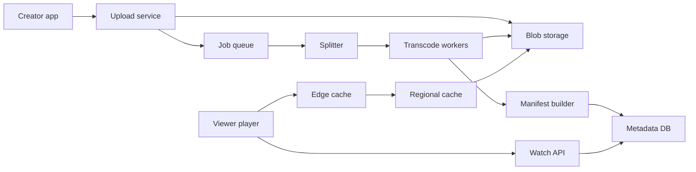

## In one minute
- Two very different systems share a name: an upload and transcoding pipeline (batch, compute-heavy, minutes of latency acceptable) and a playback path (bandwidth-heavy, latency-sensitive, served almost entirely from caches). Design them separately.
- Transcode every upload into a ladder of resolutions and bitrates, cut into short segments of a few seconds, described by a manifest (HLS or DASH). Segments are immutable files, which is what makes them cacheable everywhere.
- The player, not the server, picks quality. Adaptive bitrate (ABR) logic on the client chooses the next segment's rendition from measured throughput and buffer level. Server design follows from that: serve static segments fast.
- Egress is the cost. Average delivered video traffic is on the order of 100 Tbit/s, so the CDN, including caches placed inside ISP networks, is the real architecture. Origin storage and databases are small by comparison.
- Popularity is extremely skewed. Hot videos live at the edge; the long tail is served from regional or origin storage and stored with cheaper encodings.

## Requirements
Functional:
- Creators upload videos (up to several GB), with title, description and visibility.
- Viewers watch videos on web, mobile and TV with smooth playback, seek, and quality switching.
- Videos show metadata, view counts, and a thumbnail; search and recommendations exist as separate services.

Non-functional:
- Playback start (time to first frame) under about 1 to 2 seconds for popular content; rebuffering is rare.
- Uploads are durable once acknowledged and become playable within minutes for typical lengths.
- Very high availability for playback; brief metadata staleness (view counts) is acceptable.
- Cost efficiency: storage and egress per view must stay low.

Out of scope: recommendations and search ranking, comments, live streaming, monetisation and ads, content ID and copyright matching (mentioned only as a pipeline stage).

## Back-of-envelope
These are rough planning numbers. YouTube has publicly cited figures in the region of 500 hours uploaded per minute ([YouTube blog, 2021](https://blog.youtube/inside-youtube/new-era-video-infrastructure/)) and over a billion hours watched per day; treat both as approximate.

Uploads: 500 hours per minute x 1,440 minutes = 720,000 hours of video per day. At an average length of 10 minutes that is about 4.3M uploads per day, or about 50 per second on average and maybe 150 per second at peak. Low QPS, heavy payloads.

Upload storage: a 1080p source at about 8 Mbit/s is 3.6 GB per hour. 720,000 hours x 3.6 GB is about 2.6 PB of originals per day. The transcoded ladder (for example 144p to 1080p, roughly 0.1 + 0.3 + 0.75 + 1.5 + 3 + 5 Mbit/s, about 10.7 Mbit/s summed) in two codecs is about 21 Mbit/s, or 9.6 GB per hour of content, so another 7 PB per day. Total on the order of 10 PB per day, about 3.5 EB per year and well over 10 EB in five years before erasure coding overhead. The real system stores less than this, because rarely watched videos skip some renditions or codecs and originals can move to colder storage, but the order of magnitude is exabytes.

Playback bandwidth: 1B hours per day is 3.6e12 viewer-seconds. At an average delivered bitrate of 2.5 Mbit/s, that is 9e18 bits per day, divided by 86,400 seconds gives about 1e14 bit/s, roughly 100 Tbit/s on average and perhaps 200 Tbit/s at peak.

Segment requests: with 4-second segments, 3.6e12 / 4 = 9e11 segment fetches per day, about 10M per second on average. Metadata: if there are 5B video views per day, the watch page API sees about 60,000 requests per second on average and a few times that at peak.

Transcoding compute: if encoding the full ladder costs roughly 1 to 4 CPU-hours per hour of source (much more for AV1), 720,000 hours per day needs hundreds of thousands of CPU cores busy around the clock. That is why large platforms build dedicated video transcoding hardware.

## API
```
POST /v1/uploads                      body: { filename, size, content_type }
  -> 200 { upload_id, upload_url, chunk_size }     // resumable session
PUT  {upload_url}?offset=N            body: bytes   -> 308 { next_offset } | 200
POST /v1/videos                       body: { upload_id, title, description, visibility }
  -> 202 { video_id, status: "PROCESSING" }

GET /v1/videos/{video_id}
  -> 200 { video_id, title, channel, duration_s, status,
           manifest_url, thumbnails[], view_count }
GET {cdn}/v/{video_id}/{codec}/{rendition}/master.m3u8     // or .mpd
GET {cdn}/v/{video_id}/{codec}/{rendition}/seg_00042.m4s
```
Resumable uploads matter because mobile uploads of several GB fail often; the client resumes from the last acknowledged offset.

## Data model
- **videos** (metadata): key `video_id` (random, 11 base64 characters or similar), columns `channel_id`, `title`, `description`, `duration_s`, `status`, `visibility`, `created_at`, `renditions` (list of codec and resolution available). Partitioned by `video_id` hash in a sharded relational store (YouTube built Vitess in 2010 to shard MySQL for exactly this kind of load ([Vitess](https://vitess.io/docs/overview/history/)), though a Vitess maintainer said in 2022 that YouTube has since migrated off it ([Changelog #485](https://changelog.com/podcast/485))). Read-heavy, so fronted by a cache.
- **channel_videos**: key `(channel_id, created_at DESC, video_id)`, partitioned by `channel_id`, for the channel page.
- **view_counts**: sharded counters per `video_id`, aggregated asynchronously from playback logs. A view count is not on the critical path and may lag minutes.
- **blob storage**: originals at `orig/{video_id}`, segments at `v/{video_id}/{codec}/{rendition}/seg_{n}`, manifests beside them. Immutable once written. Erasure coded for durability at lower overhead than three replicas.
- **transcode_jobs**: `job_id`, `video_id`, `chunk_index`, `profile`, `state`, `attempt`, `worker`, `lease_expires_at`. Partition by `video_id`, so a video's whole job graph is co-located.

## High-level design


Upload path: the client opens a resumable session and streams chunks directly to blob storage through the upload service. When the last chunk lands, the service records the video in `PROCESSING` and enqueues a job. A splitter cuts the source at keyframes into chunks of a few seconds to a minute, then creates one transcode task per chunk per rendition. Workers pull tasks with leases, encode, and write segments. When all tasks for a rendition finish, the manifest builder writes the playlist, and the video becomes playable as soon as a minimum set (for example 360p and 720p in H.264) is ready. Higher resolutions and newer codecs such as VP9 or AV1 follow later, often only for videos that get watched.

Playback path: the player fetches metadata and the manifest URL from the watch API (one cached database read), then requests the master manifest and segments from the nearest edge cache, chosen by DNS or anycast steering. The edge serves hits from memory or SSD; misses go to a regional cache and then to origin storage. The player measures download time per segment and picks the next rendition.

## Deep dives

### Parallel, resumable transcoding
Encoding a two-hour film serially takes hours. Splitting at closed group-of-pictures boundaries lets thousands of workers encode chunks in parallel and then concatenate, so wall-clock time drops to minutes. The options for orchestration are a simple queue of independent tasks, or a workflow engine that models the job graph (split, encode chunks per profile, verify, stitch, package, publish). A DAG engine with per-task leases is the choice: a worker that dies stops renewing its lease, the task returns to the queue, and since outputs are written to deterministic paths, a retried task just overwrites an identical file. Prioritise short videos and creators with large audiences in the queue so the median video is playable in a minute or two. Encode a cheap rendition first so users get a quick "ready" signal.

### Adaptive bitrate on the client
The player has a ladder of renditions and a buffer of downloaded video. Two signals drive selection. Throughput-based ABR estimates bandwidth from recent segment downloads (a harmonic mean is common because it discounts spikes) and picks the highest rendition below a safety fraction of that estimate. Buffer-based ABR (BBA, BOLA) chooses quality from buffer occupancy, which avoids oscillation caused by noisy estimates ([BOLA](https://arxiv.org/abs/1601.06748)). Production players blend the two; the reference DASH player, dash.js, runs a throughput rule and a BOLA rule and switches between them by buffer level ([dash.js](https://dashif.org/dash.js/pages/usage/abr/settings.html)). The usual policy is to drop quality quickly when the buffer is low or throughput falls, raise it one step at a time and only when the buffer is healthy. Segment length is part of this: 2 to 6 seconds balances fast switching and startup against per-request overhead and encoding efficiency.

### Delivering 100+ Tbit/s
No single data centre can serve this. The answer is a tiered cache: edge nodes in ISP networks and internet exchanges (Google Global Cache is the public example, Netflix [Open Connect](https://openconnect.netflix.com/en/) another), regional mid-tier caches, and origin. Because segments are immutable and keyed by content, cache invalidation is not a problem; only manifests for edits or takedowns need short TTLs. Popularity is heavy-tailed, so a modest edge capacity can serve a very large share of bytes, while the long tail costs origin egress. Pre-position content predicted to trend (a new release from a large channel) to edges before demand arrives. Use request coalescing at each tier so a thousand simultaneous misses for the same new segment produce one upstream fetch.

### Variant: a subscription catalogue service (Netflix-style)
Change the product and most of the design inverts. A licensed catalogue is small and known in advance: perhaps 50,000 hours of content, a few petabytes once every codec, HDR and audio variant is encoded. It grows by tens of content hours a day, not hundreds of thousands. Every title is watched many times, so the expensive step moves to the front and the delivery path gets simpler.

**Encode once, with great care.** With no long tail of unwatched uploads, spending hours of compute per title is repaid on every stream. Replace one fixed bitrate ladder with per-title or per-shot ladders chosen by a perceptual quality score such as VMAF, with shot boundaries as the parallel split points. Reported savings are around half the bitrate at equal quality for 4K, and newer codecs such as AV1 are added as extra streams ([Netflix](https://netflixtechblog.com/optimized-shot-based-encodes-for-4k-now-streaming-47b516b10bbb)). Here the upload-site habit of reserving expensive encodes for popular videos does not apply.

**Push, don't pull.** Because tomorrow's demand per region is predictable, a planner copies files to cache appliances inside ISPs during off-peak fill windows, ranking files by forecast demand per byte. Files already on disk get a bonus so that nothing is evicted and refetched the next day, and deletions are delayed so open streams are not cut. A pull-through tier waits for the first viewer to miss; this one rarely sees a miss ([Netflix and Fill](https://netflixtechblog.com/netflix-and-fill-c43a32b490c0)).

**Control plane and data plane.** The cloud decides identity, entitlement, DRM and which cache URLs to return, ranked by the client's network, health and inventory. The appliances only move bytes. Playback survives the control plane failing, because a running stream needs only the cache and its licence.

**Different state.** Plan rules limit simultaneous streams, so a play request claims a lease that heartbeats extend and expiry frees; a counter would leak when a TV loses power. Resume positions are written about once a minute per playing device, which at tens of millions of concurrent streams makes bookmarks the write-heavy path, not play starts. Conflicts resolve by device event time, since an offline phone may report an old position late.

**Different requirements.** Start within about two seconds on TVs, scheduled worldwide release at a set time, and graceful degradation: the worst case is a generic home page, not a black screen. Prioritised load shedding keeps play requests alive while personalisation is dropped first.

## Down the stack

### Layer 1: The contract
A segment URL always returns the same bytes, forever, or a 404 after a takedown. The manifest lists renditions and segment URLs and may change only by adding renditions. The edge promises low time to first byte for cached objects (single-digit milliseconds within the ISP) and correct byte-range support. The upload API promises that an acknowledged chunk is durable, and that a video in `READY` has at least the baseline renditions complete.

### Layer 2: The mechanism
Segments are fragmented MP4 (`moof` plus `mdat` boxes, CMAF) or MPEG-TS, each beginning at a keyframe so the player can switch renditions at any segment boundary. An HLS master playlist lists `#EXT-X-STREAM-INF` entries with `BANDWIDTH` and `RESOLUTION`; each media playlist lists `#EXTINF` durations and segment URIs ([RFC 8216](https://www.rfc-editor.org/rfc/rfc8216)). RFC 8216 dates from 2017; its second edition, draft-pantos-hls-rfc8216bis, is in the RFC Editor queue and would obsolete it, so check the draft for newer tags ([IETF datatracker](https://datatracker.ietf.org/doc/draft-pantos-hls-rfc8216bis/)). The player appends segment bytes to a Media Source Extensions `SourceBuffer` and runs its ABR function before each request. Caches key on the full URL, use LRU-like eviction with admission filters (do not cache a one-hit object), and coalesce concurrent misses. Akamai found 74% of cached objects on a typical cluster were requested only once in two days, and caching on the second hit cut disk writes by 44% ([Maggs and Sitaraman](https://people.cs.umass.edu/~ramesh/Site/HOME_files/CCRpaper_1.pdf)).

### Layer 3: The machine
Edge servers are built around zero-copy file serving: `sendfile` from page cache or NVMe straight to the socket, with TLS offloaded into the kernel (kTLS) or the NIC so bytes are not copied through user space. A single server with several 100 Gbit/s NICs can push hundreds of Gbit/s when the working set is in RAM and on NVMe. A 4-second 1080p segment at 5 Mbit/s is 2.5 MB, which is about 1,700 TCP segments of 1,460 bytes; on a fresh connection, slow start needs several round trips to open the congestion window, which is why players reuse connections (HTTP/2 or QUIC) and why startup uses a low rendition. Transcoding is SIMD-heavy and memory bandwidth bound; dedicated video encoding ASICs (YouTube's Argos VCU) exist because general CPUs spend too much power per encoded hour. YouTube reports up to 20 to 33 times better compute efficiency than its optimised software encoders, and notes VP9 needs about 5 times the compute of H.264 to encode ([YouTube blog](https://blog.youtube/inside-youtube/new-era-video-infrastructure/)).

### Why it's built this way
- Bandwidth is the dominant cost, so bytes must be served from as close to the viewer as possible.
- Caching is only easy for immutable objects, so video is chopped into content-addressed segments.
- Network conditions differ per viewer and change every second, so the client chooses quality, not the server.
- Encoding is slow and parallelisable at keyframes, so split, fan out, and stitch.
- Most videos are rarely watched, so expensive encodings and edge placement are reserved for popular ones.

## Failure modes
- **10x load (a global premiere):** edges are pre-warmed; request coalescing prevents origin stampedes; the player falls back to lower renditions as links saturate, which degrades quality before availability.
- **Region outage:** DNS or anycast steers viewers to the next-nearest edge; origin storage is replicated or erasure-coded across regions; the upload service accepts chunks in any region and the job queue replays from durable state.
- **Hot key (a viral video):** a single segment requested millions of times per second is still easy because it is served from RAM on many edges; the risk is the first minutes, before it is cached everywhere. Coalesce misses and push the first segments proactively.
- **Poison input:** a malformed upload crashes encoders repeatedly. Cap retries per task, quarantine the video, and alert.
- **ABR oscillation:** quality flaps between rungs and annoys users. Up-switch slowly, down-switch quickly, and require buffer headroom before raising quality.

## In the wild
- **YouTube, 2008: a BGP hijack takes the site off the internet.** On 24 February at 18:47 UTC, Pakistan Telecom announced a more specific /24 covering YouTube's addresses, and its upstream PCCW passed it to the world. YouTube announced the same /24 about 80 minutes later and then two /25s, which win by longest-prefix match, and PCCW withdrew the bad route at 21:01, about 2 hours 14 minutes in. Edge steering by DNS or anycast is only as good as the routing underneath it ([RIPE NCC](https://www.ripe.net/publications/news/industry-developments/youtube-hijacking-a-ripe-ncc-ris-case-study)).
- **Wikimedia, 2025: one video doubles network traffic.** When Jimmy Carter died, a 1.5-hour debate video on Wikimedia Commons doubled network traffic and saturated some links for about an hour. Bulk crawlers made it worse year-round: about 35% of pageviews but at least 65% of the most expensive traffic, because they read unpopular files that miss regional caches and go to the core data centre ([Wikimedia](https://diff.wikimedia.org/2025/04/01/how-crawlers-impact-the-operations-of-the-wikimedia-projects/)).
- **Akamai, 2015: do not cache one-hit wonders (engineering write-up).** On a typical cluster 74% of about 400 million objects were requested once in two days. Admitting an object only on its second request, tracked with rotating Bloom filters, raised byte hit rate from about 74% to 83% and cut disk writes by 44%, which is why long-tail video should not evict the hot set ([Maggs and Sitaraman](https://people.cs.umass.edu/~ramesh/Site/HOME_files/CCRpaper_1.pdf)).

## Trade-offs
| Option | Strengths | Weaknesses | Choose when |
|---|---|---|---|
| Short segments (2 s) | Fast startup and switching | More requests, slightly worse compression | Live or highly variable networks |
| Long segments (6 to 10 s) | Fewer requests, better compression | Slow adaptation | Stable networks, VOD on TV |
| Throughput-based ABR | Reacts quickly to bandwidth | Noisy estimates cause flapping | Startup, fast-changing networks |
| Buffer-based ABR | Stable quality, fewer stalls | Slow to ramp up | Steady state playback |
| Encode all codecs upfront | Best quality for every view | Huge compute for unwatched videos | Premium or popular content |
| Encode on demand by popularity | Saves compute and storage | First viewers get lower efficiency | Long-tail user uploads |

## Leadership lens
- Build first: resumable upload to blob storage, a split-and-encode pipeline producing an H.264 ladder in HLS, and delivery through a commercial CDN with a standard open-source player. Custom edges, new codecs and custom ABR come only after egress cost or quality metrics demand them.
- Ownership: an ingest team (upload, pipeline, packaging), a delivery team (CDN and edge), a player team (ABR, client metrics), and a metadata team. The player team owns quality-of-experience metrics: startup time, rebuffer ratio, average bitrate.
- Cost drivers: egress first, then transcoding compute, then storage. Each new codec trades more compute and storage for less egress, and pays off only on videos with enough views.
- Rollout: change ABR logic by A/B test on a small slice, measuring rebuffer rate and watch time, since small ABR changes move engagement noticeably.
- Ask in review: what is the rebuffer ratio by network type, how many origin bytes per edge byte, and what fraction of encoded renditions are ever watched.

## Check yourself
1. Where does the roughly 100 Tbit/s playback figure come from, and what does it tell you about where to spend design effort?
   **Answer:** 1B hours a day is 3.6e12 viewer-seconds, and at 2.5 Mbit/s that is about 9e18 bits a day, or about 1e14 bit/s. Egress is the dominant cost, so the tiered CDN with caches inside ISP networks is the real architecture, while origin storage and databases are small by comparison.
2. Why are videos cut into immutable segments behind a manifest rather than served as single files?
   **Answer:** A segment URL always returns the same bytes, so segments can be cached everywhere with no invalidation problem, and only manifests need short TTLs. Each segment starts at a keyframe, which also lets the player switch renditions at any segment boundary.
3. A transcode worker dies halfway through a chunk. Why does that not corrupt the video or require special recovery?
   **Answer:** Workers hold per-task leases in a DAG engine, so a dead worker stops renewing, the task returns to the queue, and another worker picks it up. Outputs go to deterministic paths, so a retried task just overwrites an identical file.
4. When would you encode renditions on demand by popularity instead of encoding every codec upfront?
   **Answer:** For long-tail user uploads, since most videos are rarely watched and encoding all codecs upfront spends huge compute on unwatched videos. The cost is that the first viewers get lower efficiency, so full encoding suits premium or popular content where the egress savings pay off.

## Practice
**Task:** Write an adaptive-bitrate selector. `estimate_throughput(history, window)` returns the harmonic mean of the last `window` throughput samples (kbps), ignoring samples that are zero or negative, and returns 0 if none remain. `select_bitrate(ladder, history, buffer_s, current_kbps)` returns the next rendition from the ladder (bitrates in kbps, possibly unsorted) using window 5 and these rules in order: if the estimate is 0, return the lowest rung; if `buffer_s < 5`, return the lowest rung (panic); the target is the highest rung at or below 0.8 times the estimate, or the lowest rung if none fits; the current index is the highest rung at or below `current_kbps`, or 0. If the target is below the current rung, switch down to the target immediately. If it is above, move up by exactly one rung only when `buffer_s >= 20`, otherwise stay on the current rung.

```python starter
def estimate_throughput(history, window):
    # TODO
    raise NotImplementedError


def select_bitrate(ladder, history, buffer_s, current_kbps):
    # TODO
    raise NotImplementedError
```

```python tests
LADDER = [300, 750, 1500, 3000, 6000]

def test_harmonic_mean_window_and_filtering():
    assert abs(estimate_throughput([1000, 4000], 5) - 1600) < 1e-6
    assert abs(estimate_throughput([9999, 1000, 1000, 1000, 1000, 1000], 5) - 1000) < 1e-6
    assert estimate_throughput([0, -5, 2000], 5) == 2000
    assert estimate_throughput([], 5) == 0

def test_spike_does_not_inflate_estimate():
    h = [1000, 1000, 1000, 1000, 100000]
    assert estimate_throughput(h, 5) < 1300
    assert select_bitrate(LADDER, h, 30, 750) == 750

def test_up_switch_one_rung_only_with_healthy_buffer():
    h = [5000] * 5
    assert select_bitrate(LADDER, h, 25, 1500) == 3000
    assert select_bitrate(LADDER, h, 25, 300) == 750, "one rung at a time"
    assert select_bitrate(LADDER, h, 15, 1500) == 1500, "buffer too low to go up"

def test_down_switch_is_immediate():
    assert select_bitrate(LADDER, [2000] * 5, 30, 6000) == 1500
    assert select_bitrate(LADDER, [100], 30, 750) == 300

def test_panic_and_empty_history():
    assert select_bitrate(LADDER, [50000] * 5, 3, 3000) == 300
    assert select_bitrate(LADDER, [], 30, 3000) == 300

def test_unsorted_ladder_and_off_ladder_current():
    assert select_bitrate([1500, 300, 750], [10000], 30, 1000) == 1500
    assert select_bitrate([1500, 300, 750], [10000], 30, 100) == 750
```

```python solution
def estimate_throughput(history, window):
    recent = [s for s in history[-window:] if s > 0]
    if not recent:
        return 0
    return len(recent) / sum(1.0 / s for s in recent)


def _highest_at_or_below(rungs, value):
    idx = 0
    for i, r in enumerate(rungs):
        if r <= value:
            idx = i
    return idx


def select_bitrate(ladder, history, buffer_s, current_kbps):
    rungs = sorted(set(ladder))
    est = estimate_throughput(history, 5)
    if est == 0 or buffer_s < 5:
        return rungs[0]
    target = _highest_at_or_below(rungs, est * 0.8)
    cur = _highest_at_or_below(rungs, current_kbps)
    if target < cur:
        return rungs[target]
    if target > cur and buffer_s >= 20:
        return rungs[cur + 1]
    return rungs[cur]
```

```typescript starter
export function estimateThroughput(history: number[], window: number): number {
  throw new Error("TODO");
}

export function selectBitrate(ladder: number[], history: number[], bufferS: number, currentKbps: number): number {
  throw new Error("TODO");
}
```

```typescript tests
const LADDER = [300, 750, 1500, 3000, 6000];
const fill = (v: number, n: number) => new Array<number>(n).fill(v);

test("harmonic mean window and filtering", () => {
  assert(Math.abs(estimateThroughput([1000, 4000], 5) - 1600) < 1e-6, "harmonic mean");
  assert(Math.abs(estimateThroughput([9999, 1000, 1000, 1000, 1000, 1000], 5) - 1000) < 1e-6, "window");
  assertEqual(estimateThroughput([0, -5, 2000], 5), 2000);
  assertEqual(estimateThroughput([], 5), 0);
});

test("spike does not inflate estimate", () => {
  const h = [1000, 1000, 1000, 1000, 100000];
  assert(estimateThroughput(h, 5) < 1300, "spike discounted");
  assertEqual(selectBitrate(LADDER, h, 30, 750), 750);
});

test("up switch one rung only with healthy buffer", () => {
  const h = fill(5000, 5);
  assertEqual(selectBitrate(LADDER, h, 25, 1500), 3000);
  assertEqual(selectBitrate(LADDER, h, 25, 300), 750, "one rung at a time");
  assertEqual(selectBitrate(LADDER, h, 15, 1500), 1500, "buffer too low to go up");
});

test("down switch is immediate", () => {
  assertEqual(selectBitrate(LADDER, fill(2000, 5), 30, 6000), 1500);
  assertEqual(selectBitrate(LADDER, [100], 30, 750), 300);
});

test("panic and empty history", () => {
  assertEqual(selectBitrate(LADDER, fill(50000, 5), 3, 3000), 300);
  assertEqual(selectBitrate(LADDER, [], 30, 3000), 300);
});

test("unsorted ladder and off ladder current", () => {
  assertEqual(selectBitrate([1500, 300, 750], [10000], 30, 1000), 1500);
  assertEqual(selectBitrate([1500, 300, 750], [10000], 30, 100), 750);
});
```

```typescript solution
export function estimateThroughput(history: number[], window: number): number {
  const recent = history.slice(Math.max(0, history.length - window)).filter((s) => s > 0);
  if (recent.length === 0) return 0;
  let inv = 0;
  for (const s of recent) inv += 1 / s;
  return recent.length / inv;
}

function highestAtOrBelow(rungs: number[], value: number): number {
  let idx = 0;
  rungs.forEach((r, i) => {
    if (r <= value) idx = i;
  });
  return idx;
}

export function selectBitrate(ladder: number[], history: number[], bufferS: number, currentKbps: number): number {
  const rungs = Array.from(new Set(ladder)).sort((a, b) => a - b);
  const est = estimateThroughput(history, 5);
  if (est === 0 || bufferS < 5) return rungs[0];
  const target = highestAtOrBelow(rungs, est * 0.8);
  const cur = highestAtOrBelow(rungs, currentKbps);
  if (target < cur) return rungs[target];
  if (target > cur && bufferS >= 20) return rungs[cur + 1];
  return rungs[cur];
}
```

```go starter
package practice

func EstimateThroughput(history []float64, window int) float64 {
	panic("TODO")
}

func SelectBitrate(ladder []int, history []float64, bufferS float64, currentKbps int) int {
	panic("TODO")
}
```

```go tests
package practice

import (
	"math"
	"testing"
)

var ladder = []int{300, 750, 1500, 3000, 6000}

func fill(v float64, n int) []float64 {
	out := make([]float64, n)
	for i := range out {
		out[i] = v
	}
	return out
}

func TestHarmonicMeanWindowAndFiltering(t *testing.T) {
	if got := EstimateThroughput([]float64{1000, 4000}, 5); math.Abs(got-1600) > 1e-6 {
		t.Fatalf("harmonic mean = %v", got)
	}
	if got := EstimateThroughput([]float64{9999, 1000, 1000, 1000, 1000, 1000}, 5); math.Abs(got-1000) > 1e-6 {
		t.Fatalf("window = %v", got)
	}
	if got := EstimateThroughput([]float64{0, -5, 2000}, 5); got != 2000 {
		t.Fatalf("filter = %v", got)
	}
	if got := EstimateThroughput(nil, 5); got != 0 {
		t.Fatalf("empty = %v", got)
	}
}

func TestSpikeDoesNotInflateEstimate(t *testing.T) {
	h := []float64{1000, 1000, 1000, 1000, 100000}
	if EstimateThroughput(h, 5) >= 1300 {
		t.Fatal("spike should be discounted")
	}
	if got := SelectBitrate(ladder, h, 30, 750); got != 750 {
		t.Fatalf("got %d", got)
	}
}

func TestUpSwitchOneRungOnlyWithHealthyBuffer(t *testing.T) {
	h := fill(5000, 5)
	if got := SelectBitrate(ladder, h, 25, 1500); got != 3000 {
		t.Fatalf("got %d", got)
	}
	if got := SelectBitrate(ladder, h, 25, 300); got != 750 {
		t.Fatalf("one rung at a time, got %d", got)
	}
	if got := SelectBitrate(ladder, h, 15, 1500); got != 1500 {
		t.Fatalf("buffer too low to go up, got %d", got)
	}
}

func TestDownSwitchIsImmediate(t *testing.T) {
	if got := SelectBitrate(ladder, fill(2000, 5), 30, 6000); got != 1500 {
		t.Fatalf("got %d", got)
	}
	if got := SelectBitrate(ladder, []float64{100}, 30, 750); got != 300 {
		t.Fatalf("got %d", got)
	}
}

func TestPanicAndEmptyHistory(t *testing.T) {
	if got := SelectBitrate(ladder, fill(50000, 5), 3, 3000); got != 300 {
		t.Fatalf("got %d", got)
	}
	if got := SelectBitrate(ladder, nil, 30, 3000); got != 300 {
		t.Fatalf("got %d", got)
	}
}

func TestUnsortedLadderAndOffLadderCurrent(t *testing.T) {
	l := []int{1500, 300, 750}
	if got := SelectBitrate(l, []float64{10000}, 30, 1000); got != 1500 {
		t.Fatalf("got %d", got)
	}
	if got := SelectBitrate(l, []float64{10000}, 30, 100); got != 750 {
		t.Fatalf("got %d", got)
	}
}
```

```go solution
package practice

import "sort"

func EstimateThroughput(history []float64, window int) float64 {
	start := len(history) - window
	if start < 0 {
		start = 0
	}
	n, inv := 0, 0.0
	for _, s := range history[start:] {
		if s > 0 {
			n++
			inv += 1 / s
		}
	}
	if n == 0 {
		return 0
	}
	return float64(n) / inv
}

func highestAtOrBelow(rungs []int, value float64) int {
	idx := 0
	for i, r := range rungs {
		if float64(r) <= value {
			idx = i
		}
	}
	return idx
}

func SelectBitrate(ladder []int, history []float64, bufferS float64, currentKbps int) int {
	seen := map[int]bool{}
	rungs := []int{}
	for _, r := range ladder {
		if !seen[r] {
			seen[r] = true
			rungs = append(rungs, r)
		}
	}
	sort.Ints(rungs)
	est := EstimateThroughput(history, 5)
	if est == 0 || bufferS < 5 {
		return rungs[0]
	}
	target := highestAtOrBelow(rungs, est*0.8)
	cur := highestAtOrBelow(rungs, float64(currentKbps))
	if target < cur {
		return rungs[target]
	}
	if target > cur && bufferS >= 20 {
		return rungs[cur+1]
	}
	return rungs[cur]
}
```

## Mock interview
**Prompt:** Design YouTube. Assume around 500 hours of video uploaded per minute and over a billion hours watched per day, on phones, laptops and TVs with very different networks.

- Follow-up: A two-hour 4K upload arrives. How long until it is playable, and how do you get that number down?
- Follow-up: A creator with 50 million subscribers publishes at a scheduled time. What happens at the edges and origin in the first five minutes?
- Follow-up: Should you encode every video in AV1? How would you decide?

**A strong answer covers:**
- Bandwidth arithmetic (about 100 Tbit/s) that makes the CDN the central design concern.
- Segmented, immutable, manifest-described renditions, and why that makes caching trivial.
- A parallel, lease-based transcoding DAG split at keyframes, with a fast baseline rendition.
- Client-side ABR combining throughput and buffer signals, with asymmetric up and down switching.
- Popularity-aware storage and encoding, pre-warming and miss coalescing for scheduled premieres.

## Sources and further study
**Primary**
- [draft-pantos-hls-rfc8216bis (IETF datatracker)](https://datatracker.ietf.org/doc/draft-pantos-hls-rfc8216bis/): the second edition of the HLS spec, queued to obsolete RFC 8216.
- [Algorithmic Nuggets in Content Delivery (Maggs and Sitaraman, CCR 2015)](https://people.cs.umass.edu/~ramesh/Site/HOME_files/CCRpaper_1.pdf): Akamai's global load balancing, consistent hashing and cache admission with real numbers.

**Systems docs**
- [dash.js ABR settings](https://dashif.org/dash.js/pages/usage/abr/settings.html): the throughput, BOLA, L2A and LoL+ rules in the DASH reference player and how to switch them.
- [RIPE NCC: YouTube hijacking case study](https://www.ripe.net/publications/news/industry-developments/youtube-hijacking-a-ripe-ncc-ris-case-study): a minute-by-minute view of BGP from route collectors.
- [Netflix and Fill (Netflix)](https://netflixtechblog.com/netflix-and-fill-c43a32b490c0): fill windows, fill clusters and escalation policies for pre-positioning a known catalogue.
- [Scaling Time Series Data Storage, Part I (Netflix)](https://netflixtechblog.com/scaling-time-series-data-storage-part-i-ec2b6d44ba39): viewing history and bookmarks on Cassandra and EVCache.

**Books**
- *System Design Interview, Volume 1*, Alex Xu, chapter 14 "Design YouTube": upload flow, transcoding DAG and CDN cost at interview depth.
- *Computer Networking: A Top-Down Approach* (8th edition), Kurose and Ross, chapter 2 "Application Layer": video streaming, DASH and how CDNs such as Netflix and YouTube place content.

**Other curricula**
- [Azure Architecture Center: Competing Consumers pattern](https://learn.microsoft.com/en-us/azure/architecture/patterns/competing-consumers): frames a pool of workers draining one queue, the shape of the transcode fleet.
- [donnemartin/system-design-primer](https://github.com/donnemartin/system-design-primer): covers CDNs as push or pull caches for static media and links to older YouTube architecture talks rather than a full design.

## Watch
- [How to Build Your Encoding Ladder, Part 1: Bitrates (Streaming Media)](https://www.youtube.com/watch?v=7p47tn9t_fY): how practitioners choose rungs and bitrates for an ABR ladder.
- [How Video Streaming Works on Scale (Piyush Garg)](https://www.youtube.com/watch?v=-JtjQ-OA7XE): a system design walkthrough of transcoding, segments and delivery.

## Free resources
- [Reimagining video infrastructure to empower YouTube (YouTube Official Blog)](https://blog.youtube/inside-youtube/new-era-video-infrastructure/): why YouTube built its own video transcoding chip and what it changed.
- [Vitess history](https://vitess.io/docs/overview/history/): how YouTube sharded MySQL for video metadata and why Vitess exists.
- [HTTP Live Streaming (RFC 8216)](https://www.rfc-editor.org/rfc/rfc8216): the playlist format, segment rules and variant streams in precise terms.
- [BOLA: Near-Optimal Bitrate Adaptation for Online Videos (arXiv)](https://arxiv.org/abs/1601.06748): the buffer-based ABR algorithm used in dash.js.
- [Netflix Open Connect](https://openconnect.netflix.com/en/): an operator's view of placing video caches inside ISP networks.
