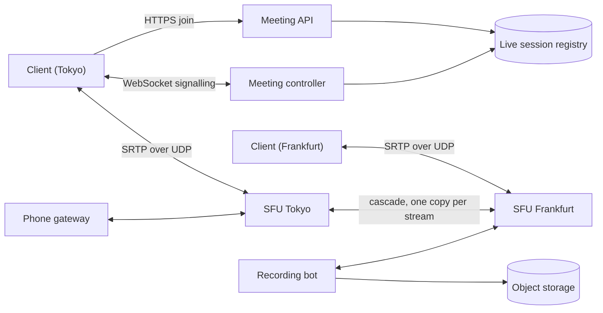

## In one minute
- **Forward, don't mix.** A Selective Forwarding Unit (SFU) receives each participant's encrypted media once and forwards packets to everyone else without decoding them. A mesh collapses past four people, and a mixing server (MCU) burns a CPU core per meeting decoding and re-encoding.
- **Every publisher sends several qualities; every subscriber gets a budget.** With simulcast or scalable video coding, the SFU picks a layer per subscriber per stream, so a phone on 4G and a desktop on fibre in the same meeting each get what their link can carry.
- **Latency beats completeness.** Media runs over UDP, a late packet is a lost packet, and the system trades resolution, then frame rate, then video itself to keep audio flowing under 150 ms one way.
- **Signalling and media are different systems.** Joining, permissions and layout go over a reliable control channel; media goes to whichever SFU is closest. Most outages are in the control plane, so it must degrade without dropping calls in progress.
- **Big meetings are a tree, not a bigger box.** Participants connect to the SFU nearest them, SFUs relay each stream once to each other, and only the active speakers' audio is forwarded to everyone.

## Requirements

**Functional**
- Create and join meetings by link, with a waiting room, host controls (mute, remove) and passcodes.
- Audio and video for up to 1,000 participants, with gallery views showing up to 49 tiles and a speaker view.
- Screen sharing, in-meeting chat, and cloud recording of the meeting as one composed video.
- Dial in by phone through a telephony gateway.

**Non-functional**
- Mouth-to-ear latency under 150 ms one way within a region and under 300 ms across continents.
- Join a meeting in under 3 seconds from clicking the link.
- Audio survives 10% packet loss and keeps working on links down to about 100 kbit/s.
- A single media server failure interrupts affected participants for under 5 seconds.
- Media is encrypted in transit; an optional end-to-end mode keeps keys off the servers.

**Out of scope:** webinars of 10,000+ viewers (served as a one-to-many live stream, see Media Streaming), breakout room logic, transcription and AI summaries, billing.

## Back-of-envelope
Round assumed numbers, not Zoom's published figures.

- **Participants:** 300M daily meeting participants averaging 45 minutes each: 13.5B participant-minutes a day. Average concurrency is 13.5B / 1,440 ≈ 9.4M; business hours concentrate load, so plan for 25M concurrent at peak.
- **Uplink:** 60% have video on. A simulcast publisher sends three layers (about 150, 500 and 1,500 kbit/s), but the SFU pauses layers nobody watches, so the average is closer to 1 Mbit/s. Ingress: 15M × 1 Mbit/s + 25M × 40 kbit/s audio ≈ 16 Tbit/s.
- **Downlink:** a typical subscriber receives one large tile at about 1.2 Mbit/s, a few thumbnails at 150 kbit/s and three audio streams: about 1.5 Mbit/s. Egress: 25M × 1.5 Mbit/s ≈ 37 Tbit/s.
- **Media servers:** an SFU host forwards roughly 5 Gbit/s before packet rate, not bandwidth, becomes the limit (5 Gbit/s / 9,600 bits per 1,200-byte packet ≈ 520k packets/s). 37 Tbit/s / 5 Gbit/s ≈ 7,400 hosts; with headroom for failover, about 15,000 across 20 or more regions.
- **Join storm:** meetings start on the hour. If 30% of peak participants join within the same two minutes, that is 7.5M / 120 s ≈ 62k joins/s, each a handful of signalling messages and an SFU allocation.
- **Recording:** 13.5B participant-minutes / 6 people per meeting / 60 ≈ 37M meeting-hours a day. If 5% are recorded at about 450 MB per hour (1 Mbit/s composite), that is 1.9M hours × 450 MB ≈ 850 TB a day, or about 1.5 EB over five years if nothing were deleted. Retention policy is a design decision, not an afterthought.

## API

```text
POST /v1/meetings                      { topic, start_time, settings }  -> { meeting_id, join_url }
POST /v1/meetings/{id}/join            { display_name, passcode }
  -> { participant_id, token, signalling_url, media: [ { region, host, port } ] }

Signalling (WebSocket, JSON shown):
-> publish     { kind: "video", encodings: [ { rid: "q", kbps: 150 }, { rid: "h", kbps: 500 }, { rid: "f", kbps: 1500 } ] }
-> subscribe   { publisher_id, max_height: 360 }         tile size drives the layer cap
<- roster      { joined: [...], left: [...], version: 412 }
<- speakers    { active: ["p17", "p03", "p44"] }
-> control     { action: "mute", target: "p22" }           host only

Media (UDP to the SFU, TCP or TLS on 443 as fallback):
  SRTP packets (RTP header + encrypted payload), RTCP feedback (NACK, PLI, receiver reports, bandwidth estimates)
```

The join response lists candidate media servers so the client can probe them and pick the fastest. `subscribe` carries the tile size, not a bitrate: the client knows its layout, the SFU knows the network, and the SFU combines both.

## Data model

**meetings** (relational, partitioned by `meeting_id`): `host_id`, `passcode_hash`, `settings` (waiting room, recording, E2EE), `scheduled_start`, `recurrence`. Read on every join, rarely written, so it caches well.

**live_sessions** (a strongly consistent registry such as etcd, or a replicated key-value store with leases): `meeting_id -> { controller_id, sfus: [ {sfu_id, region} ], roster_version }`. Leased, so a crashed controller's meetings are reassigned when the lease expires. This is the only shared state for a running meeting; it is small and short-lived.

**Roster and subscriptions** live in memory on the meeting's controller and on its SFUs: who is publishing which layers, who subscribes to whom and at what size. They are rebuilt from clients' re-joins if a node dies, so they need no database.

**recordings**: `(meeting_id, recording_id) -> object_key, duration, size, status, expires_at`, with the video itself in object storage. `expires_at` drives retention.

**sfu_load** (in memory, gossiped): per host, current forwarding Gbit/s, packets/s and participants, used for placement.

## High-level design



**Join path.**
1. The client calls `join`. The API checks the passcode and waiting-room setting, looks up the meeting in the registry, and either finds its controller or creates the live session and places it.
2. The response lists SFUs in the client's region and in regions already hosting the meeting. The client probes them over UDP and picks one; ICE handles NAT traversal ([RFC 8445](https://www.rfc-editor.org/rfc/rfc8445)), with TURN relaying over TCP or TLS on 443 if UDP is blocked ([RFC 8656](https://www.rfc-editor.org/rfc/rfc8656)).
3. Over signalling, the client announces what it publishes and what it wants to see. The controller tells its SFU to wire up the subscriptions and, if the meeting spans regions, to open a cascade link.

**Media path.**
1. The camera produces frames; the encoder emits three simulcast layers, packetized into RTP packets of about 1,200 bytes, encrypted with SRTP and sent to the SFU.
2. The SFU decrypts the SRTP envelope (or, under E2EE, sees only headers: SFrame, standardized in 2024, encrypts whole media frames end to end while leaving the metadata an SFU needs for forwarding readable, [RFC 9605](https://www.rfc-editor.org/rfc/rfc9605)), reads the RTP header and extensions, and for each subscriber decides whether this packet's layer is the one that subscriber should get.
3. It rewrites sequence numbers and timestamps so each subscriber sees one continuous stream, re-encrypts for that subscriber's session and sends.
4. Subscribers send RTCP feedback: NACKs for lost packets, keyframe requests, and bandwidth estimates that drive the next layer decision.

## Deep dives

### 1. Topology: mesh, MCU or SFU
In a mesh, every participant sends to every other: with n people each uploads n minus 1 streams. Six people at 1 Mbit/s need 5 Mbit/s of upload each, which home links and phones cannot sustain. A mesh is right only for two or three people, where it also gives the lowest latency (one hop) and true end-to-end encryption for free.

An MCU decodes every stream, composes one mixed picture and re-encodes it per subscriber. Clients receive one stream, which suited old hardware, but the server pays a full decode and encode per meeting, adds 50 to 200 ms of processing delay, and every viewer sees the same layout.

An SFU only forwards. Upload is one stream (with layers); download is one stream per visible tile; server cost is packets per second, not codec work. Clients compose their own layout. I choose an SFU and keep MCU-style mixing for the edges that need one stream: phone dial-in gets a mixed audio stream, and cloud recording uses a bot that subscribes like a client and composes off the critical path. Zoom's own public material describes a multimedia router that forwards rather than transcodes, the same idea.

### 2. Layers and the per-subscriber bandwidth budget
Simulcast means the publisher encodes the same camera at several resolutions as separate streams, each sent as its own RTP stream identified by a RID ([RFC 8851](https://www.rfc-editor.org/rfc/rfc8851)) and negotiated in SDP as described in [RFC 8853](https://www.rfc-editor.org/rfc/rfc8853). Scalable video coding (SVC, in VP9 and AV1) puts layers inside one stream: a base layer plus enhancement layers that depend on it, so the SFU drops higher-layer packets to step down. Simulcast costs more uplink and encoder CPU; SVC costs codec support and slightly worse compression per bit. Either way, the SFU has a menu per publisher.

For each subscriber, the SFU knows an estimated downlink from congestion control feedback (transport-wide sequence numbers and the receiver's arrival times, analysed with a delay-gradient model such as Google Congestion Control). Note that GCC never became a standard: its IETF draft expired in 2017 ([IETF datatracker](https://datatracker.ietf.org/doc/draft-ietf-rmcat-gcc/)), and what browsers run is whatever version ships in libwebrtc. It allocates that budget across visible tiles in priority order: active speaker and pinned tiles first, then the gallery. First every visible tile gets its lowest layer if it fits, so nobody turns into a frozen avatar while the speaker is in HD; then tiles are upgraded one step at a time in priority order until the budget runs out or each tile reaches the largest layer its on-screen size can use. Off-screen tiles get nothing. The Practice section implements exactly this allocator.

Two details make it work in practice. Switching up a layer requires a keyframe on the new layer, so the SFU sends a PLI (picture loss indication) to the publisher and keeps forwarding the old layer until the keyframe arrives. And estimates are noisy, so the allocator adds hysteresis: move down at once when the budget drops, move up only after the higher budget has held for a few seconds.

### 3. Large and global meetings
A meeting with people in Tokyo, Frankfurt and São Paulo should not hairpin everyone to one region; 250 ms of round trip to a distant SFU leaves no latency budget. Each participant connects to the SFU in their own region, and SFUs cascade: Tokyo forwards each published stream once to Frankfurt, which fans it out locally. Inter-region traffic is then (publishers × regions), not (publishers × subscribers). For a 1,000-person meeting, the controller can also spread participants over several SFUs in one region, linked the same way, so no single host owns the whole meeting.

Audio has its own rule. With 1,000 people, forwarding 1,000 audio streams to each would be 40 Mbit/s of mostly silence. Clients put their audio level in an RTP header extension ([RFC 6464](https://www.rfc-editor.org/rfc/rfc6464)), so the SFU can rank speakers without decrypting audio, and forwards only the loudest three or so. The same ranking drives the `speakers` signalling event that the client uses to pick the large tile, which in turn moves the bandwidth budget toward the speaker.

### Variant: live streaming to millions of viewers
Take the same media-server ideas and point them at a broadcaster with a huge, mostly silent audience, as on Twitch. The requirements flip. Latency can relax from 150 ms to 2 to 5 seconds, because viewers do not talk back through the video, and in exchange audience size jumps from 1,000 to over a million per channel. Nothing is interactive, so the fan-out can ride ordinary HTTP caches instead of per-viewer UDP sessions.

The ingest path changes first. The broadcaster sends one stream over RTMP, SRT or WebRTC ingest ([RFC 9725](https://www.rfc-editor.org/rfc/rfc9725), WHIP) to a nearby point of presence, which carries it over a private backbone to an origin. The origin, not the viewer's device, does the transcoding: it decodes once and encodes a ladder of renditions with keyframes aligned, so a player can switch quality at a segment boundary. That compute is the main cost, so it is spent by expected audience: guaranteed ladders for channels likely to draw viewers, source quality only for the long tail.
An SFU's per-subscriber layer choice becomes the player's own choice among prepared renditions.

Delivery becomes a pull tree. Packaged segments of about 2 seconds, cut into parts of roughly 0.3 to 0.5 seconds under Low-Latency HLS, are published to edge caches that fetch a stream only once a viewer asks. A player holds a blocking playlist request until the next part exists, so thousands of waiting viewers at one edge must be coalesced into a single upstream fetch. The latency budget is spent on a few seconds of player buffer rather than a jitter buffer of tens of milliseconds ([HLS draft](https://datatracker.ietf.org/doc/draft-pantos-hls-rfc8216bis/)). Cost shifts from SFU packet rate to egress and transcode cores.

Failure handling changes too. Instead of re-publishing after an SFU dies, a broadcaster whose home link flaps stays in a reconnecting state for tens of seconds, and the same session resumes with a playlist discontinuity marker so viewers and chat keep their place.

Chat becomes the second fan-out system. One channel with a million viewers and 50 messages a second means 50 million deliveries a second. Moderation runs once per message before fan-out, a hierarchical publish and subscribe tree sends each message only to chat edges with a joined connection, edges batch lines into one frame every 100 to 200 ms, and a slow client has messages dropped instead of buffered. It shares only the channel ID with the video path.

Pick the Zoom design when participants talk to each other; pick this variant when one source feeds a very large, passive audience.

## Down the stack

### Layer 1: The contract
- **Audio first.** Under congestion the SFU degrades video (layer, then frame rate, then pause) before audio. Audio for the active speakers is forwarded whenever any media fits.
- **Latency over completeness.** A packet that cannot arrive in time for playout is never delivered late. Loss is repaired by retransmission only when one round trip fits in the budget, otherwise concealed.
- **Per-stream continuity.** A subscriber sees one continuous RTP stream per tile, even while the SFU switches layers underneath it.
- **Control plane is reliable.** Roster changes, mutes and removals are ordered and acknowledged; a removal takes effect at the SFU within one second.

### Layer 2: The mechanism
Every RTP packet starts with a 12-byte fixed header: version, payload type, a 16-bit sequence number, a 32-bit timestamp and a 32-bit SSRC naming the stream ([RFC 3550](https://www.rfc-editor.org/rfc/rfc3550#section-5.1)). Video timestamps use a 90 kHz clock, and Opus always uses 48 kHz whatever its actual sampling rate ([RFC 7587](https://www.rfc-editor.org/rfc/rfc7587)). Header extensions carry the simulcast RID, the audio level and a transport-wide sequence number for congestion control. RTCP carries feedback: receiver reports with loss and jitter, NACK listing lost sequence numbers and PLI asking for a keyframe, both defined in the AVPF profile ([RFC 4585](https://www.rfc-editor.org/rfc/rfc4585)), and bandwidth estimates.

The SFU's forwarding state per subscriber and source is small: the chosen layer, the offset applied to sequence numbers and timestamps since the last switch, and a ring buffer of recently sent packets to answer NACKs. On the client, a jitter buffer holds packets for 20 to 80 ms, sized adaptively from measured jitter, so that frames play out smoothly; Opus adds in-band forward error correction and packet loss concealment, so a lost 20 ms audio frame is reconstructed instead of heard as a click.

### Layer 3: The machine
- **Packet sizes.** RTP payloads stay near 1,200 bytes so that IP, UDP, SRTP and any tunnel overhead fit in a 1,500-byte Ethernet MTU without fragmentation. A 1.5 Mbit/s stream at 30 frames/s is about 6 KB per frame, five packets per frame, about 160 packets/s. Opus at 20 ms frames is 50 packets/s of roughly 80 to 120 bytes each.
- **Packet rate is the bottleneck.** At 520k packets/s, each packet gets under 2 microseconds of one core's time if handled serially, so SFUs batch with `recvmmsg` and `sendmmsg`, use UDP segmentation offload (GSO) on Linux, spread sockets over cores with `SO_REUSEPORT`, and some use kernel bypass. Per-packet SRTP decryption and re-encryption with AES-GCM costs well under a microsecond with AES-NI.
- **No codec work.** The SFU never touches pixels, so a host's capacity is set by NIC queues and memory bandwidth, not by video resolution. An MCU doing the same job would need a core or more per 1080p decode and encode.
- **Latency budget.** Capture and encode about 30 ms, network 20 to 80 ms in region, SFU under 5 ms, jitter buffer 20 to 80 ms, decode and render about 20 ms: roughly 100 to 200 ms one way, which is why every hop and every buffer is counted. ITU-T G.114 says most applications are not significantly affected below 150 ms one way, and that 400 ms should not be exceeded for network planning ([ITU-T G.114](https://www.itu.int/rec/T-REC-G.114)).

### Why it's built this way
1. Conversation breaks down past roughly 150 ms of one-way delay, so media goes over UDP, with no head-of-line blocking, and late packets are dropped.
2. Home uplinks are small and asymmetric, so each participant uploads once and a server fans out, which rules out a mesh beyond a handful of people.
3. Decoding and re-encoding cost CPU and add delay, so the server forwards packets and clients compose their own layouts.
4. Subscribers' links differ by 100x in the same meeting, so publishers send layers and the SFU picks one per subscriber.
5. Speed of light across continents eats the budget, so participants attach locally and SFUs cascade each stream once between regions.

## Failure modes
- **10x load (Monday 9 a.m. in a new time zone).** Join storms hit the API and controllers, not the SFUs. Pre-scale media capacity on a calendar, cache meeting records, and let clients retry joins with jittered backoff. If media capacity is short, place new meetings on lower-capacity layers (cap at 720p) rather than refuse them.
- **SFU host crash.** Its participants see frozen video and silence. The controller notices through missed heartbeats or client reports, assigns a new SFU, and clients do an ICE restart and re-publish; target under 5 seconds. Because forwarding state is rebuilt from clients, there is nothing to recover from disk.
- **Region outage.** Participants in that region reconnect to the next nearest region at higher latency. Meetings whose controller lived there are recovered when the registry lease expires and another region's controller takes over. Calls continue on surviving SFUs; only the reconnecting participants glitch.
- **Hot meeting.** A 1,000-person all-hands with 50 cameras on. Spread subscribers over several SFUs in a cascade, forward only the top three audio streams, cap gallery tiles at the lowest layer, and switch to webinar mode (few publishers, many viewers) if it grows further.
- **Bad networks.** Wi-Fi bursts of loss and cellular handovers. NACK and retransmit when the round trip is short, Opus FEC for audio, drop to the lower simulcast layer when loss persists, and fall back to TCP or TLS on port 443 when UDP is blocked, accepting worse latency.
- **Control plane down, media up.** If the API or registry fails, running meetings should continue untouched. Only joins and host actions fail, which is why the SFU never calls the API on the packet path.

## In the wild
- **Zoom, 2020: "end-to-end" meetings with one shared ECB key.** Citizen Lab found that every participant in a Zoom meeting shared a single AES-128 key used in ECB mode, a mode that leaks patterns, and that in a US-to-Canada test call the key was handed out by a server apparently in Beijing; a scan found five servers in China and 68 in the US running the same server software, which the authors suspected were involved in key distribution. Zoom launched a 90-day security plan, moved meetings to AES-256-GCM with Zoom 5.0, let paid admins choose which data-centre regions handle their meetings, and later published a real E2EE design ([Citizen Lab](https://citizenlab.ca/2020/04/move-fast-roll-your-own-crypto-a-quick-look-at-the-confidentiality-of-zoom-meetings/), [Zoom](https://www.zoom.com/en/blog/zoom-hits-milestone-on-90-day-security-plan-releases-zoom-5-0/)).
- **Discord, 2018: an SFU fleet at 2.6 million concurrent voice users.** Discord ran more than 850 voice servers in 13 regions, pushing over 220 Gbit/s and 120 million packets a second. Every client connects to a Discord relay rather than to peers, which also hides users' IP addresses, and a custom C++ SFU bridges browser and native clients; native apps skip ICE and use a small join message instead of SDP. Packet rate, not bandwidth, is the number they report ([Discord](https://discord.com/blog/how-discord-handles-two-and-half-million-concurrent-voice-users-using-webrtc)).
- **Twitch, 2022: static ingest routing wasted capacity.** With HAProxy, each point of presence forwarded to a fixed origin, so every origin was sized for its own region's peak and could not route around a lost backbone link. Intelligest, a routing service fed by live origin capacity and backbone health, replaced it, and Twitch says it can now use 100% of its compute at peak ([Twitch](https://blog.twitch.tv/en/2022/04/26/ingesting-live-video-streams-at-global-scale/)).

## Trade-offs

| Option | Strengths | Weaknesses | Choose when |
|---|---|---|---|
| Mesh (peer to peer) | No server media cost, lowest latency, natural E2EE | Uplink grows with n, fails past 3 or 4 | One-to-one and tiny calls |
| MCU (mix) | One stream down, works on weak clients | Heavy server CPU, added delay, fixed layout | Phone dial-in, legacy room systems, recording |
| SFU (forward) | Cheap per stream, client-side layouts, per-subscriber quality | Downlink grows with visible tiles | Default for group meetings |
| Simulcast | Works with any codec, independent layers | More uplink and encoder CPU | Broad device support |
| SVC | One stream, fine-grained steps | Needs VP9/AV1 SVC support | Controlled clients and newer codecs |
| UDP media | No head-of-line blocking, low delay | Blocked on some networks | Always, with a fallback |
| TCP/TLS 443 fallback | Gets through firewalls | Retransmits add latency spikes | Only when UDP fails |

## Leadership lens
- **Build first:** a single-region SFU with signalling, simulcast and the bandwidth allocator, plus the join flow and host controls. Cascading, recording, dial-in and E2EE come later; a meeting that sounds bad is not rescued by features.
- **Team ownership:** a media team owns the SFU, congestion control and client media engine together, because the two ends of the feedback loop must change together. A meetings team owns join, controller and roster. An infrastructure team owns placement and capacity across regions. A separate team owns recording and telephony gateways.
- **Cost drivers:** egress bandwidth dominates, then SFU hosts sized by packet rate, then recording storage. Pausing unwatched layers and capping thumbnail layers are the cheapest savings, and they are product decisions as much as engineering ones.
- **Measure what users feel:** mouth-to-ear latency, freeze rate, time to first frame, join success rate and audio concealment rate, per region and per network type. Averages hide the 5% on bad Wi-Fi who drive complaints.
- **Review questions:** what happens to audio when the budget drops to 200 kbit/s; how long does a participant freeze when their SFU dies; who decides recording retention.

## Check yourself
1. Why does the design choose an SFU over a mesh or an MCU for group meetings?
   **Answer:** In a mesh each person uploads n minus 1 streams, so six people at 1 Mbit/s need 5 Mbit/s of upload each, which home links cannot sustain. An MCU pays a full decode and encode per meeting and adds 50 to 200 ms of delay, while an SFU just forwards packets and lets clients compose their own layouts.
2. A subscriber's estimated downlink drops sharply. How does the SFU decide what that subscriber still receives?
   **Answer:** It allocates the budget across visible tiles in priority order, giving every visible tile its lowest layer first and then upgrading active speaker and pinned tiles one step at a time, with off-screen tiles getting nothing. Video degrades before audio, and hysteresis moves layers down at once but up only after the higher budget has held for a few seconds.
3. Why is an SFU host's capacity about 5 Gbit/s, and roughly how many hosts does peak egress need?
   **Answer:** Packet rate, not bandwidth, is the limit: 5 Gbit/s of 1,200-byte packets is about 520k packets a second, under 2 microseconds per packet on one core. Peak egress of about 37 Tbit/s divided by 5 Gbit/s is about 7,400 hosts, so about 15,000 across 20 or more regions with failover headroom.
4. An SFU host crashes mid-meeting. How do its participants recover, and why is there nothing to restore from disk?
   **Answer:** The controller notices through missed heartbeats or client reports, assigns a new SFU, and clients do an ICE restart and re-publish, with a target under 5 seconds. Roster and forwarding state live only in memory and are rebuilt from the clients, so the SFU needs no database.

## Practice
**Task:** Implement the SFU's per-subscriber layer allocator. `allocate(budget, tiles)` takes a downlink budget in kbit/s and a list of tiles in priority order, each `(publisher, rates, max_layer)`, where `rates` lists the publisher's layer bitrates in ascending order and `max_layer` is the highest layer index the tile's on-screen size can use (`-1` for an off-screen tile). Return a map from publisher to the chosen layer index, or `-1` for paused. First pass: in priority order, give each visible tile layer 0 if `rates[0]` fits in the remaining budget, otherwise pause it and keep going (a later, cheaper tile may still fit). Then upgrade in rounds: in each round walk the tiles in priority order and move each non-paused tile up one layer if the extra cost fits and it is below `min(max_layer, len(rates) - 1)`; stop after a round with no upgrade.

```python starter
def allocate(budget, tiles):
    # tiles: list of (publisher, rates, max_layer) in priority order
    # TODO: return {publisher: layer or -1}
    raise NotImplementedError
```

```python tests
def test_plenty_of_budget_respects_tile_size():
    tiles = [("a", [150, 500, 1500], 2), ("b", [150, 500, 1500], 0)]
    assert allocate(5000, tiles) == {"a": 2, "b": 0}

def test_base_layers_first_then_pause():
    tiles = [("a", [150, 500, 1500], 2), ("b", [150, 500, 1500], 2), ("c", [150, 500, 1500], 2)]
    assert allocate(300, tiles) == {"a": 0, "b": 0, "c": -1}

def test_upgrades_go_to_priority_first():
    tiles = [("a", [150, 500, 1500], 2), ("b", [150, 500, 1500], 2), ("c", [150, 500, 1500], 2)]
    assert allocate(1000, tiles) == {"a": 1, "b": 0, "c": 0}

def test_rounds_spread_upgrades():
    tiles = [("a", [100, 300, 900], 2), ("b", [100, 300, 900], 2)]
    assert allocate(1300, tiles) == {"a": 2, "b": 1}
    assert allocate(2000, tiles) == {"a": 2, "b": 2}

def test_cheaper_lower_priority_tile_can_fit():
    tiles = [("a", [800, 2000], 1), ("b", [100, 300], 1)]
    assert allocate(500, tiles) == {"a": -1, "b": 1}

def test_off_screen_tile_costs_nothing():
    tiles = [("hidden", [100, 300], -1), ("b", [100, 300], 1)]
    assert allocate(300, tiles) == {"hidden": -1, "b": 1}

def test_max_layer_clamped_to_available_layers():
    assert allocate(1000, [("a", [100, 200], 5)]) == {"a": 1}

def test_zero_budget_and_no_tiles():
    assert allocate(0, [("a", [100], 0)]) == {"a": -1}
    assert allocate(1000, []) == {}
```

```python solution
def allocate(budget, tiles):
    remaining = budget
    layers = {}
    for pub, rates, max_layer in tiles:
        if max_layer >= 0 and rates and rates[0] <= remaining:
            layers[pub] = 0
            remaining -= rates[0]
        else:
            layers[pub] = -1
    changed = True
    while changed:
        changed = False
        for pub, rates, max_layer in tiles:
            cur = layers[pub]
            top = min(max_layer, len(rates) - 1)
            if cur < 0 or cur >= top:
                continue
            cost = rates[cur + 1] - rates[cur]
            if cost <= remaining:
                layers[pub] = cur + 1
                remaining -= cost
                changed = True
    return layers
```

```typescript starter
export type Tile = [string, number[], number];

export function allocate(budget: number, tiles: Tile[]): Record<string, number> {
  throw new Error("TODO");
}
```

```typescript tests
test("plenty of budget respects tile size", () => {
  const tiles: Tile[] = [["a", [150, 500, 1500], 2], ["b", [150, 500, 1500], 0]];
  assertEqual(allocate(5000, tiles), { a: 2, b: 0 });
});

test("base layers first then pause", () => {
  const tiles: Tile[] = [["a", [150, 500, 1500], 2], ["b", [150, 500, 1500], 2], ["c", [150, 500, 1500], 2]];
  assertEqual(allocate(300, tiles), { a: 0, b: 0, c: -1 });
});

test("upgrades go to priority first", () => {
  const tiles: Tile[] = [["a", [150, 500, 1500], 2], ["b", [150, 500, 1500], 2], ["c", [150, 500, 1500], 2]];
  assertEqual(allocate(1000, tiles), { a: 1, b: 0, c: 0 });
});

test("rounds spread upgrades", () => {
  const tiles: Tile[] = [["a", [100, 300, 900], 2], ["b", [100, 300, 900], 2]];
  assertEqual(allocate(1300, tiles), { a: 2, b: 1 });
  assertEqual(allocate(2000, tiles), { a: 2, b: 2 });
});

test("cheaper lower priority tile can fit", () => {
  const tiles: Tile[] = [["a", [800, 2000], 1], ["b", [100, 300], 1]];
  assertEqual(allocate(500, tiles), { a: -1, b: 1 });
});

test("off screen tile costs nothing", () => {
  const tiles: Tile[] = [["hidden", [100, 300], -1], ["b", [100, 300], 1]];
  assertEqual(allocate(300, tiles), { hidden: -1, b: 1 });
});

test("max layer clamped to available layers", () => {
  assertEqual(allocate(1000, [["a", [100, 200], 5]]), { a: 1 });
});

test("zero budget and no tiles", () => {
  assertEqual(allocate(0, [["a", [100], 0]]), { a: -1 });
  assertEqual(allocate(1000, []), {});
});
```

```typescript solution
export type Tile = [string, number[], number];

export function allocate(budget: number, tiles: Tile[]): Record<string, number> {
  let remaining = budget;
  const layers: Record<string, number> = {};
  for (const [pub, rates, maxLayer] of tiles) {
    if (maxLayer >= 0 && rates.length > 0 && rates[0] <= remaining) {
      layers[pub] = 0;
      remaining -= rates[0];
    } else {
      layers[pub] = -1;
    }
  }
  let changed = true;
  while (changed) {
    changed = false;
    for (const [pub, rates, maxLayer] of tiles) {
      const cur = layers[pub];
      const top = Math.min(maxLayer, rates.length - 1);
      if (cur < 0 || cur >= top) continue;
      const cost = rates[cur + 1] - rates[cur];
      if (cost <= remaining) {
        layers[pub] = cur + 1;
        remaining -= cost;
        changed = true;
      }
    }
  }
  return layers;
}
```

```go starter
package practice

type Tile struct {
	Publisher string
	Rates     []int
	MaxLayer  int
}

func Allocate(budget int, tiles []Tile) map[string]int {
	panic("TODO")
}
```

```go tests
package practice

import (
	"reflect"
	"testing"
)

func three(p string, max int) Tile { return Tile{p, []int{150, 500, 1500}, max} }

func check(t *testing.T, got, want map[string]int) {
	t.Helper()
	if !reflect.DeepEqual(got, want) {
		t.Fatalf("got %v want %v", got, want)
	}
}

func TestPlentyOfBudgetRespectsTileSize(t *testing.T) {
	check(t, Allocate(5000, []Tile{three("a", 2), three("b", 0)}), map[string]int{"a": 2, "b": 0})
}

func TestBaseLayersFirstThenPause(t *testing.T) {
	tiles := []Tile{three("a", 2), three("b", 2), three("c", 2)}
	check(t, Allocate(300, tiles), map[string]int{"a": 0, "b": 0, "c": -1})
}

func TestUpgradesGoToPriorityFirst(t *testing.T) {
	tiles := []Tile{three("a", 2), three("b", 2), three("c", 2)}
	check(t, Allocate(1000, tiles), map[string]int{"a": 1, "b": 0, "c": 0})
}

func TestRoundsSpreadUpgrades(t *testing.T) {
	tiles := []Tile{{"a", []int{100, 300, 900}, 2}, {"b", []int{100, 300, 900}, 2}}
	check(t, Allocate(1300, tiles), map[string]int{"a": 2, "b": 1})
	check(t, Allocate(2000, tiles), map[string]int{"a": 2, "b": 2})
}

func TestCheaperLowerPriorityTileCanFit(t *testing.T) {
	tiles := []Tile{{"a", []int{800, 2000}, 1}, {"b", []int{100, 300}, 1}}
	check(t, Allocate(500, tiles), map[string]int{"a": -1, "b": 1})
}

func TestOffScreenTileCostsNothing(t *testing.T) {
	tiles := []Tile{{"hidden", []int{100, 300}, -1}, {"b", []int{100, 300}, 1}}
	check(t, Allocate(300, tiles), map[string]int{"hidden": -1, "b": 1})
}

func TestMaxLayerClampedToAvailableLayers(t *testing.T) {
	check(t, Allocate(1000, []Tile{{"a", []int{100, 200}, 5}}), map[string]int{"a": 1})
}

func TestZeroBudgetAndNoTiles(t *testing.T) {
	check(t, Allocate(0, []Tile{{"a", []int{100}, 0}}), map[string]int{"a": -1})
	check(t, Allocate(1000, nil), map[string]int{})
}
```

```go solution
package practice

type Tile struct {
	Publisher string
	Rates     []int
	MaxLayer  int
}

func Allocate(budget int, tiles []Tile) map[string]int {
	remaining := budget
	layers := map[string]int{}
	for _, t := range tiles {
		if t.MaxLayer >= 0 && len(t.Rates) > 0 && t.Rates[0] <= remaining {
			layers[t.Publisher] = 0
			remaining -= t.Rates[0]
		} else {
			layers[t.Publisher] = -1
		}
	}
	for changed := true; changed; {
		changed = false
		for _, t := range tiles {
			cur := layers[t.Publisher]
			top := t.MaxLayer
			if top > len(t.Rates)-1 {
				top = len(t.Rates) - 1
			}
			if cur < 0 || cur >= top {
				continue
			}
			cost := t.Rates[cur+1] - t.Rates[cur]
			if cost <= remaining {
				layers[t.Publisher] = cur + 1
				remaining -= cost
				changed = true
			}
		}
	}
	return layers
}
```

## Mock interview
**Prompt:** Design Zoom. Assume 25 million concurrent participants at peak, meetings from two people up to 1,000, and participants on everything from fibre to a congested 4G link. Walk me through how Alice's video reaches Bob's screen, and what happens when Bob's network gets worse halfway through.

- Follow-up: Why not have every client send directly to every other client? At what meeting size does that stop working, and why?
- Follow-up: The SFU hosting a 200-person meeting crashes. What does each participant experience, and what state do you need to recover?
- Follow-up: The meeting has people in Tokyo and São Paulo. Where do you put the SFU, and what does it cost in latency and bandwidth?

**A strong answer covers:**
- SFU over mesh and MCU, with the upload and CPU arithmetic that rules the others out, and MCU-style mixing kept for dial-in and recording.
- Simulcast or SVC, congestion-control feedback, and a per-subscriber allocator that serves base layers first and respects tile size, with keyframe requests on layer switches.
- UDP media, jitter buffers, NACK versus FEC, and audio prioritized over video, all tied to a one-way budget near 150 ms.
- Separate control and media planes: a small leased registry, forwarding state rebuilt from clients, and fast reconnect on SFU failure.
- Regional SFUs with cascading, active-speaker audio selection via audio-level header extensions, and capacity planned by packet rate and egress.

## Sources and further study
**Primary**
- [RFC 8825: Overview of real-time protocols for browser-based applications](https://www.rfc-editor.org/rfc/rfc8825): the map of the WebRTC protocol suite, from ICE to SRTP and data channels.
- [RFC 3550: RTP](https://www.rfc-editor.org/rfc/rfc3550): the packet header, RTCP reports and the jitter calculation every SFU and client uses.
- [draft-pantos-hls-rfc8216bis (HLS 2nd edition)](https://datatracker.ietf.org/doc/draft-pantos-hls-rfc8216bis/): partial segments, blocking reload and hold-back rules for low-latency live streaming.
- [RFC 9725: WebRTC-HTTP Ingestion Protocol (WHIP)](https://www.rfc-editor.org/rfc/rfc9725): the standard HTTP handshake for WebRTC broadcast ingest.
- [RFC 9605: Secure Frame (SFrame)](https://www.rfc-editor.org/rfc/rfc9605): frame-level end-to-end encryption designed to pass through SFUs.

**Systems docs**
- [Netflix Live Origin (Netflix)](https://netflixtechblog.com/netflix-live-origin-41f1b0ad5371): dual pipelines, held requests and priority shedding behind a live origin, the delivery side of the streaming variant.
- [W3C WebRTC 1.0](https://www.w3.org/TR/webrtc/): the browser API, including `sendEncodings` for simulcast and the transceiver model.
- [LiveKit docs: Simulcast and dynacast](https://docs.livekit.io/home/client/tracks/advanced/): how an open-source SFU pauses layers nobody is watching.

**Books**
- *High Performance Browser Networking*, Ilya Grigorik, chapter 18 "WebRTC": the audio and video engines, real-time transports and peer connection setup ([read free](https://hpbn.co/webrtc/)).
- *High Performance Browser Networking*, Ilya Grigorik, chapter 3 "Building Blocks of UDP": why NATs break UDP and how STUN, TURN and ICE get media through ([read free](https://hpbn.co/building-blocks-of-udp/)).

**Other curricula**
- [webrtcforthecurious.com](https://webrtcforthecurious.com/): an open book that walks the stack from signalling and ICE to media and congestion control, framed for implementers.

## Watch
- [Zoom System Design | WhatsApp / FB Video Calling System Design (codeKarle)](https://www.youtube.com/watch?v=G32ThJakeHk): an interview walkthrough of signalling, media servers and call setup.
- [System Design Behind Multi-Conference Video Calls: WebRTC vs SFU vs MCU (Piyush Garg)](https://www.youtube.com/watch?v=Zaz6hYVm-WE): the three topologies compared, with their bandwidth costs.

## Free resources
- [RFC 7667: RTP Topologies](https://www.rfc-editor.org/rfc/rfc7667): the formal description of mesh, mixer and selective forwarding middlebox topologies.
- [mediasoup v3 design](https://mediasoup.org/documentation/v3/mediasoup/design/): how a production open-source SFU structures routers, transports, producers and consumers.
- [Optimizing video quality using Simulcast (webrtcHacks)](https://webrtchacks.com/sfu-simulcast/): how simulcast layers and SFU switching work in practice.
- [A Google Congestion Control Algorithm for Real-Time Communication (IETF draft)](https://datatracker.ietf.org/doc/html/draft-ietf-rmcat-gcc-02): the delay-based bandwidth estimator behind most WebRTC stacks.
- [RFC 6464: Client-to-Mixer Audio Level Indication](https://www.rfc-editor.org/rfc/rfc6464): the header extension that lets a server pick active speakers without decoding audio.
- [Zoom end-to-end encryption whitepaper (GitHub)](https://github.com/zoom/zoom-e2e-whitepaper): Zoom's published design for keeping meeting keys off its servers.
