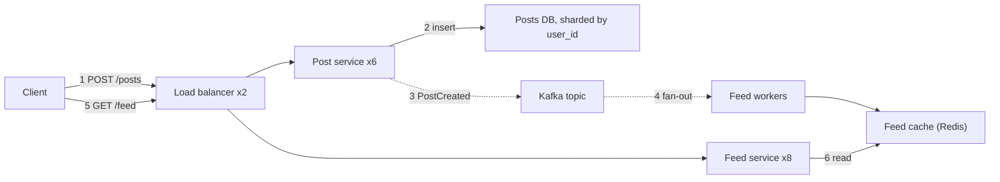

## In one minute
- The diagram is your shared memory with the interviewer. A clean one lets them follow your reasoning and ask sharper questions; a messy one hides good ideas and costs you minutes of re-explaining.
- Draw left to right in the direction a request travels: clients, edge, services, async pipeline, storage. Start with a skeleton of five to seven boxes and add detail only where you go deep.
- Every arrow should mean one thing: a call with a direction. Mark which arrows are synchronous and which are asynchronous, and label the important ones with what flows (protocol, payload, rate).
- Narrate while drawing, using numbered flows: "1 to 4 is the write path, 5 to 7 the read path". Then walk a single request end to end.
- Staff-level signal: the diagram shows failure domains, replicas and data ownership, so you can point at it and say what happens when any box dies.

## How it works

### Time budget
In a 45-minute interview, the high-level diagram should exist by around minute 15 and be mostly complete by minute 20. Spend the first pass on structure, not polish. Boxes are cheap to add later; a layout that runs out of room is expensive to fix, so leave space on the right and bottom.

### The skeleton first
Draw the minimum that satisfies the functional requirements: client, an entry point (load balancer or API gateway), one or two services, the primary datastore, and a cache or queue if the requirements obviously need one. Walk one write and one read through it before adding anything. This forces gaps to the surface early, such as "where does the feed get built?", while changes are still cheap.

### Conventions that make diagrams readable
- **Direction.** Requests flow left to right, data stores sit on the right or bottom, async pipelines below the synchronous path.
- **Shapes.** Rectangles for services, cylinders (or a labelled box) for databases, a distinct shape for queues and topics, a cloud or edge box for CDN. Keep the same shape for the same kind of thing.
- **Arrows.** Solid for synchronous request and response, dashed for asynchronous messages and events. One arrow per interaction; avoid double-headed arrows, which hide who initiates. The C4 notation guide makes the same rule: every line is unidirectional and labelled with its intent, never just "uses" ([C4 notation](https://c4model.com/diagrams/notation)).
- **Labels.** Name boxes by responsibility ("Feed service"), not by technology alone. Add the technology in small text when you have chosen it ("Postgres, sharded by user_id"), and the protocol on arrows between processes ("gRPC", "Kafka") ([C4 notation](https://c4model.com/diagrams/notation)).
- **Numbers.** Write key rates on arrows or boxes ("60k QPS reads", "2 TB/day") and replica counts on stateful components.
- **Numbered flows.** Number the steps of the main write and read paths so you can refer to them.

### Narration
Talk as you draw, but in short sentences: "The client uploads to object storage through a pre-signed URL, then calls the post service with the object key." After the skeleton, do one complete pass of each path. When you go deep, zoom: draw a second, smaller diagram for the deep dive (for example a sequence diagram for a payment flow) rather than cramming detail into the overview.

### What interviewers look for
- A diagram that matches the requirements and the API you defined.
- Clear separation of the read path and the write path, and of synchronous and asynchronous work.
- Stateful components clearly marked, with how they scale and replicate.
- The ability to point at any box and answer "what if this fails or gets 10 times the load?"

### Common mistakes
- Drawing every component you know (service mesh, three caches, two queues) before establishing the core flow.
- Unlabelled arrows that leave the interviewer guessing what flows and who calls whom.
- A single box called "Database" with no indication of partitioning or replication at the scale estimated earlier.
- Cycles of synchronous calls between services, which become latency chains and deadlock risks.
- Erasing and redrawing large parts instead of evolving the diagram; keep the old version if you change direction, and say why.

## Down the stack

### Layer 1: The contract
A system diagram makes testable claims. Each box is a deployable unit with an owner and a failure domain. Each arrow is a dependency: if the target is down, the source is affected, synchronously (fails or slows now) or asynchronously (backlog grows). A stateful box claims a data ownership boundary: no other box writes its data directly. From those claims you can answer the questions interviewers ask: which component is a single point of failure, which calls are on the latency-critical path, and what a failure cascades into.

### Layer 2: The mechanism
Treat the diagram as a directed graph. The request path is every node reachable from the entry point. A single point of failure is a node with no redundancy whose removal disconnects the entry from some required data store, which is a cut vertex (articulation point) in graph terms, findable in linear time with a depth-first search ([Wikipedia](https://en.wikipedia.org/wiki/Biconnected_component)). A cycle of synchronous edges is a call loop: retries within a loop multiply load, and timeouts nested inside each other can exceed the caller's deadline. Retries multiply along any chain, not just loops: if three layers each retry three times, one user action can become 4 × 4 × 4 = 64 attempts on the database, which is why each arrow should carry a propagated deadline rather than its own timeout ([SRE book, ch. 22](https://sre.google/sre-book/addressing-cascading-failures/)). Fan-out edges multiply requests: one arrow into a service that calls 20 shards means 20 backend calls per request, and tail latency is set by the slowest; if each shard is slow 1 percent of the time, about 18 percent of requests wait on at least one slow shard. For deep dives, sequence diagrams show ordering and failure points that a box diagram cannot, such as "the response is lost after the charge succeeded". Edges also differ in strength: a strong dependency takes the flow down when it fails, while a weak one only removes a feature, so mark which is which ([Azure Well-Architected](https://learn.microsoft.com/en-us/azure/well-architected/reliability/failure-mode-analysis)). The C4 model formalises the zoom levels: context, containers, components and code, plus supplementary dynamic and deployment diagrams ([C4 model](https://c4model.com/)). Interviews mostly live at the container level, and the AZ boundaries you draw are a small deployment diagram.

### Layer 3: The machine
Each arrow costs something physical, and annotating it shows depth. A synchronous call inside one AZ is about 0.2 to 0.5 ms of network round trip plus serialisation; a cross-AZ call adds about 1 ms, since AWS keeps a region's AZs within 100 km of each other ([AWS](https://aws.amazon.com/about-aws/global-infrastructure/regions_az/)), and is billed per GB in most clouds; a cross-region call adds tens to a hundred milliseconds. Behind each arrow are TCP connections held in pools: 200 app instances times a pool of 20 connections is 4,000 connections into one database primary. Postgres runs one backend process per connection ([Postgres docs](https://www.postgresql.org/docs/current/connect-estab.html)), so that many connections exhausts memory without a pooler such as PgBouncer, which needs about 2 kB per client connection and in transaction mode lends a server connection only for the length of a transaction ([PgBouncer](https://www.pgbouncer.org/features.html)). A load balancer box is either L4 (forwarding TCP connections, very cheap per packet) or L7 (terminating TLS and parsing HTTP, costing CPU per request). A queue box is a disk-backed log: its throughput is bounded by sequential disk writes and replication, and its buffer gives you hours of absorption only if you size the disk for it.

### Why it's built this way
Interviewers can hold only a few things in working memory while listening, so a consistent left-to-right layout with few boxes reduces their cognitive load. Failures propagate along dependencies, so arrows must show direction and synchrony. Detail is needed only where the risk is, so you zoom into a separate diagram for deep dives. And because the diagram is the evidence for your claims about scale and failure, the numbers and replica counts belong on it.

## Diagram


## Worked example
You are asked to design a URL shortener and have 10 minutes for the high-level design.

Minute 0 to 2: draw client, load balancer, "Shortener service", "URL store" and a cache, left to right. Label the write arrow `POST /urls` and the read arrow `GET /{code} -> 301`.

Minute 2 to 4: number the flows. Write path: 1 client to service, 2 service gets an ID from an ID allocator (draw a small box), 3 service writes `code -> long_url` to the store. Read path: 4 client to service, 5 cache lookup, 6 on miss read store and populate cache. Say each step aloud once.

Minute 4 to 6: add numbers from your estimate. "100 million new URLs a month is about 40 writes per second; reads at 100 to 1 are about 4,000 per second average, 20,000 at peak." Write them on the arrows. Mark the store "KV, partitioned by code, RF=3" and the cache "Redis, about 20 GB hot set".

Minute 6 to 8: mark failure domains. Draw a dashed boundary for each of two AZs and show two service instances and store replicas in each. Point at the ID allocator: "This is a single point of failure, so it hands out ID ranges of 1,000 to each service instance and runs as a three-node group."

Minute 8 to 10: add the async analytics path under the main flow: dashed arrow from service to a click-event topic, then to an aggregation job and an analytics store. You now have a diagram that answers most follow-ups by pointing.

## In the wild
- **Roblox, 2021: one box that everything, including monitoring, depended on.** Every backend service shared a single Consul cluster for service discovery, and the telemetry systems depended on Consul too. Contention in a newly enabled Consul streaming feature, plus a bloated BoltDB freelist that slowed Raft writes, took the platform down for 73 hours for about 50 million daily players, while engineers lacked the dashboards that ran through the same cluster. Fixes included dedicated Consul clusters for critical services and removed the circular dependency so telemetry no longer relies on Consul ([Roblox](https://about.roblox.com/newsroom/2022/01/roblox-return-to-service-10-28-10-31-2021)).
- **Slack, 2021: the arrow nobody drew.** On the first workday of 2021, traffic grew faster than AWS Transit Gateways could scale. Packet loss failed health checks, autoscaling removed instances and tried to add about 1,200 more, most never fully provisioned, and the dashboards failed too because they reached their databases across the same gateways. Slack planned to run the dashboards in the same VPC as their databases and to request gateway pre-scaling ahead of busy periods ([Slack Engineering](https://slack.engineering/slacks-outage-on-january-4th-2021/)).

## Trade-offs
| Option | Strengths | Weaknesses | Choose when |
|---|---|---|---|
| One overview diagram | Fast, keeps context | Gets crowded | First 20 minutes |
| Overview plus zoomed deep dive | Detail where it matters | Takes space and time | Deep dives on one flow |
| Sequence diagram | Shows ordering and failure timing | Poor at structure | Payments, consensus, retries |
| Box-and-arrow with numbers | Shows scale and bottlenecks | Needs estimates first | Capacity discussion |
| Drawing tool templates | Neat, reusable shapes | Fiddly under time pressure | Remote interviews with practice |

## Pitfalls in production
These apply equally to design reviews at work:

- **Diagrams that drift from reality.** Architecture diagrams go stale within months. Generate them from service catalogs or keep them next to the code with an owner.
- **Missing async edges.** Event consumers are often left off, so nobody sees that a "harmless" schema change breaks five downstream jobs. Draw the topics and their consumers.
- **Hidden shared dependencies.** Two "independent" services both call the same auth service or database, a shared failure domain. Draw shared dependencies once and connect all callers to it.
- **No legend.** Readers interpret dashed lines and colours differently. Add a three-line legend, and give the diagram a title that states its type and scope ([C4 notation](https://c4model.com/diagrams/notation)).
- **Single diagram for every audience.** Executives, on-call engineers and new hires need different zoom levels. Use C4-style levels.

## Leadership lens
- Ask for a diagram with numbers and failure domains in every design doc; it surfaces questions before review meetings rather than during them.
- In review, point at each stateful box and ask who owns it, how it is backed up, and what depends on it synchronously.
- Run a quick graph check on the dependency map: single points of failure on the critical path and synchronous cycles are cheap to find and expensive to discover in an incident.

## Check yourself
1. Why draw async flows with a different line style from sync calls?
   **Answer:** They fail differently: a failed sync dependency fails or slows the caller immediately, while an async one builds a backlog, so readers need to tell them apart at a glance.
2. When is a box with one replica not a single point of failure?
   **Answer:** When it is not needed on any path from the entry point to a required store, or when an alternative path bypasses it.
3. Why are cycles of synchronous calls between services a red flag?
   **Answer:** They create long latency chains, retry amplification around the loop and potential deadlock under load, and they make independent deployment hard.
4. What should you do when you want to show the details of a payment flow?
   **Answer:** Draw a separate sequence diagram for it, keeping the overview uncluttered, and refer back to the numbered step in the overview.

## Practice
**Task:** Write a design-graph linter. A design is `nodes` (a map from component name to replica count) and directed `edges` (pairs `[from, to]`). `find_spofs(nodes, edges, entry, sinks)` returns, sorted, every node with fewer than 2 replicas whose removal makes at least one sink that is reachable from `entry` in the full graph unreachable; the entry itself counts if it has one replica, and a sink counts as unreachable when it is the removed node. Raise or return an error if an edge names an unknown node. `has_cycle(nodes, edges)` reports whether the graph has a directed cycle (including a self-loop). `unreachable(nodes, edges, entry)` returns, sorted, the nodes not reachable from `entry`.

```python starter
def find_spofs(nodes, edges, entry, sinks):
    # TODO: return sorted list of node names; raise ValueError on unknown nodes in edges
    raise NotImplementedError

def has_cycle(nodes, edges):
    raise NotImplementedError

def unreachable(nodes, edges, entry):
    raise NotImplementedError
```

```python tests
DESIGN = {"client": 99, "lb": 2, "api": 3, "db": 1, "cache": 1}
EDGES = [("client", "lb"), ("lb", "api"), ("api", "db"), ("api", "cache")]

def test_single_replica_db_is_spof():
    assert find_spofs(DESIGN, EDGES, "client", ["db"]) == ["db"]

def test_cache_off_required_path_is_not_spof():
    assert "cache" not in find_spofs(DESIGN, EDGES, "client", ["db"])

def test_redundant_paths_remove_spof():
    nodes = {"client": 99, "gw1": 1, "gw2": 1, "api": 2}
    both = [("client", "gw1"), ("client", "gw2"), ("gw1", "api"), ("gw2", "api")]
    assert find_spofs(nodes, both, "client", ["api"]) == []
    one = [("client", "gw1"), ("gw1", "api"), ("client", "gw2")]
    assert find_spofs(nodes, one, "client", ["api"]) == ["gw1"]

def test_entry_with_one_replica_counts():
    nodes = {"lb": 1, "api": 2, "db": 3}
    assert find_spofs(nodes, [("lb", "api"), ("api", "db")], "lb", ["db"]) == ["lb"]

def test_unknown_node_rejected():
    try:
        find_spofs({"a": 1}, [("a", "ghost")], "a", [])
        assert False, "expected ValueError"
    except ValueError:
        pass

def test_cycles():
    n = {"a": 1, "b": 1, "c": 1}
    assert has_cycle(n, [("a", "b"), ("b", "c"), ("c", "a")]) is True
    assert has_cycle(n, [("a", "b"), ("b", "c"), ("a", "c")]) is False
    assert has_cycle(n, [("b", "b")]) is True

def test_unreachable_orphans():
    nodes = dict(DESIGN, metrics=1, batch=1)
    edges = EDGES + [("batch", "db")]
    assert unreachable(nodes, edges, "client") == ["batch", "metrics"]
```

```python solution
def _adj(nodes, edges):
    adj = {n: [] for n in nodes}
    for a, b in edges:
        if a not in nodes or b not in nodes:
            raise ValueError("unknown node in edge %s -> %s" % (a, b))
        adj[a].append(b)
    return adj

def _reach(adj, entry, removed):
    if entry == removed or entry not in adj:
        return set()
    seen, stack = {entry}, [entry]
    while stack:
        n = stack.pop()
        for m in adj[n]:
            if m != removed and m not in seen:
                seen.add(m)
                stack.append(m)
    return seen

def find_spofs(nodes, edges, entry, sinks):
    adj = _adj(nodes, edges)
    full = _reach(adj, entry, None)
    targets = [s for s in sinks if s in full]
    out = []
    for n in sorted(nodes):
        if nodes[n] >= 2 or not targets:
            continue
        r = _reach(adj, entry, n)
        if any(s not in r for s in targets):
            out.append(n)
    return out

def has_cycle(nodes, edges):
    adj = _adj(nodes, edges)
    state = {n: 0 for n in nodes}

    def visit(n):
        state[n] = 1
        for m in adj[n]:
            if state[m] == 1:
                return True
            if state[m] == 0 and visit(m):
                return True
        state[n] = 2
        return False

    return any(state[n] == 0 and visit(n) for n in sorted(nodes))

def unreachable(nodes, edges, entry):
    r = _reach(_adj(nodes, edges), entry, None)
    return sorted(n for n in nodes if n not in r)
```

```typescript starter
export type Edge = [string, string];

export function findSpofs(nodes: Record<string, number>, edges: Edge[], entry: string, sinks: string[]): string[] {
  throw new Error("TODO");
}

export function hasCycle(nodes: Record<string, number>, edges: Edge[]): boolean {
  throw new Error("TODO");
}

export function unreachable(nodes: Record<string, number>, edges: Edge[], entry: string): string[] {
  throw new Error("TODO");
}
```

```typescript tests
const DESIGN: Record<string, number> = { client: 99, lb: 2, api: 3, db: 1, cache: 1 };
const EDGES: Edge[] = [["client", "lb"], ["lb", "api"], ["api", "db"], ["api", "cache"]];
test("single replica db is spof", () => {
  assertEqual(findSpofs(DESIGN, EDGES, "client", ["db"]), ["db"]);
});
test("cache off required path is not spof", () => {
  assert(findSpofs(DESIGN, EDGES, "client", ["db"]).indexOf("cache") < 0, "cache not required");
});
test("redundant paths remove spof", () => {
  const nodes = { client: 99, gw1: 1, gw2: 1, api: 2 };
  assertEqual(findSpofs(nodes, [["client", "gw1"], ["client", "gw2"], ["gw1", "api"], ["gw2", "api"]], "client", ["api"]), []);
  assertEqual(findSpofs(nodes, [["client", "gw1"], ["gw1", "api"], ["client", "gw2"]], "client", ["api"]), ["gw1"]);
});
test("entry with one replica counts", () => {
  assertEqual(findSpofs({ lb: 1, api: 2, db: 3 }, [["lb", "api"], ["api", "db"]], "lb", ["db"]), ["lb"]);
});
test("unknown node rejected", () => {
  let threw = false;
  try { findSpofs({ a: 1 }, [["a", "ghost"]], "a", []); } catch (e) { threw = true; }
  assert(threw, "expected error");
});
test("cycles", () => {
  const n = { a: 1, b: 1, c: 1 };
  assertEqual(hasCycle(n, [["a", "b"], ["b", "c"], ["c", "a"]]), true);
  assertEqual(hasCycle(n, [["a", "b"], ["b", "c"], ["a", "c"]]), false);
  assertEqual(hasCycle(n, [["b", "b"]]), true);
});
test("unreachable orphans", () => {
  const nodes = { ...DESIGN, metrics: 1, batch: 1 };
  const edges: Edge[] = [...EDGES, ["batch", "db"]];
  assertEqual(unreachable(nodes, edges, "client"), ["batch", "metrics"]);
});
```

```typescript solution
export type Edge = [string, string];

function adjacency(nodes: Record<string, number>, edges: Edge[]): Map<string, string[]> {
  const adj = new Map<string, string[]>();
  for (const n of Object.keys(nodes)) adj.set(n, []);
  for (const [a, b] of edges) {
    if (!(a in nodes) || !(b in nodes)) throw new Error("unknown node in edge " + a + " -> " + b);
    adj.get(a)!.push(b);
  }
  return adj;
}

function reach(adj: Map<string, string[]>, entry: string, removed: string | null): Set<string> {
  const seen = new Set<string>();
  if (entry === removed || !adj.has(entry)) return seen;
  seen.add(entry);
  const stack = [entry];
  while (stack.length > 0) {
    const n = stack.pop()!;
    for (const m of adj.get(n)!) {
      if (m !== removed && !seen.has(m)) { seen.add(m); stack.push(m); }
    }
  }
  return seen;
}

export function findSpofs(nodes: Record<string, number>, edges: Edge[], entry: string, sinks: string[]): string[] {
  const adj = adjacency(nodes, edges);
  const full = reach(adj, entry, null);
  const targets = sinks.filter((s) => full.has(s));
  const out: string[] = [];
  if (targets.length === 0) return out;
  for (const n of Object.keys(nodes).sort()) {
    if (nodes[n] >= 2) continue;
    const r = reach(adj, entry, n);
    if (targets.some((s) => !r.has(s))) out.push(n);
  }
  return out;
}

export function hasCycle(nodes: Record<string, number>, edges: Edge[]): boolean {
  const adj = adjacency(nodes, edges);
  const state = new Map<string, number>();
  const visit = (n: string): boolean => {
    state.set(n, 1);
    for (const m of adj.get(n)!) {
      const s = state.get(m) ?? 0;
      if (s === 1) return true;
      if (s === 0 && visit(m)) return true;
    }
    state.set(n, 2);
    return false;
  };
  return Object.keys(nodes).sort().some((n) => (state.get(n) ?? 0) === 0 && visit(n));
}

export function unreachable(nodes: Record<string, number>, edges: Edge[], entry: string): string[] {
  const r = reach(adjacency(nodes, edges), entry, null);
  return Object.keys(nodes).filter((n) => !r.has(n)).sort();
}
```

```go starter
package practice

// Edge is a directed dependency From -> To.
type Edge struct{ From, To string }

func FindSPOFs(nodes map[string]int, edges []Edge, entry string, sinks []string) ([]string, error) {
	panic("TODO")
}

func HasCycle(nodes map[string]int, edges []Edge) (bool, error) { panic("TODO") }

func Unreachable(nodes map[string]int, edges []Edge, entry string) ([]string, error) {
	panic("TODO")
}
```

```go tests
package practice

import (
	"reflect"
	"testing"
)

var design = map[string]int{"client": 99, "lb": 2, "api": 3, "db": 1, "cache": 1}
var designEdges = []Edge{{"client", "lb"}, {"lb", "api"}, {"api", "db"}, {"api", "cache"}}

func TestSingleReplicaDB(t *testing.T) {
	got, err := FindSPOFs(design, designEdges, "client", []string{"db"})
	if err != nil || !reflect.DeepEqual(got, []string{"db"}) {
		t.Fatalf("got %v %v", got, err)
	}
}

func TestRedundantPaths(t *testing.T) {
	nodes := map[string]int{"client": 99, "gw1": 1, "gw2": 1, "api": 2}
	got, _ := FindSPOFs(nodes, []Edge{{"client", "gw1"}, {"client", "gw2"}, {"gw1", "api"}, {"gw2", "api"}}, "client", []string{"api"})
	if len(got) != 0 {
		t.Fatalf("expected none, got %v", got)
	}
	got, _ = FindSPOFs(nodes, []Edge{{"client", "gw1"}, {"gw1", "api"}, {"client", "gw2"}}, "client", []string{"api"})
	if !reflect.DeepEqual(got, []string{"gw1"}) {
		t.Fatalf("got %v", got)
	}
}

func TestEntryCounts(t *testing.T) {
	got, _ := FindSPOFs(map[string]int{"lb": 1, "api": 2, "db": 3}, []Edge{{"lb", "api"}, {"api", "db"}}, "lb", []string{"db"})
	if !reflect.DeepEqual(got, []string{"lb"}) {
		t.Fatalf("got %v", got)
	}
}

func TestUnknownNode(t *testing.T) {
	if _, err := FindSPOFs(map[string]int{"a": 1}, []Edge{{"a", "ghost"}}, "a", nil); err == nil {
		t.Fatal("expected error")
	}
}

func TestCycles(t *testing.T) {
	n := map[string]int{"a": 1, "b": 1, "c": 1}
	c1, _ := HasCycle(n, []Edge{{"a", "b"}, {"b", "c"}, {"c", "a"}})
	c2, _ := HasCycle(n, []Edge{{"a", "b"}, {"b", "c"}, {"a", "c"}})
	c3, _ := HasCycle(n, []Edge{{"b", "b"}})
	if !c1 || c2 || !c3 {
		t.Fatalf("got %v %v %v", c1, c2, c3)
	}
}

func TestUnreachable(t *testing.T) {
	nodes := map[string]int{"metrics": 1, "batch": 1}
	for k, v := range design {
		nodes[k] = v
	}
	edges := append(append([]Edge{}, designEdges...), Edge{"batch", "db"})
	got, err := Unreachable(nodes, edges, "client")
	if err != nil || !reflect.DeepEqual(got, []string{"batch", "metrics"}) {
		t.Fatalf("got %v %v", got, err)
	}
}
```

```go solution
package practice

import (
	"fmt"
	"sort"
)

// Edge is a directed dependency From -> To.
type Edge struct{ From, To string }

func adjacency(nodes map[string]int, edges []Edge) (map[string][]string, error) {
	adj := map[string][]string{}
	for n := range nodes {
		adj[n] = nil
	}
	for _, e := range edges {
		_, okA := nodes[e.From]
		_, okB := nodes[e.To]
		if !okA || !okB {
			return nil, fmt.Errorf("unknown node in edge %s -> %s", e.From, e.To)
		}
		adj[e.From] = append(adj[e.From], e.To)
	}
	return adj, nil
}

func reach(adj map[string][]string, entry, removed string) map[string]bool {
	seen := map[string]bool{}
	if _, ok := adj[entry]; !ok || entry == removed {
		return seen
	}
	seen[entry] = true
	stack := []string{entry}
	for len(stack) > 0 {
		n := stack[len(stack)-1]
		stack = stack[:len(stack)-1]
		for _, m := range adj[n] {
			if m != removed && !seen[m] {
				seen[m] = true
				stack = append(stack, m)
			}
		}
	}
	return seen
}

func sortedNames(nodes map[string]int) []string {
	names := make([]string, 0, len(nodes))
	for n := range nodes {
		names = append(names, n)
	}
	sort.Strings(names)
	return names
}

func FindSPOFs(nodes map[string]int, edges []Edge, entry string, sinks []string) ([]string, error) {
	adj, err := adjacency(nodes, edges)
	if err != nil {
		return nil, err
	}
	full := reach(adj, entry, "")
	var targets []string
	for _, s := range sinks {
		if full[s] {
			targets = append(targets, s)
		}
	}
	out := []string{}
	if len(targets) == 0 {
		return out, nil
	}
	for _, n := range sortedNames(nodes) {
		if nodes[n] >= 2 {
			continue
		}
		r := reach(adj, entry, n)
		for _, s := range targets {
			if !r[s] {
				out = append(out, n)
				break
			}
		}
	}
	return out, nil
}

func HasCycle(nodes map[string]int, edges []Edge) (bool, error) {
	adj, err := adjacency(nodes, edges)
	if err != nil {
		return false, err
	}
	state := map[string]int{}
	var visit func(string) bool
	visit = func(n string) bool {
		state[n] = 1
		for _, m := range adj[n] {
			if state[m] == 1 || (state[m] == 0 && visit(m)) {
				return true
			}
		}
		state[n] = 2
		return false
	}
	for _, n := range sortedNames(nodes) {
		if state[n] == 0 && visit(n) {
			return true, nil
		}
	}
	return false, nil
}

func Unreachable(nodes map[string]int, edges []Edge, entry string) ([]string, error) {
	adj, err := adjacency(nodes, edges)
	if err != nil {
		return nil, err
	}
	r := reach(adj, entry, "")
	out := []string{}
	for _, n := range sortedNames(nodes) {
		if !r[n] {
			out = append(out, n)
		}
	}
	return out, nil
}
```

## Mock interview
**Prompt:** You have 15 minutes to present the high-level design of a food delivery platform: customers order from restaurants, couriers are assigned and tracked live, and payments are captured on delivery. Peak load is 30,000 orders per minute at dinner time. Draw and narrate your design.

- Follow-up: Point at the component whose failure hurts the most at 7 pm on a Friday. What happens, and what did you draw to mitigate it?
- Follow-up: Which arrows on your diagram are synchronous on the order placement path, and what is the total latency budget along them?
- Follow-up: Show me, with a second diagram, the sequence of events when a courier accepts an order and then their app goes offline.

**A strong answer covers:**
- A left-to-right skeleton (clients, gateway, order, dispatch, courier location, payment, notifications) drawn quickly, then refined with numbers.
- Clear sync versus async lines, with the order event stream driving dispatch and notifications asynchronously.
- Replica counts, data store partitioning and AZ boundaries marked on the diagram.
- Numbered write and read paths narrated once each, plus a separate sequence diagram for the courier offline case with timeouts and reassignment.
- Identification of single points of failure (dispatch leader, payment provider) and the drawn mitigation.

## Sources and further study
**Primary**
- [C4 model: notation](https://c4model.com/diagrams/notation): titles, legends, element types, and the rule that every relationship is a single labelled direction.

**Systems docs**
- [Azure Well-Architected: identify flows](https://learn.microsoft.com/en-us/azure/well-architected/reliability/identify-flows): mapping user and system flows onto components before you analyse their failure modes.
- [Google SRE book, ch. 22: Addressing Cascading Failures](https://sre.google/sre-book/addressing-cascading-failures/): why retries and timeouts along the arrows decide how a failure spreads.
- [PgBouncer features](https://www.pgbouncer.org/features.html): the pooling modes behind the "connections per database" annotation.

**Books**
- *Fundamentals of Software Architecture* (2nd ed.), Richards and Ford, chapter 23 "Diagramming Architecture": tools, standards and guidelines for architecture diagrams.
- *Release It!* (2nd ed.), Michael Nygard, chapter 4 "Stability Antipatterns": integration points, chain reactions and cascading failures, the failure paths a good diagram makes visible.

**Other curricula**
- [donnemartin/system-design-primer](https://github.com/donnemartin/system-design-primer#how-to-approach-a-system-design-interview-question): frames the diagram as step 2, a sketch of main components to justify before going deep.
- [Hello Interview: Delivery Framework](https://www.hellointerview.com/learn/system-design/in-a-hurry/delivery): frames the high-level design as about 10 to 15 minutes of drawing that comes after the requirements, core entities and API it must satisfy.

## Watch
- [Visualising software architecture with the C4 model (Simon Brown)](https://www.youtube.com/watch?v=x2-rSnhpw0g): zoom levels and notation that make diagrams readable.
- [System Design Interview: A Step-By-Step Guide (ByteByteGo)](https://www.youtube.com/watch?v=i7twT3x5yv8): where the high-level diagram fits in the interview and how to evolve it.

## Free resources
- [The C4 model](https://c4model.com/): a lightweight, widely used approach to diagram levels and notation.
- [Flowchart syntax (Mermaid docs)](https://mermaid.js.org/syntax/flowchart.html): text-based diagrams you can keep next to code.
- [Sequence diagram syntax (Mermaid docs)](https://mermaid.js.org/syntax/sequenceDiagram.html): for drawing deep-dive flows and failure timing.
- [Failure mode analysis (Azure Architecture Center)](https://learn.microsoft.com/en-us/azure/architecture/resiliency/failure-mode-analysis): walking each component of a diagram for failure modes.
- [Single point of failure (Wikipedia)](https://en.wikipedia.org/wiki/Single_point_of_failure): the concept and common mitigations.
