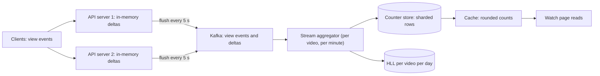

## In one minute
- Counting looks trivial (`count = count + 1`) until one counter receives thousands of increments per second, or the count must be distinct, or it must be exact enough to bill on.
- First classify the counter: exact or approximate, total or distinct, real-time or minutes behind, and whether each increment must be deduplicated (one like per user). The design follows from those answers.
- Hot counters are fixed by spreading writes: **sharded counters** (N sub-counters summed on read) and **write-behind batching** (aggregate in memory, flush deltas). The same idea appears in hardware as per-CPU counters.
- Distinct counts at scale use **HyperLogLog** (about 1 percent error in a few kilobytes); top-k uses a **count-min sketch** plus a heap.
- Multi-region counters that cannot coordinate per increment use CRDTs such as the **PN-counter**: each replica counts its own increments, and merging takes the maximum per replica.

## How it works

### When the pattern shows up in interviews
Like and view counts, follower counts, unique visitors, ad clicks for billing, trending hashtags and top-k, and rate limiter counters. Interviewers usually ask "how do you show the like count?" and then add a celebrity post with millions of likes in an hour.

### Classify before designing
Likes are deduplicated per user, must reflect the user's own action immediately, and can lag for others. Views can be approximate and minutes stale. Unique visitors are distinct and approximate. Ad clicks must be exact, deduplicated and auditable, but can finalise hours later. Saying this out loud is half of a strong answer.

### The hot row
`UPDATE posts SET like_count = like_count + 1 WHERE id = $1` is correct but serialises on the row lock. As with any hot row, throughput is bounded by how long each transaction holds the lock, a few hundred to a few thousand per second on one row depending on commit latency. A viral post exceeds that easily.

### Sharded counters
Split the counter into N rows: `(post_id, shard)` with a random shard per increment. Writes spread over N locks; reads sum N rows, which is cheap when cached. Choose N from the peak write rate per counter divided by what one row sustains, and grow it only for hot keys, so ordinary posts keep a single row. Google's Firestore documents the pattern with a deliberately low per-document ceiling: its sample assumes each shard takes about one increment per second, so write throughput grows linearly with the number of shards ([Firestore docs](https://cloud.google.com/firestore/docs/solutions/counters)).

### Write-behind aggregation
Instead of writing every increment, each app server keeps an in-memory map `post_id -> delta` and flushes it every few seconds as one `INCRBY` or one batched SQL statement. A million increments per second on a single viral post become one write per server per flush interval. The cost is that a crash loses the unflushed deltas, acceptable for views and not for billing. A durable variant writes raw events to Kafka and lets stream processors aggregate per key per window; the event log stays the source of truth, so totals can be recomputed if a bug is found. Netflix's counter service offers both as named modes: a best-effort counter on its EVCache layer, and an eventually consistent one that stores every increment as an immutable event with an idempotency key and rolls events up in time windows in the background; it served about 75,000 count requests per second at single-digit millisecond latency when described in 2024 ([InfoQ](https://www.infoq.com/news/2024/12/netflix-distributed-counter)).

### Deduplication and the source of truth
For likes, the real data is the set of `(user_id, post_id)` pairs with a unique constraint; the count is a derived, cached aggregate that can be rebuilt. For billing clicks, each event carries an ID and the aggregator deduplicates within a window before counting.

### Approximate counting
Exact distinct counts need memory proportional to the number of distinct items. **HyperLogLog** hashes each item, uses some bits to pick a register, and records the longest run of leading zeros seen in the rest; rare long runs imply many distinct items. Redis's implementation uses 16,384 six-bit registers (12 KB) with a standard error of about 0.81 percent ([Redis docs](https://redis.io/docs/latest/develop/data-types/probabilistic/hyperloglogs/)), and two HLLs merge by taking the per-register maximum, so daily sketches combine into weekly ones. Query engines expose the same idea: Presto's `APPROX_DISTINCT` has about 2.3 percent standard error by default, and at Facebook a weekly distinct-visitor count that would take days and terabytes of memory ran in 12 hours in under 1 MB ([Meta Engineering](https://engineering.fb.com/2018/12/13/data-infrastructure/hyperloglog/)). For heavy hitters, a **count-min sketch** keeps a few rows of counters indexed by different hashes; the estimate is the minimum across rows, which never undercounts ([Cormode and Muthukrishnan](https://dsf.berkeley.edu/cs286/papers/countmin-latin2004.pdf)). Redis Open Source includes count-min sketch (`CMS.*` commands) and Top-K types; its Top-K uses the HeavyKeeper algorithm, a decaying counter table plus a min-heap of the K largest ([Redis docs](https://redis.io/docs/latest/develop/data-types/probabilistic/top-k/)).

### Counting across regions
If each region accepts increments locally, a single global row would need cross-region coordination on every write. A **G-counter** gives each replica its own slot that only it increments; the value is the sum, and merge takes the element-wise maximum, which is commutative, associative and idempotent, so replicas converge no matter how often or in what order they gossip. A **PN-counter** pairs two G-counters for increments and decrements.

## Down the stack

### Layer 1: The contract
State the guarantee per counter. Likes: the user's own like is reflected immediately, the total converges within seconds, and the count never double-counts one user. Views: monotonic non-decreasing totals, within a few percent, lagging by under a minute. Unique visitors: an estimate with stated relative error. Billing: exactly-once per event ID, final within hours, reconcilable against raw logs. CRDT counters: every replica that has received the same set of updates reports the same value, regardless of delivery order or duplication.

### Layer 2: The mechanism
Redis executes commands on a single thread, so `INCRBY` is atomic without locks and one instance handles on the order of 100,000 simple operations per second. Its HyperLogLog (`PFADD`, `PFCOUNT`, `PFMERGE`) uses a sparse encoding for small cardinalities and switches to the dense 12 KB form as it grows; `PFCOUNT` caches the last estimate in the header. In Postgres, each counter update writes a new tuple version and a WAL record (a HOT update if no indexed column changes), leaving dead versions for vacuum. A stream processor such as Flink keeps per-key window state in RocksDB and checkpoints it with Kafka offsets so that recovery replays from a consistent point: each snapshot records a position in every source partition together with every operator's state ([Flink docs](https://nightlies.apache.org/flink/flink-docs-stable/docs/learn-flink/fault_tolerance/)). A PN-counter is two maps `P[replica]` and `N[replica]`; value is `sum(P) - sum(N)`; merge sets each entry to `max(local, remote)`.

### Layer 3: The machine
Contention appears at every level. On one machine, many cores doing atomic increments on the same 64-byte cache line force that line to bounce between cores, each transfer costing on the order of 100 nanoseconds, so a shared atomic counter scales negatively with cores. Linux's `percpu_counter` and Java's `LongAdder` solve it the same way as sharded rows: per-core slots summed on read, trading memory for much higher throughput under contention ([Java docs](https://docs.oracle.com/en/java/javase/21/docs/api/java.base/java/util/concurrent/atomic/LongAdder.html)). In a database, the bounce is a row lock plus a WAL flush; group commit amortises the `fsync`, but lock hold time still serialises one row. Over the network, one round trip per increment is the dominant cost, so batching 1,000 increments into one request cuts load by roughly a thousandfold. A 12 KB HLL fits in a few hundred cache lines, so `PFADD` is a hash plus one register update, well under a microsecond.

### Why it's built this way
1. One memory location, row or key can only be updated serially, so hot counters are split into slots that are updated independently and summed on read.
2. Per-increment I/O is expensive, so increments are aggregated in memory and written as deltas, trading durability of the last few seconds for orders of magnitude less load.
3. Exact distinct counting costs memory proportional to cardinality, so sketches trade a small, bounded error for constant memory.
4. Regions cannot coordinate on every write without paying cross-region latency, so each region owns its own slot and replicas merge with an idempotent max.
5. Derived counts drift after bugs, so a durable event log or a fact table remains the source of truth for recounts.

## Diagram


## Worked example
A video service records about 2 billion views per day: around 23,000 per second on average and perhaps 100,000 at peak. A newly viral video takes 30,000 views per second by itself.

Instead of one write per view, each of 400 API servers aggregates views in memory and flushes every 5 seconds. For the viral video that is 400 delta writes per 5 seconds, 80 per second, instead of 30,000. Across all videos, each flush carries the distinct videos viewed on that server in 5 seconds, so total counter writes fall to a few thousand per second.

Deltas go to Kafka keyed by video ID, and a stream job sums them per minute into the counter store, recording processed offsets with the totals so a restart does not double-apply a minute. The watch page displays rounded values ("1.2M views"), so the cache can hold a count for 30 seconds without users noticing.

For unique viewers, the team keeps daily HLLs only for videos with over 1,000 views that day; at 12 KB each, a million active videos need about 12 GB. Monetised views are counted separately from the raw event log, deduplicated by view ID, filtered for fraud and published hours later; displayed and paid counts may differ.

## In the wild
- **Segment, 2017: deduplicating before you count.** About 0.6% of events arriving within a four-week window were duplicates, mostly clients on flaky networks resending. Segment partitioned Kafka by message ID so each ID always reached the same worker, and each worker kept seen IDs in an embedded RocksDB store; after three months in production it held about 60 billion keys (1.5 TB on disk) and had processed about 200 billion messages ([Segment, now on Twilio's blog](https://www.twilio.com/en-us/blog/insights/exactly-once-delivery)).
- **Meta, 2018: HyperLogLog for distinct counts in Presto.** Counting distinct weekly visitors exactly would take days and terabytes of memory; with HLL sketches stored per day and merged, it took 12 hours and under 1 MB, with reported speedups of 7x to 1,000x and about 2.3% standard error ([Meta Engineering](https://engineering.fb.com/2018/12/13/data-infrastructure/hyperloglog/)).
- **Report URI, 2021: sizing a count-min sketch for hundreds of billions of reports.** With about 669 billion reports processed, the team worked out a Redis-backed sketch at 0.001 error and 0.999 confidence: 20,000 counters (about 160 KB) per sketch, with Top-K planned for listing the most frequent reports ([Scott Helme](https://scotthelme.co.uk/frequency-analysis-hundreds-billions-reports-report-uri-count-min-sketch/)).

## Trade-offs
| Option | Strengths | Weaknesses | Choose when |
|---|---|---|---|
| Single row or key increment | Exact, simple, immediate | Hot-key ceiling | Low-traffic counters |
| Sharded counter | Spreads writes, still exact | Reads sum N shards, more rows | Hot keys needing exact totals |
| Write-behind batching | Huge write reduction | Loses unflushed deltas on crash, lag | Views, impressions, analytics |
| Stream aggregation from a log | Durable, recomputable, windowed | Pipeline to operate, minutes of lag | Billing, analytics, large scale |
| HyperLogLog / count-min sketch | Constant memory, mergeable | Approximate | Distinct counts, top-k |
| CRDT counter | Multi-region writes without coordination | Memory per replica, no exact global snapshot | Active-active counters |

## Pitfalls in production
- **Counting without deduplication.** Client retries and double clicks inflate likes. Store the `(user, item)` fact with a unique key and derive the count.
- **Hot partition in the stream.** Keying events by video ID sends all of a viral video's traffic to one partition. Pre-aggregate before the log or salt hot keys.
- **Double-applying deltas after restart.** A consumer that crashes after writing totals but before committing offsets re-adds them. Commit offsets and totals atomically or make updates idempotent by window.
- **Showing exact counts that drift.** Users notice counts going down after a correction. Display rounded values and only reconcile upwards in the UI where possible.

## Leadership lens
- Ask, for each counter, "Who is harmed if this is off by 1 percent, or 5 minutes late?" The answer picks the design.
- Keep raw events or fact tables as the source of truth; counters are caches you must be able to rebuild.
- Watch for hot keys with per-key metrics, and make sharding factor a per-key setting rather than a global constant.

## Check yourself
1. Why does sharding a counter into 16 rows help writes but cost reads?
   **Answer:** Increments spread across 16 independent locks, but every read must fetch and sum all 16 rows, so reads are usually cached.
2. Why is merging G-counters with element-wise max safe under duplicate or reordered gossip?
   **Answer:** Each slot only grows and only its owner increments it, so max always picks the newest value for that slot, and applying the same state twice changes nothing.
3. How does write-behind batching reduce load for a viral item, and what does it risk?
   **Answer:** Each server sends one aggregated delta per interval instead of one write per event, but a crash loses the deltas accumulated since the last flush.
4. When would you prefer an exact set of user IDs over a HyperLogLog?
   **Answer:** When counts are small or exactness matters, such as likes where you must also answer "has this user already liked it?".

## Practice
**Task:** Implement a PN-counter CRDT for counting across replicas that cannot coordinate on every write. `PNCounter(node_id)` supports `increment(n)` and `decrement(n)` with `n` defaulting to 1 and required to be positive (otherwise raise an error), `value()` returning total increments minus total decrements across all replicas known to this one, and `merge(other)` which folds another replica's state into this one. Merging must be commutative, associative and idempotent, and must never double count: keep per-replica increment and decrement totals and merge by taking the maximum per replica.

```python starter
class PNCounter:
    def __init__(self, node_id):
        # TODO
        pass

    def increment(self, n=1):
        raise NotImplementedError

    def decrement(self, n=1):
        raise NotImplementedError

    def value(self):
        raise NotImplementedError

    def merge(self, other):
        raise NotImplementedError
```

```python tests
def test_local_counting():
    a = PNCounter("a")
    a.increment(); a.increment(4); a.decrement(2)
    assert a.value() == 3

def test_concurrent_increments_merge():
    a, b = PNCounter("a"), PNCounter("b")
    a.increment(3)
    b.increment(4)
    a.merge(b)
    assert a.value() == 7

def test_merge_is_idempotent():
    a, b = PNCounter("a"), PNCounter("b")
    a.increment(3); b.increment(4)
    a.merge(b); a.merge(b); a.merge(b)
    assert a.value() == 7

def test_merge_is_commutative():
    a, b = PNCounter("a"), PNCounter("b")
    a.increment(5); a.decrement(1)
    b.increment(2); b.decrement(3)
    a.merge(b); b.merge(a)
    assert a.value() == b.value() == 3

def test_stale_state_does_not_double_count():
    a, b = PNCounter("a"), PNCounter("b")
    a.increment(5)
    b.merge(a)
    a.increment(2)
    a.merge(b)
    assert a.value() == 7
    b.merge(a)
    assert b.value() == 7

def test_three_replica_gossip_converges():
    a, b, c = PNCounter("a"), PNCounter("b"), PNCounter("c")
    a.increment(1); b.increment(10); c.decrement(4)
    b.merge(a); c.merge(b); a.merge(c); b.merge(c)
    assert a.value() == b.value() == c.value() == 7

def test_rejects_non_positive():
    a = PNCounter("a")
    for bad in (0, -3):
        try:
            a.increment(bad)
            assert False, "expected ValueError"
        except ValueError:
            pass
    assert a.value() == 0
```

```python solution
class PNCounter:
    def __init__(self, node_id):
        self.node = node_id
        self.p = {}
        self.n = {}

    def _check(self, n):
        if n <= 0:
            raise ValueError("n must be positive")

    def increment(self, n=1):
        self._check(n)
        self.p[self.node] = self.p.get(self.node, 0) + n

    def decrement(self, n=1):
        self._check(n)
        self.n[self.node] = self.n.get(self.node, 0) + n

    def value(self):
        return sum(self.p.values()) - sum(self.n.values())

    def merge(self, other):
        for mine, theirs in ((self.p, other.p), (self.n, other.n)):
            for node, count in theirs.items():
                if count > mine.get(node, 0):
                    mine[node] = count
```

```typescript starter
export class PNCounter {
  constructor(nodeId: string) {}
  increment(n: number = 1): void {
    throw new Error("TODO");
  }
  decrement(n: number = 1): void {
    throw new Error("TODO");
  }
  value(): number {
    throw new Error("TODO");
  }
  merge(other: PNCounter): void {
    throw new Error("TODO");
  }
}
```

```typescript tests
test("local counting", () => {
  const a = new PNCounter("a");
  a.increment();
  a.increment(4);
  a.decrement(2);
  assertEqual(a.value(), 3);
});

test("concurrent increments merge", () => {
  const a = new PNCounter("a");
  const b = new PNCounter("b");
  a.increment(3);
  b.increment(4);
  a.merge(b);
  assertEqual(a.value(), 7);
});

test("merge is idempotent", () => {
  const a = new PNCounter("a");
  const b = new PNCounter("b");
  a.increment(3);
  b.increment(4);
  a.merge(b);
  a.merge(b);
  a.merge(b);
  assertEqual(a.value(), 7);
});

test("merge is commutative", () => {
  const a = new PNCounter("a");
  const b = new PNCounter("b");
  a.increment(5);
  a.decrement(1);
  b.increment(2);
  b.decrement(3);
  a.merge(b);
  b.merge(a);
  assertEqual(a.value(), 3);
  assertEqual(b.value(), 3);
});

test("stale state does not double count", () => {
  const a = new PNCounter("a");
  const b = new PNCounter("b");
  a.increment(5);
  b.merge(a);
  a.increment(2);
  a.merge(b);
  assertEqual(a.value(), 7);
  b.merge(a);
  assertEqual(b.value(), 7);
});

test("three replica gossip converges", () => {
  const a = new PNCounter("a");
  const b = new PNCounter("b");
  const c = new PNCounter("c");
  a.increment(1);
  b.increment(10);
  c.decrement(4);
  b.merge(a);
  c.merge(b);
  a.merge(c);
  b.merge(c);
  assertEqual([a.value(), b.value(), c.value()], [7, 7, 7]);
});

test("rejects non-positive", () => {
  const a = new PNCounter("a");
  for (const bad of [0, -3]) {
    let threw = false;
    try {
      a.increment(bad);
    } catch (e) {
      threw = true;
    }
    assert(threw, "expected error for " + bad);
  }
  assertEqual(a.value(), 0);
});
```

```typescript solution
export class PNCounter {
  private p = new Map<string, number>();
  private n = new Map<string, number>();
  constructor(private nodeId: string) {}

  private add(m: Map<string, number>, n: number): void {
    if (!(n > 0)) throw new Error("n must be positive");
    m.set(this.nodeId, (m.get(this.nodeId) ?? 0) + n);
  }

  increment(n: number = 1): void {
    this.add(this.p, n);
  }

  decrement(n: number = 1): void {
    this.add(this.n, n);
  }

  value(): number {
    let total = 0;
    for (const v of this.p.values()) total += v;
    for (const v of this.n.values()) total -= v;
    return total;
  }

  merge(other: PNCounter): void {
    const pairs: Array<[Map<string, number>, Map<string, number>]> = [
      [this.p, other.p],
      [this.n, other.n],
    ];
    for (const [mine, theirs] of pairs) {
      for (const [node, count] of theirs) {
        if (count > (mine.get(node) ?? 0)) mine.set(node, count);
      }
    }
  }
}
```

```go starter
package practice

type PNCounter struct{}

func NewPNCounter(nodeID string) *PNCounter {
	return &PNCounter{}
}

func (c *PNCounter) Increment(n int64) error {
	panic("TODO")
}

func (c *PNCounter) Decrement(n int64) error {
	panic("TODO")
}

func (c *PNCounter) Value() int64 {
	panic("TODO")
}

func (c *PNCounter) Merge(other *PNCounter) {
	panic("TODO")
}
```

```go tests
package practice

import "testing"

func TestLocalCounting(t *testing.T) {
	a := NewPNCounter("a")
	a.Increment(1)
	a.Increment(4)
	a.Decrement(2)
	if a.Value() != 3 {
		t.Fatalf("got %d", a.Value())
	}
}

func TestConcurrentIncrementsMerge(t *testing.T) {
	a, b := NewPNCounter("a"), NewPNCounter("b")
	a.Increment(3)
	b.Increment(4)
	a.Merge(b)
	if a.Value() != 7 {
		t.Fatalf("got %d", a.Value())
	}
}

func TestMergeIdempotent(t *testing.T) {
	a, b := NewPNCounter("a"), NewPNCounter("b")
	a.Increment(3)
	b.Increment(4)
	a.Merge(b)
	a.Merge(b)
	a.Merge(b)
	if a.Value() != 7 {
		t.Fatalf("got %d", a.Value())
	}
}

func TestMergeCommutative(t *testing.T) {
	a, b := NewPNCounter("a"), NewPNCounter("b")
	a.Increment(5)
	a.Decrement(1)
	b.Increment(2)
	b.Decrement(3)
	a.Merge(b)
	b.Merge(a)
	if a.Value() != 3 || b.Value() != 3 {
		t.Fatalf("got %d %d", a.Value(), b.Value())
	}
}

func TestStaleStateNoDoubleCount(t *testing.T) {
	a, b := NewPNCounter("a"), NewPNCounter("b")
	a.Increment(5)
	b.Merge(a)
	a.Increment(2)
	a.Merge(b)
	if a.Value() != 7 {
		t.Fatalf("got %d", a.Value())
	}
	b.Merge(a)
	if b.Value() != 7 {
		t.Fatalf("got %d", b.Value())
	}
}

func TestThreeReplicaGossip(t *testing.T) {
	a, b, c := NewPNCounter("a"), NewPNCounter("b"), NewPNCounter("c")
	a.Increment(1)
	b.Increment(10)
	c.Decrement(4)
	b.Merge(a)
	c.Merge(b)
	a.Merge(c)
	b.Merge(c)
	if a.Value() != 7 || b.Value() != 7 || c.Value() != 7 {
		t.Fatalf("got %d %d %d", a.Value(), b.Value(), c.Value())
	}
}

func TestRejectsNonPositive(t *testing.T) {
	a := NewPNCounter("a")
	if a.Increment(0) == nil || a.Decrement(-3) == nil {
		t.Fatal("expected errors")
	}
	if a.Value() != 0 {
		t.Fatalf("got %d", a.Value())
	}
}
```

```go solution
package practice

import "errors"

type PNCounter struct {
	node string
	p, n map[string]int64
}

func NewPNCounter(nodeID string) *PNCounter {
	return &PNCounter{node: nodeID, p: map[string]int64{}, n: map[string]int64{}}
}

func (c *PNCounter) add(m map[string]int64, n int64) error {
	if n <= 0 {
		return errors.New("n must be positive")
	}
	m[c.node] += n
	return nil
}

func (c *PNCounter) Increment(n int64) error { return c.add(c.p, n) }

func (c *PNCounter) Decrement(n int64) error { return c.add(c.n, n) }

func (c *PNCounter) Value() int64 {
	var total int64
	for _, v := range c.p {
		total += v
	}
	for _, v := range c.n {
		total -= v
	}
	return total
}

func (c *PNCounter) Merge(other *PNCounter) {
	for _, pair := range [][2]map[string]int64{{c.p, other.p}, {c.n, other.n}} {
		mine, theirs := pair[0], pair[1]
		for node, count := range theirs {
			if count > mine[node] {
				mine[node] = count
			}
		}
	}
}
```

## Mock interview
**Prompt:** Design the like and view counters for a short-video app with 300 million daily users. Popular videos can receive 50,000 likes and 500,000 views per minute shortly after posting. Creators see analytics including unique viewers, and advertisers are billed per qualified view.

- Follow-up: How do you guarantee one like per user while still showing a fast count on a viral video?
- Follow-up: The aggregation job crashes and restarts. How do you avoid adding the same minute of views twice?
- Follow-up: You expand to active-active in three regions. How do counts work when regions are partitioned for ten minutes?

**A strong answer covers:**
- Classifies counters (likes exact and deduplicated, views approximate and lagging, billing exact and auditable, unique viewers approximate) and designs each accordingly.
- Stores likes as `(user, video)` facts with a unique key and serves the count from a sharded or cached aggregate with read-your-own-like.
- Batches view increments in memory or a stream, avoids hot partitions by pre-aggregation, and makes window updates idempotent with committed offsets.
- Uses HyperLogLog for unique viewers with stated error and memory, and a separate exact, deduplicated pipeline for billing.
- Explains CRDT or per-region counters merged asynchronously, and what users see during a partition.

## Sources and further study
**Primary**
- [Cormode and Muthukrishnan: the count-min sketch](https://dsf.berkeley.edu/cs286/papers/countmin-latin2004.pdf): the original paper, with the width and depth formulas for a chosen error and confidence.
- [HeavyKeeper (USENIX ATC 2018)](https://www.usenix.org/conference/atc18/presentation/gong): top-k by count-with-exponential-decay, the algorithm behind Redis Top-K.

**Systems docs**
- [Redis Top-K](https://redis.io/docs/latest/develop/data-types/probabilistic/top-k/): sizing rules and commands for heavy hitters.
- [Apache Flink: fault tolerance](https://nightlies.apache.org/flink/flink-docs-stable/docs/learn-flink/fault_tolerance/): how checkpoints tie Kafka offsets to window state for exactly-once totals.
- [Netflix's distributed counter (InfoQ)](https://www.infoq.com/news/2024/12/netflix-distributed-counter): best-effort, eventually consistent and experimental accurate counting modes in one service.

**Books**
- *System Design Interview, Volume 2*, Alex Xu and Sahn Lam, Ch 6 "Ad Click Event Aggregation": exact, deduplicated, windowed counting with reconciliation.
- *Designing Data-Intensive Applications* (1st ed.), Martin Kleppmann, Ch 11 "Stream Processing": windows, idempotence and exactly-once semantics for derived counts.

**Other curricula**
- [donnemartin/system-design-primer](https://github.com/donnemartin/system-design-primer): frames the trade through write-behind caching, which writes to the store asynchronously and loses data if the cache dies first, the same risk as batching counter deltas in memory.
- [Azure Architecture Center: Materialized View pattern](https://learn.microsoft.com/en-us/azure/architecture/patterns/materialized-view): frames a stored count as a derived view that can be rebuilt from the source data.

## Watch
- [HyperLogLog Hit Counter (Computerphile)](https://www.youtube.com/watch?v=B_PexYrEcEw): an intuitive explanation of how HyperLogLog estimates distinct counts.
- [Top-K System Design Interview Breakdown w/ Ex-Meta Senior Manager (Hello Interview)](https://www.youtube.com/watch?v=y-tA2NW4LNY): counting and ranking at scale with streaming aggregation and sketches.
- [CRDTs: The Hard Parts (Martin Kleppmann)](https://www.youtube.com/watch?v=x7drE24geUw): how conflict-free replicated data types converge, beyond simple counters.

## Free resources
- [Distributed counters (Google Cloud Firestore docs)](https://cloud.google.com/firestore/docs/solutions/counters): the sharded-counter pattern with code and its read and write trade-offs.
- [HyperLogLog (Redis docs)](https://redis.io/docs/latest/develop/data-types/probabilistic/hyperloglogs/): commands, memory use and error of Redis's implementation.
- [HyperLogLog: the analysis of a near-optimal cardinality estimation algorithm (Flajolet et al.)](https://algo.inria.fr/flajolet/Publications/FlFuGaMe07.pdf): the original paper.
- [Conflict-free replicated data type (Wikipedia)](https://en.wikipedia.org/wiki/Conflict-free_replicated_data_type): G-counters, PN-counters and the convergence properties behind them.
- [Count-min sketch (Wikipedia)](https://en.wikipedia.org/wiki/Count%E2%80%93min_sketch): the structure used for approximate frequency and heavy hitters.
