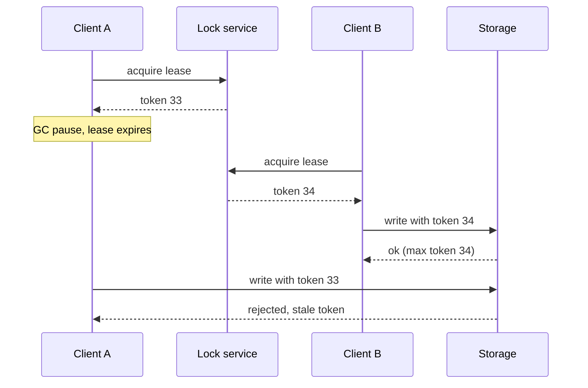

## In one minute
- Every multi-box design is a distributed system, so interviewers probe the same few ideas: what consistency each operation needs, how nodes agree, what happens when a node or link fails, and how retries avoid duplicates.
- Say the failure model out loud: nodes crash and restart, messages are delayed, dropped or duplicated, networks partition, clocks drift, and processes pause. Assume all of these, not Byzantine behaviour, unless asked.
- Use consensus (Raft or Paxos, usually via etcd, ZooKeeper or a database that embeds it) for small, critical state: leader election, locks, configuration, metadata. Do not route bulk data through it.
- "Exactly once" in practice means at-least-once delivery plus idempotent processing. Say that sentence when the interviewer asks about duplicates.
- Staff-level signal: you match the guarantee to the operation, name the mechanism that delivers it, and describe how it fails, for example a lease holder that pauses and needs a fencing token.

## How it works

### Consistency, in interview language
- **Linearizable (strong).** Every read sees the latest completed write, as if there were one copy. Needed for locks, uniqueness, balances, inventory decrements. Costs a coordination round trip and availability during partitions.
- **Sequential and causal.** Everyone sees operations in an order that respects causality; replies follow the messages they answer. Good for comments and chat.
- **Session guarantees.** Read-your-writes, monotonic reads and consistent prefix for one user, often achieved with sticky routing or version tokens. Usually what product actually wants.
- **Eventual.** Replicas converge if writes stop. Fine for counters, feeds, recommendations, analytics.

### Agreement and coordination
Consensus lets a group agree on a sequence of values despite crashes, as long as a majority is alive and can talk. Raft does it by electing a leader per term; the leader appends entries to its log and replicates them, and an entry is committed once a majority stores it. Use it through a service: etcd or ZooKeeper for coordination, or a database built on it (Spanner, CockroachDB, TiDB, Kafka's KRaft controller). For transactions across services, two-phase commit gives atomicity but blocks if the coordinator fails mid-protocol; sagas with compensating actions trade atomicity for availability and are the usual interview answer across service boundaries.

### Failure handling
- **Timeouts** turn silence into a decision; set them from measured latency (for example a bit above p99.9), not round numbers.
- **Retries** with exponential backoff and jitter, a retry budget, and only for idempotent operations or with idempotency keys. Google's SRE book caps each request at three attempts and each client at a retry ratio below 10 percent ([Google SRE, Handling Overload](https://sre.google/sre-book/handling-overload/)).
- **Circuit breakers and load shedding** stop a failing dependency from taking down callers.
- **Leases with fencing tokens** for leadership and locks: a holder may pause past its lease, so downstream storage rejects writes with old tokens ([Kleppmann](https://martin.kleppmann.com/2016/02/08/how-to-do-distributed-locking.html)).
- **Replication and failover** with a clear answer to "can we lose acknowledged writes?" (synchronous to at least one replica if not).
- **Idempotent consumers** with deduplication by message ID for queues.

### What to say when
- The interviewer says "two users book the last seat": linearizable conditional write or a single-leader partition per seat, not a cache check.
- "A node dies mid-write": replication factor, write quorum, and whether the client got an acknowledgement.
- "The network splits between regions": which side keeps accepting writes, and for which operations; the minority side either rejects or accepts and reconciles later.
- "We need a single scheduler or leader": lease-based election via etcd or ZooKeeper plus fencing.
- "Messages are duplicated or reordered": idempotency keys, sequence numbers per key, and partitioned ordering in Kafka.
- "Clocks": never compare wall clocks across machines for ordering; use logical versions, or bounded-uncertainty clocks if the store provides them.

### Common mistakes
- Saying "strongly consistent" for the whole system without naming the mechanism or the cost.
- Using a Redis `SET NX` lock, or Redlock, as if it were safe for correctness without fencing. Redlock's safety depends on bounded pauses and clock drift, and it has no way to issue fencing tokens ([Kleppmann](https://martin.kleppmann.com/2016/02/08/how-to-do-distributed-locking.html)).
- Trusting a consensus-backed lock on its own. Jepsen found that etcd 3.4.3 locks did not guarantee mutual exclusion even on a healthy cluster, while its plain key-value operations were safe; the fix is to fence with the lock key's revision ([Jepsen](https://jepsen.io/analyses/etcd-3.4.3)).
- Ignoring the case where the request succeeded but the response was lost.

## Down the stack

### Layer 1: The contract
Linearizability promises that each operation appears to take effect atomically at some instant between its invocation and its response, and all clients agree on that order. Raft promises safety: once an entry is committed it is present in the log of every future leader, so it survives as long as a majority of servers keeps its disk. It promises liveness only when a majority can communicate and timing is reasonably stable. A lease promises that at most one holder believes it holds the lease at a time only if clocks advance at similar rates; it never promises that the holder notices expiry promptly, which is why fencing exists.

### Layer 2: The mechanism
Raft has two main RPCs. `RequestVote(term, candidateId, lastLogIndex, lastLogTerm)` is sent by a follower whose randomised election timeout (the paper suggests 150 to 300 ms, [Raft paper](https://raft.github.io/raft.pdf)) expired; a server grants at most one vote per term and only to a candidate whose log is at least as up to date. `AppendEntries(term, leaderId, prevLogIndex, prevLogTerm, entries[], leaderCommit)` both replicates and acts as a heartbeat; a follower rejects it if its entry at `prevLogIndex` has a different term, and the leader backs up until logs match. The leader advances `commitIndex` when a majority has `matchIndex` at or beyond an entry from its current term; it never commits an older-term entry by counting replicas alone (section 5.4.2 of the paper). etcd builds leases on top: a lease has an ID and TTL, keys attach to it, and every key carries a `mod_revision` from the cluster-wide revision counter, which serves as a natural fencing token. etcd's own lock API does not pass that check to your storage for you, which is exactly the gap Jepsen measured. ZooKeeper offers the same through ephemeral sequential znodes and the `zxid`. A fenced storage service keeps the highest token seen per resource and rejects any write with a smaller one.

### Layer 3: The machine
A Raft entry is not acknowledged until it is `fsync`ed to the follower's WAL, so commit latency is one network round trip to the fastest majority plus one disk flush. That is why etcd's guidance asks for low-latency disks and warns about slow WAL syncs: p99 `wal_fsync_duration_seconds` should stay under 10 ms and backend commits under 25 ms ([etcd FAQ](https://etcd.io/docs/v3.6/faq/)). Leader heartbeats default to 100 ms in etcd with a 1,000 ms election timeout ([etcd tuning](https://etcd.io/docs/v3.6/tuning/)), so a crashed leader is replaced in roughly one to two seconds. Process pauses break timing assumptions: a stop-the-world GC pause of a few seconds, a VM migration, or heavy swapping can freeze a lease holder past its TTL without it knowing. Clocks drift: NTP usually keeps servers within milliseconds, but a step correction can move wall time backward. On the network, Linux's minimum TCP retransmission timeout defaults to 200 ms (recent kernels expose it as the `tcp_rto_min_us` sysctl, and a per-route `rto_min` overrides it, [Linux kernel docs](https://docs.kernel.org/networking/ip-sysctl.html)), so a single lost packet can add that much latency, which is why timeouts below a few hundred milliseconds trigger false failovers.

### Why it's built this way
Machines fail independently, so state is replicated. Replicas can disagree, so they need an agreed order, which requires a majority to overlap any two decisions. Waiting for a majority costs a round trip and a disk flush, so consensus is used for small critical state, while bulk data uses cheaper replication. Failure detection relies on timeouts that cannot distinguish slow from dead, so leases expire and a new leader may coexist briefly with an old one that has not noticed. Storage must therefore reject the old leader's writes, and fencing tokens make that check cheap.

## Diagram


## Worked example
A job scheduler must run each of 2 million scheduled jobs at most once per trigger, across a fleet of 30 workers in one region.

Coordination: one leader assigns job partitions. Leadership is a 10-second etcd lease renewed every 3 seconds. With a 3-node etcd cluster spread over three AZs, a write commits in about 2 to 4 ms (one cross-AZ round trip plus an `fsync`). The leader writes assignment changes to etcd only, about one write per second, so etcd is far from its limits.

Execution: each trigger is a row in a jobs table with `(job_id, fire_at, state, owner_token)`. A worker claims it with a conditional update: `UPDATE ... SET state='running', owner_token=? WHERE job_id=? AND fire_at=? AND state='pending'`. Only one update can succeed, so a job is claimed once even if two workers race.

Failure: a worker claims a job and then stalls for 40 seconds. The leader sees its heartbeat lapse and re-queues the job with a new token. When the stalled worker wakes and tries to record completion, its conditional update on the old token matches zero rows. Side effects such as sending an email carry the `job_id` and trigger time as an idempotency key, so even if both executions call the email service, one email goes out.

## In the wild
- **GitHub, 2018: a 43-second partition and a 24-hour degradation.** Maintenance cut the US East hub off from the primary data center for 43 seconds, and Orchestrator, which uses Raft, promoted West Coast MySQL primaries. Writes then landed on both coasts, so failback meant restoring from backup and reconciling, including 954 unreplicated writes on one cluster. Service was degraded for 24 hours 11 minutes. Afterwards Orchestrator could no longer promote across regions ([GitHub](https://github.blog/news-insights/company-news/oct21-post-incident-analysis/)).
- **Cloudflare, 2020: a half-dead switch confuses etcd.** A switch kept its control plane up while dropping data packets, so etcd nodes disagreed about who could reach whom, elections kept tying and the cluster went read-only. The database manager that relied on etcd promoted a replica, a bug forced every replica to rebuild, and API success fell as low as 75 percent over 6 hours 33 minutes. Fixes included slower auto-promotion ([Cloudflare](https://blog.cloudflare.com/a-byzantine-failure-in-the-real-world/)).
- **Jepsen, 2020: etcd key-value is safe, etcd locks are not.** Under every fault tested, etcd 3.4.3 key-value operations were strict serializable, but locks lost mutual exclusion even without faults; in one test about 18 percent of acknowledged updates to a lock-guarded set were lost. The recommended fix is the lock key's revision as a fencing token, and etcd updated its documentation ([Jepsen](https://jepsen.io/analyses/etcd-3.4.3)).

## Trade-offs
| Option | Strengths | Weaknesses | Choose when |
|---|---|---|---|
| Consensus store (etcd, ZooKeeper) | Linearizable, fault tolerant | Low throughput, majority needed | Leader election, locks, config |
| Leader-follower async replication | Fast writes, simple | Can lose recent writes on failover | Most OLTP with tolerable RPO |
| Leaderless quorums | Available, tunable per request | Conflicts, read repair, complexity | High-write, partition-tolerant data |
| Two-phase commit | Atomic across participants | Blocks on coordinator failure, latency | Inside one database or tightly owned stores |
| Saga | Available, service-friendly | No isolation, compensations needed | Workflows across services |

## Pitfalls in production
- **Locks without fencing.** A paused lock holder resumes and writes after another client took the lock. Pass a monotonic token and have storage reject stale ones.
- **Timeouts too short.** Aggressive timeouts trigger failovers during brief GC pauses or packet loss, causing flapping. Base timeouts on measured tails and add hysteresis.
- **Retry storms.** Every layer retries three times, which is four attempts per layer, so one user action across three layers can become 64 attempts on the database, exactly when it is already overloaded ([Google SRE, Addressing Cascading Failures](https://sre.google/sre-book/addressing-cascading-failures/)). Retry at one layer, with jitter and a budget.
- **Split-brain after a partition heal.** Two primaries both accepted writes. Require a majority for leadership and use fencing, or design merge rules if you choose availability.

## Leadership lens
- For each piece of state, write down the required consistency and the mechanism that gives it; review for operations that silently assume more than they get.
- Prefer managed or proven coordination (etcd, ZooKeeper, a database's transactions) over home-grown protocols, and isolate it: one shared coordination cluster becomes a single point of failure for everything that depends on it.
- Make failure testing routine: inject latency, kill leaders, partition AZs in staging, and run game days.
- Watch the operational cost of strong consistency: cross-region quorums can dominate latency budgets and cloud bills for inter-region traffic.

## Check yourself
1. Why can a lease-based lock let two clients act as holder at the same time?
   **Answer:** The old holder can pause or have a slow clock and keep acting after its lease expired while the service grants a new lease, so only a fencing check at the resource prevents conflicting writes.
2. Why does a Raft leader only count a majority for entries from its own term when advancing the commit index?
   **Answer:** An entry from an older term stored on a majority can still be overwritten by a future leader in some histories; committing a current-term entry implicitly commits all earlier ones safely.
3. A five-node etcd cluster loses two nodes. Can it accept writes? What about three?
   **Answer:** With two lost, three of five remain, a majority, so yes; with three lost it cannot form a majority and stops accepting writes.
4. How do you get effectively exactly-once processing from a queue that delivers at least once?
   **Answer:** Make the consumer idempotent, for example by recording processed message IDs or using conditional writes in the same transaction as the side effect.

## Practice
**Task:** Build a lease-based lock service with fencing tokens, and a store that enforces them. `LockService(ttl)` has `acquire(client, now)`, which returns a token if the lock is free or expired (`now >= expires_at`), issuing a new token one higher than the last ever issued; if the same client already holds an unexpired lease, it extends the lease and returns the same token; otherwise it returns nothing. `renew(client, token, now)` extends the lease only if that client holds that token and it has not expired. `release(client, token)` frees the lock only for the current holder. `FencedStore` has `write(key, value, token)`, which accepts only tokens greater than or equal to the highest token it has accepted, and `read(key)`.

```python starter
class LockService:
    def __init__(self, ttl):
        # TODO
        raise NotImplementedError

    def acquire(self, client, now):
        raise NotImplementedError

    def renew(self, client, token, now):
        raise NotImplementedError

    def release(self, client, token):
        raise NotImplementedError

class FencedStore:
    def __init__(self):
        raise NotImplementedError

    def write(self, key, value, token):
        raise NotImplementedError

    def read(self, key):
        raise NotImplementedError
```

```python tests
def test_exclusive_until_expiry():
    l = LockService(10)
    assert l.acquire("A", 0) == 1
    assert l.acquire("B", 5) is None
    assert l.acquire("B", 10) == 2

def test_holder_reacquire_extends():
    l = LockService(10)
    assert l.acquire("A", 0) == 1
    assert l.acquire("A", 8) == 1
    assert l.acquire("B", 12) is None, "lease extended to 18"

def test_renew_rules():
    l = LockService(10)
    t = l.acquire("A", 0)
    assert l.renew("A", t, 9) is True
    assert l.renew("B", t, 9) is False
    assert l.renew("A", t, 19) is False, "expired at 19"

def test_release_only_by_holder():
    l = LockService(10)
    t = l.acquire("A", 0)
    assert l.release("B", t) is False
    assert l.release("A", t) is True
    assert l.acquire("B", 1) == 2

def test_fencing_rejects_stale_writer():
    l = LockService(10)
    s = FencedStore()
    ta = l.acquire("A", 0)
    tb = l.acquire("B", 15)
    assert s.write("k", "from-B", tb) is True
    assert s.write("k", "from-A", ta) is False
    assert s.read("k") == "from-B"

def test_same_token_can_write_again():
    s = FencedStore()
    assert s.write("k", "1", 3) is True
    assert s.write("k", "2", 3) is True
    assert s.read("k") == "2"
    assert s.read("missing") is None
```

```python solution
class LockService:
    def __init__(self, ttl):
        self.ttl = ttl
        self.last_token = 0
        self.holder = None
        self.token = 0
        self.expires_at = 0

    def _held(self, now):
        return self.holder is not None and now < self.expires_at

    def acquire(self, client, now):
        if self._held(now):
            if self.holder == client:
                self.expires_at = now + self.ttl
                return self.token
            return None
        self.last_token += 1
        self.holder, self.token, self.expires_at = client, self.last_token, now + self.ttl
        return self.token

    def renew(self, client, token, now):
        if self._held(now) and self.holder == client and self.token == token:
            self.expires_at = now + self.ttl
            return True
        return False

    def release(self, client, token):
        if self.holder == client and self.token == token:
            self.holder = None
            return True
        return False

class FencedStore:
    def __init__(self):
        self.max_token = 0
        self.data = {}

    def write(self, key, value, token):
        if token < self.max_token:
            return False
        self.max_token = token
        self.data[key] = value
        return True

    def read(self, key):
        return self.data.get(key)
```

```typescript starter
export class LockService {
  constructor(ttl: number) {}
  acquire(client: string, now: number): number | null {
    throw new Error("TODO");
  }
  renew(client: string, token: number, now: number): boolean {
    throw new Error("TODO");
  }
  release(client: string, token: number): boolean {
    throw new Error("TODO");
  }
}

export class FencedStore {
  write(key: string, value: string, token: number): boolean {
    throw new Error("TODO");
  }
  read(key: string): string | null {
    throw new Error("TODO");
  }
}
```

```typescript tests
test("exclusive until expiry", () => {
  const l = new LockService(10);
  assertEqual([l.acquire("A", 0), l.acquire("B", 5), l.acquire("B", 10)], [1, null, 2]);
});
test("holder reacquire extends", () => {
  const l = new LockService(10);
  assertEqual(l.acquire("A", 0), 1);
  assertEqual(l.acquire("A", 8), 1);
  assertEqual(l.acquire("B", 12), null, "lease extended to 18");
});
test("renew rules", () => {
  const l = new LockService(10);
  const t = l.acquire("A", 0) as number;
  assertEqual([l.renew("A", t, 9), l.renew("B", t, 9), l.renew("A", t, 19)], [true, false, false]);
});
test("release only by holder", () => {
  const l = new LockService(10);
  const t = l.acquire("A", 0) as number;
  assertEqual(l.release("B", t), false);
  assertEqual(l.release("A", t), true);
  assertEqual(l.acquire("B", 1), 2);
});
test("fencing rejects stale writer", () => {
  const l = new LockService(10);
  const s = new FencedStore();
  const ta = l.acquire("A", 0) as number;
  const tb = l.acquire("B", 15) as number;
  assertEqual(s.write("k", "from-B", tb), true);
  assertEqual(s.write("k", "from-A", ta), false);
  assertEqual(s.read("k"), "from-B");
});
test("same token can write again", () => {
  const s = new FencedStore();
  assertEqual([s.write("k", "1", 3), s.write("k", "2", 3)], [true, true]);
  assertEqual(s.read("k"), "2");
  assertEqual(s.read("missing"), null);
});
```

```typescript solution
export class LockService {
  private lastToken = 0;
  private holder: string | null = null;
  private token = 0;
  private expiresAt = 0;
  constructor(private ttl: number) {}

  private held(now: number): boolean {
    return this.holder !== null && now < this.expiresAt;
  }

  acquire(client: string, now: number): number | null {
    if (this.held(now)) {
      if (this.holder !== client) return null;
      this.expiresAt = now + this.ttl;
      return this.token;
    }
    this.lastToken++;
    this.holder = client;
    this.token = this.lastToken;
    this.expiresAt = now + this.ttl;
    return this.token;
  }

  renew(client: string, token: number, now: number): boolean {
    if (this.held(now) && this.holder === client && this.token === token) {
      this.expiresAt = now + this.ttl;
      return true;
    }
    return false;
  }

  release(client: string, token: number): boolean {
    if (this.holder === client && this.token === token) {
      this.holder = null;
      return true;
    }
    return false;
  }
}

export class FencedStore {
  private maxToken = 0;
  private data = new Map<string, string>();

  write(key: string, value: string, token: number): boolean {
    if (token < this.maxToken) return false;
    this.maxToken = token;
    this.data.set(key, value);
    return true;
  }

  read(key: string): string | null {
    const v = this.data.get(key);
    return v === undefined ? null : v;
  }
}
```

```go starter
package practice

import "sync"

// LockService issues leases with monotonically increasing fencing tokens.
type LockService struct {
	mu sync.Mutex
}

func NewLockService(ttl int) *LockService { return &LockService{} }

func (l *LockService) Acquire(client string, now int) (int, bool) { panic("TODO") }

func (l *LockService) Renew(client string, token, now int) bool { panic("TODO") }

func (l *LockService) Release(client string, token int) bool { panic("TODO") }

// FencedStore rejects writes carrying a token older than the newest accepted one.
type FencedStore struct {
	mu sync.Mutex
}

func NewFencedStore() *FencedStore { return &FencedStore{} }

func (s *FencedStore) Write(key, value string, token int) bool { panic("TODO") }

func (s *FencedStore) Read(key string) (string, bool) { panic("TODO") }
```

```go tests
package practice

import "testing"

func TestExclusiveUntilExpiry(t *testing.T) {
	l := NewLockService(10)
	if tok, ok := l.Acquire("A", 0); !ok || tok != 1 {
		t.Fatal("A should get token 1")
	}
	if _, ok := l.Acquire("B", 5); ok {
		t.Fatal("B must wait")
	}
	if tok, ok := l.Acquire("B", 10); !ok || tok != 2 {
		t.Fatal("B should get token 2 after expiry")
	}
}

func TestHolderReacquireExtends(t *testing.T) {
	l := NewLockService(10)
	l.Acquire("A", 0)
	if tok, ok := l.Acquire("A", 8); !ok || tok != 1 {
		t.Fatal("holder keeps token")
	}
	if _, ok := l.Acquire("B", 12); ok {
		t.Fatal("lease extended to 18")
	}
}

func TestRenewRules(t *testing.T) {
	l := NewLockService(10)
	tok, _ := l.Acquire("A", 0)
	if !l.Renew("A", tok, 9) || l.Renew("B", tok, 9) || l.Renew("A", tok, 19) {
		t.Fatal("wrong renew behaviour")
	}
}

func TestReleaseOnlyByHolder(t *testing.T) {
	l := NewLockService(10)
	tok, _ := l.Acquire("A", 0)
	if l.Release("B", tok) || !l.Release("A", tok) {
		t.Fatal("wrong release behaviour")
	}
	if tok2, ok := l.Acquire("B", 1); !ok || tok2 != 2 {
		t.Fatal("B should get token 2")
	}
}

func TestFencingRejectsStale(t *testing.T) {
	l := NewLockService(10)
	s := NewFencedStore()
	ta, _ := l.Acquire("A", 0)
	tb, _ := l.Acquire("B", 15)
	if !s.Write("k", "from-B", tb) || s.Write("k", "from-A", ta) {
		t.Fatal("stale token must be rejected")
	}
	if v, _ := s.Read("k"); v != "from-B" {
		t.Fatalf("got %q", v)
	}
}

func TestSameTokenWritesAgain(t *testing.T) {
	s := NewFencedStore()
	if !s.Write("k", "1", 3) || !s.Write("k", "2", 3) {
		t.Fatal("equal token allowed")
	}
	if v, ok := s.Read("k"); !ok || v != "2" {
		t.Fatal("expected 2")
	}
	if _, ok := s.Read("missing"); ok {
		t.Fatal("missing key")
	}
}
```

```go solution
package practice

import "sync"

// LockService issues leases with monotonically increasing fencing tokens.
type LockService struct {
	mu        sync.Mutex
	ttl       int
	lastToken int
	holder    string
	held      bool
	token     int
	expiresAt int
}

func NewLockService(ttl int) *LockService { return &LockService{ttl: ttl} }

func (l *LockService) active(now int) bool { return l.held && now < l.expiresAt }

func (l *LockService) Acquire(client string, now int) (int, bool) {
	l.mu.Lock()
	defer l.mu.Unlock()
	if l.active(now) {
		if l.holder != client {
			return 0, false
		}
		l.expiresAt = now + l.ttl
		return l.token, true
	}
	l.lastToken++
	l.holder, l.held, l.token, l.expiresAt = client, true, l.lastToken, now+l.ttl
	return l.token, true
}

func (l *LockService) Renew(client string, token, now int) bool {
	l.mu.Lock()
	defer l.mu.Unlock()
	if l.active(now) && l.holder == client && l.token == token {
		l.expiresAt = now + l.ttl
		return true
	}
	return false
}

func (l *LockService) Release(client string, token int) bool {
	l.mu.Lock()
	defer l.mu.Unlock()
	if l.held && l.holder == client && l.token == token {
		l.held = false
		return true
	}
	return false
}

// FencedStore rejects writes carrying a token older than the newest accepted one.
type FencedStore struct {
	mu       sync.Mutex
	maxToken int
	data     map[string]string
}

func NewFencedStore() *FencedStore { return &FencedStore{data: map[string]string{}} }

func (s *FencedStore) Write(key, value string, token int) bool {
	s.mu.Lock()
	defer s.mu.Unlock()
	if token < s.maxToken {
		return false
	}
	s.maxToken = token
	s.data[key] = value
	return true
}

func (s *FencedStore) Read(key string) (string, bool) {
	s.mu.Lock()
	defer s.mu.Unlock()
	v, ok := s.data[key]
	return v, ok
}
```

## Mock interview
**Prompt:** Design a distributed rate limiter and quota service used by 2,000 API servers in three regions, enforcing per-customer limits of up to 50,000 requests per second, where some customers have a global monthly quota that must not be exceeded by more than 0.1 percent.

- Follow-up: What consistency does the per-second limit need, and what does the monthly quota need?
- Follow-up: The link between two regions drops for ten minutes. What happens to customers whose traffic spans both?
- Follow-up: A counter node pauses for 15 seconds and comes back. What could go wrong, and how do you prevent it?

**A strong answer covers:**
- Different guarantees for different limits: approximate, local, eventually consistent counters for per-second limits; a strongly consistent or pre-allocated budget for the monthly quota.
- Budget leasing: a coordinator grants each region or server a slice of quota, refilled as used, so most checks are local and the overshoot is bounded by outstanding slices.
- Explicit partition behaviour: each side spends only the slices it already holds, then degrades to a conservative local limit.
- Fencing or epochs on slice grants so a paused node's stale grants are not double-spent.
- Timeouts, retries with jitter and fail-open versus fail-closed decisions stated per customer tier.

## Sources and further study
**Primary**
- [How to do distributed locking (Martin Kleppmann)](https://martin.kleppmann.com/2016/02/08/how-to-do-distributed-locking.html): the fencing-token argument and why Redlock's timing assumptions are unsafe.
- [Jepsen: etcd 3.4.3](https://jepsen.io/analyses/etcd-3.4.3): what a consensus store does and does not guarantee for locks.

**Systems docs**
- [etcd: Tuning](https://etcd.io/docs/v3.6/tuning/): heartbeat and election timeout defaults and why disk latency matters.
- [etcd: FAQ](https://etcd.io/docs/v3.6/faq/): the `fsync` and commit-latency thresholds that cause missed heartbeats.
- [Linux kernel: IP sysctl](https://docs.kernel.org/networking/ip-sysctl.html): `tcp_rto_min_us` and the other TCP timers behind false failovers.

**Books**
- *Designing Data-Intensive Applications* (1st ed.), Martin Kleppmann, chapter 8 "The Trouble with Distributed Systems" and chapter 9 "Consistency and Consensus": partial failure, clocks, pauses, linearizability and consensus.
- *Database Internals* (1st ed.), Alex Petrov, chapters 9 "Failure Detection" and 10 "Leader Election": heartbeats, phi-accrual detectors and election algorithms.
- [*Site Reliability Engineering*, chapter 22 "Addressing Cascading Failures"](https://sre.google/sre-book/addressing-cascading-failures/): retry amplification, budgets and load shedding.

**Other curricula**
- [donnemartin/system-design-primer](https://github.com/donnemartin/system-design-primer): frames the topic as weak, eventual and strong consistency patterns plus fail-over and replication; it does not cover consensus, leases or fencing.
- [Azure Architecture Center: Leader Election pattern](https://learn.microsoft.com/en-us/azure/architecture/patterns/leader-election): presents leader election as a cloud design pattern built on leases over shared storage.
- [MIT 6.5840 Distributed Systems](https://pdos.csail.mit.edu/6.824/): teaches the topic by building Raft and a fault-tolerant key-value store in labs.

## Watch
- [Distributed Systems 6.2: Raft (Martin Kleppmann)](https://www.youtube.com/watch?v=uXEYuDwm7e4): a clear walkthrough of Raft's election and replication from the Cambridge course.
- [Designing for Understandability: The Raft Consensus Algorithm (Diego Ongaro)](https://www.youtube.com/watch?v=vYp4LYbnnW8): the author explains why Raft is structured as it is.
- [Lecture 1: Introduction (MIT 6.824)](https://www.youtube.com/watch?v=cQP8WApzIQQ): the core problems of fault tolerance, consistency and performance.

## Free resources
- [In Search of an Understandable Consensus Algorithm (Raft paper)](https://raft.github.io/raft.pdf): the full algorithm, including the RPC fields and safety argument.
- [Consistency models (Jepsen)](https://jepsen.io/consistency): a map of consistency models and what each one allows.
- [Distributed Systems lecture notes (Martin Kleppmann, Cambridge)](https://www.cl.cam.ac.uk/teaching/2122/ConcDisSys/dist-sys-notes.pdf): failure models, clocks, replication, consensus in one free set of notes.
- [Leader election in distributed systems (AWS Builders' Library)](https://aws.amazon.com/builders-library/leader-election-in-distributed-systems/): leases, fencing and practical pitfalls at Amazon.
- [Timeouts, retries, and backoff with jitter (AWS Builders' Library)](https://aws.amazon.com/builders-library/timeouts-retries-and-backoff-with-jitter/): how to retry without causing retry storms.
