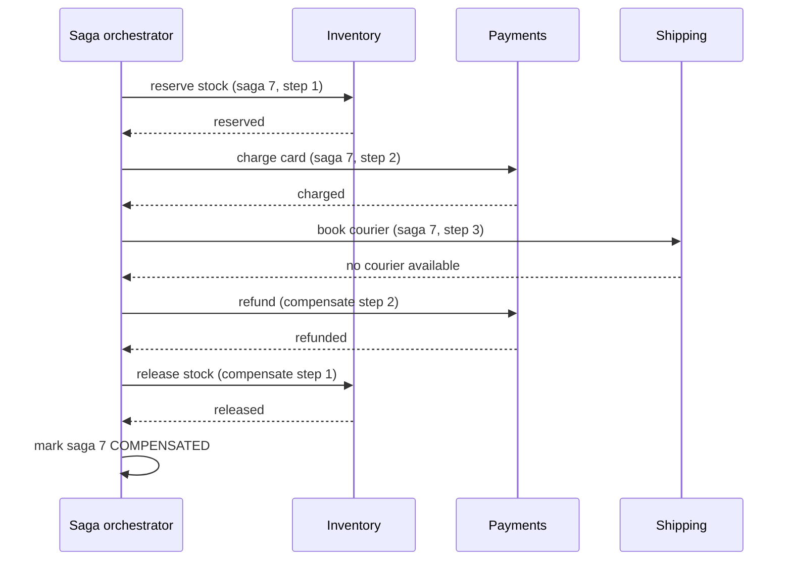

## In one minute
- When one business operation (place an order: reserve stock, charge the card, book a courier) spans several services with their own databases, there is no single `BEGIN ... COMMIT`. You must choose how to keep them consistent.
- **Two-phase commit (2PC)** gives atomicity: a coordinator asks every participant to prepare, then tells all to commit or all to abort. It holds locks across network round trips and blocks if the coordinator dies at the wrong moment, so it is rare across microservices and common inside databases.
- **Sagas** split the operation into local transactions, each with a **compensating action** that semantically undoes it. If a step fails, the saga runs compensations for completed steps in reverse. You trade isolation for availability: other requests can see intermediate states.
- The **transactional outbox** makes "update my database and publish an event" atomic, which every saga step needs.
- Interviewers raise this for e-commerce checkout, travel booking, payments and money transfers. They probe failure in the middle, compensation that fails, and what other users see meanwhile.

## How it works

### Why the problem exists
Inside one database, a transaction is atomic and isolated. Across services, each service commits independently. If inventory commits a reservation and then payment fails, someone must release the reservation. If the order service writes an order and crashes before publishing "order created", downstream services never hear about it.

### Two-phase commit
A coordinator sends `PREPARE` to all participants. Each participant does the work, writes it durably with locks held, and votes yes or no. If all vote yes, the coordinator durably records "commit" and sends `COMMIT`; otherwise it sends `ABORT`. Once a participant votes yes, it cannot decide alone: it must wait for the coordinator, holding locks. If the coordinator crashes after collecting votes, prepared participants are stuck until it recovers. In practice operators are tempted to break the deadlock by hand, and XA names this: a resource manager may make a "heuristic" decision to commit or roll back a prepared branch on its own, which frees locks but can leave the global transaction half committed, so it must report the decision to the transaction manager ([X/Open XA specification, 1991](https://pubs.opengroup.org/onlinepubs/009680699/toc.pdf)). Spanner runs 2PC over participants that are themselves Paxos-replicated groups; its authors say this "mitigates the availability problems", and they measured commits scaling reasonably to 50 participants, with latency rising noticeably at 100 ([Spanner, OSDI 2012](https://www.usenix.org/system/files/conference/osdi12/osdi12-final-16.pdf)). Across independently owned services and third-party APIs, 2PC is usually impractical: a card network will not hold a prepared transaction for you.

### Sagas
A saga is a sequence of local transactions T1, T2, ..., Tn with compensations C1, ..., Cn-1. If Tk fails, run Ck-1, ..., C1. The idea predates microservices: Garcia-Molina and Salem proposed it in 1987 for long-lived transactions inside one database, such as an airline booking that holds seat locks for hours, and noted that nothing tells other transactions that they saw work later compensated ([Sagas, SIGMOD 1987](https://www.cs.cornell.edu/andru/cs711/2002fa/reading/sagas.pdf)). Compensations are semantic, not rollbacks: "refund the charge," "release the reservation," "cancel the booking," and they must be idempotent and retryable because they also run over unreliable networks.

There are two styles. **Orchestration**: a saga orchestrator (a service or a workflow engine such as Temporal or AWS Step Functions) holds the state machine, calls each step and decides what to do next. **Choreography**: each service listens for events and reacts, with no central controller. Orchestration is easier to monitor and change for longer sagas; choreography fits short flows but risks cyclic dependencies between services and is hard to integration-test ([Azure Architecture Center](https://learn.microsoft.com/en-us/azure/architecture/patterns/saga)).

Order steps so that the riskiest or least reversible step comes late. The **pivot** step is the point of no return (often the payment capture); steps before it are compensatable, steps after it should be retryable until they succeed.

### Isolation in sagas
Sagas give up isolation. Between T1 and Tn, other transactions can see that stock is reserved for an order that will be cancelled. The anomalies are the familiar ones: lost updates, dirty reads of a step that is later compensated, and non-repeatable reads across steps. Countermeasures include semantic locks (mark the order `PENDING` so others treat it carefully), commutative updates, a pessimistic ordering that moves updates others might read into the retryable steps after the pivot, re-reading values before acting, and designing user-visible states for "in progress" ([Azure Architecture Center](https://learn.microsoft.com/en-us/azure/architecture/patterns/saga)).

### Transactional outbox
A service writes its business change and an event row into an `outbox` table in the same local transaction. A relay (polling or change data capture such as Debezium reading the database log) publishes outbox rows to the message broker ([microservices.io](https://microservices.io/patterns/data/transactional-outbox.html)). This avoids the dual-write problem where the database commit succeeds and the publish fails, or vice versa. Consumers must be idempotent because the relay delivers at least once.

### How it shows up in interviews
Triggers: design an e-commerce checkout, a travel booking system (flight plus hotel plus car), a payment or wallet transfer, a food-delivery order flow, a banking ledger across accounts in different shards. A strong answer explains why a distributed ACID transaction is unavailable or undesirable, chooses saga with orchestration, lists steps with compensations, places the pivot, uses the outbox for each step's events, makes steps idempotent, and states what intermediate states users can see. Probes: what if a compensation fails, what if the orchestrator crashes, what if two sagas touch the same inventory, when would you use 2PC instead.

## Down the stack

### Layer 1: The contract
2PC promises atomicity (all participants commit or none do) and, with locks held through commit, isolation, at the cost of blocking during coordinator failure. A saga promises eventual all-or-compensated: given that every step and compensation is eventually retried to success, the system ends with either all steps applied or all applied steps compensated. It does not promise isolation; intermediate states are visible. The outbox promises that an event is published if and only if its local transaction committed, at least once.

### Layer 2: The mechanism
In Postgres, a participant runs `PREPARE TRANSACTION 'gid'`, which persists the transaction's state and locks so it survives a crash, and later `COMMIT PREPARED 'gid'` or `ROLLBACK PREPARED 'gid'`; `max_prepared_transactions` defaults to 0, so it must be enabled ([PostgreSQL docs](https://www.postgresql.org/docs/current/runtime-config-resource.html)). The docs are blunt that the command is for external transaction managers, not applications ([PostgreSQL docs](https://www.postgresql.org/docs/current/sql-prepare-transaction.html)). XA defines the same `xa_prepare`, `xa_commit` and `xa_rollback` calls for resource managers. A saga orchestrator persists a state record per saga (`saga_id`, `current_step`, `status` such as `RUNNING`, `COMPENSATING`, `COMPLETED`, `FAILED`) before and after each step, and passes `saga_id + step` as the idempotency key to each service. Workflow engines like Temporal persist an event history for each workflow and replay it to rebuild state after a worker crash, so the orchestrator code looks sequential but survives failure. The price is determinism: replay must issue the same commands in the same order, so workflow code may not read the clock, draw random numbers or call services directly; those go in activities whose results are recorded in the history ([Temporal docs](https://docs.temporal.io/workflow-definition)). For the outbox, Debezium reads Postgres's logical replication stream from a replication slot, turns inserted outbox rows into Kafka records, and by default routes each to the topic `outbox.event.<aggregatetype>`, carrying the row's `id` as a header that consumers can use to drop duplicates ([Debezium docs](https://debezium.io/documentation/reference/stable/transformations/outbox-event-router.html)).

### Layer 3: The machine
Each durable decision costs a log flush. In 2PC, every participant flushes its prepare record (an `fsync` of the WAL) before voting yes, and the coordinator flushes its decision before sending commit, so the critical path contains at least two sequential flushes and two network round trips; within a data centre that is a few milliseconds, across regions it is hundreds. Locks held during that window block other transactions on the same rows, so throughput on hot rows drops to roughly one transaction per commit latency. Prepared transactions also pin resources: in Postgres a forgotten prepared transaction holds its locks and prevents vacuum from cleaning up old row versions, so table bloat grows until someone resolves it, and in the extreme the server shuts down to avoid transaction ID wraparound ([PostgreSQL docs](https://www.postgresql.org/docs/current/sql-prepare-transaction.html)). In a saga, each step commits locally and releases locks immediately, so hot rows stay available; the cost moves to extra writes (saga state, outbox rows) and asynchronous latency between steps through the broker.

### Why it's built this way
Network partitions and crashes are unavoidable, and a participant that has promised to commit cannot safely decide alone, so atomic commit must block or must replicate the coordinator. Holding locks across slow networks destroys throughput, so cross-service workflows release locks early and compensate instead. Writing to a database and a broker cannot be atomic across the two, so the event is written into the database and relayed. Every step can be retried, so every step and compensation must be idempotent.

## Diagram


## Worked example
A travel site books a flight, a hotel and a rental car as one trip, 200 trips per minute at peak. Each supplier is an external API with its own booking and cancellation endpoints; none supports 2PC.

The orchestrator stores saga state in its own database. Step order: hotel hold (free cancellation, cheap to undo), car hold (free cancellation), then flight ticketing (expensive to cancel, so it is the pivot), then confirmation email (retry until success). Each call includes an idempotency key `trip-{id}-step-{n}`.

In a typical week, 3% of trips fail at the flight step because the fare changed. For those, the orchestrator cancels the car and the hotel. About 0.1% of cancellations fail on the first attempt (supplier timeouts); they retry with exponential backoff for up to 24 hours. Twice a month a cancellation still fails after a day, and the saga moves to `NEEDS_ATTENTION`, which pages the operations team with the supplier reference.

The orchestrator crashes during a deploy with 150 sagas in flight. On restart it loads every saga in `RUNNING` or `COMPENSATING` and resumes from the last recorded step. Because each supplier call is idempotent, re-sending a step that had already succeeded returns the existing booking rather than booking twice.

Users see a "Booking in progress" page for the 5 to 20 seconds the saga takes, then a confirmation or a clear failure.

## In the wild
- **Google, 2013: AdWords on 2PC over Paxos.** F1 moved AdWords off a hard-to-reshard MySQL setup onto Spanner: over 100 TB and hundreds of thousands of requests per second. Commits take 50 to 150 ms, and cross-group commits use 2PC, which typically doubles commit latency; aborts and latency climb sharply with hundreds of participants. The fix was schema design, not protocol: a hierarchy rooted at Customer keeps most transactions inside one Paxos group so they skip 2PC entirely ([F1, VLDB 2013](https://www.vldb.org/pvldb/vol6/p1068-shute.pdf)).
- **Cockroach Labs, 2019: parallel commits halve 2PC latency.** CockroachDB's commit used two sequential consensus rounds, one to write intents and one to mark the transaction record committed. Parallel commits writes a `STAGING` record listing the in-flight writes at the same time as the writes; the transaction counts as committed once all are replicated, and any node can run status recovery if the coordinator dies. It shipped on by default in 19.2 and roughly halved cross-range commit latency ([Cockroach Labs](https://www.cockroachlabs.com/blog/parallel-commits/)).
- **Uber, 2023: orchestrated workflows at scale.** After six years in production, Uber's Cadence workflow engine was running over 12 billion executions and 270 billion actions a month for more than 1,000 services, with automatic retries, region failover, and workflow resets to rewind executions after a bad deploy ([Uber](https://www.uber.com/en/blog/announcing-cadence/)).

## Trade-offs
| Option | Strengths | Weaknesses | Choose when |
|---|---|---|---|
| 2PC or XA | Atomic and isolated | Blocking, lock holding, needs participant support | Inside one database system or tightly coupled stores |
| Orchestrated saga | Clear flow, central monitoring, easy to change | Orchestrator is a component to run and scale | Multi-step business workflows |
| Choreographed saga | No central service, loose coupling | Hard to trace and change, cyclic dependencies | Short flows of two or three steps |
| Try-confirm-cancel | Reservations with explicit expiry | Every participant must implement three operations | Inventory, seats, quotas |
| Avoid distribution | True ACID | Larger service or shared database | Data that must change together frequently |

## Pitfalls in production
- **Non-idempotent steps.** A retried "charge card" charges twice. Pass a stable idempotency key per saga step to every participant.
- **Compensations that can fail permanently.** Refunds can be rejected, hotels may refuse cancellation. Design a terminal "needs manual action" state with alerting rather than assuming compensation always works.
- **Dual writes.** Updating the database and publishing to the broker separately loses events on crashes. Use the outbox pattern.
- **Visible intermediate states.** Another user sees stock as unavailable because of a reservation about to be released. Use pending states, short hold expiries and clear UX.
- **Orphaned prepared transactions.** In 2PC, a crashed coordinator leaves prepared transactions holding locks. Monitor `pg_prepared_xacts` or equivalent and have a recovery procedure.

## Leadership lens
- First ask whether the boundary is right. If two services need atomic updates constantly, they may belong together.
- Choose a workflow engine or a well-tested orchestrator library rather than hand-rolling state machines in each team.
- Require every cross-service step to specify its compensation, idempotency key and what users see while it runs, in the design doc.
- Plan operations: dashboards of sagas by state and age, alerts on stuck sagas, and runbooks for manual resolution.

## Check yourself
1. Why can a participant in 2PC not decide on its own after voting yes?
   **Answer:** It promised to commit if asked, and other participants may already have committed or aborted based on the coordinator's decision, so acting alone could break atomicity.
2. What is a pivot step in a saga, and where should it go?
   **Answer:** The point after which the saga will complete rather than compensate; put it after cheap, reversible steps so failures before it are easy to undo.
3. What problem does the transactional outbox solve?
   **Answer:** It makes the business write and the event publication atomic by storing the event in the same database transaction and relaying it afterwards.
4. Why must compensations be idempotent?
   **Answer:** They run over unreliable networks and are retried, so running one twice must not, for example, refund a payment twice.

## Practice
**Task:** Implement a saga orchestrator. `run_saga(steps, max_attempts)` takes a list of steps, each with a `name`, an `action` and a `compensate` callable that return `True` on success. Run actions in order, logging `"do:<name>"` on success. If an action fails, log `"fail:<name>"` and compensate the previously completed steps in reverse order. Each compensation is tried up to `max_attempts` times, logging `"undo:<name>"` on success and `"undo_failed:<name>"` on each failed attempt; if all attempts fail, stop and return status `"stuck"`. Return `("committed", log)` if all actions succeed, `("compensated", log)` if all needed compensations succeed. The failed step itself is not compensated.

```python starter
def run_saga(steps, max_attempts):
    # steps: list of (name, action, compensate); returns (status, log)
    # TODO
    raise NotImplementedError
```

```python tests
def scripted(*results):
    seq = list(results)
    def call():
        return seq.pop(0)
    return call

def ok():
    return True

def test_all_steps_commit():
    steps = [("reserve", ok, ok), ("charge", ok, ok), ("ship", ok, ok)]
    assert run_saga(steps, 3) == ("committed", ["do:reserve", "do:charge", "do:ship"])

def test_failure_compensates_in_reverse():
    steps = [("reserve", ok, ok), ("charge", ok, ok), ("ship", scripted(False), ok)]
    status, log = run_saga(steps, 3)
    assert status == "compensated"
    assert log == ["do:reserve", "do:charge", "fail:ship", "undo:charge", "undo:reserve"]

def test_first_step_failure_needs_no_compensation():
    steps = [("reserve", scripted(False), ok), ("charge", ok, ok)]
    assert run_saga(steps, 3) == ("compensated", ["fail:reserve"])

def test_compensation_retried_until_success():
    steps = [("reserve", ok, scripted(False, False, True)), ("charge", scripted(False), ok)]
    status, log = run_saga(steps, 3)
    assert status == "compensated"
    assert log == ["do:reserve", "fail:charge", "undo_failed:reserve", "undo_failed:reserve", "undo:reserve"]

def test_stuck_when_compensation_exhausts_attempts():
    steps = [("a", ok, ok), ("b", ok, scripted(False, False)), ("c", scripted(False), ok)]
    status, log = run_saga(steps, 2)
    assert status == "stuck"
    assert log == ["do:a", "do:b", "fail:c", "undo_failed:b", "undo_failed:b"], "a is never compensated"

def test_empty_saga_commits():
    assert run_saga([], 1) == ("committed", [])
```

```python solution
def run_saga(steps, max_attempts):
    log = []
    done = []
    for name, action, compensate in steps:
        if action():
            log.append("do:" + name)
            done.append((name, compensate))
            continue
        log.append("fail:" + name)
        for cname, comp in reversed(done):
            ok = False
            for _ in range(max_attempts):
                if comp():
                    log.append("undo:" + cname)
                    ok = True
                    break
                log.append("undo_failed:" + cname)
            if not ok:
                return ("stuck", log)
        return ("compensated", log)
    return ("committed", log)
```

```typescript starter
export type Step = { name: string; action: () => boolean; compensate: () => boolean };

export function runSaga(steps: Step[], maxAttempts: number): [string, string[]] {
  throw new Error("TODO");
}
```

```typescript tests
function scripted(...results: boolean[]): () => boolean {
  const seq = [...results];
  return () => seq.shift() as boolean;
}
const ok = () => true;
test("all steps commit", () => {
  const steps: Step[] = [
    { name: "reserve", action: ok, compensate: ok },
    { name: "charge", action: ok, compensate: ok },
    { name: "ship", action: ok, compensate: ok },
  ];
  assertEqual(runSaga(steps, 3), ["committed", ["do:reserve", "do:charge", "do:ship"]]);
});
test("failure compensates in reverse", () => {
  const steps: Step[] = [
    { name: "reserve", action: ok, compensate: ok },
    { name: "charge", action: ok, compensate: ok },
    { name: "ship", action: scripted(false), compensate: ok },
  ];
  assertEqual(runSaga(steps, 3), ["compensated", ["do:reserve", "do:charge", "fail:ship", "undo:charge", "undo:reserve"]]);
});
test("first step failure", () => {
  const steps: Step[] = [
    { name: "reserve", action: scripted(false), compensate: ok },
    { name: "charge", action: ok, compensate: ok },
  ];
  assertEqual(runSaga(steps, 3), ["compensated", ["fail:reserve"]]);
});
test("compensation retried", () => {
  const steps: Step[] = [
    { name: "reserve", action: ok, compensate: scripted(false, false, true) },
    { name: "charge", action: scripted(false), compensate: ok },
  ];
  assertEqual(runSaga(steps, 3), ["compensated", ["do:reserve", "fail:charge", "undo_failed:reserve", "undo_failed:reserve", "undo:reserve"]]);
});
test("stuck after attempts", () => {
  const steps: Step[] = [
    { name: "a", action: ok, compensate: ok },
    { name: "b", action: ok, compensate: scripted(false, false) },
    { name: "c", action: scripted(false), compensate: ok },
  ];
  assertEqual(runSaga(steps, 2), ["stuck", ["do:a", "do:b", "fail:c", "undo_failed:b", "undo_failed:b"]]);
});
test("empty saga", () => {
  assertEqual(runSaga([], 1), ["committed", []]);
});
```

```typescript solution
export type Step = { name: string; action: () => boolean; compensate: () => boolean };

export function runSaga(steps: Step[], maxAttempts: number): [string, string[]] {
  const log: string[] = [];
  const done: Step[] = [];
  for (const step of steps) {
    if (step.action()) {
      log.push("do:" + step.name);
      done.push(step);
      continue;
    }
    log.push("fail:" + step.name);
    for (let i = done.length - 1; i >= 0; i--) {
      let undone = false;
      for (let a = 0; a < maxAttempts; a++) {
        if (done[i].compensate()) {
          log.push("undo:" + done[i].name);
          undone = true;
          break;
        }
        log.push("undo_failed:" + done[i].name);
      }
      if (!undone) return ["stuck", log];
    }
    return ["compensated", log];
  }
  return ["committed", log];
}
```

```go starter
package practice

// Step is one local transaction in a saga with its compensation.
type Step struct {
	Name       string
	Action     func() bool
	Compensate func() bool
}

// RunSaga returns "committed", "compensated" or "stuck", and the log.
func RunSaga(steps []Step, maxAttempts int) (string, []string) {
	panic("TODO")
}
```

```go tests
package practice

import (
	"reflect"
	"testing"
)

func scripted(results ...bool) func() bool {
	return func() bool {
		r := results[0]
		results = results[1:]
		return r
	}
}

func ok() bool { return true }

func expect(t *testing.T, gotS string, gotL []string, wantS string, wantL []string) {
	t.Helper()
	if gotS != wantS || !reflect.DeepEqual(gotL, wantL) {
		t.Fatalf("got %s %v, want %s %v", gotS, gotL, wantS, wantL)
	}
}

func TestCommit(t *testing.T) {
	s, l := RunSaga([]Step{{"reserve", ok, ok}, {"charge", ok, ok}, {"ship", ok, ok}}, 3)
	expect(t, s, l, "committed", []string{"do:reserve", "do:charge", "do:ship"})
}

func TestCompensateReverse(t *testing.T) {
	s, l := RunSaga([]Step{{"reserve", ok, ok}, {"charge", ok, ok}, {"ship", scripted(false), ok}}, 3)
	expect(t, s, l, "compensated", []string{"do:reserve", "do:charge", "fail:ship", "undo:charge", "undo:reserve"})
}

func TestFirstStepFails(t *testing.T) {
	s, l := RunSaga([]Step{{"reserve", scripted(false), ok}, {"charge", ok, ok}}, 3)
	expect(t, s, l, "compensated", []string{"fail:reserve"})
}

func TestCompensationRetried(t *testing.T) {
	s, l := RunSaga([]Step{{"reserve", ok, scripted(false, false, true)}, {"charge", scripted(false), ok}}, 3)
	expect(t, s, l, "compensated", []string{"do:reserve", "fail:charge", "undo_failed:reserve", "undo_failed:reserve", "undo:reserve"})
}

func TestStuck(t *testing.T) {
	s, l := RunSaga([]Step{{"a", ok, ok}, {"b", ok, scripted(false, false)}, {"c", scripted(false), ok}}, 2)
	expect(t, s, l, "stuck", []string{"do:a", "do:b", "fail:c", "undo_failed:b", "undo_failed:b"})
}

func TestEmpty(t *testing.T) {
	s, l := RunSaga(nil, 1)
	expect(t, s, l, "committed", []string{})
}
```

```go solution
package practice

// Step is one local transaction in a saga with its compensation.
type Step struct {
	Name       string
	Action     func() bool
	Compensate func() bool
}

// RunSaga returns "committed", "compensated" or "stuck", and the log.
func RunSaga(steps []Step, maxAttempts int) (string, []string) {
	log := []string{}
	var done []Step
	for _, st := range steps {
		if st.Action() {
			log = append(log, "do:"+st.Name)
			done = append(done, st)
			continue
		}
		log = append(log, "fail:"+st.Name)
		for i := len(done) - 1; i >= 0; i-- {
			undone := false
			for a := 0; a < maxAttempts; a++ {
				if done[i].Compensate() {
					log = append(log, "undo:"+done[i].Name)
					undone = true
					break
				}
				log = append(log, "undo_failed:"+done[i].Name)
			}
			if !undone {
				return "stuck", log
			}
		}
		return "compensated", log
	}
	return "committed", log
}
```

## Mock interview
**Prompt:** Design checkout for an online marketplace. Placing an order must reserve inventory in the inventory service, charge the buyer through the payments service (which calls an external card processor), and create a shipment in the logistics service. Peak load is 2,000 orders per second, each service owns its own database, and the business never wants to charge a customer for an item that cannot ship.

- Follow-up: The orchestrator crashes after the charge succeeds but before it records that fact. What happens on recovery?
- Follow-up: The refund compensation fails because the card processor is down for an hour. What does the customer see?
- Follow-up: Two buyers race for the last unit. How do the sagas interact, and would 2PC help?

**A strong answer covers:**
- Why a distributed ACID transaction is impractical here (external processor, independent databases, lock holding at 2,000 orders per second).
- An orchestrated saga with ordered steps (reserve, authorize, ship, capture), compensations for each, and a clearly chosen pivot.
- Durable saga state, idempotency keys per step, and resumption after orchestrator crashes.
- Transactional outbox in each service for events, and idempotent consumers.
- Handling isolation with pending states and reservation expiry, plus a manual-resolution path and monitoring for stuck sagas.

## Sources and further study
**Primary**
- [Spanner: Google's globally distributed database (OSDI 2012)](https://www.usenix.org/system/files/conference/osdi12/osdi12-final-16.pdf): 2PC over Paxos groups and measured scaling by participant count.
- [Distributed Transaction Processing: The XA Specification (X/Open, 1991)](https://pubs.opengroup.org/onlinepubs/009680699/toc.pdf): the `xa_prepare`/`xa_commit` interface and heuristic completion.

**Systems docs**
- [Temporal: Workflow definition](https://docs.temporal.io/workflow-definition): event-history replay and the determinism rules for orchestrator code.
- [Debezium: Outbox event router](https://debezium.io/documentation/reference/stable/transformations/outbox-event-router.html): the outbox table shape, topic routing and the event ID for dedup.
- [PostgreSQL: max_prepared_transactions](https://www.postgresql.org/docs/current/runtime-config-resource.html): why the prepare phase is off by default.

**Books**
- *Designing Data-Intensive Applications* (1st edition), Martin Kleppmann, chapter 9 "Consistency and Consensus", section "Distributed Transactions and Consensus": 2PC, coordinator failure, XA and in-doubt transactions.
- *Building Microservices* (2nd edition), Sam Newman, chapter 6 "Workflow": "Distributed Transactions—Just Say No" and sagas.
- *Understanding Distributed Systems* (2nd edition), Roberto Vitillo, chapter "Asynchronous transactions": outbox, sagas and isolation.

**Other curricula**
- [AWS Prescriptive Guidance: Saga orchestration pattern](https://docs.aws.amazon.com/prescriptive-guidance/latest/cloud-design-patterns/saga-orchestration.html): frames the saga as the fallback when database-per-service rules out 2PC, implemented as a Step Functions state machine with compensations, and recommends semantic locks for the missing isolation.

## Watch
- [Applying the Saga Pattern (GOTO 2015, Caitie McCaffrey)](https://www.youtube.com/watch?v=xDuwrtwYHu8): sagas from the original paper to distributed services, with failure handling.
- [Distributed Systems 7.1: Two-phase commit (Martin Kleppmann)](https://www.youtube.com/watch?v=-_rdWB9hN1c): a clear lecture on atomic commit and why it blocks.
- [Transactions: myths, surprises and opportunities (Strange Loop, Martin Kleppmann)](https://www.youtube.com/watch?v=5ZjhNTM8XU8): what transactional guarantees really mean and where distributed transactions fit.

## Free resources
- [Sagas (Garcia-Molina and Salem, 1987)](https://www.cs.cornell.edu/andru/cs711/2002fa/reading/sagas.pdf): the original paper introducing sagas and compensating transactions.
- [Saga pattern (microservices.io)](https://microservices.io/patterns/data/saga.html): orchestration versus choreography with examples.
- [Transactional outbox (microservices.io)](https://microservices.io/patterns/data/transactional-outbox.html): atomic publish of events alongside database writes.
- [Saga distributed transactions pattern (Azure Architecture Center)](https://learn.microsoft.com/en-us/azure/architecture/reference-architectures/saga/saga): pivot transactions, countermeasures and data anomalies.
- [PREPARE TRANSACTION (PostgreSQL docs)](https://www.postgresql.org/docs/current/sql-prepare-transaction.html): how a real database exposes the prepare phase and its caveats.
- [Distributed Systems lecture notes (Kleppmann, Cambridge)](https://www.cl.cam.ac.uk/teaching/2122/ConcDisSys/dist-sys-notes.pdf): atomic commit, consensus and replication in one free set of notes.
