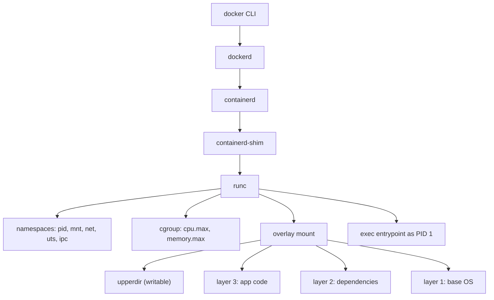

## In one minute
- A container is an ordinary Linux process with a restricted view of the system: namespaces limit what it can see, cgroups limit what it can use, and an overlay filesystem gives it its own root.
- A Docker image is a stack of read-only, content-addressed tar layers plus a JSON config. Containers add a thin writable layer on top, so a hundred containers from one image share almost all their disk and page cache.
- Docker's value in system design is packaging and repeatability: the same bytes run on a laptop, in CI and in production, and start in well under a second because there is no guest kernel to boot.
- The isolation boundary is the shared host kernel. That is weaker than a virtual machine, which matters for multi-tenant or untrusted code.
- In interviews, containers are the default unit of deployment. The interesting questions are image size, CPU and memory limits, where state lives, and what isolation you need.

## How it works

### From `docker run` to a process
The `docker` CLI talks to `dockerd` over a Unix socket. `dockerd` handles images, networks and volumes, and delegates container lifecycle to `containerd` over gRPC. For each container, `containerd` starts a small `containerd-shim-runc-v2` process, which calls `runc`. `runc` reads an OCI runtime bundle (a `config.json` plus a root filesystem), creates namespaces and cgroups, mounts the root filesystem, drops privileges and `exec`s your entrypoint. Then `runc` exits; the shim stays as parent so `dockerd` can restart without killing containers. Since Docker Engine 29 (November 2025), fresh installs also hand image storage to containerd: layers are unpacked by containerd snapshotters instead of Docker's own `overlay2` graph driver, which keeps the compressed blobs as well and so uses more disk ([Docker docs](https://docs.docker.com/engine/storage/containerd/)).

### Images and layers
Each Dockerfile instruction that changes the filesystem (`RUN`, `COPY`, `ADD`) produces a layer: a tar of the files it added, changed or deleted. An image manifest, defined by the OCI image spec, lists the layers by SHA-256 digest along with a config blob holding the entrypoint, environment and the uncompressed `diff_ids`. Because layers are named by their content, two images built on the same base share those layers on disk and in the registry, and a pull downloads only layers the node lacks. A multi-architecture image adds an index pointing to one manifest per platform ([OCI image spec](https://github.com/opencontainers/image-spec/blob/main/manifest.md)).

### Build cache
BuildKit, the default builder on Linux since Docker Engine 23.0 ([release notes](https://docs.docker.com/engine/release-notes/23.0/)), reuses a layer if its parent and instruction are unchanged and, for `COPY`, the copied files' checksums match. So install dependencies before copying source code, and a code change invalidates only the last small layer.

### Networking and storage
By default a container gets its own network namespace, joined to the host by a veth pair attached to the `docker0` bridge, with outbound traffic masqueraded via iptables NAT and published ports forwarded with DNAT rules. State that must survive the container goes in volumes or bind mounts, which bypass the overlay filesystem.

## Down the stack

### Layer 1: The contract
- **Filesystem.** A container sees the merged image layers as its root. Writes go to a private writable layer that disappears with the container unless committed. Image layers are immutable and identified by digest, so a given digest always yields the same bytes.
- **Isolation.** A container cannot see other processes, mounts, hostnames or network interfaces outside its namespaces, and cannot exceed its cgroup limits. It shares the host kernel, so a kernel exploit escapes the boundary.
- **Resources.** `--memory` is a hard limit: exceeding it triggers the kernel OOM killer inside the cgroup. `--cpus` is a bandwidth quota, not a reservation: the container may use up to N CPUs of time per period and is throttled beyond that.
- **Performance.** CPU and memory access run at native speed because there is no hypervisor. Startup is typically 100 ms to 1 s when the image is already on the node.

### Layer 2: The mechanism
**Namespaces.** `runc` calls `clone` or `unshare` with flags such as `CLONE_NEWPID`, `CLONE_NEWNS`, `CLONE_NEWNET`, `CLONE_NEWUTS`, `CLONE_NEWIPC`, `CLONE_NEWCGROUP` and optionally `CLONE_NEWUSER`. In a new PID namespace the entrypoint is PID 1, which must reap zombies and handle `SIGTERM` (use `--init` or tini if it does not). The mount namespace plus `pivot_root` swaps in the container root. `docker exec` joins the namespaces listed under `/proc/<pid>/ns/`.

**cgroups v2.** Each container gets a directory in the unified hierarchy under `/sys/fs/cgroup`. `cpu.max` holds "quota period", for example `150000 100000` for 1.5 CPUs. `memory.max` is the hard limit and `memory.high` a throttling threshold. `pids.max` caps fork bombs, and `io.max` limits block device bandwidth ([cgroup v2 docs](https://docs.kernel.org/admin-guide/cgroup-v2.html)). Docker 29 deprecates cgroup v1, with support promised only until at least May 2029 ([Engine 29 release notes](https://docs.docker.com/engine/release-notes/29/)). Counters such as `cpu.stat` (`nr_throttled`, `throttled_usec`) and `memory.events` (`oom_kill`) show when limits bite.

**overlayfs.** The `overlay2` driver mounts each container with `lowerdir` (the image layers, colon-separated, top first), `upperdir` (the writable layer), `workdir` (scratch space for atomic operations) and the `merged` view ([overlayfs docs](https://docs.kernel.org/filesystems/overlayfs.html)). A lookup checks the upper directory, then each lower one in order. The first write to a lower-layer file triggers copy-up: the whole file is copied into the upper directory before the write proceeds. Deleting a lower file creates a whiteout (a 0/0 character device) in the upper directory, and replacing a directory marks it opaque with the `trusted.overlay.opaque` xattr. In image tar layers the same ideas are encoded as `.wh.<name>` files and a `.wh..wh..opq` marker, which the driver converts when it unpacks a layer.

**Seccomp and capabilities.** The default seccomp profile is an allowlist that leaves out around 44 of the 300-plus syscalls, such as `kexec_load`, `bpf` and `io_uring_setup` ([Docker docs](https://docs.docker.com/engine/security/seccomp/)), and the default capability set drops `CAP_SYS_ADMIN` and most other root powers.

### Layer 3: The machine
**CPU throttling.** The bandwidth controller refills each cgroup's quota every period, 100 ms by default ([kernel docs](https://docs.kernel.org/scheduler/sched-bwc.html)). It is still called CFS bandwidth control, although Linux 6.6 replaced CFS's task picking with EEVDF ([kernel docs](https://docs.kernel.org/scheduler/sched-eevdf.html)). A service limited to 2 CPUs that runs 16 busy threads consumes 200 ms of CPU time in 12.5 ms of wall time, then sleeps for the remaining 87.5 ms of the period. Average utilisation looks fine while p99 jumps by up to 90 ms. Watch `nr_throttled` and size thread pools to the quota, not to the host core count. `cpu.max.burst` lets a cgroup bank unused quota for short spikes, at the cost of more interference with neighbours.

**Memory.** The memory cgroup counts anonymous memory and page cache. When usage hits `memory.max`, the kernel first reclaims cache in that cgroup, then OOM-kills a process inside it, usually PID 1, and the container exits with code 137. Language runtimes that size heaps from host RAM (older JVMs, some Node settings) overshoot the limit, so set heap sizes explicitly or rely on container-aware defaults.

**Disk and page cache.** Lower layers are shared files, so 50 containers from one image read the same inodes and share one copy in page cache. Copy-up is the cost: modifying one byte of a 2 GB file in a lower layer first writes 2 GB to the upper directory. Databases and logs belong in volumes for that reason.

**Network.** Bridge networking costs a veth hop, a bridge forward and conntrack NAT, adding a few microseconds per packet and a conntrack entry per flow. A host handling hundreds of thousands of short connections can fill `nf_conntrack_max` and silently drop new flows. `--network host` skips all of it at the cost of port conflicts.

### Why it's built this way
1. Booting a guest kernel per application costs seconds and hundreds of MB, so containers reuse the host kernel and isolate with kernel features that already existed.
2. Shipping full filesystem images to thousands of hosts is expensive, so images are split into content-addressed layers that deduplicate and cache.
3. Layers must stay immutable to be shared, so writes go to a per-container upper layer through copy-up, and deletion needs whiteouts.
4. Copying whole files on write is slow for large mutable data, so state lives in volumes outside the layered filesystem.
5. Kernels share resources by default, so cgroups add accounting and limits, and their period-based CPU quotas trade tail latency for simple, enforceable fairness.

## Diagram


## Worked example
A Python API image has three layers: a slim base (80 MB compressed), dependencies (300 MB) and application code (5 MB). It deploys to 200 nodes ten times a day.

With the Dockerfile ordered `COPY requirements.txt`, `RUN pip install`, `COPY . .`, a code change rebuilds only the 5 MB layer. Each deploy pulls 200 × 5 MB = 1 GB from the registry. If someone writes `COPY . .` before `pip install`, every commit invalidates the dependency layer too: 200 × 305 MB = 61 GB per deploy. At an effective 10 Gbit/s of registry egress, that is about 50 s of pure transfer versus under 1 s, plus decompression on each node, and over 600 GB of transfer per day.

The same service runs with `--cpus 2` and a thread pool of 32. Under load its CPU graphs show 70 percent of quota, but `nr_throttled` climbs and p99 rises from 40 ms to 120 ms. Shrinking the pool to 4 workers, or raising the quota, removes the throttling.

## In the wild
- **runc, 2024: Leaky Vessels lets a container reach the host filesystem.** runc leaked a file descriptor for the host's `/sys/fs/cgroup` into the container's init process. An image whose working directory resolved to `/proc/self/fd/7/` started with its current directory in the host mount namespace, and variants could overwrite host binaries. Versions 1.0.0-rc93 to 1.1.11 were affected (CVSS 8.6); 1.1.12 fixed it on 31 January ([runc advisory](https://github.com/opencontainers/runc/security/advisories/GHSA-xr7r-f8xq-vfvv)). It is the shared-kernel, shared-runtime boundary from this lesson failing in practice.
- **Codecov, 2021: a Docker image build leaked the credential behind a supply-chain attack.** Codecov says an error in its Docker image creation process let an attacker extract a cloud storage credential. From 31 January an attacker used it to add one line to the Bash Uploader that sent each customer CI runner's environment, with its tokens and keys, to a remote server. A customer's checksum check caught it on 1 April, about two months later ([Codecov](https://about.codecov.io/security-update/)). The lesson for image builds: anything a build puts in a layer, including a credential, ships to everyone who can pull the image, and Docker warns that build arguments and environment variables persist in the final image; BuildKit secret mounts exist only for one build step ([Docker docs](https://docs.docker.com/build/building/secrets/)).

## Trade-offs
| Option | Strengths | Weaknesses | Choose when |
|---|---|---|---|
| Docker / OCI containers | Fast start, dense packing, standard image format | Shared kernel, noisy-neighbour effects | Default for services you trust |
| Virtual machines | Strong isolation, any kernel | Seconds to boot, GB of overhead | Untrusted tenants, kernel-specific needs |
| MicroVMs (Firecracker, Kata) | VM isolation with container-like start (around 100 to 200 ms) | More complex ops, fewer features | Multi-tenant serverless, CI runners |
| gVisor | User-space kernel limits syscall surface | Syscall-heavy workloads slow down | Untrusted code that is mostly compute |
| Bare process plus systemd | No layers, no overhead | No packaging story, dependency drift | Single-purpose hosts, appliances |

## Pitfalls in production
- **CPU throttling at low utilisation.** Quotas are enforced per 100 ms period. Match thread counts to the quota, alert on `nr_throttled`, and consider dropping CPU limits for latency-sensitive services while keeping requests.
- **OOM kills from runtime defaults.** Heaps sized from host memory exceed the cgroup limit. Set heap flags or use container-aware runtimes, and leave headroom for page cache and native memory.
- **State in the writable layer.** Data written there is lost on redeploy and slowed by copy-up. Use volumes.
- **Registry rate limits.** Docker Hub allows 100 pulls per 6 hours per IP for anonymous clients and 200 for a free personal account ([Docker docs](https://docs.docker.com/docker-hub/usage/)). A cluster scaling out behind one NAT address hits that fast, so pull through an authenticated mirror or your own registry.
- **Bloated images.** Build tools and caches left in layers slow every pull. Use multi-stage builds and keep deletions in the same `RUN` as the install, since a later delete only adds a whiteout.
- **PID 1 that ignores signals.** A shell-form entrypoint wraps the app in `sh`, which does not forward `SIGTERM`, so shutdown waits for the kill timeout. Use exec form or `--init`.

## Leadership lens
- Decide the isolation level per workload: shared-kernel containers for your own code, microVMs or gVisor for customer code.
- Own a small set of approved base images with patch cadence and vulnerability scanning; base images are the biggest supply-chain surface.
- Measure image size and pull time as deploy-speed metrics, and put registry mirrors or caches near clusters.
- Agree on resource policy: requests, limits, and whether CPU limits are set at all. It shapes cost and tail latency across teams.

## Check yourself
1. Two containers from the same 1 GB image run on one host. Roughly how much disk and page cache do they use, and why?
   **Answer:** About 1 GB plus each container's small writable layer, because both mount the same read-only lower layers and share their page cache.
2. A `RUN rm -rf /tmp/cache` in a later Dockerfile line does not shrink the image. Why?
   **Answer:** Earlier layers are immutable; the delete only adds whiteouts in a new layer, so the bytes are still shipped. Remove files in the same `RUN` that created them.
3. Why can a container at 60 percent average CPU of its quota still see 80 ms latency spikes?
   **Answer:** Quota is enforced per period; bursts across many threads exhaust it early in the period and the cgroup is throttled until the next refill.
4. Why is a container a weaker security boundary than a VM?
   **Answer:** All containers share the host kernel, so a kernel bug reachable through any allowed syscall can escape, whereas a VM exposes only the much smaller hypervisor interface.

## Practice
**Task:** Implement OCI-style image layer resolution. `merge(layers)` takes layers from bottom to top, each a map from path (like `etc/app.conf`, no leading slash) to file content, and returns the merged view as a map of regular files. Within a layer, apply in this order: an opaque marker `D/.wh..wh..opq` hides everything under `D/` from lower layers; a whiteout `D/.wh.N` (or `.wh.N` at the root) deletes `D/N` and everything under `D/N/`; then each regular file is written, which also removes any lower file at a path that is a prefix directory of it and any lower files beneath it. Whiteout and marker entries never appear in the result. Then implement `diff(lower, upper)`, which takes two merged views and returns the smallest layer that turns `lower` into `upper`: changed and new files, plus a `.wh.` whiteout (with empty content) for each removed file.

```python starter
def merge(layers):
    # TODO
    raise NotImplementedError


def diff(lower, upper):
    # TODO
    raise NotImplementedError
```

```python tests
def test_upper_overrides_lower():
    base = {"etc/os": "debian", "bin/sh": "sh"}
    app = {"etc/os": "custom", "app/main.py": "print(1)"}
    assert merge([base, app]) == {"etc/os": "custom", "bin/sh": "sh", "app/main.py": "print(1)"}

def test_whiteout_deletes_file():
    base = {"etc/a": "1", "etc/b": "2"}
    top = {"etc/.wh.a": ""}
    assert merge([base, top]) == {"etc/b": "2"}

def test_whiteout_deletes_directory_and_root_level():
    base = {"var/cache/x": "1", "var/cache/y": "2", "var/log/z": "3", "tmp/t": "4"}
    top = {"var/.wh.cache": "", ".wh.tmp": ""}
    assert merge([base, top]) == {"var/log/z": "3"}

def test_opaque_dir_hides_lower_but_keeps_own_files():
    base = {"conf/a": "1", "conf/b": "2", "other": "o"}
    top = {"conf/.wh..wh..opq": "", "conf/c": "3"}
    assert merge([base, top]) == {"conf/c": "3", "other": "o"}

def test_file_replaces_directory_and_vice_versa():
    base = {"data/x": "1", "data/y": "2", "run": "file"}
    top = {"data": "now a file", "run/pid": "42"}
    assert merge([base, top]) == {"data": "now a file", "run/pid": "42"}

def test_recreate_after_whiteout_in_higher_layer():
    layers = [{"a/f": "1"}, {"a/.wh.f": ""}, {"a/f": "3"}]
    assert merge(layers) == {"a/f": "3"}

def test_diff_round_trips():
    lower = {"etc/a": "1", "etc/b": "2", "lib/x": "x"}
    upper = {"etc/a": "1", "etc/b": "changed", "bin/new": "n"}
    layer = diff(lower, upper)
    assert layer == {"etc/b": "changed", "bin/new": "n", "lib/.wh.x": "", }
    assert merge([lower, layer]) == upper

def test_empty_inputs():
    assert merge([]) == {}
    assert diff({}, {}) == {}
```

```python solution
OPQ = ".wh..wh..opq"


def _split(path):
    i = path.rfind("/")
    return ("", path) if i < 0 else (path[:i], path[i + 1:])


def _remove_tree(merged, path):
    for p in list(merged):
        if p == path or p.startswith(path + "/"):
            del merged[p]


def merge(layers):
    merged = {}
    for layer in layers:
        for path in layer:
            d, name = _split(path)
            if name == OPQ:
                for p in list(merged):
                    if d == "" or p.startswith(d + "/"):
                        del merged[p]
        for path in layer:
            d, name = _split(path)
            if name.startswith(".wh.") and name != OPQ:
                target = name[4:] if d == "" else d + "/" + name[4:]
                _remove_tree(merged, target)
        for path, content in layer.items():
            d, name = _split(path)
            if name.startswith(".wh."):
                continue
            _remove_tree(merged, path)
            parts = path.split("/")
            for i in range(1, len(parts)):
                merged.pop("/".join(parts[:i]), None)
            merged[path] = content
    return merged


def diff(lower, upper):
    out = {}
    for path, content in upper.items():
        if lower.get(path) != content:
            out[path] = content
    for path in lower:
        if path not in upper:
            d, name = _split(path)
            out[(".wh." + name) if d == "" else d + "/.wh." + name] = ""
    return out
```

```typescript starter
export type Layer = { [path: string]: string };

export function merge(layers: Layer[]): Layer {
  throw new Error("TODO");
}

export function diff(lower: Layer, upper: Layer): Layer {
  throw new Error("TODO");
}
```

```typescript tests
const sorted = (o: Layer): [string, string][] =>
  Object.keys(o).sort().map((k) => [k, o[k]] as [string, string]);

test("upper overrides lower", () => {
  const base = { "etc/os": "debian", "bin/sh": "sh" };
  const app = { "etc/os": "custom", "app/main.py": "print(1)" };
  assertEqual(sorted(merge([base, app])), sorted({ "etc/os": "custom", "bin/sh": "sh", "app/main.py": "print(1)" }));
});
test("whiteout deletes file", () => {
  assertEqual(sorted(merge([{ "etc/a": "1", "etc/b": "2" }, { "etc/.wh.a": "" }])), [["etc/b", "2"]]);
});
test("whiteout deletes directory and root level", () => {
  const base = { "var/cache/x": "1", "var/cache/y": "2", "var/log/z": "3", "tmp/t": "4" };
  assertEqual(sorted(merge([base, { "var/.wh.cache": "", ".wh.tmp": "" }])), [["var/log/z", "3"]]);
});
test("opaque dir hides lower but keeps own files", () => {
  const base = { "conf/a": "1", "conf/b": "2", other: "o" };
  const top = { "conf/.wh..wh..opq": "", "conf/c": "3" };
  assertEqual(sorted(merge([base, top])), [["conf/c", "3"], ["other", "o"]]);
});
test("file replaces directory and vice versa", () => {
  const base = { "data/x": "1", "data/y": "2", run: "file" };
  const top = { data: "now a file", "run/pid": "42" };
  assertEqual(sorted(merge([base, top])), [["data", "now a file"], ["run/pid", "42"]]);
});
test("recreate after whiteout in higher layer", () => {
  assertEqual(sorted(merge([{ "a/f": "1" }, { "a/.wh.f": "" }, { "a/f": "3" }])), [["a/f", "3"]]);
});
test("diff round trips", () => {
  const lower = { "etc/a": "1", "etc/b": "2", "lib/x": "x" };
  const upper = { "etc/a": "1", "etc/b": "changed", "bin/new": "n" };
  const layer = diff(lower, upper);
  assertEqual(sorted(layer), [["bin/new", "n"], ["etc/b", "changed"], ["lib/.wh.x", ""]]);
  assertEqual(sorted(merge([lower, layer])), sorted(upper));
});
test("empty inputs", () => {
  assertEqual(sorted(merge([])), []);
  assertEqual(sorted(diff({}, {})), []);
});
```

```typescript solution
export type Layer = { [path: string]: string };

const OPQ = ".wh..wh..opq";

function split(path: string): [string, string] {
  const i = path.lastIndexOf("/");
  return i < 0 ? ["", path] : [path.slice(0, i), path.slice(i + 1)];
}

function removeTree(m: Map<string, string>, path: string): void {
  for (const p of Array.from(m.keys())) {
    if (p === path || p.startsWith(path + "/")) m.delete(p);
  }
}

export function merge(layers: Layer[]): Layer {
  const m = new Map<string, string>();
  for (const layer of layers) {
    const paths = Object.keys(layer);
    for (const path of paths) {
      const [d, name] = split(path);
      if (name !== OPQ) continue;
      for (const p of Array.from(m.keys())) {
        if (d === "" || p.startsWith(d + "/")) m.delete(p);
      }
    }
    for (const path of paths) {
      const [d, name] = split(path);
      if (!name.startsWith(".wh.") || name === OPQ) continue;
      removeTree(m, d === "" ? name.slice(4) : d + "/" + name.slice(4));
    }
    for (const path of paths) {
      const [, name] = split(path);
      if (name.startsWith(".wh.")) continue;
      removeTree(m, path);
      const parts = path.split("/");
      for (let i = 1; i < parts.length; i++) m.delete(parts.slice(0, i).join("/"));
      m.set(path, layer[path]);
    }
  }
  const out: Layer = {};
  m.forEach((v, k) => (out[k] = v));
  return out;
}

export function diff(lower: Layer, upper: Layer): Layer {
  const out: Layer = {};
  for (const path of Object.keys(upper)) {
    if (lower[path] !== upper[path]) out[path] = upper[path];
  }
  for (const path of Object.keys(lower)) {
    if (!(path in upper)) {
      const [d, name] = split(path);
      out[d === "" ? ".wh." + name : d + "/.wh." + name] = "";
    }
  }
  return out;
}
```

```go starter
package practice

// Layer maps a path (no leading slash) to file content.
type Layer map[string]string

func Merge(layers []Layer) Layer { panic("TODO") }

func Diff(lower, upper Layer) Layer { panic("TODO") }
```

```go tests
package practice

import (
	"reflect"
	"testing"
)

func check(t *testing.T, got, want Layer) {
	t.Helper()
	if !reflect.DeepEqual(got, want) {
		t.Fatalf("got %v want %v", got, want)
	}
}

func TestUpperOverridesLower(t *testing.T) {
	base := Layer{"etc/os": "debian", "bin/sh": "sh"}
	app := Layer{"etc/os": "custom", "app/main.py": "print(1)"}
	check(t, Merge([]Layer{base, app}), Layer{"etc/os": "custom", "bin/sh": "sh", "app/main.py": "print(1)"})
}

func TestWhiteoutDeletesFile(t *testing.T) {
	check(t, Merge([]Layer{{"etc/a": "1", "etc/b": "2"}, {"etc/.wh.a": ""}}), Layer{"etc/b": "2"})
}

func TestWhiteoutDeletesDirectoryAndRootLevel(t *testing.T) {
	base := Layer{"var/cache/x": "1", "var/cache/y": "2", "var/log/z": "3", "tmp/t": "4"}
	check(t, Merge([]Layer{base, {"var/.wh.cache": "", ".wh.tmp": ""}}), Layer{"var/log/z": "3"})
}

func TestOpaqueDir(t *testing.T) {
	base := Layer{"conf/a": "1", "conf/b": "2", "other": "o"}
	top := Layer{"conf/.wh..wh..opq": "", "conf/c": "3"}
	check(t, Merge([]Layer{base, top}), Layer{"conf/c": "3", "other": "o"})
}

func TestFileReplacesDirectoryAndViceVersa(t *testing.T) {
	base := Layer{"data/x": "1", "data/y": "2", "run": "file"}
	top := Layer{"data": "now a file", "run/pid": "42"}
	check(t, Merge([]Layer{base, top}), Layer{"data": "now a file", "run/pid": "42"})
}

func TestRecreateAfterWhiteout(t *testing.T) {
	check(t, Merge([]Layer{{"a/f": "1"}, {"a/.wh.f": ""}, {"a/f": "3"}}), Layer{"a/f": "3"})
}

func TestDiffRoundTrips(t *testing.T) {
	lower := Layer{"etc/a": "1", "etc/b": "2", "lib/x": "x"}
	upper := Layer{"etc/a": "1", "etc/b": "changed", "bin/new": "n"}
	layer := Diff(lower, upper)
	check(t, layer, Layer{"etc/b": "changed", "bin/new": "n", "lib/.wh.x": ""})
	check(t, Merge([]Layer{lower, layer}), upper)
}

func TestEmptyInputs(t *testing.T) {
	check(t, Merge(nil), Layer{})
	check(t, Diff(Layer{}, Layer{}), Layer{})
}
```

```go solution
package practice

import "strings"

// Layer maps a path (no leading slash) to file content.
type Layer map[string]string

const opq = ".wh..wh..opq"

func split(path string) (string, string) {
	i := strings.LastIndex(path, "/")
	if i < 0 {
		return "", path
	}
	return path[:i], path[i+1:]
}

func removeTree(m Layer, path string) {
	for p := range m {
		if p == path || strings.HasPrefix(p, path+"/") {
			delete(m, p)
		}
	}
}

func Merge(layers []Layer) Layer {
	m := Layer{}
	for _, layer := range layers {
		for path := range layer {
			d, name := split(path)
			if name != opq {
				continue
			}
			for p := range m {
				if d == "" || strings.HasPrefix(p, d+"/") {
					delete(m, p)
				}
			}
		}
		for path := range layer {
			d, name := split(path)
			if !strings.HasPrefix(name, ".wh.") || name == opq {
				continue
			}
			target := name[4:]
			if d != "" {
				target = d + "/" + target
			}
			removeTree(m, target)
		}
		for path, content := range layer {
			_, name := split(path)
			if strings.HasPrefix(name, ".wh.") {
				continue
			}
			removeTree(m, path)
			parts := strings.Split(path, "/")
			for i := 1; i < len(parts); i++ {
				delete(m, strings.Join(parts[:i], "/"))
			}
			m[path] = content
		}
	}
	return m
}

func Diff(lower, upper Layer) Layer {
	out := Layer{}
	for path, content := range upper {
		if old, ok := lower[path]; !ok || old != content {
			out[path] = content
		}
	}
	for path := range lower {
		if _, ok := upper[path]; !ok {
			d, name := split(path)
			if d == "" {
				out[".wh."+name] = ""
			} else {
				out[d+"/.wh."+name] = ""
			}
		}
	}
	return out
}
```

## Mock interview
**Prompt:** You are designing the deployment platform for 300 microservices on a fleet of 1,000 hosts, with about 2,000 deploys per day. Explain how containers fit in, how images are built and distributed, and how you set resource limits so services do not hurt each other.

- Follow-up: a deploy of one service takes 4 minutes, and 3 of them are image pulls. Where does the time go and how do you cut it?
- Follow-up: a latency-sensitive service shows p99 spikes at 50 percent CPU. What do you check in the kernel?
- Follow-up: the business wants to run customer-supplied code on the same fleet. What changes?

**A strong answer covers:**
- Layer ordering, multi-stage builds, small shared base images, deploy by digest, and registry caches or lazy-pulling snapshotters near the hosts.
- The runtime chain (dockerd or containerd, shim, runc) and that the container is just a process with namespaces and a cgroup.
- CFS quota throttling per 100 ms period, `nr_throttled`, thread pools sized to the quota, and memory limits with heap flags.
- Copy-up and the writable layer, and keeping state in volumes or external stores.
- Shared-kernel risk and moving untrusted workloads to gVisor or Firecracker-style microVMs, with their start-time and syscall costs.

## Sources and further study
**Primary**
- [OCI Image Format Specification](https://github.com/opencontainers/image-spec): manifests, indexes, layer media types and digests, the format every registry and runtime shares.
- [OCI Runtime Specification](https://github.com/opencontainers/runtime-spec): the `config.json` bundle that `runc` executes, including namespaces, cgroups and hooks.
- [Agache et al., Firecracker: Lightweight Virtualization for Serverless Applications (NSDI 2020)](https://www.usenix.org/conference/nsdi20/presentation/agache): why AWS chose microVMs over containers for multi-tenant isolation.

**Systems docs**
- [containerd image store with Docker Engine](https://docs.docker.com/engine/storage/containerd/): the Engine 29 default, snapshotters, lazy pulling and the disk cost.
- [Docker Engine security](https://docs.docker.com/engine/security/): namespaces, cgroups, capabilities, seccomp and the daemon attack surface.
- [CFS bandwidth control](https://docs.kernel.org/scheduler/sched-bwc.html): quota, period and burst, the mechanism behind CPU throttling.

**Books**
- *Systems Performance*, 2nd edition, Brendan Gregg, chapter 11 "Cloud Computing": hardware versus OS virtualization, with the observability and overhead of each.
- *Designing Distributed Systems*, 2nd edition, Brendan Burns, chapter 3 "The Sidecar Pattern": building systems from modular containers that share a pod.

**Other curricula**
- [roadmap.sh: Docker](https://roadmap.sh/docker): a full learning path from the kernel features under containers to images, registries, networking and security.

## Watch
- [Containers From Scratch (Liz Rice, GOTO 2018)](https://www.youtube.com/watch?v=8fi7uSYlOdc): builds a container live in Go with namespaces, chroot and cgroups.
- [Cgroups, namespaces, and beyond: what are containers made from? (Jérôme Petazzoni, Docker)](https://www.youtube.com/watch?v=sK5i-N34im8): a tour of each kernel feature a container uses, with copy-on-write storage.

## Free resources
- [namespaces(7)](https://man7.org/linux/man-pages/man7/namespaces.7.html): the man page for every namespace type and the syscalls that create and join them.
- [Control Group v2](https://docs.kernel.org/admin-guide/cgroup-v2.html): kernel documentation for `cpu.max`, `memory.max`, `memory.high`, pressure stall information and the unified hierarchy.
- [Overlay Filesystem](https://docs.kernel.org/filesystems/overlayfs.html): kernel docs on lower and upper directories, copy-up, whiteouts and opaque directories.
- [OverlayFS storage driver](https://docs.docker.com/engine/storage/drivers/overlayfs-driver/): how Docker's `overlay2` maps image layers and containers onto overlayfs.
- [Storage drivers](https://docs.docker.com/engine/storage/drivers/): images, layers, copy-on-write and why write-heavy data belongs in volumes.
