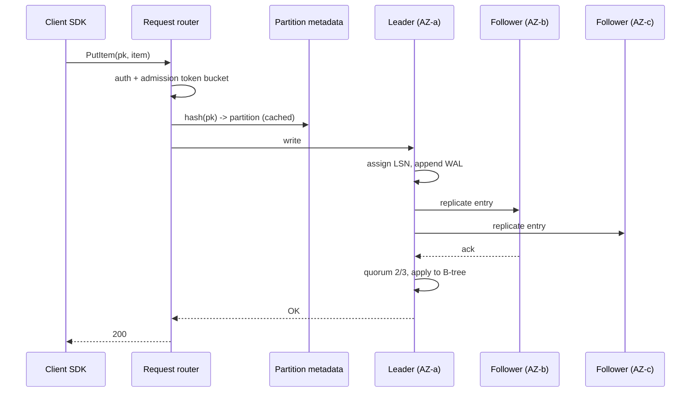

## In one minute
- DynamoDB is AWS's managed key-value and document database: you pick a partition key (and optionally a sort key), and it promises single-digit-millisecond reads and writes at almost any scale, with no servers to manage.
- Data is split into partitions by a hash of the partition key. Each partition is a three-replica Multi-Paxos group across availability zones, holding up to about 10 GB and serving up to 3,000 read units and 1,000 write units per second.
- Throughput is the design constraint. A table's capacity is spread across partitions, so a skewed key distribution throttles one partition while the table looks idle. Adaptive capacity and automatic splits soften this; they do not remove it.
- Choose it when access patterns are known, the scale is large or spiky, and you want zero operations. Avoid it when you need ad hoc queries, joins, large items (over 400 KB), or analytics over the whole table.

## How it works

### Keys and items
An item is a set of attributes up to 400 KB. The primary key is a partition key, optionally plus a sort key. Items sharing a partition key form an *item collection*, stored together and sorted by sort key, so `Query` can read a range (all orders for a customer between two dates) at up to 1 MB per page. `Scan` reads everything and is rarely the right answer.

### Capacity
1 WCU is one write of up to 1 KB; 1 RCU is one strongly consistent read of up to 4 KB, or two eventually consistent ones. Provisioned mode reserves units per second, optionally auto scaled; on-demand, now the default and recommended mode, bills per request and absorbs up to double the previous peak instantly. A new on-demand table starts able to sustain 4,000 writes and 12,000 reads per second, and going past double the previous peak within 30 minutes can throttle, so pre-warm before a known spike ([AWS docs](https://docs.aws.amazon.com/amazondynamodb/latest/developerguide/on-demand-capacity-mode.html)). Every table also has a default quota of 40,000 read and 40,000 write units per second, adjustable on request ([AWS docs](https://docs.aws.amazon.com/amazondynamodb/latest/developerguide/ServiceQuotas.html)).

### Indexes, transactions, streams
A global secondary index (GSI) is a second table with a different key, maintained asynchronously. A local secondary index (LSI) re-sorts within the same partition key, must be created with the table, and caps each item collection at 10 GB. Transactions cover up to 100 items at double cost. Streams emit an ordered per-item change log retained 24 hours. Global tables replicate across regions, active-active. The default mode (multi-Region eventual consistency) replicates asynchronously, typically within a second, and resolves concurrent writes per item by last-writer-wins. You can instead create a table with multi-Region strong consistency: exactly three Regions (or two plus a witness), writes synchronously replicated before they return, strongly consistent reads anywhere and a recovery point of zero, at the cost of cross-Region write latency and no transactions, TTL or LSIs ([AWS docs](https://docs.aws.amazon.com/amazondynamodb/latest/developerguide/V2globaltables_HowItWorks.html)).

## Down the stack

### Layer 1: The contract
A successful `PutItem` is durable in at least two of three availability zones before you get a 200: the leader acknowledges once a quorum of replicas has persisted the log record ([DynamoDB paper, USENIX ATC 2022](https://www.usenix.org/system/files/atc22-elhemali.pdf)). A strongly consistent `GetItem` reflects every write acknowledged before it started. An eventually consistent read, the default, may miss a recent write; the docs promise no bound, only that a repeated read soon returns the newer item, and in practice the lag is usually far under a second. Reads are read-committed per item: you never see a write that did not succeed ([AWS docs](https://docs.aws.amazon.com/amazondynamodb/latest/developerguide/HowItWorks.ReadConsistency.html)). Conditional writes (`ConditionExpression`) are atomic per item, which is how you build optimistic locking, idempotency keys and uniqueness. GSIs and streams are always eventually consistent; strongly consistent reads work only on the table and its LSIs. When you exceed capacity on a partition or table you get `ProvisionedThroughputExceededException` or `ThrottlingException`, which SDKs retry with backoff. Typical latency is 2 to 10 ms at p50 inside a region, with p99 under 20 ms for small items (hedge: varies with item size and region).

### Layer 2: The mechanism
**Request routing.** Every request lands on a fleet of stateless *request routers*. A router authenticates, looks up the partition map from a metadata service (cached heavily), hashes the partition key to find the partition, and forwards to that partition's leader. Routers also enforce *global admission control*: token buckets that track table-level capacity across the router fleet.

**Partitions as replication groups.** Each partition has three replicas in different zones. The replicas run Multi-Paxos: one leader, chosen by election, holds a lease. Writes go to the leader, which assigns a log sequence number, appends to its write-ahead log, and sends the entry to its peers; once a quorum (two of three, counting itself) has persisted the entry, it applies the write to its B-tree and acknowledges. Strongly consistent reads must go to the leader; eventually consistent reads can go to any replica. If the leader's lease lapses, a follower that sees no heartbeats starts an election, and the new leader serves no writes or strong reads until the old leader's lease has expired, so two leaders never both answer ([DynamoDB paper](https://www.usenix.org/system/files/atc22-elhemali.pdf)).

**Storage nodes.** Each replica stores data in a B-tree keyed by the hash of the partition key plus sort key, alongside its replication log. Logs are archived to S3 continuously, which is what powers point-in-time recovery. When a storage node fails, the system first adds a *log replica*, a member that holds only recent log entries, which takes seconds to create; full B-tree replicas are rebuilt in the background. This keeps the write quorum healthy without waiting minutes to copy gigabytes.

**Splits.** A partition splits when it exceeds its size limit or when sustained traffic is concentrated on it. A split divides the hash range (or, for heat, picks a split point by observed key distribution) and the new partitions get their own capacity. A single partition key's items cannot be split by hash, which is why one key is ultimately bounded by one partition's 1,000 WCU and 3,000 RCU. DynamoDB also declines to split for heat when the traffic is on one item or walks the key range sequentially, since a split would not spread it, and splits take minutes rather than seconds ([DynamoDB paper](https://www.usenix.org/system/files/atc22-elhemali.pdf)).

**Adaptive and burst capacity.** Early DynamoDB split provisioned throughput evenly across partitions, so a hot partition throttled while others idled. Burst capacity banks up to 300 seconds of unused throughput. Adaptive capacity lets a hot partition exceed its share, up to the per-partition maximum, while the table stays under its total, and split-for-heat then isolates the hottest ranges, down to a partition holding a single item. It will not split item collections when the table has an LSI ([AWS docs](https://docs.aws.amazon.com/amazondynamodb/latest/developerguide/burst-adaptive-capacity.html)). Internally the paper describes this as global admission control: each request router keeps a local token bucket and refills it from a central service every few seconds.

### Layer 3: The machine
A small `GetItem` crosses the network twice inside the region: client to router (often over a pooled HTTPS connection; TLS handshake costs are why connection reuse matters), and router to storage node. Each hop is sub-millisecond within a zone and about 0.5 to 1 ms across zones. A write adds a quorum round trip from the leader to a peer in another zone, plus a log append, typically to SSD where an `fsync`-equivalent costs tens to hundreds of microseconds. That adds up to the familiar 3 to 6 ms write.

Items are serialised in an internal binary format; attribute names count toward item size and capacity, so a 300-byte payload with long attribute names can tip a write from 1 WCU to 2 WCU. Reads are charged per 4 KB block, rounded up, and a `Query` sums the sizes of all items returned before rounding, which is why batching small items in one collection is cheaper than many `GetItem` calls.

### Why it's built this way
1. Multi-tenant predictability was the goal, so every partition has a hard ceiling and every table has admission control; one tenant cannot starve others on a shared storage node.
2. Hard ceilings make skew painful, so adaptive capacity, burst credits and split-for-heat were added to let real, uneven workloads use the capacity they paid for.
3. Zones fail independently, so three replicas across three zones with a two-of-three quorum survive a whole-zone loss without losing acknowledged writes.
4. Copying a full replica takes minutes, so log replicas restore the quorum in seconds while the B-tree copy catches up.
5. Hashing the partition key spreads load but destroys order across keys, so ordering exists only within one item collection, and global queries need GSIs or another system.

## Diagram


## Worked example
A ticketing service stores seat holds: 30,000 writes per second at a big on-sale, 600-byte items, and 90,000 strongly consistent reads per second. That is 30,000 WCU and 90,000 RCU, so at least 30 partitions.

The first design keys on `event_id` with `seat_id` as sort key. For one concert every write hits one partition, capped at 1,000 WCU, so 29,000 writes per second throttle whatever the table's provisioning. Adaptive capacity cannot exceed the per-partition ceiling for one key.

The fix is write sharding: key `event_id#shard` with shard = hash(seat_id) mod 50, spreading a concert over 50 keys and up to 50,000 WCU. "All available seats" becomes 50 parallel `Query` calls, about 5 to 10 ms. Holds use a conditional write (`attribute_not_exists(holder) OR expires_at < :now`) so two buyers cannot hold one seat. At $0.625 per million on-demand writes in us-east-1 ([AWS pricing](https://aws.amazon.com/dynamodb/pricing/on-demand/)), a two-hour peak costs about $135, far less than provisioning 30,000 WCU all month. Two traps remain: a fresh on-demand table sustains only 4,000 writes per second, so pre-warm it (warm throughput) to the on-sale peak beforehand, and request a quota increase if any table or index needs more than 40,000 units.

## In the wild
- **AWS, 2015: the metadata service overloads.** On 20 September a short network blip made many storage servers ask the metadata service for their partition membership at once. Rapid adoption of global secondary indexes had made membership lists much larger, so responses exceeded the servers' timeout; servers took themselves out of service and retried, overloading the service further. Customer error rates peaked near 55 percent for about five hours, also hitting SQS, Auto Scaling and CloudWatch. AWS added metadata capacity, lengthened timeouts and planned to split the service ([AWS](https://aws.amazon.com/message/5467D2/)).
- **AWS, 2025: a DNS race empties the regional endpoint.** DynamoDB's DNS automation has a planner that writes versioned plans and enactors that apply them. A delayed enactor applied a stale plan over a newer one, and cleanup of old plans then deleted every IP address for `dynamodb.us-east-1.amazonaws.com`. DynamoDB errors lasted about three hours, and EC2's lease manager, which depends on DynamoDB, fell into congestive collapse, stretching the event to about 14.5 hours. AWS disabled the automation worldwide pending a fix ([AWS](https://aws.amazon.com/message/101925/)).

## Trade-offs
| Option | Strengths | Weaknesses | Choose when |
|---|---|---|---|
| DynamoDB | No ops, predictable latency at any scale, per-item conditional writes | Access patterns fixed up front, 400 KB items, hot-key ceilings, AWS lock-in | Known key-based access at large or spiky scale |
| Cassandra | Open source, multi-cloud, huge write throughput, tunable consistency | You run it: repairs, compaction, upgrades | Write-heavy time series on your own infrastructure |
| Aurora or Postgres | SQL, joins, ad hoc queries, rich transactions | Write scaling needs sharding; connection limits | Relational data, moderate scale, evolving queries |
| MongoDB | Flexible documents, secondary indexes, aggregation | Sharding and operations are on you unless using Atlas | Document data with varied query needs |

## Pitfalls in production
- **Hot partition key.** One tenant or event takes all traffic and throttles at 1,000 WCU. Add a shard suffix ([AWS docs](https://docs.aws.amazon.com/amazondynamodb/latest/developerguide/bp-partition-key-sharding.html)); find culprits with CloudWatch Contributor Insights.
- **`Scan` as a query.** It reads and bills the whole table. Model the pattern as a `Query` on the table or a GSI.
- **GSI back-pressure.** An under-provisioned GSI throttles base-table writes. Give GSIs at least the base write capacity, or use on-demand.
- **Read-modify-write races.** Use conditional expressions or a version attribute.
- **Large items.** Big blobs burn capacity on every update. Put payloads in S3 and keep a pointer.

## Leadership lens
- Demand the list of access patterns before table design. The key schema is the query plan, and changing it later is a migration.
- Single-table design saves round trips but costs readability; choose it deliberately and document key conventions.
- Steady load favours provisioned with auto scaling; spiky or new workloads favour on-demand.
- Budget for GSIs, stream consumers and backups, which can cost as much as the base table, and give analytics an export path so nobody runs `Scan` in production.

## Check yourself
1. A table is provisioned with 10,000 WCU and is throttling at 1,200 WCU of total traffic. How?
   **Answer:** The traffic is concentrated on one partition key, and one partition cannot exceed about 1,000 WCU regardless of table capacity.
2. Why are eventually consistent reads half the price of strongly consistent ones?
   **Answer:** Any of the three replicas can serve them, while strongly consistent reads must go to the leader, so the system can spread them more cheaply.
3. What does a log replica buy during a node failure?
   **Answer:** It restores the two-of-three write quorum in seconds by holding only recent log entries, instead of waiting minutes to copy a full B-tree replica.
4. Why can a GSI slow down writes to the base table?
   **Answer:** Each base write must also be propagated to the GSI; if the GSI lacks capacity, DynamoDB throttles base writes to keep the index from falling too far behind.

## Practice
**Task:** Build a DynamoDB-style partition router with adaptive capacity. Hash keys with 32-bit FNV-1a over UTF-8 bytes. `Table(table_wcu, partition_limit, num_partitions, adaptive)` splits the 32-bit hash space into equal ranges, partition `i` owning `[i * 2^32 // n, (i+1) * 2^32 // n)`. `write(key, wcu, now)` routes to the owning partition and returns true if accepted. Usage resets when `now` (an integer second) changes. Without adaptive capacity a partition may use at most `min(table_wcu / count, partition_limit)` per second; with it, a partition may use up to `partition_limit` as long as total table usage stays within `table_wcu`. `split(i)` halves partition `i`'s range in place (the new upper half is inserted after it with zero usage), and `ranges()` returns `[lo, hi]` pairs in order.

```python starter
def fnv1a(s):
    # TODO
    raise NotImplementedError

class Table:
    def __init__(self, table_wcu, partition_limit, num_partitions, adaptive):
        pass

    def partition_for(self, key):
        raise NotImplementedError

    def write(self, key, wcu, now):
        raise NotImplementedError

    def split(self, i):
        raise NotImplementedError

    def ranges(self):
        raise NotImplementedError
```

```python tests
def test_fnv_vectors():
    assert fnv1a("") == 2166136261
    assert fnv1a("a") == 3826002220

def test_spread_and_ranges():
    t = Table(400, 1000, 4, False)
    counts = [0, 0, 0, 0]
    for i in range(1000):
        counts[t.partition_for("user#%d" % i)] += 1
    assert all(150 <= c <= 350 for c in counts), counts
    assert t.ranges()[0] == [0, 1073741824] and t.ranges()[-1][1] == 4294967296

def test_without_adaptive_hot_key_throttles_at_share():
    t = Table(400, 1000, 4, False)
    ok = sum(1 for _ in range(150) if t.write("hot", 1, 0))
    assert ok == 100

def test_adaptive_borrows_unused_table_capacity():
    t = Table(400, 1000, 4, True)
    assert sum(1 for _ in range(150) if t.write("hot", 1, 0)) == 150
    t2 = Table(400, 1000, 4, True)
    assert sum(1 for _ in range(450) if t2.write("hot", 1, 0)) == 400

def test_adaptive_still_capped_per_partition():
    t = Table(4000, 1000, 4, True)
    assert sum(1 for _ in range(1500) if t.write("hot", 1, 0)) == 1000

def test_window_resets_each_second():
    t = Table(400, 1000, 4, False)
    for _ in range(100):
        t.write("hot", 1, 0)
    assert t.write("hot", 1, 0) is False
    assert t.write("hot", 1, 1) is True

def test_split_halves_range_and_routes():
    t = Table(400, 1000, 2, False)
    t.split(0)
    assert t.ranges() == [[0, 1073741824], [1073741824, 2147483648], [2147483648, 4294967296]]
    for i in range(50):
        k = "k%d" % i
        lo, hi = t.ranges()[t.partition_for(k)]
        assert lo <= fnv1a(k) < hi
```

```python solution
def fnv1a(s):
    h = 2166136261
    for b in s.encode("utf-8"):
        h = ((h ^ b) * 16777619) & 0xFFFFFFFF
    return h

class Table:
    def __init__(self, table_wcu, partition_limit, num_partitions, adaptive):
        self.table_wcu = table_wcu
        self.partition_limit = partition_limit
        self.adaptive = adaptive
        space = 1 << 32
        self.bounds = [[i * space // num_partitions, (i + 1) * space // num_partitions]
                       for i in range(num_partitions)]
        self.used = [0] * num_partitions
        self.second = None
        self.table_used = 0

    def partition_for(self, key):
        h = fnv1a(key)
        for i, (lo, hi) in enumerate(self.bounds):
            if lo <= h < hi:
                return i
        raise ValueError("hash outside all ranges")

    def write(self, key, wcu, now):
        if now != self.second:
            self.second = now
            self.used = [0] * len(self.bounds)
            self.table_used = 0
        p = self.partition_for(key)
        if self.adaptive:
            limit = self.partition_limit
        else:
            limit = min(self.table_wcu / len(self.bounds), self.partition_limit)
        if self.used[p] + wcu > limit or self.table_used + wcu > self.table_wcu:
            return False
        self.used[p] += wcu
        self.table_used += wcu
        return True

    def split(self, i):
        lo, hi = self.bounds[i]
        mid = (lo + hi) // 2
        self.bounds[i] = [lo, mid]
        self.bounds.insert(i + 1, [mid, hi])
        self.used.insert(i + 1, 0)

    def ranges(self):
        return [list(b) for b in self.bounds]
```

```typescript starter
export function fnv1a(s: string): number {
  throw new Error("TODO");
}

export class Table {
  constructor(tableWcu: number, partitionLimit: number, numPartitions: number, adaptive: boolean) {}
  partitionFor(key: string): number {
    throw new Error("TODO");
  }
  write(key: string, wcu: number, now: number): boolean {
    throw new Error("TODO");
  }
  split(i: number): void {
    throw new Error("TODO");
  }
  ranges(): number[][] {
    throw new Error("TODO");
  }
}
```

```typescript tests
const accepted = (t: Table, key: string, n: number, now: number): number => {
  let ok = 0;
  for (let i = 0; i < n; i++) if (t.write(key, 1, now)) ok++;
  return ok;
};
test("fnv vectors", () => {
  assertEqual([fnv1a(""), fnv1a("a")], [2166136261, 3826002220]);
});
test("spread and ranges", () => {
  const t = new Table(400, 1000, 4, false);
  const counts = [0, 0, 0, 0];
  for (let i = 0; i < 1000; i++) counts[t.partitionFor("user#" + i)]++;
  assert(counts.every((c) => c >= 150 && c <= 350), JSON.stringify(counts));
  assertEqual(t.ranges()[0], [0, 1073741824]);
  assertEqual(t.ranges()[3][1], 4294967296);
});
test("without adaptive hot key throttles at share", () => {
  assertEqual(accepted(new Table(400, 1000, 4, false), "hot", 150, 0), 100);
});
test("adaptive borrows unused table capacity", () => {
  assertEqual(accepted(new Table(400, 1000, 4, true), "hot", 150, 0), 150);
  assertEqual(accepted(new Table(400, 1000, 4, true), "hot", 450, 0), 400);
});
test("adaptive still capped per partition", () => {
  assertEqual(accepted(new Table(4000, 1000, 4, true), "hot", 1500, 0), 1000);
});
test("window resets each second", () => {
  const t = new Table(400, 1000, 4, false);
  accepted(t, "hot", 100, 0);
  assertEqual(t.write("hot", 1, 0), false);
  assertEqual(t.write("hot", 1, 1), true);
});
test("split halves range and routes", () => {
  const t = new Table(400, 1000, 2, false);
  t.split(0);
  assertEqual(t.ranges(), [[0, 1073741824], [1073741824, 2147483648], [2147483648, 4294967296]]);
  for (let i = 0; i < 50; i++) {
    const k = "k" + i;
    const [lo, hi] = t.ranges()[t.partitionFor(k)];
    assert(lo <= fnv1a(k) && fnv1a(k) < hi, "routed outside range: " + k);
  }
});
```

```typescript solution
export function fnv1a(s: string): number {
  let h = 2166136261;
  const bytes = unescape(encodeURIComponent(s)); // UTF-8 bytes as chars
  for (let i = 0; i < bytes.length; i++) {
    h = Math.imul(h ^ bytes.charCodeAt(i), 16777619) >>> 0;
  }
  return h >>> 0;
}

export class Table {
  private bounds: number[][] = [];
  private used: number[];
  private second: number | null = null;
  private tableUsed = 0;

  constructor(private tableWcu: number, private partitionLimit: number, numPartitions: number, private adaptive: boolean) {
    const space = 4294967296;
    for (let i = 0; i < numPartitions; i++) {
      this.bounds.push([Math.floor((i * space) / numPartitions), Math.floor(((i + 1) * space) / numPartitions)]);
    }
    this.used = this.bounds.map(() => 0);
  }
  partitionFor(key: string): number {
    const h = fnv1a(key);
    const i = this.bounds.findIndex(([lo, hi]) => lo <= h && h < hi);
    if (i < 0) throw new Error("hash outside all ranges");
    return i;
  }
  write(key: string, wcu: number, now: number): boolean {
    if (now !== this.second) {
      this.second = now;
      this.used = this.bounds.map(() => 0);
      this.tableUsed = 0;
    }
    const p = this.partitionFor(key);
    const limit = this.adaptive
      ? this.partitionLimit
      : Math.min(this.tableWcu / this.bounds.length, this.partitionLimit);
    if (this.used[p] + wcu > limit || this.tableUsed + wcu > this.tableWcu) return false;
    this.used[p] += wcu;
    this.tableUsed += wcu;
    return true;
  }
  split(i: number): void {
    const [lo, hi] = this.bounds[i];
    const mid = Math.floor((lo + hi) / 2);
    this.bounds.splice(i, 1, [lo, mid], [mid, hi]);
    this.used.splice(i + 1, 0, 0);
  }
  ranges(): number[][] {
    return this.bounds.map((b) => [...b]);
  }
}
```

```go starter
package practice

func FNV1a(s string) uint32 { panic("TODO") }

type Table struct{}

func NewTable(tableWCU, partitionLimit, numPartitions int, adaptive bool) *Table {
	return &Table{}
}

func (t *Table) PartitionFor(key string) int { panic("TODO") }

func (t *Table) Write(key string, wcu int, now int64) bool { panic("TODO") }

func (t *Table) Split(i int) { panic("TODO") }

// Ranges returns [lo, hi) pairs of the 32-bit hash space, in order.
func (t *Table) Ranges() [][2]uint64 { panic("TODO") }
```

```go tests
package practice

import (
	"fmt"
	"reflect"
	"testing"
)

func accepted(t *Table, key string, n int, now int64) int {
	ok := 0
	for i := 0; i < n; i++ {
		if t.Write(key, 1, now) {
			ok++
		}
	}
	return ok
}

func TestFNVVectors(t *testing.T) {
	if FNV1a("") != 2166136261 || FNV1a("a") != 3826002220 {
		t.Fatal("wrong FNV-1a")
	}
}

func TestSpreadAndRanges(t *testing.T) {
	tb := NewTable(400, 1000, 4, false)
	counts := make([]int, 4)
	for i := 0; i < 1000; i++ {
		counts[tb.PartitionFor(fmt.Sprintf("user#%d", i))]++
	}
	for _, c := range counts {
		if c < 150 || c > 350 {
			t.Fatalf("uneven %v", counts)
		}
	}
	r := tb.Ranges()
	if r[0] != [2]uint64{0, 1073741824} || r[3][1] != 4294967296 {
		t.Fatalf("wrong ranges %v", r)
	}
}

func TestWithoutAdaptive(t *testing.T) {
	if got := accepted(NewTable(400, 1000, 4, false), "hot", 150, 0); got != 100 {
		t.Fatalf("got %d", got)
	}
}

func TestAdaptiveBorrows(t *testing.T) {
	if got := accepted(NewTable(400, 1000, 4, true), "hot", 150, 0); got != 150 {
		t.Fatalf("got %d", got)
	}
	if got := accepted(NewTable(400, 1000, 4, true), "hot", 450, 0); got != 400 {
		t.Fatalf("got %d", got)
	}
}

func TestAdaptiveCapped(t *testing.T) {
	if got := accepted(NewTable(4000, 1000, 4, true), "hot", 1500, 0); got != 1000 {
		t.Fatalf("got %d", got)
	}
}

func TestWindowResets(t *testing.T) {
	tb := NewTable(400, 1000, 4, false)
	accepted(tb, "hot", 100, 0)
	if tb.Write("hot", 1, 0) || !tb.Write("hot", 1, 1) {
		t.Fatal("window did not reset")
	}
}

func TestSplit(t *testing.T) {
	tb := NewTable(400, 1000, 2, false)
	tb.Split(0)
	want := [][2]uint64{{0, 1073741824}, {1073741824, 2147483648}, {2147483648, 4294967296}}
	if !reflect.DeepEqual(tb.Ranges(), want) {
		t.Fatalf("got %v", tb.Ranges())
	}
	for i := 0; i < 50; i++ {
		k := fmt.Sprintf("k%d", i)
		r := tb.Ranges()[tb.PartitionFor(k)]
		if h := uint64(FNV1a(k)); h < r[0] || h >= r[1] {
			t.Fatalf("%s routed outside range", k)
		}
	}
}
```

```go solution
package practice

func FNV1a(s string) uint32 {
	h := uint32(2166136261)
	for i := 0; i < len(s); i++ {
		h ^= uint32(s[i])
		h *= 16777619
	}
	return h
}

type Table struct {
	tableWCU, partitionLimit int
	adaptive                 bool
	bounds                   [][2]uint64
	used                     []int
	second                   int64
	started                  bool
	tableUsed                int
}

func NewTable(tableWCU, partitionLimit, numPartitions int, adaptive bool) *Table {
	t := &Table{tableWCU: tableWCU, partitionLimit: partitionLimit, adaptive: adaptive}
	space := uint64(1) << 32
	n := uint64(numPartitions)
	for i := uint64(0); i < n; i++ {
		t.bounds = append(t.bounds, [2]uint64{i * space / n, (i + 1) * space / n})
	}
	t.used = make([]int, numPartitions)
	return t
}

func (t *Table) PartitionFor(key string) int {
	h := uint64(FNV1a(key))
	for i, b := range t.bounds {
		if b[0] <= h && h < b[1] {
			return i
		}
	}
	return -1
}

func (t *Table) Write(key string, wcu int, now int64) bool {
	if !t.started || now != t.second {
		t.started, t.second = true, now
		t.used = make([]int, len(t.bounds))
		t.tableUsed = 0
	}
	p := t.PartitionFor(key)
	limit := float64(t.partitionLimit)
	if !t.adaptive {
		share := float64(t.tableWCU) / float64(len(t.bounds))
		if share < limit {
			limit = share
		}
	}
	if float64(t.used[p]+wcu) > limit || t.tableUsed+wcu > t.tableWCU {
		return false
	}
	t.used[p] += wcu
	t.tableUsed += wcu
	return true
}

func (t *Table) Split(i int) {
	lo, hi := t.bounds[i][0], t.bounds[i][1]
	mid := (lo + hi) / 2
	t.bounds = append(t.bounds[:i+1], t.bounds[i:]...)
	t.bounds[i] = [2]uint64{lo, mid}
	t.bounds[i+1] = [2]uint64{mid, hi}
	t.used = append(t.used[:i+1], t.used[i:]...)
	t.used[i+1] = 0
}

// Ranges returns [lo, hi) pairs of the 32-bit hash space, in order.
func (t *Table) Ranges() [][2]uint64 { return append([][2]uint64(nil), t.bounds...) }
```

## Mock interview
**Prompt:** Design storage for a multi-tenant audit log on DynamoDB: 5,000 tenants, 20,000 events per second, the largest tenant producing 40 percent. Users query "events for tenant X between two timestamps, newest first".

- Follow-up: which keys, and what happens to the largest tenant at peak?
- Follow-up: a GSI on `event_type` is added and base writes start throttling. Why?
- Follow-up: compliance wants seven-year retention cheaply. What changes?

**A strong answer covers:**
- Key `tenant#bucket` with a time-ordered sort key; the big tenant's 8,000 writes per second need at least 8 shards, more for headroom.
- Per-tenant query fan-out across shards, merged by timestamp.
- Low-cardinality `event_type` makes a hot GSI partition that back-pressures the base table; shard the GSI key or serve that query elsewhere.
- TTL plus export to S3 in Parquet for long retention and analytics.
- On-demand to start, provisioned once traffic is known, and idempotency keys so retries do not duplicate events.

## Sources and further study
**Primary**
- [Amazon DynamoDB pricing for on-demand capacity](https://aws.amazon.com/dynamodb/pricing/on-demand/): current per-request prices, which AWS has changed before.

**Systems docs**
- [DynamoDB global tables: how they work](https://docs.aws.amazon.com/amazondynamodb/latest/developerguide/V2globaltables_HowItWorks.html): the eventual and strong multi-Region modes and what each gives up.
- [DynamoDB on-demand capacity mode](https://docs.aws.amazon.com/amazondynamodb/latest/developerguide/on-demand-capacity-mode.html): initial throughput, the double-the-peak rule and maximum throughput settings.
- [DynamoDB burst and adaptive capacity](https://docs.aws.amazon.com/amazondynamodb/latest/developerguide/burst-adaptive-capacity.html): per-partition limits and isolation of hot items.
- [DynamoDB warm throughput](https://docs.aws.amazon.com/amazondynamodb/latest/developerguide/warm-throughput.html): pre-warming a table before a known spike.

**Books**
- *Designing Data-Intensive Applications* (1st edition), Martin Kleppmann, chapter 6 "Partitioning": hash partitioning, skew and hot spots, and secondary indexes by term.
- *Database Internals*, Alex Petrov, chapter 14 "Consensus": Paxos and Multi-Paxos, which each partition's replication group runs.

**Other curricula**
- [donnemartin/system-design-primer](https://github.com/donnemartin/system-design-primer): mentions DynamoDB as a store that supports both key-value and document access, within a general NoSQL overview.
- [Azure Architecture Center: Understand data models](https://learn.microsoft.com/en-us/azure/architecture/data-guide/technology-choices/understand-data-store-models): frames key-value stores as single-key atomic lookups that need redesign for value-based queries.

## Watch
- [Amazon DynamoDB Under the Hood: How We Built a Hyper-Scale Database (AWS re:Invent 2018)](https://www.youtube.com/watch?v=yvBR71D0nAQ): request routers, Paxos replication groups, partitions and adaptive capacity.
- [Amazon DynamoDB Deep Dive: Advanced Design Patterns (AWS re:Invent 2018)](https://www.youtube.com/watch?v=HaEPXoXVf2k): Rick Houlihan's tour of key design, write sharding and single-table modelling.

## Free resources
- [Amazon DynamoDB: A Scalable, Predictably Performant, and Fully Managed NoSQL Database Service (USENIX ATC 2022)](https://www.usenix.org/system/files/atc22-elhemali.pdf): the paper on DynamoDB's real architecture, admission control and log replicas.
- [Dynamo: Amazon's Highly Available Key-value Store (SOSP 2007)](https://www.allthingsdistributed.com/files/amazon-dynamo-sosp2007.pdf): the ancestor design; useful for seeing what DynamoDB kept and what it changed.
- [Designing partition keys to distribute your workload](https://docs.aws.amazon.com/amazondynamodb/latest/developerguide/bp-partition-key-design.html): official guidance on hot keys, burst and adaptive capacity.
- [DynamoDB read consistency](https://docs.aws.amazon.com/amazondynamodb/latest/developerguide/HowItWorks.ReadConsistency.html): exactly what eventually and strongly consistent reads guarantee.
- [Service quotas in DynamoDB](https://docs.aws.amazon.com/amazondynamodb/latest/developerguide/ServiceQuotas.html): item size, partition throughput, transaction and index limits.
