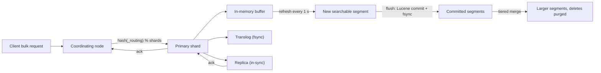

## In one minute
- Elasticsearch is a distributed search and analytics engine built on Apache Lucene. It stores JSON documents, builds inverted indexes over their text, and answers full-text, filter and aggregation queries in tens of milliseconds over billions of documents.
- An index is split into a fixed number of primary shards, each a complete Lucene index made of immutable segments, with replica copies on other nodes.
- Writes become searchable after a *refresh* (every second by default), not immediately. Durability comes from a per-shard translog; searchability and durability are separate steps.
- Relevance is BM25 by default: term frequency, saturated and normalised by document length, weighted by how rare the term is.
- Choose it for search boxes, log and event analytics, faceted navigation and autocomplete. Do not use it as the system of record, for transactions, or for data that must be visible to reads the instant it is written.

## How it works

### Documents, mappings and analysis
A document is JSON in an index. The mapping says how each field is indexed: `text` fields pass through an analyzer (tokenizer, lowercasing, stemming, synonyms) into terms; `keyword` fields are exact values; numbers, dates and geo points go into trees for range queries. Changing an existing field's type means reindexing.

### Shards and routing
A document goes to shard `hash(_routing) % number_of_primary_shards`, with `_routing` defaulting to the ID. The primary count (default 1) is fixed at creation ([Elastic docs](https://www.elastic.co/guide/en/elasticsearch/reference/current/index-modules.html)), so time-based data uses one index per day or size threshold, managed by data streams and lifecycle policies that roll over and delete old indexes.

### Search
A coordinating node sends the query to one copy of every relevant shard. Each shard returns its local top hits; the coordinator merges them, then fetches full documents for the final page. Aggregations compute partial results per shard over columnar doc values and reduce them centrally.

## Down the stack

### Layer 1: The contract
An index request returns success once the operation is in the primary's translog and has been replicated to all in-sync replicas. By default the translog is `fsync`ed on the primary and every allocated replica before acknowledging (`index.translog.durability: request`), so an acknowledged write survives a crash ([Elastic docs](https://www.elastic.co/guide/en/elasticsearch/reference/current/index-modules-translog.html)). The alternative, `async`, fsyncs every `sync_interval` (5 s) and can lose that much; Elasticsearch 1.x used that behaviour by default, which is part of why Jepsen saw acknowledged writes vanish. A write is not visible to search until the next refresh, up to `index.refresh_interval` (1 s, or 5 s on Serverless) later; a `GET` by ID, however, is real-time. One catch: if you never set `refresh_interval` explicitly, a shard that has seen no search for `index.search.idle.after` (30 s) skips background refreshes, and the first search after that waits for one ([Elastic docs](https://www.elastic.co/guide/en/elasticsearch/reference/current/index-modules.html)). Concurrency control is optimistic: each document carries `_seq_no` and `_primary_term`, and a write with `if_seq_no`/`if_primary_term` fails with a conflict if someone else changed it. There are no multi-document transactions. Searches are not snapshot-consistent across shards unless you use a point-in-time. Typical latency: single-digit ms for an indexed write (bulk requests amortise this), 10 to 100 ms for a search, depending on shard count and query cost.

### Layer 2: The mechanism
**Lucene segments.** A shard is a Lucene index made of segments. Each segment is a self-contained, immutable mini-index with its own files: a term dictionary stored as a finite state transducer (`.tip`) pointing into blocks of terms (`.tim`); postings lists of document IDs and term frequencies (`.doc`), positions (`.pos`) and offsets or payloads (`.pay`); stored fields holding `_source`, compressed in blocks (`.fdt`); doc values, a column store for sorting and aggregations (`.dvd`); norms holding each document's field length for scoring (`.nvd`); BKD trees for numeric and geo points (`.kdd`, `.kdi`); and a live-docs bitset (`.liv`) marking deleted documents. Postings are delta-encoded and bit-packed in blocks of 128 documents, still the fixed block size in Lucene 10 ([Lucene docs](https://lucene.apache.org/core/10_1_0/core/org/apache/lucene/codecs/lucene101/Lucene101PostingsFormat.html)), and skip data stored with them lets a query jump over whole blocks when intersecting terms.

**Indexing.** New documents are analysed and added to an in-memory buffer and appended to the translog. A refresh writes the buffer out as a new segment and opens it for search. Updates are a delete (set a bit in `.liv`) plus an insert of the new version. A flush performs a Lucene commit, `fsync`ing segments and starting a new translog generation. A background merge policy (tiered, targeting segments up to about 5 GB) combines small segments into larger ones and physically drops deleted documents.

**Replication.** Elasticsearch uses primary-backup replication. The master tracks an *in-sync set* of shard copies by allocation ID. The primary assigns each operation a sequence number, applies it, forwards it to every in-sync replica in parallel, and acknowledges when all respond. A replica that fails to respond is reported to the master and removed from the in-sync set before the primary acknowledges, so an acknowledged write is on every copy that might be promoted ([Elastic docs](https://www.elastic.co/guide/en/elasticsearch/reference/current/docs-replication.html)). The *global checkpoint*, the highest sequence number all in-sync copies have processed, lets a returning replica replay only the operations it missed from the translog or retained history, instead of copying whole segments.

**Cluster coordination.** Master-eligible nodes elect a master by quorum: a decision needs responses from more than half of the voting configuration, so stopping half the master-eligible nodes at once makes the cluster unavailable ([Elastic docs](https://www.elastic.co/guide/en/elasticsearch/reference/current/modules-discovery-quorums.html)). The master owns cluster state (mappings, allocation, in-sync sets) and publishes changes in two phases, committing after a quorum acknowledges.

**Search execution.** In the query phase each shard evaluates the query against each segment, combining postings iterators (conjunctions leapfrog via skip lists), scoring with BM25 using the norms (defaults `k1 = 1.2`, `b = 0.75`; [Elastic docs](https://www.elastic.co/guide/en/elasticsearch/reference/current/index-modules-similarity.html)), and keeping a priority queue of `from + size` hits. Block-max WAND skips blocks whose maximum possible score cannot reach the current top-k threshold, which makes top-10 queries over common terms fast. The coordinator merges per-shard queues, then the fetch phase loads `_source` for the winners.

### Layer 3: The machine
Segments are written once and read through the OS page cache, often memory-mapped with `mmap`. Search speed depends on how much of the hot index fits in that cache, which is why the heap should stay at or below half of RAM and below the compressed-pointer threshold, which Elastic now puts at 26 GB as safe and up to 30 GB on some systems, leaving the rest to the kernel. Modern versions size the heap automatically from the node's roles and memory, and Elastic recommends keeping that default ([Elastic docs](https://www.elastic.co/guide/en/elasticsearch/reference/current/advanced-configuration.html)). A query whose postings are cached costs microseconds per segment; one that misses goes to SSD at about 100 us per random read, or to spinning disk at about 10 ms, which is why spinning disks are a poor fit for search tiers.

Each refresh creates a small segment and future merge work; bulk loads with `refresh_interval: -1` and zero replicas, restored afterwards, can ingest several times faster. Each node has fixed-size thread pools: `write` sized to the allocated processors and `search` to `int(processors * 3 / 2) + 1`, each with a bounded queue. The queue sizes recently changed: search now queues 1,000 per thread (a flat 1,000 in 8.x and earlier) and write queues `max(10000, processors * 750)` (a flat 10,000 through 9.1) ([Elastic docs](https://www.elastic.co/guide/en/elasticsearch/reference/current/modules-threadpool.html)). When the queue fills, requests are rejected with HTTP 429, which clients must treat as back-pressure. Heap pressure comes from aggregations over high-cardinality fields, large `size` values and deep pagination; circuit breakers abort requests that would exceed configured heap fractions instead of letting the node run out of memory.

### Why it's built this way
1. Search needs to find documents by term, the inverse of how they are stored, so the core structure is an inverted index from term to sorted document IDs.
2. Updating inverted indexes in place is expensive random I/O, so Lucene writes immutable segments and merges them later, like an LSM tree.
3. Writing a segment for every document would be too slow and too many files, so documents buffer in memory and refresh periodically, which makes search near-real-time rather than real-time.
4. Buffered documents would be lost in a crash, so a translog provides durability independently of segment commits, which are expensive `fsync`s done rarely.
5. One machine cannot hold or scan billions of documents quickly, so indexes are sharded and replicated, and queries scatter and gather.

## Diagram


## Worked example
An e-commerce site has 50 million products of about 2 KB, 3,000 searches per second at peak and 500 price or stock updates per second.

Raw data is 100 GB; with analysed text, doc values and `_source`, call it 130 GB per copy, so 4 primaries of about 32 GB fit the 10 to 50 GB guidance. If a query costs about 20 ms of CPU per shard, demand is 3,000 x 4 x 20 ms = 240 CPU-seconds per second. Two replicas (3 copies) on 12 data nodes of 32 cores give 384 cores, about 60 percent busy at peak, and each node holds one 32 GB shard copy that fits the page cache of a 64 GB node with a 26 GB heap.

Each update rewrites the whole document and marks the old version deleted, so merges reclaim space continuously. Results lag updates by up to a second, so "add to cart" reads price and stock from the transactional database, never from the search hit.

## In the wild
- **Jepsen, 2015: Elasticsearch 1.5.0 loses acknowledged writes.** Under network partitions, process pauses and crashes, Kyle Kingsbury's tests lost from about 2.5% to 22% of acknowledged documents. Split brain let two primaries accept writes for seconds, and with `kill -9` about 10% vanished because writes were acknowledged before the translog fsync, which then ran every 5 seconds. The advice was to keep data in a safer database and feed the index from it ([Jepsen](https://aphyr.com/posts/323-call-me-maybe-elasticsearch-1-5-0)). Later releases made per-request translog fsync the default and replaced the cluster coordination layer.
- **Discord, 2025: re-architecting search for trillions of messages.** The old clusters grew past 200 nodes, a 50-message bulk request could fan out to 50 nodes so one node failure failed about 40% of bulks, and some indexes hit Lucene's roughly 2 billion document limit, after which indexing failed. Discord moved to many smaller clusters in cells, capped indexes at 200 million messages or 50 GB, and grouped bulk writes by destination node; median latency fell from 500 ms to under 100 ms ([Discord](https://discord.com/blog/how-discord-indexes-trillions-of-messages)).
- **Instacart, 2025: moving search off Elasticsearch.** Denormalized product documents meant billions of partial updates for price and inventory, and fixing bad data could take days. A normalized Postgres model cut write load about 10 times and search ran about twice as fast ([Instacart](https://company.instacart.com/tech-innovation/how-instacart-built-a-modern-search-infrastructure-on-postgres)). It is a reminder that update-heavy data is the expensive case for an immutable-segment engine.

## Trade-offs
| Option | Strengths | Weaknesses | Choose when |
|---|---|---|---|
| Elasticsearch or OpenSearch | Full-text relevance, aggregations, mature ecosystem | Heap tuning, shard sizing, not a primary store | Product search, log analytics, faceted navigation |
| Postgres full-text search | One system, transactional, simple | Weaker relevance tuning, harder to scale past one node | Modest search needs alongside relational data |
| Solr | Lucene-based, strong faceting, open governance | Smaller ecosystem today | Teams already invested in Solr |
| ClickHouse or a column store | Very fast aggregations, cheap storage | Weak full-text relevance | Log and event analytics without relevance ranking |

## Pitfalls in production
- **Too many small shards, or too few huge ones.** Thousands of tiny shards waste heap on cluster state and slow searches. Target 10 to 50 GB and under 200 million documents per shard, and use rollover; Lucene's hard ceiling is about 2.1 billion documents per shard, after which indexing fails ([Elastic docs](https://www.elastic.co/guide/en/elasticsearch/reference/current/size-your-shards.html)).
- **Mapping explosion.** Dynamic mapping of arbitrary keys creates tens of thousands of fields. Use `dynamic: strict` or the `flattened` type.
- **Deep pagination.** `from: 100000` makes every shard sort 100,010 hits. Use `search_after` with a point-in-time.
- **Treating it as the source of truth.** Keep primary data in a database or log and rebuild indexes from it.
- **Ignoring 429 rejections.** Back off with jitter and keep bulk requests around 5 to 15 MB.

## Leadership lens
- Ask how the index is rebuilt. If nobody can reindex from a source of truth in hours, every mapping change becomes a crisis.
- Shard count and size, heap and page-cache sizing, and lifecycle policy are the main cost levers; review them before launch, not after.
- Relevance tuning is product work: assign an owner, keep a judged query set, and measure changes offline before shipping.
- Check the licence you run. Elastic moved Elasticsearch to SSPL and the Elastic License in 2021, AWS forked it as OpenSearch, and in August 2024 Elastic added AGPL as an option ([Elastic](https://www.elastic.co/blog/elasticsearch-is-open-source-again)). Managed offerings named "OpenSearch" are a different codebase with diverging features.

## Check yourself
1. A user updates a product and immediately searches for it, but sees the old version. Why, and what are the options?
   **Answer:** The update is in the translog and buffer but not yet refreshed into a searchable segment; read by ID (real-time), wait for the next refresh with `refresh=wait_for`, or accept up to a second of lag.
2. Why are deletes in Elasticsearch cheap at write time but costly later?
   **Answer:** A delete only sets a bit in the segment's live-docs file; the space and the cost of skipping the document remain until a merge rewrites the segment.
3. What does BM25's `b` parameter control?
   **Answer:** How strongly scores are normalised by field length; `b = 0` ignores length, `b = 1` fully normalises, and the default 0.75 penalises long fields moderately.
4. Why keep the JVM heap under about 31 GB?
   **Answer:** Above that the JVM loses compressed object pointers, so a larger heap holds fewer objects, and memory taken from the page cache slows segment reads.

## Practice
**Task:** Build an inverted index with BM25 scoring. `tokenize(text)` lowercases and splits on anything that is not an ASCII letter or digit. `Index(k1, b)` supports `add(doc_id, text)` (re-adding a doc replaces it), `delete(doc_id)` and `idf(term) = ln(1 + (N - n + 0.5) / (n + 0.5))` where N is the document count and n the number of documents containing the term. `score(doc_id, query)` sums, over the distinct query terms present in the document, `idf * tf / (tf + k1 * (1 - b + b * dl / avgdl))`, the form Lucene uses. `search(query, top_k)` returns the IDs of documents containing at least one query term, ordered by score descending, ties by ID ascending.

```python starter
def tokenize(text):
    # TODO
    raise NotImplementedError

class Index:
    def __init__(self, k1=1.2, b=0.75):
        pass

    def add(self, doc_id, text):
        raise NotImplementedError

    def delete(self, doc_id):
        raise NotImplementedError

    def idf(self, term):
        raise NotImplementedError

    def score(self, doc_id, query):
        raise NotImplementedError

    def search(self, query, top_k):
        raise NotImplementedError
```

```python tests
def sample():
    ix = Index(1.2, 0.75)
    ix.add("d1", "The quick brown fox")
    ix.add("d2", "the lazy dog")
    ix.add("d3", "Quick quick fox jumps over dog")
    return ix

def test_tokenize():
    assert tokenize("Hello, World! hello-2") == ["hello", "world", "hello", "2"]

def test_idf():
    ix = sample()
    assert abs(ix.idf("lazy") - 0.980829) < 1e-5
    assert abs(ix.idf("quick") - 0.470004) < 1e-5

def test_score_values():
    ix = sample()
    assert abs(ix.score("d3", "quick") - 0.265078) < 1e-5
    assert abs(ix.score("d1", "quick") - 0.220579) < 1e-5
    assert ix.score("d2", "quick") == 0

def test_ranking_and_top_k():
    ix = sample()
    assert ix.search("quick fox", 10) == ["d3", "d1"]
    assert ix.search("lazy dog", 1) == ["d2"]
    assert ix.search("unicorn", 10) == []

def test_tf_saturates():
    ix = Index(1.2, 0)
    ix.add("one", "cat")
    ix.add("ten", "cat " * 10)
    ix.add("other", "dog")
    assert ix.score("one", "cat") < ix.score("ten", "cat") < 2 * ix.score("one", "cat")

def test_length_normalisation():
    ix = Index(1.2, 0.75)
    ix.add("short", "cat")
    ix.add("long", "cat a b c d e f g")
    ix.add("other", "dog")
    assert ix.search("cat", 10) == ["short", "long"]

def test_delete_updates_stats():
    ix = sample()
    assert ix.delete("d2") and not ix.delete("d2")
    assert ix.search("dog", 10) == ["d3"]
    assert abs(ix.idf("dog") - 0.693147) < 1e-5
```

```python solution
import math

def tokenize(text):
    out, cur = [], []
    for ch in text.lower():
        if ("a" <= ch <= "z") or ("0" <= ch <= "9"):
            cur.append(ch)
        elif cur:
            out.append("".join(cur))
            cur = []
    if cur:
        out.append("".join(cur))
    return out

class Index:
    def __init__(self, k1=1.2, b=0.75):
        self.k1, self.b = k1, b
        self.postings = {}  # term -> {doc_id: tf}
        self.lengths = {}   # doc_id -> token count

    def add(self, doc_id, text):
        self.delete(doc_id)
        tokens = tokenize(text)
        self.lengths[doc_id] = len(tokens)
        for t in tokens:
            docs = self.postings.setdefault(t, {})
            docs[doc_id] = docs.get(doc_id, 0) + 1

    def delete(self, doc_id):
        if doc_id not in self.lengths:
            return False
        del self.lengths[doc_id]
        for t in list(self.postings):
            self.postings[t].pop(doc_id, None)
            if not self.postings[t]:
                del self.postings[t]
        return True

    def idf(self, term):
        n = len(self.postings.get(term, {}))
        N = len(self.lengths)
        return math.log(1 + (N - n + 0.5) / (n + 0.5))

    def score(self, doc_id, query):
        if doc_id not in self.lengths:
            return 0.0
        avgdl = sum(self.lengths.values()) / len(self.lengths)
        dl = self.lengths[doc_id]
        total = 0.0
        for t in sorted(set(tokenize(query))):
            tf = self.postings.get(t, {}).get(doc_id, 0)
            if tf:
                norm = self.k1 * (1 - self.b + self.b * dl / avgdl)
                total += self.idf(t) * tf / (tf + norm)
        return total

    def search(self, query, top_k):
        cands = set()
        for t in set(tokenize(query)):
            cands.update(self.postings.get(t, {}))
        ranked = sorted(cands, key=lambda d: (-self.score(d, query), d))
        return ranked[:top_k]
```

```typescript starter
export function tokenize(text: string): string[] {
  throw new Error("TODO");
}

export class Index {
  constructor(k1: number, b: number) {}
  add(docId: string, text: string): void {
    throw new Error("TODO");
  }
  delete(docId: string): boolean {
    throw new Error("TODO");
  }
  idf(term: string): number {
    throw new Error("TODO");
  }
  score(docId: string, query: string): number {
    throw new Error("TODO");
  }
  search(query: string, topK: number): string[] {
    throw new Error("TODO");
  }
}
```

```typescript tests
const near = (a: number, b: number) => Math.abs(a - b) < 1e-5;
function sample(): Index {
  const ix = new Index(1.2, 0.75);
  ix.add("d1", "The quick brown fox");
  ix.add("d2", "the lazy dog");
  ix.add("d3", "Quick quick fox jumps over dog");
  return ix;
}
test("tokenize", () => {
  assertEqual(tokenize("Hello, World! hello-2"), ["hello", "world", "hello", "2"]);
});
test("idf", () => {
  const ix = sample();
  assert(near(ix.idf("lazy"), 0.980829), "lazy idf");
  assert(near(ix.idf("quick"), 0.470004), "quick idf");
});
test("score values", () => {
  const ix = sample();
  assert(near(ix.score("d3", "quick"), 0.265078), "d3");
  assert(near(ix.score("d1", "quick"), 0.220579), "d1");
  assertEqual(ix.score("d2", "quick"), 0);
});
test("ranking and top k", () => {
  const ix = sample();
  assertEqual(ix.search("quick fox", 10), ["d3", "d1"]);
  assertEqual(ix.search("lazy dog", 1), ["d2"]);
  assertEqual(ix.search("unicorn", 10), []);
});
test("tf saturates", () => {
  const ix = new Index(1.2, 0);
  ix.add("one", "cat");
  ix.add("ten", "cat ".repeat(10));
  ix.add("other", "dog");
  const one = ix.score("one", "cat");
  const ten = ix.score("ten", "cat");
  assert(one < ten && ten < 2 * one, "saturation");
});
test("length normalisation", () => {
  const ix = new Index(1.2, 0.75);
  ix.add("short", "cat");
  ix.add("long", "cat a b c d e f g");
  ix.add("other", "dog");
  assertEqual(ix.search("cat", 10), ["short", "long"]);
});
test("delete updates stats", () => {
  const ix = sample();
  assertEqual([ix.delete("d2"), ix.delete("d2")], [true, false]);
  assertEqual(ix.search("dog", 10), ["d3"]);
  assert(near(ix.idf("dog"), 0.693147), "dog idf");
});
```

```typescript solution
export function tokenize(text: string): string[] {
  return text.toLowerCase().match(/[a-z0-9]+/g) || [];
}

export class Index {
  private postings = new Map<string, Map<string, number>>();
  private lengths = new Map<string, number>();

  constructor(private k1: number, private b: number) {}

  add(docId: string, text: string): void {
    this.delete(docId);
    const tokens = tokenize(text);
    this.lengths.set(docId, tokens.length);
    for (const t of tokens) {
      let docs = this.postings.get(t);
      if (!docs) {
        docs = new Map();
        this.postings.set(t, docs);
      }
      docs.set(docId, (docs.get(docId) || 0) + 1);
    }
  }
  delete(docId: string): boolean {
    if (!this.lengths.delete(docId)) return false;
    for (const [t, docs] of [...this.postings]) {
      docs.delete(docId);
      if (docs.size === 0) this.postings.delete(t);
    }
    return true;
  }
  idf(term: string): number {
    const n = this.postings.get(term)?.size ?? 0;
    const N = this.lengths.size;
    return Math.log(1 + (N - n + 0.5) / (n + 0.5));
  }
  score(docId: string, query: string): number {
    const dl = this.lengths.get(docId);
    if (dl === undefined) return 0;
    let sum = 0;
    for (const l of this.lengths.values()) sum += l;
    const avgdl = sum / this.lengths.size;
    let total = 0;
    for (const t of [...new Set(tokenize(query))].sort()) {
      const tf = this.postings.get(t)?.get(docId) ?? 0;
      if (tf > 0) total += (this.idf(t) * tf) / (tf + this.k1 * (1 - this.b + (this.b * dl) / avgdl));
    }
    return total;
  }
  search(query: string, topK: number): string[] {
    const cands = new Set<string>();
    for (const t of new Set(tokenize(query))) {
      for (const d of this.postings.get(t)?.keys() ?? []) cands.add(d);
    }
    const scored = [...cands].map((d) => ({ d, s: this.score(d, query) }));
    scored.sort((x, y) => (y.s !== x.s ? y.s - x.s : x.d < y.d ? -1 : x.d > y.d ? 1 : 0));
    return scored.slice(0, topK).map((x) => x.d);
  }
}
```

```go starter
package practice

func Tokenize(text string) []string { panic("TODO") }

type Index struct{}

func NewIndex(k1, b float64) *Index { return &Index{} }

func (ix *Index) Add(docID, text string) { panic("TODO") }

func (ix *Index) Delete(docID string) bool { panic("TODO") }

func (ix *Index) IDF(term string) float64 { panic("TODO") }

func (ix *Index) Score(docID, query string) float64 { panic("TODO") }

func (ix *Index) Search(query string, topK int) []string { panic("TODO") }
```

```go tests
package practice

import (
	"math"
	"reflect"
	"strings"
	"testing"
)

func near(a, b float64) bool { return math.Abs(a-b) < 1e-5 }

func sample() *Index {
	ix := NewIndex(1.2, 0.75)
	ix.Add("d1", "The quick brown fox")
	ix.Add("d2", "the lazy dog")
	ix.Add("d3", "Quick quick fox jumps over dog")
	return ix
}

func TestTokenize(t *testing.T) {
	if got := Tokenize("Hello, World! hello-2"); !reflect.DeepEqual(got, []string{"hello", "world", "hello", "2"}) {
		t.Fatalf("got %v", got)
	}
}

func TestIDF(t *testing.T) {
	ix := sample()
	if !near(ix.IDF("lazy"), 0.980829) || !near(ix.IDF("quick"), 0.470004) {
		t.Fatal("wrong idf")
	}
}

func TestScoreValues(t *testing.T) {
	ix := sample()
	if !near(ix.Score("d3", "quick"), 0.265078) || !near(ix.Score("d1", "quick"), 0.220579) || ix.Score("d2", "quick") != 0 {
		t.Fatal("wrong scores")
	}
}

func TestRankingAndTopK(t *testing.T) {
	ix := sample()
	if got := ix.Search("quick fox", 10); !reflect.DeepEqual(got, []string{"d3", "d1"}) {
		t.Fatalf("got %v", got)
	}
	if got := ix.Search("lazy dog", 1); !reflect.DeepEqual(got, []string{"d2"}) {
		t.Fatalf("got %v", got)
	}
	if got := ix.Search("unicorn", 10); len(got) != 0 {
		t.Fatalf("got %v", got)
	}
}

func TestTFSaturates(t *testing.T) {
	ix := NewIndex(1.2, 0)
	ix.Add("one", "cat")
	ix.Add("ten", strings.Repeat("cat ", 10))
	ix.Add("other", "dog")
	one, ten := ix.Score("one", "cat"), ix.Score("ten", "cat")
	if !(one < ten && ten < 2*one) {
		t.Fatalf("one=%f ten=%f", one, ten)
	}
}

func TestLengthNormalisation(t *testing.T) {
	ix := NewIndex(1.2, 0.75)
	ix.Add("short", "cat")
	ix.Add("long", "cat a b c d e f g")
	ix.Add("other", "dog")
	if got := ix.Search("cat", 10); !reflect.DeepEqual(got, []string{"short", "long"}) {
		t.Fatalf("got %v", got)
	}
}

func TestDeleteUpdatesStats(t *testing.T) {
	ix := sample()
	if !ix.Delete("d2") || ix.Delete("d2") {
		t.Fatal("wrong delete results")
	}
	if got := ix.Search("dog", 10); !reflect.DeepEqual(got, []string{"d3"}) {
		t.Fatalf("got %v", got)
	}
	if !near(ix.IDF("dog"), 0.693147) {
		t.Fatal("idf not updated")
	}
}
```

```go solution
package practice

import (
	"math"
	"sort"
	"strings"
)

func Tokenize(text string) []string {
	out := []string{}
	var cur strings.Builder
	for _, r := range strings.ToLower(text) {
		if (r >= 'a' && r <= 'z') || (r >= '0' && r <= '9') {
			cur.WriteRune(r)
		} else if cur.Len() > 0 {
			out = append(out, cur.String())
			cur.Reset()
		}
	}
	if cur.Len() > 0 {
		out = append(out, cur.String())
	}
	return out
}

type Index struct {
	k1, b    float64
	postings map[string]map[string]int
	lengths  map[string]int
}

func NewIndex(k1, b float64) *Index {
	return &Index{k1: k1, b: b, postings: map[string]map[string]int{}, lengths: map[string]int{}}
}

func (ix *Index) Add(docID, text string) {
	ix.Delete(docID)
	tokens := Tokenize(text)
	ix.lengths[docID] = len(tokens)
	for _, t := range tokens {
		if ix.postings[t] == nil {
			ix.postings[t] = map[string]int{}
		}
		ix.postings[t][docID]++
	}
}

func (ix *Index) Delete(docID string) bool {
	if _, ok := ix.lengths[docID]; !ok {
		return false
	}
	delete(ix.lengths, docID)
	for t, docs := range ix.postings {
		delete(docs, docID)
		if len(docs) == 0 {
			delete(ix.postings, t)
		}
	}
	return true
}

func (ix *Index) IDF(term string) float64 {
	n := float64(len(ix.postings[term]))
	N := float64(len(ix.lengths))
	return math.Log(1 + (N-n+0.5)/(n+0.5))
}

func uniqueSorted(tokens []string) []string {
	seen := map[string]bool{}
	out := []string{}
	for _, t := range tokens {
		if !seen[t] {
			seen[t] = true
			out = append(out, t)
		}
	}
	sort.Strings(out)
	return out
}

func (ix *Index) Score(docID, query string) float64 {
	dl, ok := ix.lengths[docID]
	if !ok {
		return 0
	}
	sum := 0
	for _, l := range ix.lengths {
		sum += l
	}
	avgdl := float64(sum) / float64(len(ix.lengths))
	total := 0.0
	for _, t := range uniqueSorted(Tokenize(query)) {
		tf := float64(ix.postings[t][docID])
		if tf > 0 {
			total += ix.IDF(t) * tf / (tf + ix.k1*(1-ix.b+ix.b*float64(dl)/avgdl))
		}
	}
	return total
}

func (ix *Index) Search(query string, topK int) []string {
	cands := map[string]bool{}
	for _, t := range Tokenize(query) {
		for d := range ix.postings[t] {
			cands[d] = true
		}
	}
	ids := make([]string, 0, len(cands))
	scores := map[string]float64{}
	for d := range cands {
		ids = append(ids, d)
		scores[d] = ix.Score(d, query)
	}
	sort.Slice(ids, func(i, j int) bool {
		if scores[ids[i]] != scores[ids[j]] {
			return scores[ids[i]] > scores[ids[j]]
		}
		return ids[i] < ids[j]
	})
	if len(ids) > topK {
		ids = ids[:topK]
	}
	return ids
}
```

## Mock interview
**Prompt:** Design search for a marketplace with 200 million listings in 30 languages, 20,000 searches per second at peak, and 5,000 listing updates per second. Sellers expect edits to appear within a few seconds.

- Follow-up: how many shards and replicas, and how do you size the cluster?
- Follow-up: a node dies at peak. What happens to in-flight writes and latency?
- Follow-up: where does personalised ranking live?

**A strong answer covers:**
- Change-data-capture from the source database through Kafka into bulk indexing, so the index can be rebuilt at any time.
- Shard count from data size and replica count from query CPU, with page-cache arithmetic.
- Per-language analyzers, and an alias so a full reindex swaps in without downtime.
- Refresh interval as the freshness knob, with `refresh=wait_for` only for a seller's own edit.
- On node loss the master promotes replicas, writes to those shards pause briefly, and zone awareness keeps enough copies serving.
- Two-stage ranking: BM25 and filters retrieve candidates, then a personalised model reranks.

## Sources and further study
**Primary**
- [Robertson and Zaragoza, The Probabilistic Relevance Framework: BM25 and Beyond (2009)](https://www.staff.city.ac.uk/~sbrp622/papers/foundations_bm25_review.pdf): the derivation of BM25 and what `k1` and `b` mean, from its authors.
- [Lucene 10.1 postings format](https://lucene.apache.org/core/10_1_0/core/org/apache/lucene/codecs/lucene101/Lucene101PostingsFormat.html): the on-disk term dictionary, postings blocks and skip data.

**Systems docs**
- [Elasticsearch: Index settings](https://www.elastic.co/guide/en/elasticsearch/reference/current/index-modules.html): shard count, refresh interval and search-idle shards.
- [Elasticsearch: Advanced JVM configuration](https://www.elastic.co/guide/en/elasticsearch/reference/current/advanced-configuration.html): automatic heap sizing and the compressed-pointer limit.
- [Elasticsearch: Thread pools](https://www.elastic.co/guide/en/elasticsearch/reference/current/modules-threadpool.html): pool and queue sizes behind 429 rejections.
- [Elasticsearch: Quorum-based decision making](https://www.elastic.co/guide/en/elasticsearch/reference/current/modules-discovery-quorums.html): voting configurations and master elections.

**Books**
- *Designing Data-Intensive Applications* (1st ed.), Martin Kleppmann, Ch 3 "Storage and Retrieval": LSM-style immutable segments and full-text indexes.
- *Designing Data-Intensive Applications* (2nd ed.), Kleppmann and Riccomini, Ch 4 "Storage and Retrieval": the new section on multidimensional and full-text indexes.

**Other curricula**
- [donnemartin/system-design-primer](https://github.com/donnemartin/system-design-primer#document-store): files Elasticsearch under document stores and links one architecture article; it does not cover refresh, translog or shard sizing.
- [Azure Architecture Center: Choose a search data store](https://learn.microsoft.com/en-us/azure/architecture/data-guide/technology-choices/search-options): compares Elasticsearch with a managed search service and SQL full-text search by schema, analytics and security needs.
- [roadmap.sh: Elasticsearch](https://roadmap.sh/elasticsearch): a topic-by-topic learning path from mappings and analyzers to cluster operations.

## Watch
- [Elasticsearch from the bottom up (Alex Brasetvik, EuroPython 2014)](https://www.youtube.com/watch?v=LDyxijDEqj4): inverted indexes, segments and how they compose into shards and clusters.
- [What is in a Lucene index? (Adrien Grand, Lucene/Solr Revolution)](https://www.youtube.com/watch?v=T5RmMNDR5XI): a Lucene committer on the on-disk files and data structures.

## Free resources
- [Elasticsearch from the bottom up](https://www.elastic.co/blog/found-elasticsearch-from-the-bottom-up): the written version, from terms and postings up to cluster search.
- [Near real-time search](https://www.elastic.co/guide/en/elasticsearch/reference/current/near-real-time.html): official explanation of refresh, segments and the file system cache.
- [Translog](https://www.elastic.co/guide/en/elasticsearch/reference/current/index-modules-translog.html): durability settings and what flush does.
- [Reading and writing documents](https://www.elastic.co/guide/en/elasticsearch/reference/current/docs-replication.html): the primary-backup replication model and in-sync copies.
- [Size your shards](https://www.elastic.co/guide/en/elasticsearch/reference/current/size-your-shards.html): current official guidance on shard size and count.
- [Okapi BM25 (Wikipedia)](https://en.wikipedia.org/wiki/Okapi_BM25): the scoring formula and its parameters.
