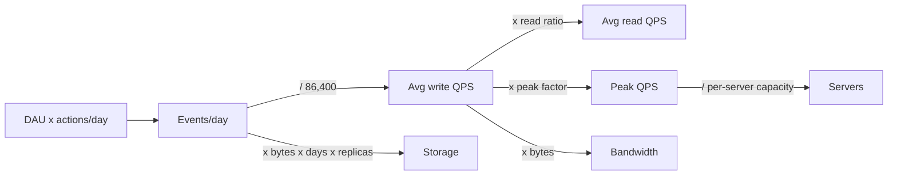

## In one minute
- Back-of-envelope estimation exists to make decisions: does this fit on one machine, does it need sharding, is a cache worth it, what dominates cost. An estimate that does not change a decision is wasted interview time.
- Memorise a small set of anchors: 86,400 seconds a day (call it 100k), 1 million per day is about 12 per second, 1 Gbit/s is 125 MB/s, a memory reference is about 100 ns, an SSD random read about 100 microseconds, a same-datacenter round trip about 0.5 ms, a cross-continent round trip about 100 ms.
- The template: users times actions gives QPS; QPS times bytes gives bandwidth; writes times bytes times retention times replication gives storage; peak is average times a factor of 2 to 10.
- Round aggressively, say your assumptions out loud, and keep two significant figures at most. Interviewers grade the method and the conclusion, not the third digit.
- Staff-level signal: you estimate the bottleneck resource, not every resource, and you sanity-check the result against what one machine can do.

## How it works

### The numbers worth memorising
Latency, roughly, on modern hardware (treat these as orders of magnitude; exact figures vary by generation). The classic table most people memorise dates from about 2012 and still lists a 4 KB SSD random read at 150 microseconds and a California to Netherlands round trip at 150 ms ([system-design-primer](https://github.com/donnemartin/system-design-primer#latency-numbers-every-programmer-should-know)). The popular "by year" version is extrapolated from growth curves rather than measured: it pins SSD random reads at 16 microseconds from 2014 onward and projects memory and SSD bandwidth forward, so its recent sequential-read figures are far faster than real hardware ([Colin Scott](https://colin-scott.github.io/personal_website/research/interactive_latency.html)). Use the ranges below.

- L1 cache hit: about 1 ns. Main memory reference: about 100 ns.
- Compress 1 KB with a fast codec: a few microseconds.
- Read 1 MB sequentially from memory: tens to a few hundred microseconds depending on the hardware.
- NVMe SSD random 4 KB read: about 20 to 100 microseconds. Read 1 MB sequentially from SSD: about 0.2 to 1 ms.
- HDD seek: about 5 to 10 ms.
- Round trip within a datacenter: about 0.2 to 0.5 ms. Between AZs: about 1 ms; AWS keeps the AZs of a region within 100 km of each other, which puts the fibre floor under 1 ms ([AWS](https://aws.amazon.com/about-aws/global-infrastructure/regions_az/)). Coast to coast in the US: about 60 to 80 ms. Transatlantic or transpacific: about 80 to 150 ms.

Throughput and capacity anchors (hedged; real limits depend heavily on payload and tuning):

- A 10 Gbit NIC moves about 1.25 GB/s; 25 Gbit about 3 GB/s.
- One NVMe SSD: hundreds of thousands of random read IOPS, and roughly 1 to 7 GB/s sequential.
- A stateless web or API server: from about 1,000 to tens of thousands of simple requests per second.
- A single Postgres or MySQL primary: thousands to low tens of thousands of simple writes per second; more reads, especially from cache.
- One Redis instance: around 100,000 or more simple operations per second; Redis's own benchmark page shows about 180,000 `SET`s per second without pipelining and over 1.5 million with a pipeline of 16, and warns that the network often runs out before the CPU, since 4 KB values at 100,000 per second already need 3.2 Gbit/s ([Redis docs](https://redis.io/docs/latest/operate/oss_and_stack/management/optimization/benchmarks/)).
- One Kafka partition: tens of MB/s of writes, depending on batching, compression, acks and replication; size partitions as the larger of target throughput divided by per-partition produce rate and by per-partition consume rate ([Confluent](https://www.confluent.io/blog/how-choose-number-topics-partitions-kafka-cluster/)).

Sizes: an ID or timestamp is 8 bytes; a UUID 16 bytes; an English character in UTF-8 1 byte; a short text post with metadata 0.5 to 1 KB; a compressed photo 200 KB to 2 MB; a minute of 1080p video at streaming bitrates roughly 30 to 60 MB.

Time conversions: a day is 86,400 s, a month about 2.6 million s, a year about 31.5 million s. So 1 million events a day is about 12 per second, 1 billion a day about 12,000 per second.

### The estimation template
1. **Users and actions.** DAU times actions per user per day gives events per day.
2. **QPS.** Events per day divided by 100,000 (or 86,400). Multiply by a read-to-write ratio for reads.
3. **Peak.** Multiply by a peak factor: 2 to 3 for smooth global traffic, 5 to 10 or more for spiky events.
4. **Storage.** Writes per day times bytes per write times retention days times replication (often 3), plus index and overhead (add 20 to 50 percent).
5. **Bandwidth.** QPS times payload size, separately for ingress and egress.
6. **Machines.** Peak load divided by per-machine capacity at a target utilisation (often 50 to 70 percent).
7. **Conclusion.** One sentence that changes the design: "120 GB a day means about 650 TB over five years with replication, so we need a sharded or object store, not one database node."

### What interviewers look for
They want to see you choose round numbers, state assumptions, carry units, and land on a decision. They also notice when candidates over-invest: spending eight minutes estimating everything to three digits leaves no time for the design. Two to four minutes is usually right.

### Common mistakes
- Forgetting replication and indexes in storage, which can triple or quadruple the number.
- Mixing bits and bytes in bandwidth (a factor of 8).
- Estimating average QPS and sizing for it, ignoring peaks.
- Computing many numbers but never stating what they imply.
- Using precise arithmetic where powers of ten would do; it is slow and error-prone at a whiteboard.
- Treating QPS as the capacity unit when request costs differ. A search and a profile read are not the same "query". Google's SRE book calls QPS a moving target and provisions in CPU instead ([SRE book, ch. 21](https://sre.google/sre-book/handling-overload/)); in an interview, at least split cheap and expensive requests.

## Down the stack

### Layer 1: The contract
An estimate promises order-of-magnitude correctness under stated assumptions, not precision. A good one is falsifiable: "about 5,000 writes per second at peak, assuming 50 million DAU and 3 posts per user per day with a peak factor of 3". When an assumption changes, the interviewer can follow the arithmetic and see the new answer. The useful output is a bound that decides architecture: within one node's capacity or not, within one NIC or not, within RAM or not.

### Layer 2: The mechanism
A few laws turn rates into resources. Little's Law says the average number of requests in flight equals arrival rate times time in system: at 20,000 requests per second and 50 ms per request, about 1,000 are in flight, which sizes thread pools, connection pools and memory for buffers. Utilisation drives queueing delay: in a simple M/M/1 model, time spent waiting in the queue is the service time multiplied by `rho / (1 - rho)` ([M/M/1 queue](https://en.wikipedia.org/wiki/M/M/1_queue)), so going from 50 percent to 90 percent utilisation multiplies queueing delay by about nine, which is why targets sit around 50 to 70 percent. Storage grows with write amplification: B-tree indexes add a page write per index, LSM compaction rewrites data several times, and replication multiplies everything. Fan-out multiplies load: a feed read that queries 200 followees is 200 backend reads per request. It also multiplies tail latency: if each backend is slow 1 percent of the time, a request that waits for 100 of them is slow `1 - 0.99^100`, about 63 percent of the time, so a fan-out estimate should use the backends' p99, not their average.

### Layer 3: The machine
The latency anchors come from physics and hardware. Light in fibre covers about 200 km per millisecond, so a 6,000 km route has a 60 ms round-trip floor before any routing detours; New York to London is 56 ms on an ideal great-circle path, and real routes are longer ([High Performance Browser Networking, ch. 1](https://hpbn.co/primer-on-latency-and-bandwidth/)). A DRAM access around 100 ns reflects row activation and memory controller queues; a cache line is 64 bytes, so streaming memory is far faster than random access. SSD random reads cost tens of microseconds because each read goes through the controller's flash translation layer and a NAND page read. A 4 KB page at 100,000 IOPS is about 400 MB/s, so small random reads saturate IOPS before bandwidth, while large sequential reads saturate bandwidth first. Networks carry about 1,460 bytes of payload per standard Ethernet frame, so a 1 MB response is about 700 packets; at 10 Gbit/s that is roughly 0.8 ms on the wire.

### Why it's built this way
Interviews are short and designs depend on scale, so you need a fast way to know which regime you are in. Google's SREs use the same arithmetic in real design reviews: in the workbook's AdWords example, 500,000 queries per second with 2 KB log entries is about 86 TB of logs a day, and at about 200 IOPS per hard disk the naive single-machine design would need about 2,500 disks, which is what forces a distributed design ([SRE Workbook, ch. 12](https://sre.google/workbook/non-abstract-design/)). Hardware capabilities change slowly in order of magnitude even as exact numbers shift, so a few anchors stay useful for years. Queues explode near saturation, so capacity plans leave headroom. And because the bottleneck decides the architecture, the skill is finding the one resource that runs out first.

## Diagram


## Worked example
A photo-sharing service: 100 million DAU, each uploads 0.2 photos a day and views 50 photos a day. Average photo after compression is 500 KB, plus 2 KB of metadata. Keep photos forever (plan for 5 years); 3 copies of metadata, and object storage with its own durability.

Uploads: 100 million times 0.2 is 20 million per day, about 230 per second, peak about 700 per second at a factor of 3. Ingress: 230 times 500 KB is about 115 MB/s average, roughly 1 Gbit/s, and about 3 Gbit/s at peak. Fine for a fleet, and a reason to upload directly to object storage with pre-signed URLs.

Views: 100 million times 50 is 5 billion per day, about 58,000 per second, peak about 175,000 per second. Egress: 58,000 times 500 KB is about 29 GB/s, roughly 230 Gbit/s average. That number is the headline: it must come from a CDN, not origin servers.

Storage: 20 million times 500 KB is 10 TB a day, about 3.65 PB a year, about 18 PB over 5 years before thumbnails. Metadata: 20 million times 2 KB times 3 replicas is 120 GB a day, about 220 TB over 5 years, which needs a sharded metadata store.

Decision: CDN-first serving, object storage with lifecycle tiering for older photos, sharded metadata, and a cache for hot metadata. One estimate changed three design choices.

## In the wild
- **Pokémon GO, 2016: the worst case was off by 10x.** Niantic planned for 1x launch traffic with 5x as the worst case, and player traffic reached 50x, measured through Cloud Datastore load. Google added tens of thousands of cores, and before the Japan launch Niantic upgraded GKE to allow more than 1,000 additional nodes and moved to the HTTP/S load balancer, so that launch passed without a major incident ([Google Cloud](https://cloud.google.com/blog/products/gcp/bringing-pokemon-go-to-life-on-google-cloud)).
- **AWS Kinesis, 2020: a per-server resource that grew with the fleet.** Each front-end server created an operating system thread for every other server in the front-end fleet, so adding capacity pushed every server past the operating system's thread limit at once. Shard-map caches could not be built, Kinesis was impaired for about 17 hours, and Cognito, CloudWatch, Lambda and others were affected. Fixes included fewer, larger servers and alarms on thread use ([AWS](https://aws.amazon.com/message/11201/)).
- **AWS Lambda, 2023: a cell grew past its tested size.** In us-east-1 a Lambda Frontend cell scaled up for normal growth, crossed a capacity threshold it had never reached, and hit a latent bug that allocated execution environments without using them. Synchronous invocations took about two hours to recover, and AWS planned to bound every cell to well-tested sizes ([AWS](https://aws.amazon.com/message/061323/)).

## Trade-offs
| Option | Strengths | Weaknesses | Choose when |
|---|---|---|---|
| Powers of ten rounding | Fast, low error risk | Off by up to about 2x | Whiteboard interviews |
| Precise arithmetic | Exact | Slow, distracts from design | Capacity planning docs |
| Average-based sizing | Simple | Underprovisions for peaks | Batch systems with queues |
| Peak-based sizing | Survives spikes | Idle capacity off-peak | User-facing, latency-sensitive paths |
| Bottleneck-only estimate | Saves time, drives decisions | May miss a second bottleneck | Most interviews |

## Pitfalls in production
- **Peak factor guessed, not measured.** Launches and live events can exceed 10x average. Use measured historical peaks and load test beyond them.
- **Forgotten overheads.** Indexes, replicas, backups, snapshots and compaction space can double or triple raw storage. Add explicit multipliers.
- **Ignoring growth.** A system sized for today runs out in nine months. Model growth and set alerts at 60 to 70 percent of capacity.
- **Per-server capacity from a benchmark.** Benchmarks with tiny payloads overstate real capacity. Measure with production-shaped requests.
- **Egress cost surprises.** Cross-region and internet egress is billed per GB; at 230 Gbit/s it dominates the bill. Estimate cost, not only capacity.

## Leadership lens
- Ask for the estimate behind every capacity claim in a design doc, with assumptions listed, and revisit it after launch with real numbers.
- Turn the bottleneck estimate into a dashboard and an alert; that is the cheapest early warning you will get.
- Include cost per unit (per request, per GB stored, per GB served) in estimates; it is often the deciding factor between designs.

## Check yourself
1. A service gets 500 million requests per day. What is the average QPS, and what peak would you plan for?
   **Answer:** About 5,800 per second on average; plan for roughly 15,000 to 30,000 at a peak factor of 3 to 5 depending on how spiky the traffic is.
2. Why do you multiply storage by replication and add overhead?
   **Answer:** Each replica stores a full copy, and indexes, metadata and free space add tens of percent, so raw data understates disk by 3 to 4 times.
3. At 20,000 requests per second with 50 ms latency, how many requests are in flight?
   **Answer:** By Little's Law, 20,000 times 0.05 is 1,000 concurrent requests.
4. Why size servers for 60 percent utilisation instead of 100 percent?
   **Answer:** Queueing delay grows sharply as utilisation approaches 100 percent, and you need headroom for failures and spikes.

## Practice
**Task:** Write a capacity estimator. `estimate(dau, writes_per_user, reads_per_write, bytes_per_write, retention_days, replication, peak_factor)` returns average write and read QPS (events per day divided by 86,400), peak write and read QPS (average times `peak_factor`), storage per day in bytes (unreplicated), total storage over the retention period including replication, and ingress and egress bandwidth in bytes per second (write and read QPS times `bytes_per_write`). Reject negative inputs, `replication < 1` or `peak_factor < 1`. Also write `servers_needed(peak_qps, qps_per_server, utilisation)`, the ceiling of `peak_qps / (qps_per_server * utilisation)`, and `humanize(n)`, which formats bytes with decimal units: below 1,000 as an integer with `" B"`, otherwise divided by 1,000 repeatedly up to `PB`, with one decimal place (for example `"1.5 KB"`).

```python starter
SECONDS_PER_DAY = 86400

def estimate(dau, writes_per_user, reads_per_write, bytes_per_write, retention_days, replication, peak_factor):
    # TODO: return dict with keys write_qps, read_qps, peak_write_qps, peak_read_qps,
    # storage_per_day, total_storage, ingress_bps, egress_bps
    raise NotImplementedError

def servers_needed(peak_qps, qps_per_server, utilisation):
    raise NotImplementedError

def humanize(n):
    raise NotImplementedError
```

```python tests
import math

def close(a, b):
    return math.isclose(a, b, rel_tol=1e-9)

def test_social_feed_estimate():
    e = estimate(200_000_000, 2, 100, 300, 365 * 5, 3, 3)
    assert close(e["write_qps"], 400_000_000 / 86400)
    assert close(e["read_qps"], 40_000_000_000 / 86400)
    assert close(e["peak_write_qps"], 3 * 400_000_000 / 86400)
    assert close(e["storage_per_day"], 120e9)
    assert close(e["total_storage"], 120e9 * 1825 * 3)

def test_bandwidth():
    e = estimate(86400, 1, 10, 1000, 1, 1, 1)
    assert close(e["write_qps"], 1.0)
    assert close(e["ingress_bps"], 1000.0)
    assert close(e["egress_bps"], 10000.0)
    assert close(e["peak_read_qps"], 10.0)

def test_rejects_bad_inputs():
    for args in ((-1, 1, 1, 1, 1, 1, 1), (1, 1, 1, 1, 1, 0, 1), (1, 1, 1, 1, 1, 1, 0.5)):
        try:
            estimate(*args)
            assert False, "expected ValueError"
        except ValueError:
            pass

def test_servers_needed():
    assert servers_needed(1_388_889, 50_000, 0.7) == 40
    assert servers_needed(35_000, 50_000, 0.7) == 1
    assert servers_needed(0, 50_000, 0.7) == 0

def test_humanize_units():
    assert humanize(999) == "999 B"
    assert humanize(1500) == "1.5 KB"
    assert humanize(120e9) == "120.0 GB"
    assert humanize(657e12) == "657.0 TB"
    assert humanize(18e15) == "18.0 PB"
    assert humanize(3e18) == "3000.0 PB"
```

```python solution
import math

SECONDS_PER_DAY = 86400

def estimate(dau, writes_per_user, reads_per_write, bytes_per_write, retention_days, replication, peak_factor):
    nums = (dau, writes_per_user, reads_per_write, bytes_per_write, retention_days)
    if any(x < 0 for x in nums) or replication < 1 or peak_factor < 1:
        raise ValueError("invalid input")
    events = dau * writes_per_user
    write_qps = events / SECONDS_PER_DAY
    read_qps = write_qps * reads_per_write
    per_day = events * bytes_per_write
    return {
        "write_qps": write_qps,
        "read_qps": read_qps,
        "peak_write_qps": write_qps * peak_factor,
        "peak_read_qps": read_qps * peak_factor,
        "storage_per_day": per_day,
        "total_storage": per_day * retention_days * replication,
        "ingress_bps": write_qps * bytes_per_write,
        "egress_bps": read_qps * bytes_per_write,
    }

def servers_needed(peak_qps, qps_per_server, utilisation):
    return math.ceil(peak_qps / (qps_per_server * utilisation))

def humanize(n):
    if n < 1000:
        return "%d B" % int(n)
    v = float(n)
    for unit in ("KB", "MB", "GB", "TB", "PB"):
        v /= 1000.0
        if v < 1000 or unit == "PB":
            return "%.1f %s" % (v, unit)
```

```typescript starter
export interface Estimate {
  writeQps: number;
  readQps: number;
  peakWriteQps: number;
  peakReadQps: number;
  storagePerDay: number;
  totalStorage: number;
  ingressBps: number;
  egressBps: number;
}

export function estimate(dau: number, writesPerUser: number, readsPerWrite: number, bytesPerWrite: number,
  retentionDays: number, replication: number, peakFactor: number): Estimate {
  throw new Error("TODO");
}

export function serversNeeded(peakQps: number, qpsPerServer: number, utilisation: number): number {
  throw new Error("TODO");
}

export function humanize(n: number): string {
  throw new Error("TODO");
}
```

```typescript tests
const close = (a: number, b: number) => Math.abs(a - b) <= 1e-9 * Math.max(Math.abs(a), Math.abs(b));
test("social feed estimate", () => {
  const e = estimate(200_000_000, 2, 100, 300, 365 * 5, 3, 3);
  assert(close(e.writeQps, 400_000_000 / 86400), "write qps");
  assert(close(e.readQps, 40_000_000_000 / 86400), "read qps");
  assert(close(e.peakWriteQps, (3 * 400_000_000) / 86400), "peak write qps");
  assert(close(e.storagePerDay, 120e9), "storage per day");
  assert(close(e.totalStorage, 120e9 * 1825 * 3), "total storage");
});
test("bandwidth", () => {
  const e = estimate(86400, 1, 10, 1000, 1, 1, 1);
  assert(close(e.writeQps, 1) && close(e.ingressBps, 1000) && close(e.egressBps, 10000), "bandwidth");
  assert(close(e.peakReadQps, 10), "peak read");
});
test("rejects bad inputs", () => {
  const bad: number[][] = [[-1, 1, 1, 1, 1, 1, 1], [1, 1, 1, 1, 1, 0, 1], [1, 1, 1, 1, 1, 1, 0.5]];
  for (const a of bad) {
    let threw = false;
    try { estimate(a[0], a[1], a[2], a[3], a[4], a[5], a[6]); } catch (e) { threw = true; }
    assert(threw, "expected error for " + a.join(","));
  }
});
test("servers needed", () => {
  assertEqual([serversNeeded(1_388_889, 50_000, 0.7), serversNeeded(35_000, 50_000, 0.7), serversNeeded(0, 50_000, 0.7)], [40, 1, 0]);
});
test("humanize units", () => {
  assertEqual([humanize(999), humanize(1500), humanize(120e9), humanize(657e12), humanize(18e15), humanize(3e18)],
    ["999 B", "1.5 KB", "120.0 GB", "657.0 TB", "18.0 PB", "3000.0 PB"]);
});
```

```typescript solution
export interface Estimate {
  writeQps: number;
  readQps: number;
  peakWriteQps: number;
  peakReadQps: number;
  storagePerDay: number;
  totalStorage: number;
  ingressBps: number;
  egressBps: number;
}

const SECONDS_PER_DAY = 86400;

export function estimate(dau: number, writesPerUser: number, readsPerWrite: number, bytesPerWrite: number,
  retentionDays: number, replication: number, peakFactor: number): Estimate {
  if ([dau, writesPerUser, readsPerWrite, bytesPerWrite, retentionDays].some((x) => x < 0) || replication < 1 || peakFactor < 1) {
    throw new Error("invalid input");
  }
  const events = dau * writesPerUser;
  const writeQps = events / SECONDS_PER_DAY;
  const readQps = writeQps * readsPerWrite;
  const perDay = events * bytesPerWrite;
  return {
    writeQps,
    readQps,
    peakWriteQps: writeQps * peakFactor,
    peakReadQps: readQps * peakFactor,
    storagePerDay: perDay,
    totalStorage: perDay * retentionDays * replication,
    ingressBps: writeQps * bytesPerWrite,
    egressBps: readQps * bytesPerWrite,
  };
}

export function serversNeeded(peakQps: number, qpsPerServer: number, utilisation: number): number {
  return Math.ceil(peakQps / (qpsPerServer * utilisation));
}

export function humanize(n: number): string {
  if (n < 1000) return Math.trunc(n) + " B";
  let v = n;
  for (const unit of ["KB", "MB", "GB", "TB", "PB"]) {
    v /= 1000;
    if (v < 1000 || unit === "PB") return v.toFixed(1) + " " + unit;
  }
  return "";
}
```

```go starter
package practice

// Estimate holds capacity figures; rates are per second, sizes in bytes.
type Estimate struct {
	WriteQPS, ReadQPS, PeakWriteQPS, PeakReadQPS float64
	StoragePerDay, TotalStorage                  float64
	IngressBps, EgressBps                        float64
}

func EstimateCapacity(dau, writesPerUser, readsPerWrite, bytesPerWrite, retentionDays, replication, peakFactor float64) (Estimate, error) {
	panic("TODO")
}

func ServersNeeded(peakQPS, qpsPerServer, utilisation float64) int { panic("TODO") }

func Humanize(n float64) string { panic("TODO") }
```

```go tests
package practice

import (
	"math"
	"testing"
)

func close(a, b float64) bool { return math.Abs(a-b) <= 1e-9*math.Max(math.Abs(a), math.Abs(b)) }

func TestSocialFeedEstimate(t *testing.T) {
	e, err := EstimateCapacity(200e6, 2, 100, 300, 365*5, 3, 3)
	if err != nil {
		t.Fatal(err)
	}
	if !close(e.WriteQPS, 400e6/86400) || !close(e.ReadQPS, 40e9/86400) || !close(e.PeakWriteQPS, 3*400e6/86400) {
		t.Fatalf("qps wrong: %+v", e)
	}
	if !close(e.StoragePerDay, 120e9) || !close(e.TotalStorage, 120e9*1825*3) {
		t.Fatalf("storage wrong: %+v", e)
	}
}

func TestBandwidth(t *testing.T) {
	e, _ := EstimateCapacity(86400, 1, 10, 1000, 1, 1, 1)
	if !close(e.WriteQPS, 1) || !close(e.IngressBps, 1000) || !close(e.EgressBps, 10000) || !close(e.PeakReadQPS, 10) {
		t.Fatalf("got %+v", e)
	}
}

func TestRejectsBadInputs(t *testing.T) {
	bad := [][7]float64{{-1, 1, 1, 1, 1, 1, 1}, {1, 1, 1, 1, 1, 0, 1}, {1, 1, 1, 1, 1, 1, 0.5}}
	for _, a := range bad {
		if _, err := EstimateCapacity(a[0], a[1], a[2], a[3], a[4], a[5], a[6]); err == nil {
			t.Fatalf("expected error for %v", a)
		}
	}
}

func TestServersNeeded(t *testing.T) {
	if ServersNeeded(1388889, 50000, 0.7) != 40 || ServersNeeded(35000, 50000, 0.7) != 1 || ServersNeeded(0, 50000, 0.7) != 0 {
		t.Fatal("wrong server count")
	}
}

func TestHumanize(t *testing.T) {
	cases := map[float64]string{999: "999 B", 1500: "1.5 KB", 120e9: "120.0 GB", 657e12: "657.0 TB", 18e15: "18.0 PB", 3e18: "3000.0 PB"}
	for in, want := range cases {
		if got := Humanize(in); got != want {
			t.Fatalf("Humanize(%v) = %q, want %q", in, got, want)
		}
	}
}
```

```go solution
package practice

import (
	"errors"
	"fmt"
	"math"
)

// Estimate holds capacity figures; rates are per second, sizes in bytes.
type Estimate struct {
	WriteQPS, ReadQPS, PeakWriteQPS, PeakReadQPS float64
	StoragePerDay, TotalStorage                  float64
	IngressBps, EgressBps                        float64
}

const secondsPerDay = 86400.0

func EstimateCapacity(dau, writesPerUser, readsPerWrite, bytesPerWrite, retentionDays, replication, peakFactor float64) (Estimate, error) {
	for _, x := range []float64{dau, writesPerUser, readsPerWrite, bytesPerWrite, retentionDays} {
		if x < 0 {
			return Estimate{}, errors.New("negative input")
		}
	}
	if replication < 1 || peakFactor < 1 {
		return Estimate{}, errors.New("replication and peak factor must be at least 1")
	}
	events := dau * writesPerUser
	w := events / secondsPerDay
	r := w * readsPerWrite
	perDay := events * bytesPerWrite
	return Estimate{
		WriteQPS: w, ReadQPS: r, PeakWriteQPS: w * peakFactor, PeakReadQPS: r * peakFactor,
		StoragePerDay: perDay, TotalStorage: perDay * retentionDays * replication,
		IngressBps: w * bytesPerWrite, EgressBps: r * bytesPerWrite,
	}, nil
}

func ServersNeeded(peakQPS, qpsPerServer, utilisation float64) int {
	return int(math.Ceil(peakQPS / (qpsPerServer * utilisation)))
}

func Humanize(n float64) string {
	if n < 1000 {
		return fmt.Sprintf("%d B", int64(n))
	}
	v := n
	units := []string{"KB", "MB", "GB", "TB", "PB"}
	for i, u := range units {
		v /= 1000
		if v < 1000 || i == len(units)-1 {
			return fmt.Sprintf("%.1f %s", v, u)
		}
	}
	return ""
}
```

## Mock interview
**Prompt:** Estimate the infrastructure for a global video-on-demand service with 150 million DAU, each watching an average of 60 minutes a day at an average bitrate of 4 Mbit/s, and a catalogue of 50,000 titles that grows by 100 titles a week.

- Follow-up: What is the peak egress, and what fraction must the CDN serve for origin to stay under 1 Tbit/s?
- Follow-up: How much storage does the catalogue need if every title is encoded into 8 bitrate and resolution variants?
- Follow-up: Which one number would you put on a dashboard to warn you before this design runs out of headroom?

**A strong answer covers:**
- Average concurrent viewers from watch time (150 million times 1 hour / 24 hours is about 6 million) and peak concurrency with a factor of 2 to 3.
- Egress as concurrency times bitrate: about 25 Tbit/s average and 50 to 75 Tbit/s at peak, so origin at 1 Tbit/s needs a CDN hit ratio of about 98 percent or better.
- Catalogue storage from title count, average length, the sum of variant bitrates and replication, landing in petabytes, not exabytes.
- Clear rounding, units carried throughout, and assumptions stated.
- Picking CDN hit ratio or peak concurrency as the leading indicator and tying it to cost.

## Sources and further study
**Primary**
- [Jeff Dean, "Designs, Lessons and Advice from Building Large Distributed Systems" (LADIS 2009 keynote)](https://www.cs.cornell.edu/projects/ladis2009/talks/dean-keynote-ladis2009.pdf): the original "Numbers Everyone Should Know" slide (it has no SSD row; that was added later) and a worked estimate for a page of 30 image thumbnails.

**Systems docs**
- [Redis benchmarks](https://redis.io/docs/latest/operate/oss_and_stack/management/optimization/benchmarks/): real single-instance throughput, the effect of pipelining, and why the NIC is often the limit.
- [AWS Regions and Availability Zones](https://aws.amazon.com/about-aws/global-infrastructure/regions_az/): the distance bound behind the cross-AZ latency anchor.
- [Confluent: how to choose the number of partitions](https://www.confluent.io/blog/how-choose-number-topics-partitions-kafka-cluster/): per-partition throughput and the partition-count formula.

**Books**
- *System Design Interview, Volume 1*, Alex Xu, chapter 2 "Back-of-the-envelope Estimation": the interview template with powers of two and availability numbers.
- *The Site Reliability Workbook*, Beyer et al., chapter 12 "Introducing Non-Abstract Large System Design": full worked estimates for disks, RAM, network and machines.
- *Systems Performance* (2nd ed.), Brendan Gregg, chapter 2 "Methodologies": utilisation, saturation and queueing models behind headroom targets.

**Other curricula**
- [donnemartin/system-design-primer](https://github.com/donnemartin/system-design-primer#latency-numbers-every-programmer-should-know): frames estimation as a lookup table of latency and powers of two, plus handy throughput rules such as about 30 MB/s from a hard disk.

## Watch
- [Back-Of-The-Envelope Estimation / Capacity Planning (ByteByteGo)](https://www.youtube.com/watch?v=UC5xf8FbdJc): a compact walkthrough of the interview estimation template.
- [Latency Numbers Programmer Should Know (ByteByteGo)](https://www.youtube.com/watch?v=FqR5vESuKe0): the latency anchors with modern context.
- [Building Software Systems At Google and Lessons Learned (Stanford)](https://www.youtube.com/watch?v=modXC5IWTJI): Jeff Dean's talk that popularised back-of-envelope design with these numbers.

## Free resources
- [Latency numbers every programmer should know (gist)](https://gist.github.com/jboner/2841832): the classic table, worth knowing even though some figures are dated.
- [Interactive latency numbers by year (Colin Scott)](https://colin-scott.github.io/personal_website/research/interactive_latency.html): how the numbers have shifted with hardware generations.
- [Building Software Systems at Google (Jeff Dean, slides)](https://static.googleusercontent.com/media/research.google.com/en//people/jeff/stanford-295-talk.pdf): the original slides with worked estimation examples.
- [Little's law (Wikipedia)](https://en.wikipedia.org/wiki/Little%27s_law): the relation between rate, latency and concurrency.
- [Handling overload (Google SRE book)](https://sre.google/sre-book/handling-overload/): why utilisation targets and headroom matter in practice.
