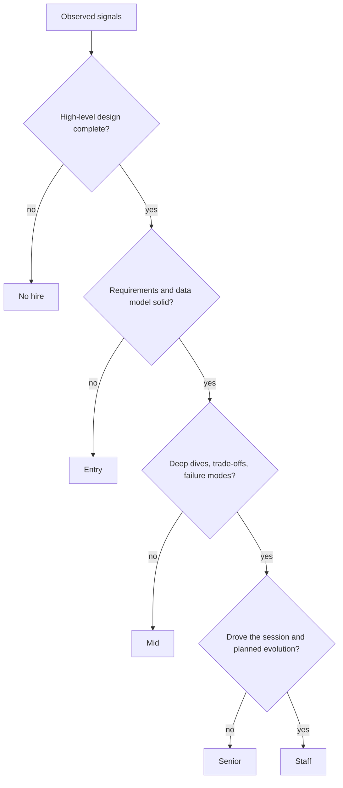

## In one minute
- The same prompt is used at every level; what changes is the bar. A mid-level engineer is expected to produce a working design with guidance, a senior engineer to drive it and go deep on the hard parts, a staff engineer to reshape the problem and reason about operations, cost and evolution.
- Years of experience are a rough proxy. Companies level on observed behaviour in the room, and a candidate with 10 years can be levelled mid if they wait to be led.
- The level decision usually works like gates plus a score: missing one must-have (say, any failure reasoning at senior) caps your level no matter how strong the rest was.
- The most visible differences are who drives the conversation, how far down the stack you can go when probed, and whether you volunteer trade-offs before being asked.
- Read this with [What are System Design Interviews?](what-interviews-measure.md) and [Types of System Design Questions](question-types.md); [Tradeoffs](tradeoffs.md) and the design walkthroughs such as [Design Payment System](design-payment-system.md) show what senior-level depth sounds like.

## How it works

### Level names and rough mapping
Ladders differ across companies, but most have the same four rungs that system design interviews care about. Treat the years as typical, not required, and do not compare level numbers across companies directly: Dropbox's first staff title is IC5 ([Dropbox](https://dropbox.github.io/dbx-career-framework/)), while Google and Meta call staff L6 and E6. Amazon has no staff title; its ladder goes SDE I, SDE II, SDE III (Senior), then Principal ([Hello Interview](https://www.hellointerview.com/blog/understanding-job-levels-at-faang-companies)).

| Rung | Common labels | Typical years | System design round |
|---|---|---|---|
| Entry | L3, E3, SDE I | 0 to 2 | Often absent, or a light API and data model discussion |
| Mid | L4, E4, SDE II | 2 to 5 | One round; a complete, sensible design is a pass |
| Senior | L5, E5, SDE III (Senior SDE) | 5 to 10 | One or two rounds; depth and trade-offs decide it |
| Staff | L6, E6, IC5 at Dropbox; Amazon jumps to Principal | 8 and up | Two rounds is common; scope, ambiguity and leadership decide it |

### Entry and mid level
Most entry-level roles have no system design round ([Hello Interview](https://www.hellointerview.com/learn/system-design/in-a-hurry/introduction)); where one exists, the interviewer checks that you know the building blocks and what each costs. At mid level you are expected to deliver a complete design: clarify requirements, sketch an API, choose a reasonable data model, draw a high-level design that satisfies the requirements, and respond well to hints. It is fine if the interviewer chooses the deep dives; one guide expects mid-level candidates to lead the early phases and the interviewer to take over later ([Hello Interview](https://www.hellointerview.com/blog/the-system-design-interview-what-is-expected-at-each-level)), and another says the interviewer should set the direction and pace below senior ([interviewing.io](https://interviewing.io/guides/system-design-interview)). What fails a mid-level candidate is an incomplete design, a data model that cannot serve the main query, or components with no reason attached.

### Senior
A senior candidate drives. They scope without being asked, estimate and use the numbers, reach a high-level design by about minute 20, and then propose the deep dives themselves: "the hard parts here are the hot partition and the payment retries; I'd like to start with the retries." Interviewers typically want real depth in about two places, ideally drawn from things the candidate has run ([Hello Interview](https://www.hellointerview.com/blog/the-system-design-interview-what-is-expected-at-each-level)). In each deep dive they compare at least two options and say why they chose one. They volunteer failure modes: what happens when the cache, the queue or a region goes away. When probed one level deeper ("how does the consumer know where to resume?") they can answer in terms of mechanisms such as committed offsets, not product names.

### Staff and above
A staff candidate questions the problem itself. They notice that the requirement "real-time" really means "within 30 seconds" and that this removes half the complexity. They talk about how the system will be built and run: what ships first, how to migrate from the old system, what the on-call burden is, which team owns which piece, where the cost goes. Their deep dives reach the machine when needed (why a cross-region synchronous write adds 60 to 70 ms, why a single hot row caps throughput). They also cut complexity: they start from the simplest design that meets the requirements, justify every extra moving part, and commit to a decision instead of offering the interviewer a menu ([Hello Interview](https://www.hellointerview.com/blog/staff-level-system-design)). They lead almost the whole session and treat the interviewer as a peer and stakeholder, checking in and adjusting. Staff roles also come in different shapes, such as tech lead, architect, solver and right hand ([StaffEng](https://staffeng.com/guides/staff-archetypes/)), so a loop may probe one shape harder than the others.

### What does not change
Every level needs clear communication, a design that actually meets the stated requirements, and honesty about what you do not know. "I haven't operated Cassandra, but I'd expect compaction to be the risk; here's why" is a strong answer at any level.

## Down the stack

### Layer 1: The contract
The human process is a leveling decision made from written feedback. Each interviewer reports a hire signal and a level signal per rubric dimension, with evidence. A debrief or committee combines rounds: system design usually carries the most weight for the level decision at senior and above, while coding rounds carry more at entry level. The contract to the candidate is consistency: the same evidence should produce the same level regardless of interviewer, which is what standardised rubrics and interviewer calibration are for ([re:Work](https://rework.withgoogle.com/intl/en/guides/a-guide-to-structured-interviewing-for-better-hiring-practices)). In practice that means must-have gates per level (no failure reasoning, no senior) plus an overall weight of evidence. A "senior with gaps" often becomes a mid-level offer rather than a rejection.

### Layer 2: The mechanism
The technical depth that separates levels shows up in how far a single topic is pushed. Take caching. Mid: "put Redis in front of the database". Senior: cache-aside with a TTL, explicit invalidation on write, a plan for the stampede when a hot key expires (request coalescing or early refresh), and the hit ratio needed to protect the database. Staff: where invalidation events come from (change data capture from the database log, as Debezium does from a Postgres logical replication stream ([Debezium docs](https://debezium.io/documentation/reference/stable/architecture.html)), rather than dual writes from the application), what consistency users actually see, how the cache is warmed after a deploy or a region failover, and what it costs per month. The same ladder exists for every topic: queues (add a queue, then delivery semantics and idempotency, then backpressure and replay strategy across teams), databases (pick one, then partition key and hot spots, then online migrations and multi-region writes).

### Layer 3: The machine
Machine-level numbers are where senior and staff candidates show depth without being asked. A senior candidate knows the common orders of magnitude: memory reads are around 100 ns, an SSD random read around 100 us, an in-region round trip 0.1 to 0.5 ms, and a cross-region one tens of milliseconds, about 60 ms between North American east and west coasts ([Napkin Math](https://github.com/sirupsen/napkin-math)). A staff candidate uses them to reject designs: "a synchronous cross-region write adds at least one round trip, roughly 60 to 70 ms between US coasts, so the 100 ms p99 goal leaves no room for a second hop"; "one Postgres row updated under a lock commits maybe a few thousand times per second, so a global counter has to be sharded into 100 sub-counters"; "a 1 Gbit/s NIC is 125 MB/s, so a cache node serving 10 KB values at 20,000 requests per second is already at 200 MB/s and needs 10 Gbit/s networking". The Redis docs make the same point: 4 KB values at 100,000 requests per second need about 3.2 Gbit/s, so the network often limits Redis before the CPU does ([Redis docs](https://redis.io/docs/latest/operate/oss_and_stack/management/optimization/benchmarks/)). These are not memorised trivia; they are the checks that stop a design from failing in production.

### Why it's built this way
Companies pay very different salaries per level, so mis-levelling is expensive in both directions. Many ladders also have a terminal level, the rung everyone is expected to reach, commonly cited as L4 at Google and E5 at Meta ([Hello Interview](https://www.hellointerview.com/blog/understanding-job-levels-at-faang-companies)); landing below it means you are expected to grow into it. Level is about the scope of problems a person can own without help, so the interview measures how much of the conversation you own. Ownership shows up as proposing deep dives, trade-offs and failure modes before the interviewer asks. Depth is hard to fake under follow-up questions, so interviewers probe one topic down several layers rather than asking many shallow questions. And because a single gap can sink a project, leveling uses gates rather than an average.

## Diagram


## Worked example
Prompt for all three candidates: "Design a notification service that sends push, email and SMS for a company with 50 million users."

Candidate A, 3 years. Clarifies channels and asks whether notifications can be delayed. Draws an API service that writes to a queue, with channel workers calling providers. When asked about volume, estimates 50 million users times 5 notifications a day, about 2,900 per second. When the interviewer asks "what if the SMS provider is down?", suggests retries with backoff. Does not mention duplicates. Signal: a complete, correct design with guidance. Mid hire.

Candidate B, 7 years. Scopes priority levels (transactional versus marketing) and user preferences up front. Estimates average and peak (a marketing blast of 50 million in 10 minutes is about 83,000 per second) and concludes that marketing and transactional traffic need separate queues so a blast cannot delay password resets. Proposes deep dives on deduplication (an idempotency key per notification, checked before the provider call) and provider failover. Discusses at-least-once delivery and why exactly-once is not available from SMS providers. Senior hire.

Candidate C, 12 years. Does all of B's work faster, then asks who owns the templates and whether product teams self-serve, which turns the service into a platform with per-team quotas. Points out that SMS cost dominates (at a few cents a message, 1 million SMS a day is tens of thousands of dollars a day) and proposes routing rules that prefer push. Describes a rollout: start with transactional email only, migrate one product team, then add channels; names the metrics that gate each step. Staff hire. Note that C did not draw more boxes than B; the difference is ownership, cost and evolution.

## In the wild
- **Shopify, 2022: a cost check before launch.** A planned marketing pipeline would run one BigQuery query 60 times a minute, each scanning about 75 GB, which priced out at about $949,000 a month. Clustering the table on the two filter columns cut each scan to about 100 MB and the estimate to about $1,370 a month. Spotting that before it ships is the cost reasoning staff candidates are expected to volunteer ([Shopify Engineering](https://shopify.engineering/reducing-bigquery-costs)).
- **Figma, 2023-2024: evolution, not a final diagram.** After vertical partitioning, some Postgres tables still reached several terabytes and billions of rows. The team built horizontal sharding in stages: tables grouped by shard key so in-key joins still worked, logical sharding through views before any data moved so rollback stayed cheap, and a query-routing proxy. The first table took about nine months and cut over with about 10 seconds of partial unavailability ([Figma](https://www.figma.com/blog/how-figmas-databases-team-lived-to-tell-the-scale/)).
- **Knight Capital, 2012: the rollout is part of the design.** New code was deployed to 7 of 8 servers; on the eighth, a reused flag woke trading logic unused since 2003. In about 45 minutes it made 4 million executions and lost about $460 million, and the SEC later cited missing deployment review and incident procedures. Staff answers that include a staged rollout and a kill switch are describing exactly what was missing ([SEC order](https://www.sec.gov/litigation/admin/2013/34-70694.pdf)).

## Trade-offs
| Choice in the room | Signals higher level | Risk | Use when |
|---|---|---|---|
| Driving and proposing deep dives | Ownership, senior and up | Missing what the interviewer wanted | Senior and staff loops; check in after proposing |
| Following the interviewer's lead | Coachability | Reads as mid-level | Junior loops, or when the interviewer clearly has a script |
| Going deep on one area | Depth | Unfinished breadth | After the high-level design is complete |
| Discussing org, rollout and cost | Staff scope | Seen as dodging technical depth if early | Last third of a staff interview |
| Admitting unknowns with a reasoned guess | Honesty and judgement | Few, if the reasoning is sound | Any level |

## Pitfalls in production
Leveling mistakes have real costs after the hire, not only in the interview:

- **Over-levelling on confidence.** A fluent candidate with shallow depth lands as senior and struggles to own designs. Fix: require one topic probed three layers deep in the evidence.
- **Under-levelling quiet experts.** Candidates who wait for questions get mid-level offers despite deep knowledge. Fix: interviewers should invite ownership explicitly ("which part would you dive into?") before scoring it.
- **Grading on the interviewer's favourite design.** A different but sound design gets marked down. Fix: rubrics that score reasoning, not a reference answer.
- **One weak round sinking a staff loop.** Fix: the committee should look at whether the gap is a must-have for the role or a coachable miss.

## Leadership lens
- Write down the must-have signals per level before running the loop, and train interviewers on them with examples of evidence at each level.
- In debriefs, ask "what did the candidate do that a level below would not?" rather than "were they good?"; it forces evidence.
- Use the same ladder for promotion: an engineer moving to staff should be visibly owning scope, cost and evolution in real design reviews.
- Calibrate across interviewers every quarter by comparing level signals on the same candidates; drift is normal and invisible without it.

## Check yourself
1. Two candidates produce the same diagram. Why might one be levelled senior and the other mid?
   **Answer:** Level is read from how the diagram was produced: who scoped, who chose the deep dives, whether trade-offs and failure modes were volunteered, and how deep follow-ups went.
2. Why do level decisions use gates instead of an average score?
   **Answer:** One missing capability, such as any failure reasoning, would cause real damage in a role at that level regardless of strengths elsewhere, so a high total should not compensate for it.
3. What does staff-level depth on caching add beyond senior-level depth?
   **Answer:** Where invalidation comes from (for example CDC), what consistency users actually see, how the cache is warmed after failover, and its operational and monetary cost.
4. Why is "I haven't run this in production, but here is my reasoning" a good answer?
   **Answer:** It is honest and still produces evidence of judgement, whereas bluffing collapses under the next follow-up and reads as a red flag at any level.

## Practice
**Task:** Build a leveling rubric scorer. Known signals and weights are `requirements` 1, `high_level` 1, `api` 1, `data_model` 1, `estimation` 1, `deep_dive` 2, `tradeoffs` 2, `failure_modes` 2, `drives` 2, `operations` 2, `evolution` 2 and `cost` 1. Levels, in order, with their gates and minimum score are `junior` (gates `high_level`, minimum 2), `mid` (`requirements`, `data_model`, minimum 5), `senior` (`deep_dive`, `tradeoffs`, `failure_modes`, minimum 10) and `staff` (`drives`, `evolution`, minimum 15). Reaching a level requires its minimum score and every gate of that level and all lower levels. `assess(signals)` ignores duplicate signals, rejects an unknown signal, and returns the score, the highest level reached (or `no_hire`), the next level (or none at staff), the sorted gates still missing for the next level including lower levels' gates, and how many points short of the next level's minimum the score is (0 if not short, and 0 at staff).

```python starter
WEIGHTS = {}  # TODO
LEVELS = []   # TODO: (name, gates, min_score)

def assess(signals):
    # TODO: return dict with score, level, next, missing, short
    raise NotImplementedError
```

```python tests
def test_junior_with_gaps():
    r = assess(["high_level", "requirements"])
    assert r == {"score": 2, "level": "junior", "next": "mid", "missing": ["data_model"], "short": 3}

def test_senior():
    r = assess(["requirements", "high_level", "api", "data_model", "estimation",
                "deep_dive", "tradeoffs", "failure_modes"])
    assert (r["score"], r["level"], r["next"], r["missing"], r["short"]) == (11, "senior", "staff", ["drives", "evolution"], 4)

def test_missing_gate_caps_level_despite_score():
    r = assess(["requirements", "high_level", "api", "data_model", "estimation", "deep_dive",
                "tradeoffs", "drives", "operations", "evolution", "cost"])
    assert r["score"] == 16
    assert r["level"] == "mid"
    assert r["missing"] == ["failure_modes"] and r["short"] == 0

def test_staff_has_no_next():
    r = assess(["requirements", "high_level", "api", "data_model", "estimation", "deep_dive",
                "tradeoffs", "failure_modes", "drives", "operations", "evolution", "cost"])
    assert r == {"score": 18, "level": "staff", "next": None, "missing": [], "short": 0}

def test_no_hire():
    assert assess([]) == {"score": 0, "level": "no_hire", "next": "junior", "missing": ["high_level"], "short": 2}
    assert assess(["requirements"])["level"] == "no_hire"

def test_duplicates_count_once():
    assert assess(["high_level", "high_level"])["level"] == "no_hire"

def test_unknown_signal_rejected():
    try:
        assess(["charisma"])
        assert False, "expected ValueError"
    except ValueError:
        pass
```

```python solution
WEIGHTS = {"requirements": 1, "high_level": 1, "api": 1, "data_model": 1, "estimation": 1,
           "deep_dive": 2, "tradeoffs": 2, "failure_modes": 2, "drives": 2, "operations": 2,
           "evolution": 2, "cost": 1}
LEVELS = [
    ("junior", ["high_level"], 2),
    ("mid", ["requirements", "data_model"], 5),
    ("senior", ["deep_dive", "tradeoffs", "failure_modes"], 10),
    ("staff", ["drives", "evolution"], 15),
]

def assess(signals):
    have = set()
    for s in signals:
        if s not in WEIGHTS:
            raise ValueError("unknown signal: %s" % s)
        have.add(s)
    score = sum(WEIGHTS[s] for s in have)
    level = "no_hire"
    gates = []
    nxt, missing, short = None, [], 0
    for name, level_gates, minimum in LEVELS:
        gates = gates + level_gates
        lacking = sorted(g for g in gates if g not in have)
        if not lacking and score >= minimum:
            level = name
            continue
        nxt, missing, short = name, lacking, max(0, minimum - score)
        break
    return {"score": score, "level": level, "next": nxt, "missing": missing, "short": short}
```

```typescript starter
export interface Assessment {
  score: number;
  level: string;
  next: string | null;
  missing: string[];
  short: number;
}

export function assess(signals: string[]): Assessment {
  throw new Error("TODO");
}
```

```typescript tests
const ALL_SIGNALS = ["requirements", "high_level", "api", "data_model", "estimation", "deep_dive",
  "tradeoffs", "failure_modes", "drives", "operations", "evolution", "cost"];
test("junior with gaps", () => {
  assertEqual(assess(["high_level", "requirements"]), { score: 2, level: "junior", next: "mid", missing: ["data_model"], short: 3 });
});
test("senior", () => {
  const r = assess(["requirements", "high_level", "api", "data_model", "estimation", "deep_dive", "tradeoffs", "failure_modes"]);
  assertEqual([r.score, r.level, r.next, r.missing, r.short], [11, "senior", "staff", ["drives", "evolution"], 4]);
});
test("missing gate caps level despite score", () => {
  const r = assess(ALL_SIGNALS.filter((s) => s !== "failure_modes"));
  assertEqual([r.score, r.level, r.missing, r.short], [16, "mid", ["failure_modes"], 0]);
});
test("staff has no next", () => {
  assertEqual(assess(ALL_SIGNALS), { score: 18, level: "staff", next: null, missing: [], short: 0 });
});
test("no hire", () => {
  assertEqual(assess([]), { score: 0, level: "no_hire", next: "junior", missing: ["high_level"], short: 2 });
  assertEqual(assess(["requirements"]).level, "no_hire");
});
test("duplicates count once", () => {
  assertEqual(assess(["high_level", "high_level"]).level, "no_hire");
});
test("unknown signal rejected", () => {
  let threw = false;
  try { assess(["charisma"]); } catch (e) { threw = true; }
  assert(threw, "expected error");
});
```

```typescript solution
export interface Assessment {
  score: number;
  level: string;
  next: string | null;
  missing: string[];
  short: number;
}

const WEIGHTS: Record<string, number> = {
  requirements: 1, high_level: 1, api: 1, data_model: 1, estimation: 1, deep_dive: 2,
  tradeoffs: 2, failure_modes: 2, drives: 2, operations: 2, evolution: 2, cost: 1,
};

const LEVELS: [string, string[], number][] = [
  ["junior", ["high_level"], 2],
  ["mid", ["requirements", "data_model"], 5],
  ["senior", ["deep_dive", "tradeoffs", "failure_modes"], 10],
  ["staff", ["drives", "evolution"], 15],
];

export function assess(signals: string[]): Assessment {
  const have = new Set<string>();
  for (const s of signals) {
    if (!(s in WEIGHTS)) throw new Error("unknown signal: " + s);
    have.add(s);
  }
  let score = 0;
  have.forEach((s) => { score += WEIGHTS[s]; });
  const out: Assessment = { score, level: "no_hire", next: null, missing: [], short: 0 };
  let gates: string[] = [];
  for (const [name, levelGates, minimum] of LEVELS) {
    gates = gates.concat(levelGates);
    const lacking = gates.filter((g) => !have.has(g)).sort();
    if (lacking.length === 0 && score >= minimum) {
      out.level = name;
      continue;
    }
    out.next = name;
    out.missing = lacking;
    out.short = Math.max(0, minimum - score);
    break;
  }
  return out;
}
```

```go starter
package practice

// Assessment is the leveling result. Next is "" at the top level.
type Assessment struct {
	Score   int
	Level   string
	Next    string
	Missing []string
	Short   int
}

func Assess(signals []string) (Assessment, error) { panic("TODO") }
```

```go tests
package practice

import (
	"reflect"
	"testing"
)

var allSignals = []string{"requirements", "high_level", "api", "data_model", "estimation", "deep_dive",
	"tradeoffs", "failure_modes", "drives", "operations", "evolution", "cost"}

func TestJuniorWithGaps(t *testing.T) {
	got, err := Assess([]string{"high_level", "requirements"})
	want := Assessment{2, "junior", "mid", []string{"data_model"}, 3}
	if err != nil || !reflect.DeepEqual(got, want) {
		t.Fatalf("got %+v %v", got, err)
	}
}

func TestSenior(t *testing.T) {
	got, _ := Assess([]string{"requirements", "high_level", "api", "data_model", "estimation", "deep_dive", "tradeoffs", "failure_modes"})
	want := Assessment{11, "senior", "staff", []string{"drives", "evolution"}, 4}
	if !reflect.DeepEqual(got, want) {
		t.Fatalf("got %+v", got)
	}
}

func TestGateCapsLevel(t *testing.T) {
	var sig []string
	for _, s := range allSignals {
		if s != "failure_modes" {
			sig = append(sig, s)
		}
	}
	got, _ := Assess(sig)
	if got.Score != 16 || got.Level != "mid" || !reflect.DeepEqual(got.Missing, []string{"failure_modes"}) || got.Short != 0 {
		t.Fatalf("got %+v", got)
	}
}

func TestStaff(t *testing.T) {
	got, _ := Assess(allSignals)
	if got.Score != 18 || got.Level != "staff" || got.Next != "" || len(got.Missing) != 0 || got.Short != 0 {
		t.Fatalf("got %+v", got)
	}
}

func TestNoHireAndDuplicates(t *testing.T) {
	got, _ := Assess(nil)
	if got.Level != "no_hire" || got.Next != "junior" || !reflect.DeepEqual(got.Missing, []string{"high_level"}) || got.Short != 2 {
		t.Fatalf("got %+v", got)
	}
	dup, _ := Assess([]string{"high_level", "high_level"})
	if dup.Level != "no_hire" {
		t.Fatalf("duplicates got %+v", dup)
	}
}

func TestUnknownSignal(t *testing.T) {
	if _, err := Assess([]string{"charisma"}); err == nil {
		t.Fatal("expected error")
	}
}
```

```go solution
package practice

import (
	"fmt"
	"sort"
)

// Assessment is the leveling result. Next is "" at the top level.
type Assessment struct {
	Score   int
	Level   string
	Next    string
	Missing []string
	Short   int
}

var weights = map[string]int{
	"requirements": 1, "high_level": 1, "api": 1, "data_model": 1, "estimation": 1, "deep_dive": 2,
	"tradeoffs": 2, "failure_modes": 2, "drives": 2, "operations": 2, "evolution": 2, "cost": 1,
}

type level struct {
	name    string
	gates   []string
	minimum int
}

var levels = []level{
	{"junior", []string{"high_level"}, 2},
	{"mid", []string{"requirements", "data_model"}, 5},
	{"senior", []string{"deep_dive", "tradeoffs", "failure_modes"}, 10},
	{"staff", []string{"drives", "evolution"}, 15},
}

func Assess(signals []string) (Assessment, error) {
	have := map[string]bool{}
	for _, s := range signals {
		if _, ok := weights[s]; !ok {
			return Assessment{}, fmt.Errorf("unknown signal: %s", s)
		}
		have[s] = true
	}
	score := 0
	for s := range have {
		score += weights[s]
	}
	out := Assessment{Score: score, Level: "no_hire", Missing: []string{}}
	var gates []string
	for _, l := range levels {
		gates = append(gates, l.gates...)
		lacking := []string{}
		for _, g := range gates {
			if !have[g] {
				lacking = append(lacking, g)
			}
		}
		sort.Strings(lacking)
		if len(lacking) == 0 && score >= l.minimum {
			out.Level = l.name
			continue
		}
		out.Next, out.Missing = l.name, lacking
		if l.minimum > score {
			out.Short = l.minimum - score
		}
		break
	}
	return out, nil
}
```

## Mock interview
**Prompt:** You are interviewing for a staff role. Design a feature flag service used by 300 engineering teams, evaluating flags for 200 million monthly users across web, mobile and backend services, with flag changes visible everywhere within 10 seconds.

- Follow-up: What would a senior answer to this question contain, and what are you adding beyond it?
- Follow-up: The flag service is down for 20 minutes. What happens to every product at the company, and how did your design limit the damage?
- Follow-up: How would you roll this out to 300 teams who already use three different homegrown flag systems?

**A strong answer covers:**
- Local evaluation in an SDK with a cached ruleset, so the service is off the request path, and a stated failure default (last known good rules, then a coded default).
- Change propagation by streaming updates or short polling with ETags, with the arithmetic: thousands of service instances polling every 10 seconds is a manageable few hundred requests per second, while per-request evaluation calls would be millions.
- Governance and safety: audit log, approvals for flags that touch payments, stale flag cleanup, and kill switches.
- A migration plan: adapters for the existing systems, one pilot team, success metrics, then a deprecation date.
- Explicit cost and ownership: who is on call, what the platform team owns versus product teams.

## Sources and further study
**Primary**
- [A guide to structured interviewing (Google re:Work)](https://rework.withgoogle.com/intl/en/guides/a-guide-to-structured-interviewing-for-better-hiring-practices): rubrics and calibration, the machinery that is supposed to make levelling consistent.
- [Napkin Math (Simon Eskildsen)](https://github.com/sirupsen/napkin-math): current latency numbers, including measured round trips between cloud regions.

**Systems docs**
- [Redis benchmark (Redis docs)](https://redis.io/docs/latest/operate/oss_and_stack/management/optimization/benchmarks/): why network bandwidth often limits a cache node before CPU.
- [Debezium architecture](https://debezium.io/documentation/reference/stable/architecture.html): change data capture from the database log, the staff-level answer to cache invalidation.

**Books**
- *The Staff Engineer's Path*, Tanya Reilly, chapter 1 "What Would You Say You Do Here?": what the staff role is and how scope and focus vary.
- *The Staff Engineer's Path*, Tanya Reilly, chapter 5 "Leading Big Projects": the project ownership that staff interviews look for in the rollout discussion.
- *Seeking SRE*, ed. David Blank-Edelman, chapter 2 "Interviewing Site Reliability Engineers": designing an interview funnel from the hiring side.

**Other curricula**
- [The System Design Interview: What is Expected at Each Level (Hello Interview)](https://www.hellointerview.com/blog/the-system-design-interview-what-is-expected-at-each-level): frames level as breadth, depth and proactiveness, with staff candidates leading almost the whole session.
- [5 Keys to Staff-Level System Design Interviews (Hello Interview)](https://www.hellointerview.com/blog/staff-level-system-design): find the crux, cut complexity, and make decisions rather than list options.
- [interviewing.io system design guide](https://interviewing.io/guides/system-design-interview): frames the change by level as who sets the direction and pace of the hour.

## Watch
- [OpenAI & Meta Senior/Staff System Design Mock Interview: Design Online Auction (Hello Interview)](https://www.youtube.com/watch?v=o8nSXW-B7Rw): a mock pitched at senior and staff, useful for hearing what "driving" sounds like.
- [System Design Interview: Step By Step Guide (System Design Interview)](https://www.youtube.com/watch?v=bUHFg8CZFws): how depth in requirements and trade-offs separates answers.

## Free resources
- [Understanding Job Levels at FAANG Companies (Hello Interview)](https://www.hellointerview.com/blog/understanding-job-levels-at-faang-companies): how levels map across large companies and what each expects.
- [Dropbox Engineering Career Framework](https://dropbox.github.io/dbx-career-framework/): a public ladder with concrete behaviours per level, useful for calibrating "senior" and "staff".
- [Staff archetypes (StaffEng)](https://staffeng.com/guides/staff-archetypes/): the different shapes staff roles take, which explains what staff interviews probe.
- [Engineering Ladders (jorgef)](https://github.com/jorgef/engineeringladders): an open framework with per-level expectations for developers and tech leads.
- [Engineering Career Framework (GitLab Handbook)](https://handbook.gitlab.com/handbook/engineering/careers/matrix/): an openly published competency matrix for comparison.
