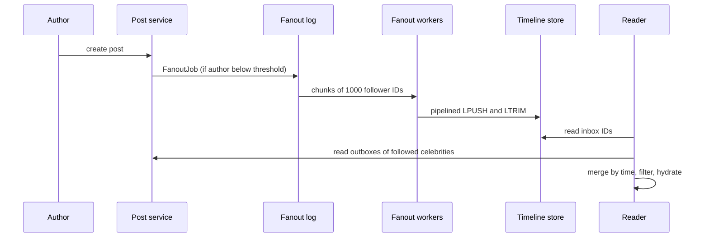

## In one minute
- Fan-out is delivering one event to many recipients: a post to followers' feeds, a message to a group chat's members, a price change to every open dashboard, a notification to subscribers.
- There are two places to do the work. **Fan-out on write (push)** copies the event into each recipient's inbox when it happens, so reads are cheap. **Fan-out on read (pull)** stores the event once and each reader gathers from everyone they follow at read time, so writes are cheap.
- Follower counts follow a power law, so neither extreme works alone. The standard answer is **hybrid**: push for ordinary senders, pull for high-fan-out senders, merge at read time.
- Real-time fan-out to connected clients is a separate layer: a pub/sub bus plus connection gateways that know which socket holds which user.
- Interviewers care about write amplification, delivery latency for the largest fan-out, ordering and what happens to inactive recipients.

## How it works

### Push: fan-out on write
When Alice posts, a fan-out service reads her follower list and appends the post ID to each follower's timeline (a capped list in Redis or a wide-row store). Reading a timeline is one lookup, then a batch fetch of post bodies. Cost lands on the write: a user with 2,000 followers causes 2,000 inbox writes. It works well while follower counts are modest and reads vastly outnumber writes, which is the case for most social products. Twitter's 2013 numbers show the shape: about 300,000 timeline reads per second against about 6,000 write requests per second, with each home timeline an 800-entry list of tweet IDs in Redis, replicated three times ([High Scalability, from Raffi Krikorian's talk](https://highscalability.com/the-architecture-twitter-uses-to-deal-with-150m-active-users/)).

### Pull: fan-out on read
Posts are stored once, indexed by author. A reader's timeline query fetches recent posts from each followee and merges them by time. Writes cost one insert. Reads cost one query per followee, so a user following 1,000 accounts triggers a scatter-gather on every refresh. Pull is also how you handle recipients who rarely log in: no work is done for them until they show up.

### Hybrid
Mark senders above a threshold (say 100,000 followers) as high fan-out. Their posts are not pushed; they are stored in the author's outbox. A reader's timeline is their precomputed inbox merged with the recent outboxes of the few high-fan-out accounts they follow. Typical readers follow a handful of such accounts, so the read-time merge is small, and the write-time cost of a celebrity post drops from tens of millions of inbox writes to one. Twitter reached this hybrid after pure push left a 31-million-follower account's tweets taking up to 5 minutes to reach everyone, and replies sometimes arriving before the tweet they answered ([High Scalability](https://highscalability.com/the-architecture-twitter-uses-to-deal-with-150m-active-users/)). Kleppmann uses the same Twitter example to define load parameters in *DDIA* Ch 1.

Two further refinements are common. Skip pushing to inactive users (not seen in 30 days, Twitter's own definition of active) and rebuild their timelines on next login. And cap inboxes at a few hundred entries, falling back to pull for deep scrolling.

### Real-time delivery
For chat, collaborative editing or live dashboards, recipients hold open connections (WebSocket, SSE, long-poll) to gateway servers. A presence or session registry maps user to gateway. When an event arrives, a router looks up recipients' gateways and publishes to those gateways only, typically through a pub/sub system keyed by gateway or by channel, which decouples senders from however many receivers exist ([Azure Publisher-Subscriber pattern](https://learn.microsoft.com/en-us/azure/architecture/patterns/publisher-subscriber)). Large channels (a 100,000-member Slack-like channel) invert the problem: rather than resolving each member, every gateway subscribes to the channels its connected users are in, and the event is published once per channel. Slack works this way: channel servers own channels by consistent hashing, gateway servers in each region hold users' channel subscriptions, and a message reaches clients worldwide in about 500 ms ([Slack Engineering](https://slack.engineering/real-time-messaging/)).

In one huge live group the cost is quadratic, because more members means both more senders and more recipients per message: 1,000 online users sending one message each make 1 million deliveries, and 100,000 make 10 billion. Discord's answer was to treat members who are not looking at the server as passive sessions that get far fewer updates (about 90% of connections in large servers), and to put relay processes between the guild and up to 15,000 sessions each to split the fan-out and permission checks ([Discord](https://discord.com/blog/maxjourney-pushing-discords-limits-with-a-million-plus-online-users-in-a-single-server)).

### How it shows up in interviews
Triggers: design Twitter, Instagram feed, Facebook News Feed, WhatsApp or Slack groups, a notification system, a live comments system, a stock ticker. A strong answer computes fan-out volume, chooses push, pull or hybrid with a threshold, describes the inbox data structure and its cap, handles inactive users, and separates persistent fan-out (timelines) from transient fan-out (online sockets). Typical probes: what happens when a user with 50 million followers posts, how long until the last follower sees it, how do you handle deletes and unfollows, and how do you order events.

## Down the stack

### Layer 1: The contract
A push timeline promises that a post appears in each active follower's inbox within some delivery latency (often a target of seconds, with the largest pushed fan-outs taking longer), at least once, in roughly time order. It usually does not promise strict global ordering: two posts seconds apart may land in different orders in different inboxes, and the read path re-sorts by timestamp or Snowflake-style ID. Deletes are best effort and asynchronous, so a read path must filter against a deleted-posts check. Real-time delivery promises "at most once to the socket, durable elsewhere" (Redis Pub/Sub, a common router, is explicitly at-most-once ([Redis docs](https://redis.io/docs/latest/develop/pubsub/))): if the client is disconnected, it catches up from the persistent store on reconnect.

### Layer 2: The mechanism
The write path enqueues a `FanoutJob{post_id, author_id, created_at}` on a partitioned log. Fan-out workers page through the follower list in chunks of, say, 1,000 IDs, and for each chunk issue a pipelined batch of `LPUSH timeline:{uid} post_id` followed by `LTRIM timeline:{uid} 0 799` (keep the newest 800). Because jobs are chunked, a large fan-out runs on many workers in parallel, and a crash replays only the failed chunk; pushing the same post ID twice is harmless if the reader de-duplicates IDs. The read path takes the inbox IDs, merges in outbox IDs from followed high-fan-out accounts with a k-way merge on time-sortable IDs, filters deleted or blocked items, and multi-gets bodies from a post cache. For sockets, a gateway keeps a map of `user_id -> connections`, and the router uses Redis Pub/Sub, NATS or Kafka topics per gateway to deliver.

### Layer 3: The machine
A Redis `LPUSH` on a small list costs microseconds of CPU, but a separate network round trip is on the order of a few hundred microseconds inside a data centre. Without pipelining, 10,000 inbox writes serialised take seconds; with batches of 1,000 commands per round trip they take tens of milliseconds of wall time per worker. Pipelining also cuts the server's own cost, since many commands share one `read()` and one `write()` system call; Redis reports throughput rising towards ten times the unpipelined baseline, and suggests batches of about 10,000 commands so queued replies do not eat memory ([Redis docs](https://redis.io/docs/latest/develop/using-commands/pipelining/)). Memory is the bigger bill: 800 entries of 8-byte IDs per user is about 6.4 KB raw, plus per-element overhead in Redis's listpack and quicklist encoding, so 200 million active users need terabytes of RAM for timelines. That is why inboxes hold IDs, not post bodies, and why inactive users are dropped. In process-per-connection runtimes the send itself costs: in Discord's Erlang guilds each `send` took 30 to 70 microseconds, so a publish to 30,000 sessions took 0.9 to 2.1 seconds until they batched sends per remote node ([Discord](https://discord.com/blog/how-discord-scaled-elixir-to-5-000-000-concurrent-users)). On the socket side, each idle WebSocket costs a file descriptor and kernel socket buffers of several kilobytes, so a gateway with a million connections spends gigabytes on buffers alone and needs `ulimit -n` and `net.ipv4.tcp_rmem` tuned.

### Why it's built this way
Reads outnumber writes by orders of magnitude, so precompute on write to make reads one lookup. Follower counts follow a power law, so a few senders would dominate write cost, and they are pulled instead. Memory is expensive, so inboxes store compact IDs and are capped. Network round trips dominate per-write cost, so writes are batched and pipelined. Workers fail, so fan-out is chunked and idempotent.

## Diagram


## Worked example
A social app has 150 million daily active users. They create 50 million posts per day, about 600 per second on average and perhaps 2,000 per second at peak. The median author has 200 followers; the mean is pulled up by large accounts.

With pure push, if the mean fan-out is 400, the system performs 600 x 400 = 240,000 inbox writes per second on average. Now add one account with 60 million followers posting: that single post is 60 million writes. At 500,000 writes per second of total fan-out capacity, it takes two minutes and delays everyone else's posts. With a hybrid threshold of 100,000 followers, roughly the top 0.01% of accounts are pulled. Their posts cost one write. A reader following 20 such accounts adds 20 outbox reads per timeline load, each served from cache and merged in under a millisecond of CPU.

Skipping users inactive for 30 days cuts fan-out by perhaps a third in a typical social product, since many followers are dormant. The inbox cap of 800 IDs keeps memory per active user under 10 KB including overhead, about 1.5 TB across 150 million users, sharded across a Redis cluster with replicas.

## In the wild
- **Twitter, 2013: push timelines and the celebrity exception.** Twitter fanned each tweet out to followers' Redis timelines (800 IDs each, three replicas), about 30 billion deliveries a day against a 5-second delivery target. Median delivery to 1 million followers took 3.5 seconds, but a 31-million-follower account could take up to 5 minutes, so Twitter moved to merging the largest accounts at read time and skipped users inactive for 30 days ([High Scalability](https://highscalability.com/the-architecture-twitter-uses-to-deal-with-150m-active-users/)).
- **Discord, 2017: batching fan-out per node.** Each guild is one Erlang process that sends every event to each connected session. In guilds of up to 30,000 concurrent users a publish took 900 ms to 2.1 s, so Discord built Manifold, which groups recipients by remote node and hands each group to partitioned workers there, spreading the CPU and cutting cross-node traffic ([Discord](https://discord.com/blog/how-discord-scaled-elixir-to-5-000-000-concurrent-users)).
- **Discord, 2023: a million online users in one server.** Midjourney's server passed 10 million members with over 1 million online. Passive sessions cut fan-out work by about 90%, relays split each guild's fan-out across processes of up to 15,000 sessions, and expensive member scans moved to worker processes reading a shared ETS table ([Discord](https://discord.com/blog/maxjourney-pushing-discords-limits-with-a-million-plus-online-users-in-a-single-server)).

## Trade-offs
| Option | Strengths | Weaknesses | Choose when |
|---|---|---|---|
| Fan-out on write | One-lookup reads, low read latency | Write amplification, slow for huge senders | Moderate fan-out, read-heavy |
| Fan-out on read | Cheap writes, always fresh | Expensive scatter-gather reads | Few readers or few followees |
| Hybrid | Bounded cost on both paths | Two code paths, merge logic | Power-law follower graphs |
| Per-channel pub/sub to gateways | One publish per channel | Gateways receive events for channels they might not need | Large live channels |
| Per-user routing to gateways | Precise delivery | Registry lookups per recipient | Small groups, direct messages |

## Pitfalls in production
- **Celebrity backlogs.** One huge fan-out job blocks the shared queue. Chunk jobs, give large fan-outs their own lane, or pull them.
- **Unfollow and delete lag.** Pushed copies stay in inboxes. Filter on read against follow state and a tombstone set, and clean up lazily.
- **Ordering assumptions.** Inbox order reflects arrival, not creation. Sort by a time-ordered ID on read and accept minor reordering.
- **Fan-out to the dead.** Pushing to millions of dormant accounts wastes memory and I/O. Track last-active time and rebuild on return.
- **Thundering reconnects.** After a gateway deploy, a million clients reconnect and re-fetch timelines at once. Drain connections gradually and add client jitter.
- **Retry duplicates.** Replayed fan-out chunks push the same ID twice. Make the read path de-duplicate or use a set-like structure.

## Leadership lens
- Ask for the follower distribution, not just averages; the tail decides the architecture.
- Pick the hybrid threshold from data and make it a config value you can change during an incident.
- Measure delivery latency at p99 and for the largest fan-outs, not only the median.
- Budget timeline memory as a first-class cost line; it grows with active users, not with posts.

## Check yourself
1. Why does pure fan-out on write fail for accounts with tens of millions of followers?
   **Answer:** One post becomes tens of millions of writes, which takes minutes and delays everyone else's deliveries.
2. Why store post IDs rather than post bodies in inboxes?
   **Answer:** IDs are tiny, so inbox memory stays small, and edits or deletes only need to change the one stored body.
3. How does the hybrid read path stay cheap?
   **Answer:** Readers follow only a few high-fan-out accounts, so merging their recent outboxes with the precomputed inbox is a small k-way merge over cached data.
4. Why is fan-out work chunked into batches of follower IDs?
   **Answer:** Chunks parallelise across workers and make retries cover only a small piece, while pipelining each chunk amortises network round trips.

## Practice
**Task:** Implement a hybrid timeline service. `Timelines(threshold)` supports `follow(follower, followee)`, `post(author, post_id, ts)` and `timeline(user, limit)`. If the author has fewer than `threshold` followers at posting time, `post` pushes the post into each follower's inbox and returns the number of inbox writes; otherwise it stores the post only in the author's outbox and returns 0. `timeline` merges the user's inbox with the outboxes of every followee who has at least `threshold` followers, and returns up to `limit` post IDs sorted by `ts` descending, with ties broken by post ID descending. Follows do not backfill old pushed posts.

```python starter
class Timelines:
    def __init__(self, threshold):
        # TODO
        raise NotImplementedError

    def follow(self, follower, followee):
        raise NotImplementedError

    def post(self, author, post_id, ts):
        raise NotImplementedError

    def timeline(self, user, limit):
        raise NotImplementedError
```

```python tests
def test_push_for_small_author():
    t = Timelines(3)
    t.follow("bob", "alice"); t.follow("carol", "alice")
    assert t.post("alice", "p1", 10) == 2
    assert t.timeline("bob", 10) == ["p1"]
    assert t.timeline("carol", 10) == ["p1"]

def test_pull_for_celebrity():
    t = Timelines(2)
    t.follow("u1", "star"); t.follow("u2", "star")
    assert t.post("star", "s1", 5) == 0
    assert t.timeline("u1", 10) == ["s1"]

def test_merge_orders_by_time_desc():
    t = Timelines(2)
    t.follow("u", "star"); t.follow("v", "star"); t.follow("u", "friend")
    t.post("friend", "f1", 1)
    t.post("star", "s1", 2)
    t.post("friend", "f2", 3)
    assert t.timeline("u", 10) == ["f2", "s1", "f1"]

def test_limit_and_tie_break():
    t = Timelines(5)
    t.follow("u", "a")
    t.post("a", "x", 7); t.post("a", "y", 7); t.post("a", "z", 1)
    assert t.timeline("u", 2) == ["y", "x"]

def test_follow_does_not_backfill_pushed_posts():
    t = Timelines(5)
    t.post("a", "old", 1)
    t.follow("u", "a")
    t.post("a", "new", 2)
    assert t.timeline("u", 10) == ["new"]

def test_unknown_user_empty():
    t = Timelines(1)
    assert t.timeline("ghost", 5) == []
```

```python solution
from collections import defaultdict

class Timelines:
    def __init__(self, threshold):
        self.threshold = threshold
        self.followers = defaultdict(set)
        self.following = defaultdict(set)
        self.inbox = defaultdict(list)
        self.outbox = defaultdict(list)

    def follow(self, follower, followee):
        self.followers[followee].add(follower)
        self.following[follower].add(followee)

    def post(self, author, post_id, ts):
        fans = self.followers[author]
        if len(fans) >= self.threshold:
            self.outbox[author].append((ts, post_id))
            return 0
        for f in fans:
            self.inbox[f].append((ts, post_id))
        return len(fans)

    def timeline(self, user, limit):
        items = list(self.inbox.get(user, []))
        for f in self.following.get(user, set()):
            if len(self.followers[f]) >= self.threshold:
                items.extend(self.outbox.get(f, []))
        items.sort(reverse=True)
        return [pid for _, pid in items[:limit]]
```

```typescript starter
export class Timelines {
  constructor(threshold: number) {}
  follow(follower: string, followee: string): void {
    throw new Error("TODO");
  }
  post(author: string, postId: string, ts: number): number {
    throw new Error("TODO");
  }
  timeline(user: string, limit: number): string[] {
    throw new Error("TODO");
  }
}
```

```typescript tests
test("push for small author", () => {
  const t = new Timelines(3);
  t.follow("bob", "alice"); t.follow("carol", "alice");
  assertEqual(t.post("alice", "p1", 10), 2);
  assertEqual(t.timeline("bob", 10), ["p1"]);
  assertEqual(t.timeline("carol", 10), ["p1"]);
});
test("pull for celebrity", () => {
  const t = new Timelines(2);
  t.follow("u1", "star"); t.follow("u2", "star");
  assertEqual(t.post("star", "s1", 5), 0);
  assertEqual(t.timeline("u1", 10), ["s1"]);
});
test("merge orders by time desc", () => {
  const t = new Timelines(2);
  t.follow("u", "star"); t.follow("v", "star"); t.follow("u", "friend");
  t.post("friend", "f1", 1);
  t.post("star", "s1", 2);
  t.post("friend", "f2", 3);
  assertEqual(t.timeline("u", 10), ["f2", "s1", "f1"]);
});
test("limit and tie break", () => {
  const t = new Timelines(5);
  t.follow("u", "a");
  t.post("a", "x", 7); t.post("a", "y", 7); t.post("a", "z", 1);
  assertEqual(t.timeline("u", 2), ["y", "x"]);
});
test("follow does not backfill", () => {
  const t = new Timelines(5);
  t.post("a", "old", 1);
  t.follow("u", "a");
  t.post("a", "new", 2);
  assertEqual(t.timeline("u", 10), ["new"]);
});
test("unknown user empty", () => {
  const t = new Timelines(1);
  assertEqual(t.timeline("ghost", 5), []);
});
```

```typescript solution
type Item = [number, string];

export class Timelines {
  private followers = new Map<string, Set<string>>();
  private following = new Map<string, Set<string>>();
  private inbox = new Map<string, Item[]>();
  private outbox = new Map<string, Item[]>();
  constructor(private threshold: number) {}
  private set(m: Map<string, Set<string>>, k: string): Set<string> {
    let s = m.get(k);
    if (!s) { s = new Set(); m.set(k, s); }
    return s;
  }
  private list(m: Map<string, Item[]>, k: string): Item[] {
    let l = m.get(k);
    if (!l) { l = []; m.set(k, l); }
    return l;
  }
  follow(follower: string, followee: string): void {
    this.set(this.followers, followee).add(follower);
    this.set(this.following, follower).add(followee);
  }
  post(author: string, postId: string, ts: number): number {
    const fans = this.set(this.followers, author);
    if (fans.size >= this.threshold) {
      this.list(this.outbox, author).push([ts, postId]);
      return 0;
    }
    for (const f of fans) this.list(this.inbox, f).push([ts, postId]);
    return fans.size;
  }
  timeline(user: string, limit: number): string[] {
    const items: Item[] = [...(this.inbox.get(user) ?? [])];
    for (const f of this.following.get(user) ?? []) {
      if ((this.followers.get(f)?.size ?? 0) >= this.threshold) items.push(...(this.outbox.get(f) ?? []));
    }
    items.sort((a, b) => (b[0] - a[0]) || (a[1] < b[1] ? 1 : a[1] > b[1] ? -1 : 0));
    return items.slice(0, limit).map((i) => i[1]);
  }
}
```

```go starter
package practice

import "sync"

// Timelines is a hybrid push/pull feed. Safe for concurrent use.
type Timelines struct {
	mu sync.Mutex
}

func NewTimelines(threshold int) *Timelines { return &Timelines{} }

func (t *Timelines) Follow(follower, followee string) { panic("TODO") }

func (t *Timelines) Post(author, postID string, ts int) int { panic("TODO") }

func (t *Timelines) Timeline(user string, limit int) []string { panic("TODO") }
```

```go tests
package practice

import (
	"reflect"
	"testing"
)

func TestPushSmallAuthor(t *testing.T) {
	tl := NewTimelines(3)
	tl.Follow("bob", "alice")
	tl.Follow("carol", "alice")
	if tl.Post("alice", "p1", 10) != 2 {
		t.Fatal("expected 2 inbox writes")
	}
	if !reflect.DeepEqual(tl.Timeline("carol", 10), []string{"p1"}) {
		t.Fatal("carol should see p1")
	}
}

func TestPullCelebrity(t *testing.T) {
	tl := NewTimelines(2)
	tl.Follow("u1", "star")
	tl.Follow("u2", "star")
	if tl.Post("star", "s1", 5) != 0 {
		t.Fatal("celebrity posts are not pushed")
	}
	if !reflect.DeepEqual(tl.Timeline("u1", 10), []string{"s1"}) {
		t.Fatal("u1 should pull s1")
	}
}

func TestMergeOrder(t *testing.T) {
	tl := NewTimelines(2)
	tl.Follow("u", "star")
	tl.Follow("v", "star")
	tl.Follow("u", "friend")
	tl.Post("friend", "f1", 1)
	tl.Post("star", "s1", 2)
	tl.Post("friend", "f2", 3)
	if got := tl.Timeline("u", 10); !reflect.DeepEqual(got, []string{"f2", "s1", "f1"}) {
		t.Fatalf("got %v", got)
	}
}

func TestLimitTieBreak(t *testing.T) {
	tl := NewTimelines(5)
	tl.Follow("u", "a")
	tl.Post("a", "x", 7)
	tl.Post("a", "y", 7)
	tl.Post("a", "z", 1)
	if got := tl.Timeline("u", 2); !reflect.DeepEqual(got, []string{"y", "x"}) {
		t.Fatalf("got %v", got)
	}
}

func TestNoBackfill(t *testing.T) {
	tl := NewTimelines(5)
	tl.Post("a", "old", 1)
	tl.Follow("u", "a")
	tl.Post("a", "new", 2)
	if got := tl.Timeline("u", 10); !reflect.DeepEqual(got, []string{"new"}) {
		t.Fatalf("got %v", got)
	}
}

func TestUnknownUser(t *testing.T) {
	tl := NewTimelines(1)
	if len(tl.Timeline("ghost", 5)) != 0 {
		t.Fatal("expected empty")
	}
}
```

```go solution
package practice

import (
	"sort"
	"sync"
)

type item struct {
	ts int
	id string
}

// Timelines is a hybrid push/pull feed. Safe for concurrent use.
type Timelines struct {
	mu        sync.Mutex
	threshold int
	followers map[string]map[string]bool
	following map[string]map[string]bool
	inbox     map[string][]item
	outbox    map[string][]item
}

func NewTimelines(threshold int) *Timelines {
	return &Timelines{threshold: threshold, followers: map[string]map[string]bool{},
		following: map[string]map[string]bool{}, inbox: map[string][]item{}, outbox: map[string][]item{}}
}

func add(m map[string]map[string]bool, k, v string) {
	if m[k] == nil {
		m[k] = map[string]bool{}
	}
	m[k][v] = true
}

func (t *Timelines) Follow(follower, followee string) {
	t.mu.Lock()
	defer t.mu.Unlock()
	add(t.followers, followee, follower)
	add(t.following, follower, followee)
}

func (t *Timelines) Post(author, postID string, ts int) int {
	t.mu.Lock()
	defer t.mu.Unlock()
	fans := t.followers[author]
	if len(fans) >= t.threshold {
		t.outbox[author] = append(t.outbox[author], item{ts, postID})
		return 0
	}
	for f := range fans {
		t.inbox[f] = append(t.inbox[f], item{ts, postID})
	}
	return len(fans)
}

func (t *Timelines) Timeline(user string, limit int) []string {
	t.mu.Lock()
	defer t.mu.Unlock()
	items := append([]item{}, t.inbox[user]...)
	for f := range t.following[user] {
		if len(t.followers[f]) >= t.threshold {
			items = append(items, t.outbox[f]...)
		}
	}
	sort.Slice(items, func(i, j int) bool {
		if items[i].ts != items[j].ts {
			return items[i].ts > items[j].ts
		}
		return items[i].id > items[j].id
	})
	out := []string{}
	for i := 0; i < len(items) && i < limit; i++ {
		out = append(out, items[i].id)
	}
	return out
}
```

## Mock interview
**Prompt:** Design the home timeline for a microblogging service with 200 million daily active users, 500 million posts per day, and accounts ranging from zero to 100 million followers. The timeline should show new posts from followed accounts within 5 seconds for most users.

- Follow-up: A 100-million-follower account posts during peak. Walk through exactly what happens.
- Follow-up: A user unfollows someone. When do that person's posts disappear, and how?
- Follow-up: How would the design change if timelines were ranked by relevance instead of time?

**A strong answer covers:**
- Fan-out arithmetic with peak QPS, mean and tail follower counts, and resulting inbox writes per second.
- A hybrid model with an explicit threshold, an outbox for high-fan-out accounts and a read-time merge.
- A capped ID-only inbox in an in-memory store, with memory sizing and handling of inactive users.
- Chunked, idempotent fan-out workers on a partitioned log, with separate lanes for large jobs.
- Read-time filtering for deletes, unfollows and blocks, and how ranking moves work from storage to a candidate-generation and scoring step.

## Sources and further study
**Primary**
- [Discord: Maxjourney](https://discord.com/blog/maxjourney-pushing-discords-limits-with-a-million-plus-online-users-in-a-single-server): passive sessions, relays and the quadratic cost of one huge group.
- [Discord: How Discord scaled Elixir to 5,000,000 concurrent users](https://discord.com/blog/how-discord-scaled-elixir-to-5-000-000-concurrent-users): per-node batching of fan-out with Manifold.

**Systems docs**
- [Redis pipelining](https://redis.io/docs/latest/develop/using-commands/pipelining/): why batched commands raise throughput and how big a batch should be.
- [Redis Pub/Sub](https://redis.io/docs/latest/develop/pubsub/): at-most-once delivery to connected subscribers, the semantics a gateway layer inherits.

**Books**
- *Designing Data-Intensive Applications* (1st ed.), Martin Kleppmann, Ch 1 "Reliable, Scalable, and Maintainable Applications": the Twitter home-timeline example used to explain load parameters and fan-out.
- *System Design Interview, Volume 1*, Alex Xu, Ch 11 "Design A News Feed System": fan-out on write versus read and the hybrid for celebrities at interview depth.

**Other curricula**
- [donnemartin/system-design-primer](https://github.com/donnemartin/system-design-primer): its Twitter timeline solution sizes fan-out at 60,000 deliveries per second and pushes tweet IDs into Redis lists.
- [roadmap.sh: System Design](https://roadmap.sh/system-design): lists fan-out building blocks under its cloud design patterns, including Pub/Sub, Competing Consumers and Priority Queue.

## Watch
- [Real-Time Delivery Architecture at Twitter (Parleys)](https://www.youtube.com/watch?v=J5auCY4ajK8): fan-out on write into cached timelines, and the exceptions for very large accounts.
- [Scaling Instagram Infrastructure (InfoQ)](https://www.youtube.com/watch?v=hnpzNAPiC0E): feed serving, caching and cross-region concerns at very large scale.

## Free resources
- [Timelines at Scale (InfoQ)](https://www.infoq.com/presentations/Twitter-Timeline-Scalability/): Twitter's push-based timeline architecture explained by the team that ran it.
- [Real-time messaging at Slack (Slack Engineering)](https://slack.engineering/real-time-messaging/): channel servers, gateways and fan-out to connected clients.
- [Publisher-Subscriber pattern (Azure Architecture Center)](https://learn.microsoft.com/en-us/azure/architecture/patterns/publisher-subscriber): decoupled fan-out with its ordering and delivery caveats.
- [The architecture Twitter uses to deal with 150M active users (High Scalability)](https://highscalability.com/the-architecture-twitter-uses-to-deal-with-150m-active-users/): a detailed write-up of the fan-out numbers and design choices.
