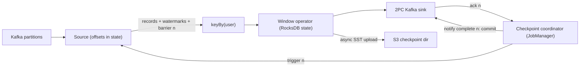

## In one minute
- Apache Flink is a distributed engine for stateful stream processing: it runs a long-lived dataflow graph that reads unbounded streams, keeps per-key state, and emits results continuously with millisecond to second latency.
- **Event time** with **watermarks** lets it compute correct windows over out-of-order data, using the time each event happened rather than the time it arrived.
- State lives next to the computation (on the JVM heap or in embedded RocksDB) and is made fault tolerant by periodic **asynchronous barrier checkpoints** to object storage, giving exactly-once state semantics.
- Combined with transactional sources and sinks (Kafka offsets, two-phase-commit producers), a pipeline gets end-to-end exactly-once output.
- Choose it for real-time aggregation, fraud detection, CEP, streaming joins and continuous ETL. Avoid it for stateless transforms and request-response work.

## How it works

### Jobs, operators and slots
You write a pipeline (DataStream API or Flink SQL), and Flink compiles it into a **JobGraph** of operators: sources, maps, `keyBy`, windows, joins, sinks. Each operator runs with some parallelism, and the runtime turns the graph into an **ExecutionGraph** of parallel subtasks. A **JobManager** schedules subtasks into **slots** on **TaskManagers**, which are JVM processes. Adjacent operators with the same parallelism and no repartition between them are **chained** into one task, so records pass by function call instead of serialisation. Flink 2.0 (March 2025) removed the old DataSet API, the Scala APIs and the legacy `SourceFunction`/`SinkFunction` interfaces, so batch jobs now run on the same DataStream and SQL APIs as streams ([Flink 2.0 announcement](https://flink.apache.org/2025/03/24/apache-flink-2.0.0-a-new-era-of-real-time-data-processing/)).

### Keyed state
`keyBy(userId)` hash-partitions the stream so all events for a key reach the same subtask. That subtask owns the key's state: a `ValueState`, `ListState`, `MapState`, or window contents. Keys hash into **key groups**, whose count equals the job's max parallelism: by default about 1.5 times the operator's parallelism, at least 128 and at most 32,768 ([parallel execution docs](https://nightlies.apache.org/flink/flink-docs-stable/docs/dev/datastream/execution/parallel/)). It cannot change without losing state compatibility, so set it deliberately before the first savepoint. Key groups are the unit of rescaling: changing parallelism reassigns contiguous ranges of key groups to subtasks and restores their state from the last checkpoint or savepoint.

### Event time and watermarks
Each event carries a timestamp. A **watermark** is a special record meaning "no more events with timestamp at or below W are expected". Sources typically generate watermarks as the maximum timestamp seen minus a bounded out-of-orderness delay. An operator with several inputs tracks the minimum watermark across them, so the slowest input holds time back. When the watermark passes the end of a window, the window fires. Events that arrive later than that are **late**: dropped by default, or kept for `allowedLateness` and re-fired, or sent to a side output ([timely stream processing](https://nightlies.apache.org/flink/flink-docs-stable/docs/concepts/time/)).

### Checkpoints and savepoints
Periodically the coordinator snapshots all state plus source positions; on failure, Flink restores the latest checkpoint and replays sources from those offsets. A **savepoint** is a user-triggered checkpoint in a portable format, used for upgrades, rescaling and migrations.

## Down the stack

### Layer 1: The contract
Given replayable sources and checkpointing, Flink guarantees that each event affects managed state exactly once, even across failures: after recovery, state equals what it would be if the failure never happened. Output to external systems is exactly-once only with transactional or idempotent sinks; otherwise it is at-least-once, because records emitted after the last checkpoint are emitted again on replay. Event-time results are deterministic given the same input and watermark strategy, regardless of arrival order within the bound. Latency is the processing path (usually milliseconds) plus the watermark delay for windowed results; with transactional sinks, consumers using `read_committed` see results only after the checkpoint commits, so the checkpoint interval becomes output latency.

### Layer 2: The mechanism
**Asynchronous barrier snapshotting.** A variant of [Chandy-Lamport](https://lamport.azurewebsites.net/pubs/chandy.pdf) that needs no channel logging for acyclic graphs ([Carbone et al.](https://arxiv.org/abs/1506.08603)). The coordinator tells each source to inject a **checkpoint barrier** n, which flows in-band with records. An operator with several inputs that sees barrier n on one input **aligns**: it stops reading that input until barrier n arrives on all inputs, so no post-barrier record leaks into the snapshot. It then snapshots state, forwards the barrier and resumes. When every sink has acknowledged, checkpoint n is complete ([stateful stream processing](https://nightlies.apache.org/flink/flink-docs-stable/docs/concepts/stateful-stream-processing/)). **Unaligned checkpoints** forward the barrier at once and store the overtaken in-flight buffers in the snapshot, keeping checkpoints fast under backpressure at the cost of size.

**State backends.** `HashMapStateBackend` keeps Java objects on the heap: fast, but memory-bound and GC-sensitive. `EmbeddedRocksDBStateBackend` keeps state in a RocksDB LSM tree on local disk, keyed by key-group prefix, key and namespace (such as the window). A snapshot flushes the memtable, hard-links the immutable SST files, and uploads them in the background. **Incremental checkpoints** (`execution.checkpointing.incremental: true`) upload only new SST files, with a shared registry reference-counting files used by several checkpoints. With nothing configured, Flink uses the heap backend. Flink 2.0 added an experimental third option, `ForStStateBackend` (`state.backend.type: forst`), which keeps state primarily in a remote file system with local disk as a cache and always snapshots incrementally, so TaskManagers no longer need disks sized for all their state ([state backends](https://nightlies.apache.org/flink/flink-docs-stable/docs/ops/state/state_backends/), [Flink 2.0 announcement](https://flink.apache.org/2025/03/24/apache-flink-2.0.0-a-new-era-of-real-time-data-processing/)).

**Watermarks and timers.** Each subtask tracks the latest watermark per input channel and emits the minimum when it advances; idle inputs can be excluded. Window operators register an event-time timer at `window.maxTimestamp()` (end minus 1 ms) per key and window, which fires when the watermark reaches it.

**Two-phase commit sinks.** On each checkpoint the sink pre-commits (for Kafka, flushes a transaction) and commits when notified that the checkpoint completed. The Kafka producer's `transaction.timeout.ms` must exceed the longest checkpoint plus restart time, or Kafka aborts the open transaction and its records are lost ([Flink Kafka connector](https://nightlies.apache.org/flink/flink-docs-stable/docs/connectors/datastream/kafka/)); brokers also cap it with `transaction.max.timeout.ms`, 15 minutes by default ([Kafka broker configs](https://kafka.apache.org/43/configuration/broker-configs/)). JobManager HA uses ZooKeeper or Kubernetes leader election and stores the pointer to the latest checkpoint metadata.

### Layer 3: The machine
Records move between TaskManagers over Netty TCP in **network buffers**, 32 KiB memory segments (`taskmanager.memory.segment-size`). With **credit-based flow control** a receiver announces its free buffers and the sender sends only that many, so a slow operator causes **backpressure** that reaches the source, which simply reads Kafka more slowly. Buffers flush when full or after `execution.buffer-timeout.interval`, 100 ms by default ([configuration](https://nightlies.apache.org/flink/flink-docs-stable/docs/deployment/config/)); the 1.x key was `execution.buffer-timeout`.

A RocksDB state access is a JNI call plus serialisation, a few microseconds, versus tens to hundreds of nanoseconds on heap; a block cache miss adds an SSD read of about 100 microseconds, which is why local NVMe matters. A node with hundreds of GB of state uploads only changed SST files per checkpoint, often a few GB, which takes seconds at a few hundred MB/s to S3.

Rough throughput (hedge: highly workload dependent): simple keyed aggregations reach hundreds of thousands to a few million events per second per TaskManager, and large deployments run tens of millions per second. Checkpoint intervals are typically 10 seconds to a few minutes; recovery is restart plus state download plus replay since the last checkpoint.

### Why it's built this way
1. Stateful streaming needs state co-located with compute, because a network call per event to a database caps throughput and adds milliseconds.
2. Co-located state must survive machine loss, so it is snapshotted to durable object storage; doing that without pausing the stream requires barriers rather than a global stop.
3. Large state makes full snapshots too slow, so RocksDB's immutable SST files enable incremental checkpoints that upload only what changed.
4. Real data arrives late and out of order, so time must come from events, and some signal (the watermark) must say when a window is complete enough to emit.
5. Bounded buffers and credit flow make a slow consumer slow the producer instead of exhausting memory, which keeps the system stable under load spikes.

## Diagram


## Worked example
A payments company wants per-merchant fraud features: count and sum of transactions per merchant per 1-minute tumbling window, from a Kafka topic with 200,000 events per second and 2 million active merchants. Events can arrive up to 10 seconds late due to mobile retries.

With 10 seconds of bounded out-of-orderness, each window fires about 10 seconds after it ends, triggering up to 2 million timers as the watermark crosses the minute. Window state is a count and a sum, about 50 bytes per merchant, so 100 MB per open window. The team also keeps a 30-day profile of about 2 KB per merchant, 4 GB in total, so RocksDB with incremental checkpoints is the safer backend.

Parallelism 32 gives about 6,250 events per second per subtask, comfortable at a few microseconds per state access. Checkpoints every 30 seconds upload perhaps 200 MB of changed files. A transactional Kafka sink would delay visible results by up to 30 seconds, too slow for fraud, so the sink does idempotent upserts keyed by merchant and window start instead. Events more than 10 seconds late go to a side output that a nightly batch uses for corrections.

## In the wild
- **Uber, 2021: exactly-once ad aggregation, and its latency bill.** Uber Eats ad events flow through Flink jobs that deduplicate with keyed state and count clicks and impressions per ad in one-minute tumbling windows. Results go to Kafka inside transactions committed on each checkpoint, and downstream consumers read only committed records. Uber cut the checkpoint interval to 2 minutes and still names it the main source of delay; every aggregate carries a UUID used as an idempotency key by the budget service, Hive and Pinot upserts ([Uber Engineering](https://www.uber.com/en-US/blog/real-time-exactly-once-ad-event-processing/)).
- **Uber, 2021: why replaying Kafka is not a backfill plan.** With trillions of messages and petabytes a day as of October 2020, Uber keeps only a few days of Kafka retention, so pure Kappa replay is impossible. Its Flink backfill either compiles one SQL query into a streaming job over Kafka and a batch job over Hive, or ("Kappa+") runs the streaming code directly over Hive with throttling and larger buffering windows for out-of-order history ([SIGMOD 2021 paper](https://arxiv.org/abs/2104.00087)).

## Trade-offs
| Option | Strengths | Weaknesses | Choose when |
|---|---|---|---|
| Flink | Event time, large state, exactly-once, low latency | Operational complexity, JVM tuning, state migrations | Stateful real-time pipelines at scale |
| Spark Structured Streaming | Same engine as batch, mature ecosystem | Micro-batch latency (often 100 ms to seconds), weaker event-time features | Teams already on Spark, near-real-time is enough |
| Kafka Streams | A library, no cluster, state in RocksDB plus changelog topics | Kafka-only, rebalances move state slowly | Kafka-to-Kafka services owned by app teams |
| Plain consumers + database | Simple, familiar | No event time, state round trips, manual recovery | Stateless or lightly stateful transforms |
| Batch jobs | Simplest correctness | Latency of minutes to hours | Results are needed daily or hourly |

## Pitfalls in production
- **One idle partition stalls all windows.** The watermark is a minimum, so an empty partition freezes time. Configure `withIdleness`.
- **Checkpoints time out under backpressure.** Barriers queue behind full buffers. Fix the bottleneck or enable unaligned checkpoints.
- **Unbounded state growth.** Keys that never return keep state forever. Set state TTL.
- **Savepoint restore breaks after a change.** Generated operator IDs shift with the graph. Give every stateful operator a stable `uid`.
- **Skewed `keyBy`.** One hot key pins one subtask. Pre-aggregate on a salted key, then combine.
- **Assuming a 1.x savepoint restores on 2.x.** State compatibility between 1.x and 2.x is not guaranteed, and removed APIs mean code changes too ([Flink 2.0 announcement](https://flink.apache.org/2025/03/24/apache-flink-2.0.0-a-new-era-of-real-time-data-processing/)). Plan the upgrade as a migration: rebuild state from the source or a backfill, or run old and new jobs side by side.

## Leadership lens
- Ask what latency the business needs and whether late data must be corrected; those answers set watermark delay, allowed lateness and sink design.
- Make savepoints part of every deploy and review state schema changes like database migrations.
- Budget for checkpoint storage, RocksDB tuning and backpressure on-call; managed Flink reduces cluster work, not job design.
- Prefer Flink SQL for standard aggregations; reserve the DataStream API for what SQL cannot express.

## Check yourself
1. Why does a two-input operator wait for the barrier on both inputs before snapshotting in aligned mode?
   **Answer:** Otherwise post-checkpoint records from the faster input would be in the snapshot, and replay after recovery would count them twice.
2. A job's windows stopped firing after a deploy, but events are flowing. What is the likely cause?
   **Answer:** An idle or lagging input holds back the minimum watermark; idleness detection or fixing that input lets time advance.
3. Why are RocksDB incremental checkpoints cheap even with terabytes of state?
   **Answer:** SST files are immutable, so a checkpoint uploads only new files and references the rest.
4. Why can a transactional Kafka sink increase end-to-end latency?
   **Answer:** Output becomes visible to `read_committed` consumers only when the checkpoint completes and the transaction commits.

## Practice
**Task:** Implement event-time tumbling windows with a bounded-out-of-orderness watermark. `on_event(key, ts, value)` finds the window `[start, start + size)`, with `start` floored to a multiple of `size` (also for negative `ts`). If `start + size - 1 <= watermark` the event is late: record `(key, ts, value)` and return nothing. Otherwise add `value` to that key's window, set the watermark to `max(watermark, max_ts_seen - delay - 1)`, and return every window with `end - 1 <= watermark` as `(key, start, end, sum)`, sorted by start then key. `flush()` fires the rest; also expose `watermark()` and `late()`.

```python starter
class TumblingWindows:
    def __init__(self, size, delay):
        self.size = size
        self.delay = delay

    def on_event(self, key, ts, value):
        # TODO
        raise NotImplementedError

    def flush(self):
        # TODO
        raise NotImplementedError

    def watermark(self):
        # TODO
        raise NotImplementedError

    def late(self):
        # TODO
        raise NotImplementedError
```

```python tests
def test_in_order_fires_when_watermark_passes():
    w = TumblingWindows(10, 0)
    assert w.on_event("a", 1, 1) == []
    assert w.on_event("a", 5, 2) == []
    assert w.watermark() == 4
    assert w.on_event("a", 12, 3) == [("a", 0, 10, 3)]
    assert w.watermark() == 11

def test_out_of_order_within_delay_counts():
    w = TumblingWindows(10, 5)
    assert w.on_event("a", 8, 1) == []
    assert w.on_event("a", 12, 1) == []
    assert w.on_event("a", 3, 1) == []
    assert w.on_event("a", 16, 1) == [("a", 0, 10, 2)]

def test_late_event_dropped_and_recorded():
    w = TumblingWindows(10, 0)
    w.on_event("a", 1, 1)
    assert w.on_event("a", 15, 1) == [("a", 0, 10, 1)]
    assert w.on_event("a", 4, 9) == []
    assert w.late() == [("a", 4, 9)]
    assert w.watermark() == 14, "late event must not move the watermark"

def test_multiple_keys_sorted():
    w = TumblingWindows(10, 5)
    w.on_event("b", 2, 1)
    w.on_event("a", 3, 4)
    w.on_event("a", 11, 1)
    w.on_event("b", 12, 2)
    assert w.on_event("c", 25, 1) == [("a", 0, 10, 4), ("b", 0, 10, 1), ("a", 10, 20, 1), ("b", 10, 20, 2)]

def test_flush_fires_rest():
    w = TumblingWindows(10, 100)
    w.on_event("x", 5, 1)
    w.on_event("x", 25, 2)
    w.on_event("y", 7, 3)
    assert w.flush() == [("x", 0, 10, 1), ("y", 0, 10, 3), ("x", 20, 30, 2)]
    assert w.flush() == []

def test_negative_timestamps_floor():
    w = TumblingWindows(10, 0)
    w.on_event("a", -3, 1)
    w.on_event("a", -10, 1)
    assert w.flush() == [("a", -10, 0, 2)]

def test_window_fires_exactly_at_end_minus_one():
    w = TumblingWindows(10, 0)
    w.on_event("a", 0, 1)
    assert w.on_event("a", 9, 1) == []
    assert w.on_event("a", 10, 1) == [("a", 0, 10, 2)]
```

```python solution
class TumblingWindows:
    def __init__(self, size, delay):
        self.size = size
        self.delay = delay
        self.wm = -(1 << 62)
        self.max_ts = -(1 << 62)
        self.state = {}  # (start, key) -> sum
        self.late_events = []

    def _start(self, ts):
        return ts - (ts % self.size)  # Python % floors for negative ts

    def _fire(self, limit):
        ready = sorted(k for k in self.state if k[0] + self.size - 1 <= limit)
        out = []
        for start, key in ready:
            out.append((key, start, start + self.size, self.state.pop((start, key))))
        return out

    def on_event(self, key, ts, value):
        start = self._start(ts)
        if start + self.size - 1 <= self.wm:
            self.late_events.append((key, ts, value))
            return []
        self.state[(start, key)] = self.state.get((start, key), 0) + value
        self.max_ts = max(self.max_ts, ts)
        self.wm = max(self.wm, self.max_ts - self.delay - 1)
        return self._fire(self.wm)

    def flush(self):
        self.wm = 1 << 62
        return self._fire(self.wm)

    def watermark(self):
        return self.wm

    def late(self):
        return list(self.late_events)
```

```typescript starter
export type Fired = [string, number, number, number];

export class TumblingWindows {
  constructor(private size: number, private delay: number) {}
  onEvent(key: string, ts: number, value: number): Fired[] {
    throw new Error("TODO");
  }
  flush(): Fired[] {
    throw new Error("TODO");
  }
  watermark(): number {
    throw new Error("TODO");
  }
  late(): [string, number, number][] {
    throw new Error("TODO");
  }
}
```

```typescript tests
test("in order fires when watermark passes", () => {
  const w = new TumblingWindows(10, 0);
  assertEqual(w.onEvent("a", 1, 1), []);
  assertEqual(w.onEvent("a", 5, 2), []);
  assertEqual(w.watermark(), 4);
  assertEqual(w.onEvent("a", 12, 3), [["a", 0, 10, 3]]);
  assertEqual(w.watermark(), 11);
});

test("out of order within delay counts", () => {
  const w = new TumblingWindows(10, 5);
  assertEqual(w.onEvent("a", 8, 1), []);
  assertEqual(w.onEvent("a", 12, 1), []);
  assertEqual(w.onEvent("a", 3, 1), []);
  assertEqual(w.onEvent("a", 16, 1), [["a", 0, 10, 2]]);
});

test("late event dropped and recorded", () => {
  const w = new TumblingWindows(10, 0);
  w.onEvent("a", 1, 1);
  assertEqual(w.onEvent("a", 15, 1), [["a", 0, 10, 1]]);
  assertEqual(w.onEvent("a", 4, 9), []);
  assertEqual(w.late(), [["a", 4, 9]]);
  assertEqual(w.watermark(), 14, "late event must not move the watermark");
});

test("multiple keys sorted", () => {
  const w = new TumblingWindows(10, 5);
  w.onEvent("b", 2, 1);
  w.onEvent("a", 3, 4);
  w.onEvent("a", 11, 1);
  w.onEvent("b", 12, 2);
  assertEqual(w.onEvent("c", 25, 1), [["a", 0, 10, 4], ["b", 0, 10, 1], ["a", 10, 20, 1], ["b", 10, 20, 2]]);
});

test("flush fires rest", () => {
  const w = new TumblingWindows(10, 100);
  w.onEvent("x", 5, 1);
  w.onEvent("x", 25, 2);
  w.onEvent("y", 7, 3);
  assertEqual(w.flush(), [["x", 0, 10, 1], ["y", 0, 10, 3], ["x", 20, 30, 2]]);
  assertEqual(w.flush(), []);
});

test("negative timestamps floor", () => {
  const w = new TumblingWindows(10, 0);
  w.onEvent("a", -3, 1);
  w.onEvent("a", -10, 1);
  assertEqual(w.flush(), [["a", -10, 0, 2]]);
});

test("window fires exactly at end minus one", () => {
  const w = new TumblingWindows(10, 0);
  w.onEvent("a", 0, 1);
  assertEqual(w.onEvent("a", 9, 1), []);
  assertEqual(w.onEvent("a", 10, 1), [["a", 0, 10, 2]]);
});
```

```typescript solution
export type Fired = [string, number, number, number];

export class TumblingWindows {
  private wm = -Number.MAX_SAFE_INTEGER;
  private maxTs = -Number.MAX_SAFE_INTEGER;
  private state = new Map<string, { start: number; key: string; sum: number }>();
  private lateEvents: [string, number, number][] = [];

  constructor(private size: number, private delay: number) {}

  private startOf(ts: number): number {
    return Math.floor(ts / this.size) * this.size;
  }

  private fire(limit: number): Fired[] {
    const ready = Array.from(this.state.values()).filter((s) => s.start + this.size - 1 <= limit);
    ready.sort((x, y) => (x.start !== y.start ? x.start - y.start : x.key < y.key ? -1 : x.key > y.key ? 1 : 0));
    return ready.map((s) => {
      this.state.delete(s.start + "|" + s.key);
      return [s.key, s.start, s.start + this.size, s.sum] as Fired;
    });
  }

  onEvent(key: string, ts: number, value: number): Fired[] {
    const start = this.startOf(ts);
    if (start + this.size - 1 <= this.wm) {
      this.lateEvents.push([key, ts, value]);
      return [];
    }
    const id = start + "|" + key;
    const cur = this.state.get(id);
    if (cur) cur.sum += value;
    else this.state.set(id, { start, key, sum: value });
    this.maxTs = Math.max(this.maxTs, ts);
    this.wm = Math.max(this.wm, this.maxTs - this.delay - 1);
    return this.fire(this.wm);
  }

  flush(): Fired[] {
    this.wm = Number.MAX_SAFE_INTEGER;
    return this.fire(this.wm);
  }

  watermark(): number {
    return this.wm;
  }

  late(): [string, number, number][] {
    return this.lateEvents.slice();
  }
}
```

```go starter
package practice

type Fired struct {
	Key   string
	Start int64
	End   int64
	Sum   int64
}

type LateEvent struct {
	Key   string
	TS    int64
	Value int64
}

type TumblingWindows struct{}

func NewTumblingWindows(size, delay int64) *TumblingWindows { return &TumblingWindows{} }

func (w *TumblingWindows) OnEvent(key string, ts, value int64) []Fired { panic("TODO") }

func (w *TumblingWindows) Flush() []Fired { panic("TODO") }

func (w *TumblingWindows) Watermark() int64 { panic("TODO") }

func (w *TumblingWindows) Late() []LateEvent { panic("TODO") }
```

```go tests
package practice

import (
	"reflect"
	"testing"
)

func check(t *testing.T, got, want []Fired) {
	t.Helper()
	if len(got) == 0 && len(want) == 0 {
		return
	}
	if !reflect.DeepEqual(got, want) {
		t.Fatalf("got %v want %v", got, want)
	}
}

func TestInOrderFiresWhenWatermarkPasses(t *testing.T) {
	w := NewTumblingWindows(10, 0)
	check(t, w.OnEvent("a", 1, 1), nil)
	check(t, w.OnEvent("a", 5, 2), nil)
	if w.Watermark() != 4 {
		t.Fatalf("wm %d", w.Watermark())
	}
	check(t, w.OnEvent("a", 12, 3), []Fired{{"a", 0, 10, 3}})
	if w.Watermark() != 11 {
		t.Fatalf("wm %d", w.Watermark())
	}
}

func TestOutOfOrderWithinDelayCounts(t *testing.T) {
	w := NewTumblingWindows(10, 5)
	check(t, w.OnEvent("a", 8, 1), nil)
	check(t, w.OnEvent("a", 12, 1), nil)
	check(t, w.OnEvent("a", 3, 1), nil)
	check(t, w.OnEvent("a", 16, 1), []Fired{{"a", 0, 10, 2}})
}

func TestLateEventDroppedAndRecorded(t *testing.T) {
	w := NewTumblingWindows(10, 0)
	w.OnEvent("a", 1, 1)
	check(t, w.OnEvent("a", 15, 1), []Fired{{"a", 0, 10, 1}})
	check(t, w.OnEvent("a", 4, 9), nil)
	if !reflect.DeepEqual(w.Late(), []LateEvent{{"a", 4, 9}}) {
		t.Fatalf("late %v", w.Late())
	}
	if w.Watermark() != 14 {
		t.Fatal("late event must not move the watermark")
	}
}

func TestMultipleKeysSorted(t *testing.T) {
	w := NewTumblingWindows(10, 5)
	w.OnEvent("b", 2, 1)
	w.OnEvent("a", 3, 4)
	w.OnEvent("a", 11, 1)
	w.OnEvent("b", 12, 2)
	check(t, w.OnEvent("c", 25, 1), []Fired{{"a", 0, 10, 4}, {"b", 0, 10, 1}, {"a", 10, 20, 1}, {"b", 10, 20, 2}})
}

func TestFlushFiresRest(t *testing.T) {
	w := NewTumblingWindows(10, 100)
	w.OnEvent("x", 5, 1)
	w.OnEvent("x", 25, 2)
	w.OnEvent("y", 7, 3)
	check(t, w.Flush(), []Fired{{"x", 0, 10, 1}, {"y", 0, 10, 3}, {"x", 20, 30, 2}})
	check(t, w.Flush(), nil)
}

func TestNegativeTimestampsFloor(t *testing.T) {
	w := NewTumblingWindows(10, 0)
	w.OnEvent("a", -3, 1)
	w.OnEvent("a", -10, 1)
	check(t, w.Flush(), []Fired{{"a", -10, 0, 2}})
}

func TestWindowFiresExactlyAtEndMinusOne(t *testing.T) {
	w := NewTumblingWindows(10, 0)
	w.OnEvent("a", 0, 1)
	check(t, w.OnEvent("a", 9, 1), nil)
	check(t, w.OnEvent("a", 10, 1), []Fired{{"a", 0, 10, 2}})
}
```

```go solution
package practice

import "sort"

type Fired struct {
	Key   string
	Start int64
	End   int64
	Sum   int64
}

type LateEvent struct {
	Key   string
	TS    int64
	Value int64
}

type winKey struct {
	start int64
	key   string
}

type TumblingWindows struct {
	size, delay int64
	wm, maxTs   int64
	state       map[winKey]int64
	late        []LateEvent
}

const sentinel = int64(1) << 62

func NewTumblingWindows(size, delay int64) *TumblingWindows {
	return &TumblingWindows{size: size, delay: delay, wm: -sentinel, maxTs: -sentinel, state: map[winKey]int64{}}
}

func (w *TumblingWindows) startOf(ts int64) int64 {
	r := ts % w.size
	if r < 0 {
		r += w.size
	}
	return ts - r
}

func (w *TumblingWindows) fire(limit int64) []Fired {
	ready := []winKey{}
	for k := range w.state {
		if k.start+w.size-1 <= limit {
			ready = append(ready, k)
		}
	}
	sort.Slice(ready, func(i, j int) bool {
		if ready[i].start != ready[j].start {
			return ready[i].start < ready[j].start
		}
		return ready[i].key < ready[j].key
	})
	out := []Fired{}
	for _, k := range ready {
		out = append(out, Fired{k.key, k.start, k.start + w.size, w.state[k]})
		delete(w.state, k)
	}
	return out
}

func (w *TumblingWindows) OnEvent(key string, ts, value int64) []Fired {
	start := w.startOf(ts)
	if start+w.size-1 <= w.wm {
		w.late = append(w.late, LateEvent{key, ts, value})
		return []Fired{}
	}
	w.state[winKey{start, key}] += value
	if ts > w.maxTs {
		w.maxTs = ts
	}
	if cand := w.maxTs - w.delay - 1; cand > w.wm {
		w.wm = cand
	}
	return w.fire(w.wm)
}

func (w *TumblingWindows) Flush() []Fired {
	w.wm = sentinel
	return w.fire(w.wm)
}

func (w *TumblingWindows) Watermark() int64 { return w.wm }

func (w *TumblingWindows) Late() []LateEvent { return append([]LateEvent{}, w.late...) }
```

## Mock interview
**Prompt:** Design a real-time dashboard showing, per advertiser, impressions and clicks per minute and click-through rate, for 1.5 million impression events and 30,000 click events per second. Clicks can arrive up to 2 minutes after the impression, and numbers shown must match the nightly billing report within 0.1 percent.

- Follow-up: how do you join clicks to impressions, and how much state does that need?
- Follow-up: a TaskManager dies mid-minute. Walk through recovery and what the dashboard shows.
- Follow-up: the billing team wants corrections for events up to 24 hours late. What changes?

**A strong answer covers:**
- An interval join of clicks to impressions within 2 minutes, then `keyBy(advertiser)` 1-minute event-time windows.
- State sizing: 1.5 million impressions per second for 2 minutes is 180 million entries, tens of GB, so RocksDB and incremental checkpoints.
- Watermarks with idleness handling; late events to a side output or allowed lateness with upsert corrections.
- Recovery from the last checkpoint with offset replay, and idempotent upserts so replays overwrite rather than double count.
- The streaming number is provisional; a batch job produces the billing figure.

## Sources and further study
**Primary**
- [State Management in Apache Flink (VLDB 2017)](https://www.vldb.org/pvldb/vol10/p1718-carbone.pdf): key groups, rescaling and consistent snapshots as implemented in Flink, by its designers.
- [Distributed Snapshots (Chandy and Lamport, 1985)](https://lamport.azurewebsites.net/pubs/chandy.pdf): the marker algorithm that checkpoint barriers adapt.

**Systems docs**
- [Apache Flink 2.0 release announcement](https://flink.apache.org/2025/03/24/apache-flink-2.0.0-a-new-era-of-real-time-data-processing/): disaggregated state, ForSt, removed APIs and the 1.x to 2.x compatibility break.
- [Flink Kafka connector](https://nightlies.apache.org/flink/flink-docs-stable/docs/connectors/datastream/kafka/): delivery guarantees, transactional ID prefixes and transaction timeouts.
- [Flink configuration reference](https://nightlies.apache.org/flink/flink-docs-stable/docs/deployment/config/): current keys and defaults for checkpointing, buffers and state.

**Books**
- *Designing Data-Intensive Applications*, 2nd ed., Kleppmann and Riccomini, Ch 12 "Stream Processing" (Processing Streams: time, windows, joins, fault tolerance).
- *Designing Data-Intensive Applications*, 2nd ed., Kleppmann and Riccomini, Ch 13 "A Philosophy of Streaming Systems" (Aiming for Correctness: exactly-once and idempotence end to end).

**Other curricula**
- [Confluent Developer: Apache Flink 101](https://developer.confluent.io/courses/apache-flink/intro/): a free course that teaches Flink through streams, state, time and checkpoints.
- [Azure Architecture Center: choose a stream processing technology](https://learn.microsoft.com/en-us/azure/architecture/data-guide/technology-choices/stream-processing): frames engine choice by stateful versus stateless work, event-time handling, windowing and fault tolerance (Azure's own list centres on Spark Structured Streaming, not Flink).

## Watch
- [What is Apache Flink? (Confluent)](https://www.youtube.com/watch?v=PVoc5tRr6to): a short overview of streams, state and time in Flink.
- [Introduction to Stateful Stream Processing with Apache Flink (Confluent Developer)](https://www.youtube.com/watch?v=Jj7l3j6knls): keyed state, event time and checkpoints from a Current 2025 talk.
- [Introduction to Stream Processing with Apache Flink (WeAreDevelopers)](https://www.youtube.com/watch?v=sZYgfv8LVHg): Marta Paes Moreira on the runtime, APIs and typical use cases.

## Free resources
- [Timely stream processing](https://nightlies.apache.org/flink/flink-docs-stable/docs/concepts/time/): official explanation of event time, watermarks and lateness.
- [Stateful stream processing](https://nightlies.apache.org/flink/flink-docs-stable/docs/concepts/stateful-stream-processing/): keyed state, key groups, barriers and alignment.
- [State backends](https://nightlies.apache.org/flink/flink-docs-stable/docs/ops/state/state_backends/): heap versus RocksDB and incremental checkpoints.
- [Lightweight Asynchronous Snapshots for Distributed Dataflows](https://arxiv.org/abs/1506.08603): the paper behind Flink's checkpointing algorithm.
- [The Dataflow Model (VLDB 2015)](https://www.vldb.org/pvldb/vol8/p1792-Akidau.pdf): the event-time, windowing and watermark model Flink implements.
