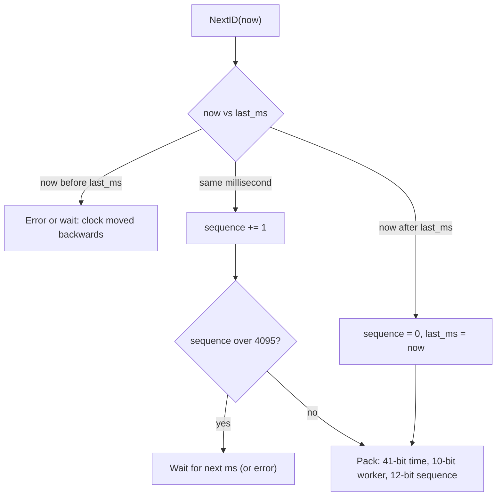

## In one minute
- Many designs need IDs that are unique across many machines without a round trip to a central counter on every write: tweets, messages, orders, short URLs, events.
- The main families are: a central sequence (simple, a bottleneck), block allocation from a central counter (amortised coordination), random IDs such as UUIDv4 (no coordination, poor index locality), and time-ordered IDs such as Snowflake, UUIDv7 and ULID (no per-ID coordination and roughly sortable by creation time).
- Snowflake-style IDs pack a millisecond timestamp, a worker ID and a per-millisecond sequence into 64 bits. Their two hard problems are assigning unique worker IDs and surviving clocks that move backwards.
- Time-ordered keys insert at the right edge of a B-tree, which keeps indexes compact and cache-friendly; random keys scatter inserts across the whole index.
- In interviews, state the properties you need (size, sortability, opacity, throughput) before picking a scheme.

## How it works

### When the pattern shows up in interviews
"Design a URL shortener" (short codes), "Design Twitter" (tweet IDs that sort by time), "Design WhatsApp" (message IDs for ordering and dedupe), sharded databases where auto-increment no longer works, and any idempotency key. The interviewer is checking whether you can list the required properties and match a scheme to them, and whether you know the failure modes: duplicate worker IDs, clock rollback, and IDs leaking business volume.

### Properties to decide first
- **Uniqueness scope:** global, per tenant or per shard.
- **Size:** 64 bits fits a `BIGINT` and is cheap to index; 128 bits (UUIDs) doubles key size in every index that stores it. Store UUIDs as 16 bytes of binary, as RFC 9562 recommends, not as 36-character strings: Percona's 1-billion-row example spent 216 GB on `char(36)` key copies alone ([Percona](https://www.percona.com/blog/uuids-are-popular-but-bad-for-performance-lets-discuss/)).
- **Width headroom:** a 32-bit signed key tops out at 2,147,483,647. Pick 64 bits for any table that grows; widening a hot column later means a long migration.
- **Ordering:** none, roughly by time (k-sorted), or strictly increasing per entity.
- **Opacity:** should outsiders be unable to guess neighbours or infer how many orders you take per day?
- **Throughput and availability:** can ID generation tolerate a coordinator outage?

### Central sequence and block allocation
A single database sequence is strictly increasing and trivially unique, but every insert depends on one node. Two common fixes: give each of N databases a different offset with a step of N, or hand out blocks. MySQL's `auto_increment_increment` and `auto_increment_offset` produce the series offset + N × increment and apply to every table on the server, not one ([MySQL docs](https://dev.mysql.com/doc/refman/8.4/en/replication-options-source.html)). With block allocation, a service atomically bumps a counter by 1,000 (`UPDATE counters SET next = next + 1000 WHERE name = 'order' RETURNING next`) and then issues those 1,000 IDs from memory. A crash wastes the rest of the block, which is fine because uniqueness, not density, is the requirement. Flickr's "ticket servers" are the classic example of a dedicated sequence service: each ID is a `REPLACE INTO` on a one-row MySQL table followed by `LAST_INSERT_ID()`, and two servers with increment 2 and offsets 1 and 2 issue odd and even IDs so either can fail without coordination ([Flickr](https://code.flickr.net/2010/02/08/ticket-servers-distributed-unique-primary-keys-on-the-cheap/)).

### Random IDs
UUIDv4 has 122 random bits, so collisions are practically impossible without any coordination. The costs are 16 bytes per key, no time ordering, and scattered B-tree inserts. RFC 9562 still says to use UUIDv4 when an ID must be unguessable for security purposes, because time-based versions reveal creation order ([RFC 9562, section 8](https://www.rfc-editor.org/rfc/rfc9562.html#section-8)).

### Time-ordered IDs
**Snowflake**, published by Twitter in 2010, uses 1 unused sign bit, 41 bits of milliseconds since a custom epoch (about 69 years of range), 10 bits of machine ID (1,024 machines), and 12 bits of sequence (4,096 IDs per millisecond per machine). Its stated goal was IDs "k-sorted" within 1 second, aiming for tens of milliseconds, with no coordination between machines ([Snowflake README](https://github.com/twitter-archive/snowflake/tree/snowflake-2010)); the original Scala service is archived, but the format lives on. IDs from one worker strictly increase; IDs across workers are ordered to within clock skew. Variants move the boundaries: Instagram generated IDs inside Postgres with 41 bits of time, 13 bits of logical shard ID, and 10 bits from a per-shard sequence ([Wikipedia](https://en.wikipedia.org/wiki/Snowflake_ID)); Discord uses 42 bits of time from a 2015 epoch, 5 bits of worker, 5 bits of process and a 12-bit increment ([Discord docs](https://docs.discord.com/developers/reference)).

**UUIDv7**, standardised in RFC 9562 (May 2024, which obsoletes RFC 4122), puts a 48-bit Unix millisecond timestamp in the top bits and fills the rest with version bits and randomness, giving time ordering with no worker IDs. The RFC says new systems should prefer UUIDv7 over the older time-based v1 and v6 ([RFC 9562](https://www.rfc-editor.org/rfc/rfc9562.html)). Databases now generate it natively: PostgreSQL 18 (September 2025) added `uuidv7()` ([PostgreSQL 18 release notes](https://www.postgresql.org/docs/18/release-18.html)). **ULID** is a similar 128-bit design (48 bits of time, 80 random) encoded as 26 Crockford base-32 characters; its monotonic mode increments the random part within a millisecond and throws an error if that overflows ([ULID spec](https://github.com/ulid/spec)).

### Short codes
A URL shortener wants 7-character codes. Base62 over a 64-bit counter gives about 3.5 trillion codes in 7 characters (62^7). A raw counter makes codes guessable, so either encode a bijective scramble of the counter (a small Feistel network or multiply by an odd constant mod 2^n) or draw random codes and retry on the rare collision through a unique index. The system-design-primer's Pastebin answer takes the hash route: Base62 of an MD5 over IP and timestamp, truncated to 7 characters, regenerated if it already exists.

## Down the stack

### Layer 1: The contract
Every issued ID is unique within its scope forever, including across restarts and failovers. For Snowflake: IDs from one worker strictly increase; IDs from different workers are ordered by timestamp to within clock skew plus one millisecond; the generator either returns an ID or a clear error (clock moved backwards, sequence exhausted), and never a duplicate. Generation is local and takes well under a microsecond.

### Layer 2: The mechanism
A Snowflake generator keeps `last_ms` and `sequence`. On each call it reads the clock. If `now > last_ms`, it resets the sequence to 0. If equal, it increments; on overflow past 4,095 it waits for the next millisecond. If `now < last_ms`, the clock went backwards, so it waits or refuses, because continuing would reissue timestamps it already used. The ID is `(now - epoch) << 22 | worker << 12 | sequence`. Worker IDs must be unique among live generators: assign them from a lease in ZooKeeper or etcd (an ephemeral node or a key with a TTL that the process renews), from a StatefulSet pod ordinal, or from a database table claimed at startup. A UUIDv7 layout is: 48 bits `unix_ts_ms`, 4 bits version (`0111`), 12 bits `rand_a`, 2 bits variant, 62 bits `rand_b`; RFC 9562 allows using `rand_a` as a sub-millisecond counter for monotonicity within one generator.

### Layer 3: The machine
Reading the clock with `clock_gettime(CLOCK_REALTIME)` goes through the vDSO without a syscall and costs tens of nanoseconds, so a generator can issue millions of IDs per second per core; a call to a central ticket server costs a network round trip of hundreds of microseconds. NTP daemons normally slew the clock gradually (chrony's default maximum slew is one twelfth, 83,333 ppm) and step it only when configured to, typically with `makestep` at boot ([chrony docs](https://chrony-project.org/doc/4.6/chrony.conf.html)); a leap second, a manual `date` change, VM migrations or misconfigured hosts can jump backwards, which is why the generator must check. In a B-tree index, an increasing key always lands on the rightmost leaf page, so inserts touch one hot page that stays in memory and pages fill completely. A random UUID lands on a random leaf among millions: each insert may read a page from disk, pages split and end up roughly half to three quarters full, and the working set becomes the entire index. InnoDB stores rows in the primary key's clustered index and copies the primary key into every secondary index, so a 16-byte random key inflates and fragments all of them.

### Why it's built this way
1. A central counter costs a network round trip per ID and a single point of failure, so generate locally.
2. Local generators must not collide, so each gets a unique worker ID (or enough randomness that collisions are negligible).
3. Databases index sorted keys efficiently, so put the timestamp in the high bits to make keys increase over time.
4. Clocks can go backwards, so the generator remembers the last timestamp and refuses to reuse it.
5. 64-bit integers are cheap everywhere, so pack time, worker and sequence into one word instead of using 128 bits.

## Diagram


## Worked example
A messaging platform needs IDs for about 400,000 messages per second at peak across 160 API servers, each running 4 generator processes: 640 generators, under the 1,024 that 10 bits allow. Each generator averages about 625 IDs per second, under one per millisecond, so the 4,096-per-millisecond sequence has a large margin even for a 50-times burst on one process.

Generators lease worker IDs from etcd with a 10-second TTL renewed every 3 seconds. A process that cannot renew stops issuing IDs before its lease could be handed to someone else. The custom epoch is 2024-01-01, so 41 bits last until roughly 2093.

Messages are stored in a table clustered by `(conversation_id, message_id)`; because message IDs increase over time, new messages append to the end of each conversation's range and "latest 50 messages" is a short range scan. The web client receives IDs as strings, because JavaScript numbers are doubles that represent integers exactly only up to 2^53 − 1 and would silently round 64-bit IDs ([MDN](https://developer.mozilla.org/en-US/docs/Web/JavaScript/Reference/Global_Objects/Number/MAX_SAFE_INTEGER)).

## In the wild
- **Twitter, 2010: Snowflake forces string IDs.** Twitter announced that tweet IDs would become Snowflake IDs, 64-bit unsigned integers. It added `id_str` to every JSON response from 22 October, switched Snowflake on with IDs capped at 41 bits on 4 November, and warned that IDs would pass 53 bits around 26 November, after which JavaScript clients reading the numeric `id` would get rounded values ([TechCrunch](https://techcrunch.com/2010/10/18/twitter-snowflake-2)). X's docs still tell developers to always use `id_str` ([X docs](https://docs.x.com/fundamentals/x-ids)).
- **Basecamp, 2018: the 32-bit ceiling.** Basecamp 3 went read-only for almost five hours (7:21am to 12:11pm CST) when the busy events table hit the signed-integer limit of 2,147,483,647. Staff had been widening the table but misjudged how fast it was filling. The fix was migrating to a 64-bit column ([Basecamp postmortem](https://signalvnoise.com/svn3/postmortem-on-the-read-only-outage-of-basecamp-on-november-9th-2018/)).
- **Shopify, 2022: sortable keys halve insert time.** Shopify's payments team switched idempotency keys from UUIDv4 to ULIDs (48-bit timestamp plus 80 random bits) and saw INSERT duration drop by 50 percent in one high-throughput system, because time-ordered keys suit the B-tree ([Shopify Engineering](https://shopify.engineering/building-resilient-payment-systems)).

## Trade-offs
| Option | Strengths | Weaknesses | Choose when |
|---|---|---|---|
| Single DB sequence | Dense, strictly increasing, trivial | Bottleneck, single point of failure, leaks volume | One database, modest scale |
| Block allocation (hi-lo) | Rare coordination, 64-bit, mostly ordered | Gaps, ordering only within a block | Sharded services needing numeric IDs |
| UUIDv4 | No coordination at all, opaque | 128-bit, random index inserts, unordered | Low write rates, external opaque IDs |
| UUIDv7 / ULID | No coordination, time-ordered | 128-bit, exposes creation time | New systems wanting sortable UUIDs |
| Snowflake | 64-bit, time-ordered, very fast | Worker ID assignment, clock sensitivity | High-throughput event or message IDs |

## Pitfalls in production
- **Duplicate worker IDs.** Two pods configured with the same ID issue identical IDs. Assign IDs from a lease, not a config file.
- **Ignoring clock rollback.** After an NTP step back, a naive generator reissues earlier timestamps. Track `last_ms` and wait or fail.
- **64-bit IDs in JavaScript.** Values above 2^53 lose precision in JSON parsing. Serialise IDs as strings in public APIs.
- **Random UUID primary keys at scale.** Insert throughput falls as the index outgrows memory. Use time-ordered IDs for clustered keys.
- **Sequential public IDs.** Competitors read your order volume from consecutive IDs, and attackers enumerate resources. Expose an opaque or scrambled ID externally.

## Leadership lens
- Write down required properties (size, ordering, opacity, scope) before choosing; most disagreements are really about these.
- Standardise one ID library and format across services so IDs are parseable and debuggable everywhere.
- Decide what may be inferred from an ID (creation time, shard) and whether that is acceptable for public exposure.
- Have a migration plan; changing ID formats later touches every table, cache key and client.

## Check yourself
1. Why do Snowflake IDs from different workers only roughly sort by time?
   **Answer:** Each worker uses its own clock, so skew between machines can order two IDs differently from their real creation order by up to the skew.
2. A generator sees `now` 5 ms earlier than `last_ms`. What must it do?
   **Answer:** Wait until the clock passes `last_ms` or return an error; issuing IDs with the earlier timestamp could duplicate IDs already issued.
3. Why do random UUID primary keys hurt insert performance in a large B-tree?
   **Answer:** Each insert lands on a random leaf page, so the whole index must stay in memory to avoid disk reads, and random page splits leave pages partly empty.
4. How many IDs can one Snowflake worker issue per second at most?
   **Answer:** 4,096 per millisecond, so about 4.1 million per second.

## Practice
**Task:** Implement a Snowflake-style generator with an injected clock. `Snowflake(epoch_ms, worker_id)` rejects worker IDs outside 0 to 1023. `next_id(now_ms)` returns `(now_ms - epoch_ms) << 22 | worker_id << 12 | sequence`, where the sequence starts at 0 for each new millisecond and increments within the same millisecond. It must raise an error if `now_ms` is earlier than the last timestamp used, or if a 4,097th ID is requested in the same millisecond (a real generator would wait; here it reports). `decode(id, epoch_ms)` returns `(timestamp_ms, worker_id, sequence)`.

```python starter
class Snowflake:
    def __init__(self, epoch_ms, worker_id):
        # TODO: raise ValueError for an invalid worker
        pass

    def next_id(self, now_ms):
        # TODO: raise RuntimeError on clock rollback or sequence exhaustion
        raise NotImplementedError


def decode(id_, epoch_ms):
    raise NotImplementedError
```

```python tests
def test_first_id_layout():
    g = Snowflake(1000, 1)
    assert g.next_id(1000) == 4096

def test_sequence_then_new_millisecond():
    g = Snowflake(0, 3)
    ids = [g.next_id(50), g.next_id(50), g.next_id(50), g.next_id(51)]
    assert ids == sorted(ids) and len(set(ids)) == 4
    assert decode(ids[2], 0) == (50, 3, 2)
    assert decode(ids[3], 0) == (51, 3, 0)

def test_decode_roundtrip_large_timestamp():
    epoch = 1288834974657
    g = Snowflake(epoch, 37)
    now = 1700000000000
    first = g.next_id(now)
    assert decode(first, epoch) == (now, 37, 0)
    assert decode(g.next_id(now), epoch) == (now, 37, 1)

def test_workers_do_not_collide():
    a, b = Snowflake(0, 1), Snowflake(0, 2)
    assert a.next_id(10) != b.next_id(10)

def test_clock_backwards_raises():
    g = Snowflake(0, 1)
    g.next_id(2000)
    try:
        g.next_id(1999)
        assert False, "expected RuntimeError"
    except RuntimeError:
        pass
    assert decode(g.next_id(2000), 0) == (2000, 1, 1)

def test_sequence_exhaustion():
    g = Snowflake(0, 0)
    for _ in range(4096):
        g.next_id(7)
    try:
        g.next_id(7)
        assert False, "expected RuntimeError"
    except RuntimeError:
        pass
    assert decode(g.next_id(8), 0) == (8, 0, 0)

def test_invalid_worker():
    for bad in (-1, 1024):
        try:
            Snowflake(0, bad)
            assert False, "expected ValueError"
        except ValueError:
            pass
```

```python solution
class Snowflake:
    WORKER_BITS = 10
    SEQ_BITS = 12
    MAX_SEQ = (1 << SEQ_BITS) - 1

    def __init__(self, epoch_ms, worker_id):
        if not 0 <= worker_id < (1 << self.WORKER_BITS):
            raise ValueError("worker id out of range")
        self.epoch = epoch_ms
        self.worker = worker_id
        self.last_ms = -1
        self.seq = 0

    def next_id(self, now_ms):
        if now_ms < self.last_ms:
            raise RuntimeError("clock moved backwards")
        if now_ms == self.last_ms:
            if self.seq == self.MAX_SEQ:
                raise RuntimeError("sequence exhausted")
            self.seq += 1
        else:
            self.last_ms = now_ms
            self.seq = 0
        return ((now_ms - self.epoch) << 22) | (self.worker << 12) | self.seq


def decode(id_, epoch_ms):
    return ((id_ >> 22) + epoch_ms, (id_ >> 12) & 0x3FF, id_ & 0xFFF)
```

```typescript starter
export class Snowflake {
  constructor(epochMs: number, workerId: number) {
    throw new Error("TODO");
  }
  nextId(nowMs: number): bigint {
    throw new Error("TODO");
  }
}

export function decode(id: bigint, epochMs: number): [number, number, number] {
  throw new Error("TODO");
}
```

```typescript tests
function throws(fn: () => void): boolean {
  try {
    fn();
    return false;
  } catch (e) {
    return true;
  }
}

test("first id layout", () => {
  const g = new Snowflake(1000, 1);
  assert(g.nextId(1000) === 4096n, "expected 4096");
});

test("sequence then new millisecond", () => {
  const g = new Snowflake(0, 3);
  const ids = [g.nextId(50), g.nextId(50), g.nextId(50), g.nextId(51)];
  for (let i = 1; i < ids.length; i++) assert(ids[i] > ids[i - 1], "strictly increasing");
  assertEqual(decode(ids[2], 0), [50, 3, 2]);
  assertEqual(decode(ids[3], 0), [51, 3, 0]);
});

test("decode roundtrip large timestamp", () => {
  const epoch = 1288834974657;
  const g = new Snowflake(epoch, 37);
  const now = 1700000000000;
  assertEqual(decode(g.nextId(now), epoch), [now, 37, 0]);
  assertEqual(decode(g.nextId(now), epoch), [now, 37, 1]);
});

test("workers do not collide", () => {
  const a = new Snowflake(0, 1);
  const b = new Snowflake(0, 2);
  assert(a.nextId(10) !== b.nextId(10), "different workers");
});

test("clock backwards throws", () => {
  const g = new Snowflake(0, 1);
  g.nextId(2000);
  assert(throws(() => g.nextId(1999)), "expected error");
  assertEqual(decode(g.nextId(2000), 0), [2000, 1, 1]);
});

test("sequence exhaustion", () => {
  const g = new Snowflake(0, 0);
  for (let i = 0; i < 4096; i++) g.nextId(7);
  assert(throws(() => g.nextId(7)), "expected error");
  assertEqual(decode(g.nextId(8), 0), [8, 0, 0]);
});

test("invalid worker", () => {
  assert(throws(() => new Snowflake(0, -1)), "negative");
  assert(throws(() => new Snowflake(0, 1024)), "too large");
});
```

```typescript solution
export class Snowflake {
  private lastMs = -1;
  private seq = 0;

  constructor(private epochMs: number, private workerId: number) {
    if (!Number.isInteger(workerId) || workerId < 0 || workerId > 1023) {
      throw new Error("worker id out of range");
    }
  }

  nextId(nowMs: number): bigint {
    if (nowMs < this.lastMs) throw new Error("clock moved backwards");
    if (nowMs === this.lastMs) {
      if (this.seq === 4095) throw new Error("sequence exhausted");
      this.seq++;
    } else {
      this.lastMs = nowMs;
      this.seq = 0;
    }
    return (BigInt(nowMs - this.epochMs) << 22n) | (BigInt(this.workerId) << 12n) | BigInt(this.seq);
  }
}

export function decode(id: bigint, epochMs: number): [number, number, number] {
  return [Number(id >> 22n) + epochMs, Number((id >> 12n) & 0x3ffn), Number(id & 0xfffn)];
}
```

```go starter
package practice

import "errors"

var (
	ErrClockBackwards    = errors.New("clock moved backwards")
	ErrSequenceExhausted = errors.New("sequence exhausted")
	ErrInvalidWorker     = errors.New("worker id out of range")
)

type Snowflake struct{}

func NewSnowflake(epochMs, workerID int64) (*Snowflake, error) {
	return nil, errors.New("TODO")
}

func (s *Snowflake) NextID(nowMs int64) (int64, error) {
	panic("TODO")
}

func Decode(id, epochMs int64) (ts, worker, seq int64) {
	panic("TODO")
}
```

```go tests
package practice

import (
	"errors"
	"testing"
)

func mustNew(t *testing.T, epoch, worker int64) *Snowflake {
	t.Helper()
	g, err := NewSnowflake(epoch, worker)
	if err != nil {
		t.Fatalf("NewSnowflake: %v", err)
	}
	return g
}

func mustID(t *testing.T, g *Snowflake, now int64) int64 {
	t.Helper()
	id, err := g.NextID(now)
	if err != nil {
		t.Fatalf("NextID(%d): %v", now, err)
	}
	return id
}

func TestFirstIDLayout(t *testing.T) {
	g := mustNew(t, 1000, 1)
	if id := mustID(t, g, 1000); id != 4096 {
		t.Fatalf("got %d", id)
	}
}

func TestSequenceThenNewMillisecond(t *testing.T) {
	g := mustNew(t, 0, 3)
	ids := []int64{mustID(t, g, 50), mustID(t, g, 50), mustID(t, g, 50), mustID(t, g, 51)}
	for i := 1; i < len(ids); i++ {
		if ids[i] <= ids[i-1] {
			t.Fatal("ids must strictly increase")
		}
	}
	if ts, w, s := Decode(ids[2], 0); ts != 50 || w != 3 || s != 2 {
		t.Fatalf("decode %d %d %d", ts, w, s)
	}
	if ts, _, s := Decode(ids[3], 0); ts != 51 || s != 0 {
		t.Fatalf("decode %d %d", ts, s)
	}
}

func TestDecodeRoundtripLarge(t *testing.T) {
	const epoch, now = int64(1288834974657), int64(1700000000000)
	g := mustNew(t, epoch, 37)
	if ts, w, s := Decode(mustID(t, g, now), epoch); ts != now || w != 37 || s != 0 {
		t.Fatalf("decode %d %d %d", ts, w, s)
	}
	if _, _, s := Decode(mustID(t, g, now), epoch); s != 1 {
		t.Fatalf("seq %d", s)
	}
}

func TestWorkersDoNotCollide(t *testing.T) {
	a, b := mustNew(t, 0, 1), mustNew(t, 0, 2)
	if mustID(t, a, 10) == mustID(t, b, 10) {
		t.Fatal("collision")
	}
}

func TestClockBackwards(t *testing.T) {
	g := mustNew(t, 0, 1)
	mustID(t, g, 2000)
	if _, err := g.NextID(1999); !errors.Is(err, ErrClockBackwards) {
		t.Fatalf("expected ErrClockBackwards, got %v", err)
	}
	if _, _, s := Decode(mustID(t, g, 2000), 0); s != 1 {
		t.Fatalf("seq %d", s)
	}
}

func TestSequenceExhaustion(t *testing.T) {
	g := mustNew(t, 0, 0)
	for i := 0; i < 4096; i++ {
		mustID(t, g, 7)
	}
	if _, err := g.NextID(7); !errors.Is(err, ErrSequenceExhausted) {
		t.Fatalf("expected ErrSequenceExhausted, got %v", err)
	}
	if ts, _, s := Decode(mustID(t, g, 8), 0); ts != 8 || s != 0 {
		t.Fatal("new millisecond should reset sequence")
	}
}

func TestInvalidWorker(t *testing.T) {
	for _, bad := range []int64{-1, 1024} {
		if _, err := NewSnowflake(0, bad); !errors.Is(err, ErrInvalidWorker) {
			t.Fatalf("worker %d: expected ErrInvalidWorker, got %v", bad, err)
		}
	}
}
```

```go solution
package practice

import "errors"

var (
	ErrClockBackwards    = errors.New("clock moved backwards")
	ErrSequenceExhausted = errors.New("sequence exhausted")
	ErrInvalidWorker     = errors.New("worker id out of range")
)

const maxSeq = 4095

type Snowflake struct {
	epoch, worker, lastMs, seq int64
}

func NewSnowflake(epochMs, workerID int64) (*Snowflake, error) {
	if workerID < 0 || workerID > 1023 {
		return nil, ErrInvalidWorker
	}
	return &Snowflake{epoch: epochMs, worker: workerID, lastMs: -1}, nil
}

func (s *Snowflake) NextID(nowMs int64) (int64, error) {
	if nowMs < s.lastMs {
		return 0, ErrClockBackwards
	}
	if nowMs == s.lastMs {
		if s.seq == maxSeq {
			return 0, ErrSequenceExhausted
		}
		s.seq++
	} else {
		s.lastMs, s.seq = nowMs, 0
	}
	return (nowMs-s.epoch)<<22 | s.worker<<12 | s.seq, nil
}

func Decode(id, epochMs int64) (ts, worker, seq int64) {
	return id>>22 + epochMs, (id >> 12) & 0x3FF, id & 0xFFF
}
```

## Mock interview
**Prompt:** Design ID generation for a social network's posts and comments: about 500,000 new items per second at peak across several regions. IDs must be unique, fit in 64 bits, and sort approximately by creation time so feeds can paginate by ID.

- Follow-up: How do you assign worker IDs on Kubernetes, where pods come and go constantly?
- Follow-up: An NTP correction moves one host's clock back 2 seconds. What happens to ID generation on that host?
- Follow-up: Product wants post IDs in public URLs. Any concerns with your scheme?

**A strong answer covers:**
- Lists required properties and rejects a central sequence for throughput and availability, and UUIDv4 for size and ordering.
- Specifies a bit layout with capacity math (epoch range, worker count, per-millisecond sequence) against the stated load.
- Assigns worker IDs with leases (etcd or ZooKeeper) that stop generation before a lease can be reissued, possibly with region bits.
- Handles clock rollback by tracking the last timestamp and waiting or failing, plus monitoring of clock offset.
- Addresses exposure: IDs reveal creation time and volume, JavaScript precision requires string encoding, and opaque external IDs may be needed.

## Sources and further study
**Primary**
- [Snowflake README, 2010 branch (Twitter)](https://github.com/twitter-archive/snowflake/tree/snowflake-2010): the original requirements (uncoordinated, k-sorted, under 64 bits) and bit layout.
- [ULID specification](https://github.com/ulid/spec): layout, Crockford encoding and the monotonic mode with its overflow error.

**Systems docs**
- [PostgreSQL: UUID functions](https://www.postgresql.org/docs/current/functions-uuid.html): `uuidv7()` with sub-millisecond ordering and `uuidv4()`, both built in since version 18.
- [Discord API reference: Snowflakes](https://docs.discord.com/developers/reference): a production Snowflake variant with worker and process fields, served as strings.
- [MySQL: auto_increment_increment and auto_increment_offset](https://dev.mysql.com/doc/refman/8.4/en/replication-options-source.html): the step-and-offset scheme and its server-wide scope.

**Books**
- *Designing Data-Intensive Applications* (2nd edition), Kleppmann and Riccomini, chapter 10 "Consistency and Consensus", section "ID Generators and Logical Clocks": why timestamp IDs do not give a causal order.
- *System Design Interview, Volume 1*, Alex Xu, chapter 7 "Design A Unique ID Generator In Distributed Systems": multi-master, UUID, ticket server and Snowflake compared at interview depth.
- *Database Internals*, Alex Petrov, chapter 4 "Implementing B-Trees", section "Right-Only Appends": the fast path that time-ordered keys hit.

**Other curricula**
- [donnemartin/system-design-primer: Pastebin](https://github.com/donnemartin/system-design-primer/blob/master/solutions/system_design/pastebin/README.md): frames short IDs as a hash truncated to 7 Base62 characters with a collision check, not a counter.

## Watch
- [Snowflake ID Generation by Twitter (Gaurav Sen)](https://www.youtube.com/watch?v=2O1wur4m8DE): the Snowflake bit layout and why it suits distributed systems.
- [System Design - Part 12: Design a Unique ID Generator, 4 Methods (Nikhil Lohia)](https://www.youtube.com/watch?v=ogOKDhOa_cs): a comparison of the main ID-generation approaches.

## Free resources
- [RFC 9562: Universally Unique IDentifiers (IETF)](https://www.rfc-editor.org/rfc/rfc9562.html): the current UUID standard, including the UUIDv7 layout and monotonicity guidance.
- [Ticket servers: distributed unique primary keys on the cheap (Flickr Code)](https://code.flickr.net/2010/02/08/ticket-servers-distributed-unique-primary-keys-on-the-cheap/): the central-sequence approach done pragmatically.
- [Snowflake ID (Wikipedia)](https://en.wikipedia.org/wiki/Snowflake_ID): the format, its variants and where it is used.
- [UUIDs are popular, but bad for performance (Percona)](https://www.percona.com/blog/uuids-are-popular-but-bad-for-performance-lets-discuss/): measurements of random-key effects on InnoDB indexes.
