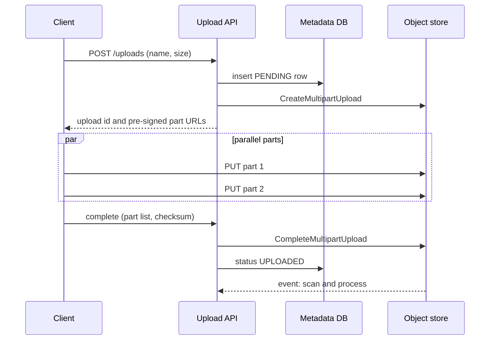

## In one minute
- Large files (videos, backups, datasets, design files) should never flow through your application servers. Clients upload directly to object storage using short-lived **pre-signed URLs**, and downloads come from object storage or a CDN.
- Big uploads are split into **chunks** (parts) that upload in parallel, retry independently and resume after a network drop. The server assembles them only when all parts are present and verified.
- Your database stores **metadata** (owner, size, checksum, status, storage key), never the bytes. Object storage stores bytes.
- Downloads use HTTP **range requests**, so clients can resume, seek and fetch in parallel.
- In interviews, the pattern shows up in Dropbox, Google Drive, YouTube upload, photo sharing, file attachments in chat and any "users upload X" requirement. The probes are about resumability, integrity, the upload state machine and abuse.

## How it works

### Why not through the app server
An app server that proxies a 4 GB upload holds a connection and buffers for minutes, ties up a worker or thread, doubles network traffic (client to app, app to storage), and loses everything if it is redeployed mid-upload. Object stores are built for this traffic; your servers are not. So the app server's job shrinks to authorization and bookkeeping.

### The upload flow
1. The client calls `POST /uploads` with file name, size and content type. The server checks quota and permissions, creates a metadata row with status `PENDING`, and starts a multipart upload in object storage, receiving an upload ID.
2. The server returns pre-signed URLs, one per part (or issues them in batches on request). Each URL authorizes a `PUT` of one part until it expires, and it can be replayed any number of times before then. S3 checks expiry when a request starts, and a URL signed with temporary role credentials dies when that session does, by default after an hour ([AWS docs](https://docs.aws.amazon.com/AmazonS3/latest/userguide/using-presigned-url.html)), so clients must be able to ask for fresh URLs mid-upload.
3. The client uploads parts in parallel, typically 3 to 8 at a time, each 8 to 64 MB. It records which parts succeeded and their ETags or checksums.
4. On a network drop, the client asks the server (or the store) which parts exist and uploads only the missing ones.
5. The client calls `POST /uploads/{id}/complete` with the part list. The server completes the multipart upload, verifies size and checksum, and moves the row to `UPLOADED`.
6. An event on completion triggers post-processing: virus scanning, thumbnailing, transcoding, indexing. The row moves to `READY` when done.

### Chunking for sync and deduplication
Sync products go further: they split files into content-defined or fixed-size blocks and name each block by its hash; Dropbox's storage keys blocks of up to 4 MB by their SHA-256 ([Dropbox Tech](https://dropbox.tech/infrastructure/inside-the-magic-pocket)). Uploading a file becomes "which of these block hashes do you not already have?", so editing one page of a large document uploads one block, and two users uploading the same file store it once. The file's metadata becomes an ordered list of block hashes.

### Serving downloads
For public or widely shared files, put a CDN in front of the store. For private files, the server checks permissions and returns a pre-signed `GET` URL or a signed CDN URL with a short expiry. Clients use `Range` headers to resume broken downloads and to fetch parts in parallel; the store answers `206 Partial Content`, and an `If-Range` validator makes sure the bytes still belong to the same version ([RFC 9110](https://www.rfc-editor.org/rfc/rfc9110#section-14)).

### How it shows up in interviews
Triggers: design Dropbox or Google Drive, design YouTube or Instagram upload, design an attachment service for email or chat, design a backup service. A strong answer keeps bytes off app servers, uses pre-signed multipart uploads with resumability, defines the metadata state machine, verifies integrity end to end, and handles post-processing asynchronously. Interviewers probe: how a client resumes after a laptop sleeps, how you stop someone uploading 1 TB against a 10 GB quota, what happens to abandoned uploads, how you deduplicate, and how a shared link to a private file stays secure.

## Down the stack

### Layer 1: The contract
A pre-signed part URL promises that exactly that operation (method, bucket, key, part number, sometimes content length and checksum) is allowed until expiry; anyone holding the URL can use it, so it is a bearer token. Multipart upload promises atomic visibility: the object does not exist until `complete` succeeds, and then it appears whole. Parts can be re-uploaded; the last successful upload of a part number wins. Your API promises that a file in `READY` has the declared size and checksum and has passed scanning. Range requests promise byte-exact slices of an immutable object, which is why objects should be immutable and new versions get new keys.

### Layer 2: The mechanism
In Amazon S3, `CreateMultipartUpload` returns an `UploadId`; each `UploadPart` takes a `PartNumber` from 1 to 10,000 and a body of at least 5 MiB (except the last) and at most 5 GiB, and returns an ETag; `CompleteMultipartUpload` takes the ordered list of part numbers and ETags. The object size limit is now 48.8 TiB, not the 5 TB that older material quotes, and `ListParts` returns at most 1,000 parts per page, so a resuming client must paginate ([AWS docs](https://docs.aws.amazon.com/AmazonS3/latest/userguide/qfacts.html)). The resulting ETag of a multipart object is the MD5 of the concatenated part MD5s plus `-N`, not the MD5 of the file, so use explicit checksums. S3 now attaches a CRC64NVME checksum by default when the client sends none, and CRC-based algorithms support a "full object" checksum on multipart uploads, so you can check one whole-file value without tracking part boundaries; SHA-256 works only as a composite of part checksums ([AWS docs](https://docs.aws.amazon.com/AmazonS3/latest/userguide/checking-object-integrity-upload.html)). Incomplete uploads keep their parts, and their storage charges, until aborted, which is what the `AbortIncompleteMultipartUpload` lifecycle rule is for. Pre-signed URLs carry a SigV4 signature in the query string (`X-Amz-Signature`, `X-Amz-Expires`, `X-Amz-Credential`). Google Cloud Storage uses a resumable session URI instead, valid for a week, where the client sends chunks in multiples of 256 KiB with `Content-Range` and asks for the committed offset after a failure; Google suggests one chunk when possible, since each extra request adds latency and cost ([Google Cloud docs](https://docs.cloud.google.com/storage/docs/resumable-uploads)). The open tus protocol standardises the same idea: `HEAD` returns `Upload-Offset`, and `PATCH` sends bytes starting at that offset. Its successor is an IETF working-group draft, still not an RFC at version 13 in October 2026, which adds an `Upload-Complete` header and a `104` interim response that hands the client a resume URL before the body is sent ([IETF draft](https://datatracker.ietf.org/doc/draft-ietf-httpbis-resumable-upload/)).

### Layer 3: The machine
Upload time is bound by the client's uplink. A 2 GB file over a 20 Mbit/s home uplink takes about 800 seconds even with perfect parallelism, so resumability matters more than speed. A single TCP connection's throughput is limited by its congestion window over RTT; on a 100 ms path, one connection with a 1 MB window caps near 80 Mbit/s, and one lost packet halves the window under classic congestion control, which is why parallel parts over several connections fill a fat pipe better. On the serving side, a well-built file server avoids copying bytes through user space: `sendfile(2)` moves data from the page cache to the socket inside the kernel ([man7](https://man7.org/linux/man-pages/man2/sendfile.2.html)), and kernel TLS (kTLS) lets that work for HTTPS too. Storage servers erasure-code objects across disks and racks (for example splitting data into k data and m parity fragments), so a whole-object read touches many disks in parallel, and a 1 KB metadata row lives in a database built for small random reads.

### Why it's built this way
Bytes and metadata have opposite access patterns (large sequential versus small random), so they live in different systems. Client networks are slow and flaky, so uploads must resume from parts instead of restarting. App servers are expensive per connection and redeployed often, so they hand clients a signed capability and step aside. Objects are immutable once complete, which makes caching, ranges and CDN distribution safe.

## Diagram


## Worked example
A design-file sharing product has 5 million uploads per day with a median size of 40 MB and a p99 of 3 GB. Total ingest is about 200 TB per day.

If uploads went through app servers, average ingest of 200 TB per day is about 18 Gbit/s sustained, with daytime peaks of several times that, all entering and leaving app servers. With direct-to-store uploads, the API handles about 120 create and complete calls per second on average, each a few kilobytes.

Part size is 16 MB. A 3 GB file is 192 parts; with 6 in parallel over a 50 Mbit/s uplink it takes around 8 minutes. If Wi-Fi drops at minute 6, the client lists parts already uploaded (roughly 140) and resends only the rest, losing at most the 6 parts in flight, about 96 MB. A lifecycle rule aborts multipart uploads that are not completed within 7 days; before it existed, the team found tens of terabytes of orphaned parts quietly billed each month.

Integrity: the client computes a SHA-256 per part and for the whole file while reading it. The store verifies part checksums on receipt, and the server checks the whole-file checksum after completion before marking the file `UPLOADED`.

## In the wild
- **Microsoft, 2023: a storage token far broader than intended.** A researcher shared AI training data on GitHub through an Azure blob URL whose SAS token opened the whole storage account, including workstation backups and Teams messages of two former employees. Wiz reported it on 22 June and the token was revoked two days later. Microsoft extended secret scanning to flag SAS tokens with long expiry or broad permissions and now recommends lifetimes of an hour or less ([MSRC](https://www.microsoft.com/en-us/msrc/blog/2023/09/microsoft-mitigated-exposure-of-internal-information-in-a-storage-account-due-to-overly-permissive-sas-token)).
- **GitLab, 2021: tens of thousands of dangling multipart uploads.** A self-managed GitLab customer found more than 67,276 incomplete S3 multipart uploads created in three days: the temporary files were cleaned up, but the uploads were never completed or aborted, so their parts kept billing. The advised fix was an S3 lifecycle rule that aborts incomplete uploads ([GitLab issue](https://gitlab.com/gitlab-org/gitlab/-/issues/342136)).
- **AWS, 2017: the object store itself goes down.** A mistyped command removed too much capacity from S3's index and placement subsystems in us-east-1, and both needed a full restart that had not been done at that scale in years. S3 there was unavailable for about four hours, taking EC2 launches, Lambda and AWS's own status page with it. Any upload design that assumes one region's store is always up inherits this risk ([AWS](https://aws.amazon.com/message/41926/)).

## Trade-offs
| Option | Strengths | Weaknesses | Choose when |
|---|---|---|---|
| Proxy through app servers | Simple, full control of bytes | Costly, fragile, double bandwidth | Small files only (a few MB) |
| Single pre-signed PUT | Simple, no app bandwidth | No resume, size limits per request | Files up to tens of MB |
| Multipart with pre-signed parts | Parallel, resumable, very large files | More client logic, orphan cleanup | Large uploads, unreliable networks |
| Content-addressed blocks | Dedup and delta sync | Hash index, garbage collection of blocks | Sync and backup products |

## Pitfalls in production
- **Orphaned parts.** Abandoned multipart uploads accumulate silently and cost money. Add an abort-incomplete lifecycle rule and a sweeper for `PENDING` rows.
- **Trusting declared size and type.** Clients lie. Enforce size limits in the signed request where possible, check the final size on completion, and sniff content type server-side.
- **Long-lived pre-signed URLs.** They are bearer tokens and leak through logs and browser history. Keep expiries to minutes and scope each URL to one key; Azure's valet-key example issues a three-minute, create-only token for one blob, which also makes it effectively single-use ([Azure Architecture Center](https://learn.microsoft.com/en-us/azure/architecture/patterns/valet-key)).
- **Serving before scanning.** If the file is downloadable the moment upload completes, malware spreads. Gate on a `READY` state after scanning.
- **Mutable objects behind a CDN.** Overwriting a key leaves stale copies at the edge and breaks range resumes. Write new versions to new keys, and enforce it: a pre-signed `PUT` silently replaces an existing key, but `If-None-Match: *` on `PutObject` or `CompleteMultipartUpload` makes S3 refuse with `412` ([AWS docs](https://docs.aws.amazon.com/AmazonS3/latest/userguide/conditional-writes.html)).
- **Metadata and bytes drifting apart.** A crash between the store and the DB leaves rows without objects or objects without rows. Reconcile with a periodic job keyed on upload ID.

## Leadership lens
- Make the upload state machine explicit and observable: counts per state, time stuck in each state, and failure reasons.
- Storage and egress are usually the biggest cost lines. Ask about lifecycle tiers, dedup ratios and CDN hit rate early.
- Decide the client SDK strategy. Resumable uploads live mostly in client code, so mobile and web teams need a shared library and tests against flaky networks.
- Plan for abuse: per-user quotas, rate limits on upload creation and takedown workflows.

## Check yourself
1. Why should part uploads be independent and retryable?
   **Answer:** Networks drop mid-transfer, and independent parts mean a failure costs one part rather than the whole file.
2. Why not compare the multipart ETag with an MD5 of the file?
   **Answer:** The multipart ETag is derived from the parts, not the whole file's MD5, so integrity needs an explicit checksum computed the same way on both sides.
3. What does content-addressed chunking enable?
   **Answer:** Uploading only blocks the server lacks, so edits send small deltas and identical content is stored once.
4. Why do completed objects get new keys instead of being overwritten?
   **Answer:** Immutable keys make CDN caching and range resumes safe, since a cached or partially downloaded object can never change underneath.

## Practice
**Task:** Implement the server side of a resumable chunked upload. `UploadSession(total_size, chunk_size)` expects `ceil(total_size / chunk_size)` chunks, where every chunk is exactly `chunk_size` characters except the last, which holds the remainder. `put_chunk(index, data)` returns `True` for a newly stored chunk and `False` for an identical re-upload; it raises an error for an out-of-range index, a wrong size, or different data for an index already stored. `missing()` returns the sorted list of indices not yet received. `complete()` returns the assembled string, or raises an error if any chunk is missing. Data is a string to keep the exercise portable.

```python starter
class UploadSession:
    def __init__(self, total_size, chunk_size):
        # TODO
        raise NotImplementedError

    def put_chunk(self, index, data):
        raise NotImplementedError

    def missing(self):
        raise NotImplementedError

    def complete(self):
        raise NotImplementedError
```

```python tests
def test_out_of_order_assembly():
    s = UploadSession(10, 4)
    assert s.missing() == [0, 1, 2]
    assert s.put_chunk(2, "ij") is True
    assert s.put_chunk(0, "abcd") is True
    assert s.missing() == [1]
    s.put_chunk(1, "efgh")
    assert s.complete() == "abcdefghij"

def test_identical_retry_is_idempotent():
    s = UploadSession(4, 2)
    assert s.put_chunk(0, "ab") is True
    assert s.put_chunk(0, "ab") is False

def test_conflicting_retry_rejected():
    s = UploadSession(4, 2)
    s.put_chunk(0, "ab")
    try:
        s.put_chunk(0, "zz")
        assert False, "expected error"
    except ValueError:
        pass

def test_wrong_size_and_range_rejected():
    s = UploadSession(10, 4)
    for idx, data in [(0, "abc"), (2, "ijk"), (3, "x"), (-1, "abcd")]:
        try:
            s.put_chunk(idx, data)
            assert False, "expected error for %r" % (idx,)
        except ValueError:
            pass

def test_complete_with_missing_fails():
    s = UploadSession(6, 3)
    s.put_chunk(0, "abc")
    try:
        s.complete()
        assert False, "expected error"
    except ValueError:
        pass

def test_exact_multiple_has_full_last_chunk():
    s = UploadSession(6, 3)
    assert s.missing() == [0, 1]
    s.put_chunk(1, "def"); s.put_chunk(0, "abc")
    assert s.complete() == "abcdef"
```

```python solution
class UploadSession:
    def __init__(self, total_size, chunk_size):
        self.total = total_size
        self.size = chunk_size
        self.count = (total_size + chunk_size - 1) // chunk_size
        self.chunks = {}

    def _expected(self, index):
        if index < self.count - 1:
            return self.size
        return self.total - self.size * (self.count - 1)

    def put_chunk(self, index, data):
        if index < 0 or index >= self.count:
            raise ValueError("index out of range")
        if len(data) != self._expected(index):
            raise ValueError("wrong chunk size")
        if index in self.chunks:
            if self.chunks[index] != data:
                raise ValueError("conflicting data for chunk")
            return False
        self.chunks[index] = data
        return True

    def missing(self):
        return [i for i in range(self.count) if i not in self.chunks]

    def complete(self):
        if self.missing():
            raise ValueError("chunks missing")
        return "".join(self.chunks[i] for i in range(self.count))
```

```typescript starter
export class UploadSession {
  constructor(totalSize: number, chunkSize: number) {}
  putChunk(index: number, data: string): boolean {
    throw new Error("TODO");
  }
  missing(): number[] {
    throw new Error("TODO");
  }
  complete(): string {
    throw new Error("TODO");
  }
}
```

```typescript tests
function throws(fn: () => unknown): boolean {
  try { fn(); return false; } catch (e) { return true; }
}
test("out of order assembly", () => {
  const s = new UploadSession(10, 4);
  assertEqual(s.missing(), [0, 1, 2]);
  assertEqual(s.putChunk(2, "ij"), true);
  assertEqual(s.putChunk(0, "abcd"), true);
  assertEqual(s.missing(), [1]);
  s.putChunk(1, "efgh");
  assertEqual(s.complete(), "abcdefghij");
});
test("identical retry is idempotent", () => {
  const s = new UploadSession(4, 2);
  assertEqual(s.putChunk(0, "ab"), true);
  assertEqual(s.putChunk(0, "ab"), false);
});
test("conflicting retry rejected", () => {
  const s = new UploadSession(4, 2);
  s.putChunk(0, "ab");
  assert(throws(() => s.putChunk(0, "zz")), "expected error");
});
test("wrong size and range rejected", () => {
  const s = new UploadSession(10, 4);
  const cases: [number, string][] = [[0, "abc"], [2, "ijk"], [3, "x"], [-1, "abcd"]];
  for (const [i, d] of cases) assert(throws(() => s.putChunk(i, d)), "expected error for " + i);
});
test("complete with missing fails", () => {
  const s = new UploadSession(6, 3);
  s.putChunk(0, "abc");
  assert(throws(() => s.complete()), "expected error");
});
test("exact multiple", () => {
  const s = new UploadSession(6, 3);
  assertEqual(s.missing(), [0, 1]);
  s.putChunk(1, "def"); s.putChunk(0, "abc");
  assertEqual(s.complete(), "abcdef");
});
```

```typescript solution
export class UploadSession {
  private count: number;
  private chunks = new Map<number, string>();
  constructor(private totalSize: number, private chunkSize: number) {
    this.count = Math.ceil(totalSize / chunkSize);
  }
  private expected(i: number): number {
    return i < this.count - 1 ? this.chunkSize : this.totalSize - this.chunkSize * (this.count - 1);
  }
  putChunk(index: number, data: string): boolean {
    if (index < 0 || index >= this.count) throw new Error("index out of range");
    if (data.length !== this.expected(index)) throw new Error("wrong chunk size");
    const have = this.chunks.get(index);
    if (have !== undefined) {
      if (have !== data) throw new Error("conflicting data");
      return false;
    }
    this.chunks.set(index, data);
    return true;
  }
  missing(): number[] {
    const out: number[] = [];
    for (let i = 0; i < this.count; i++) if (!this.chunks.has(i)) out.push(i);
    return out;
  }
  complete(): string {
    if (this.missing().length > 0) throw new Error("chunks missing");
    let s = "";
    for (let i = 0; i < this.count; i++) s += this.chunks.get(i);
    return s;
  }
}
```

```go starter
package practice

import "sync"

// UploadSession assembles a resumable chunked upload. Safe for concurrent use.
type UploadSession struct {
	mu sync.Mutex
}

func NewUploadSession(totalSize, chunkSize int) *UploadSession { return &UploadSession{} }

// PutChunk returns true if newly stored, false for an identical retry.
func (s *UploadSession) PutChunk(index int, data string) (bool, error) { panic("TODO") }

func (s *UploadSession) Missing() []int { panic("TODO") }

func (s *UploadSession) Complete() (string, error) { panic("TODO") }
```

```go tests
package practice

import (
	"reflect"
	"testing"
)

func TestOutOfOrder(t *testing.T) {
	s := NewUploadSession(10, 4)
	if !reflect.DeepEqual(s.Missing(), []int{0, 1, 2}) {
		t.Fatal("expected three missing chunks")
	}
	s.PutChunk(2, "ij")
	s.PutChunk(0, "abcd")
	if !reflect.DeepEqual(s.Missing(), []int{1}) {
		t.Fatal("expected chunk 1 missing")
	}
	s.PutChunk(1, "efgh")
	if got, err := s.Complete(); err != nil || got != "abcdefghij" {
		t.Fatalf("got %q %v", got, err)
	}
}

func TestIdempotentRetry(t *testing.T) {
	s := NewUploadSession(4, 2)
	if ok, err := s.PutChunk(0, "ab"); !ok || err != nil {
		t.Fatal("first put should store")
	}
	if ok, err := s.PutChunk(0, "ab"); ok || err != nil {
		t.Fatal("identical retry returns false, nil")
	}
}

func TestConflict(t *testing.T) {
	s := NewUploadSession(4, 2)
	s.PutChunk(0, "ab")
	if _, err := s.PutChunk(0, "zz"); err == nil {
		t.Fatal("expected conflict error")
	}
}

func TestBadInput(t *testing.T) {
	s := NewUploadSession(10, 4)
	cases := []struct {
		i int
		d string
	}{{0, "abc"}, {2, "ijk"}, {3, "x"}, {-1, "abcd"}}
	for _, c := range cases {
		if _, err := s.PutChunk(c.i, c.d); err == nil {
			t.Fatalf("expected error for %d", c.i)
		}
	}
}

func TestCompleteMissing(t *testing.T) {
	s := NewUploadSession(6, 3)
	s.PutChunk(0, "abc")
	if _, err := s.Complete(); err == nil {
		t.Fatal("expected error")
	}
}

func TestExactMultiple(t *testing.T) {
	s := NewUploadSession(6, 3)
	s.PutChunk(1, "def")
	s.PutChunk(0, "abc")
	if got, _ := s.Complete(); got != "abcdef" {
		t.Fatalf("got %q", got)
	}
}
```

```go solution
package practice

import (
	"errors"
	"strings"
	"sync"
)

// UploadSession assembles a resumable chunked upload. Safe for concurrent use.
type UploadSession struct {
	mu     sync.Mutex
	total  int
	size   int
	count  int
	chunks map[int]string
}

func NewUploadSession(totalSize, chunkSize int) *UploadSession {
	return &UploadSession{total: totalSize, size: chunkSize,
		count: (totalSize + chunkSize - 1) / chunkSize, chunks: map[int]string{}}
}

func (s *UploadSession) expected(i int) int {
	if i < s.count-1 {
		return s.size
	}
	return s.total - s.size*(s.count-1)
}

// PutChunk returns true if newly stored, false for an identical retry.
func (s *UploadSession) PutChunk(index int, data string) (bool, error) {
	s.mu.Lock()
	defer s.mu.Unlock()
	if index < 0 || index >= s.count {
		return false, errors.New("index out of range")
	}
	if len(data) != s.expected(index) {
		return false, errors.New("wrong chunk size")
	}
	if have, ok := s.chunks[index]; ok {
		if have != data {
			return false, errors.New("conflicting data")
		}
		return false, nil
	}
	s.chunks[index] = data
	return true, nil
}

func (s *UploadSession) missingLocked() []int {
	out := []int{}
	for i := 0; i < s.count; i++ {
		if _, ok := s.chunks[i]; !ok {
			out = append(out, i)
		}
	}
	return out
}

func (s *UploadSession) Missing() []int {
	s.mu.Lock()
	defer s.mu.Unlock()
	return s.missingLocked()
}

func (s *UploadSession) Complete() (string, error) {
	s.mu.Lock()
	defer s.mu.Unlock()
	if len(s.missingLocked()) > 0 {
		return "", errors.New("chunks missing")
	}
	var b strings.Builder
	for i := 0; i < s.count; i++ {
		b.WriteString(s.chunks[i])
	}
	return b.String(), nil
}
```

## Mock interview
**Prompt:** Design the upload and download path for a cloud storage product like Google Drive. Users upload files up to 50 GB from browsers and mobile apps, there are 20 million uploads per day, and shared links must work for both private and public files.

- Follow-up: A user's laptop sleeps for an hour in the middle of a 20 GB upload. What happens when it wakes?
- Follow-up: How do you prevent a user from exceeding a 15 GB quota when uploads bypass your servers?
- Follow-up: Would you deduplicate across users? What are the privacy and deletion implications?

**A strong answer covers:**
- Direct-to-object-store multipart uploads with pre-signed part URLs and a metadata DB holding state, owner, size and checksum.
- Resume by listing completed parts, with session and URL expiry handled by requesting fresh URLs.
- Quota reservation at upload creation using declared size, verified at completion, plus cleanup of abandoned uploads.
- Asynchronous post-processing (scan, preview, index) gated by a `READY` state.
- Downloads through signed URLs or a CDN with range support, and the trade-offs of cross-user dedup (storage savings versus side channels and reference-counted deletion).

## Sources and further study
**Primary**
- [IETF draft: Resumable Uploads for HTTP](https://datatracker.ietf.org/doc/draft-ietf-httpbis-resumable-upload/): the standards-track successor to tus, with upload resources and offsets.
- [RFC 9110, section 14: Range Requests](https://www.rfc-editor.org/rfc/rfc9110#section-14): `Range`, `If-Range`, `206` and multipart byte ranges.

**Systems docs**
- [Amazon S3: multipart upload limits](https://docs.aws.amazon.com/AmazonS3/latest/userguide/qfacts.html): object size, part count and part size limits.
- [Amazon S3: checking object integrity for uploads](https://docs.aws.amazon.com/AmazonS3/latest/userguide/checking-object-integrity-upload.html): full-object versus composite checksums and how the multipart ETag is built.
- [Amazon S3: conditional writes](https://docs.aws.amazon.com/AmazonS3/latest/userguide/conditional-writes.html): `If-None-Match` and `If-Match` on puts and multipart completion.

**Books**
- *System Design Interview Vol. 1*, Alex Xu, chapter 15 "Design Google Drive": block servers, delta sync, resumable upload and metadata.
- *System Design Interview Vol. 2*, Alex Xu and Sahn Lam, chapter 9 "S3-like Object Storage": data and metadata stores, multipart upload and erasure coding.
- *Understanding Distributed Systems* (2nd ed.), Roberto Vitillo, chapter "File storage": how a blob store such as Azure Storage separates its layers.

**Other curricula**
- [Azure Architecture Center: Claim-Check pattern](https://learn.microsoft.com/en-us/azure/architecture/patterns/claim-check): frames large payloads as something you store once and pass by reference, keeping them out of messaging and app paths.

## Watch
- [Dropbox Background on Magic Pocket with James Cowling (Tech Field Day)](https://www.youtube.com/watch?v=1RKLdRI1WKU): how Dropbox stores file blocks at scale after leaving S3.
- [Dive deep on Amazon S3 (AWS re:Invent 2024)](https://www.youtube.com/watch?v=NXehLy7IiPM): how a large object store is built and what that means for clients.

## Free resources
- [Uploading and copying objects using multipart upload (AWS docs)](https://docs.aws.amazon.com/AmazonS3/latest/userguide/mpuoverview.html): part limits, completion and abort semantics.
- [Uploading objects with presigned URLs (AWS docs)](https://docs.aws.amazon.com/AmazonS3/latest/userguide/PresignedUrlUploadObject.html): how signed URLs delegate a single upload.
- [Resumable uploads (Google Cloud Storage)](https://cloud.google.com/storage/docs/resumable-uploads): session URIs, chunk sizes and resuming after failure.
- [tus resumable upload protocol](https://tus.io/protocols/resumable-upload): an open HTTP protocol for resumable uploads.
- [Inside the Magic Pocket (Dropbox Tech)](https://dropbox.tech/infrastructure/inside-the-magic-pocket): block storage, replication and verification for user files.
- [Valet Key pattern (Azure Architecture Center)](https://learn.microsoft.com/en-us/azure/architecture/patterns/valet-key): delegating direct storage access with scoped tokens.
