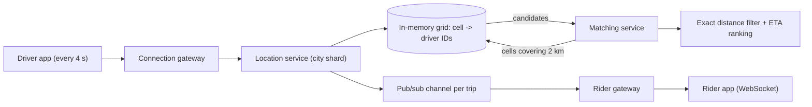

## In one minute
- Location questions come in two flavours: **find nearby** (businesses, drivers, people within a radius) and **track a moving object** (a driver approaching, a courier en route). The first is a spatial index problem; the second is a high-rate write and fan-out problem.
- A plain B-tree on latitude and longitude cannot answer "within 2 km" efficiently, because it orders by one dimension. Spatial indexes map 2D space to cells: geohash and S2 use space-filling curves, quadtrees split adaptively, R-trees group bounding boxes, and H3 uses hexagons.
- Every cell scheme has edges, so a radius query covers the target cell plus its neighbours, then filters candidates by exact distance.
- Static places (restaurants) belong in a persistent spatial index; constantly moving objects (drivers) belong in an in-memory grid keyed by cell, with stale entries expiring.
- Tracking pushes position updates to subscribers over long-lived connections, partitioned by city or trip so no single server sees all traffic.

## How it works

### When the pattern shows up in interviews
"Design Uber/Lyft", "Design Yelp or Google Places", "Design Tinder" (people near me), "Design DoorDash tracking", "Find My Friends", and geofencing ("notify me when I arrive"). Interviewers want to hear how you avoid scanning all points, how you handle density differences between a city centre and the countryside, how often locations update, and what happens at cell boundaries.

### Geohash: cells as string prefixes
Geohash interleaves bits from repeatedly halving longitude and latitude ranges, then encodes every 5 bits as a base-32 character. Each extra character shrinks the cell; at 6 characters a cell is roughly 1.2 km by 0.6 km ([Wikipedia](https://en.wikipedia.org/wiki/Geohash)). Points that share a prefix are in the same cell, so any store that supports prefix or range scans (a B-tree, a sorted set, a wide-column store) becomes a spatial index. The weakness is the seam: two points a metre apart on opposite sides of a cell boundary can have completely different prefixes, so queries always include the 8 neighbouring cells.

### Quadtrees and R-trees: adaptive structures
A quadtree starts with the whole map as one node and splits a node into four children when it holds more than some threshold of points. Dense downtown areas end up with tiny cells, deserts with huge ones, so each leaf holds a similar number of points. It is usually built in memory and rebuilt or updated incrementally. An R-tree groups nearby objects into bounding rectangles in a balanced tree ([Guttman, SIGMOD 1984](https://www.cs.princeton.edu/courses/archive/fall08/cos597B/papers/rtrees.pdf)) and is what PostGIS uses (through a GiST index) to answer `ST_DWithin` queries. Both shine for static or slowly changing data.

### S2 and H3: global cell systems
Google's S2 projects the sphere onto a cube and orders cells along a Hilbert curve, which preserves locality better than geohash's Z-order. A 64-bit cell ID holds 3 face bits, then 2 bits per level down to 30 levels, where leaf cells are about 1 cm across ([S2 docs](https://s2geometry.io/devguide/s2cell_hierarchy)); a "region coverer" returns a small set of cells covering any circle or polygon. Uber's H3 tiles the globe with hexagons at 16 resolutions, from about 1.4 km edges at resolution 7 to 200 m at resolution 9; every neighbour of a hexagon is the same distance away, which makes it convenient for "ring of cells around me" queries and for aggregating demand and supply into cells for pricing. A sphere cannot be tiled with hexagons alone, so each resolution also has exactly 12 pentagons, with five neighbours, that ring code must tolerate ([H3 docs](https://h3geo.org/docs/core-library/restable/)). Older tutorials use the version 3 API: `geoToH3` is now `latLngToCell` and `kRing` is now `gridDisk` ([H3 docs](https://h3geo.org/docs/library/migration-3.x/functions)).

### Moving objects
Drivers send a location every few seconds. Writing each update into a disk-based spatial index would churn it, so keep a separate in-memory structure: a map from cell ID to the set of driver IDs in that cell, plus a map from driver to its last position and cell. On each update, if the cell changed, move the driver between sets. Entries carry a last-seen time and drop out when stale. Redis's `GEOADD` and `GEOSEARCH` implement exactly this on top of a sorted set; `GEORADIUS`, still common in older answers, has been deprecated since Redis 6.2 ([Redis docs](https://redis.io/docs/latest/commands/georadius/)). Partition by city or by coarse cell so one shard handles one region.

### Tracking and fan-out
When a trip starts, the rider subscribes to the driver's updates. The driver's app sends positions over a persistent connection to a gateway; the location service publishes them on a channel keyed by trip ID; the rider's gateway pushes them down a WebSocket. Clients interpolate between updates to animate smoothly, so a 4-second update interval looks continuous.

## Down the stack

### Layer 1: The contract
A radius query returns every indexed object whose last reported position is within the radius, sorted by distance, as of a staleness bound equal to the update interval plus pipeline delay. Positions older than a TTL are excluded. A nearest-k query returns the k closest, which may require widening the search ring when nearby cells are empty. Tracking delivers updates in order per object with best-effort latency; a dropped update is superseded by the next, so it needs no retry.

### Layer 2: The mechanism
Geohash encoding alternates bits: bit 0 halves longitude, bit 1 halves latitude, and so on; 5 bits map to one character of `0123456789bcdefghjkmnpqrstuvwxyz`. Redis stores members of a geo set in a sorted set whose score is a 52-bit interleaved geohash integer, which a double holds exactly; because it uses the Web Mercator bounds, latitudes beyond about 85.05 degrees are rejected ([Redis docs](https://redis.io/docs/latest/commands/geoadd/)). `GEOSEARCH ... BYRADIUS` estimates the geohash precision whose cell size fits the radius, computes the centre cell and its 8 neighbours, issues a score range lookup for each in the sorted set's skip list, then computes exact distance for each candidate and discards those outside the circle. PostGIS builds a GiST index of bounding boxes; `ST_DWithin(geog, point, 2000)` expands the point into a box for the index scan, then rechecks exact distance on the candidates, measured in metres on the spheroid by default ([PostGIS docs](https://postgis.net/docs/ST_DWithin.html)). A quadtree node holds either up to N points or four children, and a query descends only into children whose bounds intersect the search circle.

### Layer 3: The machine
A location update is small: an ID, two `float64` coordinates (16 bytes), a timestamp and maybe heading and speed, under 100 bytes on the wire after framing. A million active drivers reporting every 4 seconds is 250,000 updates per second, which is a lot of requests but only tens of MB per second of payload and around 100 MB of state in memory. The cost is in connections and syscalls, not bytes, so gateways batch writes and keep long-lived TCP or WebSocket connections, each costing kilobytes of kernel and user-space buffers. Exact distance uses the haversine formula, a handful of trigonometric calls costing on the order of tens to a hundred nanoseconds, so filtering a few thousand candidates is cheap; scanning millions is not. Haversine assumes a spherical Earth, so it can be off by up to 0.5%, fine for "drivers near me" but not for surveying (the same Redis page). Phone GPS is typically accurate to about 4.9 m under open sky and worse near buildings, bridges and trees ([GPS.gov](https://www.gps.gov/gps-accuracy)), so precision beyond that is noise; snapping to roads happens server-side.

### Why it's built this way
1. Databases index well in one dimension, so 2D positions are mapped onto a 1D curve (geohash, S2) or a tree of rectangles.
2. Curves have seams, so queries cover neighbouring cells and then filter by exact distance.
3. Density varies by orders of magnitude between places, so adaptive structures or multiple resolutions keep cells balanced.
4. Moving objects write constantly and only the latest position matters, so they live in memory with TTLs rather than in a durable spatial index.
5. One region's traffic is independent of another's, so shard by geography and keep fan-out local to the trip.

## Diagram


## Worked example
A ride-hailing company serves one large metro with up to 60,000 online drivers at peak. Each sends a position every 4 seconds: 15,000 updates per second for the city. The location service keeps a map of geohash-6 cells (about 1.2 by 0.6 km) to driver sets, and a driver map of last position, cell and timestamp. State is about 60,000 times 100 bytes, roughly 6 MB, so one process could hold it; the team runs three replicas fed from the same update stream for availability.

Riders request about 400 trips per second at peak. For each, matching looks up the rider's cell and its 8 neighbours, which covers at least 0.6 km in every direction and typically returns 50 to 200 drivers downtown. It drops entries older than 15 seconds, computes haversine distance, keeps the closest 20, and calls the routing service for road ETAs on those only. If fewer than 5 candidates appear, it widens to the next ring of cells. Suburbs work the same way with more rings, which is why some designs choose a coarser precision or an adaptive quadtree in sparse areas.

Once matched, the driver's updates are also published to `trip:{id}` and pushed to the rider's WebSocket.

## In the wild
- **Uber, 2016: geofences without a spatial tree.** Uber's highest-traffic service answers "which zones contain this point". Rather than an R-tree or S2, it scans city boundaries first and then only that city's fences, cutting candidates from tens of thousands to hundreds. On New Year's Eve 2015 it served 170,000 queries per second on 40 machines at 35% CPU, under 5 ms at p95 ([Uber Engineering](https://www.uber.com/en-DE/blog/go-geofence-highest-query-per-second-service/)).
- **Redis, 2022: a radius search misses a point inside the radius.** Near 85 degrees north, a `GEORADIUSBYMEMBER` with a 4,891.94 m radius missed a member that `GEODIST` placed at 4,891.938 m, because the centre cell plus neighbours did not fully cover the bounding box. The fix shipped in 6.2.7 and 7.0, a reminder that cell covering is an approximation you should test at the edges ([Redis PR 10018](https://github.com/redis/redis/pull/10018)).
- **Check Point Research, 2024: location leaks in dating apps.** Hornet randomised the distances it showed and let users hide them, yet repeated distance queries from chosen points located users to within about 10 m, even with the display off; after fixes the error grew to about 50 m. Another app sent 12-character geohashes, cells of about 37 by 18 cm, and stayed safe only because it rounded coordinates to three decimals (about 110 m) before encoding: privacy comes from discarding precision, not from the encoding ([Check Point Research](https://research.checkpoint.com/2024/the-illusion-of-privacy-geolocation-risks-in-modern-dating-apps/)).

## Trade-offs
| Option | Strengths | Weaknesses | Choose when |
|---|---|---|---|
| Geohash in a KV or sorted set | Works on any ordered store, simple | Seams, uneven cell sizes by latitude | Most interview answers, Redis GEO |
| Quadtree (in memory) | Adapts to density | Rebuild cost, harder to shard | Static points with very uneven density |
| PostGIS R-tree (GiST) | Exact queries, polygons, SQL joins | Single-node writes, heavy for high update rates | Places, geofences, admin queries |
| S2 cells | Hilbert locality, good region covering | More complex library | Large-scale geo systems, polygons |
| H3 hexagons | Uniform neighbours, great for aggregation | Hexagons do not nest perfectly | Supply and demand heatmaps, pricing |

## Pitfalls in production
- **Querying only the centre cell.** Nearby objects across a seam are missed. Always include neighbours and filter by exact distance.
- **Euclidean distance on degrees.** A degree of longitude shrinks towards the poles, so rankings skew. Use haversine or a projected coordinate system.
- **Stale drivers shown as available.** An app crash leaves a ghost entry. Expire positions by last-seen time.
- **Hot cells.** An airport or stadium cell holds thousands of drivers. Use finer cells there or cap candidates per cell.
- **Over-frequent updates.** Sending every second drains batteries and quadruples load with little accuracy gain. Adapt the rate to speed and trip state.

## Leadership lens
- Separate the static places index from the moving-object index; they have opposite read and write profiles.
- Choose the cell system once and use it across matching, pricing and analytics so data joins cleanly.
- Shard by geography, but plan for trips that cross shard boundaries, such as airport runs between cities.
- Location history is personal data; set retention limits and access controls from the start.

## Check yourself
1. Why can't a composite B-tree index on `(lat, lon)` answer a radius query efficiently?
   **Answer:** It orders by latitude first, so a latitude band scan returns every longitude in that band worldwide, and the longitude condition filters afterwards.
2. Why does a geohash radius query look at neighbouring cells?
   **Answer:** Points close together can sit on opposite sides of a cell boundary and share no prefix, so the centre cell alone misses them.
3. Why are moving drivers kept in memory instead of in PostGIS?
   **Answer:** Each driver writes every few seconds and only the latest position matters, so a durable spatial index would churn while an in-memory cell map handles the rate cheaply.
4. What makes H3 hexagons attractive for pricing heatmaps?
   **Answer:** All six neighbours are equidistant from the centre, so rings and smoothing behave uniformly, unlike squares with diagonal neighbours.

## Practice
**Task:** Implement geohash encoding and a grid-based proximity index for moving objects. `encode_geohash(lat, lon, precision)` returns the standard base-32 geohash string. `ProximityIndex(cell_deg)` buckets objects into square cells of `cell_deg` degrees; `upsert(id, lat, lon)` adds or moves an object (moving it between cells if needed), `remove(id)` returns whether it existed, and `nearby(lat, lon, radius_km, limit)` returns up to `limit` IDs within `radius_km` by haversine distance (Earth radius 6371 km), sorted by distance then ID. `nearby` must only examine cells that could contain matches, not every object.

```python starter
def encode_geohash(lat, lon, precision):
    # TODO
    raise NotImplementedError


class ProximityIndex:
    def __init__(self, cell_deg):
        # TODO
        pass

    def upsert(self, obj_id, lat, lon):
        raise NotImplementedError

    def remove(self, obj_id):
        raise NotImplementedError

    def nearby(self, lat, lon, radius_km, limit):
        raise NotImplementedError
```

```python tests
SF = (37.7749, -122.4194)

def make_index():
    idx = ProximityIndex(0.05)
    idx.upsert("a", 37.7750, -122.4195)   # about 14 m away
    idx.upsert("b", 37.7849, -122.4094)   # about 1.42 km
    idx.upsert("e", 37.7749, -122.4370)   # about 1.55 km
    idx.upsert("c", 37.8044, -122.2712)   # about 13.4 km
    return idx

def test_geohash_known_values():
    assert encode_geohash(57.64911, 10.40744, 11) == "u4pruydqqvj"
    assert encode_geohash(SF[0], SF[1], 6) == "9q8yyk"
    assert encode_geohash(SF[0], SF[1], 1) == "9"

def test_geohash_prefix_property():
    long_hash = encode_geohash(-33.8688, 151.2093, 9)
    assert encode_geohash(-33.8688, 151.2093, 5) == long_hash[:5]

def test_nearby_sorted_by_distance():
    idx = make_index()
    assert idx.nearby(SF[0], SF[1], 2.0, 10) == ["a", "b", "e"]
    assert idx.nearby(SF[0], SF[1], 20.0, 10) == ["a", "b", "e", "c"]

def test_limit():
    assert make_index().nearby(SF[0], SF[1], 20.0, 2) == ["a", "b"]

def test_move_updates_cell():
    idx = make_index()
    idx.upsert("a", 37.8050, -122.2700)
    assert idx.nearby(SF[0], SF[1], 2.0, 10) == ["b", "e"]
    assert idx.nearby(37.8044, -122.2712, 1.0, 10) == ["c", "a"]

def test_remove():
    idx = make_index()
    assert idx.remove("b")
    assert not idx.remove("b")
    assert idx.nearby(SF[0], SF[1], 2.0, 10) == ["a", "e"]

def test_empty_index():
    assert ProximityIndex(0.05).nearby(0.0, 0.0, 5.0, 10) == []
```

```python solution
import math

BASE32 = "0123456789bcdefghjkmnpqrstuvwxyz"

def encode_geohash(lat, lon, precision):
    lat_lo, lat_hi, lon_lo, lon_hi = -90.0, 90.0, -180.0, 180.0
    out, bits, ch, even = [], 0, 0, True
    while len(out) < precision:
        if even:
            mid = (lon_lo + lon_hi) / 2
            if lon >= mid:
                ch, lon_lo = ch * 2 + 1, mid
            else:
                ch, lon_hi = ch * 2, mid
        else:
            mid = (lat_lo + lat_hi) / 2
            if lat >= mid:
                ch, lat_lo = ch * 2 + 1, mid
            else:
                ch, lat_hi = ch * 2, mid
        even = not even
        bits += 1
        if bits == 5:
            out.append(BASE32[ch])
            bits, ch = 0, 0
    return "".join(out)


def haversine_km(lat1, lon1, lat2, lon2):
    p1, p2 = math.radians(lat1), math.radians(lat2)
    dp, dl = p2 - p1, math.radians(lon2 - lon1)
    h = math.sin(dp / 2) ** 2 + math.cos(p1) * math.cos(p2) * math.sin(dl / 2) ** 2
    return 2 * 6371.0 * math.asin(math.sqrt(h))


class ProximityIndex:
    def __init__(self, cell_deg):
        self.cell = cell_deg
        self.cells = {}   # (row, col) -> set of ids
        self.pos = {}     # id -> (lat, lon, key)

    def _key(self, lat, lon):
        return (math.floor(lat / self.cell), math.floor(lon / self.cell))

    def upsert(self, obj_id, lat, lon):
        self.remove(obj_id)
        key = self._key(lat, lon)
        self.cells.setdefault(key, set()).add(obj_id)
        self.pos[obj_id] = (lat, lon, key)

    def remove(self, obj_id):
        old = self.pos.pop(obj_id, None)
        if old is None:
            return False
        members = self.cells[old[2]]
        members.discard(obj_id)
        if not members:
            del self.cells[old[2]]
        return True

    def nearby(self, lat, lon, radius_km, limit):
        dlat = radius_km / 110.0
        coslat = max(math.cos(math.radians(min(89.0, abs(lat) + dlat))), 0.01)
        dlon = radius_km / (110.0 * coslat)
        r0, c0 = self._key(lat - dlat, lon - dlon)
        r1, c1 = self._key(lat + dlat, lon + dlon)
        found = []
        for r in range(r0, r1 + 1):
            for c in range(c0, c1 + 1):
                for obj_id in self.cells.get((r, c), ()):
                    plat, plon, _ = self.pos[obj_id]
                    d = haversine_km(lat, lon, plat, plon)
                    if d <= radius_km:
                        found.append((d, obj_id))
        found.sort()
        return [obj_id for _, obj_id in found[:limit]]
```

```typescript starter
export function encodeGeohash(lat: number, lon: number, precision: number): string {
  throw new Error("TODO");
}

export class ProximityIndex {
  constructor(cellDeg: number) {}
  upsert(id: string, lat: number, lon: number): void {
    throw new Error("TODO");
  }
  remove(id: string): boolean {
    throw new Error("TODO");
  }
  nearby(lat: number, lon: number, radiusKm: number, limit: number): string[] {
    throw new Error("TODO");
  }
}
```

```typescript tests
const SF: [number, number] = [37.7749, -122.4194];

function makeIndex(): ProximityIndex {
  const idx = new ProximityIndex(0.05);
  idx.upsert("a", 37.775, -122.4195);
  idx.upsert("b", 37.7849, -122.4094);
  idx.upsert("e", 37.7749, -122.437);
  idx.upsert("c", 37.8044, -122.2712);
  return idx;
}

test("geohash known values", () => {
  assertEqual(encodeGeohash(57.64911, 10.40744, 11), "u4pruydqqvj");
  assertEqual(encodeGeohash(SF[0], SF[1], 6), "9q8yyk");
  assertEqual(encodeGeohash(SF[0], SF[1], 1), "9");
});

test("geohash prefix property", () => {
  const longHash = encodeGeohash(-33.8688, 151.2093, 9);
  assertEqual(encodeGeohash(-33.8688, 151.2093, 5), longHash.slice(0, 5));
});

test("nearby sorted by distance", () => {
  const idx = makeIndex();
  assertEqual(idx.nearby(SF[0], SF[1], 2.0, 10), ["a", "b", "e"]);
  assertEqual(idx.nearby(SF[0], SF[1], 20.0, 10), ["a", "b", "e", "c"]);
});

test("limit", () => {
  assertEqual(makeIndex().nearby(SF[0], SF[1], 20.0, 2), ["a", "b"]);
});

test("move updates cell", () => {
  const idx = makeIndex();
  idx.upsert("a", 37.805, -122.27);
  assertEqual(idx.nearby(SF[0], SF[1], 2.0, 10), ["b", "e"]);
  assertEqual(idx.nearby(37.8044, -122.2712, 1.0, 10), ["c", "a"]);
});

test("remove", () => {
  const idx = makeIndex();
  assert(idx.remove("b"), "first remove");
  assert(!idx.remove("b"), "second remove");
  assertEqual(idx.nearby(SF[0], SF[1], 2.0, 10), ["a", "e"]);
});

test("empty index", () => {
  assertEqual(new ProximityIndex(0.05).nearby(0, 0, 5, 10), []);
});
```

```typescript solution
const BASE32 = "0123456789bcdefghjkmnpqrstuvwxyz";

export function encodeGeohash(lat: number, lon: number, precision: number): string {
  let latLo = -90, latHi = 90, lonLo = -180, lonHi = 180;
  let out = "", bits = 0, ch = 0, even = true;
  while (out.length < precision) {
    if (even) {
      const mid = (lonLo + lonHi) / 2;
      if (lon >= mid) { ch = ch * 2 + 1; lonLo = mid; } else { ch = ch * 2; lonHi = mid; }
    } else {
      const mid = (latLo + latHi) / 2;
      if (lat >= mid) { ch = ch * 2 + 1; latLo = mid; } else { ch = ch * 2; latHi = mid; }
    }
    even = !even;
    if (++bits === 5) { out += BASE32[ch]; bits = 0; ch = 0; }
  }
  return out;
}

function haversineKm(lat1: number, lon1: number, lat2: number, lon2: number): number {
  const rad = (d: number) => (d * Math.PI) / 180;
  const p1 = rad(lat1), p2 = rad(lat2), dp = p2 - p1, dl = rad(lon2 - lon1);
  const h = Math.sin(dp / 2) ** 2 + Math.cos(p1) * Math.cos(p2) * Math.sin(dl / 2) ** 2;
  return 2 * 6371.0 * Math.asin(Math.sqrt(h));
}

export class ProximityIndex {
  private cells = new Map<string, Set<string>>();
  private pos = new Map<string, { lat: number; lon: number; key: string }>();
  constructor(private cellDeg: number) {}

  private rc(lat: number, lon: number): [number, number] {
    return [Math.floor(lat / this.cellDeg), Math.floor(lon / this.cellDeg)];
  }

  upsert(id: string, lat: number, lon: number): void {
    this.remove(id);
    const key = this.rc(lat, lon).join(",");
    if (!this.cells.has(key)) this.cells.set(key, new Set());
    this.cells.get(key)!.add(id);
    this.pos.set(id, { lat, lon, key });
  }

  remove(id: string): boolean {
    const old = this.pos.get(id);
    if (!old) return false;
    this.pos.delete(id);
    const members = this.cells.get(old.key)!;
    members.delete(id);
    if (members.size === 0) this.cells.delete(old.key);
    return true;
  }

  nearby(lat: number, lon: number, radiusKm: number, limit: number): string[] {
    const dlat = radiusKm / 110;
    const coslat = Math.max(Math.cos((Math.min(89, Math.abs(lat) + dlat) * Math.PI) / 180), 0.01);
    const dlon = radiusKm / (110 * coslat);
    const [r0, c0] = this.rc(lat - dlat, lon - dlon);
    const [r1, c1] = this.rc(lat + dlat, lon + dlon);
    const found: Array<[number, string]> = [];
    for (let r = r0; r <= r1; r++) {
      for (let c = c0; c <= c1; c++) {
        const members = this.cells.get(`${r},${c}`);
        if (!members) continue;
        for (const id of members) {
          const p = this.pos.get(id)!;
          const d = haversineKm(lat, lon, p.lat, p.lon);
          if (d <= radiusKm) found.push([d, id]);
        }
      }
    }
    found.sort((x, y) => x[0] - y[0] || (x[1] < y[1] ? -1 : x[1] > y[1] ? 1 : 0));
    return found.slice(0, limit).map((f) => f[1]);
  }
}
```

```go starter
package practice

func EncodeGeohash(lat, lon float64, precision int) string {
	panic("TODO")
}

type ProximityIndex struct{}

func NewProximityIndex(cellDeg float64) *ProximityIndex {
	return &ProximityIndex{}
}

func (p *ProximityIndex) Upsert(id string, lat, lon float64) {
	panic("TODO")
}

func (p *ProximityIndex) Remove(id string) bool {
	panic("TODO")
}

func (p *ProximityIndex) Nearby(lat, lon, radiusKm float64, limit int) []string {
	panic("TODO")
}
```

```go tests
package practice

import (
	"reflect"
	"testing"
)

const sfLat, sfLon = 37.7749, -122.4194

func makeIndex() *ProximityIndex {
	idx := NewProximityIndex(0.05)
	idx.Upsert("a", 37.7750, -122.4195)
	idx.Upsert("b", 37.7849, -122.4094)
	idx.Upsert("e", 37.7749, -122.4370)
	idx.Upsert("c", 37.8044, -122.2712)
	return idx
}

func same(t *testing.T, got, want []string) {
	t.Helper()
	if len(got) == 0 && len(want) == 0 {
		return
	}
	if !reflect.DeepEqual(got, want) {
		t.Fatalf("got %v, want %v", got, want)
	}
}

func TestGeohashKnownValues(t *testing.T) {
	if g := EncodeGeohash(57.64911, 10.40744, 11); g != "u4pruydqqvj" {
		t.Fatalf("got %s", g)
	}
	if g := EncodeGeohash(sfLat, sfLon, 6); g != "9q8yyk" {
		t.Fatalf("got %s", g)
	}
	if g := EncodeGeohash(sfLat, sfLon, 1); g != "9" {
		t.Fatalf("got %s", g)
	}
}

func TestGeohashPrefix(t *testing.T) {
	long := EncodeGeohash(-33.8688, 151.2093, 9)
	if EncodeGeohash(-33.8688, 151.2093, 5) != long[:5] {
		t.Fatal("prefix property violated")
	}
}

func TestNearbySorted(t *testing.T) {
	idx := makeIndex()
	same(t, idx.Nearby(sfLat, sfLon, 2.0, 10), []string{"a", "b", "e"})
	same(t, idx.Nearby(sfLat, sfLon, 20.0, 10), []string{"a", "b", "e", "c"})
}

func TestLimit(t *testing.T) {
	same(t, makeIndex().Nearby(sfLat, sfLon, 20.0, 2), []string{"a", "b"})
}

func TestMoveUpdatesCell(t *testing.T) {
	idx := makeIndex()
	idx.Upsert("a", 37.8050, -122.2700)
	same(t, idx.Nearby(sfLat, sfLon, 2.0, 10), []string{"b", "e"})
	same(t, idx.Nearby(37.8044, -122.2712, 1.0, 10), []string{"c", "a"})
}

func TestRemove(t *testing.T) {
	idx := makeIndex()
	if !idx.Remove("b") || idx.Remove("b") {
		t.Fatal("remove semantics")
	}
	same(t, idx.Nearby(sfLat, sfLon, 2.0, 10), []string{"a", "e"})
}

func TestEmptyIndex(t *testing.T) {
	same(t, NewProximityIndex(0.05).Nearby(0, 0, 5, 10), nil)
}
```

```go solution
package practice

import (
	"math"
	"sort"
)

const base32 = "0123456789bcdefghjkmnpqrstuvwxyz"

func EncodeGeohash(lat, lon float64, precision int) string {
	latLo, latHi, lonLo, lonHi := -90.0, 90.0, -180.0, 180.0
	out := make([]byte, 0, precision)
	bits, ch, even := 0, 0, true
	for len(out) < precision {
		if even {
			mid := (lonLo + lonHi) / 2
			if lon >= mid {
				ch, lonLo = ch*2+1, mid
			} else {
				ch, lonHi = ch*2, mid
			}
		} else {
			mid := (latLo + latHi) / 2
			if lat >= mid {
				ch, latLo = ch*2+1, mid
			} else {
				ch, latHi = ch*2, mid
			}
		}
		even = !even
		bits++
		if bits == 5 {
			out = append(out, base32[ch])
			bits, ch = 0, 0
		}
	}
	return string(out)
}

func haversineKm(lat1, lon1, lat2, lon2 float64) float64 {
	rad := func(d float64) float64 { return d * math.Pi / 180 }
	p1, p2 := rad(lat1), rad(lat2)
	dp, dl := p2-p1, rad(lon2-lon1)
	h := math.Pow(math.Sin(dp/2), 2) + math.Cos(p1)*math.Cos(p2)*math.Pow(math.Sin(dl/2), 2)
	return 2 * 6371.0 * math.Asin(math.Sqrt(h))
}

type cellKey struct{ r, c int }

type position struct {
	lat, lon float64
	key      cellKey
}

type ProximityIndex struct {
	cellDeg float64
	cells   map[cellKey]map[string]bool
	pos     map[string]position
}

func NewProximityIndex(cellDeg float64) *ProximityIndex {
	return &ProximityIndex{cellDeg: cellDeg, cells: map[cellKey]map[string]bool{}, pos: map[string]position{}}
}

func (p *ProximityIndex) key(lat, lon float64) cellKey {
	return cellKey{int(math.Floor(lat / p.cellDeg)), int(math.Floor(lon / p.cellDeg))}
}

func (p *ProximityIndex) Upsert(id string, lat, lon float64) {
	p.Remove(id)
	k := p.key(lat, lon)
	if p.cells[k] == nil {
		p.cells[k] = map[string]bool{}
	}
	p.cells[k][id] = true
	p.pos[id] = position{lat, lon, k}
}

func (p *ProximityIndex) Remove(id string) bool {
	old, ok := p.pos[id]
	if !ok {
		return false
	}
	delete(p.pos, id)
	delete(p.cells[old.key], id)
	if len(p.cells[old.key]) == 0 {
		delete(p.cells, old.key)
	}
	return true
}

func (p *ProximityIndex) Nearby(lat, lon, radiusKm float64, limit int) []string {
	dlat := radiusKm / 110
	coslat := math.Max(math.Cos(math.Min(89, math.Abs(lat)+dlat)*math.Pi/180), 0.01)
	dlon := radiusKm / (110 * coslat)
	lo, hi := p.key(lat-dlat, lon-dlon), p.key(lat+dlat, lon+dlon)
	type hit struct {
		d  float64
		id string
	}
	var found []hit
	for r := lo.r; r <= hi.r; r++ {
		for c := lo.c; c <= hi.c; c++ {
			for id := range p.cells[cellKey{r, c}] {
				q := p.pos[id]
				if d := haversineKm(lat, lon, q.lat, q.lon); d <= radiusKm {
					found = append(found, hit{d, id})
				}
			}
		}
	}
	sort.Slice(found, func(i, j int) bool {
		if found[i].d != found[j].d {
			return found[i].d < found[j].d
		}
		return found[i].id < found[j].id
	})
	var out []string
	for i := 0; i < len(found) && i < limit; i++ {
		out = append(out, found[i].id)
	}
	return out
}
```

## Mock interview
**Prompt:** Design the driver-matching and live-tracking backend for a ride-hailing app operating in 300 cities, with up to 1 million drivers online at peak, each reporting location every 4 seconds. Riders should see nearby cars on the map, get matched within seconds, and watch their driver approach.

- Follow-up: How do you find the 10 nearest available drivers if the rider is on a cell boundary, or in a sparse suburb?
- Follow-up: A driver's phone loses signal in a tunnel for 30 seconds. What does the system show, and could it match them to a new rider?
- Follow-up: Would you use geohash, a quadtree or H3? What would change your mind?

**A strong answer covers:**
- Separates the moving-driver index (in memory, cell to driver set, TTL) from static data and from trip state in a durable store.
- Uses cell plus neighbours with exact distance filtering, and expands rings when results are sparse; ranks by road ETA on a short candidate list.
- Computes write load (about 250,000 updates per second) and shards by city or region, with replicas for availability.
- Handles staleness explicitly: last-seen timestamps, excluding stale drivers from matching, and client interpolation for display.
- Explains tracking fan-out via per-trip pub/sub channels over persistent connections, and the cell-system choice with its trade-offs.

## Sources and further study
**Primary**
- [Guttman, R-Trees: A Dynamic Index Structure for Spatial Searching (SIGMOD 1984)](https://www.cs.princeton.edu/courses/archive/fall08/cos597B/papers/rtrees.pdf): the original R-tree with its search, insert and node-split algorithms.

**Systems docs**
- [Redis: GEOADD](https://redis.io/docs/latest/commands/geoadd/): the 52-bit score, the 1+8 cell query and the spherical Earth model.
- [PostGIS: ST_DWithin](https://postgis.net/docs/ST_DWithin.html): index-assisted radius queries on geometry and geography.
- [H3: table of cell statistics by resolution](https://h3geo.org/docs/core-library/restable/): cell areas, edge lengths and the 12 pentagons per resolution.
- [H3: 3.x to 4.0 function renames](https://h3geo.org/docs/library/migration-3.x/functions): the old and new API names side by side.

**Books**
- *System Design Interview Vol. 2*, Alex Xu and Sahn Lam, chapters 1 "Proximity Service" and 2 "Nearby Friends": geohash, quadtree and S2 compared, then location fan-out over WebSockets and pub/sub.
- *Designing Data-Intensive Applications* (2nd ed.), Kleppmann and Riccomini, chapter 4 "Storage and Retrieval": multidimensional indexes, including space-filling curves and R-trees.

**Other curricula**
- [Azure Architecture Center: Geode pattern](https://learn.microsoft.com/en-us/azure/architecture/patterns/geodes): frames geographic locality at the deployment level, serving users from the nearest of many full copies of the backend.

## Watch
- [Proximity Search & Geospatial Indexes Explained (Hello Interview)](https://www.youtube.com/watch?v=dQXdSxn7d1g): geohash, quadtrees and R-trees framed for interviews.
- [H3: Tiling the Earth with Hexagons (Uber Engineering)](https://www.youtube.com/watch?v=ay2uwtRO3QE): why Uber built a hexagonal grid and how it is used.
- [FAANG System Design Interview: Design A Location Based Service (ByteByteGo)](https://www.youtube.com/watch?v=M4lR_Va97cQ): a proximity service walkthrough comparing indexing options.

## Free resources
- [Geohash (Wikipedia)](https://en.wikipedia.org/wiki/Geohash): the encoding, cell sizes per precision and edge cases.
- [S2 cell hierarchy (S2 Geometry docs)](https://s2geometry.io/devguide/s2cell_hierarchy): how S2 maps the sphere to Hilbert-ordered cells.
- [H3 documentation (h3geo.org)](https://h3geo.org/docs/): resolutions, indexing and neighbour operations for hexagonal cells.
- [Redis geospatial (Redis docs)](https://redis.io/docs/latest/develop/data-types/geospatial/): how geo sets are stored in sorted sets and queried.
- [Spatial indexing (PostGIS workshop)](https://postgis.net/workshops/postgis-intro/indexing.html): how GiST indexes speed up spatial queries and why the recheck step exists.
