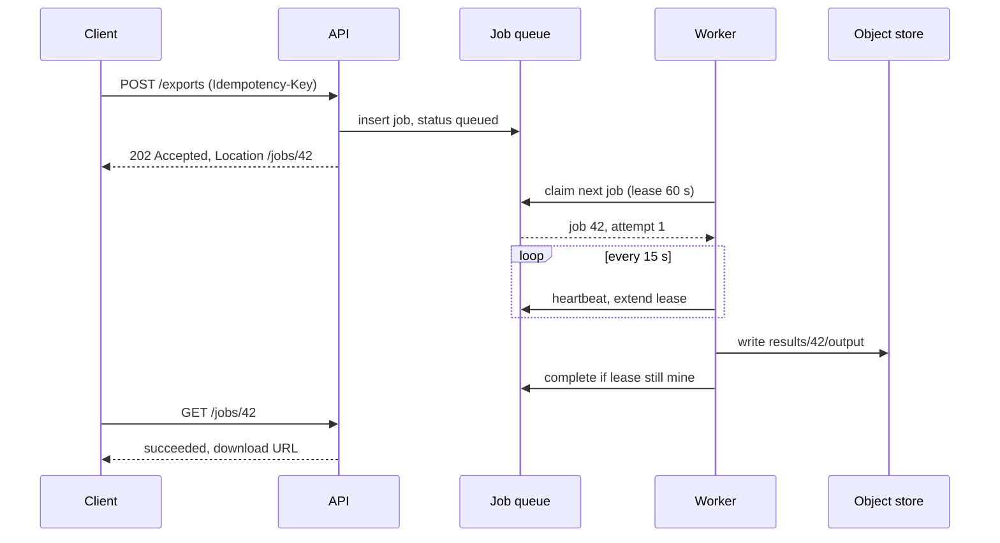

## In one minute
- Work that takes longer than a comfortable HTTP request (seconds to hours) should not run inside the request. Accept it, persist a job, return `202 Accepted` with a job ID, and let workers process it asynchronously.
- The core machinery is a durable queue plus workers that **lease** jobs: a claimed job is invisible to others until the lease expires, so a crashed worker's job is retried automatically.
- Leases need **heartbeats** for long jobs, and every job needs **idempotency**, because at-least-once delivery means some jobs run twice.
- Poison jobs go to a dead-letter queue after a bounded number of attempts; very long jobs checkpoint progress so a retry resumes rather than restarts.
- Clients learn the outcome by polling a status endpoint, a webhook, or a push channel. Multi-step jobs with waits and compensation belong in a workflow engine.

## How it works

### When the pattern shows up in interviews
Video transcoding (YouTube), image processing (Instagram), "export my data" (GDPR), report generation, bulk CSV import, sending a marketing campaign to millions, ML inference on uploads, payment settlement batches, and web crawlers. The tell is any operation where the user should not stare at a spinner, or where the work is too heavy or bursty to share machines with request-serving code. Interviewers want to see the async boundary drawn early and then ask what happens when a worker dies halfway.

### The request side
The API validates the request, writes a `jobs` row (ID, type, parameters, status `queued`, owner, idempotency key) and enqueues a message with the job ID, then returns `202 Accepted` with a `Location: /jobs/{id}` header and a `Retry-After` hint for how soon to poll ([Azure Architecture Center](https://learn.microsoft.com/en-us/azure/architecture/patterns/async-request-reply)). If the client retries with the same idempotency key, it gets the same job instead of a duplicate. Enqueueing and writing the row should be atomic, which is the outbox problem again ([Brandur Leach](https://brandur.org/job-drain)): either use a database-backed queue, or write the row and let a relay or CDC publish it.

### The worker side
Workers pull rather than receive pushes, so each controls its own concurrency. A pull **leases** the job for a visibility timeout. While the worker runs, it periodically **heartbeats** to extend the lease and to report progress. On success it writes the result (usually to object storage), updates the job row to `succeeded`, and deletes the message. On failure it either lets the lease lapse or explicitly releases the job with a backoff delay. After `max_attempts`, the job moves to a dead-letter queue and its status becomes `failed`, which pages a human or triggers an alert rather than retrying forever.

### Idempotency and checkpoints
A worker can finish the work and die before acknowledging, so the job will run again. Design each job so a second run is harmless: write outputs to deterministic keys (`results/{job_id}/part-0007`), use conditional status transitions (`UPDATE jobs SET status='succeeded' WHERE id=$1 AND status='running' AND lease_owner=$2`), and pass idempotency keys to external side effects such as emails or charges. For jobs that run for an hour, checkpoint progress (last processed offset, completed chunks) so a retry skips finished work. Better still, split the job into many small tasks: a 10-million-row import becomes 1,000 tasks of 10,000 rows, which parallelise and retry cheaply.

### Telling the client
Polling `GET /jobs/{id}` with a `Retry-After` hint works everywhere. While the job runs the status endpoint answers 200 with the state; when it finishes it can answer `303 See Other` pointing at the result, which makes clients follow with a GET rather than replay the POST, and a `DELETE` on the status resource is a clean way to offer cancellation ([Azure Architecture Center](https://learn.microsoft.com/en-us/azure/architecture/patterns/async-request-reply)). For the deduplication key, the `Idempotency-Key` header is a common convention, but its IETF draft expired without becoming an RFC ([IETF datatracker](https://datatracker.ietf.org/doc/draft-ietf-httpapi-idempotency-key-header/)). Beyond polling, webhooks suit server-to-server integrations; server-sent events or WebSockets suit interactive UIs. The status row stays the source of truth.

### Workflow engines
When a task has many steps, external waits ("wait for the user to approve"), timers, and compensation on failure, hand-rolled queues become a tangle of state flags. Durable-execution systems such as Temporal, AWS Step Functions and Azure Durable Functions persist each step's result as an event history, so a crashed workflow replays to where it was and continues. Use them when the orchestration logic, not the compute, is the hard part.

## Down the stack

### Layer 1: The contract
Accepted means durable: once the API returns 202, the job survives any single crash. Each job is executed at least once and, in the absence of permanent failure, eventually reaches a terminal state (`succeeded`, `failed`, or `cancelled`). A job is leased to at most one worker at a time, but a worker whose lease expired may still be running, so "exactly one worker at a time" holds only for workers that check their lease before committing. Results are visible only after the terminal status is written.

### Layer 2: The mechanism
In Amazon SQS, `ReceiveMessage` returns a message and a receipt handle and hides the message for the queue's `VisibilityTimeout` (30 seconds by default). `ChangeMessageVisibility` with the receipt handle extends it, which is the heartbeat, but the 12-hour ceiling counts from the first receive and extending does not reset it, so anything longer must be split up or moved to a workflow engine. A standard queue also allows only about 120,000 in-flight messages at once ([SQS docs](https://docs.aws.amazon.com/AWSSimpleQueueService/latest/SQSDeveloperGuide/sqs-visibility-timeout.html)). `DeleteMessage` acknowledges. Each receive increments `ApproximateReceiveCount`, and a redrive policy with `maxReceiveCount` moves the message to a dead-letter queue ([SQS docs](https://docs.aws.amazon.com/AWSSimpleQueueService/latest/SQSDeveloperGuide/sqs-dead-letter-queues.html)). A Postgres-backed queue does the same with a row: workers run `SELECT id FROM jobs WHERE status='queued' AND run_at <= now() ORDER BY id FOR UPDATE SKIP LOCKED LIMIT 1`, then set `status='running', lease_owner=$w, lease_until=now()+interval '60 s', attempts=attempts+1` in the same transaction. Postgres documents `SKIP LOCKED` as unsuitable for general queries but meant for exactly this, many consumers on a queue-like table ([Postgres docs](https://www.postgresql.org/docs/current/sql-select.html)). A reaper (or the claim query itself) treats `running` rows with `lease_until < now()` as claimable. Temporal models the same thing with activity timeouts: `StartToClose` bounds one attempt, `HeartbeatTimeout` detects a stalled worker, and a retry policy controls backoff and maximum attempts ([Temporal docs](https://docs.temporal.io/encyclopedia/detecting-activity-failures)). Note Temporal's default activity retry policy has no attempt limit (1 second initial interval, coefficient 2.0, capped at 100 seconds), so a poison input retries forever unless you set `MaximumAttempts` or mark the error non-retryable ([Temporal docs](https://docs.temporal.io/encyclopedia/retry-policies)).

### Layer 3: The machine
Workers long-poll: an SQS receive with `WaitTimeSeconds` up to 20 ([SQS docs](https://docs.aws.amazon.com/AWSSimpleQueueService/latest/SQSDeveloperGuide/sqs-short-and-long-polling.html)) holds the HTTP connection open until a message arrives, which avoids burning requests on empty polls. On Kubernetes a scale-down or deploy sends `SIGTERM` and then `SIGKILL` after `terminationGracePeriodSeconds` (30 seconds by default, [Kubernetes docs](https://kubernetes.io/docs/concepts/workloads/pods/pod-lifecycle/)), so a worker must stop taking new jobs on `SIGTERM` and either finish or checkpoint within that window. Spot or preemptible instances give a short notice before reclaiming the machine: two minutes on EC2 Spot ([AWS docs](https://docs.aws.amazon.com/AWSEC2/latest/UserGuide/spot-instance-termination-notices.html)), while a GCE Spot VM gets no dedicated notice by default, only a best-effort shutdown period of up to 30 seconds, unless you opt into a 120-second notice ([Google Cloud docs](https://cloud.google.com/compute/docs/instances/spot)). Long jobs also hit memory limits: a transcoder that buffers a 4 GB file in RAM will be OOM-killed by the cgroup limit, so stream from object storage in chunks of a few MB. A heartbeat is one small network call every few seconds, negligible next to the work, but it must run on a thread or task that a CPU-bound loop or a stop-the-world GC pause cannot starve, or healthy jobs will lose their leases.

### Why it's built this way
1. Load balancers and clients time out idle connections after tens of seconds, so long work cannot live inside a request.
2. Machines die mid-job, so jobs are leased with a timeout rather than handed off permanently.
3. A fixed timeout is either too short for big jobs or too slow to detect crashes, so leases are short and extended by heartbeats.
4. Lease expiry plus retries means duplicate execution, so jobs are idempotent and status changes are conditional.
5. Some inputs always fail, so attempts are capped and failures are quarantined for humans.

## Diagram


## Worked example
A video platform receives about 10,000 uploads per hour at peak, roughly 3 per second. Each upload is transcoded into four renditions; a rendition takes about 4 minutes on one worker vCPU set. By Little's law, concurrent rendition tasks are 3 x 4 x 240 s, about 2,900, so the fleet needs roughly that many worker slots at peak, plus headroom. Splitting by rendition (and, for long videos, by segment) keeps each task short, so a crash wastes minutes, not an hour.

Leases are 60 seconds with a heartbeat every 15 seconds, so a dead worker is detected within about a minute and its task is retried elsewhere. `max_attempts` is 4 with exponential backoff; a corrupted file fails four times and lands in the DLQ with the error attached instead of looping. Workers autoscale on queue depth divided by per-worker throughput, with a floor so the first uploads after a quiet night do not wait for cold starts. When the last rendition finishes, a conditional update flips the parent job to `ready` and emits an event that notifies the uploader.

## In the wild
- **Slack, about 2016: the job queue that could not dequeue.** Database contention slowed Slack's job workers until the Redis-backed queue hit its memory limit. New jobs were refused, so every queue-backed feature failed, and because dequeuing needed free memory to move a job onto an in-flight list, the queue stayed stuck after the database recovered. At over 1.4 billion jobs on busy days and peaks of 33,000 per second, Slack put Kafka in front of Redis as a durable buffer ([Slack Engineering](https://slack.engineering/scaling-slacks-job-queue/)).
- **GitHub, 2022: retrying jobs that could never succeed.** On 5 October automated accounts rapidly created and deleted repositories, so many webhook jobs could not build their payloads because the data was already gone. Workers kept retrying them and new webhook events were blocked for 31 minutes. GitHub changed workers to stop retrying jobs whose data no longer exists ([GitHub blog](https://github.blog/2022-11-02-github-availability-report-october-2022/)).
- **Uber, 2018: retry topics and DLQs instead of a blocked partition.** In a Kafka consumer, a handler that kept failing never committed its offset, so newer messages behind it waited. Uber's insurance engineering team moved failed messages through a chain of delayed retry topics and finally a dead-letter topic, so one bad message stops blocking the rest ([Uber Engineering](https://www.uber.com/US/en/blog/reliable-reprocessing/)).

## Trade-offs
| Option | Strengths | Weaknesses | Choose when |
|---|---|---|---|
| Database table as queue (`SKIP LOCKED`) | Transactional with app data, simple | Polling load, vacuum churn at high rates | Up to modest throughput, one service |
| Managed queue (SQS, Pub/Sub) | Scales, built-in visibility and DLQ | Separate from DB, needs outbox for atomicity | Most async job systems |
| Log (Kafka) | Huge throughput, replay | Per-partition ordering blocks on slow jobs, no per-message lease | Streaming, not slow per-item work |
| Workflow engine (Temporal, Step Functions) | Durable multi-step state, timers, retries | New platform to run and learn | Multi-step orchestration with waits |

## Pitfalls in production
- **Visibility timeout shorter than the job.** The job is redelivered while still running and two workers process it. Heartbeat, or set the timeout above p99 duration.
- **Heartbeat starved by the work.** A CPU-bound loop or long GC pause misses heartbeats and loses a healthy lease. Heartbeat from a separate thread and check the lease before committing.
- **Unbounded retries on poison input.** One bad file consumes workers forever. Cap attempts, back off, and dead-letter with the error. Check the defaults: some engines retry without limit unless told otherwise.
- **Non-idempotent side effects.** A retried campaign job emails customers twice. Record per-recipient sends or use provider idempotency keys.
- **Ignoring `SIGTERM`.** Deploys kill jobs mid-write, leaving partial outputs. Drain on `SIGTERM`, checkpoint, and write outputs atomically (temp key then rename or commit marker).

## Leadership lens
- Ask for the job state machine in the design doc: states, who moves each transition, and what happens on timeout in each state.
- Monitor queue age (oldest message), not just depth; age is what users feel.
- Decide early whether you need a workflow engine; retrofitting one onto ad-hoc status flags is costly.
- Make DLQ handling an owned process with a runbook and a redrive tool, not a graveyard.

## Check yourself
1. Why is a worker that holds an expired lease dangerous, and how do you contain it?
   **Answer:** Another worker may now own the job, so both could commit results; make the completion a conditional update that checks the lease owner, and write outputs idempotently.
2. Why split a one-hour job into many small tasks rather than heartbeat one long task?
   **Answer:** Small tasks parallelise, and a crash or deploy loses minutes of work instead of an hour, without checkpoint logic.
3. What metric best shows users are suffering from a backlog?
   **Answer:** Age of the oldest message, because depth alone does not tell you how long work waits.
4. When is Kafka a poor fit for slow jobs?
   **Answer:** A slow job blocks every later message in its partition, and there is no per-message lease or redelivery, only offsets.

## Practice
**Task:** Implement a lease-based job queue. `JobQueue(lease, max_attempts)` supports `enqueue(job_id)`, and `claim(worker, now)`, which returns the oldest-enqueued claimable job and leases it to `worker` until `now + lease`, incrementing its attempt count, or returns nothing. A job is claimable when it is queued, or when it is running and its lease has expired (`now >= lease_until`) and it has fewer than `max_attempts` attempts. A running job whose lease expired after its last allowed attempt becomes `"dead"`. `heartbeat(job_id, worker, now)` extends an unexpired lease held by that worker and returns true or false. `complete(job_id, worker, now)` marks the job `"done"` only if that worker holds an unexpired lease. `status(job_id, now)` returns `"queued"`, `"running"`, `"done"` or `"dead"` (an expired, retryable lease reads as `"queued"`).

```python starter
class JobQueue:
    def __init__(self, lease, max_attempts):
        # TODO
        pass

    def enqueue(self, job_id):
        raise NotImplementedError

    def claim(self, worker, now):
        raise NotImplementedError

    def heartbeat(self, job_id, worker, now):
        raise NotImplementedError

    def complete(self, job_id, worker, now):
        raise NotImplementedError

    def status(self, job_id, now):
        raise NotImplementedError
```

```python tests
def test_claims_in_fifo_order():
    q = JobQueue(lease=10, max_attempts=3)
    q.enqueue("a"); q.enqueue("b")
    assert q.claim("w1", 0) == "a"
    assert q.claim("w2", 0) == "b"
    assert q.claim("w3", 0) is None

def test_complete_only_by_holder():
    q = JobQueue(lease=10, max_attempts=3)
    q.enqueue("a")
    q.claim("w1", 0)
    assert not q.complete("a", "w2", 1)
    assert q.complete("a", "w1", 2)
    assert q.status("a", 2) == "done"
    assert q.claim("w2", 50) is None

def test_expired_lease_is_reclaimed():
    q = JobQueue(lease=10, max_attempts=3)
    q.enqueue("a")
    q.claim("w1", 0)
    assert q.status("a", 9) == "running"
    assert q.status("a", 10) == "queued"
    assert q.claim("w2", 10) == "a"
    assert not q.complete("a", "w1", 11), "old holder lost the lease"
    assert q.complete("a", "w2", 11)

def test_heartbeat_extends_lease():
    q = JobQueue(lease=10, max_attempts=3)
    q.enqueue("a")
    q.claim("w1", 0)
    assert q.heartbeat("a", "w1", 8)
    assert q.claim("w2", 15) is None
    assert q.complete("a", "w1", 17)

def test_heartbeat_after_expiry_fails():
    q = JobQueue(lease=10, max_attempts=3)
    q.enqueue("a")
    q.claim("w1", 0)
    assert not q.heartbeat("a", "w1", 10)
    assert not q.heartbeat("a", "w2", 5)

def test_dead_after_max_attempts():
    q = JobQueue(lease=5, max_attempts=2)
    q.enqueue("a"); q.enqueue("b")
    assert q.claim("w1", 0) == "a"
    assert q.claim("w1", 5) == "a"
    assert q.claim("w1", 10) == "b"
    assert q.status("a", 10) == "dead"
    assert q.claim("w2", 20) == "b"
    assert q.claim("w2", 30) is None
    assert q.status("b", 30) == "dead"
```

```python solution
class JobQueue:
    def __init__(self, lease, max_attempts):
        self.lease = lease
        self.max_attempts = max_attempts
        self.order = []
        self.jobs = {}

    def enqueue(self, job_id):
        self.order.append(job_id)
        self.jobs[job_id] = {"state": "queued", "worker": None, "until": 0, "attempts": 0}

    def _refresh(self, job, now):
        if job["state"] == "running" and now >= job["until"]:
            job["state"] = "dead" if job["attempts"] >= self.max_attempts else "queued"
            job["worker"] = None

    def claim(self, worker, now):
        for job_id in self.order:
            job = self.jobs[job_id]
            self._refresh(job, now)
            if job["state"] == "queued":
                job.update(state="running", worker=worker, until=now + self.lease)
                job["attempts"] += 1
                return job_id
        return None

    def _held(self, job_id, worker, now):
        job = self.jobs.get(job_id)
        if job is None:
            return None
        self._refresh(job, now)
        if job["state"] == "running" and job["worker"] == worker:
            return job
        return None

    def heartbeat(self, job_id, worker, now):
        job = self._held(job_id, worker, now)
        if job is None:
            return False
        job["until"] = now + self.lease
        return True

    def complete(self, job_id, worker, now):
        job = self._held(job_id, worker, now)
        if job is None:
            return False
        job["state"] = "done"
        return True

    def status(self, job_id, now):
        job = self.jobs[job_id]
        self._refresh(job, now)
        return job["state"]
```

```typescript starter
export class JobQueue {
  constructor(lease: number, maxAttempts: number) {}
  enqueue(jobId: string): void {
    throw new Error("TODO");
  }
  claim(worker: string, now: number): string | null {
    throw new Error("TODO");
  }
  heartbeat(jobId: string, worker: string, now: number): boolean {
    throw new Error("TODO");
  }
  complete(jobId: string, worker: string, now: number): boolean {
    throw new Error("TODO");
  }
  status(jobId: string, now: number): string {
    throw new Error("TODO");
  }
}
```

```typescript tests
test("claims in fifo order", () => {
  const q = new JobQueue(10, 3);
  q.enqueue("a");
  q.enqueue("b");
  assertEqual(q.claim("w1", 0), "a");
  assertEqual(q.claim("w2", 0), "b");
  assertEqual(q.claim("w3", 0), null);
});

test("complete only by holder", () => {
  const q = new JobQueue(10, 3);
  q.enqueue("a");
  q.claim("w1", 0);
  assert(!q.complete("a", "w2", 1), "not holder");
  assert(q.complete("a", "w1", 2), "holder");
  assertEqual(q.status("a", 2), "done");
  assertEqual(q.claim("w2", 50), null);
});

test("expired lease is reclaimed", () => {
  const q = new JobQueue(10, 3);
  q.enqueue("a");
  q.claim("w1", 0);
  assertEqual(q.status("a", 9), "running");
  assertEqual(q.status("a", 10), "queued");
  assertEqual(q.claim("w2", 10), "a");
  assert(!q.complete("a", "w1", 11), "old holder lost the lease");
  assert(q.complete("a", "w2", 11), "new holder completes");
});

test("heartbeat extends lease", () => {
  const q = new JobQueue(10, 3);
  q.enqueue("a");
  q.claim("w1", 0);
  assert(q.heartbeat("a", "w1", 8), "heartbeat");
  assertEqual(q.claim("w2", 15), null);
  assert(q.complete("a", "w1", 17), "complete after extension");
});

test("heartbeat after expiry fails", () => {
  const q = new JobQueue(10, 3);
  q.enqueue("a");
  q.claim("w1", 0);
  assert(!q.heartbeat("a", "w1", 10), "expired");
  assert(!q.heartbeat("a", "w2", 5), "not holder");
});

test("dead after max attempts", () => {
  const q = new JobQueue(5, 2);
  q.enqueue("a");
  q.enqueue("b");
  assertEqual(q.claim("w1", 0), "a");
  assertEqual(q.claim("w1", 5), "a");
  assertEqual(q.claim("w1", 10), "b");
  assertEqual(q.status("a", 10), "dead");
  assertEqual(q.claim("w2", 20), "b");
  assertEqual(q.claim("w2", 30), null);
  assertEqual(q.status("b", 30), "dead");
});
```

```typescript solution
interface Job {
  state: string;
  worker: string | null;
  until: number;
  attempts: number;
}

export class JobQueue {
  private order: string[] = [];
  private jobs = new Map<string, Job>();
  constructor(private lease: number, private maxAttempts: number) {}

  enqueue(jobId: string): void {
    this.order.push(jobId);
    this.jobs.set(jobId, { state: "queued", worker: null, until: 0, attempts: 0 });
  }

  private refresh(job: Job, now: number): void {
    if (job.state === "running" && now >= job.until) {
      job.state = job.attempts >= this.maxAttempts ? "dead" : "queued";
      job.worker = null;
    }
  }

  claim(worker: string, now: number): string | null {
    for (const id of this.order) {
      const job = this.jobs.get(id)!;
      this.refresh(job, now);
      if (job.state === "queued") {
        job.state = "running";
        job.worker = worker;
        job.until = now + this.lease;
        job.attempts++;
        return id;
      }
    }
    return null;
  }

  private held(jobId: string, worker: string, now: number): Job | null {
    const job = this.jobs.get(jobId);
    if (!job) return null;
    this.refresh(job, now);
    return job.state === "running" && job.worker === worker ? job : null;
  }

  heartbeat(jobId: string, worker: string, now: number): boolean {
    const job = this.held(jobId, worker, now);
    if (!job) return false;
    job.until = now + this.lease;
    return true;
  }

  complete(jobId: string, worker: string, now: number): boolean {
    const job = this.held(jobId, worker, now);
    if (!job) return false;
    job.state = "done";
    return true;
  }

  status(jobId: string, now: number): string {
    const job = this.jobs.get(jobId)!;
    this.refresh(job, now);
    return job.state;
  }
}
```

```go starter
package practice

type JobQueue struct{}

func NewJobQueue(lease int64, maxAttempts int) *JobQueue {
	return &JobQueue{}
}

func (q *JobQueue) Enqueue(jobID string) {
	panic("TODO")
}

// Claim returns the job ID and true, or "" and false if nothing is claimable.
func (q *JobQueue) Claim(worker string, now int64) (string, bool) {
	panic("TODO")
}

func (q *JobQueue) Heartbeat(jobID, worker string, now int64) bool {
	panic("TODO")
}

func (q *JobQueue) Complete(jobID, worker string, now int64) bool {
	panic("TODO")
}

func (q *JobQueue) Status(jobID string, now int64) string {
	panic("TODO")
}
```

```go tests
package practice

import "testing"

func mustClaim(t *testing.T, q *JobQueue, worker string, now int64, want string) {
	t.Helper()
	got, ok := q.Claim(worker, now)
	if want == "" {
		if ok {
			t.Fatalf("expected nothing at %d, got %s", now, got)
		}
		return
	}
	if !ok || got != want {
		t.Fatalf("at %d expected %s, got %q", now, want, got)
	}
}

func TestClaimsFIFO(t *testing.T) {
	q := NewJobQueue(10, 3)
	q.Enqueue("a")
	q.Enqueue("b")
	mustClaim(t, q, "w1", 0, "a")
	mustClaim(t, q, "w2", 0, "b")
	mustClaim(t, q, "w3", 0, "")
}

func TestCompleteOnlyByHolder(t *testing.T) {
	q := NewJobQueue(10, 3)
	q.Enqueue("a")
	q.Claim("w1", 0)
	if q.Complete("a", "w2", 1) || !q.Complete("a", "w1", 2) {
		t.Fatal("only holder completes")
	}
	if q.Status("a", 2) != "done" {
		t.Fatal("should be done")
	}
	mustClaim(t, q, "w2", 50, "")
}

func TestExpiredLeaseReclaimed(t *testing.T) {
	q := NewJobQueue(10, 3)
	q.Enqueue("a")
	q.Claim("w1", 0)
	if q.Status("a", 9) != "running" || q.Status("a", 10) != "queued" {
		t.Fatal("lease boundary")
	}
	mustClaim(t, q, "w2", 10, "a")
	if q.Complete("a", "w1", 11) || !q.Complete("a", "w2", 11) {
		t.Fatal("old holder must lose")
	}
}

func TestHeartbeatExtends(t *testing.T) {
	q := NewJobQueue(10, 3)
	q.Enqueue("a")
	q.Claim("w1", 0)
	if !q.Heartbeat("a", "w1", 8) {
		t.Fatal("heartbeat failed")
	}
	mustClaim(t, q, "w2", 15, "")
	if !q.Complete("a", "w1", 17) {
		t.Fatal("complete failed")
	}
}

func TestHeartbeatAfterExpiry(t *testing.T) {
	q := NewJobQueue(10, 3)
	q.Enqueue("a")
	q.Claim("w1", 0)
	if q.Heartbeat("a", "w1", 10) || q.Heartbeat("a", "w2", 5) {
		t.Fatal("heartbeat should fail")
	}
}

func TestDeadAfterMaxAttempts(t *testing.T) {
	q := NewJobQueue(5, 2)
	q.Enqueue("a")
	q.Enqueue("b")
	mustClaim(t, q, "w1", 0, "a")
	mustClaim(t, q, "w1", 5, "a")
	mustClaim(t, q, "w1", 10, "b")
	if q.Status("a", 10) != "dead" {
		t.Fatal("a should be dead")
	}
	mustClaim(t, q, "w2", 20, "b")
	mustClaim(t, q, "w2", 30, "")
	if q.Status("b", 30) != "dead" {
		t.Fatal("b should be dead")
	}
}
```

```go solution
package practice

type job struct {
	state    string
	worker   string
	until    int64
	attempts int
}

type JobQueue struct {
	lease       int64
	maxAttempts int
	order       []string
	jobs        map[string]*job
}

func NewJobQueue(lease int64, maxAttempts int) *JobQueue {
	return &JobQueue{lease: lease, maxAttempts: maxAttempts, jobs: map[string]*job{}}
}

func (q *JobQueue) Enqueue(jobID string) {
	q.order = append(q.order, jobID)
	q.jobs[jobID] = &job{state: "queued"}
}

func (q *JobQueue) refresh(j *job, now int64) {
	if j.state == "running" && now >= j.until {
		if j.attempts >= q.maxAttempts {
			j.state = "dead"
		} else {
			j.state = "queued"
		}
		j.worker = ""
	}
}

// Claim returns the job ID and true, or "" and false if nothing is claimable.
func (q *JobQueue) Claim(worker string, now int64) (string, bool) {
	for _, id := range q.order {
		j := q.jobs[id]
		q.refresh(j, now)
		if j.state == "queued" {
			j.state, j.worker, j.until = "running", worker, now+q.lease
			j.attempts++
			return id, true
		}
	}
	return "", false
}

func (q *JobQueue) held(jobID, worker string, now int64) *job {
	j, ok := q.jobs[jobID]
	if !ok {
		return nil
	}
	q.refresh(j, now)
	if j.state == "running" && j.worker == worker {
		return j
	}
	return nil
}

func (q *JobQueue) Heartbeat(jobID, worker string, now int64) bool {
	j := q.held(jobID, worker, now)
	if j == nil {
		return false
	}
	j.until = now + q.lease
	return true
}

func (q *JobQueue) Complete(jobID, worker string, now int64) bool {
	j := q.held(jobID, worker, now)
	if j == nil {
		return false
	}
	j.state = "done"
	return true
}

func (q *JobQueue) Status(jobID string, now int64) string {
	j := q.jobs[jobID]
	q.refresh(j, now)
	return j.state
}
```

## Mock interview
**Prompt:** Design the "export my account data" feature for a social network with 500 million users. An export gathers posts, photos and messages into a ZIP that can be several gigabytes and may take from a minute to a few hours to build. Expect around 50,000 export requests per day, with spikes after news coverage of privacy laws.

- Follow-up: A worker is killed by a deploy two hours into a three-hour export. What happens?
- Follow-up: A user clicks "Export" five times in a row. What do they get?
- Follow-up: Would you build this on Kafka, a database queue, or a workflow engine? Why?

**A strong answer covers:**
- Returns 202 with a job ID, deduplicates on an idempotency key or "one active export per user", and stores status in a jobs table.
- Leases with heartbeats, a bounded retry policy with backoff, and a DLQ with alerting.
- Splits the export into per-data-type or per-chunk tasks with checkpoints, writing parts to object storage under deterministic keys, then a final assembly step.
- Graceful shutdown on `SIGTERM`, conditional status transitions, and handling a stale worker that wakes up after losing its lease.
- Notification by email or push with a signed, expiring download URL, plus per-tenant fairness so spikes do not starve other async work.

## Sources and further study
**Primary**
- [RFC 9110, HTTP Semantics, section 15.3.3 (IETF)](https://www.rfc-editor.org/rfc/rfc9110.html#name-202-accepted): what `202 Accepted` does and does not promise about the eventual outcome.
- [Retry policies (Temporal docs)](https://docs.temporal.io/encyclopedia/retry-policies): default backoff, unlimited attempts by default, and non-retryable errors.

**Systems docs**
- [Amazon SQS dead-letter queues (AWS docs)](https://docs.aws.amazon.com/AWSSimpleQueueService/latest/SQSDeveloperGuide/sqs-dead-letter-queues.html): redrive policy, `maxReceiveCount`, and moving messages back after a fix.
- [SELECT, the locking clause (PostgreSQL docs)](https://www.postgresql.org/docs/current/sql-select.html): `FOR UPDATE SKIP LOCKED` and why it suits queue tables.
- [Pod lifecycle and termination (Kubernetes docs)](https://kubernetes.io/docs/concepts/workloads/pods/pod-lifecycle/): the `SIGTERM`, grace period, `SIGKILL` sequence a worker must handle.

**Books**
- *Designing Distributed Systems* (2nd ed.), Brendan Burns, Ch 11 "Work Queue Systems": a generic work queue, dynamic worker scaling and the multiworker pattern.
- *Understanding Distributed Systems* (2nd ed.), Roberto Vitillo, chapter "Messaging": queues, delivery guarantees, failures and dead letters.

**Other curricula**
- [Asynchronous Request-Reply pattern (Azure Architecture Center)](https://learn.microsoft.com/en-us/azure/architecture/patterns/async-request-reply): frames the client side as 202, a status endpoint, `Retry-After`, and a 303 to the result.
- [System Design Primer: Asynchronism (donnemartin)](https://github.com/donnemartin/system-design-primer#asynchronism): frames the topic as message queues, task queues and back pressure, with clients told to retry later on 503.

## Watch
- [Message Queues in System Design Interviews w/ Meta Staff Engineer (Hello Interview)](https://www.youtube.com/watch?v=1ISRd0bS714): when and how to introduce a queue, with retries, DLQs and scaling consumers.
- [Durable execution, explained with coffee (Temporal)](https://www.youtube.com/watch?v=20tEds5Eg44): the idea behind workflow engines that survive crashes mid-process.

## Free resources
- [Amazon SQS visibility timeout (AWS docs)](https://docs.aws.amazon.com/AWSSimpleQueueService/latest/SQSDeveloperGuide/sqs-visibility-timeout.html): the canonical lease model, including extending the timeout during processing.
- [Avoiding insurmountable queue backlogs (AWS Builders' Library)](https://aws.amazon.com/builders-library/avoiding-insurmountable-queue-backlogs/): fairness, backlog recovery and why queue age matters.
- [Transactionally staged job drains in Postgres (Brandur Leach)](https://brandur.org/job-drain): enqueueing jobs atomically with the data they depend on.
- [Detecting activity failures (Temporal docs)](https://docs.temporal.io/encyclopedia/detecting-activity-failures): start-to-close and heartbeat timeouts in a durable workflow engine.
- [Making retries safe with idempotent APIs (AWS Builders' Library)](https://aws.amazon.com/builders-library/making-retries-safe-with-idempotent-APIs/): designing side effects that tolerate at-least-once execution.
