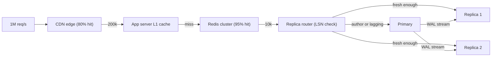

## In one minute
- Most products read far more than they write, often 100 to 1. Scaling reads means serving answers from many cheap copies and making each answer cheap to compute.
- Think of the read path as a funnel: browser, CDN, in-process cache, distributed cache, read replicas, primary. Each layer removes a fraction of traffic, and the fractions multiply.
- Every copy is stale by some amount. A strong answer sets a staleness budget per data type and keeps read-your-writes for the person who just wrote.
- When reads are expensive rather than merely frequent, precompute: denormalised rows, materialised views, read models fed by change data capture.
- Designs fail in the tail: hot keys, stampedes, lag spikes and cold caches. Name them before the interviewer does.

## How it works

### The read funnel
Each layer answers what it can and passes the rest inward. If 1 million requests per second arrive, a CDN that answers 80 percent leaves 200,000; a cache tier that answers 95 percent of those leaves 10,000 for the database. Raising any layer's hit ratio from 95 to 99 percent cuts the load behind it by a factor of five, which is why interviewers want hit-ratio arithmetic, not a list of boxes. The Caching chapter covers patterns and invalidation inside one layer; this chapter is about combining layers.

### Read replicas and lag
A replica replays the primary's log. Replicas multiply read throughput, but most replication is asynchronous, so a replica can be milliseconds or minutes behind. Three guarantees matter:

- **Read-your-writes.** After I post a review, I see it ([Jepsen](https://jepsen.io/consistency/models/read-your-writes)). Return the commit position (a Postgres LSN or a MySQL GTID) with the write, store it in the session, and route my reads only to replicas that have replayed past it, or to the primary.
- **Monotonic reads.** I never see a value disappear on refresh. Pin a session to one replica, or carry the highest position seen so far.
- **Bounded staleness.** Everyone sees data at most N seconds old. Remove replicas from rotation when lag exceeds N.

### Make each read cheap
A page that joins five tables and aggregates 2,000 rows is expensive even when rare. Denormalise: keep the average rating and review count on the restaurant row, updated on each review write. Use materialised views for heavier aggregates. At the far end is CQRS: a separate read model (search index, per-user feed table, page-shaped document) maintained from the write side's events. The cost moves to the write path, and each precomputed copy is one more thing to keep in step ([Azure Materialized View pattern](https://learn.microsoft.com/en-us/azure/architecture/patterns/materialized-view)).

### Protect the origin
When a popular key expires, every server misses at once; request coalescing (one in-flight load per key, others wait) turns 5,000 identical misses into one query, and `stale-while-revalidate` serves the old value while one request refreshes it. Facebook's memcache leases do the same job: a server hands out a fill token for a key at most once every 10 seconds, which cut the peak database query rate on herd-prone keys from 17,000 to 1,300 per second ([Nishtala et al., NSDI 2013](https://www.usenix.org/conference/nsdi13/technical-sessions/presentation/nishtala)). A viral item can saturate one cache shard however many exist; the Hot Keys chapter covers splitting and replicating such keys. A cache that restarts empty, or fails, sends its whole miss stream inward at once, so AWS advises capping calls to dependencies and testing with the cache switched off ([AWS Builders' Library](https://aws.amazon.com/builders-library/caching-challenges-and-strategies/)). Load shedding in front of the database turns a cold cache into slow pages instead of an outage.

## Down the stack

### Layer 1: The contract
The read path promises a latency envelope (for example p99 under 100 ms at the edge), a staleness bound per data class (prices within 60 seconds, profile photos within 5 minutes, account balance never stale), and read-your-writes for the author of a change. It does not promise that two users see the same value at once, or freshness across regions. A CDN hit within `s-maxage` is correct under this contract; a read missing the author's own write is not.

### Layer 2: The mechanism
**Postgres streaming replication.** On commit the primary writes WAL; a `walsender` process streams records to the replica's `walreceiver`, and the startup process replays them into data pages. `pg_current_wal_lsn()` on the primary and `pg_last_wal_replay_lsn()` on a replica give positions a router can compare. When a replica query conflicts with replay (it reads rows being vacuumed away), replay waits up to `max_standby_streaming_delay` (default 30 seconds), then cancels the query: a direct trade between query success and lag ([Postgres docs](https://www.postgresql.org/docs/18/runtime-config-replication.html)). The other escape, `hot_standby_feedback`, stops the primary's vacuum from removing rows the replica still reads, which avoids cancellations but bloats tables on the primary ([Postgres hot standby](https://www.postgresql.org/docs/current/hot-standby.html)). MySQL offers the same idea with GTIDs: `WAIT_FOR_EXECUTED_GTID_SET` blocks a replica read until a given transaction has applied, returning 1 if an optional timeout expires first ([MySQL 8.4 docs](https://dev.mysql.com/doc/refman/8.4/en/gtid-functions.html)).

**HTTP caching.** `Cache-Control: public, s-maxage=60, stale-while-revalidate=30` lets shared caches keep a response for 60 seconds, then serve it stale for up to 30 more while revalidating in the background. `s-maxage` is defined in RFC 9111, which replaced RFC 7234 in 2022 ([RFC 9111](https://www.rfc-editor.org/rfc/rfc9111)); `stale-while-revalidate` comes from the RFC 5861 extension. CDNs collapse concurrent misses for a URL into one origin fetch ([Fastly docs](https://www.fastly.com/documentation/guides/concepts/edge-state/cache/request-collapsing/)), and tiered caching lets only upper-tier data centers ask the origin, so the origin sees one request per region, not per point of presence ([Cloudflare docs](https://developers.cloudflare.com/cache/how-to/tiered-cache/)).

**Cache tiers with ordering.** Facebook's TAO, which served a billion reads and millions of writes per second, puts follower caches in front of leader caches per region. Followers forward writes to the leader, which updates the database and invalidates followers asynchronously; the follower that handled a write is updated synchronously on the leader's reply, which gives the writer read-your-writes within that tier while other users converge ([Bronson et al., USENIX ATC 2013](https://www.usenix.org/system/files/conference/atc13/atc13-bronson.pdf)).

**Materialised views.** Postgres `REFRESH MATERIALIZED VIEW CONCURRENTLY` avoids blocking readers but still recomputes the whole query; incremental maintenance from change events updates only affected rows.

### Layer 3: The machine
Latency per layer spans five orders of magnitude: an in-process map lookup is about 100 ns, a Redis hit in the same zone 0.2 to 0.5 ms, an indexed database read 1 to 5 ms, and a cross-region hop 60 to 150 ms. Postgres replays WAL in a single startup process, so a replica on a 32-core box can fall behind a primary that writes in parallel, even while the replica's CPUs look idle. Since Postgres 15, `recovery_prefetch` (default `try`) reads ahead blocks that upcoming WAL records will touch, which hides some of that I/O wait but does not add replay parallelism ([Postgres docs](https://www.postgresql.org/docs/current/runtime-config-wal.html)). Replicas must also absorb every write's I/O: a replica on slower disks than the primary lags under write bursts. A new replica has a cold buffer pool, so its first reads hit storage: roughly 100 us per 4 KB random read on NVMe, several ms on network block storage. Bandwidth often binds before CPU: 100,000 responses per second of 20 KB is about 16 Gbit/s of egress.

### Why it's built this way
1. A read changes nothing, so it can be answered by any copy, and copies are cheap compared with making one machine faster.
2. Copies are updated after the write commits, because waiting for every copy would put the slowest replica on every write's latency.
3. Asynchronous copies diverge, so systems carry positions (LSN, GTID, version) that let a reader demand "at least this fresh".
4. Recomputing an aggregate per read wastes work, so read-dominated systems precompute once per write.
5. A failing layer dumps its traffic inward, so inner layers need coalescing and shedding.

## Diagram


## Worked example
A restaurant review site has 300,000 page reads per second at peak and 500 review writes per second; 70 percent of traffic is anonymous.

Anonymous pages (210,000 per second) are cached at the CDN with `s-maxage=60`; at 95 percent edge hits, 10,500 per second reach the origin. Logged-in pages (90,000 per second) split into a shared restaurant fragment and a small personal one, so the shared part still hits Redis.

The restaurant fragment is one denormalised document (hours, rating average, review count, top 10 reviews) of about 8 KB; 400,000 active restaurants take 3.2 GB of Redis. At 97 percent hits on about 100,000 origin requests, the database sees about 3,000 reads per second, within two replicas. Without the stored count and rating sum, each miss would aggregate up to 2,000 review rows: 6 million row reads per second.

Read-your-writes: a review write returns its LSN, kept in the session for 30 seconds, and the router sends that user to a replica past it. Lag is usually under 50 ms, so the primary sees at most about 1,000 extra reads per second.

## In the wild
- **Slack, 2022: a cache refill that the database could not survive.** A gradual Consul agent upgrade dropped memcached nodes from the catalog, and they were replaced with empty ones, so the hit rate fell. Group DM membership was cached by channel, but Vitess was sharded by user, so every miss became a query to every shard. The database overloaded, could not refill the cache, and client retries kept it down; many users could not boot Slack that morning. Slack moved the query to a channel-sharded table and audited other cache-fronted scatter queries ([Slack Engineering](https://slack.engineering/slacks-incident-on-2-22-22/)).
- **Facebook, 2010: invalid-value handling turned into a read storm.** A system that replaced cached config values it judged invalid met an invalid value in the database itself, so every client queried one cluster at hundreds of thousands of queries per second, and clients deleted cache keys on database errors, which fed the loop. Facebook had to take the site down for about 2.5 hours to stop the traffic and disabled the system ([Facebook Engineering](https://engineering.fb.com/2010/09/23/uncategorized/more-details-on-today-s-outage/)).
- **Facebook, 2013: leases and a Gutter pool for a read-dominated cache.** Facebook's memcache paper describes leases that allow one refill per key every 10 seconds, cutting herd-prone database load from 17,000 to 1,300 queries per second, and a Gutter pool of about 1% of servers that takes over for failed hosts so their misses do not land on the database ([USENIX NSDI 2013](https://www.usenix.org/conference/nsdi13/technical-sessions/presentation/nishtala)).

## Trade-offs
| Option | Strengths | Weaknesses | Choose when |
|---|---|---|---|
| CDN with short TTL | Removes origin load, cuts latency globally | Public content only, purge delay | Anonymous or shared responses |
| In-process L1 | Nanosecond reads, absorbs hot keys | Per-server staleness, memory per instance | Tiny, very hot, tolerant data |
| Distributed cache | Shared, sub-ms, large capacity | Invalidation, stampedes, cold starts | Default for hot entities |
| Read replicas | Full query power, no invalidation code | Lag, write I/O on every replica | Complex queries, moderate scale |
| Denormalised rows or materialised views | Cheap reads for expensive queries | Write amplification, consistency of copies | Aggregates read far more than written |
| Separate read model (CQRS) | Each read shaped for its page | Two systems, eventual consistency | Very different read and write shapes |

## Pitfalls in production
- **Replica lag spikes.** Backfills or long analytical queries push lag to minutes. Throttle backfills, isolate analytics, and drain replicas above the lag budget.
- **Read-your-writes lost behind a load balancer.** The next read hit a random lagging replica. Carry an LSN in the session and route on it.
- **Caches hide missing capacity.** A database sized for 3 percent misses meets 100 percent after a flush. Load-test cold, warm critical keys, and shed load.
- **Personalised responses cached publicly.** A CDN serves one user's page to another. Mark them `private` and strip cookies on cacheable routes.
- **Full view refreshes.** A refresh every minute becomes the heaviest query. Maintain incrementally from change events.

## Leadership lens
- Ask for a staleness budget per data class in the design doc, signed off by product, before choosing layers.
- Make replica lag an SLO, and decide in advance which reads fall back to the primary when it is breached.
- Every precomputed copy needs an owner and a rebuild procedure; count read models as systems in your on-call map.
- Track cost per million reads per layer; moving traffic outward to the CDN is often the cheapest capacity you can buy.

## Check yourself
1. Your CDN hit ratio falls from 90 to 80 percent. What happens to origin load?
   **Answer:** Misses go from 10 to 20 percent, so origin traffic doubles.
2. Why can a replica fall behind even though its CPUs are mostly idle?
   **Answer:** Replay is often single-threaded (Postgres replays WAL in one process) while the primary commits in parallel, so the replica is bound by one core and its I/O latency.
3. How do you give a user read-your-writes without sending all their reads to the primary?
   **Answer:** Keep the write's log position in the session and route reads to any replica that has replayed past it, falling back to the primary only when none has.
4. When should you denormalise instead of adding replicas?
   **Answer:** When each read is expensive (large joins or aggregates), because replicas multiply capacity but every replica still pays the full query cost.

## Practice
**Task:** Build a lag-aware read router. `ReadRouter(replicas, max_lag)` starts every replica at log position 0. `write(user, lsn)` records a commit, raising the primary's position and the user's last write position to at least `lsn`. `applied(replica, lsn)` records replay progress; positions never go backwards, and an unknown replica is an error. `route(user)` returns a replica that has applied at least the user's last write and whose lag (primary position minus applied) is at most `max_lag`; among eligible replicas choose the one with the fewest reads routed so far, ties by list order, and count the read. If none is eligible, return `"primary"`.

```python starter
class ReadRouter:
    def __init__(self, replicas, max_lag):
        # TODO
        pass

    def write(self, user, lsn):
        raise NotImplementedError

    def applied(self, replica, lsn):
        raise NotImplementedError

    def route(self, user):
        raise NotImplementedError
```

```python tests
def test_spreads_reads_evenly():
    r = ReadRouter(["r1", "r2"], 100)
    assert [r.route("a") for _ in range(4)] == ["r1", "r2", "r1", "r2"]

def test_read_your_writes():
    r = ReadRouter(["r1", "r2"], 100)
    r.write("alice", 10)
    r.applied("r1", 10)
    r.applied("r2", 5)
    assert r.route("alice") == "r1"
    assert r.route("bob") == "r2"
    assert r.route("alice") == "r1"

def test_lagging_replica_excluded():
    r = ReadRouter(["r1", "r2"], 5)
    r.write("x", 20)
    r.applied("r1", 18)
    r.applied("r2", 10)
    assert r.route("y") == "r1"
    assert r.route("y") == "r1"

def test_falls_back_to_primary():
    r = ReadRouter(["r1"], 100)
    r.write("u", 50)
    r.applied("r1", 40)
    assert r.route("u") == "primary"

def test_applied_is_monotonic():
    r = ReadRouter(["r1"], 100)
    r.applied("r1", 10)
    r.applied("r1", 4)
    r.write("u", 10)
    assert r.route("u") == "r1"

def test_unknown_replica():
    r = ReadRouter(["r1"], 100)
    try:
        r.applied("zz", 1)
        assert False, "expected KeyError"
    except KeyError:
        pass

def test_no_replicas():
    r = ReadRouter([], 100)
    assert r.route("u") == "primary"
```

```python solution
class ReadRouter:
    def __init__(self, replicas, max_lag):
        self.replicas = list(replicas)
        self.max_lag = max_lag
        self.pos = {name: 0 for name in replicas}
        self.count = {name: 0 for name in replicas}
        self.primary = 0
        self.last_write = {}

    def write(self, user, lsn):
        self.primary = max(self.primary, lsn)
        self.last_write[user] = max(self.last_write.get(user, 0), lsn)

    def applied(self, replica, lsn):
        if replica not in self.pos:
            raise KeyError(replica)
        if lsn > self.pos[replica]:
            self.pos[replica] = lsn

    def route(self, user):
        need = self.last_write.get(user, 0)
        best = None
        for name in self.replicas:
            if self.pos[name] < need or self.primary - self.pos[name] > self.max_lag:
                continue
            if best is None or self.count[name] < self.count[best]:
                best = name
        if best is None:
            return "primary"
        self.count[best] += 1
        return best
```

```typescript starter
export class ReadRouter {
  constructor(replicas: string[], maxLag: number) {}
  write(user: string, lsn: number): void { throw new Error("TODO"); }
  applied(replica: string, lsn: number): void { throw new Error("TODO"); }
  route(user: string): string { throw new Error("TODO"); }
}
```

```typescript tests
test("spreads reads evenly", () => {
  const r = new ReadRouter(["r1", "r2"], 100);
  assertEqual([r.route("a"), r.route("a"), r.route("a"), r.route("a")], ["r1", "r2", "r1", "r2"]);
});
test("read your writes", () => {
  const r = new ReadRouter(["r1", "r2"], 100);
  r.write("alice", 10); r.applied("r1", 10); r.applied("r2", 5);
  assertEqual(r.route("alice"), "r1");
  assertEqual(r.route("bob"), "r2");
  assertEqual(r.route("alice"), "r1");
});
test("lagging replica excluded", () => {
  const r = new ReadRouter(["r1", "r2"], 5);
  r.write("x", 20); r.applied("r1", 18); r.applied("r2", 10);
  assertEqual(r.route("y"), "r1");
  assertEqual(r.route("y"), "r1");
});
test("falls back to primary", () => {
  const r = new ReadRouter(["r1"], 100);
  r.write("u", 50); r.applied("r1", 40);
  assertEqual(r.route("u"), "primary");
});
test("applied is monotonic", () => {
  const r = new ReadRouter(["r1"], 100);
  r.applied("r1", 10); r.applied("r1", 4); r.write("u", 10);
  assertEqual(r.route("u"), "r1");
});
test("unknown replica", () => {
  const r = new ReadRouter(["r1"], 100);
  let threw = false;
  try { r.applied("zz", 1); } catch (e) { threw = true; }
  assert(threw, "expected throw");
});
test("no replicas", () => {
  const r = new ReadRouter([], 100);
  assertEqual(r.route("u"), "primary");
});
```

```typescript solution
export class ReadRouter {
  private replicas: string[];
  private pos = new Map<string, number>();
  private count = new Map<string, number>();
  private primary = 0;
  private lastWrite = new Map<string, number>();

  constructor(replicas: string[], private maxLag: number) {
    this.replicas = [...replicas];
    for (const r of replicas) { this.pos.set(r, 0); this.count.set(r, 0); }
  }

  write(user: string, lsn: number): void {
    this.primary = Math.max(this.primary, lsn);
    this.lastWrite.set(user, Math.max(this.lastWrite.get(user) ?? 0, lsn));
  }

  applied(replica: string, lsn: number): void {
    const cur = this.pos.get(replica);
    if (cur === undefined) throw new Error("unknown replica " + replica);
    if (lsn > cur) this.pos.set(replica, lsn);
  }

  route(user: string): string {
    const need = this.lastWrite.get(user) ?? 0;
    let best: string | null = null;
    for (const name of this.replicas) {
      const p = this.pos.get(name)!;
      if (p < need || this.primary - p > this.maxLag) continue;
      if (best === null || this.count.get(name)! < this.count.get(best)!) best = name;
    }
    if (best === null) return "primary";
    this.count.set(best, this.count.get(best)! + 1);
    return best;
  }
}
```

```go starter
package practice

type ReadRouter struct{}

func NewReadRouter(replicas []string, maxLag int64) *ReadRouter { return &ReadRouter{} }

func (r *ReadRouter) Write(user string, lsn int64) { panic("TODO") }

// Applied returns an error for an unknown replica.
func (r *ReadRouter) Applied(replica string, lsn int64) error { panic("TODO") }

func (r *ReadRouter) Route(user string) string { panic("TODO") }
```

```go tests
package practice

import (
	"reflect"
	"testing"
)

func TestSpreadsReadsEvenly(t *testing.T) {
	r := NewReadRouter([]string{"r1", "r2"}, 100)
	got := []string{r.Route("a"), r.Route("a"), r.Route("a"), r.Route("a")}
	if !reflect.DeepEqual(got, []string{"r1", "r2", "r1", "r2"}) {
		t.Fatalf("got %v", got)
	}
}

func TestReadYourWrites(t *testing.T) {
	r := NewReadRouter([]string{"r1", "r2"}, 100)
	r.Write("alice", 10)
	r.Applied("r1", 10)
	r.Applied("r2", 5)
	if got := r.Route("alice"); got != "r1" {
		t.Fatalf("alice got %s", got)
	}
	if got := r.Route("bob"); got != "r2" {
		t.Fatalf("bob got %s", got)
	}
	if got := r.Route("alice"); got != "r1" {
		t.Fatalf("alice again got %s", got)
	}
}

func TestLaggingReplicaExcluded(t *testing.T) {
	r := NewReadRouter([]string{"r1", "r2"}, 5)
	r.Write("x", 20)
	r.Applied("r1", 18)
	r.Applied("r2", 10)
	if a, b := r.Route("y"), r.Route("y"); a != "r1" || b != "r1" {
		t.Fatalf("got %s %s", a, b)
	}
}

func TestFallsBackToPrimary(t *testing.T) {
	r := NewReadRouter([]string{"r1"}, 100)
	r.Write("u", 50)
	r.Applied("r1", 40)
	if got := r.Route("u"); got != "primary" {
		t.Fatalf("got %s", got)
	}
}

func TestAppliedIsMonotonic(t *testing.T) {
	r := NewReadRouter([]string{"r1"}, 100)
	r.Applied("r1", 10)
	r.Applied("r1", 4)
	r.Write("u", 10)
	if got := r.Route("u"); got != "r1" {
		t.Fatalf("got %s", got)
	}
}

func TestUnknownReplica(t *testing.T) {
	r := NewReadRouter([]string{"r1"}, 100)
	if err := r.Applied("zz", 1); err == nil {
		t.Fatal("expected error")
	}
}

func TestNoReplicas(t *testing.T) {
	r := NewReadRouter(nil, 100)
	if got := r.Route("u"); got != "primary" {
		t.Fatalf("got %s", got)
	}
}
```

```go solution
package practice

import "fmt"

type ReadRouter struct {
	replicas  []string
	maxLag    int64
	pos       map[string]int64
	count     map[string]int
	primary   int64
	lastWrite map[string]int64
}

func NewReadRouter(replicas []string, maxLag int64) *ReadRouter {
	r := &ReadRouter{
		replicas:  append([]string(nil), replicas...),
		maxLag:    maxLag,
		pos:       map[string]int64{},
		count:     map[string]int{},
		lastWrite: map[string]int64{},
	}
	for _, name := range replicas {
		r.pos[name] = 0
		r.count[name] = 0
	}
	return r
}

func (r *ReadRouter) Write(user string, lsn int64) {
	if lsn > r.primary {
		r.primary = lsn
	}
	if lsn > r.lastWrite[user] {
		r.lastWrite[user] = lsn
	}
}

// Applied returns an error for an unknown replica.
func (r *ReadRouter) Applied(replica string, lsn int64) error {
	cur, ok := r.pos[replica]
	if !ok {
		return fmt.Errorf("unknown replica %q", replica)
	}
	if lsn > cur {
		r.pos[replica] = lsn
	}
	return nil
}

func (r *ReadRouter) Route(user string) string {
	need := r.lastWrite[user]
	best := ""
	for _, name := range r.replicas {
		p := r.pos[name]
		if p < need || r.primary-p > r.maxLag {
			continue
		}
		if best == "" || r.count[name] < r.count[best] {
			best = name
		}
	}
	if best == "" {
		return "primary"
	}
	r.count[best]++
	return best
}
```

## Mock interview
**Prompt:** Design the read path for a profile and posts service: 400,000 reads and 4,000 writes per second at peak, with celebrity profiles reaching 50,000 reads per second each during live events.

- Follow-up: A user edits their bio and refreshes. Which layer serves the refresh, and why is the bio new?
- Follow-up: Replication lag on one replica jumps to 90 seconds during a backfill. What do users see, and what does your router do?
- Follow-up: Product wants a "trending posts" page across all posts. Replicas, a materialised view, or something else?

**A strong answer covers:**
- A funnel with hit ratios and the resulting load at each layer, sized against per-node limits.
- A staleness budget per data type and how TTLs, purges and invalidation map to it.
- Read-your-writes through log positions or session pinning, plus lag-aware routing and an alert on lag.
- Hot-key handling for celebrities (edge caching, L1, replicated keys) and request coalescing on misses.
- Precomputing trending as a separate read model fed by an event stream, not a query over replicas.

## Sources and further study
**Primary**
- [RFC 9111: HTTP Caching](https://www.rfc-editor.org/rfc/rfc9111): the current definition of `max-age`, `s-maxage` and when a cache may serve stale responses.
- [Scaling Memcache at Facebook (NSDI 2013)](https://www.usenix.org/conference/nsdi13/technical-sessions/presentation/nishtala): leases, regional pools and the Gutter pool for a read-heavy cache tier.

**Systems docs**
- [PostgreSQL: replication settings](https://www.postgresql.org/docs/18/runtime-config-replication.html): `max_standby_streaming_delay`, `hot_standby_feedback` and the other standby knobs.
- [MySQL 8.4: GTID functions](https://dev.mysql.com/doc/refman/8.4/en/gtid-functions.html): `WAIT_FOR_EXECUTED_GTID_SET` for read-your-writes on replicas.
- [Cloudflare Tiered Cache](https://developers.cloudflare.com/cache/how-to/tiered-cache/): how lower and upper tiers cut origin fetches.
- [Fastly: request collapsing](https://www.fastly.com/documentation/guides/concepts/edge-state/cache/request-collapsing/): one origin fetch for many concurrent misses, and when it backfires.

**Books**
- *Designing Data-Intensive Applications* (1st ed.), Martin Kleppmann, Ch 5 "Replication": the section on problems with replication lag covers read-your-writes and monotonic reads.
- *Understanding Distributed Systems* (2nd ed.), Roberto Vitillo, chapters "HTTP caching", "Content delivery networks" and "Caching": the funnel layer by layer.

**Other curricula**
- [donnemartin/system-design-primer](https://github.com/donnemartin/system-design-primer): frames read scaling as replication, denormalization and cache-aside, with the 100:1 to 1000:1 read ratio as the reason.
- [Azure Architecture Center: Cache-Aside pattern](https://learn.microsoft.com/en-us/azure/architecture/patterns/cache-aside): frames the cache as loaded on demand by the application, with expiry and consistency as the main costs.

## Watch
- [Scaling Instagram Infrastructure (InfoQ)](https://www.youtube.com/watch?v=hnpzNAPiC0E): caches, replicas and thundering herds across regions at very large read volume.
- [Scaling Memcache at Facebook (NSDI talk)](https://www.youtube.com/watch?v=6phA3IAcEJ8): look-aside caching, leases and cross-region invalidation for a read-dominated workload.
- [When to Shard Database vs Replicate? (KodeKloud)](https://www.youtube.com/watch?v=1_xLXicErn0): when replicas are enough and the lag they introduce.

## Free resources
- [TAO: Facebook's Distributed Data Store for the Social Graph (USENIX ATC 2013)](https://www.usenix.org/system/files/conference/atc13/atc13-bronson.pdf): leader and follower cache tiers with read-after-write for the writer.
- [Caching challenges and strategies (AWS Builders' Library)](https://aws.amazon.com/builders-library/caching-challenges-and-strategies/): cold caches, sizing and what happens when a cache layer fails.
- [Hot standby (PostgreSQL docs)](https://www.postgresql.org/docs/current/hot-standby.html): querying replicas, replay conflicts and their settings.
- [RFC 5861: HTTP Cache-Control extensions for stale content](https://www.rfc-editor.org/rfc/rfc5861): the definition of `stale-while-revalidate` and `stale-if-error`.
- [Read your writes (Jepsen consistency models)](https://jepsen.io/consistency/models/read-your-writes): the precise guarantee and how it relates to other session models.
