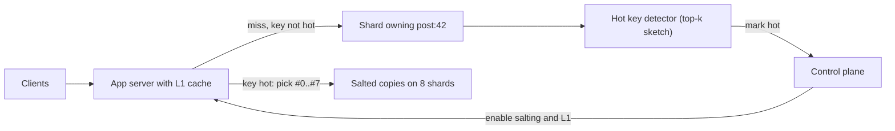

## In one minute
- A hot key is a single key (a celebrity profile, a viral post, a flash-sale SKU) that receives a large share of traffic. Partitioning spreads keys, not load, so one key lands on one shard and overwhelms it while the rest of the cluster idles.
- Interviewers raise it whenever your design hashes by an ID that can go viral: social feeds, like counters, leaderboards, ticketing, rate limiters, caches. The probe is usually "what happens when Taylor Swift posts?"
- Read-hot keys are fixed by copying: a local in-process cache, replicas of the key under salted names, or a CDN. Write-hot keys are fixed by splitting: shard the counter into N sub-keys and sum on read, or buffer and batch writes.
- You cannot fix what you cannot see. Detect hot keys with sampled counting (count-min sketch, top-k) per shard and react automatically.
- Every fix trades something: staleness for read replicas, read cost for split counters, memory for local caches. A strong answer names the trade.

## How it works

### Why hashing does not save you
Consistent hashing or range partitioning gives each shard a fair share of the *key space*. Real traffic follows a power law, so a handful of keys carry a large fraction of requests: traces from 153 of Twitter's production cache clusters showed approximately Zipfian popularity, sometimes with very high skew ([Yang et al., OSDI 2020](https://www.usenix.org/conference/osdi20/presentation/yang)). If one key gets 200,000 reads per second and a single Redis shard comfortably serves something on the order of 100,000 simple operations per second per core, that shard saturates no matter how many other shards you add. Adding nodes helps the long tail; it does nothing for the head.

### Read-hot keys
The goal is to serve one logical key from many physical places.

- **Local (L1) cache in the application.** Each app server keeps the hottest few thousand values in memory with a short TTL, say 1 to 5 seconds. With 500 app servers, the backing shard sees at most 500 refreshes per TTL window instead of 200,000 requests per second. Staleness is bounded by the TTL. Redis can instead push invalidations to such a cache (server-assisted client-side caching), but a dropped connection flushes the whole local cache, and Redis advises keeping frequently updated keys such as counters off it, since the invalidation traffic can cost more than the cache saves ([Redis docs](https://redis.io/docs/latest/develop/clients/client-side-caching/)).
- **Key replication with salting.** Store the value under `post:42#0` through `post:42#7`, which hash to different shards. Readers pick a suffix at random. Writers update all copies (or invalidate them). Read capacity grows by the fan-out factor; write cost grows by the same factor.
- **Push to the edge.** For public, cacheable content, a CDN absorbs the load at the edge.

### Write-hot keys
Copying does not help writes, because every copy must take every write. Instead:

- **Split counters.** A like counter becomes `likes:42:0` through `likes:42:15`. Each increment picks a random sub-key; a read sums all 16. Writes spread across shards; reads cost 16 lookups, which you then cache.
- **Write buffering.** Aggregate increments in memory on each app server for 1 second and flush one `INCRBY 37` instead of 37 `INCR`s.
- **Append, then aggregate.** Write events to a log (Kafka partitioned by a random key, not the hot ID), and let a stream processor compute the total. The hot key becomes a hot *aggregate*, updated a few times per second.
- **Pre-split exact state.** For flash-sale inventory, split stock into buckets (50 buckets of 100 units), each with its own owner, so contention is per bucket and nothing oversells.

### Detection
Pre-mark predictable cases such as known celebrities; for the rest, count. Each shard or proxy keeps a count-min sketch or a Space-Saving top-k structure over a sliding window, reports keys above a threshold, and a control plane flips them into "hot mode" (enable salting, extend TTLs, push to L1). Redis offers `redis-cli --hotkeys`, which works only when `maxmemory-policy` is an LFU policy, because it reads the eviction counters ([redis-cli docs](https://redis.io/docs/latest/develop/tools/cli/)). Since Redis 8.6 the server can also track hot keys itself: `HOTKEYS START` records the top K keys by share of CPU time or network bytes over a window, with optional sampling and per-slot filters ([Redis docs](https://redis.io/docs/latest/commands/hotkeys-start/)). Managed stores such as DynamoDB shift capacity toward hot partitions and can isolate one heavily used item on its own partition, but that item still tops out at 3,000 read units and 1,000 write units per second ([AWS docs](https://docs.aws.amazon.com/amazondynamodb/latest/developerguide/burst-adaptive-capacity.html)).

### How it shows up in interviews
Questions that trigger it: design Twitter or Instagram (celebrity posts), design a like or view counter, design a ticketing system, design a distributed cache, design a leaderboard, design a rate limiter keyed by API key. A strong answer separates read-hot from write-hot, sizes the problem with numbers, picks a mechanism for each, and mentions detection. Interviewers then probe: how do you invalidate eight copies consistently, what does a split counter cost on read, what if the hot key is not known in advance, and what if the hot key is a write that needs strong consistency.

## Down the stack

### Layer 1: The contract
A salted read-replica scheme promises that a read returns a value no older than the replication or invalidation delay, typically bounded by a TTL you choose (for example 2 seconds). A split counter promises that the sum is eventually exact once in-flight increments land, with no lost increments as long as each sub-key write is durable; a read during writes may undercount by in-flight operations. A local L1 cache promises nothing about cross-server consistency: two users on different servers can see different values for up to the TTL.

### Layer 2: The mechanism
In Memcached at Facebook, a miss on a hot key can cause a thundering herd of database queries. Their published design uses *leases*: on a miss, the server hands out a 64-bit lease token to one client and tells others to wait briefly and retry; the paper describes issuing a token at most once every 10 seconds per key, which cut peak database queries on such keys from 17,000 to 1,300 per second. The token also rejects stale `set`s if the key was deleted meanwhile ([Nishtala et al., NSDI 2013](https://www.usenix.org/conference/nsdi13/technical-sessions/presentation/nishtala)). Redis client-side caching uses `CLIENT TRACKING`: the server remembers which keys each connection read and sends invalidation messages (over RESP3 push or a redirected Pub/Sub channel) when they change, so an L1 cache can hold values without a fixed TTL. A count-min sketch keeps `d` rows of `w` counters; an increment bumps one counter per row and the estimate is the row minimum, which can overestimate but never underestimates ([Cormode and Muthukrishnan](https://dsf.berkeley.edu/cs286/papers/countmin-latin2004.pdf)). Redis's built-in Top-K type pairs such counters with a min-heap of the K heaviest items, using the HeavyKeeper algorithm, whose decay favours large flows over small ones ([Redis docs](https://redis.io/docs/latest/develop/data-types/probabilistic/top-k/)).

### Layer 3: The machine
A hot Redis key is a hot core: Redis executes commands on one main thread, so one key's operations serialize on one CPU regardless of how many cores the box has. Bandwidth is often the real wall. A 100 KB value read 50,000 times per second is 5 GB/s, about 40 Gbit/s, more than a 25 Gbit NIC can push, so even a perfect CPU path fails. In-process, a single shared counter updated by many threads bounces one 64-byte cache line between cores; each transfer costs on the order of tens to a hundred nanoseconds, which is why `LongAdder` in Java ([Java docs](https://docs.oracle.com/en/java/javase/21/docs/api/java.base/java/util/concurrent/atomic/LongAdder.html)) and per-CPU counters in the Linux kernel stripe a counter across cells, the same split-counter idea at nanosecond scale.

### Why it's built this way
Hashing spreads keys evenly because it ignores popularity, so popularity has to be handled separately. A key lives on one owner so that writes have a single serialization point, so read scaling requires copies and write scaling requires splitting the key itself. Copies go stale, so every copy scheme picks a staleness bound (TTL, lease, invalidation). Counting every key exactly costs memory proportional to key count, so detection uses sketches with bounded error.

## Diagram


## Worked example
A social app shows like counts on posts. Normal posts get tens of likes per second. A celebrity post receives 60,000 likes per second and 400,000 count reads per second at peak.

Writes: one Redis shard handles perhaps 80,000 increments per second in practice, and the hot shard also serves other keys. Split the counter into 32 sub-keys spread across shards: each gets about 1,900 increments per second. Add write buffering on 300 app servers with a 500 ms flush: each server sees 200 likes per second, flushes 100 per batch, so the cluster receives about 600 `INCRBY` calls per second total. A crash loses up to 500 ms of likes on one server: fine for likes, not for payments.

Reads: summing 32 sub-keys per read at 400,000 reads per second would be 12.8 million Redis operations per second. Instead, a background job sums the sub-keys every second and writes `likes:42:total`. App servers cache that total in L1 for 1 second. With 300 servers, the total key sees at most 300 reads per second. Counts are up to about 2 seconds stale.

## In the wild
- **Salesforce, 2026: hot keys pin single Redis shards during a cache migration.** Moving Marketing Cloud's caching (about 1.5 million cache events per second from 50+ applications) from Memcached to Redis Cluster exposed keys hot enough to saturate one shard's single command thread. Read replicas bought time, the hot keys were moved to local in-memory caches backed by Redis, and the team planned a count-min sketch inside the data access layer to flag keys over a threshold ([Salesforce Engineering](https://engineering.salesforce.com/migration-at-scale-moving-marketing-cloud-caching-from-memcached-to-redis-at-1-5m-rps-without-downtime/)).
- **Healthchecks.io, 2025: one client, one check, 300 requests a second.** A misconfigured client pinged a single check about 300 times a second. HAProxy's tarpit rate limiting held each rejected connection open for a second, which used up connection slots, and pulling one load balancer from DNS moved its load onto the others. The service was intermittently down for about 1 hour 40 minutes; the fix was to block the source and answer with an immediate 429 instead ([Healthchecks.io](https://blog.healthchecks.io/2025/11/post-mortem-outage-on-november-1/)).
- **Twitter, 2020: measuring skew across 153 cache clusters.** An analysis of production Twemcache traces (over 80 TB) found approximately Zipfian popularity, sometimes with very high skew, and that more than 35% of clusters were write-heavy, so hot-key designs cannot assume a read-only head ([USENIX OSDI 2020](https://www.usenix.org/conference/osdi20/presentation/yang)).

## Trade-offs
| Option | Strengths | Weaknesses | Choose when |
|---|---|---|---|
| Local L1 cache | Removes load entirely, microsecond reads | Stale per server, memory per instance | Read-hot, staleness of seconds is fine |
| Salted key copies | Read capacity scales with copies | N writes or invalidations per update | Read-hot, values change rarely |
| Split counter | Write capacity scales with splits | Reads cost N lookups, needs a cached sum | Write-hot commutative updates |
| Write buffering | Huge reduction in write rate | Loses buffered data on crash, adds delay | Counters, metrics, analytics |
| Single owner queue | Exact, strongly consistent | Throughput capped by one worker | Inventory, money, anything non-commutative |

## Pitfalls in production
- **Detecting too late.** A viral key goes from cold to melting a shard in seconds. Keep detection windows short (a few seconds) and pre-mark predictable hot keys such as top accounts or scheduled launches.
- **Cache stampede on expiry.** When a hot key's TTL expires, thousands of servers miss at once. Use leases, request coalescing (single-flight), or early probabilistic refresh before expiry.
- **Splitting non-commutative state.** Split counters work for increments; they break for "set to X" or check-then-decrement. For stock, split into buckets with their own limits, not a shared total.
- **Forgetting writes to salted copies.** If an update reaches only some copies, readers flip between values. Write all copies, or store a version and invalidate rather than overwrite.
- **Hot keys hiding in secondary indexes.** A partition key of `status=PENDING` or today's date makes one index partition hot. Add a random or bucketed suffix to the index key.

## Leadership lens
- In design review ask: which IDs in this schema can go viral, and what is the per-key ceiling of the store we chose?
- Decide the staleness budget with product up front. "Counts may lag by 2 seconds" unlocks most of the cheap fixes.
- Make hot-key handling automatic and observable: a dashboard of top keys per shard, alerts on shard skew, and a manual override to force a key into hot mode.

## Check yourself
1. Why does adding more shards not fix a hot key?
   **Answer:** All requests for one key still route to the single shard that owns it, so extra shards only take load from other keys.
2. Why do salted copies help reads but not writes?
   **Answer:** Readers can pick any copy, spreading reads, but every write must reach every copy, so write load multiplies instead of spreading.
3. A split counter has 16 sub-keys. What does a read cost, and how do you keep reads cheap?
   **Answer:** Sixteen lookups per read; keep a periodically recomputed cached total so most reads hit one key.
4. Why is a count-min sketch suitable for hot-key detection?
   **Answer:** It uses fixed memory regardless of key count and only overestimates, so heavy hitters are never missed.

## Practice
**Task:** Build a hot-key tracker with salted read routing. `HotKeyTracker(threshold, window, fanout)` records accesses with `record(key, now)` (integer timestamps) and returns whether the key is hot: its access count in the window `(now - window, now]` is at least `threshold`. `read_target(key, now, r)` returns `key` if it is not hot at `now`, otherwise `key + "#" + str(r % fanout)`, where `r` is an injected random integer. `write_targets(key)` always returns `[key, key#0, ..., key#(fanout-1)]`, since any copy may be serving reads. Accesses stop counting once they leave the window, and time only moves forward.

```python starter
class HotKeyTracker:
    def __init__(self, threshold, window, fanout):
        # TODO
        raise NotImplementedError

    def record(self, key, now):
        raise NotImplementedError

    def read_target(self, key, now, r):
        raise NotImplementedError

    def write_targets(self, key):
        raise NotImplementedError
```

```python tests
def test_becomes_hot_at_threshold():
    t = HotKeyTracker(3, 10, 4)
    assert t.record("a", 1) is False
    assert t.record("a", 2) is False
    assert t.record("a", 3) is True

def test_window_expires_old_accesses():
    t = HotKeyTracker(3, 10, 4)
    for ts in (1, 2, 3):
        t.record("a", ts)
    assert t.read_target("a", 10, 5) == "a#1"
    assert t.read_target("a", 11, 5) == "a", "access at t=1 has left the window"

def test_cold_key_reads_primary():
    t = HotKeyTracker(2, 5, 8)
    t.record("x", 0)
    assert t.read_target("x", 0, 3) == "x"
    assert t.read_target("never", 0, 3) == "never"

def test_salt_uses_random_modulo_fanout():
    t = HotKeyTracker(1, 5, 4)
    t.record("p", 0)
    assert [t.read_target("p", 0, r) for r in (0, 5, 10, 7)] == ["p#0", "p#1", "p#2", "p#3"]

def test_write_targets_cover_all_copies():
    t = HotKeyTracker(1, 5, 3)
    assert t.write_targets("k") == ["k", "k#0", "k#1", "k#2"]

def test_keys_are_independent():
    t = HotKeyTracker(2, 5, 2)
    t.record("a", 0); t.record("b", 0)
    assert t.record("a", 1) is True
    assert t.read_target("b", 1, 0) == "b"
```

```python solution
from collections import defaultdict, deque

class HotKeyTracker:
    def __init__(self, threshold, window, fanout):
        self.threshold = threshold
        self.window = window
        self.fanout = fanout
        self.hits = defaultdict(deque)

    def _count(self, key, now):
        q = self.hits.get(key)
        if q is None:
            return 0
        while q and q[0] <= now - self.window:
            q.popleft()
        return len(q)

    def record(self, key, now):
        self.hits[key].append(now)
        return self._count(key, now) >= self.threshold

    def read_target(self, key, now, r):
        if self._count(key, now) >= self.threshold:
            return key + "#" + str(r % self.fanout)
        return key

    def write_targets(self, key):
        return [key] + [key + "#" + str(i) for i in range(self.fanout)]
```

```typescript starter
export class HotKeyTracker {
  constructor(threshold: number, window: number, fanout: number) {}
  record(key: string, now: number): boolean {
    throw new Error("TODO");
  }
  readTarget(key: string, now: number, r: number): string {
    throw new Error("TODO");
  }
  writeTargets(key: string): string[] {
    throw new Error("TODO");
  }
}
```

```typescript tests
test("becomes hot at threshold", () => {
  const t = new HotKeyTracker(3, 10, 4);
  assertEqual([t.record("a", 1), t.record("a", 2), t.record("a", 3)], [false, false, true]);
});
test("window expires old accesses", () => {
  const t = new HotKeyTracker(3, 10, 4);
  for (const ts of [1, 2, 3]) t.record("a", ts);
  assertEqual(t.readTarget("a", 10, 5), "a#1");
  assertEqual(t.readTarget("a", 11, 5), "a");
});
test("cold key reads primary", () => {
  const t = new HotKeyTracker(2, 5, 8);
  t.record("x", 0);
  assertEqual(t.readTarget("x", 0, 3), "x");
  assertEqual(t.readTarget("never", 0, 3), "never");
});
test("salt uses r modulo fanout", () => {
  const t = new HotKeyTracker(1, 5, 4);
  t.record("p", 0);
  assertEqual([0, 5, 10, 7].map((r) => t.readTarget("p", 0, r)), ["p#0", "p#1", "p#2", "p#3"]);
});
test("write targets cover all copies", () => {
  const t = new HotKeyTracker(1, 5, 3);
  assertEqual(t.writeTargets("k"), ["k", "k#0", "k#1", "k#2"]);
});
test("keys are independent", () => {
  const t = new HotKeyTracker(2, 5, 2);
  t.record("a", 0);
  t.record("b", 0);
  assertEqual(t.record("a", 1), true);
  assertEqual(t.readTarget("b", 1, 0), "b");
});
```

```typescript solution
export class HotKeyTracker {
  private hits = new Map<string, number[]>();
  constructor(private threshold: number, private window: number, private fanout: number) {}
  private count(key: string, now: number): number {
    const q = this.hits.get(key);
    if (!q) return 0;
    while (q.length > 0 && q[0] <= now - this.window) q.shift();
    return q.length;
  }
  record(key: string, now: number): boolean {
    const q = this.hits.get(key) ?? [];
    q.push(now);
    this.hits.set(key, q);
    return this.count(key, now) >= this.threshold;
  }
  readTarget(key: string, now: number, r: number): string {
    if (this.count(key, now) >= this.threshold) return key + "#" + (r % this.fanout);
    return key;
  }
  writeTargets(key: string): string[] {
    const out = [key];
    for (let i = 0; i < this.fanout; i++) out.push(key + "#" + i);
    return out;
  }
}
```

```go starter
package practice

import "sync"

// HotKeyTracker detects hot keys over a sliding window. Safe for concurrent use.
type HotKeyTracker struct {
	mu sync.Mutex
}

func NewHotKeyTracker(threshold, window, fanout int) *HotKeyTracker { return &HotKeyTracker{} }

func (t *HotKeyTracker) Record(key string, now int) bool { panic("TODO") }

func (t *HotKeyTracker) ReadTarget(key string, now, r int) string { panic("TODO") }

func (t *HotKeyTracker) WriteTargets(key string) []string { panic("TODO") }
```

```go tests
package practice

import (
	"reflect"
	"testing"
)

func TestBecomesHot(t *testing.T) {
	h := NewHotKeyTracker(3, 10, 4)
	if h.Record("a", 1) || h.Record("a", 2) || !h.Record("a", 3) {
		t.Fatal("expected hot only on third access")
	}
}

func TestWindowExpires(t *testing.T) {
	h := NewHotKeyTracker(3, 10, 4)
	for _, ts := range []int{1, 2, 3} {
		h.Record("a", ts)
	}
	if got := h.ReadTarget("a", 10, 5); got != "a#1" {
		t.Fatalf("got %q", got)
	}
	if got := h.ReadTarget("a", 11, 5); got != "a" {
		t.Fatalf("got %q", got)
	}
}

func TestColdKey(t *testing.T) {
	h := NewHotKeyTracker(2, 5, 8)
	h.Record("x", 0)
	if h.ReadTarget("x", 0, 3) != "x" || h.ReadTarget("never", 0, 3) != "never" {
		t.Fatal("cold keys read primary")
	}
}

func TestSaltModulo(t *testing.T) {
	h := NewHotKeyTracker(1, 5, 4)
	h.Record("p", 0)
	var got []string
	for _, r := range []int{0, 5, 10, 7} {
		got = append(got, h.ReadTarget("p", 0, r))
	}
	if !reflect.DeepEqual(got, []string{"p#0", "p#1", "p#2", "p#3"}) {
		t.Fatalf("got %v", got)
	}
}

func TestWriteTargets(t *testing.T) {
	h := NewHotKeyTracker(1, 5, 3)
	if !reflect.DeepEqual(h.WriteTargets("k"), []string{"k", "k#0", "k#1", "k#2"}) {
		t.Fatal("wrong targets")
	}
}

func TestIndependentKeys(t *testing.T) {
	h := NewHotKeyTracker(2, 5, 2)
	h.Record("a", 0)
	h.Record("b", 0)
	if !h.Record("a", 1) || h.ReadTarget("b", 1, 0) != "b" {
		t.Fatal("keys must be independent")
	}
}
```

```go solution
package practice

import (
	"strconv"
	"sync"
)

// HotKeyTracker detects hot keys over a sliding window. Safe for concurrent use.
type HotKeyTracker struct {
	mu        sync.Mutex
	threshold int
	window    int
	fanout    int
	hits      map[string][]int
}

func NewHotKeyTracker(threshold, window, fanout int) *HotKeyTracker {
	return &HotKeyTracker{threshold: threshold, window: window, fanout: fanout, hits: map[string][]int{}}
}

func (t *HotKeyTracker) count(key string, now int) int {
	q := t.hits[key]
	for len(q) > 0 && q[0] <= now-t.window {
		q = q[1:]
	}
	t.hits[key] = q
	return len(q)
}

func (t *HotKeyTracker) Record(key string, now int) bool {
	t.mu.Lock()
	defer t.mu.Unlock()
	t.hits[key] = append(t.hits[key], now)
	return t.count(key, now) >= t.threshold
}

func (t *HotKeyTracker) ReadTarget(key string, now, r int) string {
	t.mu.Lock()
	defer t.mu.Unlock()
	if t.count(key, now) >= t.threshold {
		return key + "#" + strconv.Itoa(r%t.fanout)
	}
	return key
}

func (t *HotKeyTracker) WriteTargets(key string) []string {
	out := []string{key}
	for i := 0; i < t.fanout; i++ {
		out = append(out, key+"#"+strconv.Itoa(i))
	}
	return out
}
```

## Mock interview
**Prompt:** You are designing the view and like counters for a short-video app with 300 million daily users. Most videos get a few views per second, but a viral video can hit 500,000 views per second and 50,000 likes per second within minutes of posting. Counts are shown on every video tile.

- Follow-up: How do you detect that a video has gone viral if you did not know in advance?
- Follow-up: A shard holding sub-counters fails mid-spike. What does the user see, and what is lost?
- Follow-up: Product now wants "exactly 1,000,000 likes" to trigger a reward. What changes?

**A strong answer covers:**
- Separating read-hot (displaying counts) from write-hot (incrementing) and sizing each against per-shard limits.
- Split counters or a log-plus-stream-aggregation path for writes, with buffering and its durability cost.
- A cached total with L1 caches and a stated staleness budget for reads.
- Automatic detection with sliding-window sketches per shard and a control plane that enables hot mode.
- Recognising that an exact threshold event needs a different path, such as a single-owner aggregator that emits the event once from the ordered log.

## Sources and further study
**Primary**
- [Cormode and Muthukrishnan: the count-min sketch](https://dsf.berkeley.edu/cs286/papers/countmin-latin2004.pdf): the error bounds behind per-shard heavy-hitter detection.
- [HeavyKeeper (USENIX ATC 2018)](https://www.usenix.org/conference/atc18/presentation/gong): the top-k algorithm Redis uses for elephant flows.

**Systems docs**
- [Redis: HOTKEYS START](https://redis.io/docs/latest/commands/hotkeys-start/): server-side hot-key tracking by CPU and network share, from Redis 8.6.
- [DynamoDB burst and adaptive capacity](https://docs.aws.amazon.com/amazondynamodb/latest/developerguide/burst-adaptive-capacity.html): isolating a hot item and the per-partition ceiling that still applies.
- [Java `LongAdder`](https://docs.oracle.com/en/java/javase/21/docs/api/java.base/java/util/concurrent/atomic/LongAdder.html): the striped counter that trades memory for throughput under contention.

**Books**
- *Designing Data-Intensive Applications* (1st ed.), Martin Kleppmann, Ch 6 "Partitioning": the section on skewed workloads and relieving hot spots describes salting a hot key with a random suffix and the read cost it adds.

**Other curricula**
- [donnemartin/system-design-primer](https://github.com/donnemartin/system-design-primer): treats hot spots as a disadvantage of sharding, where a set of power users can make one shard lopsided.
- [Azure Architecture Center: Sharding pattern](https://learn.microsoft.com/en-us/azure/architecture/patterns/sharding): frames hotspots as a shard-key problem and recommends many small virtual shards so a busy one can be moved cheaply.

## Watch
- [Scale fearlessly with Amazon DynamoDB adaptive capacity (AWS Events)](https://www.youtube.com/watch?v=zUsJK5pe_A0): how a managed store detects and splits hot partitions, and where per-key limits remain.
- [Scaling Memcache at Facebook (NSDI talk)](https://www.youtube.com/watch?v=6phA3IAcEJ8): leases, thundering herds and hot keys in one of the largest cache deployments.
- [Scaling Instagram Infrastructure (InfoQ)](https://www.youtube.com/watch?v=hnpzNAPiC0E): practical handling of celebrity traffic and cache thundering herds.

## Free resources
- [Scaling Memcache at Facebook (USENIX NSDI 2013)](https://www.usenix.org/system/files/conference/nsdi13/nsdi13-final170_update.pdf): leases, regional pools and replication for hot items.
- [DynamoDB partition key design (AWS docs)](https://docs.aws.amazon.com/amazondynamodb/latest/developerguide/bp-partition-key-design.html): per-partition limits and write sharding with suffixes.
- [Redis client-side caching](https://redis.io/docs/latest/develop/clients/client-side-caching/): server-assisted invalidation for local caches.
- [Count-min sketch (Wikipedia)](https://en.wikipedia.org/wiki/Count%E2%80%93min_sketch): the data structure behind cheap heavy-hitter detection.
- [Bigtable schema design (Google Cloud)](https://cloud.google.com/bigtable/docs/schema-design): row-key design to avoid hotspotting in range-partitioned stores.
