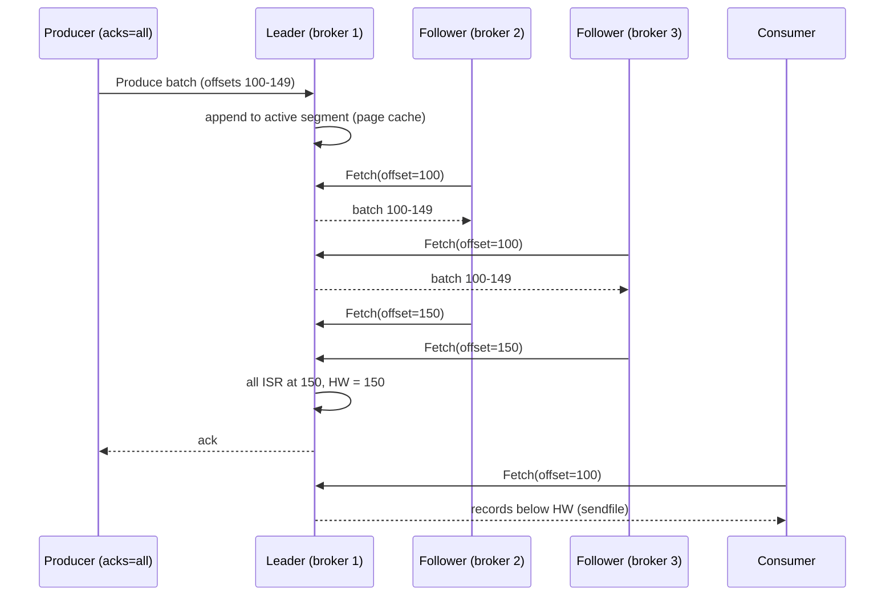

## In one minute
- Kafka is a distributed, replicated commit log. Producers append records to partitions of a topic; consumers read them by offset, at their own pace, as many times as they like until retention deletes them.
- Ordering is guaranteed only within a partition. The partition count sets the ceiling on consumer parallelism within one group, and the key decides which partition a record lands in.
- Each partition has a leader and followers that pull from it. With `acks=all` and `min.insync.replicas=2` on replication factor 3, an acknowledged write survives any single broker failure.
- It is fast because it does almost nothing per message: sequential appends to the page cache, batched and compressed records, and zero-copy transfer from file to socket.
- Choose it for event streaming, change data capture, log and metrics pipelines, and decoupling services with replayable history. Avoid it for per-message routing, delays and priorities, request-reply, or tiny workloads where a managed queue is simpler. Share groups (production-ready in 4.2) add queue-style per-record acknowledgement, but not routing or delays.

## How it works

### Topics, partitions and offsets
A topic is split into partitions, each an ordered, append-only sequence of records numbered by offset. Producers choose a partition by hashing the key (murmur2 in the Java client), so all events for `order-123` stay in order; keyless records stick to one partition until about `batch.size` bytes have gone there, then move on ([producer configs](https://kafka.apache.org/43/configuration/producer-configs/)). Retention is by time or size (`retention.ms`, 7 days by default), or by key with log compaction, which keeps the newest record per key ([topic configs](https://kafka.apache.org/43/configuration/topic-configs/)).

### Consumer groups
Consumers sharing a `group.id` split a topic: each partition goes to exactly one member, so 12 partitions allow at most 12 active consumers per group. Progress is the committed offset of the next record to read, stored in the internal `__consumer_offsets` topic. Groups read independently, so one stream can feed an indexer, a fraud model and a warehouse.

### Share groups (queues for Kafka)
Since 4.2, a *share group* is a production-ready alternative to a consumer group: its members read the same partitions together, each record is locked to one consumer (30 s by default) and then accepted, released for redelivery or rejected on its own; after 5 delivery attempts by default it is archived as a poison record ([Kafka 4.2 upgrade notes](https://kafka.apache.org/42/getting-started/upgrade/), [KIP-932](https://cwiki.apache.org/confluence/display/KAFKA/KIP-932%3A+Queues+for+Kafka)). That lifts the "consumers no more than partitions" cap for job-style work, at the cost of per-partition ordering. It fits independent tasks, not ordered streams.

### Delivery semantics
Process then commit gives at-least-once; commit then process gives at-most-once. Exactly-once within Kafka uses idempotent producers plus transactions that atomically write outputs and commit input offsets; external systems still need idempotent sinks.

## Down the stack

### Layer 1: The contract
For a producer with `acks=all`, a successful response means the record is in the leader's log and in the log of every replica currently in the in-sync replica set (ISR), and that set had at least `min.insync.replicas` members; otherwise the write fails with `NotEnoughReplicas`. Records are visible to consumers only below the *high watermark*, the offset every ISR member has replicated, so a consumer never reads a record that a leader failover could erase. Since 3.0 the producer defaults are `acks=all` and `enable.idempotence=true`, up from `acks=1` and no idempotence ([KIP-679](https://cwiki.apache.org/confluence/display/KAFKA/KIP-679%3A+Producer+will+enable+the+strongest+delivery+guarantee+by+default)). Idempotent producers attach a producer ID and per-partition sequence numbers so retries do not duplicate or reorder. With `acks=1`, a leader crash can lose acknowledged records. Produce latency with `acks=all` is dominated by the follower fetch round trip and batching (`linger.ms`, whose default rose from 0 to 5 ms in 4.0 ([upgrade notes](https://kafka.apache.org/42/getting-started/upgrade/))).

### Layer 2: The mechanism
**Log layout.** Each partition is a directory such as `orders-3/`. The log is split into segments, each named by its base offset: `00000000000000368771.log` holds record batches, `.index` is a sparse map from relative offset to byte position (one entry every `log.index.interval.bytes`, 4 KB by default), and `.timeindex` maps timestamps to offsets. A segment rolls at `segment.bytes` (1 GiB) or `segment.ms` ([topic configs](https://kafka.apache.org/43/configuration/topic-configs/)). Retention deletes whole closed segments, never individual records, and never the active one. To read offset N, the broker binary-searches segment base offsets, then the sparse index, then scans forward a few KB.

**Record batches.** The unit of storage and transfer is a batch, not a record. A v2 batch header carries `baseOffset`, `batchLength`, `partitionLeaderEpoch`, `magic`, a CRC, attributes (compression codec, transactional, control), `lastOffsetDelta`, first and max timestamps, `producerId`, `producerEpoch` and `baseSequence`. Records inside store offset and timestamp as varint deltas from the header. The broker stores producer-compressed batches as is and hands them to consumers unchanged.

**Replication.** Followers replicate by sending `Fetch` requests to the leader, the same API consumers use, with the offset they want next. The leader learns each follower's log end offset from those fetches and advances the high watermark to the minimum across the ISR. A follower that has not caught up within `replica.lag.time.max.ms` (30 s) is dropped from the ISR ([broker configs](https://kafka.apache.org/43/configuration/broker-configs/)). When a leader fails, the controller picks a new leader from the ISR; with `unclean.leader.election.enable=false`, an out-of-sync replica is never promoted, which has been the default since 0.11 ([Kafka design](https://kafka.apache.org/43/design/design/)). Leader epochs stored in `leader-epoch-checkpoint` tell a returning replica exactly where to truncate divergent data.

**Metadata.** Since KRaft, a small Raft quorum of controllers stores cluster metadata (topics, partitions, ISR changes, configs) in the `__cluster_metadata` log, and brokers replay it. ZooKeeper mode was removed in 4.0, so 3.9 is the last line that can run it ([upgrade notes](https://kafka.apache.org/42/getting-started/upgrade/)), and failover of the controller takes about as long as a Raft election.

**Groups.** One broker is the group coordinator for each group, chosen by hashing the group ID onto a partition of `__consumer_offsets`. Assignment used to be a stop-the-world rebalance; cooperative rebalancing and the server-side consumer protocol (KIP-848, generally available since 4.0, opted into with `group.protocol=consumer` ([rebalance protocol docs](https://kafka.apache.org/42/operations/consumer-rebalance-protocol/))) move partitions incrementally so most consumers keep working.

### Layer 3: The machine
A broker uses Java NIO: an acceptor thread, `num.network.threads` processor threads running selectors that read requests into a shared queue, and `num.io.threads` handler threads that append to logs or serve fetches. Requests that must wait, such as an `acks=all` produce or a fetch with `fetch.min.bytes`, park in a *purgatory* until satisfied or timed out, without holding a thread.

Writes go to the OS page cache with a plain `write`; Kafka does not `fsync` per message by default (`flush.messages` defaults to `Long.MAX_VALUE`) and relies on replication for durability, letting the kernel flush in the background ([Kafka design](https://kafka.apache.org/43/design/design/)). Reads of recent data are served from the same page cache, so consumers that keep up never touch disk. For plaintext connections, the broker uses `sendfile` (via `FileChannel.transferTo`) to move bytes from page cache to socket without copying through the JVM heap; TLS breaks this because bytes must be encrypted in user space, so the broker skips `sendfile` when SSL is on and pays noticeable CPU. The practical limits are NIC bandwidth (a 25 Gb/s NIC is about 3 GB/s, shared between producer ingress, replication and consumer egress) and disk throughput for consumers reading old data.

Partitions are not free: each has open file handles for its segments and indexes, replication fetch state, and metadata. Guidance has been a few thousand partitions per broker (hedge: it depends on version, hardware and KRaft), and very high partition counts slow controller failover and increase end-to-end latency.

### Why it's built this way
1. Disks and SSDs are far faster at sequential I/O than random I/O, so each partition is an append-only log and reads are sequential scans.
2. Per-message overhead dominates at high rates, so producers batch and compress, and the broker stores and serves batches without unpacking them.
3. Copying data through the JVM costs CPU and GC, so Kafka leans on the page cache and `sendfile` instead of its own cache.
4. A log with offsets makes replay trivial, so consumers own their position and many independent groups can read the same data cheaply.
5. Ordering across a whole topic would need one sequencer, so order is only per partition, and partitions are the unit of parallelism, replication and placement.

## Diagram


## Worked example
A ride-hailing app publishes driver locations: 1 million drivers, one 200-byte update every 4 seconds, so 250,000 records and 50 MB/s.

With `linger.ms=10` (the default is 5 since 4.0) and zstd at roughly 4 to 1 (hedge: payload-dependent), about 12.5 MB/s reaches brokers. RF 3 means 37.5 MB/s of disk writes and 25 MB/s of follower traffic, and three consumer groups read another 37.5 MB/s. 24 hours of retention is 12.5 MB/s x 86,400 s x 3, about 3.2 TB.

Matching needs per-driver order, so the key is `driver_id`. At about 10,000 records per second per matching consumer, 25 consumers are needed; the topic gets 48 partitions to grow without repartitioning, since changing the count remaps keys. Six brokers lead 8 partitions each, with headroom to absorb a broker loss.

With `acks=all`, `min.insync.replicas=2` and RF 3, one broker can fail without losing writes or blocking producers. If two fail, shared partitions reject writes rather than silently lose them, the right trade here.

## In the wild
- **Jepsen, 2013: the ISR shrinks to the leader alone.** Under a network partition, Kafka 0.8 let the in-sync set shrink to just the leader, which kept acknowledging writes held only on its own disk; ZooKeeper then elected a lagging replica. In one run 520 of 987 acknowledged writes, about 53%, were lost. The analysis argued for a minimum ISR size and refusing writes over silent loss, which Kafka later shipped as `min.insync.replicas` and disabled unclean election by default ([Jepsen](https://aphyr.com/posts/293-call-me-maybe-kafka)).
- **Honeycomb, 2025: lost redundancy, full disks and tiered storage.** On 5 December the EU cluster lost redundancy and about a quarter of event partitions had no leader. Unbalanced brokers filled until ingest was shut off with under 5% disk left, a full ingest outage of 6 hours 23 minutes. Disabling tiered storage freed space, but damaged metadata partitions left the control plane unrepairable, so the team rehearsed and then evacuated to a new cluster, producers first, then consumers ([Honeycomb status](https://status.honeycomb.io/incidents/pjzh0mtqw3vt)).
- **Uber, 2018: retry topics instead of a stuck partition.** A handler that kept failing never committed its offset, so newer records waited behind one bad message. Uber's insurance team moved failures through a chain of retry topics with growing delays, each with its own consumers, ending in a dead-letter topic that tooling can list, purge or merge back ([Uber Engineering](https://www.uber.com/en-US/blog/reliable-reprocessing/)).

## Trade-offs
| Option | Strengths | Weaknesses | Choose when |
|---|---|---|---|
| Kafka | High throughput, replay, ordered partitions, huge ecosystem | Partition planning, operational weight, no per-message routing | Event streaming, CDC, analytics pipelines |
| RabbitMQ | Flexible routing, per-message ack, priorities and delays | Lower throughput, replay only with streams | Task queues and complex routing |
| SQS or Pub/Sub | Fully managed, scales without partitions | Limited ordering and replay, per-request cost | Simple decoupling in one cloud |
| Pulsar | Separate storage (BookKeeper), multi-tenancy, tiered storage | More moving parts, smaller community | Many tenants or topics, geo-replication needs |

## Pitfalls in production
- **Too few partitions.** Parallelism is capped and adding partitions later breaks key ordering. Size for 2 to 3 years of growth.
- **Hot partitions.** One huge tenant overloads one partition and consumer. Salt the key or give heavy keys their own topic.
- **Rebalance storms.** Slow processing exceeds `max.poll.interval.ms` and the group thrashes. Bound per-poll work, use cooperative rebalancing and static membership.
- **`acks=1` or `min.insync.replicas=1`.** A leader crash loses acknowledged writes. Use `acks=all` with `min.insync.replicas=2`.
- **Lag past retention.** A slow consumer silently loses data. Alert on lag measured in time.

## Leadership lens
- Treat topics as public APIs: define schemas (Avro or Protobuf with a registry), compatibility rules and ownership per topic.
- Decide delivery semantics per consumer and require idempotent sinks; exactly-once inside Kafka does not cover your database.
- Managed Kafka (MSK, Confluent Cloud, Aiven) removes most operational load; self-hosting needs real expertise in upgrades, rebalancing and disk planning.
- Tiered storage moves old segments to object storage, which changes retention economics; it became production-ready in 3.9 ([Kafka 3.9 announcement](https://kafka.apache.org/blog/2024/11/06/apache-kafka-3.9.0-release-announcement/)). Consider it before buying bigger disks, and rehearse recovery with it on.
- Ask whether a simpler queue would do. Kafka is a strong default for streams and a heavy one for a few hundred jobs per minute.

## Check yourself
1. Why can a consumer group not use more active consumers than partitions?
   **Answer:** Each partition is assigned to one consumer in the group to preserve order; extra consumers sit idle.
2. What does the high watermark protect against?
   **Answer:** Consumers reading records that are only on the leader; if that leader failed, those records could be truncated and consumers would have seen data that no longer exists.
3. Why does Kafka not `fsync` every write, and when is that unsafe?
   **Answer:** Replication across brokers provides durability more cheaply than per-write disk flushes; it is unsafe when all replicas can lose power at once, such as a single-rack cluster with RF 1 or with `acks=1`.
4. Why does increasing partitions on a keyed topic break ordering?
   **Answer:** The partition is `hash(key) mod count`, so changing the count moves keys to new partitions while their older records remain in the old ones.

## Practice
**Task:** Build a Kafka-style partition log. `PartitionLog(segment_bytes, followers)` appends records with sequential offsets from 0; a record's size is `len(key) + len(value)`, and a new segment starts when adding a record would push a non-empty active segment over `segment_bytes`. The high watermark is the minimum log end offset of the leader and every follower still in the ISR; `follower_fetch(name, offset)` records that a follower has everything below `offset`, and `shrink_isr(name)` removes it. `read(offset, max_records)` returns up to `max_records` `(offset, value)` pairs below the high watermark, and errors if `offset` is below the log start offset or above the end offset. `delete_before(offset)` removes whole closed segments whose records are all below `offset`, never the active one. Consumer groups `commit(group, offset)` (error if beyond the high watermark), `committed(group)` (-1 if none) and `lag(group)` (high watermark minus committed offset, or minus log start if none).

```python starter
class PartitionLog:
    def __init__(self, segment_bytes, followers):
        # TODO
        pass

    def append(self, key, value):
        raise NotImplementedError

    def end_offset(self):
        raise NotImplementedError

    def segments(self):
        raise NotImplementedError

    def follower_fetch(self, name, offset):
        raise NotImplementedError

    def shrink_isr(self, name):
        raise NotImplementedError

    def high_watermark(self):
        raise NotImplementedError

    def read(self, offset, max_records):
        raise NotImplementedError

    def delete_before(self, offset):
        raise NotImplementedError

    def log_start_offset(self):
        raise NotImplementedError

    def commit(self, group, offset):
        raise NotImplementedError

    def committed(self, group):
        raise NotImplementedError

    def lag(self, group):
        raise NotImplementedError
```

```python tests
def filled(n, followers=()):
    log = PartitionLog(10, list(followers))
    for i in range(n):
        log.append("k", "v%02d" % i)
    return log

def test_sequential_offsets():
    log = PartitionLog(100, [])
    assert [log.append("a", "x"), log.append("b", "y")] == [0, 1]
    assert log.end_offset() == 2 and log.high_watermark() == 2

def test_segments_roll_and_read_across():
    log = filled(5)
    assert log.segments() == [0, 2, 4]
    assert log.read(1, 3) == [(1, "v01"), (2, "v02"), (3, "v03")]
    assert log.read(5, 10) == []

def test_high_watermark_follows_isr():
    log = filled(3, ["f1", "f2"])
    assert log.read(0, 10) == []
    log.follower_fetch("f1", 3)
    log.follower_fetch("f2", 2)
    assert log.high_watermark() == 2
    assert [o for o, _ in log.read(0, 10)] == [0, 1]
    log.shrink_isr("f2")
    assert log.high_watermark() == 3

def test_retention_deletes_whole_segments_only():
    log = filled(5)
    log.delete_before(3)
    assert log.segments() == [2, 4] and log.log_start_offset() == 2
    log.delete_before(100)
    assert log.segments() == [4] and log.log_start_offset() == 4

def test_read_out_of_range():
    log = filled(5)
    log.delete_before(4)
    for bad in (1, 6):
        try:
            log.read(bad, 1)
            assert False, "expected out of range"
        except ValueError:
            pass

def test_consumer_group_commit_and_lag():
    log = filled(5)
    assert log.committed("g") == -1 and log.lag("g") == 5
    log.commit("g", 2)
    assert log.committed("g") == 2 and log.lag("g") == 3
    assert log.committed("other") == -1
    try:
        log.commit("g", 6)
        assert False, "expected error"
    except ValueError:
        pass

def test_lag_uses_high_watermark():
    log = filled(4, ["f1"])
    log.follower_fetch("f1", 1)
    log.commit("g", 1)
    assert log.lag("g") == 0
```

```python solution
class PartitionLog:
    def __init__(self, segment_bytes, followers):
        self.segment_bytes = segment_bytes
        self.segs = []  # each: {"base": int, "size": int, "records": [(offset, value)]}
        self.next_offset = 0
        self.start = 0
        self.isr = {f: 0 for f in followers}
        self.groups = {}

    def append(self, key, value):
        size = len(key) + len(value)
        if not self.segs or (self.segs[-1]["records"] and self.segs[-1]["size"] + size > self.segment_bytes):
            self.segs.append({"base": self.next_offset, "size": 0, "records": []})
        seg = self.segs[-1]
        seg["records"].append((self.next_offset, value))
        seg["size"] += size
        self.next_offset += 1
        return self.next_offset - 1

    def end_offset(self):
        return self.next_offset

    def segments(self):
        return [s["base"] for s in self.segs]

    def follower_fetch(self, name, offset):
        if name in self.isr:
            self.isr[name] = max(self.isr[name], min(offset, self.next_offset))

    def shrink_isr(self, name):
        self.isr.pop(name, None)

    def high_watermark(self):
        return min([self.next_offset] + list(self.isr.values()))

    def read(self, offset, max_records):
        if offset < self.start or offset > self.next_offset:
            raise ValueError("offset out of range")
        hw = self.high_watermark()
        out = []
        for seg in self.segs:
            for off, value in seg["records"]:
                if off >= offset and off < hw and len(out) < max_records:
                    out.append((off, value))
        return out

    def delete_before(self, offset):
        while len(self.segs) > 1 and self.segs[1]["base"] <= offset:
            self.segs.pop(0)
        if self.segs:
            self.start = self.segs[0]["base"]

    def log_start_offset(self):
        return self.start

    def commit(self, group, offset):
        if offset > self.high_watermark():
            raise ValueError("commit beyond high watermark")
        self.groups[group] = offset

    def committed(self, group):
        return self.groups.get(group, -1)

    def lag(self, group):
        pos = self.groups.get(group, self.start)
        return self.high_watermark() - pos
```

```typescript starter
export class PartitionLog {
  constructor(segmentBytes: number, followers: string[]) {}
  append(key: string, value: string): number {
    throw new Error("TODO");
  }
  endOffset(): number {
    throw new Error("TODO");
  }
  segments(): number[] {
    throw new Error("TODO");
  }
  followerFetch(name: string, offset: number): void {
    throw new Error("TODO");
  }
  shrinkIsr(name: string): void {
    throw new Error("TODO");
  }
  highWatermark(): number {
    throw new Error("TODO");
  }
  read(offset: number, maxRecords: number): [number, string][] {
    throw new Error("TODO");
  }
  deleteBefore(offset: number): void {
    throw new Error("TODO");
  }
  logStartOffset(): number {
    throw new Error("TODO");
  }
  commit(group: string, offset: number): void {
    throw new Error("TODO");
  }
  committed(group: string): number {
    throw new Error("TODO");
  }
  lag(group: string): number {
    throw new Error("TODO");
  }
}
```

```typescript tests
function filled(n: number, followers: string[] = []): PartitionLog {
  const log = new PartitionLog(10, followers);
  for (let i = 0; i < n; i++) log.append("k", "v" + String(i).padStart(2, "0"));
  return log;
}
const throws = (fn: () => void): boolean => {
  try { fn(); return false; } catch (e) { return true; }
};
test("sequential offsets", () => {
  const log = new PartitionLog(100, []);
  assertEqual([log.append("a", "x"), log.append("b", "y")], [0, 1]);
  assertEqual([log.endOffset(), log.highWatermark()], [2, 2]);
});
test("segments roll and read across", () => {
  const log = filled(5);
  assertEqual(log.segments(), [0, 2, 4]);
  assertEqual(log.read(1, 3), [[1, "v01"], [2, "v02"], [3, "v03"]]);
  assertEqual(log.read(5, 10), []);
});
test("high watermark follows ISR", () => {
  const log = filled(3, ["f1", "f2"]);
  assertEqual(log.read(0, 10), []);
  log.followerFetch("f1", 3);
  log.followerFetch("f2", 2);
  assertEqual(log.highWatermark(), 2);
  assertEqual(log.read(0, 10).map((r) => r[0]), [0, 1]);
  log.shrinkIsr("f2");
  assertEqual(log.highWatermark(), 3);
});
test("retention deletes whole segments only", () => {
  const log = filled(5);
  log.deleteBefore(3);
  assertEqual([log.segments(), log.logStartOffset()], [[2, 4], 2]);
  log.deleteBefore(100);
  assertEqual([log.segments(), log.logStartOffset()], [[4], 4]);
});
test("read out of range", () => {
  const log = filled(5);
  log.deleteBefore(4);
  assert(throws(() => log.read(1, 1)), "below start");
  assert(throws(() => log.read(6, 1)), "beyond end");
});
test("consumer group commit and lag", () => {
  const log = filled(5);
  assertEqual([log.committed("g"), log.lag("g")], [-1, 5]);
  log.commit("g", 2);
  assertEqual([log.committed("g"), log.lag("g"), log.committed("other")], [2, 3, -1]);
  assert(throws(() => log.commit("g", 6)), "commit beyond HW");
});
test("lag uses high watermark", () => {
  const log = filled(4, ["f1"]);
  log.followerFetch("f1", 1);
  log.commit("g", 1);
  assertEqual(log.lag("g"), 0);
});
```

```typescript solution
type Segment = { base: number; size: number; records: [number, string][] };

export class PartitionLog {
  private segs: Segment[] = [];
  private nextOffset = 0;
  private start = 0;
  private isr = new Map<string, number>();
  private groups = new Map<string, number>();

  constructor(private segmentBytes: number, followers: string[]) {
    for (const f of followers) this.isr.set(f, 0);
  }
  append(key: string, value: string): number {
    const size = key.length + value.length;
    const last = this.segs[this.segs.length - 1];
    if (!last || (last.records.length > 0 && last.size + size > this.segmentBytes)) {
      this.segs.push({ base: this.nextOffset, size: 0, records: [] });
    }
    const seg = this.segs[this.segs.length - 1];
    seg.records.push([this.nextOffset, value]);
    seg.size += size;
    return this.nextOffset++;
  }
  endOffset(): number {
    return this.nextOffset;
  }
  segments(): number[] {
    return this.segs.map((s) => s.base);
  }
  followerFetch(name: string, offset: number): void {
    const cur = this.isr.get(name);
    if (cur !== undefined) this.isr.set(name, Math.max(cur, Math.min(offset, this.nextOffset)));
  }
  shrinkIsr(name: string): void {
    this.isr.delete(name);
  }
  highWatermark(): number {
    return Math.min(this.nextOffset, ...this.isr.values());
  }
  read(offset: number, maxRecords: number): [number, string][] {
    if (offset < this.start || offset > this.nextOffset) throw new Error("offset out of range");
    const hw = this.highWatermark();
    const out: [number, string][] = [];
    for (const seg of this.segs) {
      for (const [off, value] of seg.records) {
        if (off >= offset && off < hw && out.length < maxRecords) out.push([off, value]);
      }
    }
    return out;
  }
  deleteBefore(offset: number): void {
    while (this.segs.length > 1 && this.segs[1].base <= offset) this.segs.shift();
    if (this.segs.length > 0) this.start = this.segs[0].base;
  }
  logStartOffset(): number {
    return this.start;
  }
  commit(group: string, offset: number): void {
    if (offset > this.highWatermark()) throw new Error("commit beyond high watermark");
    this.groups.set(group, offset);
  }
  committed(group: string): number {
    const c = this.groups.get(group);
    return c === undefined ? -1 : c;
  }
  lag(group: string): number {
    const c = this.groups.get(group);
    return this.highWatermark() - (c === undefined ? this.start : c);
  }
}
```

```go starter
package practice

// Record is one stored record.
type Record struct {
	Offset int64
	Value  string
}

type PartitionLog struct{}

func NewPartitionLog(segmentBytes int, followers []string) *PartitionLog {
	return &PartitionLog{}
}

func (l *PartitionLog) Append(key, value string) int64 { panic("TODO") }

func (l *PartitionLog) EndOffset() int64 { panic("TODO") }

func (l *PartitionLog) Segments() []int64 { panic("TODO") }

func (l *PartitionLog) FollowerFetch(name string, offset int64) { panic("TODO") }

func (l *PartitionLog) ShrinkISR(name string) { panic("TODO") }

func (l *PartitionLog) HighWatermark() int64 { panic("TODO") }

func (l *PartitionLog) Read(offset int64, maxRecords int) ([]Record, error) { panic("TODO") }

func (l *PartitionLog) DeleteBefore(offset int64) { panic("TODO") }

func (l *PartitionLog) LogStartOffset() int64 { panic("TODO") }

func (l *PartitionLog) Commit(group string, offset int64) error { panic("TODO") }

func (l *PartitionLog) Committed(group string) int64 { panic("TODO") }

func (l *PartitionLog) Lag(group string) int64 { panic("TODO") }
```

```go tests
package practice

import (
	"fmt"
	"reflect"
	"testing"
)

func filled(n int, followers ...string) *PartitionLog {
	log := NewPartitionLog(10, followers)
	for i := 0; i < n; i++ {
		log.Append("k", fmt.Sprintf("v%02d", i))
	}
	return log
}

func TestSequentialOffsets(t *testing.T) {
	log := NewPartitionLog(100, nil)
	if log.Append("a", "x") != 0 || log.Append("b", "y") != 1 {
		t.Fatal("wrong offsets")
	}
	if log.EndOffset() != 2 || log.HighWatermark() != 2 {
		t.Fatal("wrong end or HW")
	}
}

func TestSegmentsRollAndReadAcross(t *testing.T) {
	log := filled(5)
	if !reflect.DeepEqual(log.Segments(), []int64{0, 2, 4}) {
		t.Fatalf("got %v", log.Segments())
	}
	got, err := log.Read(1, 3)
	want := []Record{{1, "v01"}, {2, "v02"}, {3, "v03"}}
	if err != nil || !reflect.DeepEqual(got, want) {
		t.Fatalf("got %v %v", got, err)
	}
	if got, _ := log.Read(5, 10); len(got) != 0 {
		t.Fatal("expected empty at end")
	}
}

func TestHighWatermarkFollowsISR(t *testing.T) {
	log := filled(3, "f1", "f2")
	if got, _ := log.Read(0, 10); len(got) != 0 {
		t.Fatal("nothing replicated yet")
	}
	log.FollowerFetch("f1", 3)
	log.FollowerFetch("f2", 2)
	if log.HighWatermark() != 2 {
		t.Fatalf("hw %d", log.HighWatermark())
	}
	if got, _ := log.Read(0, 10); len(got) != 2 {
		t.Fatalf("got %v", got)
	}
	log.ShrinkISR("f2")
	if log.HighWatermark() != 3 {
		t.Fatal("shrink did not advance HW")
	}
}

func TestRetention(t *testing.T) {
	log := filled(5)
	log.DeleteBefore(3)
	if !reflect.DeepEqual(log.Segments(), []int64{2, 4}) || log.LogStartOffset() != 2 {
		t.Fatalf("got %v", log.Segments())
	}
	log.DeleteBefore(100)
	if !reflect.DeepEqual(log.Segments(), []int64{4}) || log.LogStartOffset() != 4 {
		t.Fatalf("got %v", log.Segments())
	}
}

func TestReadOutOfRange(t *testing.T) {
	log := filled(5)
	log.DeleteBefore(4)
	if _, err := log.Read(1, 1); err == nil {
		t.Fatal("expected error below start")
	}
	if _, err := log.Read(6, 1); err == nil {
		t.Fatal("expected error beyond end")
	}
}

func TestConsumerGroup(t *testing.T) {
	log := filled(5)
	if log.Committed("g") != -1 || log.Lag("g") != 5 {
		t.Fatal("wrong initial state")
	}
	if err := log.Commit("g", 2); err != nil {
		t.Fatal(err)
	}
	if log.Committed("g") != 2 || log.Lag("g") != 3 || log.Committed("other") != -1 {
		t.Fatal("wrong commit state")
	}
	if err := log.Commit("g", 6); err == nil {
		t.Fatal("expected error beyond HW")
	}
}

func TestLagUsesHighWatermark(t *testing.T) {
	log := filled(4, "f1")
	log.FollowerFetch("f1", 1)
	if err := log.Commit("g", 1); err != nil || log.Lag("g") != 0 {
		t.Fatal("lag should be measured against HW")
	}
}
```

```go solution
package practice

import "errors"

// Record is one stored record.
type Record struct {
	Offset int64
	Value  string
}

type segment struct {
	base    int64
	size    int
	records []Record
}

type PartitionLog struct {
	segmentBytes int
	segs         []*segment
	next, start  int64
	isr          map[string]int64
	groups       map[string]int64
}

func NewPartitionLog(segmentBytes int, followers []string) *PartitionLog {
	l := &PartitionLog{segmentBytes: segmentBytes, isr: map[string]int64{}, groups: map[string]int64{}}
	for _, f := range followers {
		l.isr[f] = 0
	}
	return l
}

func (l *PartitionLog) Append(key, value string) int64 {
	size := len(key) + len(value)
	n := len(l.segs)
	if n == 0 || (len(l.segs[n-1].records) > 0 && l.segs[n-1].size+size > l.segmentBytes) {
		l.segs = append(l.segs, &segment{base: l.next})
	}
	seg := l.segs[len(l.segs)-1]
	seg.records = append(seg.records, Record{l.next, value})
	seg.size += size
	l.next++
	return l.next - 1
}

func (l *PartitionLog) EndOffset() int64 { return l.next }

func (l *PartitionLog) Segments() []int64 {
	out := []int64{}
	for _, s := range l.segs {
		out = append(out, s.base)
	}
	return out
}

func (l *PartitionLog) FollowerFetch(name string, offset int64) {
	cur, ok := l.isr[name]
	if !ok {
		return
	}
	if offset > l.next {
		offset = l.next
	}
	if offset > cur {
		l.isr[name] = offset
	}
}

func (l *PartitionLog) ShrinkISR(name string) { delete(l.isr, name) }

func (l *PartitionLog) HighWatermark() int64 {
	hw := l.next
	for _, leo := range l.isr {
		if leo < hw {
			hw = leo
		}
	}
	return hw
}

func (l *PartitionLog) Read(offset int64, maxRecords int) ([]Record, error) {
	if offset < l.start || offset > l.next {
		return nil, errors.New("offset out of range")
	}
	hw := l.HighWatermark()
	out := []Record{}
	for _, s := range l.segs {
		for _, r := range s.records {
			if r.Offset >= offset && r.Offset < hw && len(out) < maxRecords {
				out = append(out, r)
			}
		}
	}
	return out, nil
}

func (l *PartitionLog) DeleteBefore(offset int64) {
	for len(l.segs) > 1 && l.segs[1].base <= offset {
		l.segs = l.segs[1:]
	}
	if len(l.segs) > 0 {
		l.start = l.segs[0].base
	}
}

func (l *PartitionLog) LogStartOffset() int64 { return l.start }

func (l *PartitionLog) Commit(group string, offset int64) error {
	if offset > l.HighWatermark() {
		return errors.New("commit beyond high watermark")
	}
	l.groups[group] = offset
	return nil
}

func (l *PartitionLog) Committed(group string) int64 {
	if c, ok := l.groups[group]; ok {
		return c
	}
	return -1
}

func (l *PartitionLog) Lag(group string) int64 {
	pos, ok := l.groups[group]
	if !ok {
		pos = l.start
	}
	return l.HighWatermark() - pos
}
```

## Mock interview
**Prompt:** Design the event backbone for an e-commerce company: 300 microservices, 2 billion events per day, 100,000 events per second at sale peaks. Order events must be processed in order per order, and payments needs exactly-once ledger updates.

- Follow-up: how do you choose partition counts and keys for `orders`?
- Follow-up: a broker's disk fails during a sale. What do producers and consumers see?
- Follow-up: where does Kafka's exactly-once guarantee stop?

**A strong answer covers:**
- About 23,000 events per second average; at 1 KB, the peak is about 100 MB/s before compression and replication, a modest cluster.
- Key by `order_id`, partitions sized for peak consumer throughput, and why adding partitions later is hard.
- `acks=all`, `min.insync.replicas=2`, RF 3, idempotent producers and rack awareness, so a broker loss means a brief leader election, not data loss.
- Transactions and `read_committed` inside Kafka, plus an idempotent ledger write keyed by event ID.
- Schema registry, topic ownership and lag alerting, and admitting where a simpler queue would do.

## Sources and further study
**Primary**
- [KIP-101: leader epochs for log truncation](https://cwiki.apache.org/confluence/display/KAFKA/KIP-101+-+Alter+Replication+Protocol+to+use+Leader+Epoch+rather+than+High+Watermark+for+Truncation): why truncating to the high watermark could lose committed data, and the epoch fix.
- [KIP-932: Queues for Kafka](https://cwiki.apache.org/confluence/display/KAFKA/KIP-932%3A+Queues+for+Kafka): the design of share groups, acquisition locks and delivery counts.
- [KIP-848: next-generation consumer rebalance protocol](https://cwiki.apache.org/confluence/display/KAFKA/KIP-848%3A+The+Next+Generation+of+the+Consumer+Rebalance+Protocol): server-driven incremental assignment.

**Systems docs**
- [Kafka 4.3 topic configuration reference](https://kafka.apache.org/43/configuration/topic-configs/): current defaults for retention, segments, flushing and min ISR.
- [Kafka tiered storage operations](https://kafka.apache.org/43/operations/tiered-storage/): how remote log storage is configured and its limits.

**Books**
- *Designing Data-Intensive Applications*, 2nd ed., Kleppmann and Riccomini, Ch 12 "Stream Processing" (Transmitting Event Streams: log-based message brokers).
- *Designing Distributed Systems*, 2nd ed., Burns, Ch 12 "Event-Driven Batch Processing" (Publisher/Subscriber Infrastructure; Hands On: Deploying Kafka).

**Other curricula**
- [system-design-primer](https://github.com/donnemartin/system-design-primer): treats Kafka under asynchronism and message queues, next to task queues and back pressure.
- [Azure Architecture Center: Publisher-Subscriber pattern](https://learn.microsoft.com/en-us/azure/architecture/patterns/publisher-subscriber): frames Kafka-style topics as a decoupling pattern with ordering, poison-message and idempotency concerns.

## Watch
- [System Design: Why is Kafka fast? (ByteByteGo)](https://www.youtube.com/watch?v=UNUz1-msbOM): sequential I/O and zero-copy in a few minutes.
- [Apache Kafka in 6 minutes (James Cutajar)](https://www.youtube.com/watch?v=Ch5VhJzaoaI): a compact tour of topics, partitions, offsets and consumer groups.

## Free resources
- [Apache Kafka documentation: design](https://kafka.apache.org/documentation/#design): the official explanation of persistence, efficiency, replication and delivery semantics.
- [Kafka: a Distributed Messaging System for Log Processing (NetDB 2011)](https://notes.stephenholiday.com/Kafka.pdf): the original LinkedIn paper.
- [KIP-500: Replace ZooKeeper with a self-managed metadata quorum](https://cwiki.apache.org/confluence/display/KAFKA/KIP-500%3A+Replace+ZooKeeper+with+a+Self-Managed+Metadata+Quorum): why and how KRaft replaced ZooKeeper.
- [Kafka internals course (Confluent Developer)](https://developer.confluent.io/courses/architecture/get-started/): free modules on the broker, replication, consumer groups and transactions.
- [Hands-free Kafka replication (Confluent blog)](https://www.confluent.io/blog/hands-free-kafka-replication-a-lesson-in-operational-simplicity/): how ISR membership is decided by time lag.
