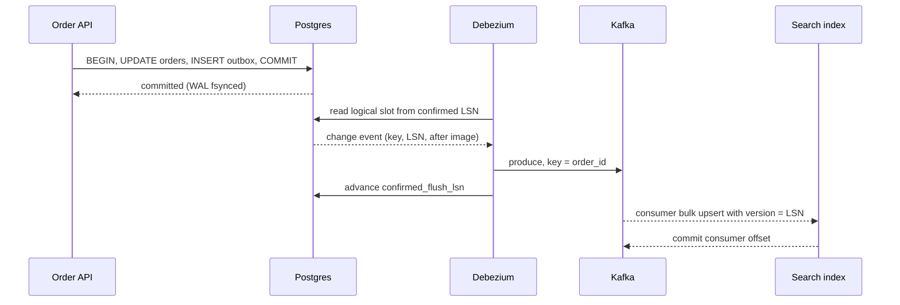

## In one minute
- Almost every non-trivial design has one source of truth and several derived copies: a search index, a cache, a warehouse, a denormalised read model, another team's service. The interview question is how changes flow from the first to the rest without being lost or applied out of order.
- Writing to two systems from application code (a "dual write") is the trap. A crash, timeout or race between the two writes leaves them permanently different, and nothing notices.
- The robust answers make the database commit the single point of truth and derive everything else from a durable, ordered log: the transactional outbox, or change data capture (CDC) that tails the database's own write-ahead log.
- Consumers then need two properties: they are idempotent under redelivery, and they discard updates older than what they already hold (per-key versioning).
- A strong answer states the consistency the derived store offers (eventual, with a measured lag) and how the product copes with that lag.

## How it works

### When the pattern shows up in interviews
Listen for any phrase that implies a second copy of data: keyword search over a relational catalog, a fast denormalised order history, "notify shipping when an order is paid", or a cached profile. The interviewer is waiting to see whether you notice the consistency gap and close it deliberately, or draw an arrow from the API server to both stores and move on.

### Why dual writes fail
The order service commits to Postgres, then publishes `OrderPaid` to Kafka. If the process dies in between, the order is paid but never shipped; reverse the order and a crash publishes an event for a rolled-back order. Even without crashes, two updates can commit as A then B while their publishes land as B then A, leaving the copy stale forever. Reordering the two writes only moves the failure, and in-memory retries die with the process ([Confluent](https://www.confluent.io/blog/dual-write-problem/)). Two-phase commit would fix atomicity, but most brokers, search engines and caches cannot take part in one.

### The transactional outbox
Write the business row and an `outbox` row (payload, aggregate ID, increasing sequence) in the same local transaction. A relay reads unsent outbox rows in order, publishes them, and marks them sent ([microservices.io](https://microservices.io/patterns/data/transactional-outbox.html)). Atomicity comes from one database transaction, and a rolled-back business write takes its event with it. The relay can crash after publishing and before marking, so delivery is at least once. AWS's guidance draws the same conclusion: expect duplicates and make the consumer idempotent by tracking what it has processed ([AWS Prescriptive Guidance](https://docs.aws.amazon.com/prescriptive-guidance/latest/cloud-design-patterns/transactional-outbox.html)). You also control the event shape: a domain event rather than a raw row image.

### Change data capture
Databases already keep an ordered, durable log of committed changes for recovery and replication. CDC tools such as Debezium read that log and emit row-level change events: before and after images, operation, and log position. CDC needs no application changes and catches every write path, including migrations and manual fixes, but couples consumers to your table shapes. A popular combination is letting CDC tail the outbox table: domain events with log-based delivery and no polling ([Debezium blog](https://debezium.io/blog/2019/02/19/reliable-microservices-data-exchange-with-the-outbox-pattern/)). Document stores offer the same shape: Azure's reference design writes the entity and its event in one Cosmos DB transactional batch on one logical partition and relays them from the change feed ([Azure Architecture Center](https://learn.microsoft.com/en-us/azure/architecture/databases/guide/transactional-outbox-cosmos)).

### Polling
A job running `WHERE updated_at > :last_seen` is the baseline. It misses hard deletes, skips rows whose transactions commit late with an earlier timestamp, and loads the primary. Polling by an increasing ID has the same hole: a transaction that took ID 188 can commit after the one holding 189, so a reader that has moved past 189 never sees it ([Precision Nutrition](https://tech.precisionnutrition.com/postgres/databases/2020/03/06/fun-with-mvcc)). Outbox relays that poll need the same care, which is one reason to let CDC read them.

### Making consumers correct
Delivery is at least once and only ordered within a partition. Partition the stream by the entity key so all changes to one row arrive in order on one consumer. Carry a version with every event (an LSN, an outbox sequence number, or a row version column) and have the consumer apply an update only when its version is higher than the stored one. Elasticsearch supports this directly with external versioning, which indexes a document only when the supplied version is strictly higher than the stored one ([Elasticsearch docs](https://www.elastic.co/guide/en/elasticsearch/reference/current/docs-index_.html)); for a cache, use a compare-and-set script. Deletes become tombstones that keep their version, so a late, older upsert cannot resurrect the row.

### Bootstrapping and rebuilding
A new derived store needs history. Record the current log position, take a consistent snapshot, load it, then stream from the recorded position; overlap is harmless when consumers compare versions. To rebuild a search index, build a new one in the background and swap an alias once it catches up.

## Down the stack

### Layer 1: The contract
The source database promises durability and a total order of committed transactions. The pipeline promises that every committed change is delivered at least once, in commit order per key, with no lost updates. The derived store promises eventual convergence: after writes stop, every replica reaches the source's last state, with lag usually measured in seconds. It does not promise read-your-writes, and it does not promise atomic visibility of multi-row transactions unless you group events by transaction ID.

### Layer 2: The mechanism
Postgres writes every change to the WAL, which is divided into 16 MB segment files by default ([Postgres docs](https://www.postgresql.org/docs/current/wal-internals.html)) and addressed by a log sequence number (LSN). With `wal_level = logical`, a logical replication slot runs an output plugin (`pgoutput` for built-in replication) that decodes WAL records into `BEGIN`, `INSERT`, `UPDATE`, `DELETE` and `COMMIT` messages, emitted only for committed transactions and in commit order. The slot stores `confirmed_flush_lsn`, the point up to which the consumer has acknowledged, and Postgres retains the WAL the slot still needs even when no consumer is connected ([Postgres docs](https://www.postgresql.org/docs/current/logicaldecoding-explanation.html)). Before Postgres 17, logical slots lived only on the primary, so a failover lost them and forced a re-snapshot; 17 added failover slots that a standby keeps in sync when `sync_replication_slots` is on ([Postgres 17 release notes](https://www.postgresql.org/docs/release/17.0/)). Debezium reads the slot, emits one Kafka record per row change keyed by primary key, and periodically commits its offset back to the slot. MySQL's equivalent is the `ROW`-format binlog with GTIDs. Downstream, a compacted Kafka topic keeps the latest record per key, with null-valued records as delete tombstones.

### Layer 3: The machine
Each commit already costs a WAL `fsync` (sub-millisecond on local NVMe, often milliseconds on networked block storage). CDC adds no fsync; it reads WAL that was written anyway, often from the page cache. The danger is disk: if the consumer stalls, the slot pins WAL and the primary's disk fills at the rate of write traffic, which can be gigabytes per hour on a busy database. Kafka appends to segment files sequentially and serves consumers from the page cache, using `sendfile` to copy bytes to the socket without passing through user space. That zero-copy path is plaintext only; with TLS the broker reads, encrypts and writes in user space ([KAFKA-13799](https://issues.apache.org/jira/browse/KAFKA-13799)). On the sink side, Elasticsearch accepts batches through the `_bulk` API and makes them searchable at the next refresh, one second by default on self-managed clusters and five seconds on Elastic Serverless. If you leave the interval unset, a shard that has had no searches for 30 seconds stops refreshing until the next search arrives ([Elasticsearch docs](https://www.elastic.co/docs/reference/elasticsearch/index-settings/index-modules)). End-to-end lag is usually decoding plus batching plus refresh.

### Why it's built this way
1. You cannot get atomic writes across heterogeneous systems cheaply, so pick one system to commit and derive the rest.
2. The database must already write an ordered log for recovery, so reusing it costs almost nothing on the write path.
3. Logs are ordered but networks redeliver and consumers restart, so every event carries a version and consumers compare instead of trusting arrival order.
4. Logs grow without bound, so retention is capped, which forces a snapshot-plus-stream bootstrap for new consumers.
5. Retained WAL fills disks, so the slot's lag becomes a first-class alert.

## Diagram


## Worked example
A marketplace has 50 million product rows in Postgres and needs keyword search. Sellers make about 2,000 updates per second at peak. Each change event is roughly 1.5 KB, so the stream carries about 3 MB/s, trivial for Kafka. The topic is keyed by `product_id` with 24 partitions, so each partition sees about 85 events per second and per-product order is preserved.

Six indexers send `_bulk` requests of up to 500 documents or 200 ms, whichever comes first, each document using `version_type=external` with the source LSN so reordered events are rejected. Lag is roughly 200 ms of batching, under 100 ms of decoding and transport, and up to one second of refresh: about 1.5 seconds at p99. The product page reads from Postgres, so sellers see their own edits immediately.

For a mapping change, the team builds `products_v2` from a snapshot. At 10,000 documents per second, 50 million rows take about 85 minutes. The indexer starts consuming from the LSN recorded before the snapshot, catches up, and then the `products` alias is switched atomically.

## In the wild
- **Shopify, 2021: from hourly polling to log-based CDC.** Shopify's batch extractor could query each table at most once an hour, so data was at least an hour old, hard deletes were invisible, and rows that skipped `updated_at` or changed constantly could be missed. The Debezium replacement runs about 150 connectors over more than 100 MySQL shards, averaged about 65,000 records per second over Black Friday Cyber Monday 2020 with spikes to 100,000, and lands changes in Kafka in under 10 seconds at p99 ([Shopify Engineering](https://shopify.engineering/capturing-every-change-shopify-sharded-monolith)).
- **Amazon RDS, 2022: a forgotten slot fills a 200 GiB disk.** A stopped CDC connector left a logical slot on an otherwise idle RDS Postgres 14 database. RDS writes an internal heartbeat every five minutes and `archive_timeout` then forces a new 64 MB WAL segment, so the slot pinned about 18 GB a day and the disk filled in under two weeks. The fix: alert on retained WAL per slot, drop unused slots, and emit `pg_logical_emit_message()` heartbeats so quiet slots advance ([Gunnar Morling](https://morling.dev/blog/insatiable-postgres-replication-slot)).
- **Zalando, 2025: WAL growth on quiet databases, at fleet scale.** Zalando runs hundreds of Postgres logical replication streams with embedded Debezium across more than 100 Kubernetes clusters, and called WAL piling up on low-activity databases its biggest operational issue even with heartbeats on. It contributed `lsn.flush.mode` and `offset.mismatch.strategy` to Debezium 3.4 so slots can advance on server keepalives without risking skipped changes ([Zalando Engineering](https://engineering.zalando.com/posts/2025/12/contributing-to-debezium.html)).

## Trade-offs
| Option | Strengths | Weaknesses | Choose when |
|---|---|---|---|
| Dual write in app code | No infrastructure | Silent divergence on crash or race | Never for data you care about |
| Polling by `updated_at` | Simple, any database | Misses deletes, late commits, scan load | Low volume, coarse freshness |
| Transactional outbox | Atomic with business write, domain-shaped events | Extra table and relay, at-least-once | Events to other services |
| Log-based CDC | No app changes, catches every write, low overhead | Couples consumers to schema, slot operations | Search, cache, warehouse replicas |

## Pitfalls in production
- **Stalled replication slot fills the primary's disk.** Alert on slot lag in bytes and cap it with `max_slot_wal_keep_size` (Postgres 13 and later), accepting a re-snapshot if it trips ([Postgres 13 release notes](https://www.postgresql.org/docs/release/13.0/)). Postgres 18 adds `idle_replication_slot_timeout` to invalidate slots nobody has used for a set time ([Postgres 18 release notes](https://www.postgresql.org/docs/release/18.0/)). A quiet database on a busy server can pin WAL even with a healthy connector, because its slot only advances when it sees changes; Debezium's `heartbeat.interval.ms` exists for this case ([Debezium docs](https://debezium.io/documentation/reference/stable/connectors/postgresql.html)).
- **Consumers apply events by arrival order.** Reprocessing after a rebalance overwrites new data with old. Compare versions on every write.
- **Deletes vanish.** Hard deletes are missed by polling and dropped by sinks that ignore tombstones. Emit tombstones and keep them long enough for slow consumers.
- **Schema change breaks consumers.** A renamed column becomes a null in the index. Use a schema registry with compatibility rules, or publish outbox events with an explicit contract.
- **Snapshot without a recorded position.** Changes during the snapshot are lost. Record the log position first, then snapshot, then stream from that position.

## Leadership lens
- In design review, ask for the source of truth of every field and the arrow that keeps each copy in sync. "Also write" is a defect.
- Decide who owns the CDC pipeline; slots on a primary are an operational liability for the database team.
- Agree a lag SLO per derived store and make the product tolerate it, for example by reading your own writes from the primary.
- Budget for full rebuilds. Every derived store will need one, so make reindexing a tested, routine operation.

## Check yourself
1. Why does publishing to Kafka inside the database transaction (before COMMIT) not fix the dual-write problem?
   **Answer:** The publish is not rolled back if the transaction later aborts, so consumers see an event for a change that never happened.
2. A consumer receives version 7 of a row after it already stored version 9. What should happen, and what mechanism ensures it?
   **Answer:** It should be discarded. The sink compares the event's version (LSN or row version) with the stored one and applies only higher versions.
3. Why does a deleted row need a tombstone that carries a version rather than simply removing the key?
   **Answer:** If the key is removed, a delayed older upsert looks new and resurrects the row; a versioned tombstone lets the consumer reject it.
4. What happens to the primary if a CDC connector is down for a day?
   **Answer:** Its replication slot retains all WAL since its confirmed position, so disk usage grows with write volume until the connector catches up or the slot is dropped.

## Practice
**Task:** Implement the apply side of a CDC consumer that keeps a derived key-value store correct under redelivery and reordering. `apply(key, version, op, value)` takes `op` of `"upsert"` or `"delete"` and returns `"applied"` if the event's version is strictly greater than the version already recorded for that key (or the key has never been seen), and `"stale"` otherwise. Deletes must leave a tombstone that remembers the version, so an older upsert cannot bring the key back. `get(key)` returns the live value or nothing, and `size()` returns the number of live (non-deleted) keys. Snapshot rows and streamed rows go through the same `apply`.

```python starter
class Replica:
    def __init__(self):
        # TODO
        pass

    def apply(self, key, version, op, value=None):
        raise NotImplementedError

    def get(self, key):
        raise NotImplementedError

    def size(self):
        raise NotImplementedError
```

```python tests
def test_upsert_then_get():
    r = Replica()
    assert r.apply("p1", 1, "upsert", "red shoe") == "applied"
    assert r.get("p1") == "red shoe"
    assert r.size() == 1

def test_missing_key_is_none():
    assert Replica().get("nope") is None

def test_older_version_is_stale():
    r = Replica()
    r.apply("p1", 5, "upsert", "v5")
    assert r.apply("p1", 3, "upsert", "v3") == "stale"
    assert r.get("p1") == "v5"

def test_redelivery_is_stale():
    r = Replica()
    r.apply("p1", 2, "upsert", "a")
    assert r.apply("p1", 2, "upsert", "a") == "stale"

def test_tombstone_blocks_resurrection():
    r = Replica()
    r.apply("p1", 1, "upsert", "a")
    assert r.apply("p1", 4, "delete") == "applied"
    assert r.get("p1") is None
    assert r.apply("p1", 3, "upsert", "late") == "stale"
    assert r.get("p1") is None and r.size() == 0

def test_snapshot_after_stream_does_not_overwrite():
    r = Replica()
    r.apply("p1", 10, "upsert", "streamed")
    r.apply("p2", 2, "upsert", "only-in-snapshot")
    for key, ver, val in [("p1", 8, "snap"), ("p2", 2, "only-in-snapshot"), ("p3", 1, "new")]:
        r.apply(key, ver, "upsert", val)
    assert r.get("p1") == "streamed"
    assert r.get("p3") == "new"
    assert r.size() == 3

def test_upsert_after_delete_with_newer_version():
    r = Replica()
    r.apply("p1", 1, "delete")
    assert r.apply("p1", 2, "upsert", "back") == "applied"
    assert r.get("p1") == "back" and r.size() == 1
```

```python solution
class Replica:
    def __init__(self):
        self.rows = {}  # key -> (version, value or None for tombstone)

    def apply(self, key, version, op, value=None):
        current = self.rows.get(key)
        if current is not None and version <= current[0]:
            return "stale"
        if op == "delete":
            self.rows[key] = (version, None)
        else:
            self.rows[key] = (version, value)
        return "applied"

    def get(self, key):
        row = self.rows.get(key)
        return None if row is None else row[1]

    def size(self):
        return sum(1 for v, val in self.rows.values() if val is not None)
```

```typescript starter
export class Replica {
  apply(key: string, version: number, op: "upsert" | "delete", value?: string): string {
    throw new Error("TODO");
  }
  get(key: string): string | null {
    throw new Error("TODO");
  }
  size(): number {
    throw new Error("TODO");
  }
}
```

```typescript tests
test("upsert then get", () => {
  const r = new Replica();
  assertEqual(r.apply("p1", 1, "upsert", "red shoe"), "applied");
  assertEqual(r.get("p1"), "red shoe");
  assertEqual(r.size(), 1);
});

test("missing key is null", () => {
  assertEqual(new Replica().get("nope"), null);
});

test("older version is stale", () => {
  const r = new Replica();
  r.apply("p1", 5, "upsert", "v5");
  assertEqual(r.apply("p1", 3, "upsert", "v3"), "stale");
  assertEqual(r.get("p1"), "v5");
});

test("redelivery is stale", () => {
  const r = new Replica();
  r.apply("p1", 2, "upsert", "a");
  assertEqual(r.apply("p1", 2, "upsert", "a"), "stale");
});

test("tombstone blocks resurrection", () => {
  const r = new Replica();
  r.apply("p1", 1, "upsert", "a");
  assertEqual(r.apply("p1", 4, "delete"), "applied");
  assertEqual(r.get("p1"), null);
  assertEqual(r.apply("p1", 3, "upsert", "late"), "stale");
  assertEqual(r.size(), 0);
});

test("snapshot after stream does not overwrite", () => {
  const r = new Replica();
  r.apply("p1", 10, "upsert", "streamed");
  r.apply("p2", 2, "upsert", "only-in-snapshot");
  r.apply("p1", 8, "upsert", "snap");
  r.apply("p2", 2, "upsert", "only-in-snapshot");
  r.apply("p3", 1, "upsert", "new");
  assertEqual(r.get("p1"), "streamed");
  assertEqual(r.get("p3"), "new");
  assertEqual(r.size(), 3);
});

test("upsert after delete with newer version", () => {
  const r = new Replica();
  r.apply("p1", 1, "delete");
  assertEqual(r.apply("p1", 2, "upsert", "back"), "applied");
  assertEqual(r.get("p1"), "back");
  assertEqual(r.size(), 1);
});
```

```typescript solution
export class Replica {
  private rows = new Map<string, { version: number; value: string | null }>();

  apply(key: string, version: number, op: "upsert" | "delete", value?: string): string {
    const cur = this.rows.get(key);
    if (cur !== undefined && version <= cur.version) return "stale";
    this.rows.set(key, { version, value: op === "delete" ? null : value ?? null });
    return "applied";
  }

  get(key: string): string | null {
    const cur = this.rows.get(key);
    return cur === undefined ? null : cur.value;
  }

  size(): number {
    let n = 0;
    for (const row of this.rows.values()) if (row.value !== null) n++;
    return n;
  }
}
```

```go starter
package practice

type Replica struct{}

func NewReplica() *Replica {
	return &Replica{}
}

// Apply returns "applied" or "stale". op is "upsert" or "delete".
func (r *Replica) Apply(key string, version int64, op string, value string) string {
	panic("TODO")
}

func (r *Replica) Get(key string) (string, bool) {
	panic("TODO")
}

func (r *Replica) Size() int {
	panic("TODO")
}
```

```go tests
package practice

import "testing"

func TestUpsertThenGet(t *testing.T) {
	r := NewReplica()
	if got := r.Apply("p1", 1, "upsert", "red shoe"); got != "applied" {
		t.Fatalf("got %s", got)
	}
	if v, ok := r.Get("p1"); !ok || v != "red shoe" {
		t.Fatalf("got %q %v", v, ok)
	}
	if r.Size() != 1 {
		t.Fatal("size")
	}
}

func TestMissingKey(t *testing.T) {
	if _, ok := NewReplica().Get("nope"); ok {
		t.Fatal("expected missing")
	}
}

func TestOlderVersionIsStale(t *testing.T) {
	r := NewReplica()
	r.Apply("p1", 5, "upsert", "v5")
	if got := r.Apply("p1", 3, "upsert", "v3"); got != "stale" {
		t.Fatalf("got %s", got)
	}
	if v, _ := r.Get("p1"); v != "v5" {
		t.Fatalf("got %s", v)
	}
}

func TestRedeliveryIsStale(t *testing.T) {
	r := NewReplica()
	r.Apply("p1", 2, "upsert", "a")
	if r.Apply("p1", 2, "upsert", "a") != "stale" {
		t.Fatal("expected stale")
	}
}

func TestTombstoneBlocksResurrection(t *testing.T) {
	r := NewReplica()
	r.Apply("p1", 1, "upsert", "a")
	if r.Apply("p1", 4, "delete", "") != "applied" {
		t.Fatal("delete should apply")
	}
	if r.Apply("p1", 3, "upsert", "late") != "stale" {
		t.Fatal("late upsert should be stale")
	}
	if _, ok := r.Get("p1"); ok || r.Size() != 0 {
		t.Fatal("row should stay deleted")
	}
}

func TestSnapshotAfterStream(t *testing.T) {
	r := NewReplica()
	r.Apply("p1", 10, "upsert", "streamed")
	r.Apply("p2", 2, "upsert", "only-in-snapshot")
	r.Apply("p1", 8, "upsert", "snap")
	r.Apply("p2", 2, "upsert", "only-in-snapshot")
	r.Apply("p3", 1, "upsert", "new")
	if v, _ := r.Get("p1"); v != "streamed" {
		t.Fatalf("got %s", v)
	}
	if v, _ := r.Get("p3"); v != "new" || r.Size() != 3 {
		t.Fatalf("got %s size %d", v, r.Size())
	}
}

func TestUpsertAfterDelete(t *testing.T) {
	r := NewReplica()
	r.Apply("p1", 1, "delete", "")
	if r.Apply("p1", 2, "upsert", "back") != "applied" {
		t.Fatal("should apply")
	}
	if v, ok := r.Get("p1"); !ok || v != "back" || r.Size() != 1 {
		t.Fatal("expected back")
	}
}
```

```go solution
package practice

type row struct {
	version int64
	value   string
	deleted bool
}

type Replica struct {
	rows map[string]row
}

func NewReplica() *Replica {
	return &Replica{rows: map[string]row{}}
}

// Apply returns "applied" or "stale". op is "upsert" or "delete".
func (r *Replica) Apply(key string, version int64, op string, value string) string {
	if cur, ok := r.rows[key]; ok && version <= cur.version {
		return "stale"
	}
	r.rows[key] = row{version: version, value: value, deleted: op == "delete"}
	return "applied"
}

func (r *Replica) Get(key string) (string, bool) {
	cur, ok := r.rows[key]
	if !ok || cur.deleted {
		return "", false
	}
	return cur.value, true
}

func (r *Replica) Size() int {
	n := 0
	for _, cur := range r.rows {
		if !cur.deleted {
			n++
		}
	}
	return n
}
```

## Mock interview
**Prompt:** You run an e-commerce catalog in Postgres with 50 million products and about 2,000 writes per second at peak. Product managers want keyword search with filters, results reflecting edits within a few seconds, and a separate team wants an event whenever a price changes. Design how data gets from Postgres to search and to the pricing team.

- Follow-up: The indexer was down for six hours. What happens on the primary, and how do you recover?
- Follow-up: Two updates to the same product are processed by different consumer instances after a rebalance. How do you guarantee the index ends with the newer one?
- Follow-up: Why not have the API write to Elasticsearch directly after the Postgres commit, with a retry queue for failures?

**A strong answer covers:**
- Names the dual-write problem and explains concretely how a crash or race causes permanent divergence.
- Uses CDC from the WAL for the search index and an outbox for the cross-team price event, with reasons for each.
- Partitions by product ID for per-key order and uses source versions (LSN or row version) for idempotent, order-safe writes, including tombstones for deletes.
- Describes bootstrap and rebuild: record the position, snapshot, stream, alias swap.
- Covers operations: slot lag alerting, WAL retention limits, schema evolution, and a stated freshness SLO.

## Sources and further study
**Primary**
- [Logical replication failover (PostgreSQL docs)](https://www.postgresql.org/docs/current/logical-replication-failover.html): how failover slots, `sync_replication_slots` and `synchronized_standby_slots` keep CDC alive across a primary promotion.
- [Replication settings (PostgreSQL docs)](https://www.postgresql.org/docs/current/runtime-config-replication.html): `max_slot_wal_keep_size` and `idle_replication_slot_timeout`, the two guards against a slot filling the disk.

**Systems docs**
- [Transactional outbox pattern (AWS Prescriptive Guidance)](https://docs.aws.amazon.com/prescriptive-guidance/latest/cloud-design-patterns/transactional-outbox.html): outbox table versus DynamoDB Streams CDC, with duplicates and ordering called out.
- [Transactional outbox with Azure Cosmos DB (Azure Architecture Center)](https://learn.microsoft.com/en-us/azure/architecture/databases/guide/transactional-outbox-cosmos): the pattern on a document store, using transactional batches, the change feed and Service Bus duplicate detection.
- [Index settings (Elasticsearch docs)](https://www.elastic.co/docs/reference/elasticsearch/index-settings/index-modules): refresh interval defaults and search-idle shards, which set the floor on search freshness.

**Books**
- *Designing Data-Intensive Applications* (1st ed.), Martin Kleppmann, Ch 11 "Stream Processing", section "Databases and Streams": dual writes, change data capture and event sourcing as one idea.
- *Understanding Distributed Systems* (2nd ed.), Roberto Vitillo, chapter "Asynchronous transactions": the outbox, sagas and their isolation problems.

**Other curricula**
- [What is the dual-write problem? (Confluent Developer)](https://www.confluent.io/blog/dual-write-problem/): frames the topic as three fixes, outbox, event sourcing and listen-to-yourself, and rejects reordering writes or in-memory retries.
- [Using logs to build a solid data infrastructure (Martin Kleppmann)](https://martin.kleppmann.com/2015/05/27/logs-for-data-infrastructure.html): frames every derived store as a consumer of one ordered log, the idea CDC puts into practice.

## Watch
- [Change Data Capture and Debezium with Gunnar Morling (The Geek Narrator)](https://www.youtube.com/watch?v=VGH6TlhEJpM): the Debezium lead walks through log-based CDC, failure modes and schema changes.
- ["Turning the database inside out with Apache Samza" by Martin Kleppmann (Strange Loop Conference)](https://www.youtube.com/watch?v=fU9hR3kiOK0): the argument for treating the change log as the primary abstraction and derived stores as views.
- [What is the Dual Write Problem? (Confluent)](https://www.youtube.com/watch?v=FpLXCBr7ucA): a short, clear statement of why writing to two systems fails.

## Free resources
- [Transactional outbox (microservices.io)](https://microservices.io/patterns/data/transactional-outbox.html): the canonical description of the outbox pattern and its relay.
- [Reliable microservices data exchange with the outbox pattern (Debezium blog)](https://debezium.io/blog/2019/02/19/reliable-microservices-data-exchange-with-the-outbox-pattern/): combining outbox tables with log-based CDC.
- [Logical decoding concepts (PostgreSQL docs)](https://www.postgresql.org/docs/current/logicaldecoding-explanation.html): replication slots, output plugins and why slots retain WAL.
- [Debezium PostgreSQL connector (Debezium docs)](https://debezium.io/documentation/reference/stable/connectors/postgresql.html): snapshot modes, event structure and operational settings.
- [Log compaction (Apache Kafka docs)](https://kafka.apache.org/documentation/#compaction): how compacted topics and tombstones keep the latest value per key.
