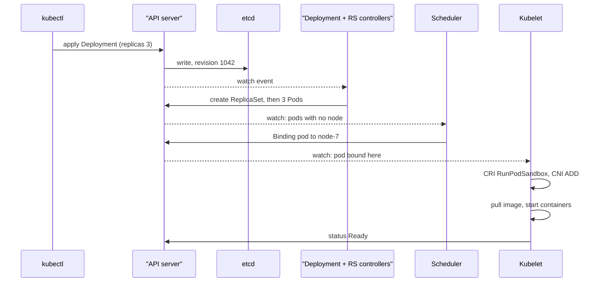

## In one minute
- Kubernetes is a declarative control plane for containers: you write desired state as API objects, and controllers keep changing the world until it matches.
- All state lives in etcd behind one API server. Every other component, including the scheduler and each node's kubelet, is a client that watches the API and writes back.
- Controllers are level-triggered reconcile loops. They do not react to "what changed"; they compare desired and observed state and act on the difference, which makes them robust to missed events and crashes.
- The scheduler only chooses a node and writes a binding. The kubelet on that node starts containers through the CRI and wires networking through CNI.
- Choose it when you run dozens of services and have people to operate a platform. For a handful of services, a managed container service (Cloud Run, ECS, App Service) is usually cheaper in people and time.

## How it works

### Objects and desired state
Everything is a typed object with `metadata`, `spec` (what you want) and `status` (what is). A Deployment's spec says "4 replicas of this pod template, roll out with `maxSurge` 25 percent and `maxUnavailable` 25 percent", which are also the defaults ([Kubernetes docs](https://kubernetes.io/docs/concepts/workloads/controllers/deployment/)). You never tell Kubernetes to start a container; you change an object and wait.

### The control plane
The API server is the only component that talks to etcd: it authenticates, authorises with RBAC, runs admission webhooks, validates and stores objects. `kube-controller-manager` runs dozens of controllers (Deployment, ReplicaSet, Job, Node, EndpointSlice, garbage collector) in one process, and `kube-scheduler` assigns pods to nodes; each uses a `Lease` for leader election.

### The nodes
Each node runs the kubelet, a container runtime such as containerd, and usually kube-proxy or an eBPF replacement. The kubelet watches for pods bound to its node, starts them, runs probes and reports status. Every pod gets its own IP from a flat network where pods reach each other without NAT; a CNI plugin (Calico, Cilium, the cloud's VPC plugin) provides it. A Service gives a stable virtual IP that kube-proxy turns into iptables, IPVS or nftables rules spreading traffic over ready endpoints. `iptables` is still the default mode, nftables has been GA since 1.33, and IPVS was deprecated in 1.35 and will be off by default from 1.40 ([Kubernetes docs](https://kubernetes.io/docs/reference/networking/virtual-ips/)).

### A Deployment rollout
The Deployment controller owns ReplicaSets, one per pod template, named by a hash of the template. On a template change it creates a new ReplicaSet and shifts replica counts between old and new within the surge and unavailability budget, waiting for new pods to become ready. The ReplicaSet controller creates or deletes pods to match each count.

## Down the stack

### Layer 1: The contract
- **Declarative and eventually consistent.** A successful write means the object is durably stored, not that the world has changed. Status catches up later.
- **Optimistic concurrency.** Every object has a `resourceVersion`. An update with a stale one fails with `409 Conflict`, so controllers re-read and retry instead of overwriting.
- **List and watch.** A client can list a resource at a version and then watch from that version, receiving every later change in order, unless the version has been compacted, in which case it gets `410 Gone` and must re-list ([API concepts](https://kubernetes.io/docs/reference/using-api/api-concepts/)).
- **Scale envelope.** Upstream tests target up to 5,000 nodes, 150,000 pods, 300,000 containers and 110 pods per node ([Kubernetes docs](https://kubernetes.io/docs/setup/best-practices/cluster-large/)). Each object is limited to about 1.5 MiB by etcd's default request size ([etcd docs](https://etcd.io/docs/v3.6/dev-guide/limit/)).
- **Failure behaviour.** If the control plane is down, running pods keep running and Services keep routing; nothing new is scheduled or healed.

### Layer 2: The mechanism
**API server and etcd.** Objects are serialised (protobuf for built-in types) and stored under keys like `/registry/pods/default/web-7d9f-abc`. etcd is a Raft-replicated key-value store with MVCC on bbolt: each write gets a cluster-wide revision, which becomes the object's `resourceVersion`. The API server keeps a watch cache per resource type, so thousands of watchers are served from memory rather than from etcd, and it compacts old revisions every 5 minutes by default. Since 1.31 the cache also answers consistent ("most recent") lists, after confirming with etcd that it is up to date, so a plain LIST no longer has to read etcd.

**Informers and work queues.** A controller does not poll. A shared informer lists once, then watches, maintaining a local cache and calling handlers on add, update and delete. Handlers only push an object key (`namespace/name`) onto a rate-limited work queue, which deduplicates: ten updates to one Deployment while a worker is busy collapse into one pending key. Workers pop keys and call `reconcile(key)`, which reads current state from the cache, computes the difference from spec, issues API writes and returns. Errors re-queue with exponential backoff. A periodic resync re-queues everything, so a missed event is eventually corrected.

**Reconcile is level-triggered.** Because the loop asks "how many pods should exist and how many do", it is idempotent and safe to run twice or after a crash. The Deployment controller also records `observedGeneration` in status so clients can tell whether the controller has seen the latest spec.

**Scheduler.** Unscheduled pods (empty `spec.nodeName`) enter a priority queue. The scheduling framework runs plugins in phases: `PreFilter` and `Filter` remove infeasible nodes (resources, taints, node affinity, topology spread), `Score` ranks the rest (balanced allocation, image locality, inter-pod affinity), then `Reserve`, `Permit` and finally `Bind`, which writes a `Binding` subresource setting `nodeName`. In large clusters it stops after finding enough feasible nodes (`percentageOfNodesToScore`). Decisions use requests, not actual usage ([Scheduling Framework](https://kubernetes.io/docs/concepts/scheduling-eviction/scheduling-framework/)).

**Kubelet, CRI and CNI.** The kubelet syncs each pod: it asks the runtime over CRI gRPC to `RunPodSandbox`, which creates a pause container holding the pod's network namespace. The runtime calls the CNI plugin's `ADD` command with that namespace path; the plugin creates a veth pair or ENI attachment, assigns an IP from IPAM and returns it. Then the kubelet pulls images and calls `CreateContainer` and `StartContainer` for each container, placing them in a cgroup under `kubepods/<qos>/pod<uid>`. It heartbeats by renewing a `Lease` in `kube-node-lease` every 10 s ([Kubernetes docs](https://kubernetes.io/docs/reference/node/node-status/)); if heartbeats stop for the 50 s `node-monitor-grace-period`, the node controller sets its `Ready` condition to `Unknown` and taints it unreachable, and pods are evicted after an automatically added 300 s toleration ([Kubernetes docs](https://kubernetes.io/docs/concepts/scheduling-eviction/taint-and-toleration/)).

### Layer 3: The machine
etcd is the throughput limit. Every write is a Raft append that must be `fsync`ed on a quorum, so etcd wants WAL `fsync` p99 under 10 ms ([etcd FAQ](https://etcd.io/docs/v3.6/faq/)); on slow network disks, leader elections and API timeouts follow. Its default space quota is 2 GiB (8 GiB is the suggested maximum), and once exceeded the cluster becomes read-only until compaction and defragmentation. A cluster with 100,000 pods holds a few hundred MB in etcd, and each pod update rewrites the whole object.

Unbounded LIST calls are the classic overload. A list of all pods that bypasses the watch cache (an exact `resourceVersion`, or an old cluster) makes the API server read every object from etcd, decode it and re-encode JSON, using hundreds of MB and seconds of CPU. Even from cache, the full response is built in memory, which is why streaming lists (beta and on by default since 1.34) let informers start with a watch that sends the initial state item by item. API Priority and Fairness, stable since 1.29, queues requests by flow so one noisy client cannot starve the controllers ([Kubernetes docs](https://kubernetes.io/docs/concepts/cluster-administration/flow-control/)).

On the node, pod startup is dominated by image pulls (seconds to minutes), then CNI setup (tens to hundreds of ms). iptables-mode Service routing makes rule updates take seconds with tens of thousands of Services, and packet latency grows with the rule count; IPVS, nftables and eBPF datapaths use hash lookups ([Kubernetes blog](https://kubernetes.io/blog/2025/02/28/nftables-kube-proxy/)).

### Why it's built this way
1. Machines and networks fail all the time at scale, so components must recover from any state, which makes level-triggered reconciliation safer than event-driven scripts.
2. Many independent controllers need a consistent shared truth, so all state goes through one API backed by a consensus store.
3. Consensus writes are slow and etcd is small, so the API server caches and fans out watches, and objects stay small.
4. Polling thousands of objects from dozens of controllers would crush the API, so informers list once and watch, and work queues collapse bursts.
5. Scheduling and running containers are different problems at different scales, so the scheduler only binds and each kubelet owns its node, with CRI and CNI keeping runtimes and networks pluggable.

## Diagram


## Worked example
A Deployment has 100 replicas, `maxSurge` 25 percent and `maxUnavailable` 25 percent, so during a rollout there may be up to 125 pods and must be at least 75 ready.

The controller first scales the new ReplicaSet to 25 (surge) and the old one down to 75 (the unavailability budget allows losing 25). As new pods become ready, it moves the next 25 from old to new. If a new pod takes 30 s to pull, start and pass readiness, the rollout needs about four waves, roughly 2 to 3 minutes. Setting `maxUnavailable` 0 and `maxSurge` 10 percent keeps full capacity but needs ten waves and 10 extra pods of headroom on the nodes.

Control-plane cost: each pod generates roughly 5 to 10 writes over its life (create, bind, several status updates, delete). Replacing 100 pods is about 1,000 writes, trivial for etcd, which sustains thousands of writes per second on good disks. The same rollout across 2,000 Deployments at once is 2 million writes and can saturate it, which is why platform teams stagger large rollouts.

## In the wild
- **OpenAI, 2024: a telemetry DaemonSet takes down the control plane, and DNS with it.** A new telemetry service made every node run Kubernetes API calls whose cost grew with cluster size, which overloaded the API servers in most large clusters. Service discovery depended on the control plane, so it failed too, but node DNS caches hid the problem for about 20 minutes and the rollout kept going. Services were degraded or down for about 4 hours 22 minutes. Fixes: phased rollouts gated on control-plane health, break-glass API access, and discovery decoupled from the control plane ([OpenAI](https://status.openai.com/incidents/ctrsv3lwd797)).
- **Datadog, 2023: an OS update deletes the CNI's routes on every node.** An automatic security update restarted systemd-networkd on Ubuntu 22.04, which removed the routes Cilium managed, and tens of thousands of nodes dropped off the network within an hour. A legacy update channel used the same 06:00 to 07:00 UTC window in every region, so otherwise isolated regions failed together. All services were operational in every region about 27 hours later, and the incident closed after about 48 hours once historical data was backfilled ([Datadog](https://www.datadoghq.com/blog/2023-03-08-multiregion-infrastructure-connectivity-issue/)).

## Trade-offs
| Option | Strengths | Weaknesses | Choose when |
|---|---|---|---|
| Managed Kubernetes (EKS, GKE, AKS) | Standard API, huge ecosystem, bin packing, self-healing | Steep learning curve, many moving parts, cluster upgrades | Dozens of services, a platform team |
| Self-managed Kubernetes | Full control, on-prem | You run etcd and upgrades | Regulatory or on-prem requirements |
| Serverless containers (Cloud Run, Fargate) | No nodes, scale to zero | Less control, cold starts, per-request cost | Few services, spiky traffic |
| Nomad | Simpler, mixed workloads | Smaller ecosystem | Small ops team, VMs plus containers |
| VMs with autoscaling groups | Simple mental model, strong isolation | Slow scaling, poor packing | A few large stateless services |

## Pitfalls in production
- **Requests that do not match reality.** The scheduler packs by requests, so under-requested pods get OOM-killed or starve neighbours. Set requests from measured usage and review them.
- **Readiness lies.** A probe that returns OK before caches warm sends traffic to cold pods and the rollout moves on. Make readiness reflect real ability to serve.
- **etcd on slow disks.** High `fsync` latency causes leader churn and API timeouts. Use dedicated SSDs and alert on `wal_fsync_duration_seconds`.
- **Unbounded LISTs.** Custom controllers that list everything on a timer overload the API server. Use informers and pagination.
- **Huge objects.** ConfigMaps near 1 MB and CRDs with large status slow every watcher. Keep data in real storage.
- **No PodDisruptionBudget.** Node drains evict all replicas at once. Define PDBs for every critical workload.

## Leadership lens
- Ask what the team gains over a managed container service. Kubernetes pays off with many services and shared platform tooling, not for three apps.
- Budget platform people: upgrades every few months (each minor release gets about a year of patch support, [Kubernetes releases](https://kubernetes.io/releases/)), add-ons (ingress, CNI, cert-manager, autoscaler), security patching and on-call for the control plane. Add-ons retire too: the community ingress-nginx controller got no fixes after March 2026, and the Ingress API itself is frozen in favour of Gateway API ([Kubernetes docs](https://kubernetes.io/docs/concepts/services-networking/ingress/)).
- Decide multi-tenancy early: namespaces plus quotas and network policies, or separate clusters per team or environment.
- Treat custom controllers like distributed systems code: idempotent reconcile, owner references, finalizers with timeouts, and load tests against the API server.

## Check yourself
1. Why are Kubernetes controllers level-triggered rather than edge-triggered?
   **Answer:** If they acted only on events, a missed or duplicated event or a crash would leave the system wrong forever. Comparing full desired and observed state on every pass corrects any drift.
2. What happens to running pods if the whole control plane goes down for 10 minutes?
   **Answer:** They keep running and Services keep routing via existing rules, but nothing is scheduled, scaled or replaced, and status goes stale.
3. Why does the scheduler write a `Binding` instead of telling the kubelet to start a pod?
   **Answer:** All coordination goes through the API; the binding is durable state the kubelet watches, so either side can crash and resume without a direct RPC.
4. Why does a work queue deduplicate keys rather than queue every event?
   **Answer:** Reconcile reads the latest state anyway, so processing one key once covers all pending changes and bursts do not multiply work.

## Practice
**Task:** Implement one pass of a Deployment-style reconcile loop. Inputs: `desired` replicas, the target `version`, `max_surge`, `max_unavailable` (absolute counts) and the current pods, each with `name`, `version` and `ready`. Return how many new pods to create and which pods to delete, without mutating input. Raise or return an error if both budgets are 0. Rules: let new pods be those at the target version and old the rest. Create `min(desired + max_surge - total, desired - new_count)`, not below 0. If there are no old pods, delete `new_count - desired` new pods when positive. Otherwise delete every unready old pod, plus up to `ready_total - (desired - max_unavailable)` ready old pods (not below 0), where `ready_total` counts ready pods of both versions. Choose victims unready first, then by name ascending, and return deletions in that order.

```python starter
def reconcile(desired, version, max_surge, max_unavailable, pods):
    """pods: list of dicts {"name", "version", "ready"}. Returns (create, delete_names)."""
    # TODO
    raise NotImplementedError
```

```python tests
def P(name, version, ready=True):
    return {"name": name, "version": version, "ready": ready}

def test_fresh_deployment_creates_all():
    assert reconcile(3, "v1", 1, 0, []) == (3, [])

def test_steady_state_is_noop():
    pods = [P("a", "v1"), P("b", "v1"), P("c", "v1")]
    assert reconcile(3, "v1", 1, 0, pods) == (0, [])

def test_rollout_surges_first_when_no_unavailability():
    pods = [P("a", "v1"), P("b", "v1"), P("c", "v1")]
    assert reconcile(3, "v2", 1, 0, pods) == (1, [])

def test_rollout_removes_old_once_new_is_ready():
    pods = [P("a", "v1"), P("b", "v1"), P("c", "v1"), P("n1", "v2")]
    assert reconcile(3, "v2", 1, 0, pods) == (0, ["a"])
    pods[3]["ready"] = False
    assert reconcile(3, "v2", 1, 0, pods) == (0, []), "unready new pod blocks progress"

def test_unavailability_budget_without_surge():
    pods = [P("a", "v1"), P("b", "v1"), P("c", "v1"), P("d", "v1")]
    assert reconcile(4, "v2", 0, 2, pods) == (0, ["a", "b"])

def test_unready_old_pods_go_first():
    pods = [P("a", "v1"), P("b", "v1", False), P("c", "v1")]
    assert reconcile(3, "v2", 1, 0, pods) == (1, ["b"])

def test_scale_down_prefers_unready_then_name():
    pods = [P("e", "v1"), P("d", "v1"), P("c", "v1", False), P("b", "v1"), P("a", "v1")]
    assert reconcile(3, "v1", 1, 1, pods) == (0, ["c", "a"])

def test_zero_budgets_rejected():
    try:
        reconcile(3, "v1", 0, 0, [])
    except ValueError:
        return
    assert False, "expected ValueError"
```

```python solution
def reconcile(desired, version, max_surge, max_unavailable, pods):
    """pods: list of dicts {"name", "version", "ready"}. Returns (create, delete_names)."""
    if max_surge == 0 and max_unavailable == 0:
        raise ValueError("maxSurge and maxUnavailable cannot both be 0")
    order = lambda p: (p["ready"], p["name"])
    new = [p for p in pods if p["version"] == version]
    old = [p for p in pods if p["version"] != version]
    total = len(pods)
    create = max(0, min(desired + max_surge - total, desired - len(new)))
    if not old:
        extra = len(new) - desired
        victims = sorted(new, key=order)[:extra] if extra > 0 else []
        return create, [p["name"] for p in victims]
    ready_total = sum(1 for p in pods if p["ready"])
    budget = max(0, ready_total - (desired - max_unavailable))
    victims = [p for p in sorted(old, key=order) if not p["ready"]]
    ready_old = [p for p in sorted(old, key=order) if p["ready"]]
    victims += ready_old[:budget]
    return create, [p["name"] for p in victims]
```

```typescript starter
export interface Pod {
  name: string;
  version: string;
  ready: boolean;
}

export function reconcile(
  desired: number, version: string, maxSurge: number, maxUnavailable: number, pods: Pod[],
): { create: number; delete: string[] } {
  throw new Error("TODO");
}
```

```typescript tests
const P = (name: string, version: string, ready = true): Pod => ({ name, version, ready });

test("fresh deployment creates all", () => {
  assertEqual(reconcile(3, "v1", 1, 0, []), { create: 3, delete: [] });
});
test("steady state is noop", () => {
  assertEqual(reconcile(3, "v1", 1, 0, [P("a", "v1"), P("b", "v1"), P("c", "v1")]), { create: 0, delete: [] });
});
test("rollout surges first", () => {
  assertEqual(reconcile(3, "v2", 1, 0, [P("a", "v1"), P("b", "v1"), P("c", "v1")]), { create: 1, delete: [] });
});
test("rollout removes old once new is ready", () => {
  const pods = [P("a", "v1"), P("b", "v1"), P("c", "v1"), P("n1", "v2")];
  assertEqual(reconcile(3, "v2", 1, 0, pods), { create: 0, delete: ["a"] });
  pods[3].ready = false;
  assertEqual(reconcile(3, "v2", 1, 0, pods), { create: 0, delete: [] }, "unready new pod blocks progress");
});
test("unavailability budget without surge", () => {
  const pods = [P("a", "v1"), P("b", "v1"), P("c", "v1"), P("d", "v1")];
  assertEqual(reconcile(4, "v2", 0, 2, pods), { create: 0, delete: ["a", "b"] });
});
test("unready old pods go first", () => {
  assertEqual(reconcile(3, "v2", 1, 0, [P("a", "v1"), P("b", "v1", false), P("c", "v1")]), { create: 1, delete: ["b"] });
});
test("scale down prefers unready then name", () => {
  const pods = [P("e", "v1"), P("d", "v1"), P("c", "v1", false), P("b", "v1"), P("a", "v1")];
  assertEqual(reconcile(3, "v1", 1, 1, pods), { create: 0, delete: ["c", "a"] });
});
test("zero budgets rejected", () => {
  let threw = false;
  try {
    reconcile(3, "v1", 0, 0, []);
  } catch (e) {
    threw = true;
  }
  assert(threw, "expected an error");
});
```

```typescript solution
export interface Pod {
  name: string;
  version: string;
  ready: boolean;
}

const byReadyThenName = (a: Pod, b: Pod): number =>
  Number(a.ready) - Number(b.ready) || (a.name < b.name ? -1 : a.name > b.name ? 1 : 0);

export function reconcile(
  desired: number, version: string, maxSurge: number, maxUnavailable: number, pods: Pod[],
): { create: number; delete: string[] } {
  if (maxSurge === 0 && maxUnavailable === 0) throw new Error("maxSurge and maxUnavailable cannot both be 0");
  const fresh = pods.filter((p) => p.version === version);
  const old = pods.filter((p) => p.version !== version).sort(byReadyThenName);
  const create = Math.max(0, Math.min(desired + maxSurge - pods.length, desired - fresh.length));
  if (old.length === 0) {
    const extra = fresh.length - desired;
    const victims = extra > 0 ? fresh.slice().sort(byReadyThenName).slice(0, extra) : [];
    return { create, delete: victims.map((p) => p.name) };
  }
  const readyTotal = pods.filter((p) => p.ready).length;
  const budget = Math.max(0, readyTotal - (desired - maxUnavailable));
  const victims = old.filter((p) => !p.ready).concat(old.filter((p) => p.ready).slice(0, budget));
  return { create, delete: victims.map((p) => p.name) };
}
```

```go starter
package practice

type Pod struct {
	Name    string
	Version string
	Ready   bool
}

type Actions struct {
	Create int
	Delete []string
}

func Reconcile(desired int, version string, maxSurge, maxUnavailable int, pods []Pod) (Actions, error) {
	panic("TODO")
}
```

```go tests
package practice

import (
	"reflect"
	"testing"
)

func P(name, version string, ready bool) Pod { return Pod{name, version, ready} }

func expect(t *testing.T, got Actions, err error, create int, del []string) {
	t.Helper()
	if err != nil {
		t.Fatalf("unexpected error %v", err)
	}
	if got.Create != create || !reflect.DeepEqual(got.Delete, del) {
		t.Fatalf("got %+v want create=%d delete=%v", got, create, del)
	}
}

func TestFreshDeploymentCreatesAll(t *testing.T) {
	a, err := Reconcile(3, "v1", 1, 0, nil)
	expect(t, a, err, 3, []string{})
}

func TestSteadyStateIsNoop(t *testing.T) {
	a, err := Reconcile(3, "v1", 1, 0, []Pod{P("a", "v1", true), P("b", "v1", true), P("c", "v1", true)})
	expect(t, a, err, 0, []string{})
}

func TestRolloutSurgesFirst(t *testing.T) {
	a, err := Reconcile(3, "v2", 1, 0, []Pod{P("a", "v1", true), P("b", "v1", true), P("c", "v1", true)})
	expect(t, a, err, 1, []string{})
}

func TestRolloutRemovesOldOnceNewReady(t *testing.T) {
	pods := []Pod{P("a", "v1", true), P("b", "v1", true), P("c", "v1", true), P("n1", "v2", true)}
	a, err := Reconcile(3, "v2", 1, 0, pods)
	expect(t, a, err, 0, []string{"a"})
	pods[3].Ready = false
	a, err = Reconcile(3, "v2", 1, 0, pods)
	expect(t, a, err, 0, []string{})
}

func TestUnavailabilityBudgetWithoutSurge(t *testing.T) {
	pods := []Pod{P("a", "v1", true), P("b", "v1", true), P("c", "v1", true), P("d", "v1", true)}
	a, err := Reconcile(4, "v2", 0, 2, pods)
	expect(t, a, err, 0, []string{"a", "b"})
}

func TestUnreadyOldPodsGoFirst(t *testing.T) {
	a, err := Reconcile(3, "v2", 1, 0, []Pod{P("a", "v1", true), P("b", "v1", false), P("c", "v1", true)})
	expect(t, a, err, 1, []string{"b"})
}

func TestScaleDownPrefersUnreadyThenName(t *testing.T) {
	pods := []Pod{P("e", "v1", true), P("d", "v1", true), P("c", "v1", false), P("b", "v1", true), P("a", "v1", true)}
	a, err := Reconcile(3, "v1", 1, 1, pods)
	expect(t, a, err, 0, []string{"c", "a"})
}

func TestZeroBudgetsRejected(t *testing.T) {
	if _, err := Reconcile(3, "v1", 0, 0, nil); err == nil {
		t.Fatal("expected an error")
	}
}
```

```go solution
package practice

import (
	"errors"
	"sort"
)

type Pod struct {
	Name    string
	Version string
	Ready   bool
}

type Actions struct {
	Create int
	Delete []string
}

func sortVictims(ps []Pod) {
	sort.Slice(ps, func(i, j int) bool {
		if ps[i].Ready != ps[j].Ready {
			return !ps[i].Ready
		}
		return ps[i].Name < ps[j].Name
	})
}

func Reconcile(desired int, version string, maxSurge, maxUnavailable int, pods []Pod) (Actions, error) {
	if maxSurge == 0 && maxUnavailable == 0 {
		return Actions{}, errors.New("maxSurge and maxUnavailable cannot both be 0")
	}
	var fresh, old []Pod
	readyTotal := 0
	for _, p := range pods {
		if p.Version == version {
			fresh = append(fresh, p)
		} else {
			old = append(old, p)
		}
		if p.Ready {
			readyTotal++
		}
	}
	create := desired + maxSurge - len(pods)
	if d := desired - len(fresh); d < create {
		create = d
	}
	if create < 0 {
		create = 0
	}
	out := Actions{Create: create, Delete: []string{}}
	if len(old) == 0 {
		sortVictims(fresh)
		for i := 0; i < len(fresh)-desired; i++ {
			out.Delete = append(out.Delete, fresh[i].Name)
		}
		return out, nil
	}
	sortVictims(old)
	budget := readyTotal - (desired - maxUnavailable)
	for _, p := range old {
		if !p.Ready {
			out.Delete = append(out.Delete, p.Name)
		} else if budget > 0 {
			out.Delete = append(out.Delete, p.Name)
			budget--
		}
	}
	return out, nil
}
```

## Mock interview
**Prompt:** Your company runs 400 microservices on 3 Kubernetes clusters of about 1,500 nodes each. Deploys sometimes stall for 20 minutes, and last month an etcd outage froze all deploys for an hour. Explain how a deploy flows through Kubernetes and what you would change.

- Follow-up: trace one `kubectl rollout` from the API write to a container running, naming every component and object involved.
- Follow-up: etcd's database hit its 2 GB quota. What happened to the cluster, why, and how do you prevent it?
- Follow-up: would more, smaller clusters be better than three large ones? What do you gain and lose?

**A strong answer covers:**
- The path: API server and admission, etcd revision, Deployment and ReplicaSet controllers via informers and work queues, scheduler filter and score then Binding, kubelet with CRI sandbox, CNI ADD, image pull, readiness.
- Stalls usually come from readiness probes, image pulls, insufficient capacity for surge, or PodDisruptionBudgets, each visible in events and conditions.
- etcd sizing: dedicated SSDs, `fsync` latency alerts, compaction and defragmentation, the space quota alarm making the cluster read-only, and keeping large objects out.
- API server protection: API Priority and Fairness, informers instead of LIST loops in custom controllers.
- Cluster topology trade-offs: blast radius and upgrade safety versus duplicated add-ons, cross-cluster service discovery and platform toil.

## Sources and further study
**Primary**
- [Verma et al., Large-scale cluster management at Google with Borg (EuroSys 2015)](https://research.google/pubs/large-scale-cluster-management-at-google-with-borg/): the predecessor system, its cell sizes and the scheduling ideas Kubernetes inherited.
- [Ongaro and Ousterhout, In Search of an Understandable Consensus Algorithm (Raft)](https://raft.github.io/raft.pdf): the protocol behind etcd and every Kubernetes write.

**Systems docs**
- [etcd: System limits](https://etcd.io/docs/v3.6/dev-guide/limit/): request size and storage quota, the hard ceilings under the API server.
- [API Priority and Fairness](https://kubernetes.io/docs/concepts/cluster-administration/flow-control/): how the API server queues and sheds requests by priority level and flow.
- [Gateway API](https://gateway-api.sigs.k8s.io/): the successor to Ingress, with role-oriented routing resources.

**Books**
- *Site Reliability Engineering*, Beyer et al. (eds.), chapter 2 "The Production Environment at Google, from the Viewpoint of an SRE": Borg, Chubby and the cluster model Kubernetes generalised.
- *Designing Distributed Systems*, 2nd edition, Brendan Burns, chapter 6 "Replicated Load-Balanced Services": the serving pattern a Deployment plus Service implements, from a Kubernetes co-founder.

**Other curricula**
- [roadmap.sh: Kubernetes](https://roadmap.sh/kubernetes): a learning path from pods and Deployments to scheduling, autoscaling, security and cluster operations.
- [Azure Architecture Center: AKS baseline architecture](https://learn.microsoft.com/en-us/azure/architecture/reference-architectures/containers/aks/baseline-aks): treats Kubernetes as one piece of a reference design with ingress, identity, network policy and upgrades decided up front.

## Watch
- [Kubernetes Deconstructed (Carson Anderson, CNCF)](https://www.youtube.com/watch?v=90kZRyPcRZw): builds up the API server, etcd, controllers, scheduler and kubelet one piece at a time.
- [Deep Dive into Kubernetes Internals for Builders and Operators (USENIX LISA19)](https://www.youtube.com/watch?v=3KtEAa7_duA): control-plane internals, watches and controller patterns for people who run clusters.

## Free resources
- [Cluster Architecture](https://kubernetes.io/docs/concepts/architecture/): the official overview of control-plane and node components.
- [Controllers](https://kubernetes.io/docs/concepts/architecture/controller/): the control-loop pattern and how controllers act through the API server.
- [Scheduling Framework](https://kubernetes.io/docs/concepts/scheduling-eviction/scheduling-framework/): every scheduler extension point from queue sort to bind.
- [Kubernetes API Concepts](https://kubernetes.io/docs/reference/using-api/api-concepts/): resource versions, watches, `410 Gone`, pagination and bookmarks.
- [Considerations for large clusters](https://kubernetes.io/docs/setup/best-practices/cluster-large/): the tested scale limits and what to tune near them.
- [Borg, Omega, and Kubernetes](https://research.google/pubs/borg-omega-and-kubernetes/): the lessons from Google's earlier systems that shaped Kubernetes' design.
