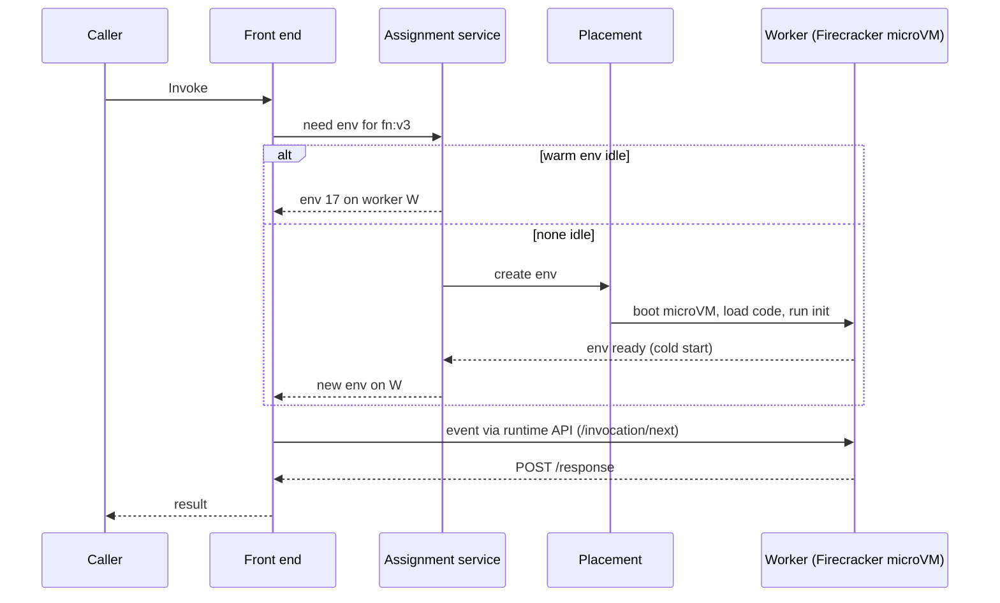

## In one minute
- AWS Lambda runs your function in response to events (HTTP via API Gateway or function URLs, SQS, Kinesis, S3, EventBridge, schedules) and bills per invocation and per GB-second, with no servers to manage.
- Each **execution environment** is a Firecracker microVM running one invocation at a time. Concurrency equals the number of environments busy at once; scaling means creating more environments.
- A new environment pays a **cold start** (download code, boot the sandbox, start the runtime, run your init code), from roughly 100 ms to several seconds. Warm environments are reused for later invocations.
- Hard limits shape designs: 15-minute timeout, up to 10 GB memory with CPU proportional to it, 6 MB synchronous and 1 MB asynchronous payloads, and a regional concurrency quota (1,000 by default, lower on new accounts) ([Lambda quotas](https://docs.aws.amazon.com/lambda/latest/dg/gettingstarted-limits.html)).
- Choose it for spiky, event-driven glue and APIs with modest latency needs. Avoid it for long jobs, steady high throughput (containers are cheaper) and paths that cannot absorb cold starts.

## How it works

### Invocation models
**Synchronous** invocations (API Gateway, function URLs, SDK `Invoke` with `RequestResponse`) wait for the result and return errors to the caller. **Asynchronous** invocations (S3, SNS, EventBridge, `Event` type) are queued internally; Lambda retries twice on error, one and then two minutes apart, and can send failures to a destination or DLQ ([AWS docs](https://docs.aws.amazon.com/lambda/latest/dg/invocation-async-error-handling.html)). **Event source mappings** are Lambda-managed pollers that read SQS, Kinesis, DynamoDB Streams or Kafka in batches and invoke your function synchronously, with retry and checkpoint behaviour defined by the source.

### The execution environment lifecycle
An environment goes through **Init** (start extensions, start the runtime, run code outside the handler), then repeated **Invoke** phases, then **Shutdown** when Lambda reclaims it. Between invocations the environment is frozen: background threads stop and timers do not fire. Anything you create during init (SDK clients, database connections, caches in globals, files in `/tmp`) survives into later invocations on the same environment, which is the main warm-start optimisation.

### Concurrency
If a function handles 200 requests per second at 50 ms each, it needs about 200 x 0.05 = 10 concurrent environments. **Reserved concurrency** caps a function and guarantees it that share of the account quota. **Provisioned concurrency** keeps a number of environments initialised in advance, removing cold starts for that many concurrent requests at an hourly price. **SnapStart** (Java, Python, .NET) snapshots an initialised environment and restores new ones from the snapshot instead of running init.

One request per environment is the classic model, now one of several. **Lambda Managed Instances** (announced December 2025) run functions on EC2 instances in your account, isolated by containers on Nitro rather than Firecracker, and let one environment serve many invocations at once; they scale on CPU without cold starts and cost the EC2 price plus a 15% management fee ([AWS docs](https://docs.aws.amazon.com/lambda/latest/dg/lambda-managed-instances.html)). **Durable functions** checkpoint each step and replay after interruptions, so one workflow can run for up to a year and wait without paying for compute ([AWS docs](https://docs.aws.amazon.com/lambda/latest/dg/durable-functions.html)). AWS now calls the classic kind Event Functions, next to Web Functions, which run an ordinary HTTP server with 64 concurrent requests per environment by default ([Lambda quotas](https://docs.aws.amazon.com/lambda/latest/dg/gettingstarted-limits.html#web-functions-quotas)).

## Down the stack

### Layer 1: The contract
Lambda promises at-least-once execution for asynchronous and event-source invocations: retries and internal redelivery mean your handler can run more than once for the same event, so handlers must be idempotent. A synchronous invoke runs at most once per request from Lambda's side, but client retries can repeat it. Each environment handles one request at a time, so per-environment code needs no locking. Functions scale until they hit the account or reserved concurrency limit, after which synchronous calls get `429 TooManyRequestsException` and asynchronous events are retried for up to 6 hours. Scaling speed is bounded too: each function can add 1,000 concurrent environments every 10 seconds, refilled continuously and never banked ([AWS docs](https://docs.aws.amazon.com/lambda/latest/dg/scaling-behavior.html)). Warm invocation overhead is typically a few milliseconds; cold starts add roughly 100 ms to over 1 s depending on runtime, package size and init work.

### Layer 2: The mechanism
**Routing.** A **front-end** fleet authenticates the request and asks an **assignment service** for an idle environment of that function version. If one exists, the request goes to its worker; if not, a **placement service** picks a worker with capacity and creates one. AWS has described rebuilding assignment around a replicated log so environment state survives failures (hedge: from re:Invent talks, not formal docs).

**Workers and Firecracker.** Workers are bare-metal EC2 hosts running many **Firecracker** microVMs. Firecracker is a Rust virtual machine monitor on KVM with a minimal device model (virtio net and block, serial console), booting a guest kernel in under 125 ms with under 5 MiB of overhead per microVM, and up to 150 microVMs per second per host ([Firecracker](https://firecracker-microvm.github.io/)). Each microVM holds a guest kernel, the runtime and your code for one function in one account, giving VM-level isolation between tenants.

**Code delivery.** Zip packages (50 MB zipped, 250 MB unzipped) and container images (10 GB) are cached near workers. Image layers are split into chunks, deduplicated across customers with convergent encryption, and loaded lazily, so a 1 GB image need not download fully before start ([Brooker et al., USENIX ATC 2023](https://www.usenix.org/conference/atc23/presentation/brooker)).

**Runtime API.** The runtime loops on `GET /2018-06-01/runtime/invocation/next`, calls your handler, then `POST`s to `/runtime/invocation/<request-id>/response` (or `/error`). Custom runtimes plug in here. For SQS, Lambda-managed pollers long-poll, batch, invoke and delete on success, scaling with backlog up to the mapping's maximum concurrency.

### Layer 3: The machine
Memory is the single sizing knob: CPU is allocated in proportion, reaching one full vCPU at 1,769 MB and up to 6 vCPUs at 10,240 MB. A CPU-bound function at 512 MB gets about 0.3 of a vCPU, so doubling memory can halve duration at the same cost. Billing is per millisecond of duration times configured memory, $0.0000166667 per GB-second on x86 and $0.0000133334 on Arm (20 percent less) in the cheapest tier, plus $0.20 per million requests ([AWS pricing](https://aws.amazon.com/lambda/pricing/)).

A cold start splits into sandbox creation (tens of ms, with pre-created pools), code loading (proportional to bytes touched), runtime start (a few ms for Node or Python, hundreds for a JVM) and your init code, often the largest part. Init is capped at 10 seconds for on-demand functions ([AWS docs](https://docs.aws.amazon.com/lambda/latest/dg/lambda-runtime-environment.html)). Since 1 August 2025 that init time is billed for every configuration; before, on-demand zip functions on managed runtimes got it free ([AWS Compute Blog](https://aws.amazon.com/blogs/compute/aws-lambda-standardizes-billing-for-init-phase/)). SnapStart instead restores memory pages from a snapshot on demand, so code assuming uniqueness at init (random seeds, connections) needs care.

Idle environments are reclaimed after an unspecified period, commonly observed as minutes. VPC-attached functions use shared Hyperplane ENIs, so VPC attachment no longer adds seconds to cold starts as it did before 2019 ([AWS Compute Blog](https://aws.amazon.com/blogs/compute/announcing-improved-vpc-networking-for-aws-lambda-functions/)).

### Why it's built this way
1. Customers wanted to pay only for actual work, so capacity is allocated per request rather than per server, which requires creating and destroying sandboxes quickly.
2. Running untrusted code from many accounts on shared hosts requires VM-grade isolation, but traditional VMs boot in seconds and cost hundreds of MB, so AWS built Firecracker to make VMs as cheap as containers.
3. One request per environment keeps the programming model simple and isolation clean, at the cost of more environments for concurrent load.
4. Cold starts are the price of not reserving capacity, so Lambda reuses warm environments, and offers provisioned concurrency and SnapStart for those who will pay to avoid them.
5. Fleet stability needs limits, so concurrency quotas, scaling rates and timeouts protect both AWS and downstream systems from runaway fan-out.

## Diagram


## Worked example
An image-thumbnail service receives S3 upload events: 2 million images a day, with a launch-day spike of 3,000 uploads per second for 10 minutes. Each thumbnail takes 400 ms at 1,024 MB.

Normal load averages about 23 per second, needing about 23 x 0.4 = 9 concurrent environments. The spike needs 3,000 x 0.4 = 1,200, above the default regional quota of 1,000, and that quota is shared with every other function in the account. The team requests a quota increase to 3,000 and sets reserved concurrency of 1,500 on the thumbnail function so it cannot starve the customer-facing API. Because S3 events invoke asynchronously, any throttled events are retried by Lambda for up to 6 hours, so the spike causes delay rather than loss.

Cost: 2 million x 0.4 s x 1 GB = 800,000 GB-seconds a day, about $13. Containers sized for the peak would sit mostly idle, so Lambda wins. At a steady 3,000 per second all day the same math gives about $1,700 a day, where containers would cost a fraction.

Python with Pillow cold-starts in about 300 ms; about 1,200 environments start cold once during the spike, then are reused. Nobody waits synchronously on thumbnails, so no provisioned concurrency is needed.

## In the wild
- **AWS, 2023: a Lambda front-end cell crosses an untested size.** On 13 June the Lambda Frontend fleet in us-east-1 scaled up for normal growth, and at 11:49 PDT one cell passed a capacity threshold it had never reached, waking a latent bug: new execution environments were allocated but never used. Synchronous invocations recovered by 13:45 and everything by 15:37 PDT, while STS, console sign-in, EventBridge and EKS provisioning, all built on Lambda, were degraded. AWS fixed the bug and committed to keeping cells within well-tested sizes ([AWS](https://aws.amazon.com/message/061323/)).
- **Amazon Prime Video, 2023: a serverless pipeline moved into one process.** A stream-quality monitor built from Step Functions, Lambda and S3 hit a hard scaling limit at about 5% of expected load: each second of stream needed several state transitions, which exhausted account limits and were billed one by one, and passing frames through S3 was expensive. Packing the same components into one ECS service cut infrastructure cost by over 90% ([Prime Video Tech, archived](http://web.archive.org/web/20240805183535/https://www.primevideotech.com/video-streaming/scaling-up-the-prime-video-audio-video-monitoring-service-and-reducing-costs-by-90)). It is this lesson's cost warning at steady high throughput, in production.

## Trade-offs
| Option | Strengths | Weaknesses | Choose when |
|---|---|---|---|
| Lambda | No servers, per-ms billing, scales from zero | Cold starts, 15-minute limit, cost at steady high load | Spiky, event-driven work and glue |
| Lambda + provisioned concurrency | Predictable latency | Pays for idle capacity | Latency-sensitive APIs with known baseline |
| ECS Fargate or Cloud Run | Containers, long-running, no host management | Slower scaling (tens of seconds), per-task overhead | Steady services, long jobs |
| EC2 or EKS | Cheapest at steady load, full control | You run capacity and patching | Large steady workloads, special hardware |
| Step Functions + Lambda | Orchestration beyond 15 minutes with retries | More moving parts, per-transition cost | Multi-step workflows across many services |
| Lambda durable functions | Workflows in plain code for up to a year, free while waiting | Code outside steps re-runs on every replay; newer | Multi-step logic that belongs inside one function |
| Lambda Managed Instances | Many requests per environment, EC2 pricing and hardware, no cold starts | Always-on minimum instances, 15% fee, handlers must be thread-safe | High steady volume that should keep Lambda's event integrations |

## Pitfalls in production
- **Database connection storms.** 1,000 environments can exhaust a relational database. Use RDS Proxy and cap concurrency.
- **Runaway recursion.** A function writing to the bucket that triggers it invokes itself forever. Separate buckets or prefixes. Lambda now stops loops through SQS, SNS, S3 and EventBridge after about 16 invocations in one chain, but only with supported SDKs ([AWS docs](https://docs.aws.amazon.com/lambda/latest/dg/invocation-recursion.html)).
- **Shared account quota.** A batch job can throttle the user-facing API. Partition with reserved concurrency.
- **Work after returning.** The environment freezes, so background flushes stall. Flush before returning.
- **Timeouts shorter than SDK retries.** The function dies mid-retry. Align SDK timeouts with the function timeout.

## Leadership lens
- Ask for the concurrency math (requests per second times duration) and compare it with account quotas and downstream limits before approving a Lambda design.
- Model cost at expected steady load, not just at launch; Lambda is cheapest for spiky or low-volume work and expensive for constant high throughput.
- Standardise idempotency, structured logging, timeouts and DLQs or failure destinations in a shared template so every team gets them by default.
- Decide which paths are latency critical and budget for provisioned concurrency or SnapStart only there.

## Check yourself
1. Why does increasing a function's memory sometimes reduce its cost?
   **Answer:** CPU scales with memory, so a CPU-bound function finishes proportionally faster and GB-seconds stay flat or fall while latency improves.
2. A function serves 500 requests per second at 80 ms each. How many concurrent environments does it need, and what happens at the default quota?
   **Answer:** About 40, well within a 1,000 quota; at 100 times that load it would need 4,000 and be throttled with 429 errors.
3. Why can global variables be both useful and dangerous in a Lambda handler?
   **Answer:** They persist on a warm environment, enabling connection and cache reuse, but can leak per-request data between users and are not shared across environments.
4. Why must an SQS-triggered function be idempotent even if it never fails?
   **Answer:** SQS and the poller provide at-least-once delivery, so a message can be delivered twice, for example when a visibility timeout expires during a slow batch.

## Practice
**Task:** Simulate Lambda's environment pool. `LambdaPool(limit, init_ms, idle_timeout_ms, provisioned)` starts with `provisioned` warm environments (IDs 1 to `provisioned`, free from time 0, never reclaimed); more than `limit` is an error. `invoke(now, duration)` is called with non-decreasing `now` and first reclaims every non-provisioned free environment with `now - free_at >= idle_timeout_ms`. It then picks a free environment (`free_at <= now`), preferring the latest `free_at` and then the lowest ID, and returns `("warm", id, now + duration)`. If none is free and fewer than `limit` exist, it creates the next ID and returns `("cold", id, now + init_ms + duration)`; otherwise `("throttled", -1, -1)`. An environment's `free_at` becomes the returned finish time. Also provide `stats()` as (cold, warm, throttled) and `env_count()`.

```python starter
class LambdaPool:
    def __init__(self, limit, init_ms, idle_timeout_ms, provisioned=0):
        self.limit = limit

    def invoke(self, now, duration):
        # TODO
        raise NotImplementedError

    def stats(self):
        # TODO
        raise NotImplementedError

    def env_count(self):
        # TODO
        raise NotImplementedError
```

```python tests
def test_cold_then_warm_then_concurrent_cold():
    p = LambdaPool(10, 100, 1000)
    assert p.invoke(0, 50) == ("cold", 1, 150)
    assert p.invoke(150, 20) == ("warm", 1, 170)
    assert p.invoke(160, 10) == ("cold", 2, 270)
    assert p.stats() == (2, 1, 0)

def test_throttle_at_limit():
    p = LambdaPool(2, 100, 1000)
    assert p.invoke(0, 500)[0] == "cold"
    assert p.invoke(10, 500)[0] == "cold"
    assert p.invoke(20, 500) == ("throttled", -1, -1)
    assert p.stats() == (2, 0, 1)

def test_idle_reclaim_boundary():
    p = LambdaPool(5, 100, 1000)
    assert p.invoke(0, 0) == ("cold", 1, 100)
    assert p.invoke(1099, 0) == ("warm", 1, 1099)
    assert p.invoke(2099, 0) == ("cold", 2, 2199)
    assert p.env_count() == 1

def test_most_recently_freed_preferred():
    p = LambdaPool(5, 0, 1000)
    p.invoke(0, 10)
    p.invoke(0, 20)
    assert p.invoke(30, 5) == ("warm", 2, 35)
    assert p.invoke(30, 5) == ("warm", 1, 35)

def test_provisioned_never_reclaimed():
    p = LambdaPool(3, 100, 50, 2)
    assert p.invoke(0, 10) == ("warm", 1, 10)
    assert p.invoke(1000, 10) == ("warm", 1, 1010)
    assert p.env_count() == 2
    assert p.invoke(2000, 100) == ("warm", 1, 2100)
    assert p.invoke(2000, 100) == ("warm", 2, 2100)
    assert p.invoke(2000, 100) == ("cold", 3, 2200)
    assert p.invoke(2000, 100) == ("throttled", -1, -1)

def test_env_free_exactly_at_finish():
    p = LambdaPool(1, 0, 1000)
    assert p.invoke(0, 100) == ("cold", 1, 100)
    assert p.invoke(99, 1) == ("throttled", -1, -1)
    assert p.invoke(100, 1) == ("warm", 1, 101)

def test_provisioned_over_limit_rejected():
    try:
        LambdaPool(2, 0, 10, 3)
        assert False, "expected ValueError"
    except ValueError:
        pass
```

```python solution
class LambdaPool:
    def __init__(self, limit, init_ms, idle_timeout_ms, provisioned=0):
        if provisioned > limit:
            raise ValueError("provisioned exceeds limit")
        self.limit = limit
        self.init_ms = init_ms
        self.idle_timeout = idle_timeout_ms
        self.envs = {}  # id -> [free_at, provisioned]
        self.next_id = 1
        self.cold = self.warm = self.throttled = 0
        for _ in range(provisioned):
            self.envs[self.next_id] = [0, True]
            self.next_id += 1

    def invoke(self, now, duration):
        for eid in list(self.envs):
            free_at, prov = self.envs[eid]
            if not prov and free_at <= now and now - free_at >= self.idle_timeout:
                del self.envs[eid]
        free = [(-v[0], eid) for eid, v in self.envs.items() if v[0] <= now]
        if free:
            eid = min(free)[1]
            self.envs[eid][0] = now + duration
            self.warm += 1
            return ("warm", eid, now + duration)
        if len(self.envs) < self.limit:
            eid = self.next_id
            self.next_id += 1
            finish = now + self.init_ms + duration
            self.envs[eid] = [finish, False]
            self.cold += 1
            return ("cold", eid, finish)
        self.throttled += 1
        return ("throttled", -1, -1)

    def stats(self):
        return (self.cold, self.warm, self.throttled)

    def env_count(self):
        return len(self.envs)
```

```typescript starter
export type Result = [string, number, number];

export class LambdaPool {
  constructor(limit: number, initMs: number, idleTimeoutMs: number, provisioned: number = 0) {}
  invoke(now: number, duration: number): Result {
    throw new Error("TODO");
  }
  stats(): [number, number, number] {
    throw new Error("TODO");
  }
  envCount(): number {
    throw new Error("TODO");
  }
}
```

```typescript tests
test("cold then warm then concurrent cold", () => {
  const p = new LambdaPool(10, 100, 1000);
  assertEqual(p.invoke(0, 50), ["cold", 1, 150]);
  assertEqual(p.invoke(150, 20), ["warm", 1, 170]);
  assertEqual(p.invoke(160, 10), ["cold", 2, 270]);
  assertEqual(p.stats(), [2, 1, 0]);
});

test("throttle at limit", () => {
  const p = new LambdaPool(2, 100, 1000);
  assertEqual(p.invoke(0, 500)[0], "cold");
  assertEqual(p.invoke(10, 500)[0], "cold");
  assertEqual(p.invoke(20, 500), ["throttled", -1, -1]);
  assertEqual(p.stats(), [2, 0, 1]);
});

test("idle reclaim boundary", () => {
  const p = new LambdaPool(5, 100, 1000);
  assertEqual(p.invoke(0, 0), ["cold", 1, 100]);
  assertEqual(p.invoke(1099, 0), ["warm", 1, 1099]);
  assertEqual(p.invoke(2099, 0), ["cold", 2, 2199]);
  assertEqual(p.envCount(), 1);
});

test("most recently freed preferred", () => {
  const p = new LambdaPool(5, 0, 1000);
  p.invoke(0, 10);
  p.invoke(0, 20);
  assertEqual(p.invoke(30, 5), ["warm", 2, 35]);
  assertEqual(p.invoke(30, 5), ["warm", 1, 35]);
});

test("provisioned never reclaimed", () => {
  const p = new LambdaPool(3, 100, 50, 2);
  assertEqual(p.invoke(0, 10), ["warm", 1, 10]);
  assertEqual(p.invoke(1000, 10), ["warm", 1, 1010]);
  assertEqual(p.envCount(), 2);
  assertEqual(p.invoke(2000, 100), ["warm", 1, 2100]);
  assertEqual(p.invoke(2000, 100), ["warm", 2, 2100]);
  assertEqual(p.invoke(2000, 100), ["cold", 3, 2200]);
  assertEqual(p.invoke(2000, 100), ["throttled", -1, -1]);
});

test("env free exactly at finish", () => {
  const p = new LambdaPool(1, 0, 1000);
  assertEqual(p.invoke(0, 100), ["cold", 1, 100]);
  assertEqual(p.invoke(99, 1), ["throttled", -1, -1]);
  assertEqual(p.invoke(100, 1), ["warm", 1, 101]);
});

test("provisioned over limit rejected", () => {
  let threw = false;
  try { new LambdaPool(2, 0, 10, 3); } catch (e) { threw = true; }
  assert(threw, "expected constructor to throw");
});
```

```typescript solution
export type Result = [string, number, number];

interface Env {
  freeAt: number;
  provisioned: boolean;
}

export class LambdaPool {
  private envs = new Map<number, Env>();
  private nextId = 1;
  private cold = 0;
  private warm = 0;
  private throttled = 0;

  constructor(private limit: number, private initMs: number, private idleTimeoutMs: number, provisioned: number = 0) {
    if (provisioned > limit) throw new Error("provisioned exceeds limit");
    for (let i = 0; i < provisioned; i++) this.envs.set(this.nextId++, { freeAt: 0, provisioned: true });
  }

  invoke(now: number, duration: number): Result {
    for (const [id, e] of Array.from(this.envs.entries())) {
      if (!e.provisioned && e.freeAt <= now && now - e.freeAt >= this.idleTimeoutMs) this.envs.delete(id);
    }
    let best = -1;
    let bestFree = -Infinity;
    for (const [id, e] of this.envs) {
      if (e.freeAt > now) continue;
      if (e.freeAt > bestFree || (e.freeAt === bestFree && id < best)) {
        best = id;
        bestFree = e.freeAt;
      }
    }
    if (best !== -1) {
      this.envs.get(best)!.freeAt = now + duration;
      this.warm++;
      return ["warm", best, now + duration];
    }
    if (this.envs.size < this.limit) {
      const id = this.nextId++;
      const finish = now + this.initMs + duration;
      this.envs.set(id, { freeAt: finish, provisioned: false });
      this.cold++;
      return ["cold", id, finish];
    }
    this.throttled++;
    return ["throttled", -1, -1];
  }

  stats(): [number, number, number] {
    return [this.cold, this.warm, this.throttled];
  }

  envCount(): number {
    return this.envs.size;
  }
}
```

```go starter
package practice

type Result struct {
	Status string
	EnvID  int
	Finish int64
}

type LambdaPool struct{}

func NewLambdaPool(limit int, initMs, idleTimeoutMs int64, provisioned int) (*LambdaPool, error) {
	return &LambdaPool{}, nil
}

func (p *LambdaPool) Invoke(now, duration int64) Result { panic("TODO") }

func (p *LambdaPool) Stats() (int, int, int) { panic("TODO") }

func (p *LambdaPool) EnvCount() int { panic("TODO") }
```

```go tests
package practice

import "testing"

func pool(t *testing.T, limit int, initMs, idle int64, prov int) *LambdaPool {
	t.Helper()
	p, err := NewLambdaPool(limit, initMs, idle, prov)
	if err != nil {
		t.Fatalf("unexpected error %v", err)
	}
	return p
}

func expect(t *testing.T, got Result, status string, id int, finish int64) {
	t.Helper()
	if got != (Result{status, id, finish}) {
		t.Fatalf("got %+v want {%s %d %d}", got, status, id, finish)
	}
}

func TestColdThenWarmThenConcurrentCold(t *testing.T) {
	p := pool(t, 10, 100, 1000, 0)
	expect(t, p.Invoke(0, 50), "cold", 1, 150)
	expect(t, p.Invoke(150, 20), "warm", 1, 170)
	expect(t, p.Invoke(160, 10), "cold", 2, 270)
	if c, w, th := p.Stats(); c != 2 || w != 1 || th != 0 {
		t.Fatalf("stats %d %d %d", c, w, th)
	}
}

func TestThrottleAtLimit(t *testing.T) {
	p := pool(t, 2, 100, 1000, 0)
	p.Invoke(0, 500)
	p.Invoke(10, 500)
	expect(t, p.Invoke(20, 500), "throttled", -1, -1)
	if c, w, th := p.Stats(); c != 2 || w != 0 || th != 1 {
		t.Fatalf("stats %d %d %d", c, w, th)
	}
}

func TestIdleReclaimBoundary(t *testing.T) {
	p := pool(t, 5, 100, 1000, 0)
	expect(t, p.Invoke(0, 0), "cold", 1, 100)
	expect(t, p.Invoke(1099, 0), "warm", 1, 1099)
	expect(t, p.Invoke(2099, 0), "cold", 2, 2199)
	if p.EnvCount() != 1 {
		t.Fatalf("env count %d", p.EnvCount())
	}
}

func TestMostRecentlyFreedPreferred(t *testing.T) {
	p := pool(t, 5, 0, 1000, 0)
	p.Invoke(0, 10)
	p.Invoke(0, 20)
	expect(t, p.Invoke(30, 5), "warm", 2, 35)
	expect(t, p.Invoke(30, 5), "warm", 1, 35)
}

func TestProvisionedNeverReclaimed(t *testing.T) {
	p := pool(t, 3, 100, 50, 2)
	expect(t, p.Invoke(0, 10), "warm", 1, 10)
	expect(t, p.Invoke(1000, 10), "warm", 1, 1010)
	if p.EnvCount() != 2 {
		t.Fatalf("env count %d", p.EnvCount())
	}
	expect(t, p.Invoke(2000, 100), "warm", 1, 2100)
	expect(t, p.Invoke(2000, 100), "warm", 2, 2100)
	expect(t, p.Invoke(2000, 100), "cold", 3, 2200)
	expect(t, p.Invoke(2000, 100), "throttled", -1, -1)
}

func TestEnvFreeExactlyAtFinish(t *testing.T) {
	p := pool(t, 1, 0, 1000, 0)
	expect(t, p.Invoke(0, 100), "cold", 1, 100)
	expect(t, p.Invoke(99, 1), "throttled", -1, -1)
	expect(t, p.Invoke(100, 1), "warm", 1, 101)
}

func TestProvisionedOverLimitRejected(t *testing.T) {
	if _, err := NewLambdaPool(2, 0, 10, 3); err == nil {
		t.Fatal("expected error")
	}
}
```

```go solution
package practice

import "errors"

type Result struct {
	Status string
	EnvID  int
	Finish int64
}

type env struct {
	freeAt      int64
	provisioned bool
}

type LambdaPool struct {
	limit                  int
	initMs, idleTimeout    int64
	envs                   map[int]*env
	nextID                 int
	cold, warm, throttled int
}

func NewLambdaPool(limit int, initMs, idleTimeoutMs int64, provisioned int) (*LambdaPool, error) {
	if provisioned > limit {
		return nil, errors.New("provisioned exceeds limit")
	}
	p := &LambdaPool{limit: limit, initMs: initMs, idleTimeout: idleTimeoutMs, envs: map[int]*env{}, nextID: 1}
	for i := 0; i < provisioned; i++ {
		p.envs[p.nextID] = &env{freeAt: 0, provisioned: true}
		p.nextID++
	}
	return p, nil
}

func (p *LambdaPool) Invoke(now, duration int64) Result {
	for id, e := range p.envs {
		if !e.provisioned && e.freeAt <= now && now-e.freeAt >= p.idleTimeout {
			delete(p.envs, id)
		}
	}
	best := -1
	var bestFree int64
	for id, e := range p.envs {
		if e.freeAt > now {
			continue
		}
		if best == -1 || e.freeAt > bestFree || (e.freeAt == bestFree && id < best) {
			best, bestFree = id, e.freeAt
		}
	}
	if best != -1 {
		p.envs[best].freeAt = now + duration
		p.warm++
		return Result{"warm", best, now + duration}
	}
	if len(p.envs) < p.limit {
		id := p.nextID
		p.nextID++
		finish := now + p.initMs + duration
		p.envs[id] = &env{freeAt: finish}
		p.cold++
		return Result{"cold", id, finish}
	}
	p.throttled++
	return Result{"throttled", -1, -1}
}

func (p *LambdaPool) Stats() (int, int, int) { return p.cold, p.warm, p.throttled }

func (p *LambdaPool) EnvCount() int { return len(p.envs) }
```

## Mock interview
**Prompt:** Design the backend for a ticketing site's checkout API on Lambda. Normal traffic is 200 requests per second, but when popular events go on sale traffic jumps to 20,000 requests per second within a minute, and p99 latency must stay under 500 ms.

- Follow-up: walk through what happens in the first 30 seconds of the spike, environment by environment.
- Follow-up: the payments database allows 2,000 connections. How do you stop Lambda from exhausting it?
- Follow-up: at what point would you move this API off Lambda, and to what?

**A strong answer covers:**
- Concurrency math: 20,000 per second at about 100 ms is 2,000 environments, against the quota and a scaling rate of 1,000 per 10 seconds.
- Provisioned concurrency scheduled before known on-sales, small packages and once-per-environment init.
- A waiting room or queue in front, with API Gateway throttling to protect dependencies.
- RDS Proxy, reserved concurrency as a cap, and idempotency keys so retries never double-charge.
- A cost comparison with containers at steady load.

## Sources and further study
**Primary**
- [Wang et al., Peeking Behind the Curtains of Serverless Platforms (USENIX ATC 2018)](https://www.usenix.org/conference/atc18/presentation/wang-liang): an outside measurement of Lambda, Azure Functions and Google Cloud Functions across 50,000 instances, covering placement, cold starts and contention.
- [Brooker et al., On-demand Container Loading in AWS Lambda (USENIX ATC 2023)](https://www.usenix.org/conference/atc23/presentation/brooker): how 10 GB images start in seconds through chunking, deduplication and lazy loading.
- [Jonas et al., Cloud Programming Simplified: A Berkeley View on Serverless Computing (2019)](https://arxiv.org/abs/1902.03383): the limits of FaaS for state, communication and long jobs.

**Systems docs**
- [Lambda Managed Instances](https://docs.aws.amazon.com/lambda/latest/dg/lambda-managed-instances.html): the multi-concurrency compute type on EC2 and how it differs from the default.
- [Lambda durable functions](https://docs.aws.amazon.com/lambda/latest/dg/durable-functions.html): checkpoint and replay for workflows up to a year long.
- [AWS Builders' Library: Avoiding insurmountable queue backlogs](https://aws.amazon.com/builders-library/avoiding-insurmountable-queue-backlogs/): how AWS reasons about asynchronous queues like the one behind async invokes.

**Books**
- *Designing Distributed Systems*, 2nd edition, Brendan Burns, chapter 9 "Functions and Event-Driven Processing": when FaaS makes sense, and patterns for it.
- *Systems Performance*, 2nd edition, Brendan Gregg, chapter 11 "Cloud Computing": hardware, OS and lightweight virtualization, the spectrum Firecracker sits on.

**Other curricula**
- [AWS Well-Architected: Serverless Applications Lens](https://docs.aws.amazon.com/wellarchitected/latest/serverless-applications-lens/welcome.html): frames Lambda designs as common serverless scenarios, each reviewed against the Well-Architected pillars rather than as a feature tour.

## Watch
- [AWS re:Invent 2018: A Serverless Journey: AWS Lambda Under the Hood (AWS)](https://www.youtube.com/watch?v=QdzV04T_kec): the front end, worker manager, placement and Firecracker workers behind an invoke.
- [AWS re:Invent 2019: Scalable serverless event-driven applications using Amazon SQS & Lambda (AWS Events)](https://www.youtube.com/watch?v=2rikdPIFc_Q): how Lambda's SQS pollers scale, batch and handle failures.

## Free resources
- [Lambda execution environment lifecycle](https://docs.aws.amazon.com/lambda/latest/dg/lambda-runtime-environment.html): the Init, Invoke and Shutdown phases and freezing between invokes.
- [Understanding Lambda function scaling](https://docs.aws.amazon.com/lambda/latest/dg/scaling-behavior.html): concurrency, scaling rate and how throttling works.
- [Configuring provisioned concurrency](https://docs.aws.amazon.com/lambda/latest/dg/provisioned-concurrency.html): pre-initialised environments and their cost.
- [Lambda quotas](https://docs.aws.amazon.com/lambda/latest/dg/gettingstarted-limits.html): memory, timeout, payload, package and concurrency limits.
- [Improving startup performance with Lambda SnapStart](https://docs.aws.amazon.com/lambda/latest/dg/snapstart.html): snapshot restore and its uniqueness caveats.
- [Firecracker: Lightweight Virtualization for Serverless Applications (NSDI 2020)](https://www.usenix.org/conference/nsdi20/presentation/agache): the paper on the microVM monitor that runs Lambda.
