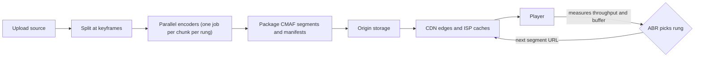

## In one minute
- Modern on-demand streaming is just HTTP file serving, cleverly arranged. Video is encoded at several quality levels (a **bitrate ladder**), cut into segments of a few seconds, and described by a **manifest** (HLS `.m3u8` or DASH `.mpd`).
- The **player** decides everything at playback time: it measures throughput and buffer level and picks which rendition to fetch for the next segment. This is **adaptive bitrate (ABR)** streaming.
- Because segments are ordinary cacheable files, a **CDN** does most of the work. The origin serves each segment roughly once per edge; viewers are served from caches close to them.
- The upload side is a **transcoding pipeline**: split the source into chunks, encode each chunk into every rendition in parallel, package, and publish the manifest.
- Live streaming adds a latency budget: ingest, transcode and package in real time, and trade segment length against delay and stall risk.

## How it works

### Encoding and the ladder
A source file (say a 4K master) is decoded and re-encoded into renditions such as 240p at 300 kbit/s up to 4K at 15 Mbit/s or more. Each rendition uses the same keyframe (IDR frame) positions so segments line up across renditions and the player can switch quality at any segment boundary without a glitch. Apple's authoring rules are a common baseline: an IDR every 2 seconds, every segment starting with one, and segments of nominally 6 seconds ([Apple HLS authoring spec](https://developer.apple.com/documentation/http-live-streaming/hls-authoring-specification-for-apple-devices)). Services tune the ladder per title or even per scene: a cartoon needs far fewer bits than a grainy action film for the same perceived quality.

### Packaging and manifests
The encoded streams are cut into segments (fragmented MP4 under the CMAF format is now common to both HLS and DASH). A master playlist lists the renditions with their bandwidth, resolution and codecs; each media playlist lists the segments in order. Audio and subtitles are separate tracks with their own playlists, so a player can combine any video rendition with any language.

### Delivery
The player fetches the master manifest, picks a starting rendition (usually a conservative one), then fetches segments one by one over HTTP from a CDN. Popular titles stay hot at the edge; large services also place caching appliances inside ISP networks so the bytes never cross the wider internet. Netflix's Open Connect works with over a thousand ISPs, gives the appliances to qualifying ISPs at no charge, and fills them nightly ([Netflix Open Connect](https://openconnect.netflix.com/en/)). Signed URLs or tokens limit access, and DRM (Widevine, FairPlay, PlayReady) encrypts segments with keys delivered by a separate license server.

### Adaptive bitrate in the player
The player keeps a buffer of downloaded but unplayed media, typically tens of seconds for on-demand video. Throughput-based ABR estimates bandwidth from recent segment downloads and picks the highest rendition that fits with a safety margin. Buffer-based ABR picks quality from buffer level: low buffer means low quality, full buffer means high quality. Netflix tested this on millions of users and found capacity estimates unnecessary in steady state but still needed at startup, while the buffer is filling ([Huang et al., SIGCOMM 2014](https://web.stanford.edu/class/cs244/papers/sigcomm2014-video.pdf)). Production players mix both and add hysteresis so they do not flap between rungs; the FESTIVE algorithm, for example, uses a harmonic mean over the last 20 segments and moves only one rung at a time ([Timmerer et al.](https://arxiv.org/abs/1606.00341)).

### Live
A broadcaster pushes a stream (RTMP, SRT or WebRTC) to an ingest server, which transcodes in real time into the ladder and publishes segments as they complete. WebRTC ingest now has a standard handshake: WHIP sends the SDP offer in one HTTP `POST` and ends the session with `DELETE` ([RFC 9725](https://www.rfc-editor.org/rfc/rfc9725)). Latency is roughly the segment duration times the number of segments the player buffers, plus encode and CDN propagation; classic HLS with 6-second segments often sits at 15 to 30 seconds behind live. Low-latency HLS and DASH publish partial segments and use blocking playlist reloads to get to a few seconds. Parts are shorter than many guides suggest: Apple recommends a one-second part target, and at least three times the P95 round trip to the server, so that clients are not drowned in requests (same Apple spec). Sub-second interactivity needs WebRTC, which gives up CDN-friendly caching.

### How it shows up in interviews
Triggers: design YouTube, Netflix, Twitch, Spotify, or a video course platform. A strong answer separates the upload and transcoding pipeline from playback, explains segments, manifests and ABR, puts a CDN in front with numbers on egress, and handles live separately if asked. Probes include: why not stream one big file, what happens when bandwidth drops mid-play, how many renditions and why, how you handle a new viral video that is not yet cached, and how you get live latency down.

## Down the stack

### Layer 1: The contract
The server side promises immutable, independently decodable segments at stable URLs, each starting with a keyframe, and a manifest that accurately lists them; for live, a playlist that only grows and advances its media sequence number. The player promises continuous playback as long as average throughput exceeds the lowest rung, at the best quality it can sustain, with a startup time target (often a second or two) and a rebuffering ratio target (stall time as a fraction of watch time). Nothing promises a constant quality; the contract is "keep playing, as well as possible".

### Layer 2: The mechanism
HLS ([RFC 8216](https://datatracker.ietf.org/doc/html/rfc8216)) master playlists carry `#EXT-X-STREAM-INF:BANDWIDTH=...,RESOLUTION=...,CODECS=...` lines, each followed by a media playlist URI. Media playlists carry `#EXT-X-TARGETDURATION`, `#EXT-X-MEDIA-SEQUENCE`, and an `#EXTINF:<duration>` line before each segment URI; on-demand lists end with `#EXT-X-ENDLIST`, while live lists keep sliding. RFC 8216 itself predates low-latency HLS; `EXT-X-PART-INF` and blocking reloads live in its intended successor, still an Internet-Draft at revision 22 in May 2026 ([IETF draft](https://datatracker.ietf.org/doc/draft-pantos-hls-rfc8216bis/)). DASH uses an XML MPD with `Period`, `AdaptationSet` and `Representation` elements and usually a `SegmentTemplate` such as `$RepresentationID$/$Number$.m4s`. In the browser, the player downloads segments with `fetch` and feeds bytes into Media Source Extensions with `SourceBuffer.appendBuffer`, so the video element plays a stream assembled by JavaScript. iPhones only gained this path with Safari 17.1 in 2023, through Managed Media Source ([WebKit](https://webkit.org/blog/14735/)), a variant in which the browser may evict buffered media and tells the player when to fetch ([MDN](https://developer.mozilla.org/en-US/docs/Web/API/ManagedMediaSource)). The transcoding pipeline splits the source at keyframes into chunks, runs encoders such as x264 or x265 per chunk per rendition on a worker fleet, then concatenates and packages, which turns hours of serial encoding into minutes.

### Layer 3: The machine
A 1080p rendition at 5 Mbit/s is 625 KB per second, so a 4-second segment is about 2.5 MB, which TCP delivers as roughly 1,700 segments of 1,460-byte payload. With a 40 ms RTT, a fresh connection needs several round trips of slow start before the window is large enough, which is why players reuse connections (HTTP/2 or HTTP/3) and why the first segment is a low rung. On edge servers, serving is a page-cache-to-NIC problem: hot segments live in RAM, `sendfile` avoids copying them through user space, and kernel TLS keeps encryption in the kernel. Netflix has described its FreeBSD-based Open Connect appliances serving on the order of hundreds of gigabits per second per box using these techniques. Encoding is the opposite: CPU-bound, with a modern encoder at slow presets running well below real time per core for 4K, so encode cost scales with renditions times duration times preset effort.

### Why it's built this way
Networks vary from second to second, so quality must be chosen per segment by the client that sees the network. HTTP caches are everywhere and cheap, so video is shaped into small immutable HTTP files. Switching requires aligned keyframes, so all renditions share a GOP structure. Encoding is expensive and done once, while delivery happens millions of times, so it pays to spend more CPU per title to save bandwidth on every view.

## Diagram


## Worked example
A course platform serves 2 million viewing hours per day. Average delivered bitrate is 3 Mbit/s because many viewers watch on laptops at 720p or 1080p.

Egress: 2 million hours x 3,600 seconds x 3 Mbit/s = 21.6 billion megabits per day, about 2.7 PB per day, roughly 250 Gbit/s on average with an evening peak perhaps twice that. With a 95% CDN hit ratio, the origin serves about 5% of that, around 12 Gbit/s on average. Cutting the average bitrate 20% with per-title encoding saves about 540 TB of egress per day, which is why encoding effort pays for itself.

Storage: 50,000 hours of content with a six-rung ladder averaging 2.5 Mbit/s per rung stores 50,000 x 3,600 x 15 Mbit = 2.7 billion megabits, about 340 TB, small compared with daily egress.

Playback: segments are 4 seconds, the player targets a 30-second buffer, and starts at 750 kbit/s. On a 20 Mbit/s home connection, the first 4-second segment (375 KB) arrives in a few hundred milliseconds including connection setup, playback starts, and the player climbs one rung per segment to 1080p within about 20 seconds.

## In the wild
- **Netflix, 2014: buffer-based rate adaptation.** Netflix and Stanford replaced throughput prediction with a rule that picks the rate from buffer occupancy, keeping a simple throughput estimate only for startup. In experiments across millions of real users it cut rebuffers by 10 to 20% compared with Netflix's then-default algorithm, at a similar average bitrate ([Huang et al., SIGCOMM 2014](https://web.stanford.edu/class/cs244/papers/sigcomm2014-video.pdf)).
- **Akamai, 2015: most cached objects are requested once.** On a typical cluster, 74% of about 400 million objects were requested only once in two days. Caching an object only on its second request, tracked with rotating Bloom filters, raised the byte hit rate from about 74% to 83% and cut disk writes by 44%, which matters for long-tail video catalogues ([Maggs and Sitaraman](https://people.cs.umass.edu/~ramesh/Site/HOME_files/CCRpaper_1.pdf)).
- **Amazon Prime Video, 2023: stream monitoring back into one process.** A service that checks every stream for audio and video defects was built from Step Functions, Lambda and S3, and hit account limits at about 5% of expected load because each second of video caused several state transitions. Packing the same components into one ECS process cut infrastructure cost by over 90% ([Prime Video Tech, archived](http://web.archive.org/web/20240805183535/https://www.primevideotech.com/video-streaming/scaling-up-the-prime-video-audio-video-monitoring-service-and-reducing-costs-by-90)).

## Trade-offs
| Option | Strengths | Weaknesses | Choose when |
|---|---|---|---|
| Short segments (2 s) | Faster switching, lower live latency | More requests, slightly worse compression | Live or variable networks |
| Long segments (6 to 10 s) | Fewer requests, efficient encoding | Slower adaptation, higher live latency | On-demand with stable networks |
| Fixed ladder | Simple pipeline | Wastes bits on easy content | Small catalogue |
| Per-title or per-scene ladder | Lower bandwidth for the same quality | More encode compute and complexity | Large audiences where egress dominates |
| LL-HLS or LL-DASH | Few seconds of live latency over CDNs | More requests, tighter tuning | Sports, live events |
| WebRTC | Sub-second latency | Poor CDN fit, costly at large scale | Interactive streams, calls |

## Pitfalls in production
- **Misaligned keyframes.** If renditions place keyframes differently, switches cause visual glitches or decode errors. Force fixed GOPs aligned across the ladder.
- **Origin stampede on new releases.** A premiere at a set time sends every edge to the origin for the same segments. Pre-position content and use an origin shield tier.
- **Manifest caching wrong.** Long TTLs on live playlists freeze viewers; no caching at all overloads the origin. Give live playlists TTLs near the segment duration and segments long TTLs.
- **Oscillating ABR.** Players that react to every sample flap between rungs. Use smoothed estimates, a safety factor and one-step upswitches.
- **Measuring throughput from cached segments.** A segment served instantly from a local cache inflates the estimate. Ignore tiny or cache-hit samples.
- **Ignoring audio.** Separate audio tracks and their segment timing must stay in sync with video, or lip-sync drifts after switches.

## Leadership lens
- CDN egress is usually the largest cost. Ask for hit ratio, average bitrate and the encoding budget that could reduce both.
- Define quality-of-experience metrics up front: startup time, rebuffer ratio, average bitrate and switch rate, measured from players.
- Keep the transcoding pipeline idempotent and chunked so failed jobs retry cheaply.
- Decide whether to build or buy: managed packaging, DRM and CDN services save months but lock in pricing.

## Check yourself
1. Why is streaming built on segments over HTTP rather than a single long stream?
   **Answer:** Segments are cacheable, immutable files that any CDN can serve, and each segment boundary is a chance for the player to change quality.
2. Why must keyframes align across renditions?
   **Answer:** A segment must decode on its own, and switching quality mid-stream needs the next segment in any rendition to start with a keyframe at the same timestamp.
3. Why does classic HLS live streaming lag 15 to 30 seconds?
   **Answer:** Players buffer several segments of several seconds each, and segments are published only when complete, so delay accumulates by segment duration.
4. Why does a player prefer a harmonic mean of throughput samples?
   **Answer:** It weights slow samples heavily, so a single dip pulls the estimate down and the player avoids picking a rung it cannot sustain.

## Practice
**Task:** Write an ABR decision function. `choose_bitrate(ladder, samples, buffer_s, current)` takes an ascending list of rung bitrates in kbit/s, a list of throughput samples in kbit/s (most recent last), the buffer level in seconds and the current rung. Rules, in order: with no samples return the lowest rung; if `buffer_s < 5` return the lowest rung; estimate throughput as the harmonic mean of the last five samples (or fewer if fewer exist) and take 80% of it as the budget; the target is the highest rung at or below the budget, or the lowest rung if none fit. If the target is above `current`, stay at `current` when `buffer_s < 10`, otherwise move up exactly one rung. If the target is at or below `current`, return the target.

```python starter
def choose_bitrate(ladder, samples, buffer_s, current):
    # TODO
    raise NotImplementedError
```

```python tests
LADDER = [300, 750, 1500, 3000, 6000]

def test_no_samples_starts_low():
    assert choose_bitrate(LADDER, [], 0, 300) == 300

def test_upswitch_one_rung_at_a_time():
    assert choose_bitrate(LADDER, [10000], 20, 750) == 1500
    assert choose_bitrate(LADDER, [5000, 5000, 5000], 20, 1500) == 3000

def test_no_upswitch_on_low_buffer():
    assert choose_bitrate(LADDER, [10000], 8, 750) == 750

def test_downswitch_immediately():
    assert choose_bitrate(LADDER, [1000], 20, 3000) == 750

def test_harmonic_mean_punishes_dips():
    assert choose_bitrate(LADDER, [4000, 4000, 4000, 4000, 400], 20, 1500) == 750

def test_only_last_five_samples_count():
    assert choose_bitrate(LADDER, [100, 5000, 5000, 5000, 5000, 5000], 30, 3000) == 3000

def test_panic_on_nearly_empty_buffer():
    assert choose_bitrate(LADDER, [10000], 3, 3000) == 300

def test_below_lowest_rung():
    assert choose_bitrate(LADDER, [100], 20, 750) == 300
```

```python solution
def choose_bitrate(ladder, samples, buffer_s, current):
    if not samples or buffer_s < 5:
        return ladder[0]
    recent = samples[-5:]
    est = len(recent) / sum(1.0 / s for s in recent)
    budget = est * 0.8
    target = ladder[0]
    for rung in ladder:
        if rung <= budget:
            target = rung
    if target > current:
        if buffer_s < 10:
            return current
        idx = ladder.index(current)
        return ladder[min(idx + 1, len(ladder) - 1)]
    return target
```

```typescript starter
export function chooseBitrate(ladder: number[], samples: number[], bufferS: number, current: number): number {
  throw new Error("TODO");
}
```

```typescript tests
const LADDER = [300, 750, 1500, 3000, 6000];
test("no samples starts low", () => {
  assertEqual(chooseBitrate(LADDER, [], 0, 300), 300);
});
test("upswitch one rung at a time", () => {
  assertEqual(chooseBitrate(LADDER, [10000], 20, 750), 1500);
  assertEqual(chooseBitrate(LADDER, [5000, 5000, 5000], 20, 1500), 3000);
});
test("no upswitch on low buffer", () => {
  assertEqual(chooseBitrate(LADDER, [10000], 8, 750), 750);
});
test("downswitch immediately", () => {
  assertEqual(chooseBitrate(LADDER, [1000], 20, 3000), 750);
});
test("harmonic mean punishes dips", () => {
  assertEqual(chooseBitrate(LADDER, [4000, 4000, 4000, 4000, 400], 20, 1500), 750);
});
test("only last five samples", () => {
  assertEqual(chooseBitrate(LADDER, [100, 5000, 5000, 5000, 5000, 5000], 30, 3000), 3000);
});
test("panic on nearly empty buffer", () => {
  assertEqual(chooseBitrate(LADDER, [10000], 3, 3000), 300);
});
test("below lowest rung", () => {
  assertEqual(chooseBitrate(LADDER, [100], 20, 750), 300);
});
```

```typescript solution
export function chooseBitrate(ladder: number[], samples: number[], bufferS: number, current: number): number {
  if (samples.length === 0 || bufferS < 5) return ladder[0];
  const recent = samples.slice(-5);
  let inv = 0;
  for (const s of recent) inv += 1 / s;
  const budget = (recent.length / inv) * 0.8;
  let target = ladder[0];
  for (const rung of ladder) if (rung <= budget) target = rung;
  if (target > current) {
    if (bufferS < 10) return current;
    const idx = ladder.indexOf(current);
    return ladder[Math.min(idx + 1, ladder.length - 1)];
  }
  return target;
}
```

```go starter
package practice

// ChooseBitrate picks the next rung (kbit/s) for an adaptive bitrate player.
func ChooseBitrate(ladder []int, samples []float64, bufferS float64, current int) int {
	panic("TODO")
}
```

```go tests
package practice

import "testing"

var ladder = []int{300, 750, 1500, 3000, 6000}

func check(t *testing.T, got, want int) {
	t.Helper()
	if got != want {
		t.Fatalf("got %d want %d", got, want)
	}
}

func TestNoSamples(t *testing.T) {
	check(t, ChooseBitrate(ladder, nil, 0, 300), 300)
}

func TestUpswitchOneRung(t *testing.T) {
	check(t, ChooseBitrate(ladder, []float64{10000}, 20, 750), 1500)
	check(t, ChooseBitrate(ladder, []float64{5000, 5000, 5000}, 20, 1500), 3000)
}

func TestLowBufferHolds(t *testing.T) {
	check(t, ChooseBitrate(ladder, []float64{10000}, 8, 750), 750)
}

func TestDownswitch(t *testing.T) {
	check(t, ChooseBitrate(ladder, []float64{1000}, 20, 3000), 750)
}

func TestHarmonicMean(t *testing.T) {
	check(t, ChooseBitrate(ladder, []float64{4000, 4000, 4000, 4000, 400}, 20, 1500), 750)
}

func TestLastFive(t *testing.T) {
	check(t, ChooseBitrate(ladder, []float64{100, 5000, 5000, 5000, 5000, 5000}, 30, 3000), 3000)
}

func TestPanicBuffer(t *testing.T) {
	check(t, ChooseBitrate(ladder, []float64{10000}, 3, 3000), 300)
}

func TestBelowLowest(t *testing.T) {
	check(t, ChooseBitrate(ladder, []float64{100}, 20, 750), 300)
}
```

```go solution
package practice

// ChooseBitrate picks the next rung (kbit/s) for an adaptive bitrate player.
func ChooseBitrate(ladder []int, samples []float64, bufferS float64, current int) int {
	if len(samples) == 0 || bufferS < 5 {
		return ladder[0]
	}
	recent := samples
	if len(recent) > 5 {
		recent = recent[len(recent)-5:]
	}
	inv := 0.0
	for _, s := range recent {
		inv += 1 / s
	}
	budget := float64(len(recent)) / inv * 0.8
	target := ladder[0]
	for _, r := range ladder {
		if float64(r) <= budget {
			target = r
		}
	}
	if target > current {
		if bufferS < 10 {
			return current
		}
		for i, r := range ladder {
			if r == current && i+1 < len(ladder) {
				return ladder[i+1]
			}
		}
		return current
	}
	return target
}
```

## Mock interview
**Prompt:** Design a video platform like YouTube that accepts 500,000 uploads per day (average 10 minutes each) and serves 1 billion views per day worldwide. Videos should be watchable within minutes of upload, and playback should start in under 2 seconds.

- Follow-up: How does the player react when a viewer walks from Wi-Fi to a weak cellular signal?
- Follow-up: A new video goes viral within an hour of upload, before any CDN has it. What happens?
- Follow-up: How would you add live streaming with under 5 seconds of latency?

**A strong answer covers:**
- An upload path to object storage, then a chunked parallel transcoding pipeline producing a ladder of renditions with aligned keyframes, packaged as CMAF with HLS and DASH manifests.
- Fast availability by publishing low rungs first and adding higher rungs as they finish.
- CDN delivery with an origin shield, hit-ratio and egress arithmetic, and pre-positioning for predictable demand.
- Client-side ABR combining throughput and buffer signals, with the startup rung chosen for fast first frame.
- Live via real-time transcoding and LL-HLS or LL-DASH partial segments, with WebRTC only where sub-second latency justifies it.

## Sources and further study
**Primary**
- [HTTP Live Streaming 2nd Edition (IETF draft)](https://datatracker.ietf.org/doc/draft-pantos-hls-rfc8216bis/): the intended successor to RFC 8216, including low-latency HLS.
- [RFC 9725: WebRTC-HTTP Ingestion Protocol (WHIP)](https://www.rfc-editor.org/rfc/rfc9725): one HTTP exchange to start WebRTC ingest into a streaming service.
- [Timmerer et al., Which Adaptation Logic? (arXiv)](https://arxiv.org/abs/1606.00341): ten ABR algorithms compared objectively and with real viewers.

**Systems docs**
- [Apple: HLS Authoring Specification for Apple Devices](https://developer.apple.com/documentation/http-live-streaming/hls-authoring-specification-for-apple-devices): codecs, keyframe interval, segment and part durations.
- [MDN: ManagedMediaSource](https://developer.mozilla.org/en-US/docs/Web/API/ManagedMediaSource): the eviction-aware variant of MSE and its streaming events.

**Books**
- *Computer Networking: A Top-Down Approach* (8th ed.), Kurose and Ross, chapter 2 "Application Layer", section on video streaming and CDNs: DASH, CDN cluster placement and Netflix and YouTube case studies.
- *System Design Interview Vol. 1*, Alex Xu, chapter 14 "Design YouTube": upload, transcoding DAG and CDN cost trade-offs.

**Other curricula**
- [donnemartin/system-design-primer: Content delivery network](https://github.com/donnemartin/system-design-primer#content-delivery-network): frames CDNs as push versus pull caches with TTLs, which is the delivery half of streaming; it does not cover ABR or manifests.

## Watch
- [Netflix Open Connect: Starting from a Greenfield (NANOG)](https://www.youtube.com/watch?v=pb4PsAkBdH8): why Netflix built its own CDN and placed caches inside ISPs.
- [Adaptive Bitrate Streaming Protocols Explained (programmerCave)](https://www.youtube.com/watch?v=_DHa6sR4_cc): HLS, DASH, CMAF and low-latency variants side by side.

## Free resources
- [RFC 8216: HTTP Live Streaming](https://datatracker.ietf.org/doc/html/rfc8216): the HLS playlist format and client and server behaviour.
- [HTTP Live Streaming (Apple Developer)](https://developer.apple.com/documentation/http-live-streaming): authoring guidance, low-latency HLS and tooling.
- [Dynamic Adaptive Streaming over HTTP (Wikipedia)](https://en.wikipedia.org/wiki/Dynamic_Adaptive_Streaming_over_HTTP): background on DASH and its MPD model.
- [Media Source Extensions API (MDN)](https://developer.mozilla.org/en-US/docs/Web/API/Media_Source_Extensions_API): how browser players feed segments into a video element.
- [Netflix Open Connect](https://openconnect.netflix.com/en/): how Netflix deploys caching appliances in ISP networks.
