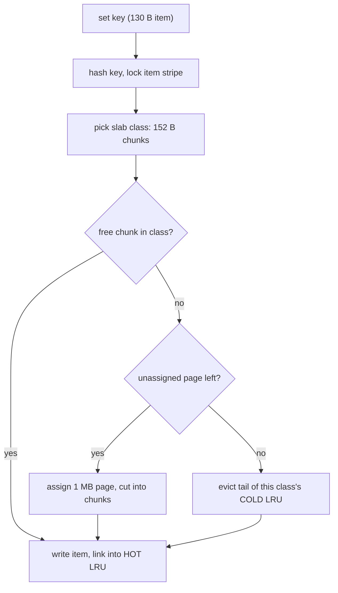

## In one minute
- Memcached is a multithreaded, in-memory key-value cache: opaque byte values up to 1 MB by default, keys up to 250 bytes, operations like `get`, `set`, `add`, `cas`, `incr` and `delete`.
- It has no replication, no persistence and no cluster awareness. Servers do not know about each other; clients pick a server by hashing the key.
- Memory is managed by a slab allocator: fixed-size chunks grouped into classes, with an LRU per class. It never fragments, but it can waste memory and evict in one class while another sits half-empty.
- Choose it for a large, flat look-aside cache on many-core machines where you want predictable memory and simple operations. Choose Redis when you need data structures, persistence, replication or pub/sub.

## How it works

### A cache with nothing extra
A Memcached server is a hash table in RAM behind a network front end. Each item carries a TTL and a 32-bit flags field clients use for things like "compressed". There are no secondary structures, no multi-key transactions and no server-to-server traffic, so a node is cheap to run and easy to reason about.

### Sharding is the client's job
Clients hash each key onto a consistent-hash ring (ketama is the classic scheme) and talk directly to the owning server, so adding a 51st server remaps about 1/51 of keys. Large fleets put a proxy in front, such as mcrouter or the proxy built into Memcached since 1.6.23, for routing by key prefix, named pools, fan-out writes, failover and connection pooling ([Memcached docs](https://docs.memcached.org/features/proxy/)).

### Look-aside caching
The application reads the cache; on a miss it reads the database and `set`s the value. On a database write it deletes the key rather than updating it, because two racing `set`s can leave the older value behind. Facebook's leases extend this: on a miss the server hands out a token, only its holder may fill the key, and others wait or take a stale value, which stops thundering herds and stale writes. Facebook issued at most one token per key every 10 seconds, and on herd-prone keys that cut the peak database query rate from 17,000 to 1,300 per second ([Nishtala et al., NSDI 2013](https://www.usenix.org/conference/nsdi13/technical-sessions/presentation/nishtala)).

## Down the stack

### Layer 1: The contract
Memcached promises only best-effort storage. A `set` that returns `STORED` may be evicted a millisecond later; a server restart loses everything; a network partition makes keys on that server simply miss. Per key, operations are atomic: `incr`, `add` (store only if absent) and `cas` (store only if the CAS unique still matches) are safe under concurrency. TTLs up to 30 days are relative seconds; larger numbers are read as Unix timestamps, a classic source of keys that expire instantly. Keys are limited to 250 bytes ([protocol docs](https://docs.memcached.org/protocols/basic/)). Latency is typically 100 to 300 us per request inside a data centre, dominated by the network.

### Layer 2: The mechanism
**Threads.** One listener thread `accept`s connections and hands each to a worker thread round-robin, signalling it over a pipe. Each worker (`-t`, default 4 per the [man page](https://raw.githubusercontent.com/memcached/memcached/master/doc/memcached.1)) runs its own libevent loop over its connections, so a connection is always served by the same thread. Background threads handle hash table expansion, the LRU maintainer, the LRU crawler (which reclaims expired items) and slab rebalancing.

**Hash table.** A single chained hash table, sized as a power of two (`hashpower`, starting at 2^16 buckets). When items exceed 1.5 times the bucket count, an expansion thread grows the table while workers keep serving. Concurrency comes from a striped array of item locks keyed by hash, so two workers only contend when their keys share a stripe.

**Slab allocator.** Memory is carved into pages, 1 MB by default (matching the maximum item size `-I`). Slab classes have chunk sizes growing by the factor `-f` (default 1.25) from a small minimum around 96 bytes: 96, 120, 152, 192 and so on, up to half a page, with a final class for full-page items. A page belongs to exactly one class and is cut into equal chunks. An item (header of roughly 48 to 56 bytes plus key plus value) goes into the smallest chunk that fits. A 130-byte item uses a 152-byte chunk, wasting 22 bytes. When a class has no free chunk, the server assigns it a new page if any remain under `-m`; otherwise it evicts from that class's LRU. Pages assigned to one class stay there unless the slab rebalancer moves them, which it does when one class keeps evicting while another has idle pages. Since 1.5.0 the rebalancer is on by default (`slab_reassign` true, `slab_automove=1`) as part of the former `-o modern` bundle ([release notes](https://github.com/memcached/memcached/wiki/ReleaseNotes150), [source](https://github.com/memcached/memcached/blob/master/memcached.c)).

**Segmented LRU.** Since 1.5 each class has HOT, WARM and COLD queues (plus TEMP for very short TTLs). New items enter HOT, which is never bumped and acts as a probation queue; the LRU maintainer moves items down; an item that becomes active while in COLD is queued for an asynchronous move to WARM. Evictions take from the COLD tail. This became the default in 1.5.0 ([memcached.org](https://memcached.org/blog/modern-lru/)). It replaced the older rule of bumping an item at most once per 60 seconds, which existed so a hot key did not take the LRU lock on every read.

**Protocols.** The text protocol (`get k1 k2`, `set k flags ttl bytes`) is human-readable. The meta protocol (`mg`, `ms`, `md`, `ma`, 1.6+) adds flags such as returning a stale value with a "win" (`W`) flag so exactly one client refreshes, while later clients see `Z` and keep serving the stale copy ([meta protocol](https://docs.memcached.org/protocols/meta/)). Extstore keeps keys in RAM but moves large values to flash.

### Layer 3: The machine
Every request is a short syscall dance: `epoll_wait` returns, `read` pulls the request, a hash lookup touches a bucket and an item header (two or three cache misses, a few hundred nanoseconds), and `sendmsg` writes the value. Multi-get batches amortise this; a `get` of 100 keys in one request costs far less than 100 round trips. With enough threads and NIC queues, a single modern server can serve several million small gets per second, at which point the NIC and interrupts are the limit (hedge: published numbers range from 1 to over 10 million depending on hardware and batching). Lock granularity matters as much as threads: Facebook's finer-grained locking tripled one server's peak hit rate from 600,000 to 1.8 million items per second. Facebook also moved gets to UDP to avoid per-connection TCP state, treating the 0.25 percent of gets dropped at peak as misses ([NSDI 2013 paper](https://www.usenix.org/system/files/conference/nsdi13/nsdi13-final170_update.pdf)). Stock Memcached went the other way: UDP has been off by default since 1.5.6 because open UDP ports were being abused for reflection attacks ([release notes](https://github.com/memcached/memcached/wiki/ReleaseNotes156)).

The slab design comes from `malloc` behaviour under churn: many allocations and frees of varied sizes fragment the heap until resident memory far exceeds live data. Fixed-size chunks never fragment, and allocation is popping a free list. The cost moves to internal waste (up to about 20 percent with factor 1.25) and to *slab calcification*, where yesterday's size distribution owns the pages today's traffic needs.

### Why it's built this way
1. RAM is the expensive resource in a cache fleet, so memory overhead per item must be small and predictable; that rules out general-purpose `malloc` with its fragmentation.
2. Fixed chunks bring internal waste and calcification, so the server adds tunable growth factors and a background page rebalancer.
3. A cache can always be refilled from the database, so replication and persistence are not worth their CPU and network cost; clients handle failure as misses.
4. Without server-side clustering, servers stay simple, and consistent hashing in the client keeps remapping small when the fleet changes.
5. Small requests are dominated by per-request syscalls, so many threads and multi-get batching are how one box uses all its cores.

## Diagram


## Worked example
A catalogue service caches product JSON: 30 million hot products, 1.8 KB average, 400,000 reads per second at peak.

An item of about 1.9 KB with header and key lands in the roughly 2.3 KB class at the default factor, so 30 million items need about 69 GB. On 64 GB servers giving 54 GB to Memcached (`-m 55296`), two servers would almost fit; the fleet runs 6, which survives a node loss and keeps each near 67,000 requests per second. At a 95 percent hit rate, Postgres sees 20,000 reads per second.

Six months later the average value is 3 KB and the hit rate falls to 85 percent although total memory looks fine: pages are still held by the 2.3 KB class while the 3.6 KB class evicts. On 1.5.0 and later the default rebalancer (`slab_automove=1`) notices the skew and migrates pages over minutes; on an older build, or with automove turned off, the operator must enable it or restart, and the hit rate recovers once pages move. A growth factor of 1.08 would also cut per-item waste from up to 20 percent to under 8 percent, at the cost of more classes.

## In the wild
- **Slack, 2022: empty caches turn a lookup into a scatter query.** A gradual Consul agent rollout briefly removed memcached nodes, and Slack's cache control plane swapped in empty replacements, so hit rates fell. Group DM membership was cached by channel but the Vitess tables were sharded by user, so every miss became a query to every shard. The database could not refill the cache, client retries piled on, and many users could not boot Slack from just after 6am PT. Fixes included a channel-sharded table and an audit of other cache-fronted scatter queries ([Slack](https://slack.engineering/slacks-incident-on-2-22-22/)).
- **GitHub, 2018: 1.35 Tbps from exposed memcached servers.** Attackers spoofed GitHub's address in UDP requests to internet-facing memcached servers, amplifying traffic up to about 51,000 times, peaking at 1.35 Tbps and 126.9 million packets per second. GitHub was down for five minutes and intermittently unavailable for four more until traffic was routed through Akamai's scrubbing ([GitHub](https://github.blog/news-insights/company-news/ddos-incident-report/)).
- **Instagram, 2015: leases for a celebrity's like count.** After adding a second region, every new like deleted the cached count, and each miss ran a `count(*)` costing hundreds of milliseconds, worst on the most popular posts. Instagram denormalized the count into a column and used memcache lease-gets so one web server refilled a deleted key while others got a stale value or waited ([Instagram Engineering, archived](https://web.archive.org/web/20250121100731/https://instagram-engineering.com/instagration-pt-2-scaling-our-infrastructure-to-multiple-data-centers-5745cbad7834)).

## Trade-offs
| Option | Strengths | Weaknesses | Choose when |
|---|---|---|---|
| Memcached | Multithreaded, predictable memory, very simple | Only opaque values; no replication or persistence | Large look-aside cache of serialised objects |
| Redis | Rich types, replication, persistence, scripting | One execution thread per shard, fork memory overhead | Counters, leaderboards, queues, sessions |
| In-process cache | Nanosecond access, no network | Per-host duplication, harder invalidation | Tiny hot sets, config, read-mostly reference data |
| CDN or HTTP cache | Offloads whole responses at the edge | Coarse invalidation, public responses only | Cacheable pages and assets |

## Pitfalls in production
- **Slab calcification.** Value sizes drift and one class starves. Keep `slab_reassign` and `slab_automove` on (the default since 1.5.0, but often off on old builds or hand-written configs), and watch per-class evictions in `stats slabs`.
- **Thundering herd on a hot miss.** A popular key expires and thousands of requests hit the database. Use leases or the meta protocol's stale-and-win flags, and jitter TTLs.
- **Stale sets racing deletes.** A slow reader `set`s an old value after a writer deleted the key. Fill with `add`, CAS or leases.
- **TTL over 30 days.** It is read as an absolute timestamp in 1970, so items expire immediately. Cap relative TTLs.
- **Losing a server floods the database.** With 10 servers, one failure sends 10 percent of reads to the database. Use a gutter or replicated pool (Facebook's gutter pool was about 1 percent of servers) and size the database for it.
- **UDP or port 11211 reachable from the internet.** A tiny spoofed request returns a huge value, which made exposed servers a DDoS amplifier. Keep UDP off (the default since 1.5.6) and firewall the port.

## Leadership lens
- Ask what the database does at a 0 percent hit rate. That is your cold-start and failure capacity requirement.
- Choose Memcached when teams only need get/set of serialised blobs at scale; avoid running two cache technologies without a reason.
- Invalidation is the hard part: decide delete-on-write versus TTL-only per data type, and consider tailing the database change log to issue deletes.
- A routing proxy centralises pools and failover, which matters more than any server flag once many services share the fleet.

## Check yourself
1. Why does Memcached use a slab allocator instead of `malloc`?
   **Answer:** Fixed-size chunks never fragment and allocate in constant time, so memory use stays predictable under churn; the cost is internal waste and per-class eviction.
2. Total memory is half free but one slab class is evicting heavily. How?
   **Answer:** Pages are assigned to classes and stay there; the free memory belongs to other classes. The rebalancer or a restart is needed to move pages.
3. Why delete on write instead of updating the cached value?
   **Answer:** Delete is idempotent and cannot reorder badly; two concurrent updates can leave the older value cached indefinitely.
4. What do leases fix?
   **Answer:** Only one client per key gets permission to fill a miss, which prevents thundering herds, and a delete invalidates outstanding tokens so stale fills are rejected.

## Practice
**Task:** Build a Memcached-style slab allocator. `SlabAllocator(page_size, min_chunk, factor, total_pages)` creates classes with chunk sizes starting at `min_chunk`, each next size `max(prev + 1, ceil(prev * factor))`, while the size is below `page_size`, plus a final class of exactly `page_size`. `class_for(size)` returns the smallest class whose chunk fits, or -1 if larger than a page. `set(key, size)` replaces any existing item, takes a free chunk in its class, else assigns a new page to the class (`page_size // chunk` chunks), else evicts that class's least recently used item, and returns false only if the class has no items to evict. `get(key)` returns the size and marks the item recently used; `delete(key)` frees its chunk. Expose `chunk_sizes()`, `pages_assigned(cls)` and `evictions()`.

```python starter
class SlabAllocator:
    def __init__(self, page_size, min_chunk, factor, total_pages):
        # TODO
        pass

    def chunk_sizes(self):
        raise NotImplementedError

    def class_for(self, size):
        raise NotImplementedError

    def set(self, key, size):
        raise NotImplementedError

    def get(self, key):
        raise NotImplementedError

    def delete(self, key):
        raise NotImplementedError

    def pages_assigned(self, cls):
        raise NotImplementedError

    def evictions(self):
        raise NotImplementedError
```

```python tests
def test_chunk_sizes():
    assert SlabAllocator(1024, 64, 2, 1).chunk_sizes() == [64, 128, 256, 512, 1024]
    assert SlabAllocator(1024, 64, 1.25, 1).chunk_sizes()[:5] == [64, 80, 100, 125, 157]

def test_class_for():
    a = SlabAllocator(1024, 64, 2, 1)
    assert a.class_for(1) == 0 and a.class_for(64) == 0 and a.class_for(65) == 1
    assert a.class_for(1024) == 4 and a.class_for(1025) == -1

def test_pages_assigned_lazily():
    a = SlabAllocator(1024, 64, 2, 4)
    for i in range(17):
        assert a.set("k%d" % i, 50)
    assert a.pages_assigned(0) == 2 and a.pages_assigned(1) == 0
    assert a.get("k3") == 50 and a.evictions() == 0

def test_lru_eviction_within_class():
    a = SlabAllocator(1024, 64, 2, 1)
    for i in range(16):
        a.set("k%d" % i, 50)
    a.get("k0")
    assert a.set("new", 60)
    assert a.get("k1") is None and a.get("k0") == 50 and a.evictions() == 1

def test_calcification_rejects_other_class():
    a = SlabAllocator(1024, 64, 2, 1)
    a.set("small", 10)
    assert a.set("big", 600) is False
    assert a.get("small") == 10

def test_delete_frees_chunk():
    a = SlabAllocator(1024, 512, 2, 1)
    assert a.set("a", 500) and a.set("b", 500)
    assert a.delete("a") and not a.delete("a")
    assert a.set("c", 500) and a.evictions() == 0
    assert a.get("a") is None

def test_overwrite_and_too_large():
    a = SlabAllocator(1024, 64, 2, 2)
    a.set("x", 50)
    a.set("x", 200)
    assert a.get("x") == 200 and a.pages_assigned(2) == 1
    assert a.set("huge", 5000) is False
```

```python solution
import math
from collections import OrderedDict

class SlabAllocator:
    def __init__(self, page_size, min_chunk, factor, total_pages):
        self.page_size = page_size
        self.sizes = []
        s = min_chunk
        while s < page_size:
            self.sizes.append(s)
            s = max(s + 1, int(math.ceil(s * factor)))
        self.sizes.append(page_size)
        self.free_pages = total_pages
        self.pages = [0] * len(self.sizes)
        self.free = [0] * len(self.sizes)
        self.lru = [OrderedDict() for _ in self.sizes]
        self.items = {}
        self.evicted = 0

    def chunk_sizes(self):
        return list(self.sizes)

    def class_for(self, size):
        for i, c in enumerate(self.sizes):
            if size <= c:
                return i
        return -1

    def set(self, key, size):
        c = self.class_for(size)
        if c < 0:
            return False
        self.delete(key)
        if self.free[c] == 0:
            if self.free_pages > 0:
                self.free_pages -= 1
                self.pages[c] += 1
                self.free[c] += self.page_size // self.sizes[c]
            elif self.lru[c]:
                victim = next(iter(self.lru[c]))
                self.delete(victim)
                self.evicted += 1
            else:
                return False
        self.free[c] -= 1
        self.lru[c][key] = True
        self.items[key] = (c, size)
        return True

    def get(self, key):
        if key not in self.items:
            return None
        c, size = self.items[key]
        self.lru[c].move_to_end(key)
        return size

    def delete(self, key):
        if key not in self.items:
            return False
        c, _ = self.items.pop(key)
        del self.lru[c][key]
        self.free[c] += 1
        return True

    def pages_assigned(self, cls):
        return self.pages[cls]

    def evictions(self):
        return self.evicted
```

```typescript starter
export class SlabAllocator {
  constructor(pageSize: number, minChunk: number, factor: number, totalPages: number) {}
  chunkSizes(): number[] {
    throw new Error("TODO");
  }
  classFor(size: number): number {
    throw new Error("TODO");
  }
  set(key: string, size: number): boolean {
    throw new Error("TODO");
  }
  get(key: string): number | null {
    throw new Error("TODO");
  }
  delete(key: string): boolean {
    throw new Error("TODO");
  }
  pagesAssigned(cls: number): number {
    throw new Error("TODO");
  }
  evictions(): number {
    throw new Error("TODO");
  }
}
```

```typescript tests
test("chunk sizes", () => {
  assertEqual(new SlabAllocator(1024, 64, 2, 1).chunkSizes(), [64, 128, 256, 512, 1024]);
  assertEqual(new SlabAllocator(1024, 64, 1.25, 1).chunkSizes().slice(0, 5), [64, 80, 100, 125, 157]);
});
test("class for", () => {
  const a = new SlabAllocator(1024, 64, 2, 1);
  assertEqual([a.classFor(1), a.classFor(64), a.classFor(65), a.classFor(1024), a.classFor(1025)], [0, 0, 1, 4, -1]);
});
test("pages assigned lazily", () => {
  const a = new SlabAllocator(1024, 64, 2, 4);
  for (let i = 0; i < 17; i++) assert(a.set("k" + i, 50), "set " + i);
  assertEqual([a.pagesAssigned(0), a.pagesAssigned(1)], [2, 0]);
  assertEqual([a.get("k3"), a.evictions()], [50, 0]);
});
test("lru eviction within class", () => {
  const a = new SlabAllocator(1024, 64, 2, 1);
  for (let i = 0; i < 16; i++) a.set("k" + i, 50);
  a.get("k0");
  assert(a.set("new", 60), "set new");
  assertEqual([a.get("k1"), a.get("k0"), a.evictions()], [null, 50, 1]);
});
test("calcification rejects other class", () => {
  const a = new SlabAllocator(1024, 64, 2, 1);
  a.set("small", 10);
  assertEqual(a.set("big", 600), false);
  assertEqual(a.get("small"), 10);
});
test("delete frees chunk", () => {
  const a = new SlabAllocator(1024, 512, 2, 1);
  assert(a.set("a", 500) && a.set("b", 500), "two fit");
  assertEqual([a.delete("a"), a.delete("a")], [true, false]);
  assert(a.set("c", 500), "reuses chunk");
  assertEqual([a.evictions(), a.get("a")], [0, null]);
});
test("overwrite and too large", () => {
  const a = new SlabAllocator(1024, 64, 2, 2);
  a.set("x", 50);
  a.set("x", 200);
  assertEqual([a.get("x"), a.pagesAssigned(2)], [200, 1]);
  assertEqual(a.set("huge", 5000), false);
});
```

```typescript solution
export class SlabAllocator {
  private sizes: number[] = [];
  private pages: number[];
  private free: number[];
  private lru: Map<string, true>[];
  private items = new Map<string, [number, number]>();
  private evicted = 0;
  private freePages: number;

  constructor(private pageSize: number, minChunk: number, factor: number, totalPages: number) {
    let s = minChunk;
    while (s < pageSize) {
      this.sizes.push(s);
      s = Math.max(s + 1, Math.ceil(s * factor));
    }
    this.sizes.push(pageSize);
    this.freePages = totalPages;
    this.pages = this.sizes.map(() => 0);
    this.free = this.sizes.map(() => 0);
    this.lru = this.sizes.map(() => new Map<string, true>());
  }
  chunkSizes(): number[] {
    return [...this.sizes];
  }
  classFor(size: number): number {
    return this.sizes.findIndex((c) => size <= c);
  }
  set(key: string, size: number): boolean {
    const c = this.classFor(size);
    if (c < 0) return false;
    this.delete(key);
    if (this.free[c] === 0) {
      if (this.freePages > 0) {
        this.freePages--;
        this.pages[c]++;
        this.free[c] += Math.floor(this.pageSize / this.sizes[c]);
      } else if (this.lru[c].size > 0) {
        const victim = this.lru[c].keys().next().value as string;
        this.delete(victim);
        this.evicted++;
      } else {
        return false;
      }
    }
    this.free[c]--;
    this.lru[c].set(key, true);
    this.items.set(key, [c, size]);
    return true;
  }
  get(key: string): number | null {
    const it = this.items.get(key);
    if (!it) return null;
    this.lru[it[0]].delete(key);
    this.lru[it[0]].set(key, true);
    return it[1];
  }
  delete(key: string): boolean {
    const it = this.items.get(key);
    if (!it) return false;
    this.items.delete(key);
    this.lru[it[0]].delete(key);
    this.free[it[0]]++;
    return true;
  }
  pagesAssigned(cls: number): number {
    return this.pages[cls];
  }
  evictions(): number {
    return this.evicted;
  }
}
```

```go starter
package practice

type SlabAllocator struct{}

func NewSlabAllocator(pageSize, minChunk int, factor float64, totalPages int) *SlabAllocator {
	return &SlabAllocator{}
}

func (a *SlabAllocator) ChunkSizes() []int { panic("TODO") }

func (a *SlabAllocator) ClassFor(size int) int { panic("TODO") }

func (a *SlabAllocator) Set(key string, size int) bool { panic("TODO") }

// Get returns the item size and whether it exists.
func (a *SlabAllocator) Get(key string) (int, bool) { panic("TODO") }

func (a *SlabAllocator) Delete(key string) bool { panic("TODO") }

func (a *SlabAllocator) PagesAssigned(cls int) int { panic("TODO") }

func (a *SlabAllocator) Evictions() int { panic("TODO") }
```

```go tests
package practice

import (
	"fmt"
	"reflect"
	"testing"
)

func TestChunkSizes(t *testing.T) {
	if got := NewSlabAllocator(1024, 64, 2, 1).ChunkSizes(); !reflect.DeepEqual(got, []int{64, 128, 256, 512, 1024}) {
		t.Fatalf("got %v", got)
	}
	if got := NewSlabAllocator(1024, 64, 1.25, 1).ChunkSizes()[:5]; !reflect.DeepEqual(got, []int{64, 80, 100, 125, 157}) {
		t.Fatalf("got %v", got)
	}
}

func TestClassFor(t *testing.T) {
	a := NewSlabAllocator(1024, 64, 2, 1)
	got := []int{a.ClassFor(1), a.ClassFor(64), a.ClassFor(65), a.ClassFor(1024), a.ClassFor(1025)}
	if !reflect.DeepEqual(got, []int{0, 0, 1, 4, -1}) {
		t.Fatalf("got %v", got)
	}
}

func TestPagesAssignedLazily(t *testing.T) {
	a := NewSlabAllocator(1024, 64, 2, 4)
	for i := 0; i < 17; i++ {
		if !a.Set(fmt.Sprintf("k%d", i), 50) {
			t.Fatal("set failed")
		}
	}
	if a.PagesAssigned(0) != 2 || a.PagesAssigned(1) != 0 || a.Evictions() != 0 {
		t.Fatal("wrong page assignment")
	}
}

func TestLRUEvictionWithinClass(t *testing.T) {
	a := NewSlabAllocator(1024, 64, 2, 1)
	for i := 0; i < 16; i++ {
		a.Set(fmt.Sprintf("k%d", i), 50)
	}
	a.Get("k0")
	if !a.Set("new", 60) {
		t.Fatal("set new failed")
	}
	if _, ok := a.Get("k1"); ok {
		t.Fatal("k1 should be evicted")
	}
	if v, ok := a.Get("k0"); !ok || v != 50 || a.Evictions() != 1 {
		t.Fatal("k0 should survive")
	}
}

func TestCalcification(t *testing.T) {
	a := NewSlabAllocator(1024, 64, 2, 1)
	a.Set("small", 10)
	if a.Set("big", 600) {
		t.Fatal("big should be rejected")
	}
	if v, ok := a.Get("small"); !ok || v != 10 {
		t.Fatal("small lost")
	}
}

func TestDeleteFreesChunk(t *testing.T) {
	a := NewSlabAllocator(1024, 512, 2, 1)
	if !a.Set("a", 500) || !a.Set("b", 500) {
		t.Fatal("two should fit")
	}
	if !a.Delete("a") || a.Delete("a") {
		t.Fatal("wrong delete results")
	}
	if !a.Set("c", 500) || a.Evictions() != 0 {
		t.Fatal("chunk not reused")
	}
}

func TestOverwriteAndTooLarge(t *testing.T) {
	a := NewSlabAllocator(1024, 64, 2, 2)
	a.Set("x", 50)
	a.Set("x", 200)
	if v, _ := a.Get("x"); v != 200 || a.PagesAssigned(2) != 1 {
		t.Fatal("overwrite failed")
	}
	if a.Set("huge", 5000) {
		t.Fatal("huge should be rejected")
	}
}
```

```go solution
package practice

import (
	"container/list"
	"math"
)

type entry struct {
	class, size int
	elem        *list.Element
}

type SlabAllocator struct {
	pageSize  int
	sizes     []int
	freePages int
	pages     []int
	free      []int
	lru       []*list.List
	items     map[string]*entry
	evicted   int
}

func NewSlabAllocator(pageSize, minChunk int, factor float64, totalPages int) *SlabAllocator {
	a := &SlabAllocator{pageSize: pageSize, freePages: totalPages, items: map[string]*entry{}}
	for s := minChunk; s < pageSize; {
		a.sizes = append(a.sizes, s)
		next := int(math.Ceil(float64(s) * factor))
		if next < s+1 {
			next = s + 1
		}
		s = next
	}
	a.sizes = append(a.sizes, pageSize)
	a.pages = make([]int, len(a.sizes))
	a.free = make([]int, len(a.sizes))
	for range a.sizes {
		a.lru = append(a.lru, list.New())
	}
	return a
}

func (a *SlabAllocator) ChunkSizes() []int { return append([]int(nil), a.sizes...) }

func (a *SlabAllocator) ClassFor(size int) int {
	for i, c := range a.sizes {
		if size <= c {
			return i
		}
	}
	return -1
}

func (a *SlabAllocator) Set(key string, size int) bool {
	c := a.ClassFor(size)
	if c < 0 {
		return false
	}
	a.Delete(key)
	if a.free[c] == 0 {
		switch {
		case a.freePages > 0:
			a.freePages--
			a.pages[c]++
			a.free[c] += a.pageSize / a.sizes[c]
		case a.lru[c].Len() > 0:
			a.Delete(a.lru[c].Front().Value.(string))
			a.evicted++
		default:
			return false
		}
	}
	a.free[c]--
	a.items[key] = &entry{class: c, size: size, elem: a.lru[c].PushBack(key)}
	return true
}

// Get returns the item size and whether it exists.
func (a *SlabAllocator) Get(key string) (int, bool) {
	e, ok := a.items[key]
	if !ok {
		return 0, false
	}
	a.lru[e.class].MoveToBack(e.elem)
	return e.size, true
}

func (a *SlabAllocator) Delete(key string) bool {
	e, ok := a.items[key]
	if !ok {
		return false
	}
	delete(a.items, key)
	a.lru[e.class].Remove(e.elem)
	a.free[e.class]++
	return true
}

func (a *SlabAllocator) PagesAssigned(cls int) int { return a.pages[cls] }

func (a *SlabAllocator) Evictions() int { return a.evicted }
```

## Mock interview
**Prompt:** A feed service makes 2 million cache reads per second against a 200-node Memcached fleet backed by sharded MySQL. Explain key routing, invalidation when posts are edited, and surviving a node loss.

- Follow-up: a celebrity post's key expires and 50,000 requests miss within a second. What happens?
- Follow-up: you add 20 nodes. How many keys move, and what does the database see?
- Follow-up: why not Redis Cluster?

**A strong answer covers:**
- Consistent hashing in clients or a proxy, so adding 20 nodes to 200 remaps about 9 percent of keys.
- Delete-on-write driven by the database change stream, so invalidations survive app crashes.
- Leases or stale-while-revalidate so one request refills a hot key.
- A gutter or replicated pool so a node loss does not dump its 0.5 percent of traffic onto MySQL.
- Capacity math: 10,000 reads per node per second is light; the database must survive the miss rate.
- Redis Cluster adds replication and structures but costs memory and operations a blob cache does not need.

## Sources and further study
**Primary**
- [Yang et al., A large scale analysis of hundreds of in-memory cache clusters at Twitter (OSDI 2020)](https://www.usenix.org/conference/osdi20/presentation/yang): 153 production clusters; many are write-heavy and TTL, not eviction, often bounds the working set.
- [Memcached source: memcached.c](https://github.com/memcached/memcached/blob/master/memcached.c): `settings_init()` shows the real defaults, including slab rebalancing.

**Systems docs**
- [Memcached meta protocol](https://docs.memcached.org/protocols/meta/): win, stale and invalidation flags for herd-safe refresh.
- [Memcached built-in proxy](https://docs.memcached.org/features/proxy/): pools, routes and consistent hashing inside the server since 1.6.23.
- [Memcached 1.5.0 release notes](https://github.com/memcached/memcached/wiki/ReleaseNotes150): the `-o modern` defaults (segmented LRU, slab rebalancing, LRU crawler).
- [Memcached 1.5.6 release notes](https://github.com/memcached/memcached/wiki/ReleaseNotes156): UDP disabled by default after amplification attacks.

**Books**
- *Designing Distributed Systems* (2nd ed.), Brendan Burns, Ch 7 "Sharded Services": sharded caching, choosing a sharding function and hot shards.
- *Site Reliability Engineering*, Beyer et al., Ch 22 "Addressing Cascading Failures": slow startup and cold caches as an overload trigger ([read free](https://sre.google/sre-book/addressing-cascading-failures/)).

**Other curricula**
- [donnemartin/system-design-primer](https://github.com/donnemartin/system-design-primer#cache): places Memcached as the classic cache-aside store and suggests connection pooling or UDP to cut connection overhead.
- [AWS Builders' Library: Caching challenges and strategies](https://builder.aws.com/content/3K9TeXp6strMiJ4vhakpRD7BQWO/caching-challenges-and-strategies): treats the cache fleet as a dependency that fails, with soft and hard TTLs and request coalescing.
- [Azure Architecture Center: Cache-Aside pattern](https://learn.microsoft.com/en-us/azure/architecture/patterns/cache-aside): the look-aside read path, expiry and invalidation trade-offs, independent of any product.

## Watch
- [NSDI '13 - Scaling Memcache at Facebook (USENIX)](https://www.youtube.com/watch?v=m4_7W4XzRgk): leases, regional pools, gutter servers and invalidation at billions of requests per second.

## Free resources
- [Scaling Memcache at Facebook (NSDI 2013 paper)](https://www.usenix.org/system/files/conference/nsdi13/nsdi13-final170_update.pdf): the canonical account of running Memcached as a fleet.
- [Memcached documentation](https://docs.memcached.org/): official guides to configuration, protocols and features.
- [Memcached basic text protocol](https://docs.memcached.org/protocols/basic/): exact command and reply formats, including CAS and TTL rules.
- [Replacing the cache replacement algorithm in memcached](https://memcached.org/blog/modern-lru/): the maintainer's explanation of the segmented HOT/WARM/COLD LRU.
- [Flash storage (extstore)](https://docs.memcached.org/features/flashstorage/): how values move to SSD while keys stay in RAM.
