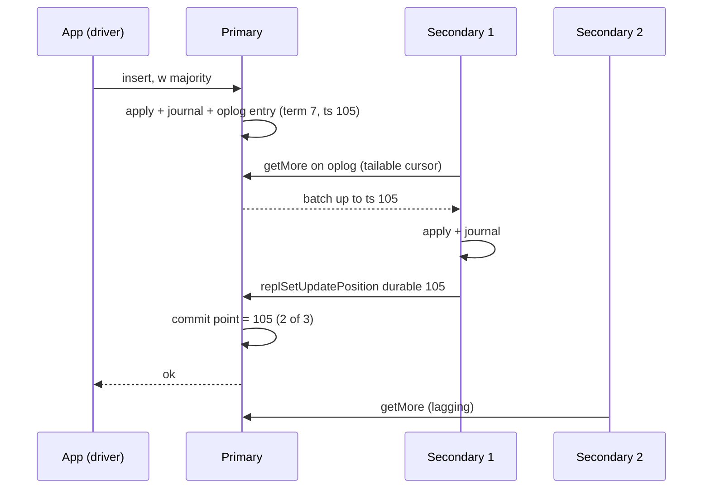

## In one minute
- MongoDB stores BSON documents in collections, with secondary indexes, aggregation pipelines and multi-document transactions. One document may be at most 16 MiB.
- Each shard is a replica set: a primary takes writes, secondaries pull its oplog, and a Raft-style protocol with terms elects a new primary in roughly ten seconds.
- Durability and freshness are per-operation dials: write concern (`w: 1`, `w: "majority"`) and read concern (`local`, `majority`, `linearizable`, `snapshot`).
- WiredTiger stores each collection and index as a B-tree with MVCC, a write-ahead journal and a checkpoint every 60 seconds.
- Sharding splits a collection into key ranges (chunks) placed by a balancer and routed by `mongos`. The shard key is the decision you cannot cheaply undo.

## How it works

### The document model
A document holds what is read together: an order with its line items and address. One read fetches the aggregate, and a single-document write is atomic without a transaction. Unbounded arrays (every comment on a viral post) fight back: they grow towards 16 MiB, rewrite large pages on each update and bloat indexes, so anything that grows without bound gets its own collection.

### Replica sets
A replica set has up to 50 members, at most 7 voting ([MongoDB docs](https://www.mongodb.com/docs/manual/core/replica-set-elections/)). The primary applies a write and records it in the oplog (`local.oplog.rs`); secondaries copy and replay it. Drivers discover the topology and send reads where the read preference allows (`primary`, `secondary`, `nearest`).

### Sharded clusters
Stateless `mongos` routers consult a config server replica set that maps key ranges to shards. A query with the shard key hits one shard; without it, every shard. Hashed keys spread inserts but scatter range queries; ranged keys keep ranges local but funnel monotonic keys (timestamps, ObjectIds) onto one hot shard. Since 8.0 the topology is less fixed than it was: `moveCollection` relocates an unsharded collection to another shard, `unshardCollection` gathers a sharded one back onto a single shard, a config server can also hold data as a config shard, and resharding runs substantially faster, including resharding on the same key to redistribute data ([MongoDB 8.0 release notes](https://www.mongodb.com/docs/manual/release-notes/8.0/)).

## Down the stack

### Layer 1: The contract
A single-document write is atomic and, on the primary, linearizable. With `w: "majority"` (the implicit default for most deployments since 5.0), an acknowledged write is journaled on a majority of voting members and survives any failover the majority survives. The exception catches people out: with an arbiter, if data-bearing voters do not outnumber the voting majority (the common primary, secondary, arbiter layout), the default silently drops to `w: 1` ([MongoDB docs](https://www.mongodb.com/docs/manual/reference/write-concern/)). With `w: 1`, only the primary had it, and if it dies first the write is rolled back when it rejoins. `readConcern: "majority"` never returns data that can be rolled back; `local` may. Causally consistent sessions add read-your-writes across members by carrying `afterClusterTime`, but only with majority reads and writes; with `w: 1` and `local` reads, Jepsen saw acknowledged writes vanish and reads return values later rolled back ([Jepsen](https://jepsen.io/analyses/mongodb-3-6-4)). Multi-document transactions give snapshot isolation, not serializability, and set their own concerns: Jepsen found 4.2.6 transactions ignored collection-level concerns and fell back to `local` and `w: 1`, so set `snapshot` and `majority` explicitly on each transaction ([Jepsen](https://jepsen.io/analyses/mongodb-4.2.6)). Expect single-digit millisecond indexed reads within a zone and about 10 to 15 seconds without writes during an unplanned failover; the docs put the median election, including detection, at no more than about 12 seconds with default settings ([MongoDB docs](https://www.mongodb.com/docs/manual/core/replica-set-elections/)).

### Layer 2: The mechanism
**WiredTiger.** Each collection and index is a `.wt` file holding a B-tree. In cache, records carry update chains stamped with transaction timestamps, which gives MVCC snapshot reads without read locks; versions still needed by old readers move to the history store. On disk, pages are compressed (snappy for collections, zstd for time-series collections, prefix compression for indexes) and never overwritten: a reconciled page goes to a new block, and a checkpoint every 60 seconds publishes a consistent root ([MongoDB docs](https://www.mongodb.com/docs/manual/core/wiredtiger/)). Between checkpoints the journal makes writes recoverable; it is flushed every 100 ms by default (`storage.journal.commitIntervalMs`), or at once for `j: true` and majority writes.

**Oplog.** A capped collection of idempotent operations keyed by optime (timestamp plus term); an `$inc` is logged as a `$set` of the result so replay is safe. Secondaries pull with a tailable cursor from a sync source (possibly another secondary), apply batches with parallel writer threads, and report applied and durable optimes with `replSetUpdatePosition`. The primary computes the majority commit point and gossips it in heartbeats.

**Elections.** Members heartbeat every two seconds. After `electionTimeoutMillis` (10 seconds) without the primary, a secondary bumps the term and sends `replSetRequestVotes` with its last optime. Voters grant one vote per term, only to candidates at least as up to date, Raft's rule. A deposed primary rolls back entries the new primary lacks into a `rollback` directory.

**Balancer.** Routers cache the routing table with a collection version; a shard holding a newer version returns a stale-config error and the router refreshes. Since 6.0 the balancer, running on the config server primary, balances by data size: it acts when shards differ by three times the range size (default 128 MB, so 384 MB) ([MongoDB docs](https://www.mongodb.com/docs/manual/core/sharding-balancer-administration/)). A migration clones documents, streams concurrent changes, holds a short critical section that blocks writes to the range, commits ownership on the config servers, and deletes the donor copy later.

### Layer 3: The machine
The WiredTiger cache defaults to the larger of 50 percent of (RAM minus 1 GB) or 256 MB, so a 64 GB host gets 31.5 GB; the OS page cache holds compressed blocks with the rest. Eviction threads aim to keep the cache near 80 percent full and dirty data near 5 percent; past the hard triggers (roughly 95 percent full or 20 percent dirty), application threads must evict pages themselves and p99 jumps from milliseconds to hundreds of milliseconds. Checkpoints flush all dirty pages each minute, a periodic I/O burst. The journal is append-only with grouped `fsync`s: one flush of a few hundred microseconds on NVMe covers every write in the window, so majority writes batch well. Each connection gets its own thread, commonly estimated at around 1 MB of memory, so 20,000 pooled connections hurt before any query runs.

### Why it's built this way
1. Joins across tables cost random I/O, so the aggregate lives in one document behind one B-tree lookup.
2. Single-document writes need no distributed transaction, so data can be sharded by key with each write on one replica set.
3. Random in-place updates are slow and torn writes corrupt pages, so WiredTiger writes new blocks, journals sequentially and checkpoints periodically.
4. Machines fail, so shards replicate an ordered log, and safe failover needs majorities and terms so two primaries can never both commit.
5. A majority costs a round trip, so latency versus durability is chosen per operation.

## Diagram


## Worked example
An order history service holds 600 million orders of about 2 KB (1.2 TB plus about 300 GB of indexes), with 8,000 inserts and 40,000 reads per second at peak. Nearly every read is "orders for customer X, newest first".

Shard key `{customerId: 1, createdAt: -1}` makes each read a single-shard index range scan, and inserts spread because customers arrive at random. A hashed `_id` would spread writes too but scatter every customer read.

Six shards hold about 250 GB each. On 128 GB hosts the cache is about 63 GB, enough for all indexes and the recent orders that dominate reads. Each primary takes about 1,300 inserts per second.

Oplog: at roughly 2.2 KB per entry a shard logs about 2.9 MB per second, 10 GB per hour. With 1.5 TB free disk the default oplog (5 percent of free disk, at least 990 MB and capped at 50 GB) hits its cap: about five hours of window ([MongoDB docs](https://www.mongodb.com/docs/manual/core/replica-set-oplog/)). A secondary down longer needs a full initial sync, so before an eight-hour maintenance raise `oplogSizeMB` or set `oplogMinRetentionHours`.

Orders use `w: "majority"` across three zones, adding about 1 to 2 ms to p50 inserts. History pages read from secondaries with `maxStalenessSeconds: 90`, the minimum allowed.

## In the wild
- **Foursquare, 2010: one shard outgrows its RAM.** Two months after splitting a 66 GB-RAM database into two shards keyed by user ID, uneven check-in activity grew shard0 to about 67 GB while the other held about 50 GB. Once shard0's data no longer fit in memory, queries went to disk, a backlog built and the site went down on two consecutive days. Moving 5 percent of the data to a new shard did not help, because 300-byte documents left the old pages fragmented; a four-hour offline compaction did. 10gen promised online compaction and size-aware balancing, which the balancer now does ([MongoDB user group post-mortem](https://groups.google.com/g/mongodb-user/c/UoqU8ofp134)).
- **Jepsen, 2018: causal sessions without majorities.** MongoDB documents read-your-writes and monotonic reads for causal sessions, but with `w: 1` writes and `local` reads, acknowledged writes disappeared after a partition healed. MongoDB closed the ticket as working as designed and documented that the guarantees need majority read and write concerns ([Jepsen](https://jepsen.io/analyses/mongodb-3-6-4)).
- **Jepsen, 2020: transactions weaker than advertised.** In 4.2.6, even `snapshot` reads with `majority` writes showed read skew, cyclic information flow and duplicated writes, and transactions ignored collection-level concerns. MongoDB traced the anomalies to a retry bug (SERVER-48307) and scheduled the fix for 4.2.8 ([Jepsen](https://jepsen.io/analyses/mongodb-4.2.6)).

## Trade-offs
| Option | Strengths | Weaknesses | Choose when |
|---|---|---|---|
| `w: 1` | Lowest write latency | Acknowledged writes can roll back on failover | Logs, metrics, rebuildable data |
| `w: "majority"` | Survives failover of a minority | One extra intra-cluster round trip | Default for business data |
| Hashed shard key | Even writes, no hot shard on monotonic keys | Range queries scatter to all shards | Point lookups by ID, high insert rate |
| Ranged compound shard key | Targeted range queries | Hot spots if the leading field is skewed or monotonic | Queries scoped by tenant or customer |
| Embed related data | One read, atomic update | Document growth, duplication | Bounded, read-together data |
| Reference in another collection | Unbounded growth, independent updates | Extra query or `$lookup` | Comments, events, history |

## Pitfalls in production
- **Monotonic shard key.** ObjectId or timestamp keys send every insert to one shard. Hash the key or lead with a high-cardinality field.
- **Unbounded arrays.** Growing documents rewrite large pages and inflate multikey indexes. Bucket them or move them to their own collection.
- **Oplog window too short.** A secondary that falls further behind than the window needs initial sync. Alert on lag relative to the window.
- **Cache pressure.** A working set larger than the cache drafts application threads into eviction. Watch application-thread evictions; add RAM or shards.
- **Secondary reads on freshness-critical paths.** Lag reaches seconds during bursts. Use primary reads or causal sessions for read-your-writes.
- **Connection storms.** Huge driver pools swamp thread-per-connection. Cap `maxPoolSize`.

## Leadership lens
- Treat the shard key as an architecture decision with a written review: resharding exists since 5.0 and is much faster in 8.0, but it still copies the whole collection and needs spare capacity.
- Set write concern by data class in a team standard, and forbid `w: 1` for anything that represents money, orders or user content.
- Size the oplog by the longest planned outage plus margin, and rehearse failovers to measure real write unavailability.
- Managed Atlas removes upgrade and backup toil; self-hosting needs people who understand elections, balancing and WiredTiger metrics.
- Ask "which queries do not include the shard key?" in every design review; each one costs work on every shard.

## Check yourself
1. A client receives "ok" for a `w: 1` insert, the primary crashes, and after failover the document is missing. Where did it go?
   **Answer:** The write never reached a secondary, so the new primary lacked it. When the old primary rejoined it rolled the write back into its `rollback` directory.
2. Why does a voter refuse a candidate with an older last optime?
   **Answer:** A committed write lives on a majority, and any winning majority overlaps it; refusing staler candidates guarantees the new primary holds every committed write.
3. Why might p99 latency spike while CPU and disk look moderate?
   **Answer:** The cache crossed its eviction trigger, so application threads are evicting pages before serving their own operations.
4. Why is `{createdAt: 1}` a poor shard key for an insert-heavy collection?
   **Answer:** Every new document has the largest key, so all inserts land on the shard owning the top range until the balancer moves it, creating a permanent hot shard.

## Practice
**Task:** Model how a replica set primary decides when a write is acknowledged. `ReplicaSetTracker(members)` tracks each member's last applied optime (an integer, initially 0). `report(member, optime)` records progress, ignoring lower values; an unknown member is an error. `commit_point()` returns the newest optime held by a majority (`len(members) // 2 + 1`). `satisfied(optime, w)` returns whether at least `w` members have applied it; `majority_satisfied(optime)` whether it is at or below the commit point. `most_up_to_date()` returns the member with the highest optime (ties: smallest name). `rolled_back(primary_log, new_primary)` returns, in order, the old primary's optimes that the new primary lacks.

```python starter
class ReplicaSetTracker:
    def __init__(self, members):
        # TODO
        pass

    def report(self, member, optime):
        raise NotImplementedError

    def commit_point(self):
        raise NotImplementedError

    def satisfied(self, optime, w):
        raise NotImplementedError

    def majority_satisfied(self, optime):
        raise NotImplementedError

    def most_up_to_date(self):
        raise NotImplementedError

    def rolled_back(self, primary_log, new_primary):
        raise NotImplementedError
```

```python tests
def test_commit_point_needs_majority():
    t = ReplicaSetTracker(["a", "b", "c"])
    t.report("a", 10)
    assert t.commit_point() == 0
    t.report("b", 7)
    assert t.commit_point() == 7

def test_optimes_never_go_backwards():
    t = ReplicaSetTracker(["a", "b", "c"])
    t.report("a", 10)
    t.report("b", 10)
    t.report("b", 3)
    assert t.commit_point() == 10

def test_write_concern_counts():
    t = ReplicaSetTracker(["a", "b", "c", "d", "e"])
    t.report("a", 20)
    t.report("b", 15)
    t.report("c", 12)
    assert t.satisfied(15, 2)
    assert not t.satisfied(15, 3)
    assert t.majority_satisfied(12)
    assert not t.majority_satisfied(13)

def test_unknown_member():
    t = ReplicaSetTracker(["a"])
    try:
        t.report("z", 1)
        assert False, "expected KeyError"
    except KeyError:
        pass

def test_most_up_to_date_ties_by_name():
    t = ReplicaSetTracker(["c", "b", "a"])
    t.report("c", 9)
    t.report("b", 9)
    t.report("a", 4)
    assert t.most_up_to_date() == "b"

def test_rollback_after_failover():
    t = ReplicaSetTracker(["p", "s1", "s2"])
    t.report("p", 8)
    t.report("s1", 5)
    t.report("s2", 6)
    assert t.rolled_back([3, 5, 6, 7, 8], "s2") == [7, 8]
    assert t.rolled_back([3, 5], "s2") == []
```

```python solution
class ReplicaSetTracker:
    def __init__(self, members):
        self.order = list(members)
        self.applied = {m: 0 for m in members}

    def report(self, member, optime):
        if member not in self.applied:
            raise KeyError(member)
        if optime > self.applied[member]:
            self.applied[member] = optime

    def commit_point(self):
        need = len(self.order) // 2 + 1
        values = sorted(self.applied.values(), reverse=True)
        return values[need - 1]

    def satisfied(self, optime, w):
        return sum(1 for v in self.applied.values() if v >= optime) >= w

    def majority_satisfied(self, optime):
        return optime <= self.commit_point()

    def most_up_to_date(self):
        return min(self.order, key=lambda m: (-self.applied[m], m))

    def rolled_back(self, primary_log, new_primary):
        have = self.applied[new_primary]
        return [op for op in primary_log if op > have]
```

```typescript starter
export class ReplicaSetTracker {
  constructor(members: string[]) {}
  report(member: string, optime: number): void { throw new Error("TODO"); }
  commitPoint(): number { throw new Error("TODO"); }
  satisfied(optime: number, w: number): boolean { throw new Error("TODO"); }
  majoritySatisfied(optime: number): boolean { throw new Error("TODO"); }
  mostUpToDate(): string { throw new Error("TODO"); }
  rolledBack(primaryLog: number[], newPrimary: string): number[] { throw new Error("TODO"); }
}
```

```typescript tests
test("commit point needs majority", () => {
  const t = new ReplicaSetTracker(["a", "b", "c"]);
  t.report("a", 10);
  assertEqual(t.commitPoint(), 0);
  t.report("b", 7);
  assertEqual(t.commitPoint(), 7);
});
test("optimes never go backwards", () => {
  const t = new ReplicaSetTracker(["a", "b", "c"]);
  t.report("a", 10); t.report("b", 10); t.report("b", 3);
  assertEqual(t.commitPoint(), 10);
});
test("write concern counts", () => {
  const t = new ReplicaSetTracker(["a", "b", "c", "d", "e"]);
  t.report("a", 20); t.report("b", 15); t.report("c", 12);
  assert(t.satisfied(15, 2), "w2 at 15");
  assert(!t.satisfied(15, 3), "w3 at 15");
  assert(t.majoritySatisfied(12), "majority at 12");
  assert(!t.majoritySatisfied(13), "majority at 13");
});
test("unknown member", () => {
  const t = new ReplicaSetTracker(["a"]);
  let threw = false;
  try { t.report("z", 1); } catch (e) { threw = true; }
  assert(threw, "expected throw");
});
test("most up to date ties by name", () => {
  const t = new ReplicaSetTracker(["c", "b", "a"]);
  t.report("c", 9); t.report("b", 9); t.report("a", 4);
  assertEqual(t.mostUpToDate(), "b");
});
test("rollback after failover", () => {
  const t = new ReplicaSetTracker(["p", "s1", "s2"]);
  t.report("p", 8); t.report("s1", 5); t.report("s2", 6);
  assertEqual(t.rolledBack([3, 5, 6, 7, 8], "s2"), [7, 8]);
  assertEqual(t.rolledBack([3, 5], "s2"), []);
});
```

```typescript solution
export class ReplicaSetTracker {
  private order: string[];
  private applied = new Map<string, number>();

  constructor(members: string[]) {
    this.order = [...members];
    for (const m of members) this.applied.set(m, 0);
  }

  report(member: string, optime: number): void {
    const cur = this.applied.get(member);
    if (cur === undefined) throw new Error("unknown member " + member);
    if (optime > cur) this.applied.set(member, optime);
  }

  commitPoint(): number {
    const need = Math.floor(this.order.length / 2) + 1;
    const values = [...this.applied.values()].sort((a, b) => b - a);
    return values[need - 1];
  }

  satisfied(optime: number, w: number): boolean {
    let n = 0;
    for (const v of this.applied.values()) if (v >= optime) n++;
    return n >= w;
  }

  majoritySatisfied(optime: number): boolean {
    return optime <= this.commitPoint();
  }

  mostUpToDate(): string {
    let best = this.order[0];
    for (const m of this.order) {
      const a = this.applied.get(m)!, b = this.applied.get(best)!;
      if (a > b || (a === b && m < best)) best = m;
    }
    return best;
  }

  rolledBack(primaryLog: number[], newPrimary: string): number[] {
    const have = this.applied.get(newPrimary) ?? 0;
    return primaryLog.filter((op) => op > have);
  }
}
```

```go starter
package practice

type ReplicaSetTracker struct{}

func NewReplicaSetTracker(members []string) *ReplicaSetTracker { return &ReplicaSetTracker{} }

// Report returns an error for an unknown member.
func (t *ReplicaSetTracker) Report(member string, optime int64) error { panic("TODO") }

func (t *ReplicaSetTracker) CommitPoint() int64 { panic("TODO") }

func (t *ReplicaSetTracker) Satisfied(optime int64, w int) bool { panic("TODO") }

func (t *ReplicaSetTracker) MajoritySatisfied(optime int64) bool { panic("TODO") }

func (t *ReplicaSetTracker) MostUpToDate() string { panic("TODO") }

func (t *ReplicaSetTracker) RolledBack(primaryLog []int64, newPrimary string) []int64 {
	panic("TODO")
}
```

```go tests
package practice

import (
	"reflect"
	"testing"
)

func TestCommitPointNeedsMajority(t *testing.T) {
	r := NewReplicaSetTracker([]string{"a", "b", "c"})
	r.Report("a", 10)
	if got := r.CommitPoint(); got != 0 {
		t.Fatalf("got %d, want 0", got)
	}
	r.Report("b", 7)
	if got := r.CommitPoint(); got != 7 {
		t.Fatalf("got %d, want 7", got)
	}
}

func TestOptimesNeverGoBackwards(t *testing.T) {
	r := NewReplicaSetTracker([]string{"a", "b", "c"})
	r.Report("a", 10)
	r.Report("b", 10)
	r.Report("b", 3)
	if got := r.CommitPoint(); got != 10 {
		t.Fatalf("got %d, want 10", got)
	}
}

func TestWriteConcernCounts(t *testing.T) {
	r := NewReplicaSetTracker([]string{"a", "b", "c", "d", "e"})
	r.Report("a", 20)
	r.Report("b", 15)
	r.Report("c", 12)
	if !r.Satisfied(15, 2) || r.Satisfied(15, 3) {
		t.Fatal("w counts wrong")
	}
	if !r.MajoritySatisfied(12) || r.MajoritySatisfied(13) {
		t.Fatal("majority wrong")
	}
}

func TestUnknownMember(t *testing.T) {
	r := NewReplicaSetTracker([]string{"a"})
	if err := r.Report("z", 1); err == nil {
		t.Fatal("expected error")
	}
}

func TestMostUpToDateTiesByName(t *testing.T) {
	r := NewReplicaSetTracker([]string{"c", "b", "a"})
	r.Report("c", 9)
	r.Report("b", 9)
	r.Report("a", 4)
	if got := r.MostUpToDate(); got != "b" {
		t.Fatalf("got %s, want b", got)
	}
}

func TestRollbackAfterFailover(t *testing.T) {
	r := NewReplicaSetTracker([]string{"p", "s1", "s2"})
	r.Report("p", 8)
	r.Report("s1", 5)
	r.Report("s2", 6)
	if got := r.RolledBack([]int64{3, 5, 6, 7, 8}, "s2"); !reflect.DeepEqual(got, []int64{7, 8}) {
		t.Fatalf("got %v", got)
	}
	if got := r.RolledBack([]int64{3, 5}, "s2"); len(got) != 0 {
		t.Fatalf("got %v, want empty", got)
	}
}
```

```go solution
package practice

import (
	"fmt"
	"sort"
)

type ReplicaSetTracker struct {
	order   []string
	applied map[string]int64
}

func NewReplicaSetTracker(members []string) *ReplicaSetTracker {
	t := &ReplicaSetTracker{order: append([]string(nil), members...), applied: map[string]int64{}}
	for _, m := range members {
		t.applied[m] = 0
	}
	return t
}

// Report returns an error for an unknown member.
func (t *ReplicaSetTracker) Report(member string, optime int64) error {
	cur, ok := t.applied[member]
	if !ok {
		return fmt.Errorf("unknown member %q", member)
	}
	if optime > cur {
		t.applied[member] = optime
	}
	return nil
}

func (t *ReplicaSetTracker) CommitPoint() int64 {
	values := make([]int64, 0, len(t.order))
	for _, m := range t.order {
		values = append(values, t.applied[m])
	}
	sort.Slice(values, func(i, j int) bool { return values[i] > values[j] })
	return values[len(t.order)/2]
}

func (t *ReplicaSetTracker) Satisfied(optime int64, w int) bool {
	n := 0
	for _, v := range t.applied {
		if v >= optime {
			n++
		}
	}
	return n >= w
}

func (t *ReplicaSetTracker) MajoritySatisfied(optime int64) bool {
	return optime <= t.CommitPoint()
}

func (t *ReplicaSetTracker) MostUpToDate() string {
	best := t.order[0]
	for _, m := range t.order {
		a, b := t.applied[m], t.applied[best]
		if a > b || (a == b && m < best) {
			best = m
		}
	}
	return best
}

func (t *ReplicaSetTracker) RolledBack(primaryLog []int64, newPrimary string) []int64 {
	have := t.applied[newPrimary]
	out := []int64{}
	for _, op := range primaryLog {
		if op > have {
			out = append(out, op)
		}
	}
	return out
}
```

## Mock interview
**Prompt:** Move a marketplace's listings and orders from one Postgres instance to MongoDB: 300 million listings, 2 billion orders, 50,000 reads and 6,000 writes per second at peak, three availability zones. Walk through the data model, replica sets and shard keys.

- Follow-up: A primary loses its network for 20 seconds and then returns. What happens to writes made just before, under `w: 1` and under `w: "majority"`?
- Follow-up: The balancer has been migrating ranges all day and p99 has doubled. What is going on and what do you do?
- Follow-up: Sellers need "all orders for my listings this month" while buyers need "my orders". One shard key cannot serve both. What are your options?

**A strong answer covers:**
- Embedding bounded, read-together data and referencing unbounded data.
- Three-member replica sets across zones with `w: "majority"` for orders, and rollback under `w: 1`.
- Shard keys from the dominant query, no monotonic leading field, and the scatter-gather cost of other queries.
- Balancer costs (critical sections, range deletion I/O) and a balancing window as mitigation.
- A second collection keyed by seller, fed by change streams, accepting eventual consistency.

## Sources and further study
**Primary**
- [Jepsen: MongoDB 3.6.4](https://jepsen.io/analyses/mongodb-3-6-4): which causal-session guarantees survive partitions, and under which concerns.
- [MongoDB 8.0 release notes](https://www.mongodb.com/docs/manual/release-notes/8.0/): moveable and unsharded collections, config shards and faster resharding.

**Systems docs**
- [MongoDB: Write concern](https://www.mongodb.com/docs/manual/reference/write-concern/): the implicit default, the arbiter exception and journaling.
- [MongoDB: Replica set oplog](https://www.mongodb.com/docs/manual/core/replica-set-oplog/): default sizing and minimum retention.

**Books**
- *Designing Data-Intensive Applications* (1st edition), Martin Kleppmann, chapter 2 "Data Models and Query Languages" and chapter 6 "Partitioning": the document model's locality trade-off and key-range versus hash partitioning.
- *Database Internals*, Alex Petrov, chapter 14 "Consensus": Raft, which MongoDB's elections follow.

**Other curricula**
- [donnemartin/system-design-primer](https://github.com/donnemartin/system-design-primer): lists MongoDB as a document store with a query language, contrasted with key-value and wide-column stores.
- [roadmap.sh: MongoDB](https://roadmap.sh/mongodb): a step-by-step learning path for MongoDB developers, useful as a checklist beyond the storage internals covered here.
- [Azure Architecture Center: Understand data models](https://learn.microsoft.com/en-us/azure/architecture/data-guide/technology-choices/understand-data-store-models): frames document stores as denormalised aggregates with per-document atomicity and warns about document growth.

## Watch
- [How MongoDB replication follows and improves upon the Raft algorithm (Henrik Ingo, PG Day Russia)](https://www.youtube.com/watch?v=zOkFBtUocWQ): how pull-based oplog replication maps onto Raft.
- [Keith Bostic: WiredTiger (CMU Database Group)](https://www.youtube.com/watch?v=GkgDDs9EJUw): the storage engine's design from one of its authors.
- [Fixing a MongoDB Replication Protocol Bug with TLA+ (William Schultz)](https://www.youtube.com/watch?v=x9zSynTfLDE): where the protocol diverges from Raft and how a model checker found a bug.

## Free resources
- [Tunable Consistency in MongoDB (VLDB 2019)](https://www.vldb.org/pvldb/vol12/p2071-schultz.pdf): MongoDB engineers on write and read concern and their measured costs.
- [Replica set elections (MongoDB docs)](https://www.mongodb.com/docs/manual/core/replica-set-elections/): heartbeats, timeouts, priorities and what triggers an election.
- [WiredTiger storage engine (MongoDB docs)](https://www.mongodb.com/docs/manual/core/wiredtiger/): cache sizing, compression, checkpoints and journaling.
- [Sharded cluster balancer (MongoDB docs)](https://www.mongodb.com/docs/manual/core/sharding-balancer-administration/): migration thresholds and the range migration procedure.
- [Jepsen: MongoDB 4.2.6](https://jepsen.io/analyses/mongodb-4.2.6): what transactions and weaker concerns actually guaranteed under faults.
- [In Search of an Understandable Consensus Algorithm (Raft paper)](https://raft.github.io/raft.pdf): the protocol MongoDB's replication follows.
