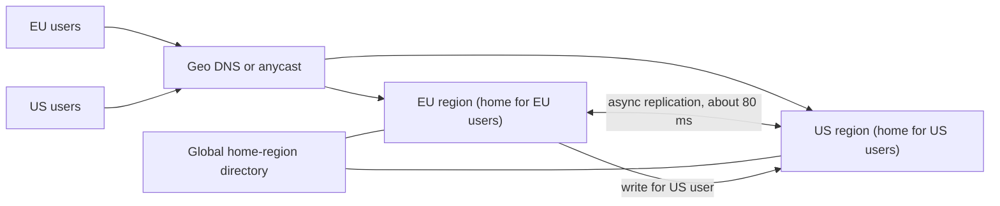

## In one minute
- Teams go multi-region for three reasons: **latency** (serve users near them), **availability** (survive a whole region failing) and **data residency** (keep certain data in a jurisdiction). Name which one drives the design, because each leads to different choices.
- The speed of light sets the rules. Cross-continent round trips take tens to hundreds of milliseconds, so anything that needs synchronous agreement across regions is slow.
- The main patterns are **active-passive** (one region serves writes, another stands by), **active-active with partitioned ownership** (each user or tenant has a home region) and **active-active with multi-writer replication** (any region accepts writes and conflicts are resolved).
- Conflicts are the price of multi-writer designs. Resolve them with last-writer-wins, merge functions (CRDTs), or by avoiding them through single-region ownership of each record.
- Interviewers ask about it for global products (chat, social, payments, gaming) and often as a follow-up: "now make it work if us-east-1 goes away."

## How it works

### Stateless tiers are easy
Web and API servers can run in every region behind global DNS routing or anycast, sending each user to the nearest healthy region. Static content goes to a CDN. The hard part is always the data.

### Active-passive
One primary region takes writes; the database replicates asynchronously to a standby region that may serve reads. On regional failure, operators (or automation) promote the standby and shift traffic. This keeps a single-writer model, so no conflicts, but writes from far away pay the round trip to the primary, failover loses whatever had not replicated (the recovery point objective, RPO), and the switch takes minutes (the recovery time objective, RTO). The RPO is a per-transaction dial in some databases: Postgres's `synchronous_commit` ranges from `local` (no wait for any standby) through `on` (standby has flushed the commit) to `remote_apply` (standby has replayed it and can serve it) ([Postgres docs](https://www.postgresql.org/docs/current/runtime-config-wal.html)), so a payment can wait for the remote region while a page view does not. It is the most common starting point.

### Active-active with home regions
Each user, tenant or account is assigned a home region, and all writes for that entity go there. Every region serves reads for everyone (possibly stale for remote entities) and writes for its own residents. This gives local latency to most users and no write conflicts, because each record has one owner. The costs: a routing layer that knows each entity's home, cross-region operations (a user in Europe messaging a user in Asia) that must touch two regions, and a migration process when users move.

### Active-active multi-writer
Any region accepts writes for any record and replicates to the others asynchronously. Two regions can update the same record concurrently; the system resolves conflicts with a rule. Last-writer-wins by timestamp is simple but silently drops one update. The alternative is to keep both versions and let the application merge them: Amazon's original Dynamo tracked versions with vector clocks and merged divergent shopping carts, so an "add to cart" was never lost, though a deleted item could reappear ([DeCandia et al., SOSP 2007](https://www.allthingsdistributed.com/files/amazon-dynamo-sosp2007.pdf)). CRDTs (counters, sets, registers with merge functions) converge without loss for suitable data types. DynamoDB global tables and Cassandra multi-datacenter clusters work this way by default. Watch the edges of "by default": in DynamoDB's default eventual mode a transaction is atomic only in the region that ran it, so another region can briefly see half of it ([AWS docs](https://docs.aws.amazon.com/amazondynamodb/latest/developerguide/globaltables-CoreConcepts.html)).

### Globally consistent databases
Spanner, CockroachDB and similar systems run consensus groups whose replicas span regions, so a write commits once a majority acknowledges it. You get serializable transactions everywhere at the cost of cross-region latency on writes (and sometimes reads). Placement controls (keeping a row's leader near its users) recover much of the latency. Managed key-value stores now offer the same trade as a switch: DynamoDB's multi-Region strong consistency mode, chosen when a global table is created, writes synchronously to at least one other region before acknowledging, gives an RPO of zero, and must span exactly three regions (three replicas, or two plus a witness). It gives up transactions, TTL and local secondary indexes, and it rejects a write that races one in another region with `ReplicatedWriteConflictException` instead of silently picking a winner ([AWS docs](https://docs.aws.amazon.com/amazondynamodb/latest/developerguide/V2globaltables_HowItWorks.html)).

### How it shows up in interviews
Triggers: "users are worldwide," "must survive a region outage," "EU data must stay in the EU," designs like WhatsApp, Uber, Netflix, a global payment system or a multiplayer game. A strong answer states the goal, picks a pattern per data type (not one for everything), explains replication mode and conflict handling, quantifies RPO and RTO, and describes failover including how traffic moves and how the old region rejoins. Interviewers probe: what happens to writes in flight when a region dies, how a user's data follows them, how two regions resolve a conflicting update, and what the latency cost of strong consistency is.

## Down the stack

### Layer 1: The contract
For each data class, state three numbers and one rule. RPO: how much acknowledged data a regional loss can lose (zero for synchronous or quorum replication across regions; seconds for asynchronous). RTO: how long until service resumes elsewhere (seconds for active-active, minutes for active-passive). Read staleness: how old a cross-region read can be (typically under a second to a few seconds of replication lag). Conflict rule: what happens when two regions write the same key concurrently (last-writer-wins, merge or impossible by ownership). Without these, "multi-region" means nothing testable.

### Layer 2: The mechanism
Asynchronous replication ships a change stream: Postgres streams WAL records to a remote standby, MySQL ships binlog events, DynamoDB global tables replicate item changes, typically within a second, and reconcile concurrent writes with last-writer-wins on an internal timestamp; a strongly consistent read in one region can still return stale data written elsewhere (same AWS page). Cassandra writes to replicas in every datacenter but lets the client choose consistency per request: `LOCAL_QUORUM` waits only for the local datacenter, `EACH_QUORUM` waits for a quorum in each ([Cassandra docs](https://cassandra.apache.org/doc/latest/cassandra/architecture/dynamo.html)). Spanner commits via Paxos groups with replicas across regions and uses TrueTime, an API returning an interval `[earliest, latest]` with bounded clock uncertainty, waiting out that uncertainty before acknowledging a commit so timestamps reflect real-time order. In Google's production the uncertainty is a sawtooth of about 1 to 7 ms, 4 ms most of the time, so commit wait is cheap next to a cross-region round trip ([Corbett et al., OSDI 2012](https://static.googleusercontent.com/media/research.google.com/en//archive/spanner-osdi2012.pdf)). Traffic steering uses DNS with health checks and short TTLs (with resolvers that may ignore them), or anycast addresses announced from every region so routing withdraws a failed region automatically. Home-region routing uses a small, globally replicated directory mapping entity to region, cached at the edge.

### Layer 3: The machine
Light in fibre covers about 200 km per millisecond, roughly two-thirds of its speed in vacuum, and real paths are longer than great-circle distance: even a perfect New York to London fibre would take 56 ms round trip ([Grigorik, HPBN](https://hpbn.co/primer-on-latency-and-bandwidth/)). Typical round trips are on the order of 60 to 80 ms between the US east and west coasts, 70 to 90 ms between the US east coast and western Europe, and 150 ms or more between the US and Asia. A synchronous cross-region commit pays at least one such round trip; a protocol with two phases pays two. Bandwidth costs matter too: cloud providers charge for inter-region transfer per gigabyte, so replicating a 50 MB/s change stream to two other regions is about 8.6 TB per day of billed egress. TCP throughput over a long fat pipe depends on window size: a 150 ms path needs about 19 MB in flight to sustain 1 Gbit/s, so replication links need tuned buffers or many parallel streams.

### Why it's built this way
Distance imposes latency that no engineering removes, so synchronous agreement across regions is reserved for data that truly needs it. Regions fail as units (power, networking, control planes, bad deploys), so availability needs copies in independent regions. Replicating asynchronously keeps writes fast but creates a window of possible loss and conflicts, so designs either assign each record a single owner region or choose data types that merge. Failover is risky and rarely exercised, so the best designs make every region serve traffic all the time.

## Diagram


## Worked example
A messaging app has 60 million users: 45% in Europe, 40% in the Americas, 15% in Asia. It currently runs in one US region, and European users see about 100 ms extra on every API call. The goals are lower latency and surviving a region loss with under 5 seconds of message loss and under 5 minutes of downtime.

The team chooses home regions: each user is assigned to the nearest of three regions at signup. Conversations are homed with the creator's region. Messages for a conversation are written in its home region and asynchronously replicated to the other two, so readers anywhere read locally, with lag usually under a second. A European user sending to a European conversation sees local write latency (about 10 to 20 ms). Sending to an American-homed conversation pays one transatlantic round trip, about 80 ms, which is acceptable for messaging.

Replication volume: 2 billion messages per day at about 1 KB with metadata is 2 TB per day, so about 4 TB per day of cross-region transfer to two peers, a predictable cost line.

Region failure: when the US region fails, the directory marks it down and promotes US-homed conversations to EU and Asia replicas. Asynchronous lag at the moment of failure was under 2 seconds, so a handful of messages may be lost or arrive late when the region returns; the clients still hold unsent messages with idempotency keys and resend them. Clients are redirected by DNS with a 30-second TTL, plus app-level retry to a fallback endpoint list, which handles resolvers that cache longer.

## In the wild
- **GitHub, 2018: 43 seconds of partition, 24 hours of degradation.** Optical equipment work cut the US East hub off from the primary East Coast data center for 43 seconds. The failover tooling had quorum and promoted West Coast MySQL primaries, so both coasts held writes the other lacked and a clean failback was impossible. GitHub restored from backups and re-replicated, staying degraded for 24 hours 11 minutes, then stopped cross-region primary promotion and pushed toward serving from several sites at once ([GitHub](https://github.blog/2018-10-30-oct21-post-incident-analysis/)).
- **AWS, 2025: one regional endpoint, many dependents.** A race in DynamoDB's DNS automation applied a stale plan and then deleted every IP address for the us-east-1 endpoint. DynamoDB errors lasted about three hours, but EC2's lease manager depended on it and fell into congestive collapse, stretching the whole event to about 14.5 hours. Systems that "only" needed one region's DynamoDB were down with it ([AWS](https://aws.amazon.com/message/101925/)).
- **Google Cloud, 2025: global data, global outage.** A quota policy with blank fields was written to globally replicated Spanner tables and crashed Service Control, which checks every API call, in every region within seconds. Restarts then overloaded Spanner in us-central1 for lack of randomized backoff. Google committed to rolling out global data incrementally, failing open, and gating critical code behind feature flags ([Google Cloud status](https://status.cloud.google.com/incidents/ow5i3PPK96RduMcb1SsW)).

## Trade-offs
| Option | Strengths | Weaknesses | Choose when |
|---|---|---|---|
| Active-passive | Simple, no conflicts | Remote write latency, minutes of RTO, possible data loss | Starting out, single-writer databases |
| Active-active with home regions | Local writes, no conflicts | Routing directory, cross-region operations, migrations | Users or tenants with clear locality |
| Multi-writer with LWW | Writes anywhere, simple | Silent lost updates | Data where overwrite is acceptable |
| Multi-writer with CRDTs | Converges without loss | Limited data types, metadata overhead | Counters, sets, collaborative state |
| Globally consistent database | Serializable everywhere | Cross-region write latency, cost | Money, inventory, global uniqueness |

## Pitfalls in production
- **Never-tested failover.** The standby region lacks capacity, a config or a secret, and failover fails when needed. Run regular evacuation drills, or serve production traffic from every region.
- **Hidden global dependencies.** An auth service, a feature flag store or a control plane lives in one region and takes everything down with it. Inventory global dependencies and make each one regional or statically stable: the surviving side keeps working with capacity and state it already has, rather than calling a control plane that may itself be impaired during the event ([AWS Builder Center](https://builder.aws.com/content/3K9SiqiJ369TGkkGzqPM95BuYWI/static-stability-using-availability-zones)).
- **Clock-based LWW with skewed clocks.** A region with a fast clock wins every conflict. Use hybrid logical clocks or server-assigned versions, and avoid LWW for valuable data.
- **Uniqueness across regions.** Two regions both accept the username "alice". Route uniqueness-critical writes to one owner or a consensus store.
- **Failback surprises.** When the failed region returns, it holds writes that were never replicated. Plan reconciliation before failing back.
- **Ignoring residency.** Replicating EU personal data to the US for availability may violate policy. Classify data and pin regulated data to allowed regions.

## Leadership lens
- Start with the business driver and write down RPO, RTO and latency targets per data class; they decide the pattern.
- Multi-region roughly doubles or triples infrastructure and adds inter-region transfer costs. Make sure the availability or latency gain is worth it.
- Ownership matters: someone must own the traffic-steering layer, the directory and the failover runbook, and practise it.
- Prefer designs where every region serves live traffic; idle standbys rot.

## Check yourself
1. Why does active-passive with async replication have a non-zero RPO?
   **Answer:** Writes acknowledged by the primary may not have reached the standby when the primary region fails, so they are lost on promotion.
2. How do home regions avoid write conflicts?
   **Answer:** Each record has exactly one region that accepts its writes, so concurrent writes to the same record are serialised in that region.
3. Why does a globally consistent database add latency to writes?
   **Answer:** A commit needs acknowledgement from a majority of replicas, and when they span regions that requires at least one cross-region round trip.
4. What goes wrong with last-writer-wins when clocks drift?
   **Answer:** The region with the faster clock wins conflicts regardless of real order, silently discarding later updates from other regions.

## Practice
**Task:** Implement a last-writer-wins replicated map, the conflict rule many multi-writer stores use. `LWWMap(region)` has `put(key, value, ts)` and `delete(key, ts)`, which apply locally and return a replication record `{key, value, ts, region}` (value is `None` for a delete tombstone). `apply(record)` merges a record from any region and returns `True` if it changed state. A record wins if `(ts, region)` is greater than the current entry's `(ts, region)`, comparing timestamps first and region names second. `get(key)` returns the value, or `None` if absent or deleted. Replicas that apply the same set of records in any order must converge.

```python starter
class LWWMap:
    def __init__(self, region):
        # TODO
        raise NotImplementedError

    def put(self, key, value, ts):
        raise NotImplementedError

    def delete(self, key, ts):
        raise NotImplementedError

    def apply(self, record):
        raise NotImplementedError

    def get(self, key):
        raise NotImplementedError
```

```python tests
def test_local_put_and_get():
    m = LWWMap("eu")
    rec = m.put("k", "v1", 10)
    assert rec == {"key": "k", "value": "v1", "ts": 10, "region": "eu"}
    assert m.get("k") == "v1"

def test_later_timestamp_wins():
    eu, us = LWWMap("eu"), LWWMap("us")
    a = eu.put("k", "from-eu", 5)
    b = us.put("k", "from-us", 7)
    assert eu.apply(b) is True
    assert us.apply(a) is False
    assert eu.get("k") == us.get("k") == "from-us"

def test_tie_broken_by_region():
    eu, us = LWWMap("eu"), LWWMap("us")
    a = eu.put("k", "eu", 5)
    b = us.put("k", "us", 5)
    eu.apply(b); us.apply(a)
    assert eu.get("k") == us.get("k") == "us"

def test_delete_tombstone_blocks_older_put():
    eu, ap = LWWMap("eu"), LWWMap("ap")
    old = ap.put("k", "stale", 3)
    eu.put("k", "v", 4)
    eu.delete("k", 6)
    assert eu.apply(old) is False
    assert eu.get("k") is None

def test_order_independent_convergence():
    recs = [{"key": "k", "value": "a", "ts": 1, "region": "x"},
            {"key": "k", "value": None, "ts": 3, "region": "y"},
            {"key": "k", "value": "c", "ts": 3, "region": "z"},
            {"key": "j", "value": "d", "ts": 2, "region": "x"}]
    m1, m2 = LWWMap("m1"), LWWMap("m2")
    for r in recs:
        m1.apply(r)
    for r in reversed(recs):
        m2.apply(r)
    assert m1.get("k") == m2.get("k") == "c"
    assert m1.get("j") == m2.get("j") == "d"

def test_reapply_is_idempotent():
    m = LWWMap("eu")
    r = {"key": "k", "value": "v", "ts": 1, "region": "us"}
    assert m.apply(r) is True
    assert m.apply(r) is False
    assert m.get("missing") is None
```

```python solution
class LWWMap:
    def __init__(self, region):
        self.region = region
        self.data = {}

    def _record(self, key, value, ts):
        rec = {"key": key, "value": value, "ts": ts, "region": self.region}
        self.apply(rec)
        return rec

    def put(self, key, value, ts):
        return self._record(key, value, ts)

    def delete(self, key, ts):
        return self._record(key, None, ts)

    def apply(self, record):
        cur = self.data.get(record["key"])
        if cur is not None and (record["ts"], record["region"]) <= (cur["ts"], cur["region"]):
            return False
        self.data[record["key"]] = dict(record)
        return True

    def get(self, key):
        cur = self.data.get(key)
        return None if cur is None else cur["value"]
```

```typescript starter
export type LWWRecord = { key: string; value: string | null; ts: number; region: string };

export class LWWMap {
  constructor(region: string) {}
  put(key: string, value: string, ts: number): LWWRecord {
    throw new Error("TODO");
  }
  delete(key: string, ts: number): LWWRecord {
    throw new Error("TODO");
  }
  apply(record: LWWRecord): boolean {
    throw new Error("TODO");
  }
  get(key: string): string | null {
    throw new Error("TODO");
  }
}
```

```typescript tests
test("local put and get", () => {
  const m = new LWWMap("eu");
  assertEqual(m.put("k", "v1", 10), { key: "k", value: "v1", ts: 10, region: "eu" });
  assertEqual(m.get("k"), "v1");
});
test("later timestamp wins", () => {
  const eu = new LWWMap("eu"), us = new LWWMap("us");
  const a = eu.put("k", "from-eu", 5);
  const b = us.put("k", "from-us", 7);
  assertEqual(eu.apply(b), true);
  assertEqual(us.apply(a), false);
  assertEqual([eu.get("k"), us.get("k")], ["from-us", "from-us"]);
});
test("tie broken by region", () => {
  const eu = new LWWMap("eu"), us = new LWWMap("us");
  const a = eu.put("k", "eu", 5);
  const b = us.put("k", "us", 5);
  eu.apply(b); us.apply(a);
  assertEqual([eu.get("k"), us.get("k")], ["us", "us"]);
});
test("tombstone blocks older put", () => {
  const eu = new LWWMap("eu"), ap = new LWWMap("ap");
  const old = ap.put("k", "stale", 3);
  eu.put("k", "v", 4);
  eu.delete("k", 6);
  assertEqual(eu.apply(old), false);
  assertEqual(eu.get("k"), null);
});
test("order independent convergence", () => {
  const recs: LWWRecord[] = [
    { key: "k", value: "a", ts: 1, region: "x" },
    { key: "k", value: null, ts: 3, region: "y" },
    { key: "k", value: "c", ts: 3, region: "z" },
    { key: "j", value: "d", ts: 2, region: "x" },
  ];
  const m1 = new LWWMap("m1"), m2 = new LWWMap("m2");
  for (const r of recs) m1.apply(r);
  for (const r of [...recs].reverse()) m2.apply(r);
  assertEqual([m1.get("k"), m2.get("k"), m1.get("j"), m2.get("j")], ["c", "c", "d", "d"]);
});
test("reapply idempotent", () => {
  const m = new LWWMap("eu");
  const r: LWWRecord = { key: "k", value: "v", ts: 1, region: "us" };
  assertEqual(m.apply(r), true);
  assertEqual(m.apply(r), false);
  assertEqual(m.get("missing"), null);
});
```

```typescript solution
export type LWWRecord = { key: string; value: string | null; ts: number; region: string };

export class LWWMap {
  private data = new Map<string, LWWRecord>();
  constructor(private region: string) {}
  private record(key: string, value: string | null, ts: number): LWWRecord {
    const rec: LWWRecord = { key, value, ts, region: this.region };
    this.apply(rec);
    return rec;
  }
  put(key: string, value: string, ts: number): LWWRecord {
    return this.record(key, value, ts);
  }
  delete(key: string, ts: number): LWWRecord {
    return this.record(key, null, ts);
  }
  apply(record: LWWRecord): boolean {
    const cur = this.data.get(record.key);
    if (cur && (record.ts < cur.ts || (record.ts === cur.ts && record.region <= cur.region))) return false;
    this.data.set(record.key, { ...record });
    return true;
  }
  get(key: string): string | null {
    const cur = this.data.get(key);
    return cur ? cur.value : null;
  }
}
```

```go starter
package practice

import "sync"

// Record is a replicated write. Deleted marks a tombstone.
type Record struct {
	Key     string
	Value   string
	Deleted bool
	TS      int
	Region  string
}

// LWWMap is a last-writer-wins replicated map. Safe for concurrent use.
type LWWMap struct {
	mu sync.Mutex
}

func NewLWWMap(region string) *LWWMap { return &LWWMap{} }

func (m *LWWMap) Put(key, value string, ts int) Record { panic("TODO") }

func (m *LWWMap) Delete(key string, ts int) Record { panic("TODO") }

func (m *LWWMap) Apply(r Record) bool { panic("TODO") }

// Get returns the value and true, or "" and false if absent or deleted.
func (m *LWWMap) Get(key string) (string, bool) { panic("TODO") }
```

```go tests
package practice

import "testing"

func TestLocalPut(t *testing.T) {
	m := NewLWWMap("eu")
	r := m.Put("k", "v1", 10)
	if r != (Record{Key: "k", Value: "v1", TS: 10, Region: "eu"}) {
		t.Fatalf("got %+v", r)
	}
	if v, ok := m.Get("k"); !ok || v != "v1" {
		t.Fatal("expected v1")
	}
}

func TestLaterWins(t *testing.T) {
	eu, us := NewLWWMap("eu"), NewLWWMap("us")
	a := eu.Put("k", "from-eu", 5)
	b := us.Put("k", "from-us", 7)
	if !eu.Apply(b) || us.Apply(a) {
		t.Fatal("later timestamp should win")
	}
	v1, _ := eu.Get("k")
	v2, _ := us.Get("k")
	if v1 != "from-us" || v2 != "from-us" {
		t.Fatalf("got %s %s", v1, v2)
	}
}

func TestTieByRegion(t *testing.T) {
	eu, us := NewLWWMap("eu"), NewLWWMap("us")
	a := eu.Put("k", "eu", 5)
	b := us.Put("k", "us", 5)
	eu.Apply(b)
	us.Apply(a)
	v1, _ := eu.Get("k")
	v2, _ := us.Get("k")
	if v1 != "us" || v2 != "us" {
		t.Fatalf("got %s %s", v1, v2)
	}
}

func TestTombstone(t *testing.T) {
	eu, ap := NewLWWMap("eu"), NewLWWMap("ap")
	old := ap.Put("k", "stale", 3)
	eu.Put("k", "v", 4)
	eu.Delete("k", 6)
	if eu.Apply(old) {
		t.Fatal("older put must not resurrect")
	}
	if _, ok := eu.Get("k"); ok {
		t.Fatal("expected deleted")
	}
}

func TestConvergence(t *testing.T) {
	recs := []Record{
		{Key: "k", Value: "a", TS: 1, Region: "x"},
		{Key: "k", Deleted: true, TS: 3, Region: "y"},
		{Key: "k", Value: "c", TS: 3, Region: "z"},
		{Key: "j", Value: "d", TS: 2, Region: "x"},
	}
	m1, m2 := NewLWWMap("m1"), NewLWWMap("m2")
	for _, r := range recs {
		m1.Apply(r)
	}
	for i := len(recs) - 1; i >= 0; i-- {
		m2.Apply(recs[i])
	}
	a, _ := m1.Get("k")
	b, _ := m2.Get("k")
	c, _ := m1.Get("j")
	d, _ := m2.Get("j")
	if a != "c" || b != "c" || c != "d" || d != "d" {
		t.Fatalf("got %s %s %s %s", a, b, c, d)
	}
}

func TestReapply(t *testing.T) {
	m := NewLWWMap("eu")
	r := Record{Key: "k", Value: "v", TS: 1, Region: "us"}
	if !m.Apply(r) || m.Apply(r) {
		t.Fatal("first apply changes, second does not")
	}
	if _, ok := m.Get("missing"); ok {
		t.Fatal("missing key")
	}
}
```

```go solution
package practice

import "sync"

// Record is a replicated write. Deleted marks a tombstone.
type Record struct {
	Key     string
	Value   string
	Deleted bool
	TS      int
	Region  string
}

// LWWMap is a last-writer-wins replicated map. Safe for concurrent use.
type LWWMap struct {
	mu     sync.Mutex
	region string
	data   map[string]Record
}

func NewLWWMap(region string) *LWWMap {
	return &LWWMap{region: region, data: map[string]Record{}}
}

func (m *LWWMap) Put(key, value string, ts int) Record {
	r := Record{Key: key, Value: value, TS: ts, Region: m.region}
	m.Apply(r)
	return r
}

func (m *LWWMap) Delete(key string, ts int) Record {
	r := Record{Key: key, Deleted: true, TS: ts, Region: m.region}
	m.Apply(r)
	return r
}

func (m *LWWMap) Apply(r Record) bool {
	m.mu.Lock()
	defer m.mu.Unlock()
	if cur, ok := m.data[r.Key]; ok {
		if r.TS < cur.TS || (r.TS == cur.TS && r.Region <= cur.Region) {
			return false
		}
	}
	m.data[r.Key] = r
	return true
}

// Get returns the value and true, or "" and false if absent or deleted.
func (m *LWWMap) Get(key string) (string, bool) {
	m.mu.Lock()
	defer m.mu.Unlock()
	cur, ok := m.data[key]
	if !ok || cur.Deleted {
		return "", false
	}
	return cur.Value, true
}
```

## Mock interview
**Prompt:** A B2B project-management SaaS runs in a single US region and serves 20,000 companies, 40% of them in Europe. Customers complain about latency, a large European customer requires data residency in the EU, and leadership wants to survive a full region outage with under a minute of data loss. Propose a multi-region architecture.

- Follow-up: A US employee of a European company edits a shared document. Where does the write go and what latency do they see?
- Follow-up: The EU region goes down for an hour. Walk through failover and failback, including residency constraints.
- Follow-up: Some tables, like billing and global usernames, need global uniqueness. How do you handle them?

**A strong answer covers:**
- Tenant-level home regions, chosen per company, which serve latency and residency goals and avoid write conflicts.
- A global directory mapping tenant to region, cached at the edge, with routing for users who travel.
- Asynchronous replication to a paired region within the same jurisdiction for disaster recovery, with explicit RPO and RTO.
- A small set of global data (accounts, billing, uniqueness) in a consensus-backed global store or a single owner region, with the latency cost stated.
- Regular evacuation drills, removal of hidden single-region dependencies, and an honest cost estimate.

## Sources and further study
**Primary**
- [Corbett et al., Spanner (OSDI 2012)](https://static.googleusercontent.com/media/research.google.com/en//archive/spanner-osdi2012.pdf), section 3 on TrueTime: how bounded clock uncertainty turns into commit wait.
- [Mike Furr, Static stability using Availability Zones (AWS)](https://builder.aws.com/content/3K9SiqiJ369TGkkGzqPM95BuYWI/static-stability-using-availability-zones): control plane versus data plane, and pre-provisioning so recovery needs no changes.

**Systems docs**
- [DynamoDB: how global tables work](https://docs.aws.amazon.com/amazondynamodb/latest/developerguide/V2globaltables_HowItWorks.html): the eventual and strong multi-Region modes, their RPOs and their limits.
- [PostgreSQL: synchronous_commit](https://www.postgresql.org/docs/current/runtime-config-wal.html): choosing, per transaction, how far a commit waits on standbys.
- [Apache Cassandra: Dynamo architecture and consistency levels](https://cassandra.apache.org/doc/latest/cassandra/architecture/dynamo.html): per-request consistency across datacenters.

**Books**
- *Designing Data-Intensive Applications* (2nd ed.), Kleppmann and Riccomini, chapter 6 "Replication": multi-leader replication across regions and conflict resolution.
- *Understanding Distributed Systems* (2nd ed.), Roberto Vitillo, chapter "Replication": consistency models, CAP and PACELC, and CRDTs.

**Other curricula**
- [Azure Architecture Center: Geode pattern](https://learn.microsoft.com/en-us/azure/architecture/patterns/geodes): frames multi-region as many full, independent backends behind global routing, all active.
- [donnemartin/system-design-primer: Availability patterns](https://github.com/donnemartin/system-design-primer#availability-patterns): active-passive versus active-active fail-over and master-slave versus master-master replication, at server level rather than region level.

## Watch
- [Architecture patterns for multi-region active-active (AWS re:Invent 2019)](https://www.youtube.com/watch?v=3K9AzSrCmiQ): data replication, routing and conflict handling in active-active designs.
- [Multi-Region design patterns and best practices (AWS re:Invent 2022)](https://www.youtube.com/watch?v=ilgpzlE7Hds): choosing between failover and active-active, with operational guidance.
- [Best practices for creating multi-Region architectures on AWS (AWS re:Invent 2024)](https://www.youtube.com/watch?v=CbkqQznZS9Y): dependencies, failover testing and the cost of going multi-region.

## Free resources
- [AWS Multi-Region Fundamentals (AWS whitepaper)](https://docs.aws.amazon.com/whitepapers/latest/aws-multi-region-fundamentals/aws-multi-region-fundamentals.html): when multi-region is worth it and the prerequisites.
- [Spanner: Google's Globally-Distributed Database (OSDI 2012)](https://static.googleusercontent.com/media/research.google.com/en//archive/spanner-osdi2012.pdf): TrueTime and commit wait for global consistency.
- [Dynamo: Amazon's Highly Available Key-value Store (SOSP 2007)](https://www.allthingsdistributed.com/files/amazon-dynamo-sosp2007.pdf): multi-writer replication, vector clocks and conflict handling.
- [DynamoDB global tables (AWS docs)](https://docs.aws.amazon.com/amazondynamodb/latest/developerguide/GlobalTables.html): a production multi-writer design and its consistency options.
- [CockroachDB multi-region overview](https://www.cockroachlabs.com/docs/stable/multiregion-overview): table localities and survival goals for geo-distributed SQL.
- [Consistency models (Jepsen)](https://jepsen.io/consistency): precise definitions of what each replication mode guarantees.
