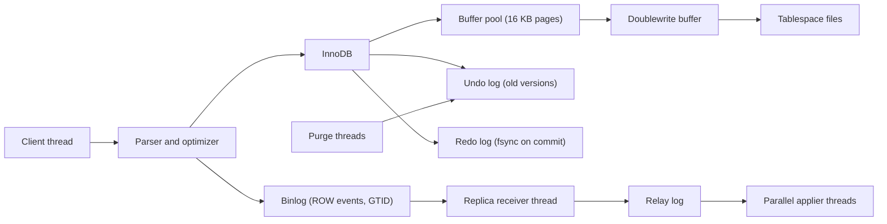

## In one minute
- MySQL is a relational database with a server layer (connections, parser, optimizer, binary log) on top of a pluggable storage engine. In practice the engine is InnoDB, and InnoDB is what you are really choosing.
- InnoDB stores each table as a B+tree clustered on the primary key: rows live in primary-key order, and secondary indexes store the primary key, not a physical address. Primary key design is the single biggest performance decision.
- MVCC works by updating rows in place and keeping old versions in undo logs. Readers rebuild the version they need by walking back the undo chain; purge threads discard versions no reader needs.
- Each connection is a thread, so connections are cheaper than in Postgres. Replication ships the binary log to replicas, identified by GTIDs; semi-sync and Group Replication tighten durability across nodes.
- In an interview, pick it for very high-volume, primary-key-driven OLTP (user records, messages, orders by ID), when you want a proven sharding path (Vitess), or when the company already runs it well. Be ready to explain gap locks and why a random UUID primary key hurts.

## How it works

### Server layer and threads
Each client connection gets a dedicated server thread (a thread pool plugin exists in Enterprise and Percona builds). The thread parses SQL, the optimizer picks a plan from index statistics, and the executor calls the storage engine row by row. The server layer also writes the binary log used by replication and point-in-time recovery.

Versions matter when you read advice online. MySQL 8.0 reached end of life in April 2026 ([Atlas](https://atlasgo.io/blog/2026/05/05/mysql-8-eol)); 8.4 and 9.7 are the long-term support lines, and releases after 9.7 use year.month numbers such as 26.7 ([MySQL docs](https://dev.mysql.com/doc/refman/9.4/en/mysql-releases.html)). 8.4 also finished the terminology change, so commands are `CHANGE REPLICATION SOURCE TO` and `SHOW REPLICA STATUS`.

### Clustered index
In InnoDB the table is its primary key index. Leaf pages of the B+tree hold whole rows, sorted by primary key, in 16 KB pages. A secondary index on `email` stores `(email, primary key)`; a lookup by email descends the secondary tree to find the key, then descends the clustered tree to fetch the row. With no primary key, InnoDB clusters on the first `UNIQUE NOT NULL` index, or else on a hidden 6-byte row ID called `GEN_CLUST_INDEX` that you cannot query by ([MySQL docs](https://dev.mysql.com/doc/refman/8.4/en/innodb-index-types.html)).

### Undo-based MVCC
Every clustered row carries two hidden columns: `DB_TRX_ID`, the last transaction that modified it, and `DB_ROLL_PTR`, a pointer to the undo record holding the previous version. An `UPDATE` writes the old values to undo and changes the row in place. A consistent read compares `DB_TRX_ID` with its read view; if that version is too new, it follows the roll pointer and applies undo records until it reaches a version it may see.

### Replication
The primary writes committed transactions to binlog files. Each replica runs a receiver thread that streams events into a local relay log, and applier threads that execute them, in parallel by default: MySQL 8.4 starts 4 workers (`replica_parallel_workers`), schedules by logical clock, and keeps `replica_preserve_commit_order = ON` so replicas commit in the source's order ([MySQL docs](https://dev.mysql.com/doc/refman/8.4/en/replication-options-replica.html)). With GTIDs, every transaction has an ID like `3e11fa47-...:4521`, so a replica can follow any new primary by asking for the transactions it lacks instead of a file and offset. Semi-synchronous replication makes a commit wait until at least one replica confirms it received the event. By default (`AFTER_SYNC`) the source waits after syncing the binlog but before committing in InnoDB, so no client can see a write that no replica has; if no replica answers within the timeout, the source quietly falls back to asynchronous replication until one catches up ([MySQL docs](https://dev.mysql.com/doc/refman/8.4/en/replication-semisync.html)). Group Replication goes further: a Paxos-based group agrees on transaction order, and each member certifies write sets to detect conflicts.

## Down the stack

### Layer 1: The contract
With `innodb_flush_log_at_trx_commit = 1` and `sync_binlog = 1` (both defaults), a committed transaction survives a crash and is present in the binlog. The default isolation level is Repeatable Read: plain `SELECT`s read from a snapshot taken at the first read in the transaction, while locking reads and writes (`SELECT ... FOR UPDATE`, `UPDATE`, `DELETE`) act on the latest committed row and take next-key locks (the row plus the gap before it) to block phantom inserts. Deadlocks are detected and one transaction is rolled back with error 1213, so clients retry. Do not read Repeatable Read as snapshot isolation: Jepsen showed that on a single healthy node it allows lost updates, write skew and reads that change mid-transaction, because locking reads and writes see the latest data while plain reads see the snapshot. Read-modify-write code needs `SELECT ... FOR UPDATE` or Serializable ([Jepsen](https://jepsen.io/analyses/mysql-8.0.34)). Asynchronous replicas can lag by any amount; semi-sync bounds loss to transactions no replica received (unless it has timed out to async), and Group Replication in single-primary mode does not acknowledge a commit until a majority has agreed on it.

### Layer 2: The mechanism
**Pages and records.** A 16 KB page holds a header, records linked in key order, and a page directory of slots for binary search. Each clustered record holds the key, a 6-byte `DB_TRX_ID`, a 7-byte `DB_ROLL_PTR` and the columns, with long values moved to overflow pages. Sequential primary keys fill pages to about 15/16 and append on the right; random keys split pages in the middle and leave them about half full.

**Read views.** A read view stores `m_creator_trx_id`, `m_ids` (transactions active when it was created), `m_up_limit_id` (smallest of those) and `m_low_limit_id` (the next ID to be assigned). A version written by trx T is visible if T is the creator, T is below `m_up_limit_id`, or T is below `m_low_limit_id` and not in `m_ids`. Rollback physically applies undo, so aborted changes never need a visibility check.

**Undo and purge.** Undo records live in rollback segments inside undo tablespaces. Committed update undo is linked into the history list; purge threads (`innodb_purge_threads`, 4 on machines with more than 16 logical processors) walk it in commit order and discard what the oldest open read view no longer needs. The `History list length` in `SHOW ENGINE INNODB STATUS` is the backlog.

**Redo, doublewrite and two-phase commit.** Changes to pages are logged in the redo log, sized by `innodb_redo_log_capacity` (100 MB by default, too small for write-heavy servers). The capacity is spread over 32 files in `#innodb_redo` and can be resized online with `SET GLOBAL` ([MySQL docs](https://dev.mysql.com/doc/refman/8.4/en/innodb-redo-log.html)). Page flushes first go to the doublewrite buffer, then to their final location, so a torn 16 KB write can be repaired; Postgres solves the same problem with full-page images in WAL. Because the binlog and redo log are separate, commit is an internal two-phase commit: InnoDB prepares in redo, the server writes and syncs the binlog, then InnoDB marks the commit. Crash recovery commits prepared transactions that reached the binlog and rolls back the rest, keeping replicas and primary consistent.

**Binlog formats.** `binlog_format = ROW` (default) logs row images, which CDC tools such as Debezium and gh-ost consume.

### Layer 3: The machine
`innodb_buffer_pool_size` defaults to 128 MB; on a dedicated host it is typically set to 50 to 80 percent of RAM, and `innodb_flush_method` defaults to `O_DIRECT` on Linux, so InnoDB bypasses the page cache and owns its memory. That default is new in 8.4 (8.0 used `fsync`), and 8.4 changed others that old tuning guides assume: `innodb_io_capacity` went from 200 to 10,000, the adaptive hash index and change buffering are now off, and the log buffer grew from 16 MB to 64 MB ([MySQL 8.4 docs](https://dev.mysql.com/doc/refman/8.4/en/mysql-nutshell.html)). The buffer pool LRU inserts new pages at a midpoint with 3/8 of the pool as the old sublist, so a single table scan cannot flush the hot working set. A point lookup on a billion-row table walks about 4 levels; the upper ones stay cached, so a miss costs one or two 16 KB reads of about 100 us on NVMe.

A connection costs a thread stack (`thread_stack`, 1 MB reserved, mostly untouched) plus session buffers, far less than a forked process. Running thousands of threads at once still causes mutex and CPU contention, which is why proxies like ProxySQL or Vitess's vttablet pool connections at scale. At commit, the log writer and flusher threads batch many transactions into one `fsync` of the redo log, and binlog group commit does the same for the binlog.

### Why it's built this way
1. Most OLTP queries look up rows by primary key, so storing rows inside the primary key B+tree saves a hop on the most common path.
2. Secondary indexes store the key, not a physical address, so rows can move during page splits without rewriting every index, and an update only touches indexes whose columns changed.
3. Updating in place keeps the table compact, so old versions go to undo, and readers that need them pay to reconstruct them.
4. The server layer was designed for multiple engines, so replication uses its own engine-independent binlog, which then has to be kept consistent with redo by two-phase commit.
5. Positional replication made failover error-prone, so GTIDs gave each transaction a global name and Group Replication added consensus for automatic, lossless failover.

## Diagram


## Worked example
A chat service stores 3 billion messages of about 300 bytes each, roughly 900 GB of row data, with 8,000 inserts per second and 40,000 reads of "the latest 50 messages in a conversation" per second.

With `PRIMARY KEY (conversation_id, message_id)` and a time-ordered `message_id`, each conversation's messages sit together in the clustered index. A 16 KB page holds about 50 messages, so the hot read is one tree descent plus one or two leaf pages, and new messages append at the right edge of each conversation's range. With a random UUIDv4 key, each insert would land on a random leaf among about 60 million that a 200 GB buffer pool cannot hold, turning inserts into random reads and splitting pages to half full.

Replication: at about 400 bytes per ROW event, 8,000 inserts per second is 3.2 MB/s of binlog, about 275 GB per day, so `binlog_expire_logs_seconds` (30 days by default) would need over 8 TB; set it to 3 days and archive binlogs to object storage for point-in-time recovery. Insert undo is discarded at commit, but read receipts update 3,000 rows per second, so a nightly analytics job holding a read view open for 2 hours keeps about 21 million update undo records unpurged; route it to a replica.

## In the wild
- **GitHub, 2018: a 43-second partition and a 24-hour degradation.** Network maintenance cut the US East hub off from the main East data centre for 43 seconds. Orchestrator promoted West Coast MySQL primaries before they had caught up, writes landed on both coasts, and a clean failback was impossible. GitHub restored from backups and re-replicated, staying degraded for 24 hours 11 minutes, and planned to stop Orchestrator promoting primaries across regions ([GitHub](https://github.blog/2018-10-30-oct21-post-incident-analysis/)).
- **GitHub, 2022: four outages in a week on one shared cluster.** Peak load on the `mysql1` primary plus a poorly performing query exhausted the database proxy's connections, failing writes across git operations, webhooks, pull requests and Actions for roughly 2.5 to 5.5 hours each time. Each recovery was a primary failover; the fixes were an index for the query, peak-time webhook throttling and moving traffic off `mysql1` ([GitHub](https://github.blog/2022-03-23-an-update-on-recent-service-disruptions/)).
- **Shopify, 2021: related rows from different replicas.** Replicas with different lag let one request read a row from one table and miss its partner in another. Waiting on every replica was too costly and GTID-based causal reads too complex, so Shopify pinned each request's reads to one replica by hashing a `consistent_read_id` in its ProxySQL fork, giving monotonic reads ([Shopify](https://shopify.engineering/read-consistency-database-replicas)).

## Trade-offs
| Option | Strengths | Weaknesses | Choose when |
|---|---|---|---|
| MySQL (InnoDB) | Clustered PK reads, cheap connections, Vitess, huge operational know-how | Gap-lock surprises, fewer advanced SQL types and extensions | High-volume PK-driven OLTP, existing MySQL estate |
| PostgreSQL | Richer SQL, extensions, JSONB, PostGIS | Process per connection, vacuum, index write amplification | Default system of record, complex queries |
| MySQL with Vitess | Horizontal sharding, resharding online | Cross-shard queries and transactions are limited | Write volume beyond one primary |
| MySQL Group Replication | Automatic failover with no acknowledged-write loss | Write latency of consensus, conflicts in multi-primary | HA without an external orchestrator |
| Aurora MySQL | Shared distributed storage, fast replicas | Cost, AWS lock-in | Managed MySQL at scale on AWS |

## Pitfalls in production
- **Random primary keys.** UUIDv4 keys fragment the clustered index and bloat every secondary index. Use auto-increment, or time-ordered IDs such as UUIDv7 or Snowflake.
- **Long transactions.** An open read view blocks purge, the history list grows into millions, and every consistent read walks longer undo chains. Alert on history list length and transaction age.
- **Gap-lock deadlocks.** Two transactions doing `SELECT ... FOR UPDATE` on a missing key then inserting it deadlock under Repeatable Read. Use `INSERT ... ON DUPLICATE KEY UPDATE`, or Read Committed where phantoms are acceptable.
- **Replica lag.** One large `DELETE` of 10 million rows becomes 10 million row events applied on every replica. Delete in batches of a few thousand.
- **Blocking schema changes.** Some `ALTER TABLE` operations copy the table. Prefer `ALGORITHM=INSTANT` where supported, or gh-ost for the rest.

## Leadership lens
- Pick MySQL or Postgres based on team expertise and the workload's query shape; the difference rarely decides success, operational skill does.
- Make primary key conventions a platform standard; changing them later means rewriting every large table.
- Decide the HA model explicitly: async plus an orchestrator, semi-sync, or Group Replication, each with a different loss window and latency cost.
- If growth points beyond one primary, evaluate Vitess early; retrofitting a sharding key into application queries is the expensive part.

## Check yourself
1. Why does a lookup through a secondary index cost about twice as much as a primary key lookup in InnoDB?
   **Answer:** The secondary index leaf stores the primary key, so InnoDB descends the secondary tree and then the clustered tree to fetch the row, unless the index covers the query.
2. A 4-hour reporting query on the primary makes unrelated short reads slower. Why?
   **Answer:** Its read view stops purge, so undo history grows, and other consistent reads must walk longer undo chains to rebuild visible versions.
3. Why does InnoDB need two-phase commit between the redo log and the binlog?
   **Answer:** They are separate logs; without coordinating, a crash could leave a transaction committed in InnoDB but missing from the binlog, so replicas would diverge from the primary.
4. What do GTIDs give you during failover that file and position coordinates do not?
   **Answer:** Each transaction has a global identity, so a replica can tell a new primary exactly which transactions it has, and auto-position without manual offset math.

## Practice
**Task:** Implement InnoDB-style MVCC with undo chains. `begin()` returns increasing transaction IDs from 1 and creates a read view (creator, active IDs, up limit as the smallest active ID or the next ID if none, low limit as the next ID). `write(trx, key, value)` updates the row in place, pushing the old version onto its undo chain; if the newest version belongs to another still-active transaction, raise a lock conflict (`LockConflict` in Python and TypeScript, `ErrLockConflict` in Go). `read(trx, key)` walks from the newest version to the first one visible to the read view and returns its value, or none. `rollback(trx)` removes that transaction's versions, restoring the previous ones; `commit(trx)` ends it. `purge()` cuts every chain below the newest committed version that all open read views can see, returning how many old versions were discarded, and `versions(key)` returns the chain length.

```python starter
class LockConflict(Exception):
    pass

class InnoDB:
    def __init__(self):
        # TODO
        pass

    def begin(self):
        raise NotImplementedError

    def write(self, trx, key, value):
        raise NotImplementedError

    def read(self, trx, key):
        raise NotImplementedError

    def commit(self, trx):
        raise NotImplementedError

    def rollback(self, trx):
        raise NotImplementedError

    def purge(self):
        raise NotImplementedError

    def versions(self, key):
        raise NotImplementedError
```

```python tests
def test_own_write_visible_others_not():
    db = InnoDB()
    a = db.begin(); b = db.begin()
    db.write(a, "k", "v1")
    assert db.read(a, "k") == "v1" and db.read(b, "k") is None

def test_consistent_read_walks_undo():
    db = InnoDB()
    t = db.begin(); db.write(t, "k", "old"); db.commit(t)
    r = db.begin()
    w = db.begin(); db.write(w, "k", "new"); db.commit(w)
    assert db.read(r, "k") == "old"
    assert db.read(db.begin(), "k") == "new"

def test_rollback_restores():
    db = InnoDB()
    t = db.begin(); db.write(t, "k", "a"); db.commit(t)
    u = db.begin(); db.write(u, "k", "b"); db.write(u, "k", "c"); db.rollback(u)
    assert db.read(db.begin(), "k") == "a" and db.versions("k") == 1

def test_lock_conflict_on_active_writer():
    db = InnoDB()
    a = db.begin(); b = db.begin()
    db.write(a, "k", "a")
    try:
        db.write(b, "k", "b")
        assert False, "expected lock conflict"
    except LockConflict:
        pass
    db.commit(a)
    db.write(b, "k", "b")
    assert db.read(b, "k") == "b"

def test_purge_waits_for_old_view():
    db = InnoDB()
    t = db.begin(); db.write(t, "k", "v1"); db.commit(t)
    old = db.begin()
    for v in ["v2", "v3"]:
        w = db.begin(); db.write(w, "k", v); db.commit(w)
    assert db.purge() == 0 and db.versions("k") == 3
    assert db.read(old, "k") == "v1"
    db.commit(old)
    assert db.purge() == 2 and db.versions("k") == 1
    assert db.read(db.begin(), "k") == "v3"

def test_purge_keeps_committed_below_active_writer():
    db = InnoDB()
    t = db.begin(); db.write(t, "k", "v1"); db.commit(t)
    w = db.begin(); db.write(w, "k", "v2")
    assert db.purge() == 0 and db.versions("k") == 2
    assert db.read(db.begin(), "k") == "v1"
```

```python solution
class LockConflict(Exception):
    pass

class InnoDB:
    def __init__(self):
        self.rows = {}    # key -> list of (trx_id, value), newest last
        self.next_id = 1
        self.views = {}   # active trx -> (ids, up_limit, low_limit)

    def begin(self):
        trx = self.next_id
        self.next_id += 1
        ids = set(self.views)
        up = min(ids) if ids else trx
        self.views[trx] = (ids, up, trx + 1)
        return trx

    def _sees(self, view_trx, writer):
        ids, up, low = self.views[view_trx]
        return writer == view_trx or writer < up or (writer < low and writer not in ids)

    def write(self, trx, key, value):
        chain = self.rows.setdefault(key, [])
        if chain and chain[-1][0] != trx and chain[-1][0] in self.views:
            raise LockConflict(key)
        chain.append((trx, value))

    def read(self, trx, key):
        for writer, value in reversed(self.rows.get(key, [])):
            if self._sees(trx, writer):
                return value
        return None

    def commit(self, trx):
        self.views.pop(trx, None)

    def rollback(self, trx):
        for chain in self.rows.values():
            while chain and chain[-1][0] == trx:
                chain.pop()
        self.views.pop(trx, None)

    def purge(self):
        removed = 0
        for key, chain in self.rows.items():
            for i in range(len(chain) - 1, -1, -1):
                writer = chain[i][0]
                if writer in self.views:
                    continue
                if all(self._sees(v, writer) for v in self.views):
                    removed += i
                    self.rows[key] = chain[i:]
                    break
        return removed

    def versions(self, key):
        return len(self.rows.get(key, []))
```

```typescript starter
export class LockConflict extends Error {}

export class InnoDB {
  begin(): number {
    throw new Error("TODO");
  }
  write(trx: number, key: string, value: string): void {
    throw new Error("TODO");
  }
  read(trx: number, key: string): string | null {
    throw new Error("TODO");
  }
  commit(trx: number): void {
    throw new Error("TODO");
  }
  rollback(trx: number): void {
    throw new Error("TODO");
  }
  purge(): number {
    throw new Error("TODO");
  }
  versions(key: string): number {
    throw new Error("TODO");
  }
}
```

```typescript tests
test("own write visible, others not", () => {
  const db = new InnoDB();
  const a = db.begin(), b = db.begin();
  db.write(a, "k", "v1");
  assertEqual([db.read(a, "k"), db.read(b, "k")], ["v1", null]);
});
test("consistent read walks undo", () => {
  const db = new InnoDB();
  const t = db.begin(); db.write(t, "k", "old"); db.commit(t);
  const r = db.begin();
  const w = db.begin(); db.write(w, "k", "new"); db.commit(w);
  assertEqual(db.read(r, "k"), "old");
  assertEqual(db.read(db.begin(), "k"), "new");
});
test("rollback restores", () => {
  const db = new InnoDB();
  const t = db.begin(); db.write(t, "k", "a"); db.commit(t);
  const u = db.begin(); db.write(u, "k", "b"); db.write(u, "k", "c"); db.rollback(u);
  assertEqual([db.read(db.begin(), "k"), db.versions("k")], ["a", 1]);
});
test("lock conflict on active writer", () => {
  const db = new InnoDB();
  const a = db.begin(), b = db.begin();
  db.write(a, "k", "a");
  let conflicted = false;
  try { db.write(b, "k", "b"); } catch (e) { conflicted = e instanceof LockConflict; }
  assert(conflicted, "expected lock conflict");
  db.commit(a);
  db.write(b, "k", "b");
  assertEqual(db.read(b, "k"), "b");
});
test("purge waits for old view", () => {
  const db = new InnoDB();
  const t = db.begin(); db.write(t, "k", "v1"); db.commit(t);
  const old = db.begin();
  for (const v of ["v2", "v3"]) { const w = db.begin(); db.write(w, "k", v); db.commit(w); }
  assertEqual([db.purge(), db.versions("k")], [0, 3]);
  assertEqual(db.read(old, "k"), "v1");
  db.commit(old);
  assertEqual([db.purge(), db.versions("k")], [2, 1]);
  assertEqual(db.read(db.begin(), "k"), "v3");
});
test("purge keeps committed below active writer", () => {
  const db = new InnoDB();
  const t = db.begin(); db.write(t, "k", "v1"); db.commit(t);
  const w = db.begin(); db.write(w, "k", "v2");
  assertEqual([db.purge(), db.versions("k")], [0, 2]);
  assertEqual(db.read(db.begin(), "k"), "v1");
});
```

```typescript solution
export class LockConflict extends Error {}

type View = { ids: Set<number>; up: number; low: number };

export class InnoDB {
  private rows = new Map<string, [number, string][]>();
  private nextId = 1;
  private views = new Map<number, View>();

  begin(): number {
    const trx = this.nextId++;
    const ids = new Set<number>(Array.from(this.views.keys()));
    const up = ids.size ? Math.min(...Array.from(ids)) : trx;
    this.views.set(trx, { ids, up, low: trx + 1 });
    return trx;
  }
  private sees(viewTrx: number, writer: number): boolean {
    const v = this.views.get(viewTrx)!;
    return writer === viewTrx || writer < v.up || (writer < v.low && !v.ids.has(writer));
  }
  write(trx: number, key: string, value: string): void {
    let chain = this.rows.get(key);
    if (!chain) { chain = []; this.rows.set(key, chain); }
    const head = chain[chain.length - 1];
    if (head && head[0] !== trx && this.views.has(head[0])) throw new LockConflict(key);
    chain.push([trx, value]);
  }
  read(trx: number, key: string): string | null {
    const chain = this.rows.get(key) ?? [];
    for (let i = chain.length - 1; i >= 0; i--) {
      if (this.sees(trx, chain[i][0])) return chain[i][1];
    }
    return null;
  }
  commit(trx: number): void {
    this.views.delete(trx);
  }
  rollback(trx: number): void {
    this.rows.forEach((chain) => {
      while (chain.length && chain[chain.length - 1][0] === trx) chain.pop();
    });
    this.views.delete(trx);
  }
  purge(): number {
    let removed = 0;
    this.rows.forEach((chain, key) => {
      for (let i = chain.length - 1; i >= 0; i--) {
        const writer = chain[i][0];
        if (this.views.has(writer)) continue;
        if (Array.from(this.views.keys()).every((v) => this.sees(v, writer))) {
          removed += i;
          this.rows.set(key, chain.slice(i));
          break;
        }
      }
    });
    return removed;
  }
  versions(key: string): number {
    return (this.rows.get(key) ?? []).length;
  }
}
```

```go starter
package practice

import "errors"

var ErrLockConflict = errors.New("lock conflict")

type InnoDB struct{}

func NewInnoDB() *InnoDB { return &InnoDB{} }

func (db *InnoDB) Begin() int { panic("TODO") }

func (db *InnoDB) Write(trx int, key, value string) error { panic("TODO") }

// Read returns the visible value and whether one exists.
func (db *InnoDB) Read(trx int, key string) (string, bool) { panic("TODO") }

func (db *InnoDB) Commit(trx int) { panic("TODO") }

func (db *InnoDB) Rollback(trx int) { panic("TODO") }

func (db *InnoDB) Purge() int { panic("TODO") }

func (db *InnoDB) Versions(key string) int { panic("TODO") }
```

```go tests
package practice

import (
	"errors"
	"testing"
)

func TestOwnWriteVisible(t *testing.T) {
	db := NewInnoDB()
	a, b := db.Begin(), db.Begin()
	db.Write(a, "k", "v1")
	if v, ok := db.Read(a, "k"); !ok || v != "v1" {
		t.Fatal("own write not visible")
	}
	if _, ok := db.Read(b, "k"); ok {
		t.Fatal("uncommitted write visible")
	}
}

func TestConsistentRead(t *testing.T) {
	db := NewInnoDB()
	x := db.Begin()
	db.Write(x, "k", "old")
	db.Commit(x)
	r := db.Begin()
	w := db.Begin()
	db.Write(w, "k", "new")
	db.Commit(w)
	if v, _ := db.Read(r, "k"); v != "old" {
		t.Fatalf("reader saw %q", v)
	}
	if v, _ := db.Read(db.Begin(), "k"); v != "new" {
		t.Fatalf("new trx saw %q", v)
	}
}

func TestRollbackRestores(t *testing.T) {
	db := NewInnoDB()
	x := db.Begin()
	db.Write(x, "k", "a")
	db.Commit(x)
	u := db.Begin()
	db.Write(u, "k", "b")
	db.Write(u, "k", "c")
	db.Rollback(u)
	if v, _ := db.Read(db.Begin(), "k"); v != "a" || db.Versions("k") != 1 {
		t.Fatal("rollback did not restore")
	}
}

func TestLockConflict(t *testing.T) {
	db := NewInnoDB()
	a, b := db.Begin(), db.Begin()
	db.Write(a, "k", "a")
	if err := db.Write(b, "k", "b"); !errors.Is(err, ErrLockConflict) {
		t.Fatal("expected lock conflict")
	}
	db.Commit(a)
	if err := db.Write(b, "k", "b"); err != nil {
		t.Fatal(err)
	}
	if v, _ := db.Read(b, "k"); v != "b" {
		t.Fatal("write after commit lost")
	}
}

func TestPurgeWaitsForOldView(t *testing.T) {
	db := NewInnoDB()
	x := db.Begin()
	db.Write(x, "k", "v1")
	db.Commit(x)
	old := db.Begin()
	for _, v := range []string{"v2", "v3"} {
		w := db.Begin()
		db.Write(w, "k", v)
		db.Commit(w)
	}
	if db.Purge() != 0 || db.Versions("k") != 3 {
		t.Fatal("purged versions an open view needs")
	}
	if v, _ := db.Read(old, "k"); v != "v1" {
		t.Fatal("old view lost its version")
	}
	db.Commit(old)
	if db.Purge() != 2 || db.Versions("k") != 1 {
		t.Fatal("purge did not trim")
	}
}

func TestPurgeBelowActiveWriter(t *testing.T) {
	db := NewInnoDB()
	x := db.Begin()
	db.Write(x, "k", "v1")
	db.Commit(x)
	w := db.Begin()
	db.Write(w, "k", "v2")
	if db.Purge() != 0 || db.Versions("k") != 2 {
		t.Fatal("purged the committed version under an active writer")
	}
	if v, _ := db.Read(db.Begin(), "k"); v != "v1" {
		t.Fatal("lost committed version")
	}
}
```

```go solution
package practice

import "errors"

var ErrLockConflict = errors.New("lock conflict")

type version struct {
	trx   int
	value string
}

type view struct {
	ids     map[int]bool
	up, low int
}

type InnoDB struct {
	rows   map[string][]version
	nextID int
	views  map[int]view
}

func NewInnoDB() *InnoDB {
	return &InnoDB{rows: map[string][]version{}, nextID: 1, views: map[int]view{}}
}

func (db *InnoDB) Begin() int {
	trx := db.nextID
	db.nextID++
	ids := map[int]bool{}
	up := trx
	for id := range db.views {
		ids[id] = true
		if id < up {
			up = id
		}
	}
	db.views[trx] = view{ids: ids, up: up, low: trx + 1}
	return trx
}

func (db *InnoDB) sees(viewTrx, writer int) bool {
	v := db.views[viewTrx]
	return writer == viewTrx || writer < v.up || (writer < v.low && !v.ids[writer])
}

func (db *InnoDB) Write(trx int, key, value string) error {
	chain := db.rows[key]
	if n := len(chain); n > 0 {
		head := chain[n-1].trx
		if _, active := db.views[head]; head != trx && active {
			return ErrLockConflict
		}
	}
	db.rows[key] = append(chain, version{trx, value})
	return nil
}

// Read returns the visible value and whether one exists.
func (db *InnoDB) Read(trx int, key string) (string, bool) {
	chain := db.rows[key]
	for i := len(chain) - 1; i >= 0; i-- {
		if db.sees(trx, chain[i].trx) {
			return chain[i].value, true
		}
	}
	return "", false
}

func (db *InnoDB) Commit(trx int) { delete(db.views, trx) }

func (db *InnoDB) Rollback(trx int) {
	for key, chain := range db.rows {
		for len(chain) > 0 && chain[len(chain)-1].trx == trx {
			chain = chain[:len(chain)-1]
		}
		db.rows[key] = chain
	}
	delete(db.views, trx)
}

func (db *InnoDB) Purge() int {
	removed := 0
	for key, chain := range db.rows {
		for i := len(chain) - 1; i >= 0; i-- {
			writer := chain[i].trx
			if _, active := db.views[writer]; active {
				continue
			}
			all := true
			for v := range db.views {
				if !db.sees(v, writer) {
					all = false
					break
				}
			}
			if all {
				removed += i
				db.rows[key] = append([]version(nil), chain[i:]...)
				break
			}
		}
	}
	return removed
}

func (db *InnoDB) Versions(key string) int { return len(db.rows[key]) }
```

## Mock interview
**Prompt:** You are designing storage for a social app's direct messages: 500 million users, 20 billion messages a year, 50,000 message writes per second at peak. The team knows MySQL well. Walk through schema, keys, replication and how you scale past one primary.

- Follow-up: why not use a UUID as the message primary key?
- Follow-up: the primary dies mid-peak. What can be lost, and how does a replica take over?
- Follow-up: when would you choose Postgres instead for this system?

**A strong answer covers:**
- A clustered key of `(conversation_id, message_id)` with time-ordered message IDs, so a conversation's recent messages are a short range scan on adjacent pages.
- Sharding by `conversation_id` with Vitess or an application-level shard map, since 50,000 writes per second with secondary indexes exceeds a comfortable single primary.
- GTID-based replication with semi-sync to one replica in another zone, an orchestrator for promotion, and the loss window stated clearly.
- Batched retention deletes or dropped time partitions, and no long transactions, to keep purge and replica lag healthy.
- Postgres would be the pick if the product needed rich queries, full-text or JSONB search inside the database, or the team's expertise were there; the storage engine difference matters less than operational skill.

## Sources and further study
**Primary**
- [Jepsen: MySQL 8.0.34](https://jepsen.io/analyses/mysql-8.0.34): what InnoDB's Repeatable Read and Serializable actually guarantee, on one node and on RDS.

**Systems docs**
- [MySQL 8.4: What is new](https://dev.mysql.com/doc/refman/8.4/en/mysql-nutshell.html): the changed InnoDB defaults and the replication command renames.
- [MySQL: Semisynchronous replication](https://dev.mysql.com/doc/refman/8.4/en/replication-semisync.html): wait points, timeouts and the fallback to asynchronous.
- [MySQL: Replica server options](https://dev.mysql.com/doc/refman/8.4/en/replication-options-replica.html): parallel appliers and commit-order preservation.
- [MySQL: Redo log](https://dev.mysql.com/doc/refman/8.4/en/innodb-redo-log.html): capacity, file layout and online resizing.
- [Vitess documentation](https://vitess.io/docs/): the sharding layer most large MySQL estates use, from VSchema to resharding.

**Books**
- *Designing Data-Intensive Applications* (1st edition), Martin Kleppmann, chapter 3 "Storage and Retrieval" and chapter 5 "Replication": B-trees versus logs, and the replication-lag anomalies Shopify hit.
- *Database Internals*, Alex Petrov, chapter 4 "Implementing B-Trees": page splits, right-only appends and why sequential keys fill pages.

**Other curricula**
- [donnemartin/system-design-primer](https://github.com/donnemartin/system-design-primer): frames MySQL scaling as master-slave or master-master replication, federation and sharding, with their trade-offs but no engine internals.
- [Azure Architecture Center: Understand data models](https://learn.microsoft.com/en-us/azure/architecture/data-guide/technology-choices/understand-data-store-models): places relational OLTP among other store models and lists when to prefer it.

## Watch
- [Primary Key vs Secondary Key (Hussein Nasser)](https://www.youtube.com/watch?v=PQcIfqE85Co): how clustered and secondary indexes differ in MySQL and Postgres storage.
- [18 - Multi-Version Concurrency Control (CMU Database Group)](https://www.youtube.com/watch?v=QXWf1sgwvSs): Andy Pavlo compares version storage schemes, including append-only (Postgres) and delta undo (InnoDB).
- [Keith Adams on the Architecture of Slack (InfoQ)](https://www.youtube.com/watch?v=5WZ5F8KtW7k): running a large product on sharded MySQL in practice.

## Free resources
- [MySQL: InnoDB Architecture](https://dev.mysql.com/doc/refman/8.4/en/innodb-architecture.html): the official map of buffer pool, redo, undo and doublewrite.
- [MySQL: InnoDB Multi-Versioning](https://dev.mysql.com/doc/refman/8.4/en/innodb-multi-versioning.html): hidden row columns, undo logs and purge.
- [MySQL: Clustered and Secondary Indexes](https://dev.mysql.com/doc/refman/8.4/en/innodb-index-types.html): why the primary key shapes every lookup.
- [MySQL: GTID Format and Storage](https://dev.mysql.com/doc/refman/8.4/en/replication-gtids-concepts.html): how transactions are named across a replication topology.
- [MySQL: Group Replication](https://dev.mysql.com/doc/refman/8.4/en/group-replication.html): consensus, certification and single-primary mode.
- [gh-ost (GitHub)](https://github.com/github/gh-ost): binlog-driven online schema migration, with docs explaining the approach.
