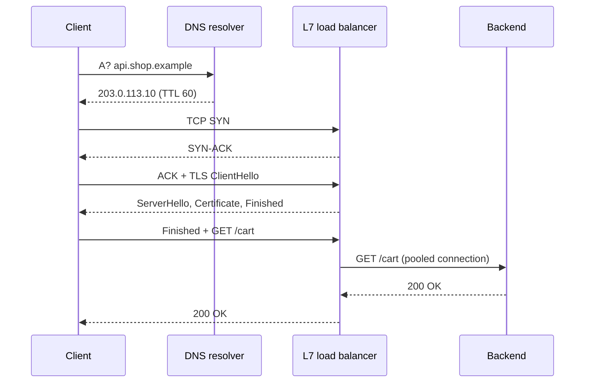

## In one minute
- Every request pays for round trips before it pays for bytes: DNS lookup, TCP handshake, TLS handshake, then the request itself. On a 150 ms path that is over half a second for a cold connection, which is why connection reuse, edge termination and HTTP/3 matter.
- TCP gives an ordered, reliable byte stream with congestion control; UDP gives unordered datagrams and leaves reliability to you. QUIC rebuilds TCP's guarantees on UDP so it can fix head-of-line blocking and handshake cost.
- HTTP/1.1 runs one request at a time per connection, HTTP/2 multiplexes streams over one TCP connection, HTTP/3 multiplexes them over QUIC so one lost packet only stalls its own stream.
- Layer 4 load balancers route connections by addresses and ports; layer 7 load balancers terminate TLS and route requests by path, header or cookie. Most production stacks use both.
- Know the latency ladder: about 0.5 ms inside a zone, 1 to 2 ms across zones (AWS only promises [single-digit milliseconds](https://docs.aws.amazon.com/whitepapers/latest/aws-fault-isolation-boundaries/availability-zones.html) between zones up to about 100 km apart), 60 to 80 ms across the US, 150 to 250 ms across the planet. Light in fibre covers about 200 km per millisecond, and no engineering beats that.

## How it works

### The life of a request
A browser wants `https://api.shop.example/cart`. A recursive resolver returns the address, walking root, `.example` and authoritative servers on a cache miss. The client opens a TCP connection (SYN, SYN-ACK, ACK), runs a TLS handshake, then sends the HTTP request. Each step is at least one round trip, and only the last one does useful work.

### TCP and UDP
TCP numbers every byte, acknowledges receipt, retransmits losses, and slows down under congestion. The application sees a stream with no message boundaries, so protocols on top add framing. UDP sends independent datagrams with no ordering, retransmission or congestion control. DNS, video calls, games and QUIC use it because a late packet is worse than a lost one, or because they want their own reliability rules.

### HTTP/1.1, HTTP/2, HTTP/3
HTTP/1.1 keeps connections alive but answers requests in order, so browsers open about six connections per host to fetch in parallel. HTTP/2 splits each request into frames tagged with a stream ID and interleaves many streams on one connection, with compressed headers. Its weakness is TCP itself: one lost segment blocks every stream behind it until the retransmit arrives. HTTP/3 runs over QUIC, where each stream is delivered independently, the transport and TLS handshakes are combined, and connections survive a change of client IP because they are identified by connection IDs rather than the address tuple. Two spec changes are easy to miss. The current HTTP/2 spec is RFC 9113 (June 2022), which replaced RFC 7540 and [deprecated its stream-priority scheme](https://datatracker.ietf.org/doc/rfc9113/), so do not design around priority trees. HTTP/3 is RFC 9114, and it swaps HPACK for QPACK because HPACK's strictly ordered table updates would bring head-of-line blocking back ([RFC 9114](https://www.rfc-editor.org/rfc/rfc9114)).

### Load balancing at L4 and L7
An L4 balancer sees IP addresses, ports and protocol. It picks a backend per connection, by hash or least connections, and forwards packets without reading them, so it is fast and protocol-agnostic. An L7 balancer terminates the connection, decrypts TLS, parses HTTP, and routes each request by host, path or header; it can retry, rate limit and spread HTTP/2 streams from one client across many backends. The common shape is DNS or anycast to a region, an L4 tier for packet capacity, then an L7 proxy tier such as Envoy or NGINX. Cloud guides draw the same split along two axes, global versus regional and HTTP versus non-HTTP, and warn that DNS-based global balancing fails over slowly because resolvers and clients ignore TTLs ([Azure Architecture Center](https://learn.microsoft.com/en-us/azure/architecture/guide/technology-choices/load-balancing-overview)).

## Down the stack

### Layer 1: The contract
TCP promises that bytes arrive in order, without gaps or duplicates, or the connection fails. It does not promise that the peer application processed them: an ACK means the kernel buffered the data. A timeout leaves the outcome unknown, so retried requests must be idempotent. TLS promises confidentiality, integrity and authentication of the server's name against a trusted CA, and TLS 1.3 0-RTT data has no replay protection, so it must only carry idempotent requests. DNS promises nothing about freshness beyond the TTL, and many clients and resolvers hold records longer than asked. An L7 balancer promises per-request routing but may retry on your behalf, which can double a non-idempotent POST.

### Layer 2: The mechanism
**TCP.** The handshake exchanges initial sequence numbers and options such as MSS, window scale and SACK. The sender may have `min(cwnd, rwnd)` bytes unacknowledged. Slow start begins with an initial window of about 10 segments, capped at `min(10*MSS, max(2*MSS, 14600))` bytes ([RFC 6928](https://www.rfc-editor.org/rfc/rfc6928)), so about 14.6 KB, and doubles each round trip until loss or a threshold, after which CUBIC or BBR govern growth. CUBIC, now RFC 9438 (2023), is the default in the [Linux, Windows and Apple stacks](https://www.rfc-editor.org/rfc/rfc9438). Three duplicate ACKs trigger fast retransmit; silence triggers a retransmission timeout. The standard asks for a [1-second minimum](https://www.rfc-editor.org/rfc/rfc6298), but Linux uses [200 ms](https://www.kernel.org/doc/html/latest/networking/ip-sysctl.html) (`tcp_rto_min_us`), which is where many mysterious 200 ms tail spikes come from. The side that closes first holds the socket in `TIME_WAIT` for 60 seconds on Linux.

**TLS 1.3.** The client sends `ClientHello` with a `key_share` guess; the server answers `ServerHello`, its key share, `EncryptedExtensions`, `Certificate`, `CertificateVerify` and `Finished` in one flight. That is one round trip, versus two for TLS 1.2. Resumption with a pre-shared key allows 0-RTT early data, which the spec says has [no guarantee of non-replay](https://www.rfc-editor.org/rfc/rfc8446) between connections.

**HTTP/2 and QUIC.** HTTP/2 sends `HEADERS`, `DATA`, `SETTINGS`, `WINDOW_UPDATE` and `RST_STREAM` frames, with HPACK header compression and per-stream flow control. QUIC packets carry a connection ID and packet numbers that are never reused, so a retransmission is unambiguous; stream frames carry offsets so each stream reassembles independently.

**L4 balancers.** A connection table keyed by the 5-tuple pins each flow to a backend. Google's [Maglev](https://research.google/pubs/maglev-a-fast-and-reliable-software-network-load-balancer/) (NSDI 2016) and similar designs use a consistent hashing table so that any balancer instance picks the same backend for a flow, which lets the balancer tier scale horizontally behind ECMP routing. Direct server return lets backends reply straight to the client, so the balancer only carries the small request direction.

### Layer 3: The machine
A 1,500-byte Ethernet frame carries a 1,460-byte TCP payload after 40 bytes of IP and TCP headers (less with timestamps). The NIC hashes flows across receive queues, one per core. The kernel holds a SYN queue and an accept queue per listening socket; the accept backlog is capped by `net.core.somaxconn`, [4096 since Linux 5.4](https://www.kernel.org/doc/html/latest/networking/ip-sysctl.html) (128 before). When it overflows, Linux does not send an error by default (`tcp_abort_on_overflow` is off): it silently drops the handshake's final ACK and new SYNs, so clients see stalls of a second or more rather than refusals. Outgoing connections use ephemeral ports from `ip_local_port_range`, typically 32768 to 60999, so one proxy talking to one backend address can hold about 28,000 connections at once; with 60 seconds of `TIME_WAIT` that caps fresh connections around 470 per second unless you reuse connections. Linux only reuses `TIME_WAIT` ports for loopback traffic by default (`tcp_tw_reuse=2`), so pooling is the real fix. TLS handshakes cost on the order of a millisecond of server CPU (hedge: depends on key type), while bulk AES-GCM runs at gigabytes per second per core.

Physics sets the floor. Fibre carries light at about 200,000 km per second, so New York to London (5,600 km) has a best-case RTT near 56 ms, and real routes measure 70 to 80 ms.

### Why it's built this way
1. Packets get lost and reordered on shared links, so TCP adds sequence numbers, ACKs and retransmission.
2. Senders that ignore loss collapse shared links, so TCP probes capacity with slow start and backs off on loss, which makes new connections slow.
3. Handshakes cost round trips that bandwidth cannot buy back, so protocols merged them: TLS 1.3 cut one, QUIC folded transport and crypto together.
4. Multiplexing on one ordered stream inherits its head-of-line blocking, so HTTP/3 moved streams into the transport.
5. Reading every request costs CPU, so packet-level L4 balancing absorbs volume cheaply and L7 is applied only where request-aware routing pays.

## Diagram


## Worked example
A shopper in Sydney calls an API hosted in Virginia, about 200 ms RTT (hedge: varies by route). The JSON response is 100 KB.

Cold, with no edge: DNS through a nearby resolver with a cached answer costs about 5 ms. TCP takes 1 RTT, TLS 1.3 another, the request a third: 600 ms before the first byte. With TLS 1.2 it is 800 ms. Then slow start: the first flight carries about 14.6 KB, the next 29 KB, then 58 KB, so 100 KB needs two more round trips after the first, another 400 ms. Total about one second.

Now terminate TCP and TLS at an edge proxy in Sydney, 10 ms away, which keeps warm connections to Virginia. Handshakes cost 2 RTTs of 10 ms, and the request crosses the ocean once on a connection whose congestion window is already large: about 20 + 200 + 10 = 230 ms. The 4x gain comes from moving round trips, not from adding bandwidth.

## In the wild
- **Google Cloud, 2023: HTTP/2 Rapid Reset.** Attackers opened a stream with `HEADERS` and cancelled it at once with `RST_STREAM`, in a loop. Cancelled streams never counted against the concurrent-stream limit, but servers still started work for each one. Google saw a peak above 398 million requests per second. The fixes were connection-level: track cancellations per connection, send `GOAWAY` and close abusive connections. Multiplexing moved the unit of abuse from the connection to the stream ([Google Cloud](https://cloud.google.com/blog/products/identity-security/how-it-works-the-novel-http2-rapid-reset-ddos-attack)).
- **Mozilla, 2019: an expired intermediate certificate disables add-ons.** The intermediate that signed every Firefox add-on expired just after 01:00 UTC on 4 May. Firefox re-checks signatures about every 24 hours, so most of 15,000+ add-ons were switched off for users worldwide. A replacement certificate with the same subject and key went out through the Studies system in under 9 hours, though it took another 6 to 12 hours for most users to receive it. It is a reminder that a TLS chain has an expiry date somebody must own ([Mozilla Hacks](https://hacks.mozilla.org/2019/05/technical-details-on-the-recent-firefox-add-on-outage/)).
- **GitHub, 2018: GLB Director, an L4 balancer built for draining.** GitHub's L4 tier keeps a forwarding table of about 65,000 rows, each naming a primary and a secondary proxy chosen by rendezvous hashing. Adding a proxy moves about 1/N of flows. Draining swaps primary and secondary so in-flight connections still reach the old proxy. This is the same idea as Maglev: every balancer computes the same answer, so no connection state has to be shared ([GitHub blog](https://github.blog/engineering/infrastructure/glb-director-open-source-load-balancer/)).

## Trade-offs
| Option | Strengths | Weaknesses | Choose when |
|---|---|---|---|
| HTTP/1.1 | Universal, simple to debug | One request at a time per connection | Internal tools, legacy clients |
| HTTP/2 over TCP | Multiplexing, header compression, gRPC | TCP head-of-line blocking on lossy links | Service to service, most APIs |
| HTTP/3 over QUIC | No transport HOL blocking, faster setup, connection migration | UDP sometimes blocked, more CPU, newer tooling | Mobile and long-haul clients |
| L4 load balancer | Millions of packets per second, any protocol | No request-level routing or retries | Front tier, databases, non-HTTP |
| L7 load balancer | Path routing, retries, auth, observability | TLS and parsing CPU, extra hop | HTTP APIs and microservices |
| DNS-based balancing | Global, cheap, no hop | TTLs ignored, slow failover | Choosing a region |

## Pitfalls in production
- **New connection per request.** Clients that do not pool pay handshakes every time and exhaust ephemeral ports in `TIME_WAIT`. Use keep-alive and connection pools, and alert on port usage.
- **Long-lived HTTP/2 connections defeat L4 balancing.** A gRPC client pins all its traffic to one backend, and new replicas sit idle ([Kubernetes blog](https://kubernetes.io/blog/2018/11/07/grpc-load-balancing-on-kubernetes-without-tears/)). Balance per request at L7 or cap connection age.
- **Retries at every layer.** Client, sidecar and balancer each retry three times and turn one failure into 27 requests. Retry in one place, with budgets.
- **Idle timeout mismatch.** A load balancer drops idle connections at 60 seconds while the client pool keeps them for 90, so requests fail on dead sockets. Make client idle timeouts shorter than every hop in between.
- **Low DNS TTLs that nobody honours.** Failover by DNS change takes minutes for some clients. Plan for it or use anycast.

## Leadership lens
- Ask for the round-trip budget of the critical user path, not just server time; most user-visible latency lives in the network.
- Decide where TLS terminates and who owns certificates and rotation; expired certificates remain a top cause of outages.
- Standardise on one proxy layer for retries, timeouts and mTLS so each team does not reinvent it with different defaults.
- Cross-zone and egress traffic is billed; chatty service calls across zones show up on the cloud bill.

## Check yourself
1. Why can HTTP/2 be slower than HTTP/1.1 with six connections on a lossy mobile network?
   **Answer:** One lost TCP segment stalls every multiplexed stream on the single connection, while six connections only stall the one that lost a packet and grow six congestion windows.
2. A load balancer acknowledges your POST, then the connection resets. Did the order get created?
   **Answer:** Unknown. A TCP ACK only means bytes were buffered; the request may or may not have run, so the retry needs an idempotency key.
3. Why does a gRPC service behind an L4 balancer end up with one hot pod?
   **Answer:** L4 balances connections, and gRPC reuses one long-lived HTTP/2 connection for all requests, so every request from that client lands on the same pod.
4. Why is TLS 1.3 0-RTT unsafe for a payment request?
   **Answer:** Early data can be replayed by an attacker who captured it, and the server cannot tell, so it must only carry idempotent requests.

## Practice
**Task:** Build an L4 least-connections balancer with a connection table. `open(conn_id)` assigns a new connection to the healthy backend with the fewest active connections, breaking ties by the order backends were given, and returns its name; opening an existing connection returns its current backend; with no healthy backend it returns `None` (`null` in TypeScript, `""` in Go). `route(conn_id)` returns the pinned backend or none if the connection is unknown. `close(conn_id)` removes it and returns whether it existed. `mark_down(backend)` makes a backend unhealthy and drops (resets) all its connections, returning how many were dropped; `mark_up(backend)` restores it. `active(backend)` returns its current connection count.

```python starter
class L4Balancer:
    def __init__(self, backends):
        # TODO
        pass

    def open(self, conn_id):
        raise NotImplementedError

    def route(self, conn_id):
        raise NotImplementedError

    def close(self, conn_id):
        raise NotImplementedError

    def mark_down(self, backend):
        raise NotImplementedError

    def mark_up(self, backend):
        raise NotImplementedError

    def active(self, backend):
        raise NotImplementedError
```

```python tests
def test_least_connections_with_tie_order():
    lb = L4Balancer(["a", "b", "c"])
    assert [lb.open(i) for i in range(4)] == ["a", "b", "c", "a"]
    assert lb.active("a") == 2

def test_sticky_routing():
    lb = L4Balancer(["a", "b"])
    lb.open("x"); lb.open("y")
    assert lb.open("x") == "a"
    assert lb.route("y") == "b" and lb.route("zzz") is None
    assert lb.active("a") == 1

def test_close_frees_capacity():
    lb = L4Balancer(["a", "b"])
    lb.open(1); lb.open(2); lb.open(3)
    assert lb.close(1) is True and lb.close(1) is False
    assert lb.open(4) == "a"

def test_mark_down_drops_connections():
    lb = L4Balancer(["a", "b"])
    for i in range(4):
        lb.open(i)
    assert lb.mark_down("a") == 2
    assert lb.route(0) is None and lb.active("a") == 0
    assert lb.open(9) == "b"

def test_mark_up_rejoins():
    lb = L4Balancer(["a", "b"])
    lb.mark_down("a")
    lb.open(1); lb.open(2)
    lb.mark_up("a")
    assert lb.open(3) == "a"

def test_no_healthy_backend():
    lb = L4Balancer(["a"])
    lb.mark_down("a")
    assert lb.open(1) is None and lb.route(1) is None
```

```python solution
class L4Balancer:
    def __init__(self, backends):
        self.order = list(backends)
        self.healthy = {b: True for b in backends}
        self.count = {b: 0 for b in backends}
        self.table = {}

    def open(self, conn_id):
        if conn_id in self.table:
            return self.table[conn_id]
        best = None
        for b in self.order:
            if self.healthy[b] and (best is None or self.count[b] < self.count[best]):
                best = b
        if best is None:
            return None
        self.table[conn_id] = best
        self.count[best] += 1
        return best

    def route(self, conn_id):
        return self.table.get(conn_id)

    def close(self, conn_id):
        b = self.table.pop(conn_id, None)
        if b is None:
            return False
        self.count[b] -= 1
        return True

    def mark_down(self, backend):
        self.healthy[backend] = False
        doomed = [c for c, b in self.table.items() if b == backend]
        for c in doomed:
            del self.table[c]
        self.count[backend] = 0
        return len(doomed)

    def mark_up(self, backend):
        self.healthy[backend] = True

    def active(self, backend):
        return self.count[backend]
```

```typescript starter
export class L4Balancer {
  constructor(backends: string[]) {}
  open(connId: string | number): string | null {
    throw new Error("TODO");
  }
  route(connId: string | number): string | null {
    throw new Error("TODO");
  }
  close(connId: string | number): boolean {
    throw new Error("TODO");
  }
  markDown(backend: string): number {
    throw new Error("TODO");
  }
  markUp(backend: string): void {
    throw new Error("TODO");
  }
  active(backend: string): number {
    throw new Error("TODO");
  }
}
```

```typescript tests
test("least connections with tie order", () => {
  const lb = new L4Balancer(["a", "b", "c"]);
  assertEqual([0, 1, 2, 3].map((i) => lb.open(i)), ["a", "b", "c", "a"]);
  assertEqual(lb.active("a"), 2);
});
test("sticky routing", () => {
  const lb = new L4Balancer(["a", "b"]);
  lb.open("x"); lb.open("y");
  assertEqual(lb.open("x"), "a");
  assertEqual(lb.route("y"), "b");
  assertEqual(lb.route("zzz"), null);
  assertEqual(lb.active("a"), 1);
});
test("close frees capacity", () => {
  const lb = new L4Balancer(["a", "b"]);
  lb.open(1); lb.open(2); lb.open(3);
  assertEqual([lb.close(1), lb.close(1)], [true, false]);
  assertEqual(lb.open(4), "a");
});
test("mark down drops connections", () => {
  const lb = new L4Balancer(["a", "b"]);
  for (let i = 0; i < 4; i++) lb.open(i);
  assertEqual(lb.markDown("a"), 2);
  assertEqual(lb.route(0), null);
  assertEqual(lb.active("a"), 0);
  assertEqual(lb.open(9), "b");
});
test("mark up rejoins", () => {
  const lb = new L4Balancer(["a", "b"]);
  lb.markDown("a");
  lb.open(1); lb.open(2);
  lb.markUp("a");
  assertEqual(lb.open(3), "a");
});
test("no healthy backend", () => {
  const lb = new L4Balancer(["a"]);
  lb.markDown("a");
  assertEqual(lb.open(1), null);
  assertEqual(lb.route(1), null);
});
```

```typescript solution
export class L4Balancer {
  private order: string[];
  private healthy = new Map<string, boolean>();
  private count = new Map<string, number>();
  private table = new Map<string | number, string>();

  constructor(backends: string[]) {
    this.order = backends.slice();
    for (const b of backends) {
      this.healthy.set(b, true);
      this.count.set(b, 0);
    }
  }
  open(connId: string | number): string | null {
    const existing = this.table.get(connId);
    if (existing !== undefined) return existing;
    let best: string | null = null;
    for (const b of this.order) {
      if (this.healthy.get(b) && (best === null || this.count.get(b)! < this.count.get(best)!)) best = b;
    }
    if (best === null) return null;
    this.table.set(connId, best);
    this.count.set(best, this.count.get(best)! + 1);
    return best;
  }
  route(connId: string | number): string | null {
    const b = this.table.get(connId);
    return b === undefined ? null : b;
  }
  close(connId: string | number): boolean {
    const b = this.table.get(connId);
    if (b === undefined) return false;
    this.table.delete(connId);
    this.count.set(b, this.count.get(b)! - 1);
    return true;
  }
  markDown(backend: string): number {
    this.healthy.set(backend, false);
    let dropped = 0;
    for (const [c, b] of Array.from(this.table.entries())) {
      if (b === backend) {
        this.table.delete(c);
        dropped++;
      }
    }
    this.count.set(backend, 0);
    return dropped;
  }
  markUp(backend: string): void {
    this.healthy.set(backend, true);
  }
  active(backend: string): number {
    return this.count.get(backend) ?? 0;
  }
}
```

```go starter
package practice

type L4Balancer struct{}

func NewL4Balancer(backends []string) *L4Balancer { return &L4Balancer{} }

// Open returns the backend for connID, or "" if no backend is healthy.
func (lb *L4Balancer) Open(connID string) string { panic("TODO") }

// Route returns the pinned backend, or "" if the connection is unknown.
func (lb *L4Balancer) Route(connID string) string { panic("TODO") }

func (lb *L4Balancer) Close(connID string) bool { panic("TODO") }

func (lb *L4Balancer) MarkDown(backend string) int { panic("TODO") }

func (lb *L4Balancer) MarkUp(backend string) { panic("TODO") }

func (lb *L4Balancer) Active(backend string) int { panic("TODO") }
```

```go tests
package practice

import (
	"fmt"
	"reflect"
	"testing"
)

func TestLeastConnectionsTieOrder(t *testing.T) {
	lb := NewL4Balancer([]string{"a", "b", "c"})
	var got []string
	for i := 0; i < 4; i++ {
		got = append(got, lb.Open(fmt.Sprint(i)))
	}
	if !reflect.DeepEqual(got, []string{"a", "b", "c", "a"}) || lb.Active("a") != 2 {
		t.Fatalf("got %v", got)
	}
}

func TestStickyRouting(t *testing.T) {
	lb := NewL4Balancer([]string{"a", "b"})
	lb.Open("x")
	lb.Open("y")
	if lb.Open("x") != "a" || lb.Route("y") != "b" || lb.Route("zzz") != "" || lb.Active("a") != 1 {
		t.Fatal("routing not sticky")
	}
}

func TestCloseFreesCapacity(t *testing.T) {
	lb := NewL4Balancer([]string{"a", "b"})
	lb.Open("1")
	lb.Open("2")
	lb.Open("3")
	if !lb.Close("1") || lb.Close("1") {
		t.Fatal("wrong close results")
	}
	if lb.Open("4") != "a" {
		t.Fatal("freed capacity not reused")
	}
}

func TestMarkDownDrops(t *testing.T) {
	lb := NewL4Balancer([]string{"a", "b"})
	for i := 0; i < 4; i++ {
		lb.Open(fmt.Sprint(i))
	}
	if lb.MarkDown("a") != 2 || lb.Route("0") != "" || lb.Active("a") != 0 {
		t.Fatal("mark down did not drop connections")
	}
	if lb.Open("9") != "b" {
		t.Fatal("down backend chosen")
	}
}

func TestMarkUpRejoins(t *testing.T) {
	lb := NewL4Balancer([]string{"a", "b"})
	lb.MarkDown("a")
	lb.Open("1")
	lb.Open("2")
	lb.MarkUp("a")
	if lb.Open("3") != "a" {
		t.Fatal("recovered backend not chosen")
	}
}

func TestNoHealthyBackend(t *testing.T) {
	lb := NewL4Balancer([]string{"a"})
	lb.MarkDown("a")
	if lb.Open("1") != "" || lb.Route("1") != "" {
		t.Fatal("expected no backend")
	}
}
```

```go solution
package practice

type L4Balancer struct {
	order   []string
	healthy map[string]bool
	count   map[string]int
	table   map[string]string
}

func NewL4Balancer(backends []string) *L4Balancer {
	lb := &L4Balancer{
		order:   append([]string(nil), backends...),
		healthy: map[string]bool{},
		count:   map[string]int{},
		table:   map[string]string{},
	}
	for _, b := range backends {
		lb.healthy[b] = true
	}
	return lb
}

// Open returns the backend for connID, or "" if no backend is healthy.
func (lb *L4Balancer) Open(connID string) string {
	if b, ok := lb.table[connID]; ok {
		return b
	}
	best := ""
	for _, b := range lb.order {
		if lb.healthy[b] && (best == "" || lb.count[b] < lb.count[best]) {
			best = b
		}
	}
	if best == "" {
		return ""
	}
	lb.table[connID] = best
	lb.count[best]++
	return best
}

// Route returns the pinned backend, or "" if the connection is unknown.
func (lb *L4Balancer) Route(connID string) string { return lb.table[connID] }

func (lb *L4Balancer) Close(connID string) bool {
	b, ok := lb.table[connID]
	if !ok {
		return false
	}
	delete(lb.table, connID)
	lb.count[b]--
	return true
}

func (lb *L4Balancer) MarkDown(backend string) int {
	lb.healthy[backend] = false
	dropped := 0
	for c, b := range lb.table {
		if b == backend {
			delete(lb.table, c)
			dropped++
		}
	}
	lb.count[backend] = 0
	return dropped
}

func (lb *L4Balancer) MarkUp(backend string) { lb.healthy[backend] = true }

func (lb *L4Balancer) Active(backend string) int { return lb.count[backend] }
```

## Mock interview
**Prompt:** Your mobile app's checkout takes 2.5 seconds at p95 in Southeast Asia and 400 ms in the US, while backend server time is 80 ms everywhere. All servers are in us-east-1. Explain where the time goes and what you would change.

- Follow-up: walk through the exact round trips for a cold HTTPS request from Jakarta.
- Follow-up: you move to HTTP/3 and some users get slower. Why?
- Follow-up: would you rather add an edge proxy or a second region, and what does each cost?

**A strong answer covers:**
- Round-trip arithmetic: about 230 ms RTT times DNS, TCP, TLS, request and slow start flights explains seconds, not server time.
- Connection reuse and keep-alive in the app, and fewer sequential API calls on the checkout path.
- Edge termination with warm, pooled connections to origin, cutting handshakes to the local RTT.
- HTTP/3 helps lossy mobile links but some networks block or throttle UDP, so race QUIC against TCP and fall back.
- A second region removes the ocean round trip for reads but brings data replication and consistency work for checkout writes.

## Sources and further study
**Primary**
- [RFC 9114: HTTP/3](https://www.rfc-editor.org/rfc/rfc9114): HTTP over QUIC, and why QPACK replaces HPACK.
- [RFC 6928: Increasing TCP's Initial Window](https://www.rfc-editor.org/rfc/rfc6928): the IW10 bound and the measurements behind it.
- [RFC 9438: CUBIC for Fast and Long-Distance Networks](https://www.rfc-editor.org/rfc/rfc9438): the congestion controller most stacks run by default.
- [Eisenbud et al., Maglev (NSDI 2016)](https://research.google/pubs/maglev-a-fast-and-reliable-software-network-load-balancer/): ECMP plus consistent hashing for a stateless-looking L4 tier.

**Systems docs**
- [Linux kernel: IP sysctl](https://www.kernel.org/doc/html/latest/networking/ip-sysctl.html): the real defaults for `somaxconn`, port ranges, `tcp_tw_reuse` and minimum RTO.
- [gRPC load balancing on Kubernetes without tears](https://kubernetes.io/blog/2018/11/07/grpc-load-balancing-on-kubernetes-without-tears/): why connection-level balancing breaks for HTTP/2.

**Books**
- *Computer Networking: A Top-Down Approach* (8th ed.), Kurose and Ross, chapter 3 "Transport Layer": reliable transfer, TCP congestion control and QUIC.
- *Understanding Distributed Systems* (2nd ed.), Roberto Vitillo, chapters "Reliable links", "Secure links" and "Network load balancing".

**Other curricula**
- [Azure Architecture Center: Load balancing options](https://learn.microsoft.com/en-us/azure/architecture/guide/technology-choices/load-balancing-overview): sorts balancers by global versus regional and HTTP versus non-HTTP, with a decision tree.
- [donnemartin/system-design-primer](https://github.com/donnemartin/system-design-primer): contrasts TCP with UDP and L4 with L7 balancing in short definitions; it does not cover handshake cost, HTTP/3 or kernel limits.

## Watch
- [What happens when you type a URL into your browser? (ByteByteGo)](https://www.youtube.com/watch?v=AlkDbnbv7dk): DNS, TCP, TLS and the request in one short animated walk-through.
- [HTTP/1 to HTTP/2 to HTTP/3 (ByteByteGo)](https://www.youtube.com/watch?v=a-sBfyiXysI): what each version changed and which bottleneck it removed.
- [Transport Layer Security, TLS 1.2 and 1.3 (Explained by Example) (Hussein Nasser)](https://www.youtube.com/watch?v=AlE5X1NlHgg): both handshakes step by step and why 1.3 saves a round trip.

## Free resources
- [High Performance Browser Networking (Ilya Grigorik)](https://hpbn.co/): free book covering latency, TCP, TLS, HTTP/2 and mobile networks with real numbers.
- [RFC 8446: TLS 1.3](https://www.rfc-editor.org/rfc/rfc8446): the handshake messages, key schedule and 0-RTT caveats from the source.
- [RFC 9000: QUIC](https://www.rfc-editor.org/rfc/rfc9000): streams, connection IDs, packet numbers and loss recovery.
- [RFC 9113: HTTP/2](https://www.rfc-editor.org/rfc/rfc9113): frames, streams and flow control.
- [HTTP/3: the past, the present, and the future (Cloudflare)](https://blog.cloudflare.com/http3-the-past-present-and-future/): why QUIC exists and what deploying it at the edge looks like.
- [Latency numbers every programmer should know](https://gist.github.com/jboner/2841832): the classic table for back-of-envelope estimates.
