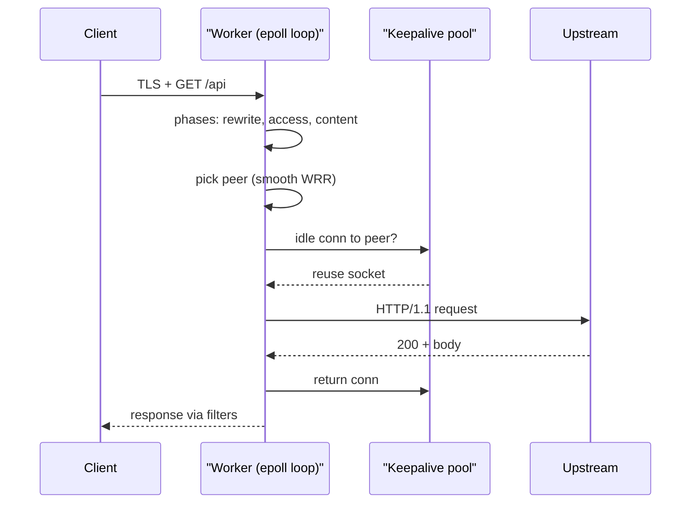

## In one minute
- Nginx is an event-driven web server and reverse proxy: a master process plus one single-threaded worker per core, each multiplexing thousands of connections with `epoll`.
- It earns its place at the edge of a system: TLS termination, static files, L7 load balancing, caching, rate limiting and buffering slow clients away from your app servers.
- Load balancing is smooth weighted round-robin by default, with passive health checks (`max_fails`, `fail_timeout`); active checks need NGINX Plus or a sidecar.
- Upstream keepalive is the setting most often forgotten. Without it every proxied request opens a new TCP connection to the backend, which burns CPU and ephemeral ports. Nginx 1.29.7 and the 1.30 stable line (April 2026) finally turn it on by default, but most fleets still run older builds.
- Reach for it when config is fairly static and you want a boring, fast proxy. Prefer Envoy or a managed load balancer when backends change every few seconds or you need rich per-request logic.

## How it works

### Master and workers
The master process runs as root, parses `nginx.conf`, opens listening sockets and forks workers. It does no request work. Each worker is an unprivileged process with its own event loop and connection table. `worker_processes auto` gives one worker per core, so nothing contends for a lock on the hot path.

Reload is a signal, not a restart. On `SIGHUP` the master parses the new config (rolling back and keeping the old one if it fails to apply), forks new workers, and tells the old ones to stop accepting and exit when in-flight requests finish. Long-lived connections keep old workers alive until `worker_shutdown_timeout`, so a reload can briefly double memory ([nginx: controlling nginx](https://nginx.org/en/docs/control.html)).

### A request's path through a worker
A request moves through phases: `server` selection by `Host` or SNI, rewrite, `location` match, access checks (`allow`, `auth_request`, `limit_req`), content, then logging. The content handler serves a file or hands off to the upstream module, which picks a backend and streams the response back through output filters (gzip, chunked encoding, SSL).

### Load balancing
An `upstream` block lists servers with weights. The default algorithm is smooth weighted round-robin; alternatives are `least_conn`, `ip_hash`, `hash $key consistent` (a ketama-style ring), `random two least_conn` (power of two choices) and, since open-source 1.31.0, `least_time`, which was previously NGINX Plus only. Each server has `max_fails` (default 1) and `fail_timeout` (default 10 s). If a server fails `max_fails` times within `fail_timeout`, it is skipped for `fail_timeout`, then given a single trial request ([ngx_http_upstream_module](https://nginx.org/en/docs/http/ngx_http_upstream_module.html)). What counts as a failure is set by `proxy_next_upstream`, which by default is `error timeout`: a 500 from the backend is passed to the client and is not a failure unless you add `http_500` ([ngx_http_proxy_module](https://nginx.org/en/docs/http/ngx_http_proxy_module.html#proxy_next_upstream)).

## Down the stack

### Layer 1: The contract
For the client, Nginx is an HTTP/1.1, HTTP/2 or HTTP/3 server that returns a response or a 5xx it generated itself: 502 when the upstream connection failed or returned garbage, 504 when `proxy_read_timeout` (default 60 s) expired, 503 when `limit_req` rejected it. It retries a request on the next upstream after an error or timeout (since 1.9.13, POST, PATCH and LOCK only if `non_idempotent` is set), bounded by `proxy_next_upstream_tries` and `proxy_next_upstream_timeout`. Without that flag a POST is not retried once it was sent upstream, and no request is retried after response bytes reached the client, so a backend crash mid-request surfaces as a 502.

Balancing state is per worker: each keeps its own round-robin counters and failure counts unless a `zone` directive moves peer state into shared memory. A proxied hop within a rack adds tens to a few hundred microseconds when the upstream connection is already open.

### Layer 2: The mechanism
**Event loop.** Each worker runs `ngx_process_events_and_timers`: find the nearest timer in a red-black tree of timeouts, call `epoll_wait` (the method chosen on Linux, [nginx docs](https://nginx.org/en/docs/events.html)) with that as the timeout, dispatch each ready event to its handler, then expire timers. Every connection is an `ngx_connection_t` with a read event and a write event; handlers are state machines that consume whatever bytes are available and return `NGX_AGAIN` when a socket would block. Nothing in the loop may block. Disk reads that might miss the page cache can be moved to a thread pool with `aio threads`.

**Memory.** Allocation uses per-connection and per-request pools (`ngx_pool_t`) freed in one step when the request ends ([AOSA: nginx](https://aosabook.org/en/v2/nginx.html)). Data moves as chains of buffers (`ngx_chain_t` of `ngx_buf_t`); a buffer can point at a file range, which is how `sendfile` avoids copying.

**Accepting.** Workers share the listening socket by default. `listen 443 reuseport` gives each worker its own `SO_REUSEPORT` socket so the kernel spreads new connections evenly.

**Smooth weighted round-robin.** Each peer has a static `weight`, an `effective_weight` and a `current_weight`. On each pick, every eligible peer adds its `effective_weight` to its `current_weight`; the peer with the highest `current_weight` wins and has the total subtracted. For weights 5, 1, 1 this yields `a a b a c a a`, spreading the light servers out instead of sending five requests in a row to `a`. On failure, `effective_weight` drops by `weight / max_fails` and climbs back by one per selection, so a flaky server is eased back in. Maxim Dounin added the algorithm in 2012 ([nginx commit](https://github.com/nginx/nginx/commit/52327e0627f49dbda1e8db695e63a4b0af4448b1)).

**Upstream keepalive.** `keepalive 32` in an `upstream` block gives each worker a cache of up to 32 idle connections to that group. When a response completes cleanly, the connection goes back into the cache instead of being closed. Before 1.29.7 it only worked with `proxy_http_version 1.1` and `proxy_set_header Connection ""`, because the default proxy protocol was HTTP/1.0 with `Connection: close`. From 1.29.7 (and so in 1.30 stable) the defaults flipped: `keepalive 32 local` is on in every upstream, `proxy_http_version` defaults to 1.1 and no `Connection` header is sent ([nginx CHANGES](https://nginx.org/en/CHANGES)). The `local` flag stops locations from sharing cached connections. `keepalive_requests` (default 1000 since 1.19.10) and `keepalive_timeout` (default 60 s) bound each cached connection's life.

### Layer 3: The machine
`epoll_wait` returns only ready file descriptors, so the cost of a loop iteration scales with active connections, not total ones. That is the difference from `select`/`poll`, which scan every descriptor on every call. Nginx registers sockets edge-triggered (`EPOLLET`), so it must read until `EAGAIN` or it will not be woken again for the same data.

An idle client costs a few KB of user memory plus kernel socket buffers (hedge: TLS and HTTP/2 settings change this a lot), so 100,000 idle clients fit in a few hundred MB, provided `worker_rlimit_nofile` allows the descriptors.

Static files go out with `sendfile`, page cache to socket inside the kernel, unless TLS forces a trip through user space (kTLS avoids it). A full TLS handshake costs roughly 0.1 to 0.3 ms of CPU with ECDSA P-256 and 1 ms or more with RSA-2048 (hedge: varies by CPU), so session resumption and keepalive matter more than raw request throughput.

New upstream connections hit a hard limit. Linux's default ephemeral range (32768 to 60999, [kernel docs](https://docs.kernel.org/networking/ip-sysctl.html)) is about 28,000 ports, and the side that closes holds each socket in `TIME_WAIT` for 60 s. Toward one backend IP and port, that sustains only about 470 new connections per second from one source IP. Keepalive turns that into a handful of long-lived connections. Per-worker pools still waste reuse: when Cloudflare replaced Nginx with Pingora, whose pool is shared by all threads, one large customer's connection reuse rose from 87.1% to 99.92%, or 160 times fewer new origin connections ([Cloudflare](https://blog.cloudflare.com/how-we-built-pingora-the-proxy-that-connects-cloudflare-to-the-internet/)).

### Why it's built this way
1. In 2002 the C10K problem was that a thread or process per connection cost megabytes of stack and a context switch per event, so Nginx uses one process per core and nonblocking sockets.
2. One thread per worker means no locks, but anything blocking stalls thousands of connections, so blocking work goes to thread pools.
3. Workers do not share memory by default, which keeps them independent and crash-isolated, so load-balancing state is per worker unless you opt into a shared `zone`.
4. TCP and TLS setup cost more than proxying a small request, so connections are reused on both sides.
5. Config is compiled into in-memory structures at load time for speed, so changes require a reload; that is the root of the "static config" trade-off against xDS-driven proxies.

## Diagram


## Worked example
An API peaks at 60,000 requests per second. Four Nginx boxes with 8 cores each sit behind a cloud L4 load balancer, proxying to 30 app servers.

Per box that is 15,000 requests per second, under 2,000 per worker, well within one worker's capacity for small proxied responses, even with one box down.

Without upstream keepalive, each box opens 15,000 new connections per second spread over 30 backends: 500 per second per backend. That is above the roughly 470 per second that `TIME_WAIT` allows per source and destination pair, so after a minute or so connects start failing with `EADDRNOTAVAIL` and users see 502s.

With `keepalive 64`, each worker caches up to 64 idle connections. At 20 ms per upstream request a worker needs about 2,000 × 0.02 = 40 concurrent connections, so nearly every request reuses one and p99 drops by about one RTT.

## In the wild
- **Cloudflare, 2017: Cloudbleed leaks memory through an Nginx filter module.** Cloudflare's Ragel-generated HTML parser checked end-of-buffer with `==` instead of `>=`. A new parser changed how Nginx buffers were passed between filter modules, which woke the dormant bug, and pages with a malformed tag at the end leaked adjacent memory (cookies, tokens, POST bodies), about 1 in 3,300,000 requests at the peak. Google reported it on 18 February; Email Obfuscation was disabled worldwide 47 minutes later. TLS private keys were safe because they lived in a separate Nginx instance ([Cloudflare](https://blog.cloudflare.com/incident-report-on-memory-leak-caused-by-cloudflare-parser-bug/)).
- **Kubernetes ingress-nginx, 2025: IngressNightmare turns `nginx -t` into remote code execution.** The controller's admission webhook was unauthenticated and validated generated config by running `nginx -t`. Crafted Ingress objects injected directives such as `ssl_engine`, which loads a shared library during the test, giving code execution in a pod that could read every cluster secret (CVSS 9.8, fixed in 1.12.1 and 1.11.5). Wiz found over 6,500 clusters exposing the webhook publicly ([Wiz](https://www.wiz.io/blog/ingress-nginx-kubernetes-vulnerabilities)). The project was later retired, with no fixes after March 2026 ([Kubernetes blog](https://kubernetes.io/blog/2025/11/11/ingress-nginx-retirement/)).

## Trade-offs
| Option | Strengths | Weaknesses | Choose when |
|---|---|---|---|
| Nginx OSS | Fast, tiny, well understood, great for static files and TLS | Reload for config changes, passive health checks only, per-worker LB state | Edge proxy with mostly static upstreams |
| NGINX Plus | Active health checks, API for upstream changes, metrics | Licence cost | You want Nginx and dynamic backends |
| Envoy | xDS dynamic config, rich observability, retries, circuit breaking, gRPC | Heavier, more complex config | Service mesh or fast-changing backends |
| HAProxy | Excellent L4/L7 LB, runtime API, strong health checks | Not a web server for static content | Pure load balancing at high connection counts |
| Cloud LB (ALB, GCLB) | No servers, autoscaling, managed TLS | Less control, per-LCU cost, vendor limits | You do not want to run proxies |

## Pitfalls in production
- **Upstream keepalive silently off.** On builds older than 1.29.7, `keepalive` without `proxy_http_version 1.1` and an empty `Connection` header does nothing. Know which version each fleet runs, and check backend connection rates after any config change or upgrade.
- **Retrying non-idempotent work.** A timeout on a slow POST passed to the next upstream can double-charge. Keep `non_idempotent` off and make handlers idempotent.
- **DNS resolved once.** `proxy_pass http://name` resolves at startup; if backend IPs change, traffic goes to dead addresses. Use `resolver` with a variable in `proxy_pass`, or `server ... resolve` in a `zone` upstream, which open-source Nginx gained in 1.27.3 after years as a Plus feature.
- **Buffering surprises.** `proxy_buffering on` spills large responses to temp files on disk, and `client_max_body_size` defaults to 1 MB, rejecting uploads with 413. Tune per location.
- **Per-worker rate limits and health.** Without a `zone`, eight workers each think a backend has had one failure. Add `zone` to upstreams that need consistent state.

## Leadership lens
- Ask which component owns retries. If Nginx, the client library and a mesh all retry, one failure becomes 27 requests.
- Decide where TLS terminates and who rotates certificates; that choice drives compliance and on-call.
- Treat config as code: `nginx -t` in CI and staged rollout, because one bad `location` regex breaks every route.
- If upstream membership changes faster than you can safely reload, that is the signal to move to Envoy or a managed load balancer, not to script reloads.
- Measure p99 added latency and new upstream connections per second; both expose misconfiguration before users do.

## Check yourself
1. Why does Nginx run one worker per core instead of one thread per connection?
   **Answer:** Threads cost stack memory and context switches per event; one nonblocking event loop per core handles thousands of connections with no locks and only pays for sockets that are ready.
2. A backend returned 500 ten times in a row, yet Nginx keeps sending it traffic. Why?
   **Answer:** By default only connection errors and timeouts count as failures; a 500 is a valid response. Add `http_500` to `proxy_next_upstream` if it should count.
3. With weights 5, 1, 1, why does smooth weighted round-robin produce `a a b a c a a` instead of five `a`s then `b`, `c`?
   **Answer:** Each pick subtracts the total from the winner's current weight, so the heavy server falls behind the light ones briefly and the picks interleave.
4. What breaks first at high RPS if upstream keepalive is off?
   **Answer:** Ephemeral ports in `TIME_WAIT` toward each backend run out at a few hundred new connections per second per pair, producing connect errors and 502s, alongside wasted handshake CPU.

## Practice
**Task:** Implement an Nginx-style upstream picker with smooth weighted round-robin and passive health checks. The constructor takes a list of `(name, weight)` peers, `max_fails` and `fail_timeout`. `pick(now)` returns a peer name, or `None`/`null`/`("", false)` in Go if every peer is down. A peer is down when `fails >= max_fails` and `now - checked <= fail_timeout`. On each pick, every eligible peer adds `effective` to `current` (and then, if `effective < weight`, increments `effective` by 1); the eligible peer with the highest `current` wins, ties going to the earliest in the list, and the winner's `current` is reduced by the sum of eligible `effective` values added this round. If the winner had `fails >= max_fails` (a trial after the timeout), set its `checked = now`. `report_failure(name, now)` increments `fails`, sets `checked = now`, and lowers `effective` by `weight // max_fails` (not below 0). `report_success(name)` resets `fails` to 0.

```python starter
class Upstream:
    def __init__(self, peers, max_fails, fail_timeout):
        # TODO
        pass

    def pick(self, now):
        raise NotImplementedError

    def report_failure(self, name, now):
        raise NotImplementedError

    def report_success(self, name):
        raise NotImplementedError
```

```python tests
def test_smooth_sequence():
    u = Upstream([("a", 5), ("b", 1), ("c", 1)], 1, 10)
    assert [u.pick(0) for _ in range(7)] == ["a", "a", "b", "a", "c", "a", "a"]

def test_equal_weights_rotate():
    u = Upstream([("a", 1), ("b", 1), ("c", 1)], 1, 10)
    assert [u.pick(0) for _ in range(6)] == ["a", "b", "c", "a", "b", "c"]

def test_marked_down_after_max_fails():
    u = Upstream([("a", 1), ("b", 1)], 2, 10)
    u.report_failure("b", 0)
    assert "b" in [u.pick(1) for _ in range(4)], "one failure is below max_fails"
    u.report_failure("b", 1)
    assert [u.pick(5) for _ in range(4)] == ["a", "a", "a", "a"]

def test_trial_after_timeout_then_back_down():
    u = Upstream([("a", 1), ("b", 1)], 1, 10)
    u.report_failure("b", 0)
    assert [u.pick(10) for _ in range(3)] == ["a", "a", "a"], "fail_timeout is inclusive"
    picks = [u.pick(11) for _ in range(3)]
    assert "b" in picks, "b gets a trial after the timeout"
    u.report_failure("b", 11)
    assert [u.pick(15) for _ in range(3)] == ["a", "a", "a"]

def test_all_down_returns_none():
    u = Upstream([("a", 1), ("b", 2)], 1, 10)
    u.report_failure("a", 0)
    u.report_failure("b", 0)
    assert u.pick(3) is None

def test_success_resets_fail_count():
    u = Upstream([("a", 1), ("b", 1)], 2, 10)
    u.report_failure("b", 0)
    u.report_success("b")
    u.report_failure("b", 1)
    assert "b" in [u.pick(2) for _ in range(4)]

def test_failure_lowers_effective_weight():
    u = Upstream([("a", 4), ("b", 4)], 2, 10)
    u.report_failure("a", 0)
    assert [u.pick(1) for _ in range(4)] == ["b", "a", "b", "a"]
    assert [u.pick(1) for _ in range(4)].count("a") == 2
```

```python solution
class _Peer:
    def __init__(self, name, weight):
        self.name = name
        self.weight = weight
        self.effective = weight
        self.current = 0
        self.fails = 0
        self.checked = 0


class Upstream:
    def __init__(self, peers, max_fails, fail_timeout):
        self.peers = [_Peer(n, w) for n, w in peers]
        self.by_name = {p.name: p for p in self.peers}
        self.max_fails = max_fails
        self.fail_timeout = fail_timeout

    def _down(self, p, now):
        return p.fails >= self.max_fails and now - p.checked <= self.fail_timeout

    def pick(self, now):
        best, total = None, 0
        for p in self.peers:
            if self._down(p, now):
                continue
            p.current += p.effective
            total += p.effective
            if p.effective < p.weight:
                p.effective += 1
            if best is None or p.current > best.current:
                best = p
        if best is None:
            return None
        best.current -= total
        if best.fails >= self.max_fails:
            best.checked = now
        return best.name

    def report_failure(self, name, now):
        p = self.by_name[name]
        p.fails += 1
        p.checked = now
        p.effective = max(0, p.effective - p.weight // self.max_fails)

    def report_success(self, name):
        self.by_name[name].fails = 0
```

```typescript starter
export class Upstream {
  constructor(peers: [string, number][], maxFails: number, failTimeout: number) {}
  pick(now: number): string | null {
    throw new Error("TODO");
  }
  reportFailure(name: string, now: number): void {
    throw new Error("TODO");
  }
  reportSuccess(name: string): void {
    throw new Error("TODO");
  }
}
```

```typescript tests
const picks = (u: Upstream, now: number, n: number): (string | null)[] => {
  const out: (string | null)[] = [];
  for (let i = 0; i < n; i++) out.push(u.pick(now));
  return out;
};
test("smooth sequence", () => {
  const u = new Upstream([["a", 5], ["b", 1], ["c", 1]], 1, 10);
  assertEqual(picks(u, 0, 7), ["a", "a", "b", "a", "c", "a", "a"]);
});
test("equal weights rotate", () => {
  const u = new Upstream([["a", 1], ["b", 1], ["c", 1]], 1, 10);
  assertEqual(picks(u, 0, 6), ["a", "b", "c", "a", "b", "c"]);
});
test("marked down after max fails", () => {
  const u = new Upstream([["a", 1], ["b", 1]], 2, 10);
  u.reportFailure("b", 0);
  assert(picks(u, 1, 4).includes("b"), "one failure is below max_fails");
  u.reportFailure("b", 1);
  assertEqual(picks(u, 5, 4), ["a", "a", "a", "a"]);
});
test("trial after timeout then back down", () => {
  const u = new Upstream([["a", 1], ["b", 1]], 1, 10);
  u.reportFailure("b", 0);
  assertEqual(picks(u, 10, 3), ["a", "a", "a"], "fail_timeout is inclusive");
  assert(picks(u, 11, 3).includes("b"), "b gets a trial after the timeout");
  u.reportFailure("b", 11);
  assertEqual(picks(u, 15, 3), ["a", "a", "a"]);
});
test("all down returns null", () => {
  const u = new Upstream([["a", 1], ["b", 2]], 1, 10);
  u.reportFailure("a", 0);
  u.reportFailure("b", 0);
  assertEqual(u.pick(3), null);
});
test("success resets fail count", () => {
  const u = new Upstream([["a", 1], ["b", 1]], 2, 10);
  u.reportFailure("b", 0);
  u.reportSuccess("b");
  u.reportFailure("b", 1);
  assert(picks(u, 2, 4).includes("b"));
});
test("failure lowers effective weight", () => {
  const u = new Upstream([["a", 4], ["b", 4]], 2, 10);
  u.reportFailure("a", 0);
  assertEqual(picks(u, 1, 4), ["b", "a", "b", "a"]);
  assertEqual(picks(u, 1, 4).filter((x) => x === "a").length, 2);
});
```

```typescript solution
interface Peer {
  name: string;
  weight: number;
  effective: number;
  current: number;
  fails: number;
  checked: number;
}

export class Upstream {
  private peers: Peer[];
  constructor(peers: [string, number][], private maxFails: number, private failTimeout: number) {
    this.peers = peers.map(([name, weight]) => ({
      name, weight, effective: weight, current: 0, fails: 0, checked: 0,
    }));
  }
  private find(name: string): Peer {
    const p = this.peers.find((x) => x.name === name);
    if (!p) throw new Error("unknown peer " + name);
    return p;
  }
  private down(p: Peer, now: number): boolean {
    return p.fails >= this.maxFails && now - p.checked <= this.failTimeout;
  }
  pick(now: number): string | null {
    let best: Peer | null = null;
    let total = 0;
    for (const p of this.peers) {
      if (this.down(p, now)) continue;
      p.current += p.effective;
      total += p.effective;
      if (p.effective < p.weight) p.effective++;
      if (best === null || p.current > best.current) best = p;
    }
    if (best === null) return null;
    best.current -= total;
    if (best.fails >= this.maxFails) best.checked = now;
    return best.name;
  }
  reportFailure(name: string, now: number): void {
    const p = this.find(name);
    p.fails++;
    p.checked = now;
    p.effective = Math.max(0, p.effective - Math.floor(p.weight / this.maxFails));
  }
  reportSuccess(name: string): void {
    this.find(name).fails = 0;
  }
}
```

```go starter
package practice

// PeerSpec is one upstream server and its static weight.
type PeerSpec struct {
	Name   string
	Weight int
}

type Upstream struct{}

func NewUpstream(peers []PeerSpec, maxFails int, failTimeout int64) *Upstream {
	return &Upstream{}
}

// Pick returns the chosen peer, or ("", false) if every peer is down.
func (u *Upstream) Pick(now int64) (string, bool) { panic("TODO") }

func (u *Upstream) ReportFailure(name string, now int64) { panic("TODO") }

func (u *Upstream) ReportSuccess(name string) { panic("TODO") }
```

```go tests
package practice

import (
	"reflect"
	"testing"
)

func picks(u *Upstream, now int64, n int) []string {
	out := []string{}
	for i := 0; i < n; i++ {
		name, ok := u.Pick(now)
		if !ok {
			name = "<none>"
		}
		out = append(out, name)
	}
	return out
}

func contains(xs []string, s string) bool {
	for _, x := range xs {
		if x == s {
			return true
		}
	}
	return false
}

func TestSmoothSequence(t *testing.T) {
	u := NewUpstream([]PeerSpec{{"a", 5}, {"b", 1}, {"c", 1}}, 1, 10)
	want := []string{"a", "a", "b", "a", "c", "a", "a"}
	if got := picks(u, 0, 7); !reflect.DeepEqual(got, want) {
		t.Fatalf("got %v want %v", got, want)
	}
}

func TestEqualWeightsRotate(t *testing.T) {
	u := NewUpstream([]PeerSpec{{"a", 1}, {"b", 1}, {"c", 1}}, 1, 10)
	want := []string{"a", "b", "c", "a", "b", "c"}
	if got := picks(u, 0, 6); !reflect.DeepEqual(got, want) {
		t.Fatalf("got %v want %v", got, want)
	}
}

func TestMarkedDownAfterMaxFails(t *testing.T) {
	u := NewUpstream([]PeerSpec{{"a", 1}, {"b", 1}}, 2, 10)
	u.ReportFailure("b", 0)
	if !contains(picks(u, 1, 4), "b") {
		t.Fatal("one failure is below max_fails")
	}
	u.ReportFailure("b", 1)
	if got := picks(u, 5, 4); !reflect.DeepEqual(got, []string{"a", "a", "a", "a"}) {
		t.Fatalf("got %v", got)
	}
}

func TestTrialAfterTimeoutThenBackDown(t *testing.T) {
	u := NewUpstream([]PeerSpec{{"a", 1}, {"b", 1}}, 1, 10)
	u.ReportFailure("b", 0)
	if got := picks(u, 10, 3); !reflect.DeepEqual(got, []string{"a", "a", "a"}) {
		t.Fatalf("fail_timeout is inclusive, got %v", got)
	}
	if !contains(picks(u, 11, 3), "b") {
		t.Fatal("b should get a trial after the timeout")
	}
	u.ReportFailure("b", 11)
	if got := picks(u, 15, 3); !reflect.DeepEqual(got, []string{"a", "a", "a"}) {
		t.Fatalf("got %v", got)
	}
}

func TestAllDown(t *testing.T) {
	u := NewUpstream([]PeerSpec{{"a", 1}, {"b", 2}}, 1, 10)
	u.ReportFailure("a", 0)
	u.ReportFailure("b", 0)
	if _, ok := u.Pick(3); ok {
		t.Fatal("expected no live upstream")
	}
}

func TestSuccessResetsFailCount(t *testing.T) {
	u := NewUpstream([]PeerSpec{{"a", 1}, {"b", 1}}, 2, 10)
	u.ReportFailure("b", 0)
	u.ReportSuccess("b")
	u.ReportFailure("b", 1)
	if !contains(picks(u, 2, 4), "b") {
		t.Fatal("b should still be eligible")
	}
}

func TestFailureLowersEffectiveWeight(t *testing.T) {
	u := NewUpstream([]PeerSpec{{"a", 4}, {"b", 4}}, 2, 10)
	u.ReportFailure("a", 0)
	if got := picks(u, 1, 4); !reflect.DeepEqual(got, []string{"b", "a", "b", "a"}) {
		t.Fatalf("got %v", got)
	}
	n := 0
	for _, x := range picks(u, 1, 4) {
		if x == "a" {
			n++
		}
	}
	if n != 2 {
		t.Fatalf("want 2 picks of a after recovery, got %d", n)
	}
}
```

```go solution
package practice

import "sync"

// PeerSpec is one upstream server and its static weight.
type PeerSpec struct {
	Name   string
	Weight int
}

type peer struct {
	name                       string
	weight, effective, current int
	fails                      int
	checked                    int64
}

type Upstream struct {
	mu          sync.Mutex
	peers       []*peer
	byName      map[string]*peer
	maxFails    int
	failTimeout int64
}

func NewUpstream(peers []PeerSpec, maxFails int, failTimeout int64) *Upstream {
	u := &Upstream{byName: map[string]*peer{}, maxFails: maxFails, failTimeout: failTimeout}
	for _, s := range peers {
		p := &peer{name: s.Name, weight: s.Weight, effective: s.Weight}
		u.peers = append(u.peers, p)
		u.byName[s.Name] = p
	}
	return u
}

func (u *Upstream) down(p *peer, now int64) bool {
	return p.fails >= u.maxFails && now-p.checked <= u.failTimeout
}

// Pick returns the chosen peer, or ("", false) if every peer is down.
func (u *Upstream) Pick(now int64) (string, bool) {
	u.mu.Lock()
	defer u.mu.Unlock()
	var best *peer
	total := 0
	for _, p := range u.peers {
		if u.down(p, now) {
			continue
		}
		p.current += p.effective
		total += p.effective
		if p.effective < p.weight {
			p.effective++
		}
		if best == nil || p.current > best.current {
			best = p
		}
	}
	if best == nil {
		return "", false
	}
	best.current -= total
	if best.fails >= u.maxFails {
		best.checked = now
	}
	return best.name, true
}

func (u *Upstream) ReportFailure(name string, now int64) {
	u.mu.Lock()
	defer u.mu.Unlock()
	p := u.byName[name]
	p.fails++
	p.checked = now
	p.effective -= p.weight / u.maxFails
	if p.effective < 0 {
		p.effective = 0
	}
}

func (u *Upstream) ReportSuccess(name string) {
	u.mu.Lock()
	defer u.mu.Unlock()
	u.byName[name].fails = 0
}
```

## Mock interview
**Prompt:** You run a public API at 80,000 requests per second peak behind a fleet of Nginx proxies in front of 40 stateless app servers. During a deploy, p99 latency triples and some users see 502s. Walk through how Nginx is configured, what is likely happening, and how you would fix it.

- Follow-up: how does Nginx decide a backend is unhealthy, and what does it do with a request already sent to a backend that dies?
- Follow-up: the app servers are now autoscaled and change every few minutes. What breaks in Nginx, and what do you change?
- Follow-up: would you replace Nginx with Envoy or a cloud load balancer? What do you gain and lose?

**A strong answer covers:**
- Deploys kill backends with in-flight requests; passive checks only notice after `max_fails`, so draining (stop sending, wait, then kill) and readiness gating matter more than Nginx tuning.
- Upstream keepalive with HTTP/1.1, and the ephemeral port and handshake arithmetic that makes it necessary at this RPS.
- `proxy_next_upstream` semantics: idempotent retries only, bounded tries and timeout, and no stacking of retries across layers.
- Per-worker versus shared (`zone`) state and its effect on load spreading and failure detection.
- Dynamic membership: `resolver` plus DNS, NGINX Plus API, or moving to Envoy with xDS or a managed load balancer, with the operational cost of each.

## Sources and further study
**Primary**
- [Kegel, The C10K problem](https://www.kegel.com/c10k.html): the 1999 survey of I/O strategies that framed why Nginx chose nonblocking event loops.
- [nginx CHANGES](https://nginx.org/en/CHANGES): the authoritative changelog; read it for default changes such as 1.29.7's upstream keepalive and 1.27.3's open-source `resolve`.

**Systems docs**
- [ngx_http_proxy_module](https://nginx.org/en/docs/http/ngx_http_proxy_module.html): every proxy timeout, buffer and retry directive with its default.
- [Controlling nginx](https://nginx.org/en/docs/control.html): the signals, graceful reload and binary upgrade on the fly.
- [HAProxy configuration manual](https://docs.haproxy.org/): the main alternative, useful for comparing health checks and runtime APIs.
- [Envoy: xDS protocol](https://www.envoyproxy.io/docs/envoy/latest/api-docs/xds_protocol): how a proxy takes config from a control plane without reloads.

**Books**
- *Site Reliability Engineering*, Beyer et al. (eds.), chapter 20 "Load Balancing in the Datacenter": lame ducks, connection subsetting and balancing policies, the ideas behind `max_fails` and `least_conn`.
- *High Performance Browser Networking*, Ilya Grigorik, chapter 4 "Transport Layer Security (TLS)": handshake cost and session resumption, the reason TLS termination and keepalive matter at the edge.

**Other curricula**
- [donnemartin/system-design-primer: Reverse proxy](https://github.com/donnemartin/system-design-primer#reverse-proxy-web-server): frames Nginx as a reverse proxy that adds security, SSL termination, compression and caching, and notes it can double as a layer 7 load balancer.
- [roadmap.sh: Backend](https://roadmap.sh/backend): lists Nginx under "Web Servers" next to Apache, Caddy and IIS, as one tool among many rather than an architecture topic.

## Watch
- [The Powerful & Efficient NGINX Architecture (NGINX)](https://www.youtube.com/watch?v=i-8AISuZtN8): master, workers and the event loop explained on a lightboard by the Nginx team.
- [NginX Crash Course (Hussein Nasser)](https://www.youtube.com/watch?v=WC2-hNNBWII): Layer 4 versus Layer 7 proxying, TLS termination and HTTP/2 configured hands-on.

## Free resources
- [Inside NGINX: How We Designed for Performance and Scale](https://blog.nginx.org/blog/inside-nginx-how-we-designed-for-performance-scale): the authors' own account of workers, state machines and nonblocking I/O.
- [nginx (The Architecture of Open Source Applications)](https://aosabook.org/en/v2/nginx.html): a long chapter on the module system, phases, pools and buffers from a core contributor.
- [ngx_http_upstream_module](https://nginx.org/en/docs/http/ngx_http_upstream_module.html): reference for `server` parameters, `max_fails`, `fail_timeout`, `keepalive` and the balancing methods.
- [Connection processing methods](https://nginx.org/en/docs/events.html): how Nginx chooses between `epoll`, `kqueue` and others.
- [How we built Pingora (Cloudflare)](https://blog.cloudflare.com/how-we-built-pingora-the-proxy-that-connects-cloudflare-to-the-internet/): why a very large Nginx user outgrew per-worker connection pools.
