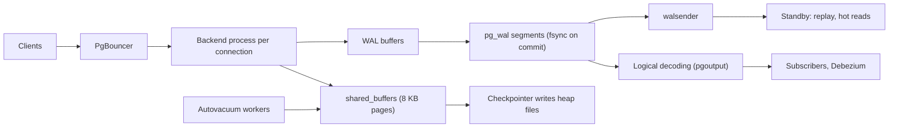

## In one minute
- PostgreSQL is the default relational database for new systems: ACID transactions, a rich SQL dialect, strong constraints, JSONB, and an extension ecosystem (PostGIS, pgvector, TimescaleDB) that lets one database cover many workloads.
- MVCC is implemented in the heap: an `UPDATE` writes a whole new row version and marks the old one dead. Readers never block writers, but dead versions pile up until `VACUUM` reclaims them.
- Every connection is a separate OS process. Connections are expensive, so production deployments put a pooler such as PgBouncer in front.
- Durability and replication both come from the write-ahead log: physical streaming replication ships WAL bytes to standbys, logical replication decodes it into row changes for selective copies and CDC.
- In an interview, pick it when you need relational integrity, flexible queries, geospatial or JSON features, or simply a safe system of record. Say how you will scale reads (replicas), connections (pooling) and, eventually, writes (partitioning or sharding with Citus or at the application layer).

## How it works

### Process model
The `postmaster` listens on port 5432 and forks one backend process per client connection. Shared state lives in shared memory: the buffer pool (`shared_buffers`), WAL buffers, the lock table and the commit status cache. Background processes do the housekeeping: the checkpointer, background writer, WAL writer, autovacuum launcher and its workers, and one `walsender` per replica.

### Tables, indexes, and MVCC
A table is a heap: an unordered file of 8 KB pages holding row versions (tuples). Indexes, B-tree by default, map keys to a tuple ID, the `(block, offset)` pair called the `ctid`. Every tuple records `xmin`, the transaction that created it, and `xmax`, the transaction that deleted or replaced it. A query takes a snapshot and shows only tuples whose creator committed before the snapshot and whose deleter did not. An `UPDATE` is therefore an insert of a new version plus setting `xmax` on the old one.

### Vacuum
Old versions stay in the page after every snapshot that could see them is gone. `VACUUM` scans for these dead tuples, removes their index entries, frees the space for reuse and updates two maps: the free space map and the visibility map, which marks pages where every tuple is visible to everyone. Autovacuum runs it per table when dead tuples exceed `autovacuum_vacuum_threshold` (50) plus `autovacuum_vacuum_scale_factor` (0.2) times the table's row count. PostgreSQL 18 caps that figure with `autovacuum_vacuum_max_threshold` (100 million dead tuples by default), so a 2-billion-row table no longer waits for 400 million dead rows before vacuum starts ([Postgres docs](https://www.postgresql.org/docs/current/runtime-config-autovacuum.html)). Version 18 also lets ordinary vacuums freeze some all-visible pages early, so the later anti-wraparound pass has less to do ([PostgreSQL 18 release notes](https://www.postgresql.org/docs/18/release-18.html)).

### Replication and high availability
A standby connects to the primary, and a `walsender` streams WAL records that the standby's startup process replays, page by page. Standbys can serve read-only queries (hot standby). Replication is asynchronous by default; `synchronous_standby_names` makes commits wait for chosen standbys. Postgres has no built-in failover manager; [Patroni](https://patroni.readthedocs.io/en/latest/) with etcd, or a managed service, handles leader election and promotion.

## Down the stack

### Layer 1: The contract
A committed transaction survives a crash once its commit record is flushed to WAL, with `synchronous_commit = on` (the default). Isolation defaults to Read Committed, where each statement sees a fresh snapshot. Repeatable Read gives snapshot isolation for the whole transaction and aborts with a serialization error if you try to update a row changed by a concurrent committed transaction. Serializable uses serializable snapshot isolation (SSI), which tracks read-write dependencies and aborts one transaction in a dangerous cycle, so clients must retry ([Postgres docs](https://www.postgresql.org/docs/current/mvcc.html)). Repeatable Read still allows write skew, and even SSI has shipped bugs: Jepsen found a conflict-detection error present since 9.5 that let Serializable transactions form cycles, fixed in the August 2020 minor releases ([Jepsen](https://jepsen.io/analyses/postgresql-12.3)). On an asynchronous standby, a read can be arbitrarily stale and a failover can lose recently committed transactions; with synchronous replication and `remote_apply`, a standby read after commit sees the write. The level can be set per transaction, so only the writes that need it pay the extra round trip ([Postgres docs](https://www.postgresql.org/docs/current/runtime-config-wal.html)).

### Layer 2: The mechanism
**Page layout.** Each 8 KB page has a 24-byte header, an array of 4-byte line pointers growing from the front, and tuples growing from the back. A tuple header is 23 bytes plus padding and holds `t_xmin`, `t_xmax`, `t_cid`, `t_ctid` (pointer to the newer version) and infomask bits, including hint bits that cache "creator committed" so later readers skip the commit log lookup. Values over about 2 KB are compressed or moved out of line to a TOAST table ([Postgres docs](https://www.postgresql.org/docs/current/storage-page-layout.html)). The header's `pd_checksum` field is now filled in by default: since PostgreSQL 18, `initdb` enables data checksums unless you pass `--no-data-checksums`, and `pg_upgrade` needs both clusters to match.

**Snapshots.** A snapshot holds `xmin` (oldest transaction still running), `xmax` (first unassigned ID) and the list of in-progress IDs. A tuple is visible if its `xmin` committed and is not in the list, and its `xmax` is empty, aborted, or still invisible. Commit status lives in `pg_xact` as two bits per transaction.

**HOT updates.** Because indexes point at physical tuple locations, a new version normally needs a new entry in every index. If no indexed column changed and the new version fits on the same page, Postgres makes a heap-only tuple (HOT): the old line pointer redirects within the page and no index is touched. Columns covered only by a BRIN index do not count, because BRIN summarises ranges instead of pointing at tuples ([Postgres docs](https://www.postgresql.org/docs/current/storage-hot.html)). Lowering `fillfactor` to 80 or 90 leaves room for this, and `pg_stat_all_tables` shows the HOT ratio.

**Freezing.** Transaction IDs are 32 bits and compared modulo 2^32, so about 2 billion transactions after a tuple was written its `xmin` would appear to be in the future. Vacuum freezes old tuples to mark them visible to all. When a table's oldest unfrozen ID reaches `autovacuum_freeze_max_age` (200 million), an anti-wraparound vacuum runs even if autovacuum is disabled. If that still loses the race, the server warns at 40 million IDs from the limit and refuses new write transactions with fewer than 3 million left ([Postgres docs](https://www.postgresql.org/docs/current/routine-vacuuming.html)).

**WAL and checkpoints.** Every change is logged to 16 MB segment files in `pg_wal` before the dirty page may be written. A checkpoint flushes all dirty buffers and records a redo point; by default it runs every `checkpoint_timeout` (5 minutes) or when WAL reaches `max_wal_size` (1 GB). The first change to a page after a checkpoint logs the full page image, protecting against torn 8 KB writes on 4 KB storage, which is why WAL volume spikes right after each checkpoint.

**Replication slots and logical decoding.** A slot records how far a consumer has confirmed, and the primary keeps WAL until then. With `wal_level = logical`, the `pgoutput` plugin decodes WAL into inserts, updates and deletes per publication, which powers logical subscribers, Debezium CDC and near-zero-downtime major version upgrades.

### Layer 3: The machine
A backend is a forked process with its own memory for catalog caches, sort and hash space (`work_mem`, 4 MB per operation by default, and twice that for hashes through `hash_mem_multiplier`) and query plans; idle ones commonly use several MB, active ones far more. Thousands of connections mean thousands of processes, context switches, and contention on the shared snapshot and lock structures, which is why `max_connections` defaults to 100 and PgBouncer in transaction mode multiplexes thousands of client connections onto a few dozen server processes. Transaction pooling used to break named prepared statements; since PgBouncer 1.21 (October 2023) it tracks and re-prepares them on whichever server connection a client gets, up to `max_prepared_statements` (200 by default) per connection ([PgBouncer changelog](https://www.pgbouncer.org/changelog.html), [config](https://www.pgbouncer.org/config.html)).

`shared_buffers` defaults to 128 MB; the manual's starting point is 25 percent of RAM, and it warns that more than 40 percent rarely helps, because Postgres reads through the OS page cache and relies on it for the rest ([Postgres docs](https://www.postgresql.org/docs/current/runtime-config-resource.html)). That means double buffering, and it means a cold page read is a `pread` that the kernel may satisfy from memory in microseconds or from an SSD in about 100 us. PostgreSQL 18 added asynchronous I/O for sequential scans, bitmap heap scans and vacuum: `io_method = worker` (the default) hands reads to background I/O workers, `io_uring` submits them straight to the kernel on Linux, and `sync` keeps the old one-read-at-a-time behaviour. The project reports up to 3x faster reads from storage in some scans ([PostgreSQL 18 announcement](https://www.postgresql.org/about/news/postgresql-18-released-3142/)). Commits call `fdatasync` on the WAL; group commit lets one flush cover many transactions, so a cloud volume with 1 ms fsync latency can still commit tens of thousands of small transactions per second when many sessions commit concurrently.

### Why it's built this way
1. Readers must not block writers, so each change creates a new version instead of locking the old one.
2. Keeping versions in the heap makes rollback free (just mark the transaction aborted) but leaves garbage, so vacuum must exist.
3. Indexes point at physical locations so lookups take one hop, but that makes every non-HOT update write to every index.
4. Random page writes are slow and can tear, so changes go first to a sequential WAL with full-page images, and pages are flushed lazily at checkpoints.
5. The WAL already describes every change in order, so shipping it is the cheapest possible replication protocol.

## Diagram


## Worked example
A ride app keeps a `driver_location` table of 2 million rows (about 150 bytes each, 300 MB) updated 20,000 times per second, with an index on `driver_id` and one on `geohash`.

Every update changes `geohash`, so HOT cannot apply: each update writes a new heap tuple and two index entries, about 60,000 page modifications per second. Autovacuum triggers at 50 + 0.2 x 2,000,000 = 400,050 dead tuples, which accrue every 20 seconds, so vacuum on this table never stops. Now an analyst opens a 30-minute report on a replica with `hot_standby_feedback = on`. The primary cannot remove anything newer than that query's snapshot: 36 million dead tuples, roughly 6 GB of bloat on a 300 MB table, and indexes grow similarly.

Fixes, cheapest first: drop the `geohash` index and keep the spatial index in Redis or a separate table so updates become HOT with `fillfactor = 70`; set per-table `autovacuum_vacuum_scale_factor = 0.01`; cap report queries with `statement_timeout`; and send analytics to a logical replica or a warehouse instead of a hot standby.

## In the wild
- **GitLab, 2023: lock manager contention on replicas.** After client-facing replicas were cut from 8 to 6, each peaking near 60,000 queries per second, several hours of slowdowns saturated PgBouncer pools. Nearly 70 percent of heavyweight locks took the slow path through the 16 `lock_manager` LWLocks, because hot queries touched more than 16 relations (the projects table had 57 indexes). The plan: more replicas, fewer indexes, partition pruning, and treating lock-manager waits as a saturation signal ([GitLab](https://gitlab.com/gitlab-com/gl-infra/observability/team/-/work_items/2301)).
- **Debezium on Amazon RDS, 2022: an idle slot fills the disk.** A stopped CDC connector left its logical replication slot behind. RDS writes a heartbeat every five minutes and `archive_timeout` forced a new 64 MB WAL segment each time, so the slot pinned WAL until a 200 GiB volume filled in under two weeks. Fixes: alert on inactive slots retaining WAL, watch free disk, and emit periodic heartbeat messages so active slots advance ([Gunnar Morling](https://morling.dev/blog/insatiable-postgres-replication-slot)).
- **Notion, 2023: resharding 32 to 96 Postgres hosts.** Some shards ran above 90 percent CPU at peak and PgBouncer neared its connection limits. Notion moved its 480 logical schemas from 15 per host to 5 using logical replication, building indexes after the copy to cut sync from 3 days to 12 hours, then cut over by pausing traffic and repointing PgBouncer. Peak CPU fell to about 20 percent with no observed downtime ([Notion](https://www.notion.com/blog/the-great-re-shard)).

## Trade-offs
| Option | Strengths | Weaknesses | Choose when |
|---|---|---|---|
| PostgreSQL | Rich SQL, extensions, strict correctness, JSONB, PostGIS | Process per connection, vacuum tuning, write amplification on updates | Default system of record, complex queries, geo or vector needs |
| MySQL (InnoDB) | Clustered primary key, cheap connections, mature sharding (Vitess) | Weaker SQL features historically, purge lag from long transactions | Huge PK-lookup OLTP, existing MySQL estate |
| Postgres plus Citus | Distributed tables, keeps SQL | Cross-shard transactions cost more, operational weight | Multi-tenant SaaS outgrowing one node |
| Aurora PostgreSQL | Storage-level replication, fast failover, replicas share storage | Cost, vendor lock-in, I/O billing | Managed HA on AWS |
| DynamoDB or Cassandra | Horizontal writes, predictable latency | No joins or ad hoc queries | Known access patterns at very high scale |

## Pitfalls in production
- **Connection storms.** Autoscaled app pods each open 20 connections and the primary runs out of memory or `max_connections`. Use PgBouncer in transaction mode and cap pool sizes.
- **Long transactions and idle-in-transaction sessions.** They pin the vacuum horizon and cause bloat. Set `idle_in_transaction_session_timeout` and alert on the oldest `backend_xmin`.
- **Abandoned replication slots.** A dead CDC consumer makes the primary keep WAL until the disk fills, because `max_slot_wal_keep_size` defaults to -1 (unlimited). Monitor slot lag, set that cap, and on PostgreSQL 18 consider `idle_replication_slot_timeout`, which invalidates (does not drop) slots idle longer than the timeout at the next checkpoint ([Postgres docs](https://www.postgresql.org/docs/current/runtime-config-replication.html)).
- **Transaction ID wraparound.** A huge table that vacuum never finishes approaches the 2 billion limit and the database stops accepting writes. Alert on `age(datfrozenxid)` long before 1 billion.
- **Blocking DDL.** `ALTER TABLE` takes an `ACCESS EXCLUSIVE` lock, and queued behind one long query it blocks every reader. Use `lock_timeout` and create indexes `CONCURRENTLY`.

## Leadership lens
- Default to Postgres unless there is a concrete reason not to; one well-understood database beats three half-understood ones.
- Ask in design review: what is the connection budget, which tables are update-heavy, and who owns vacuum and bloat monitoring?
- Decide the failover story up front (Patroni, RDS Multi-AZ, Aurora) and the acceptable data loss window for asynchronous replicas.
- Major version upgrades are a recurring project; budget for them and use logical replication to keep them short.
- Plan the write-scaling path before you need it: partitioning first, then tenant sharding.

## Check yourself
1. Why does updating one column of a row with five indexes cost more in Postgres than in MySQL?
   **Answer:** Postgres writes a new tuple at a new physical location, so unless the update is HOT every index gets a new entry; InnoDB updates the clustered row in place and only touches secondary indexes whose columns changed.
2. A replica runs a 2-hour query and the primary's table doubles in size. Explain.
   **Answer:** With `hot_standby_feedback`, the replica reports its snapshot's xmin, so vacuum on the primary cannot remove dead tuples newer than it and bloat accumulates.
3. Why can a rolled-back transaction in Postgres finish instantly, even after writing a million rows?
   **Answer:** Rollback only marks the transaction aborted in `pg_xact`; its tuples become invisible and vacuum removes them later.
4. Why does WAL volume jump right after a checkpoint?
   **Answer:** The first modification of each page after a checkpoint writes a full 8 KB page image to protect against torn writes.

## Practice
**Task:** Implement Postgres-style MVCC over an append-only heap. `begin()` returns increasing transaction IDs starting at 1 and takes a snapshot of in-progress transactions. `write(xid, key, value)` sets `xmax` on the version visible to `xid` (if any) and appends a new tuple with `xmin = xid`; `delete(xid, key)` only sets `xmax` and returns whether a visible version existed. If the visible version already has an `xmax` from another transaction that is in progress or committed, raise a write conflict (`WriteConflict` in Python and TypeScript, `ErrWriteConflict` in Go). `get(xid, key)` returns the visible value or none. `vacuum()` deletes tuples whose creator aborted, or whose `xmax` committed and is below the horizon (the oldest snapshot xmin among in-progress transactions, or the next ID if none), and returns how many it removed.

```python starter
class WriteConflict(Exception):
    pass

class Heap:
    def __init__(self):
        # TODO
        pass

    def begin(self):
        raise NotImplementedError

    def write(self, xid, key, value):
        raise NotImplementedError

    def delete(self, xid, key):
        raise NotImplementedError

    def get(self, xid, key):
        raise NotImplementedError

    def commit(self, xid):
        raise NotImplementedError

    def abort(self, xid):
        raise NotImplementedError

    def vacuum(self):
        raise NotImplementedError
```

```python tests
def test_uncommitted_invisible_to_others():
    h = Heap()
    t1 = h.begin(); t2 = h.begin()
    h.write(t1, "k", "v1")
    assert h.get(t1, "k") == "v1" and h.get(t2, "k") is None

def test_snapshot_isolation():
    h = Heap()
    t = h.begin(); h.write(t, "k", "old"); h.commit(t)
    reader = h.begin()
    w = h.begin(); h.write(w, "k", "new"); h.commit(w)
    assert h.get(reader, "k") == "old"
    assert h.get(h.begin(), "k") == "new"

def test_abort_hides_and_vacuum_removes():
    h = Heap()
    t = h.begin(); h.write(t, "k", "x"); h.abort(t)
    assert h.get(h.begin(), "k") is None
    assert h.vacuum() == 1

def test_delete():
    h = Heap()
    t = h.begin(); h.write(t, "k", "x"); h.commit(t)
    d = h.begin()
    assert h.delete(d, "k") is True and h.delete(d, "k") is False
    h.commit(d)
    assert h.get(h.begin(), "k") is None

def test_first_updater_wins():
    h = Heap()
    t = h.begin(); h.write(t, "k", "0"); h.commit(t)
    a = h.begin(); b = h.begin()
    h.write(a, "k", "a")
    try:
        h.write(b, "k", "b")
        assert False, "expected conflict"
    except WriteConflict:
        pass
    h.abort(a)
    h.write(b, "k", "b")
    h.commit(b)
    assert h.get(h.begin(), "k") == "b"

def test_vacuum_respects_horizon():
    h = Heap()
    t = h.begin(); h.write(t, "k", "v1"); h.commit(t)
    old = h.begin()
    u = h.begin(); h.write(u, "k", "v2"); h.commit(u)
    assert h.vacuum() == 0
    assert h.get(old, "k") == "v1"
    h.commit(old)
    assert h.vacuum() == 1
    assert h.get(h.begin(), "k") == "v2"
```

```python solution
class WriteConflict(Exception):
    pass

class Heap:
    def __init__(self):
        self.tuples = []  # dicts: key, value, xmin, xmax
        self.next_xid = 1
        self.status = {}  # xid -> "running" | "committed" | "aborted"
        self.snaps = {}   # xid -> set of xids running at begin

    def begin(self):
        xid = self.next_xid
        self.next_xid += 1
        self.snaps[xid] = {x for x, s in self.status.items() if s == "running"}
        self.status[xid] = "running"
        return xid

    def _sees(self, xid, other):
        if other == xid:
            return True
        return other < xid and other not in self.snaps[xid] and self.status.get(other) == "committed"

    def _visible(self, xid, key):
        for t in self.tuples:
            if t["key"] == key and self._sees(xid, t["xmin"]):
                if t["xmax"] == 0 or not self._sees(xid, t["xmax"]):
                    return t
        return None

    def _claim(self, xid, t):
        x = t["xmax"]
        if x != 0 and x != xid and self.status.get(x) != "aborted":
            raise WriteConflict("concurrent update on " + str(t["key"]))
        t["xmax"] = xid

    def write(self, xid, key, value):
        t = self._visible(xid, key)
        if t is not None:
            self._claim(xid, t)
        self.tuples.append({"key": key, "value": value, "xmin": xid, "xmax": 0})

    def delete(self, xid, key):
        t = self._visible(xid, key)
        if t is None:
            return False
        self._claim(xid, t)
        return True

    def get(self, xid, key):
        t = self._visible(xid, key)
        return None if t is None else t["value"]

    def commit(self, xid):
        self.status[xid] = "committed"
        self.snaps.pop(xid, None)

    def abort(self, xid):
        self.status[xid] = "aborted"
        self.snaps.pop(xid, None)

    def vacuum(self):
        running = [x for x, s in self.status.items() if s == "running"]
        horizon = self.next_xid
        for x in running:
            horizon = min([horizon, x] + list(self.snaps[x]))
        keep = []
        for t in self.tuples:
            dead = self.status.get(t["xmin"]) == "aborted" or (
                t["xmax"] != 0 and self.status.get(t["xmax"]) == "committed" and t["xmax"] < horizon)
            if not dead:
                keep.append(t)
        removed = len(self.tuples) - len(keep)
        self.tuples = keep
        return removed
```

```typescript starter
export class WriteConflict extends Error {}

export class Heap {
  begin(): number {
    throw new Error("TODO");
  }
  write(xid: number, key: string, value: string): void {
    throw new Error("TODO");
  }
  delete(xid: number, key: string): boolean {
    throw new Error("TODO");
  }
  get(xid: number, key: string): string | null {
    throw new Error("TODO");
  }
  commit(xid: number): void {
    throw new Error("TODO");
  }
  abort(xid: number): void {
    throw new Error("TODO");
  }
  vacuum(): number {
    throw new Error("TODO");
  }
}
```

```typescript tests
test("uncommitted invisible to others", () => {
  const h = new Heap();
  const t1 = h.begin(), t2 = h.begin();
  h.write(t1, "k", "v1");
  assertEqual([h.get(t1, "k"), h.get(t2, "k")], ["v1", null]);
});
test("snapshot isolation", () => {
  const h = new Heap();
  const t = h.begin(); h.write(t, "k", "old"); h.commit(t);
  const reader = h.begin();
  const w = h.begin(); h.write(w, "k", "new"); h.commit(w);
  assertEqual(h.get(reader, "k"), "old");
  assertEqual(h.get(h.begin(), "k"), "new");
});
test("abort hides and vacuum removes", () => {
  const h = new Heap();
  const t = h.begin(); h.write(t, "k", "x"); h.abort(t);
  assertEqual(h.get(h.begin(), "k"), null);
  assertEqual(h.vacuum(), 1);
});
test("delete", () => {
  const h = new Heap();
  const t = h.begin(); h.write(t, "k", "x"); h.commit(t);
  const d = h.begin();
  assertEqual([h.delete(d, "k"), h.delete(d, "k")], [true, false]);
  h.commit(d);
  assertEqual(h.get(h.begin(), "k"), null);
});
test("first updater wins", () => {
  const h = new Heap();
  const t = h.begin(); h.write(t, "k", "0"); h.commit(t);
  const a = h.begin(), b = h.begin();
  h.write(a, "k", "a");
  let conflicted = false;
  try { h.write(b, "k", "b"); } catch (e) { conflicted = e instanceof WriteConflict; }
  assert(conflicted, "expected conflict");
  h.abort(a);
  h.write(b, "k", "b");
  h.commit(b);
  assertEqual(h.get(h.begin(), "k"), "b");
});
test("vacuum respects horizon", () => {
  const h = new Heap();
  const t = h.begin(); h.write(t, "k", "v1"); h.commit(t);
  const old = h.begin();
  const u = h.begin(); h.write(u, "k", "v2"); h.commit(u);
  assertEqual(h.vacuum(), 0);
  assertEqual(h.get(old, "k"), "v1");
  h.commit(old);
  assertEqual(h.vacuum(), 1);
  assertEqual(h.get(h.begin(), "k"), "v2");
});
```

```typescript solution
export class WriteConflict extends Error {}

type Tuple = { key: string; value: string; xmin: number; xmax: number };
type Status = "running" | "committed" | "aborted";

export class Heap {
  private tuples: Tuple[] = [];
  private nextXid = 1;
  private status = new Map<number, Status>();
  private snaps = new Map<number, Set<number>>();

  begin(): number {
    const xid = this.nextXid++;
    const running = new Set<number>();
    this.status.forEach((s, x) => { if (s === "running") running.add(x); });
    this.snaps.set(xid, running);
    this.status.set(xid, "running");
    return xid;
  }
  private sees(xid: number, other: number): boolean {
    if (other === xid) return true;
    return other < xid && !this.snaps.get(xid)!.has(other) && this.status.get(other) === "committed";
  }
  private visible(xid: number, key: string): Tuple | null {
    for (const t of this.tuples) {
      if (t.key === key && this.sees(xid, t.xmin) && (t.xmax === 0 || !this.sees(xid, t.xmax))) return t;
    }
    return null;
  }
  private claim(xid: number, t: Tuple): void {
    if (t.xmax !== 0 && t.xmax !== xid && this.status.get(t.xmax) !== "aborted") {
      throw new WriteConflict("concurrent update on " + t.key);
    }
    t.xmax = xid;
  }
  write(xid: number, key: string, value: string): void {
    const t = this.visible(xid, key);
    if (t) this.claim(xid, t);
    this.tuples.push({ key, value, xmin: xid, xmax: 0 });
  }
  delete(xid: number, key: string): boolean {
    const t = this.visible(xid, key);
    if (!t) return false;
    this.claim(xid, t);
    return true;
  }
  get(xid: number, key: string): string | null {
    const t = this.visible(xid, key);
    return t ? t.value : null;
  }
  commit(xid: number): void {
    this.status.set(xid, "committed");
    this.snaps.delete(xid);
  }
  abort(xid: number): void {
    this.status.set(xid, "aborted");
    this.snaps.delete(xid);
  }
  vacuum(): number {
    let horizon = this.nextXid;
    this.snaps.forEach((running, x) => {
      horizon = Math.min(horizon, x);
      running.forEach((r) => { horizon = Math.min(horizon, r); });
    });
    const before = this.tuples.length;
    this.tuples = this.tuples.filter((t) => {
      const abortedInsert = this.status.get(t.xmin) === "aborted";
      const deadVersion = t.xmax !== 0 && this.status.get(t.xmax) === "committed" && t.xmax < horizon;
      return !(abortedInsert || deadVersion);
    });
    return before - this.tuples.length;
  }
}
```

```go starter
package practice

import "errors"

var ErrWriteConflict = errors.New("write conflict")

type Heap struct{}

func NewHeap() *Heap { return &Heap{} }

func (h *Heap) Begin() int { panic("TODO") }

func (h *Heap) Write(xid int, key, value string) error { panic("TODO") }

func (h *Heap) Delete(xid int, key string) (bool, error) { panic("TODO") }

// Get returns the visible value and whether one exists.
func (h *Heap) Get(xid int, key string) (string, bool) { panic("TODO") }

func (h *Heap) Commit(xid int) { panic("TODO") }

func (h *Heap) Abort(xid int) { panic("TODO") }

func (h *Heap) Vacuum() int { panic("TODO") }
```

```go tests
package practice

import (
	"errors"
	"testing"
)

func TestUncommittedInvisible(t *testing.T) {
	h := NewHeap()
	t1, t2 := h.Begin(), h.Begin()
	h.Write(t1, "k", "v1")
	if v, ok := h.Get(t1, "k"); !ok || v != "v1" {
		t.Fatal("own write not visible")
	}
	if _, ok := h.Get(t2, "k"); ok {
		t.Fatal("uncommitted write visible to other")
	}
}

func TestSnapshotIsolation(t *testing.T) {
	h := NewHeap()
	x := h.Begin()
	h.Write(x, "k", "old")
	h.Commit(x)
	reader := h.Begin()
	w := h.Begin()
	h.Write(w, "k", "new")
	h.Commit(w)
	if v, _ := h.Get(reader, "k"); v != "old" {
		t.Fatalf("reader saw %q", v)
	}
	if v, _ := h.Get(h.Begin(), "k"); v != "new" {
		t.Fatalf("new txn saw %q", v)
	}
}

func TestAbortAndVacuum(t *testing.T) {
	h := NewHeap()
	x := h.Begin()
	h.Write(x, "k", "x")
	h.Abort(x)
	if _, ok := h.Get(h.Begin(), "k"); ok {
		t.Fatal("aborted write visible")
	}
	if n := h.Vacuum(); n != 1 {
		t.Fatalf("vacuum removed %d", n)
	}
}

func TestDelete(t *testing.T) {
	h := NewHeap()
	x := h.Begin()
	h.Write(x, "k", "x")
	h.Commit(x)
	d := h.Begin()
	first, _ := h.Delete(d, "k")
	second, _ := h.Delete(d, "k")
	if !first || second {
		t.Fatal("wrong delete results")
	}
	h.Commit(d)
	if _, ok := h.Get(h.Begin(), "k"); ok {
		t.Fatal("deleted row visible")
	}
}

func TestFirstUpdaterWins(t *testing.T) {
	h := NewHeap()
	x := h.Begin()
	h.Write(x, "k", "0")
	h.Commit(x)
	a, b := h.Begin(), h.Begin()
	if err := h.Write(a, "k", "a"); err != nil {
		t.Fatal(err)
	}
	if err := h.Write(b, "k", "b"); !errors.Is(err, ErrWriteConflict) {
		t.Fatal("expected conflict")
	}
	h.Abort(a)
	if err := h.Write(b, "k", "b"); err != nil {
		t.Fatal(err)
	}
	h.Commit(b)
	if v, _ := h.Get(h.Begin(), "k"); v != "b" {
		t.Fatalf("got %q", v)
	}
}

func TestVacuumHorizon(t *testing.T) {
	h := NewHeap()
	x := h.Begin()
	h.Write(x, "k", "v1")
	h.Commit(x)
	old := h.Begin()
	u := h.Begin()
	h.Write(u, "k", "v2")
	h.Commit(u)
	if n := h.Vacuum(); n != 0 {
		t.Fatalf("vacuum removed %d while old snapshot open", n)
	}
	if v, _ := h.Get(old, "k"); v != "v1" {
		t.Fatal("old snapshot lost its version")
	}
	h.Commit(old)
	if n := h.Vacuum(); n != 1 {
		t.Fatalf("vacuum removed %d", n)
	}
}
```

```go solution
package practice

import "errors"

var ErrWriteConflict = errors.New("write conflict")

const (
	running = iota + 1
	committed
	aborted
)

type tuple struct {
	key, value string
	xmin, xmax int
}

type Heap struct {
	tuples  []*tuple
	nextXid int
	status  map[int]int
	snaps   map[int]map[int]bool
}

func NewHeap() *Heap {
	return &Heap{nextXid: 1, status: map[int]int{}, snaps: map[int]map[int]bool{}}
}

func (h *Heap) Begin() int {
	xid := h.nextXid
	h.nextXid++
	snap := map[int]bool{}
	for x, s := range h.status {
		if s == running {
			snap[x] = true
		}
	}
	h.snaps[xid] = snap
	h.status[xid] = running
	return xid
}

func (h *Heap) sees(xid, other int) bool {
	if other == xid {
		return true
	}
	return other < xid && !h.snaps[xid][other] && h.status[other] == committed
}

func (h *Heap) visible(xid int, key string) *tuple {
	for _, t := range h.tuples {
		if t.key == key && h.sees(xid, t.xmin) && (t.xmax == 0 || !h.sees(xid, t.xmax)) {
			return t
		}
	}
	return nil
}

func (h *Heap) claim(xid int, t *tuple) error {
	if t.xmax != 0 && t.xmax != xid && h.status[t.xmax] != aborted {
		return ErrWriteConflict
	}
	t.xmax = xid
	return nil
}

func (h *Heap) Write(xid int, key, value string) error {
	if t := h.visible(xid, key); t != nil {
		if err := h.claim(xid, t); err != nil {
			return err
		}
	}
	h.tuples = append(h.tuples, &tuple{key: key, value: value, xmin: xid})
	return nil
}

func (h *Heap) Delete(xid int, key string) (bool, error) {
	t := h.visible(xid, key)
	if t == nil {
		return false, nil
	}
	if err := h.claim(xid, t); err != nil {
		return false, err
	}
	return true, nil
}

// Get returns the visible value and whether one exists.
func (h *Heap) Get(xid int, key string) (string, bool) {
	if t := h.visible(xid, key); t != nil {
		return t.value, true
	}
	return "", false
}

func (h *Heap) Commit(xid int) {
	h.status[xid] = committed
	delete(h.snaps, xid)
}

func (h *Heap) Abort(xid int) {
	h.status[xid] = aborted
	delete(h.snaps, xid)
}

func (h *Heap) Vacuum() int {
	horizon := h.nextXid
	for x, snap := range h.snaps {
		if x < horizon {
			horizon = x
		}
		for r := range snap {
			if r < horizon {
				horizon = r
			}
		}
	}
	keep := h.tuples[:0]
	removed := 0
	for _, t := range h.tuples {
		dead := h.status[t.xmin] == aborted ||
			(t.xmax != 0 && h.status[t.xmax] == committed && t.xmax < horizon)
		if dead {
			removed++
		} else {
			keep = append(keep, t)
		}
	}
	h.tuples = keep
	return removed
}
```

## Mock interview
**Prompt:** You are building the order service for a marketplace with 30 million orders a year, peaking at 3,000 writes and 25,000 reads per second, with 400 application pods. The interviewer asks why you chose PostgreSQL and how it will hold up.

- Follow-up: how many database connections will you have, and what happens during a deploy when all pods restart?
- Follow-up: the primary fails. What data can you lose, and how long are writes unavailable?
- Follow-up: the orders table reaches 2 TB and vacuum takes 12 hours. What do you change?

**A strong answer covers:**
- Why Postgres: transactions across orders, payments and inventory rows, constraints, flexible reporting queries, JSONB for variable attributes.
- PgBouncer in transaction mode so 400 pods share a few hundred server connections, plus read replicas for the 25,000 reads.
- Patroni or a managed service for failover, asynchronous replication with a seconds-wide loss window or synchronous to one standby in another zone, at a commit latency cost.
- Time-based partitioning of orders so vacuum, indexes and retention operate per partition.
- Update-heavy columns isolated or designed for HOT, and monitoring of bloat, replication lag and transaction ID age.
- A plan for sharding by seller or region if writes outgrow one primary.

## Sources and further study
**Primary**
- [PostgreSQL 18 release notes](https://www.postgresql.org/docs/18/release-18.html): asynchronous I/O, the autovacuum dead-tuple cap, eager freezing and checksums on by default.
- [Jepsen: PostgreSQL 12.3](https://jepsen.io/analyses/postgresql-12.3): black-box testing of Repeatable Read and Serializable, and the SSI bug it found.

**Systems docs**
- [PostgreSQL: Automatic Vacuuming settings](https://www.postgresql.org/docs/current/runtime-config-autovacuum.html): every autovacuum threshold and its default.
- [PostgreSQL: Write Ahead Log settings](https://www.postgresql.org/docs/current/runtime-config-wal.html): checkpoints, full-page writes and the `synchronous_commit` levels.
- [PostgreSQL: Heap-Only Tuples](https://www.postgresql.org/docs/current/storage-hot.html): when an update can skip the indexes.
- [PgBouncer configuration](https://www.pgbouncer.org/config.html): pool modes, pool sizes and prepared statement tracking.
- [Patroni documentation](https://patroni.readthedocs.io/en/latest/): leader election through a consensus store and automated promotion.

**Books**
- *Designing Data-Intensive Applications* (1st edition), Martin Kleppmann, chapter 5 "Replication" and chapter 7 "Transactions": replication lag, failover risks and snapshot isolation.
- *Database Internals*, Alex Petrov, chapter 5 "Transaction Processing and Recovery": buffer management, WAL and recovery from the engine's side.

**Other curricula**
- [donnemartin/system-design-primer](https://github.com/donnemartin/system-design-primer): treats relational databases generically, as replication, federation and sharding choices, without engine internals such as vacuum.
- [roadmap.sh: PostgreSQL DBA](https://roadmap.sh/postgresql-dba): a step-by-step path for operating Postgres, useful as a checklist of what a DBA is expected to know.

## Watch
- [MVCC Unmasked (Bruce Momjian, Postgres Conference)](https://www.youtube.com/watch?v=gAE_MSQtqnQ): a core developer walks through tuple headers, snapshots, HOT and vacuum.
- [Inside PostgreSQL Shared Memory (Bruce Momjian, Postgres Open)](https://www.youtube.com/watch?v=Nwk-UfjlUn8): the buffer pool, WAL buffers, lock table and how backends share them.
- [Connection pooling, routing, and queuing with PgBouncer (Postgres Conference)](https://www.youtube.com/watch?v=CAKI_eZiRAU): why process-per-connection needs a pooler and what PgBouncer does.

## Free resources
- [PostgreSQL: Concurrency Control](https://www.postgresql.org/docs/current/mvcc.html): official description of isolation levels, snapshot behaviour and serialization failures.
- [PostgreSQL: Routine Vacuuming](https://www.postgresql.org/docs/current/routine-vacuuming.html): dead tuples, the visibility map and transaction ID wraparound.
- [PostgreSQL: Database Page Layout](https://www.postgresql.org/docs/current/storage-page-layout.html): the page header, line pointers and tuple header byte by byte.
- [PostgreSQL: Log-Shipping Standby Servers](https://www.postgresql.org/docs/current/warm-standby.html): streaming replication, synchronous commit and hot standby.
- [PostgreSQL: Logical Replication](https://www.postgresql.org/docs/current/logical-replication.html): publications, subscriptions and their limits.
- [The Internals of PostgreSQL (Hironobu Suzuki)](https://www.interdb.jp/pg/): a free book on processes, buffers, MVCC, vacuum and WAL with diagrams.
