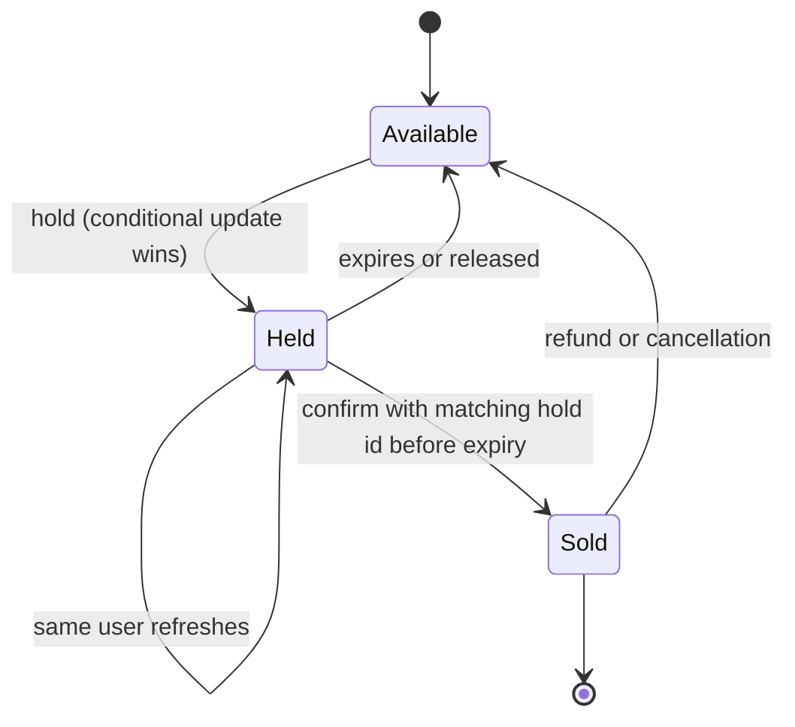

## In one minute
- Double booking is a race: two requests both read "available" and both write "booked". Any design that checks and then writes in separate steps without coordination has this bug.
- The fix is to make the check and the write one atomic step at the point of truth: a conditional update, a unique constraint, a row lock, or an exclusion constraint in the database.
- Real booking flows add a short **hold** (reservation with expiry) between "pick a seat" and "pay", so users are not charged for seats they lose, and abandoned carts release inventory automatically.
- Distributed locks in Redis are a performance tool, not a correctness tool. The database constraint must still reject a second booking even if a lock fails.
- Under extreme contention (a concert on-sale), the bottleneck is the hot rows, so strong answers add admission control, a virtual waiting room, or a queue in front of the inventory.

## How it works

### When the pattern shows up in interviews
Ticketing, hotel and flight booking, meeting-room calendars, ride matching and flash sales all hide one question: how is a scarce unit allocated exactly once? Interviewers often let you draw the happy path first and then ask, "What if two people click the same seat at the same millisecond?"

### Option 1: Conditional write (optimistic)
Make the update conditional on the seat's state:
`UPDATE seats SET status='held', holder=$u, hold_expires=now()+'10 min', version=version+1 WHERE id=$s AND (status='available' OR hold_expires <= now())`.
One row affected means you won; zero means someone else did. No lock is held between requests. The same idea works with a `version` column or DynamoDB condition expressions.

### Option 2: Unique constraint
Model the booking as an insert into a table with a uniqueness rule, such as `UNIQUE(event_id, seat_id)` on `bookings`. The second insert fails with a constraint violation. This is the most robust option because the invariant is declared rather than coded, so every code path, script and future service obeys it. For time ranges (hotel nights, meeting rooms), Postgres offers an exclusion constraint over a range type: `EXCLUDE USING gist (room_id WITH =, during WITH &&)` rejects any overlapping reservation for the same room. The `room_id WITH =` part needs the `btree_gist` extension, because plain scalar types have no GiST operator class without it ([PostgreSQL docs](https://www.postgresql.org/docs/current/rangetypes.html)). PostgreSQL 18 (September 2025) adds a friendlier spelling of the same rule, a temporal key: `PRIMARY KEY (room_id, during WITHOUT OVERLAPS)`, enforced by a GiST index, and foreign keys can reference it with `PERIOD` ([PostgreSQL 18 release notes](https://www.postgresql.org/docs/18/release-18.html), [CREATE TABLE](https://www.postgresql.org/docs/current/sql-createtable.html)).

### Option 3: Pessimistic lock
`SELECT ... FOR UPDATE` locks the row so the transaction can check rules too complex for one statement (price rules, multi-seat adjacency) before updating; competitors block. Never hold it across a payment call or user think time. For "give me any free seat in this section", `FOR UPDATE SKIP LOCKED` lets concurrent buyers grab different rows instead of queueing on the same one; the docs warn that skipping gives an inconsistent view, fine for "any row" but not for "is this exact seat free?" ([PostgreSQL docs](https://www.postgresql.org/docs/current/sql-select.html)).

Do not rely on isolation level alone for a read-then-write check. Jepsen found that MySQL 8.0.34's default REPEATABLE READ allowed lost updates (198 in one test run) and concluded that such transactions cannot safely read a value and then write it; use `SELECT ... FOR UPDATE`, SERIALIZABLE, or a conditional write ([Jepsen](https://jepsen.io/analyses/mysql-8.0.34)).

### Holds and two-phase booking
Payment takes seconds and users abandon carts, so real systems split booking into hold and confirm. The hold is a conditional write with an expiry. Confirmation is another conditional write that succeeds only if the hold is still owned by this user and has not expired: `UPDATE ... SET status='sold' WHERE id=$s AND holder=$u AND hold_id=$h AND hold_expires > now()`. Expiry needs no background job for correctness, because the conditions treat an expired hold as available; a sweeper only tidies up. The payment is authorised during the hold and captured only after confirmation succeeds, and the payment call carries an idempotency key so retries do not charge twice.

### Where Redis locks fit
Putting the hold in Redis with `SET seat:123 user NX PX 600000` is fast, but a failover can lose a just-acknowledged key, and a client paused by GC can act after its lock expired. Redis's own docs now discourage this single-node lock pattern in favour of Redlock ([Redis docs](https://redis.io/docs/latest/commands/set/)), and Redlock still assumes bounded clock drift and pauses and cannot issue increasing fencing tokens ([Kleppmann](https://martin.kleppmann.com/2016/02/08/how-to-do-distributed-locking.html)). Treat Redis as a filter and keep the database condition as the arbiter, or pass a **fencing token** (increasing per grant) that storage checks.

### Handling the stampede
At a big on-sale, even perfect atomic updates serialise on hot rows and most requests fail. Strong answers move contention out of the database: a virtual waiting room admits users at a controlled rate (Cloudflare's, for example, is configured as "total active users" plus "new users per minute", and admits the oldest arrival-minute buckets first ([Cloudflare](https://blog.cloudflare.com/building-waiting-room-on-workers-and-durable-objects/))), seat maps come from a slightly stale cache (the conditional write catches staleness), and inventory is partitioned by section.

## Down the stack

### Layer 1: The contract
Invariant: for each (event, seat), at most one booking in state `sold`, and at most one live hold at any instant. A hold request returns success to exactly one of N concurrent callers. A confirm succeeds only for the current, unexpired hold. Failures must be safe: a crash at any point may leave a hold that expires, never a seat sold twice or a charge without a seat.

### Layer 2: The mechanism
In Postgres, an `UPDATE` finds the row version visible to its snapshot, takes a row-level lock by writing its transaction ID into the tuple's `xmax`, and creates a new tuple version. A concurrent `UPDATE` on the same row waits on the first transaction. Under `READ COMMITTED`, when the first commits, the waiter re-evaluates its `WHERE` clause against the new version (the "EvalPlanQual" recheck), so it sees `status='held'` and updates zero rows. Under `REPEATABLE READ` the waiter instead fails with "could not serialize access due to concurrent update" (SQLSTATE `40001`) and must retry the whole transaction ([PostgreSQL docs](https://www.postgresql.org/docs/current/transaction-iso.html)). A unique index is enforced inside the B-tree insert: the second inserter finds a conflicting entry, waits if the first transaction is still in flight, then raises `unique_violation` if it committed. An exclusion constraint does the same with a GiST index search for overlapping ranges.

### Layer 3: The machine
Row locks live in the tuple header on the heap page, not in a separate lock table, so locking millions of rows costs no shared memory; waiters block on the holder's transaction ID lock instead. The commit that makes a booking durable is one WAL `fsync`, and group commit lets many transactions share one flush, which is why a single Postgres primary can commit thousands of small booking transactions per second on fast storage. A hot row serialises: if each holder keeps the lock for 2 ms (one round trip plus commit), that row tops out around 500 updates per second no matter how many cores the server has. A `BEGIN`, `SELECT FOR UPDATE`, `UPDATE`, `COMMIT` sequence from an app server 0.5 ms away holds the lock for several round trips; one conditional `UPDATE` holds it far less.

### Why it's built this way
1. Two independent readers cannot both see each other's future writes, so the check must happen where writes are serialised: the row or index in the database.
2. Holding locks across user think time or payment would block everyone else, so the flow splits into a short atomic hold and a later atomic confirm.
3. Holders crash and abandon carts, so holds carry an expiry that the conditions themselves enforce, without relying on a cleanup job.
4. Hot rows serialise on lock hold time, which is bounded by network round trips and commit latency, so high-demand sales add admission control before the database.

## Diagram


## Worked example
A stadium sale offers 50,000 seats and expects 400,000 users in the first minute. Without control, that is thousands of hold attempts per second concentrated on the best few thousand seats.

The team puts a waiting room in front: users get a queue position and are admitted at 2,000 per minute, roughly the rate at which held seats either convert or expire. Admitted users see a seat map cached for 2 seconds. Clicking a seat runs the single conditional `UPDATE` with a 7-minute hold. With 2,000 admitted users each making a few attempts, the database sees perhaps 100 to 200 hold writes per second spread across 50,000 rows, well within one primary. Most conflicts come from the cached map being slightly stale; they cost one failed update and a refresh.

Payment uses the hold ID as its idempotency key. If confirm then updates zero rows because the hold expired during a slow payment, the service voids the authorisation. Holds that expire unpaid return to the pool through the expiry condition alone.

## In the wild
- **Jepsen, 2020: etcd's locks do not exclude.** etcd's key-value operations tested strict-serializable, but its lock API did not give mutual exclusion even on a healthy cluster: with 2-second lease TTLs and process pauses, lock-protected updates lost about 18% of acknowledged writes. Jepsen's advice matches this lesson: use the lock for efficiency and have the protected resource check a fencing token such as the lock key's revision ([Jepsen](https://jepsen.io/analyses/etcd-3.4.3)).
- **Ticketmaster, 2022: the Eras Tour presale.** About 3.5 million fans pre-registered and about 1.5 million received codes, but bots and fans without codes drove 3.5 billion system requests, four times Ticketmaster's previous peak. It slowed some sales and postponed others to stabilise the systems, accepting longer queues; about 15% of interactions still hit errors, including passcode failures that dropped tickets already in carts. Over 2 million tickets sold that day, a single-day record ([Ticketmaster, archived](https://web.archive.org/web/20230101022610/https://business.ticketmaster.com/business-solutions/taylor-swift-the-eras-tour-onsale-explained/)).
- **Cloudflare, 2021: a waiting room for vaccine bookings.** Cloudflare first ran its Waiting Room for COVID-19 vaccination sites through Project Fair Shot. Each edge data centre gets a share of admission slots based on its traffic two minutes earlier, so propagation delay causes only small overshoots; one county site handled surges of up to 23,000 users ([Cloudflare](https://blog.cloudflare.com/building-waiting-room-on-workers-and-durable-objects/)).

## Trade-offs
| Option | Strengths | Weaknesses | Choose when |
|---|---|---|---|
| Conditional update | One round trip, no held locks, simple | Rule must fit one statement | Single seat or unit, most cases |
| Unique or exclusion constraint | Invariant declared once, enforced on every path | Needs a modelling fit, errors to translate | Slots, ranges, one-booking-per-key |
| `SELECT FOR UPDATE` | Arbitrary checks in a transaction | Lock wait queues, deadlock risk | Multi-row rules, low contention |
| Redis lock or hold | Very fast, offloads the DB | Not safe alone under failover or pauses | Pre-filter in front of a DB check |
| Waiting room or queue | Smooths spikes, fair ordering | Extra latency and infrastructure | Flash sales, ticket on-sales |

## Pitfalls in production
- **Check-then-act in application code.** `if seat.available: seat.book()` passes every test and fails under load. Push the condition into the write.
- **Holding a transaction across payment.** Locks are held for seconds and the pool drains. Use hold and confirm as separate short transactions.
- **Expiry enforced only by a cron job.** When the job is late, seats stay stuck; when it races with a confirm, a paid seat is released. Put the expiry in the conditions.
- **Trusting a Redis lock as the guard.** After a failover two clients hold "the" lock. Keep a database constraint or fencing token behind it.

## Leadership lens
- Ask, "Where is the invariant enforced?" The answer should be one place in the storage layer, not a convention spread across services.
- Agree the hold duration with product: too short frustrates buyers, too long strands inventory during a sale.
- Plan the on-sale as an event: load test the waiting room, pre-warm caches, and rehearse what happens when payment slows down.
- Reconcile sold seats against captured payments daily and alert on any mismatch.

## Check yourself
1. Two transactions run the conditional hold `UPDATE` on the same row under `READ COMMITTED`. Why does exactly one succeed?
   **Answer:** The second blocks on the first's row lock, then re-evaluates its `WHERE` clause against the committed new version, finds the seat held, and updates zero rows.
2. Why is it safe for a hold to expire without any background job?
   **Answer:** Both hold and confirm conditions compare `hold_expires` with the current time, so an expired hold is treated as available and cannot be confirmed.
3. A payment succeeds but the confirm updates zero rows. What happened and what should the system do?
   **Answer:** The hold expired and someone else may have taken the seat; void or refund the payment using its idempotency key and tell the user.
4. Why can a hot row only take a few hundred updates per second even on a large server?
   **Answer:** Updates to one row are serialised by its lock, so throughput is bounded by how long each holder keeps the lock, which is set by round trips and commit latency.

## Practice
**Task:** Implement an in-memory seat inventory with expiring holds. `hold(seat, user, now)` returns a new integer hold ID (starting at 1 and increasing across all seats) if the seat is available or its previous hold has expired; if the same user already holds it unexpired, it extends the hold and returns the same ID; otherwise it returns nothing. A hold placed at `now` expires at `now + ttl`, and is expired when the current time is greater than or equal to that. `confirm(seat, hold_id, now)` marks the seat sold only if that hold is current and unexpired, returning true or false. `release(seat, hold_id)` frees a seat held under that ID. `status(seat, now)` returns `"available"`, `"held"` or `"sold"`.

```python starter
class SeatInventory:
    def __init__(self, ttl):
        # TODO
        pass

    def hold(self, seat, user, now):
        raise NotImplementedError

    def confirm(self, seat, hold_id, now):
        raise NotImplementedError

    def release(self, seat, hold_id):
        raise NotImplementedError

    def status(self, seat, now):
        raise NotImplementedError
```

```python tests
def test_first_hold_wins():
    inv = SeatInventory(ttl=10)
    assert inv.hold("A1", "alice", 0) == 1
    assert inv.hold("A1", "bob", 1) is None
    assert inv.status("A1", 1) == "held"

def test_same_user_extends_hold():
    inv = SeatInventory(ttl=10)
    h = inv.hold("A1", "alice", 0)
    assert inv.hold("A1", "alice", 8) == h
    assert inv.status("A1", 15) == "held"
    assert inv.confirm("A1", h, 17)

def test_expired_hold_can_be_taken():
    inv = SeatInventory(ttl=10)
    h1 = inv.hold("A1", "alice", 0)
    assert inv.status("A1", 10) == "available"
    h2 = inv.hold("A1", "bob", 10)
    assert h2 == 2
    assert not inv.confirm("A1", h1, 11), "stale hold cannot confirm"
    assert inv.confirm("A1", h2, 11)

def test_confirm_after_expiry_fails():
    inv = SeatInventory(ttl=5)
    h = inv.hold("B2", "alice", 0)
    assert not inv.confirm("B2", h, 5)
    assert inv.status("B2", 5) == "available"

def test_sold_seat_cannot_be_held():
    inv = SeatInventory(ttl=5)
    h = inv.hold("C3", "alice", 0)
    assert inv.confirm("C3", h, 1)
    assert inv.hold("C3", "bob", 100) is None
    assert inv.status("C3", 100) == "sold"

def test_release_frees_seat():
    inv = SeatInventory(ttl=10)
    h = inv.hold("D4", "alice", 0)
    assert not inv.release("D4", h + 99)
    assert inv.release("D4", h)
    assert inv.status("D4", 1) == "available"
    assert inv.hold("D4", "bob", 1) is not None

def test_unknown_seat_is_available():
    inv = SeatInventory(ttl=10)
    assert inv.status("Z9", 0) == "available"
    assert not inv.confirm("Z9", 1, 0)
```

```python solution
class SeatInventory:
    def __init__(self, ttl):
        self.ttl = ttl
        self.next_id = 1
        self.seats = {}  # seat -> dict(state, user, hold_id, expires)

    def _live_hold(self, seat, now):
        s = self.seats.get(seat)
        if s and s["state"] == "held" and now < s["expires"]:
            return s
        return None

    def status(self, seat, now):
        s = self.seats.get(seat)
        if s and s["state"] == "sold":
            return "sold"
        return "held" if self._live_hold(seat, now) else "available"

    def hold(self, seat, user, now):
        if self.status(seat, now) == "sold":
            return None
        live = self._live_hold(seat, now)
        if live:
            if live["user"] != user:
                return None
            live["expires"] = now + self.ttl
            return live["hold_id"]
        hid = self.next_id
        self.next_id += 1
        self.seats[seat] = {"state": "held", "user": user, "hold_id": hid, "expires": now + self.ttl}
        return hid

    def confirm(self, seat, hold_id, now):
        live = self._live_hold(seat, now)
        if not live or live["hold_id"] != hold_id:
            return False
        live["state"] = "sold"
        return True

    def release(self, seat, hold_id):
        s = self.seats.get(seat)
        if not s or s["state"] != "held" or s["hold_id"] != hold_id:
            return False
        del self.seats[seat]
        return True
```

```typescript starter
export class SeatInventory {
  constructor(ttl: number) {}
  hold(seat: string, user: string, now: number): number | null {
    throw new Error("TODO");
  }
  confirm(seat: string, holdId: number, now: number): boolean {
    throw new Error("TODO");
  }
  release(seat: string, holdId: number): boolean {
    throw new Error("TODO");
  }
  status(seat: string, now: number): string {
    throw new Error("TODO");
  }
}
```

```typescript tests
test("first hold wins", () => {
  const inv = new SeatInventory(10);
  assertEqual(inv.hold("A1", "alice", 0), 1);
  assertEqual(inv.hold("A1", "bob", 1), null);
  assertEqual(inv.status("A1", 1), "held");
});

test("same user extends hold", () => {
  const inv = new SeatInventory(10);
  const h = inv.hold("A1", "alice", 0)!;
  assertEqual(inv.hold("A1", "alice", 8), h);
  assertEqual(inv.status("A1", 15), "held");
  assert(inv.confirm("A1", h, 17), "confirm within extended hold");
});

test("expired hold can be taken", () => {
  const inv = new SeatInventory(10);
  const h1 = inv.hold("A1", "alice", 0)!;
  assertEqual(inv.status("A1", 10), "available");
  const h2 = inv.hold("A1", "bob", 10)!;
  assertEqual(h2, 2);
  assert(!inv.confirm("A1", h1, 11), "stale hold cannot confirm");
  assert(inv.confirm("A1", h2, 11), "current hold confirms");
});

test("confirm after expiry fails", () => {
  const inv = new SeatInventory(5);
  const h = inv.hold("B2", "alice", 0)!;
  assert(!inv.confirm("B2", h, 5), "expired");
  assertEqual(inv.status("B2", 5), "available");
});

test("sold seat cannot be held", () => {
  const inv = new SeatInventory(5);
  const h = inv.hold("C3", "alice", 0)!;
  assert(inv.confirm("C3", h, 1), "confirm");
  assertEqual(inv.hold("C3", "bob", 100), null);
  assertEqual(inv.status("C3", 100), "sold");
});

test("release frees seat", () => {
  const inv = new SeatInventory(10);
  const h = inv.hold("D4", "alice", 0)!;
  assert(!inv.release("D4", h + 99), "wrong id");
  assert(inv.release("D4", h), "release");
  assertEqual(inv.status("D4", 1), "available");
  assert(inv.hold("D4", "bob", 1) !== null, "re-hold");
});

test("unknown seat is available", () => {
  const inv = new SeatInventory(10);
  assertEqual(inv.status("Z9", 0), "available");
  assert(!inv.confirm("Z9", 1, 0), "nothing to confirm");
});
```

```typescript solution
interface Seat {
  state: "held" | "sold";
  user: string;
  holdId: number;
  expires: number;
}

export class SeatInventory {
  private nextId = 1;
  private seats = new Map<string, Seat>();
  constructor(private ttl: number) {}

  private liveHold(seat: string, now: number): Seat | null {
    const s = this.seats.get(seat);
    return s && s.state === "held" && now < s.expires ? s : null;
  }

  status(seat: string, now: number): string {
    const s = this.seats.get(seat);
    if (s && s.state === "sold") return "sold";
    return this.liveHold(seat, now) ? "held" : "available";
  }

  hold(seat: string, user: string, now: number): number | null {
    if (this.status(seat, now) === "sold") return null;
    const live = this.liveHold(seat, now);
    if (live) {
      if (live.user !== user) return null;
      live.expires = now + this.ttl;
      return live.holdId;
    }
    const holdId = this.nextId++;
    this.seats.set(seat, { state: "held", user, holdId, expires: now + this.ttl });
    return holdId;
  }

  confirm(seat: string, holdId: number, now: number): boolean {
    const live = this.liveHold(seat, now);
    if (!live || live.holdId !== holdId) return false;
    live.state = "sold";
    return true;
  }

  release(seat: string, holdId: number): boolean {
    const s = this.seats.get(seat);
    if (!s || s.state !== "held" || s.holdId !== holdId) return false;
    this.seats.delete(seat);
    return true;
  }
}
```

```go starter
package practice

type SeatInventory struct{}

func NewSeatInventory(ttl int64) *SeatInventory {
	return &SeatInventory{}
}

// Hold returns the hold ID and true, or 0 and false if the seat is taken.
func (s *SeatInventory) Hold(seat, user string, now int64) (int64, bool) {
	panic("TODO")
}

func (s *SeatInventory) Confirm(seat string, holdID, now int64) bool {
	panic("TODO")
}

func (s *SeatInventory) Release(seat string, holdID int64) bool {
	panic("TODO")
}

func (s *SeatInventory) Status(seat string, now int64) string {
	panic("TODO")
}
```

```go tests
package practice

import "testing"

func TestFirstHoldWins(t *testing.T) {
	inv := NewSeatInventory(10)
	if id, ok := inv.Hold("A1", "alice", 0); !ok || id != 1 {
		t.Fatalf("got %d %v", id, ok)
	}
	if _, ok := inv.Hold("A1", "bob", 1); ok {
		t.Fatal("bob should lose")
	}
	if inv.Status("A1", 1) != "held" {
		t.Fatal("should be held")
	}
}

func TestSameUserExtends(t *testing.T) {
	inv := NewSeatInventory(10)
	h, _ := inv.Hold("A1", "alice", 0)
	if h2, ok := inv.Hold("A1", "alice", 8); !ok || h2 != h {
		t.Fatal("expected same hold id")
	}
	if inv.Status("A1", 15) != "held" || !inv.Confirm("A1", h, 17) {
		t.Fatal("extended hold should confirm")
	}
}

func TestExpiredHoldCanBeTaken(t *testing.T) {
	inv := NewSeatInventory(10)
	h1, _ := inv.Hold("A1", "alice", 0)
	if inv.Status("A1", 10) != "available" {
		t.Fatal("should be expired at ttl")
	}
	h2, ok := inv.Hold("A1", "bob", 10)
	if !ok || h2 != 2 {
		t.Fatalf("got %d", h2)
	}
	if inv.Confirm("A1", h1, 11) {
		t.Fatal("stale hold confirmed")
	}
	if !inv.Confirm("A1", h2, 11) {
		t.Fatal("current hold should confirm")
	}
}

func TestConfirmAfterExpiry(t *testing.T) {
	inv := NewSeatInventory(5)
	h, _ := inv.Hold("B2", "alice", 0)
	if inv.Confirm("B2", h, 5) || inv.Status("B2", 5) != "available" {
		t.Fatal("expired hold must not confirm")
	}
}

func TestSoldSeatCannotBeHeld(t *testing.T) {
	inv := NewSeatInventory(5)
	h, _ := inv.Hold("C3", "alice", 0)
	inv.Confirm("C3", h, 1)
	if _, ok := inv.Hold("C3", "bob", 100); ok || inv.Status("C3", 100) != "sold" {
		t.Fatal("sold seat")
	}
}

func TestReleaseFreesSeat(t *testing.T) {
	inv := NewSeatInventory(10)
	h, _ := inv.Hold("D4", "alice", 0)
	if inv.Release("D4", h+99) {
		t.Fatal("wrong id released")
	}
	if !inv.Release("D4", h) || inv.Status("D4", 1) != "available" {
		t.Fatal("release failed")
	}
	if _, ok := inv.Hold("D4", "bob", 1); !ok {
		t.Fatal("re-hold failed")
	}
}

func TestUnknownSeat(t *testing.T) {
	inv := NewSeatInventory(10)
	if inv.Status("Z9", 0) != "available" || inv.Confirm("Z9", 1, 0) {
		t.Fatal("unknown seat")
	}
}
```

```go solution
package practice

type seatState struct {
	sold    bool
	user    string
	holdID  int64
	expires int64
}

type SeatInventory struct {
	ttl    int64
	nextID int64
	seats  map[string]*seatState
}

func NewSeatInventory(ttl int64) *SeatInventory {
	return &SeatInventory{ttl: ttl, nextID: 1, seats: map[string]*seatState{}}
}

func (s *SeatInventory) liveHold(seat string, now int64) *seatState {
	st, ok := s.seats[seat]
	if ok && !st.sold && now < st.expires {
		return st
	}
	return nil
}

func (s *SeatInventory) Status(seat string, now int64) string {
	if st, ok := s.seats[seat]; ok && st.sold {
		return "sold"
	}
	if s.liveHold(seat, now) != nil {
		return "held"
	}
	return "available"
}

// Hold returns the hold ID and true, or 0 and false if the seat is taken.
func (s *SeatInventory) Hold(seat, user string, now int64) (int64, bool) {
	if s.Status(seat, now) == "sold" {
		return 0, false
	}
	if live := s.liveHold(seat, now); live != nil {
		if live.user != user {
			return 0, false
		}
		live.expires = now + s.ttl
		return live.holdID, true
	}
	id := s.nextID
	s.nextID++
	s.seats[seat] = &seatState{user: user, holdID: id, expires: now + s.ttl}
	return id, true
}

func (s *SeatInventory) Confirm(seat string, holdID, now int64) bool {
	live := s.liveHold(seat, now)
	if live == nil || live.holdID != holdID {
		return false
	}
	live.sold = true
	return true
}

func (s *SeatInventory) Release(seat string, holdID int64) bool {
	st, ok := s.seats[seat]
	if !ok || st.sold || st.holdID != holdID {
		return false
	}
	delete(s.seats, seat)
	return true
}
```

## Mock interview
**Prompt:** Design the seat-selection and checkout flow for a ticketing site. A popular concert has 50,000 seats and you expect 500,000 people to try to buy in the first five minutes. No seat may ever be sold twice, and users should not be charged for seats they did not get.

- Follow-up: Walk me through exactly what happens in the database when two users click the same seat at the same moment.
- Follow-up: The payment provider takes 40 seconds to respond for some users. What happens to their holds, and what do you do if the payment eventually succeeds?
- Follow-up: Someone proposes Redis `SETNX` locks for seats instead of database writes. What do you think?

**A strong answer covers:**
- Identifies the check-then-act race and enforces the invariant with a conditional update or unique constraint at the storage layer.
- Splits the flow into hold with expiry and confirm, with expiry enforced by the conditions rather than a cleanup job.
- Uses an idempotency key for payment and handles "paid but hold lost" with a void or refund and reconciliation.
- Explains hot-row limits and adds a waiting room or rate-limited admission, plus cached seat maps that tolerate staleness.
- Positions Redis locks as an optimisation with a database check or fencing token behind them.

## Sources and further study
**Primary**
- [PostgreSQL 18 release notes](https://www.postgresql.org/docs/18/release-18.html): temporal `PRIMARY KEY`/`UNIQUE ... WITHOUT OVERLAPS` and `PERIOD` foreign keys.
- [Jepsen: etcd 3.4.3](https://jepsen.io/analyses/etcd-3.4.3): measured evidence that lease-based locks need fencing at the resource.

**Systems docs**
- [PostgreSQL: CREATE TABLE](https://www.postgresql.org/docs/current/sql-createtable.html): exclusion constraints and `WITHOUT OVERLAPS` with their GiST and `btree_gist` requirements.
- [PostgreSQL: SELECT locking clause](https://www.postgresql.org/docs/current/sql-select.html): `FOR UPDATE`, `NOWAIT` and `SKIP LOCKED` semantics.
- [Redis: distributed locks with Redis](https://redis.io/docs/latest/develop/clients/patterns/distributed-locks/): the Redlock algorithm and the safety arguments Redis makes for it.

**Books**
- *Designing Data-Intensive Applications* (1st edition), Martin Kleppmann, chapter 7 "Transactions", section "Weak Isolation Levels": lost updates, write skew and the meeting-room booking example; chapter 8, section "Knowledge, Truth, and Lies", for fencing tokens.
- *System Design Interview, Volume 2*, Alex Xu and Sahn Lam, chapter 7 "Hotel Reservation": optimistic versus pessimistic locking and database constraints for inventory.

**Other curricula**
- [Azure Architecture Center: Queue-Based Load Leveling pattern](https://learn.microsoft.com/en-us/azure/architecture/patterns/queue-based-load-leveling): frames the on-sale stampede as a buffering problem, putting a queue in front of the contended store and bounding the consumers' rate, with the caveat that it does not suit callers who need a synchronous answer.

## Watch
- [System Design Interview: Design Ticketmaster w/ a Ex-Meta Staff Engineer (Hello Interview)](https://www.youtube.com/watch?v=fhdPyoO6aXI): a full interview walkthrough including seat holds and the virtual waiting room.
- [Pessimistic concurrency control vs Optimistic concurrency control in Database Systems Explained (Hussein Nasser)](https://www.youtube.com/watch?v=I8IlO0hCSgY): how the two locking styles behave inside a database.
- ["Transactions: myths, surprises and opportunities" by Martin Kleppmann (Strange Loop Conference)](https://www.youtube.com/watch?v=5ZjhNTM8XU8): what isolation levels actually guarantee and where races slip through.

## Free resources
- [Explicit locking (PostgreSQL docs)](https://www.postgresql.org/docs/current/explicit-locking.html): row-level lock modes, deadlocks and advisory locks.
- [Transaction isolation (PostgreSQL docs)](https://www.postgresql.org/docs/current/transaction-iso.html): how `UPDATE` re-checks rows under Read Committed and when serialisation errors occur.
- [Range types and exclusion constraints (PostgreSQL docs)](https://www.postgresql.org/docs/current/rangetypes.html): the built-in way to forbid overlapping reservations.
- [How to do distributed locking (Martin Kleppmann)](https://martin.kleppmann.com/2016/02/08/how-to-do-distributed-locking.html): why lock leases need fencing tokens to be safe.
- [Postgres 9.5 feature highlight: SKIP LOCKED for row-level locking (Michael Paquier)](https://paquier.xyz/postgresql-2/postgres-9-5-feature-highlight-skip-locked-row-level/): grabbing any free row without queueing on locked ones.
