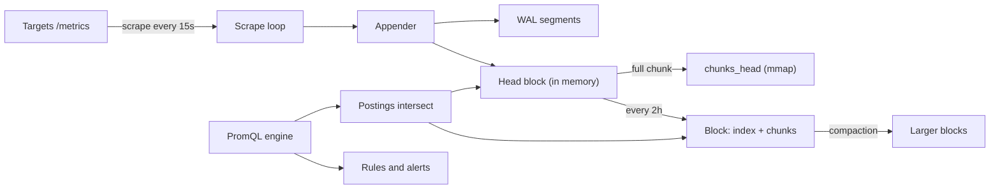

## In one minute
- Prometheus is a pull-based metrics system: it scrapes HTTP endpoints on a fixed interval, stores numeric time series in a local database, and answers queries in PromQL.
- A series is a metric name plus a set of labels. Cost scales with the number of active series (cardinality), not with traffic, so one careless label like `user_id` can take a server down.
- Storage is a custom TSDB: recent data in an in-memory head block backed by a write-ahead log, older data in immutable 2-hour blocks with compressed chunks and an inverted index. Samples compress to about 1 to 2 bytes each ([Prometheus docs](https://prometheus.io/docs/prometheus/latest/storage/)).
- `rate()` and `increase()` handle counter resets and extrapolate to the window edges, so results are estimates, fine for alerting and dashboards and wrong for billing.
- In interviews, use it for operational metrics and alerting. Add Thanos, Mimir or a managed service for long retention, global views and high availability.

## How it works

### Pull scraping
Each target exposes `/metrics` in a plain-text format: lines like `http_requests_total{method="GET",code="200"} 18234`. Prometheus discovers targets through service discovery (Kubernetes, Consul, EC2, files), rewrites labels with `relabel_configs`, and scrapes each target every `scrape_interval`, usually 15 or 30 s. Every scrape also records a synthetic `up` series, so a dead target is itself a signal. Pull keeps targets simple and lets you curl what Prometheus sees. Short-lived batch jobs that end before a scrape push to a Pushgateway instead. Since 3.0, Prometheus can also accept pushes directly: an OTLP receiver (`--web.enable-otlp-receiver`) for OpenTelemetry SDKs, and Remote Write 2.0, which carries metadata, exemplars and native histograms ([Prometheus 3.0](https://prometheus.io/blog/2024/11/14/prometheus-3-0/)). Metric and label names may now be any UTF-8, so OpenTelemetry names with dots survive.

### Metric types
Counters only go up (and reset to zero on restart); you query their rate. Gauges go up and down. Histograms export cumulative bucket counters (`_bucket{le="0.25"}`) plus `_sum` and `_count`, so quantiles are estimated server-side with `histogram_quantile` and can be aggregated across instances. Native histograms store exponential buckets in a single series and are much cheaper per resolution. They became a stable, opt-in feature in 3.8 (November 2025), enabled per job with `scrape_native_histograms` ([CHANGELOG](https://github.com/prometheus/prometheus/blob/main/CHANGELOG.md)).

### Rules and alerts
Recording rules precompute expensive expressions into new series. Alerting rules evaluate every `evaluation_interval`; once true for the `for` duration they go to Alertmanager, which deduplicates, groups, silences and routes them ([Alertmanager docs](https://prometheus.io/docs/alerting/latest/alertmanager/)).

## Down the stack

### Layer 1: The contract
- **Best-effort sampling.** A sample exists only if a scrape succeeded; missed scrapes leave gaps. Counters make this tolerable because the next sample still carries the cumulative total.
- **Local, single-node durability.** An appended sample is in the WAL, but not necessarily `fsync`ed; a crash can lose a short tail of samples. There is no replication: high availability means running two identical servers that scrape the same targets.
- **Query semantics.** An instant selector returns, for each series, the latest sample within the lookback window (5 minutes by default) before the evaluation time. Since 3.0, range selectors and the lookback window are left-open: a sample exactly on the lower boundary is excluded, so a `[1m]` window over a 1-minute scrape can now hold a single sample, too few for `rate` ([migration guide](https://prometheus.io/docs/prometheus/latest/migration/)). A series that disappears from a scrape gets a staleness marker and drops out of instant queries immediately.
- **Approximate functions.** `rate`, `increase` and `histogram_quantile` are estimates by design.
- **Scale envelope.** A single well-provisioned server commonly handles a few million active series and several hundred thousand samples per second. Cloudflare runs 916 servers averaging about 5 million series each, with the largest near 30 million ([Cloudflare](https://blog.cloudflare.com/how-cloudflare-runs-prometheus-at-scale/)); hardware, churn and query load move the limit a lot.

### Layer 2: The mechanism
**Head block.** New samples go to the head, an in-memory structure covering the newest data. Each series has a 64-bit reference, its label set, and a current chunk. Labels are interned in a symbol table, and an in-memory inverted index maps each label pair to a sorted postings list of series references.

**Chunks.** A chunk holds up to about 120 samples of one series (30 minutes at a 15 s scrape, [Vernekar](https://ganeshvernekar.com/blog/prometheus-tsdb-the-head-block/)), compressed in the style of Facebook's Gorilla ([Pelkonen et al., VLDB 2015](https://www.vldb.org/pvldb/vol8/p1816-teller.pdf)): timestamps as delta-of-delta (a regular 15 s interval costs about 1 bit per sample), values as the XOR with the previous value with leading and trailing zeros elided. Typical cost is around 1.3 bytes per sample. Once full, a head chunk is written to `chunks_head/` and memory-mapped, so the head keeps only the open chunk per series in RAM.

**WAL.** Before samples are acknowledged in the head they are appended to the WAL in `wal/`, in 128 MB segments of 32 KB pages. Record types include `Series` (new label sets with their references), `Samples` (reference, timestamp, value) and `Tombstones`. On restart, Prometheus replays the WAL to rebuild the head; periodic checkpoints drop records for series that no longer exist, keeping replay bounded.

**Persistent blocks.** Every 2 hours, once the head spans enough time, the oldest 2 hours are compacted into a block directory: `meta.json` (time range, stats, compaction level), `chunks/` (segment files of up to 512 MB), `index` (symbols, series with their chunk references, and postings) and `tombstones` (deletions applied lazily). Blocks are immutable. Background compaction merges small blocks into larger ones, up to 10 percent of the retention or 31 days, whichever is smaller, and retention deletes whole blocks past `--storage.tsdb.retention.time` (15 days by default).

**Query evaluation.** For `rate(http_requests_total{job="api"}[5m])` the engine looks up the postings for `__name__="http_requests_total"` and `job="api"`, intersects the sorted lists, then for each series reads only chunks that overlap the window, from the head or from the blocks covering that time range. A range query repeats this at every `step`. `rate` walks the samples, adds back each counter reset (a drop means the counter restarted, so the previous value is added), and extrapolates the increase to the window edges, limited so it never extrapolates below zero.

### Layer 3: The machine
Memory is dominated by series in the head: labels, postings entries, the open chunk and bookkeeping, often quoted at a few KB per active series (hedge: 3 to 8 KB depending on label sizes). Three million active series therefore need roughly 10 to 25 GB of RAM before queries. Churn makes it worse: every pod restart in Kubernetes creates new series with a new `pod` label, and old ones stay in the head until the next compaction.

Disk writes are sequential: WAL appends and occasional block writes, so a modest SSD handles hundreds of thousands of samples per second. Reads of persistent blocks go through `mmap`, so a hot query range lives in the page cache and a cold one costs page faults on the index and chunks. A dashboard querying 30 days across a million series can touch gigabytes of chunks; the query engine bounds this with `--query.max-samples` (50 million by default) and a timeout ([Prometheus flags](https://prometheus.io/docs/prometheus/latest/command-line/prometheus/)).

Prometheus 3.0 also sets `GOMAXPROCS` and `GOMEMLIMIT` from the container's CPU quota and memory limit, so the Go runtime collects garbage harder before the cgroup OOM killer fires, instead of sizing itself from the host.

Scrape parsing is real CPU: a target with 10,000 series sends roughly 1 MB of text per scrape, so 1,000 such targets at 15 s means about 70 MB/s to parse.

### Why it's built this way
1. Monitoring must work when everything else is broken, so each server is standalone with local disk and no dependency on a cluster or consensus.
2. Metrics arrive as many small appends to millions of series, so writes go to an in-memory head with a sequential WAL, not random disk updates.
3. Monitoring data is huge and very regular, so Gorilla-style compression turns 16 raw bytes per sample into about 1.3.
4. Time-ranged queries and retention by age dominate, so data is partitioned into immutable time blocks that are cheap to read, merge and delete.
5. Scrapes are periodic and can be missed, so counters are cumulative and `rate` tolerates resets and gaps at the price of being approximate.

## Diagram


## Worked example
A platform runs 2,000 pods, each exposing about 1,500 series, scraped every 15 s.

Active series: 2,000 × 1,500 = 3 million. Ingestion: 3,000,000 / 15 = 200,000 samples per second. Disk: 200,000 × 86,400 s × about 1.3 bytes is roughly 22 GB per day, so 15 days of retention is about 340 GB plus index overhead. Memory: at around 4 KB per series, about 12 GB for the head, so a 32 GB server leaves headroom for queries and the page cache. Run two of them for HA.

Now a developer adds a `customer_id` label to a request-latency histogram with 12 buckets on 200 pods, with 20,000 active customers. Each pod could emit 20,000 × 14 series (12 buckets plus sum and count), up to 56 million new series. Memory needs grow by an order of magnitude and the server OOMs, losing all monitoring at the moment you need it. The fix is a cardinality budget: per-scrape `sample_limit`, alerts on `prometheus_tsdb_head_series`, and per-customer data in logs or traces instead.

## In the wild
- **Cloudflare, 2023: guarding 916 Prometheus servers against cardinality explosions.** Cloudflare runs about 4.9 billion series across 916 servers, the largest near 30 million series. A metric that suddenly gains a high-cardinality label can exhaust memory and crash a server. They default `sample_limit` to 200 per scrape, patched it to drop only the excess new series instead of failing the whole scrape, added a hard cap on total head series, and gate limit increases on a CI capacity check ([Cloudflare](https://blog.cloudflare.com/how-cloudflare-runs-prometheus-at-scale/)).
- **Uber, 2018: M3 built because single-node storage ran out.** Uber's sharded Graphite needed manual resharding and had no replication, so one dead disk lost metrics. M3 stores over 6.6 billion series, aggregates about 500 million metrics per second into 20 million persisted per second with three-way quorum writes, and was open-sourced as remote storage for Prometheus, whose scalability and durability the post calls limited by single nodes ([Uber](https://www.uber.com/en-IL/blog/m3/)).

## Trade-offs
| Option | Strengths | Weaknesses | Choose when |
|---|---|---|---|
| Single Prometheus pair | Simple, fast, no dependencies | Local retention only, manual sharding, no global view | One cluster, weeks of retention |
| Prometheus plus Thanos | Object-storage retention, global query, dedup of HA pairs | More components to run | Many clusters, months to years of data |
| Mimir or Cortex | Horizontally scalable, multi-tenant remote write | Significant operational complexity | Central metrics platform for many teams |
| Managed (AMP, Grafana Cloud, Datadog) | No operations | Per-series cost, vendor lock-in | Small platform team |
| Push systems (StatsD, OTLP to a collector) | Works for short-lived jobs and serverless | Harder to know a target is down | Ephemeral workloads, mixed telemetry |

## Pitfalls in production
- **Cardinality explosions.** Unbounded label values (user IDs, URLs with IDs, error messages) multiply series. Enforce `sample_limit` and review new metrics. Note that by default `sample_limit` fails the whole scrape when exceeded ([configuration docs](https://prometheus.io/docs/prometheus/latest/configuration/configuration/)), so a breach also blinds you to that target's existing series.
- **`rate` over too short a window.** `rate(x[30s])` with a 15 s scrape often has fewer than two samples and returns nothing. Use at least four times the scrape interval.
- **Rate then sum, not sum then rate.** Summing counters across pods before `rate` hides resets and produces spikes. Always `sum(rate(...))`.
- **Averaging quantiles.** Averaging per-pod p99s from summaries is meaningless. Use histograms and `histogram_quantile` over summed buckets.
- **Treating it as an exact store.** Extrapolation and missed scrapes make `increase` non-integer and slightly off. Keep billing counts in a database.
- **Slow restart after a crash.** Replaying a large WAL can take minutes. Keep the head small with sane cardinality and watch replay time.

## Leadership lens
- Set a cardinality budget per team and make the series count visible on a dashboard; it is the main cost and reliability driver.
- Decide early whether metrics are per-cluster with a global query layer or remote-written to a central store; it shapes on-call and cost for years.
- Run Prometheus HA as two independent replicas and let Alertmanager deduplicate; do not attempt to cluster a single Prometheus.
- Use metrics for aggregates, logs for events and traces for individual requests; pushing per-request detail into labels is the most common misuse.

## Check yourself
1. Why does adding one label with 1,000 values sometimes increase memory 1,000-fold rather than slightly?
   **Answer:** Each unique label combination is a new series with its own head state, so a label multiplies the series count of every metric it is attached to.
2. A counter goes 100, 110, 5, 15 within a window. What increase does `rate` assume, and why?
   **Answer:** 25: it treats the drop to 5 as a restart from zero, adding back the 110 before the reset, then extrapolates to the window edges.
3. Why can Prometheus lose recent samples on a crash even though it has a WAL?
   **Answer:** WAL writes are buffered in pages and not `fsync`ed per sample, so the last unflushed data can be lost; durability is traded for ingestion throughput.
4. Why are persistent blocks immutable and 2 hours long?
   **Answer:** Immutable time-partitioned blocks make reads lock-free, compaction a merge, and retention a directory delete, while 2 hours bounds the in-memory head.

## Practice
**Task:** Implement PromQL's `rate()` and `increase()` for one counter series. Inputs: samples as `(t, v)` pairs sorted by time in seconds, the evaluation time `t_eval` and the window `rng`. Use only samples with `t_eval - rng < t <= t_eval`; with fewer than two, return `None`/`null`/`(0, false)` in Go. Compute `delta = last - first`, adding the previous value back whenever a value drops below its predecessor. Then extrapolate: `sampled = t_last - t_first`, `avg = sampled / (n - 1)`, `threshold = 1.1 * avg`, `to_start = t_first - (t_eval - rng)`, `to_end = t_eval - t_last`. If `to_start >= threshold`, set it to `avg / 2`. If `delta > 0` and `first >= 0`, cap `to_start` at `sampled * first / delta` so the counter is never extrapolated below zero. If `to_end >= threshold`, set it to `avg / 2`. `increase = delta * (sampled + to_start + to_end) / sampled` and `rate = increase / rng`.

```python starter
def increase(samples, t_eval, rng):
    # TODO
    raise NotImplementedError


def rate(samples, t_eval, rng):
    # TODO
    raise NotImplementedError
```

```python tests
def close(a, b):
    return a is not None and abs(a - b) < 1e-9

def test_steady_counter():
    s = [(15, 10), (30, 20), (45, 30), (60, 40)]
    assert close(rate(s, 60, 60), 10 / 15)
    assert close(increase(s, 60, 60), 40)

def test_counter_reset_is_added_back():
    s = [(15, 100), (30, 110), (45, 5), (60, 15)]
    assert close(increase(s, 60, 60), 25 * 60 / 45)

def test_fewer_than_two_samples():
    assert rate([(30, 5)], 60, 60) is None
    assert rate([], 60, 60) is None

def test_window_is_left_open():
    s = [(0, 0), (60, 60)]
    assert rate(s, 60, 60) is None, "t=0 is outside (0, 60]"
    assert rate(s, 60, 61) is not None

def test_no_extrapolation_below_zero():
    s = [(30, 1), (45, 11), (60, 21)]
    assert close(increase(s, 60, 60), 21.0)

def test_gap_at_end_extrapolates_half_interval():
    s = [(10, 0), (20, 10)]
    assert close(increase(s, 60, 60), 15.0)
    assert close(rate(s, 60, 60), 0.25)

def test_flat_counter_is_zero():
    s = [(15, 7), (30, 7), (45, 7)]
    assert close(rate(s, 60, 60), 0.0)
```

```python solution
def increase(samples, t_eval, rng):
    start = t_eval - rng
    pts = [(t, v) for t, v in samples if start < t <= t_eval]
    if len(pts) < 2:
        return None
    delta = pts[-1][1] - pts[0][1]
    for i in range(1, len(pts)):
        if pts[i][1] < pts[i - 1][1]:
            delta += pts[i - 1][1]
    t_first, first = pts[0]
    t_last = pts[-1][0]
    sampled = t_last - t_first
    avg = sampled / (len(pts) - 1)
    threshold = 1.1 * avg
    to_start = t_first - start
    to_end = t_eval - t_last
    if to_start >= threshold:
        to_start = avg / 2
    if delta > 0 and first >= 0:
        to_start = min(to_start, sampled * first / delta)
    if to_end >= threshold:
        to_end = avg / 2
    return delta * (sampled + to_start + to_end) / sampled


def rate(samples, t_eval, rng):
    inc = increase(samples, t_eval, rng)
    return None if inc is None else inc / rng
```

```typescript starter
export function increase(samples: [number, number][], tEval: number, rng: number): number | null {
  throw new Error("TODO");
}

export function rate(samples: [number, number][], tEval: number, rng: number): number | null {
  throw new Error("TODO");
}
```

```typescript tests
const close = (a: number | null, b: number): boolean => a !== null && Math.abs(a - b) < 1e-9;

test("steady counter", () => {
  const s: [number, number][] = [[15, 10], [30, 20], [45, 30], [60, 40]];
  assert(close(rate(s, 60, 60), 10 / 15), "rate");
  assert(close(increase(s, 60, 60), 40), "increase");
});
test("counter reset is added back", () => {
  const s: [number, number][] = [[15, 100], [30, 110], [45, 5], [60, 15]];
  assert(close(increase(s, 60, 60), (25 * 60) / 45), "reset");
});
test("fewer than two samples", () => {
  assertEqual(rate([[30, 5]], 60, 60), null);
  assertEqual(rate([], 60, 60), null);
});
test("window is left open", () => {
  const s: [number, number][] = [[0, 0], [60, 60]];
  assertEqual(rate(s, 60, 60), null, "t=0 is outside (0, 60]");
  assert(rate(s, 60, 61) !== null, "t=0 is inside (-1, 60]");
});
test("no extrapolation below zero", () => {
  assert(close(increase([[30, 1], [45, 11], [60, 21]], 60, 60), 21), "capped at zero");
});
test("gap at end extrapolates half interval", () => {
  const s: [number, number][] = [[10, 0], [20, 10]];
  assert(close(increase(s, 60, 60), 15), "increase");
  assert(close(rate(s, 60, 60), 0.25), "rate");
});
test("flat counter is zero", () => {
  assert(close(rate([[15, 7], [30, 7], [45, 7]], 60, 60), 0), "flat");
});
```

```typescript solution
export function increase(samples: [number, number][], tEval: number, rng: number): number | null {
  const start = tEval - rng;
  const pts = samples.filter(([t]) => t > start && t <= tEval);
  if (pts.length < 2) return null;
  let delta = pts[pts.length - 1][1] - pts[0][1];
  for (let i = 1; i < pts.length; i++) {
    if (pts[i][1] < pts[i - 1][1]) delta += pts[i - 1][1];
  }
  const [tFirst, first] = pts[0];
  const tLast = pts[pts.length - 1][0];
  const sampled = tLast - tFirst;
  const avg = sampled / (pts.length - 1);
  const threshold = 1.1 * avg;
  let toStart = tFirst - start;
  let toEnd = tEval - tLast;
  if (toStart >= threshold) toStart = avg / 2;
  if (delta > 0 && first >= 0) toStart = Math.min(toStart, (sampled * first) / delta);
  if (toEnd >= threshold) toEnd = avg / 2;
  return (delta * (sampled + toStart + toEnd)) / sampled;
}

export function rate(samples: [number, number][], tEval: number, rng: number): number | null {
  const inc = increase(samples, tEval, rng);
  return inc === null ? null : inc / rng;
}
```

```go starter
package practice

type Sample struct {
	T float64
	V float64
}

// Increase returns the extrapolated increase, or (0, false) with fewer than two samples.
func Increase(samples []Sample, tEval, rng float64) (float64, bool) { panic("TODO") }

func Rate(samples []Sample, tEval, rng float64) (float64, bool) { panic("TODO") }
```

```go tests
package practice

import (
	"math"
	"testing"
)

func near(t *testing.T, got float64, ok bool, want float64) {
	t.Helper()
	if !ok || math.Abs(got-want) > 1e-9 {
		t.Fatalf("got %v (ok=%v) want %v", got, ok, want)
	}
}

func TestSteadyCounter(t *testing.T) {
	s := []Sample{{15, 10}, {30, 20}, {45, 30}, {60, 40}}
	r, ok := Rate(s, 60, 60)
	near(t, r, ok, 10.0/15)
	i, ok := Increase(s, 60, 60)
	near(t, i, ok, 40)
}

func TestCounterResetAddedBack(t *testing.T) {
	s := []Sample{{15, 100}, {30, 110}, {45, 5}, {60, 15}}
	i, ok := Increase(s, 60, 60)
	near(t, i, ok, 25.0*60/45)
}

func TestFewerThanTwoSamples(t *testing.T) {
	if _, ok := Rate([]Sample{{30, 5}}, 60, 60); ok {
		t.Fatal("one sample should give no result")
	}
	if _, ok := Rate(nil, 60, 60); ok {
		t.Fatal("no samples should give no result")
	}
}

func TestWindowIsLeftOpen(t *testing.T) {
	s := []Sample{{0, 0}, {60, 60}}
	if _, ok := Rate(s, 60, 60); ok {
		t.Fatal("t=0 is outside (0, 60]")
	}
	if _, ok := Rate(s, 60, 61); !ok {
		t.Fatal("t=0 is inside (-1, 60]")
	}
}

func TestNoExtrapolationBelowZero(t *testing.T) {
	i, ok := Increase([]Sample{{30, 1}, {45, 11}, {60, 21}}, 60, 60)
	near(t, i, ok, 21)
}

func TestGapAtEnd(t *testing.T) {
	s := []Sample{{10, 0}, {20, 10}}
	i, ok := Increase(s, 60, 60)
	near(t, i, ok, 15)
	r, ok := Rate(s, 60, 60)
	near(t, r, ok, 0.25)
}

func TestFlatCounter(t *testing.T) {
	r, ok := Rate([]Sample{{15, 7}, {30, 7}, {45, 7}}, 60, 60)
	near(t, r, ok, 0)
}
```

```go solution
package practice

type Sample struct {
	T float64
	V float64
}

// Increase returns the extrapolated increase, or (0, false) with fewer than two samples.
func Increase(samples []Sample, tEval, rng float64) (float64, bool) {
	start := tEval - rng
	var pts []Sample
	for _, s := range samples {
		if s.T > start && s.T <= tEval {
			pts = append(pts, s)
		}
	}
	if len(pts) < 2 {
		return 0, false
	}
	delta := pts[len(pts)-1].V - pts[0].V
	for i := 1; i < len(pts); i++ {
		if pts[i].V < pts[i-1].V {
			delta += pts[i-1].V
		}
	}
	first := pts[0]
	tLast := pts[len(pts)-1].T
	sampled := tLast - first.T
	avg := sampled / float64(len(pts)-1)
	threshold := 1.1 * avg
	toStart := first.T - start
	toEnd := tEval - tLast
	if toStart >= threshold {
		toStart = avg / 2
	}
	if delta > 0 && first.V >= 0 {
		if z := sampled * first.V / delta; z < toStart {
			toStart = z
		}
	}
	if toEnd >= threshold {
		toEnd = avg / 2
	}
	return delta * (sampled + toStart + toEnd) / sampled, true
}

func Rate(samples []Sample, tEval, rng float64) (float64, bool) {
	inc, ok := Increase(samples, tEval, rng)
	if !ok {
		return 0, false
	}
	return inc / rng, true
}
```

## Mock interview
**Prompt:** Design the metrics and alerting system for a company with 40 Kubernetes clusters, 30,000 pods and about 50 million active series in total. Teams want 13 months of retention for capacity planning and alerts that fire within 2 minutes of an outage.

- Follow-up: walk through what happens to a sample from the moment a pod increments a counter to the moment an alert pages someone.
- Follow-up: one team's deploy adds a label that triples their series count. How do you detect and contain it before it affects other teams?
- Follow-up: why not push every metric to a central store directly from each pod?

**A strong answer covers:**
- Per-cluster Prometheus HA pairs scraping locally for fast, failure-isolated alerting, with Alertmanager deduplicating the pair.
- Long-term storage via Thanos sidecars or remote write to Mimir on object storage, with downsampling for 13-month queries.
- Sizing: 50 million series at a 30 s scrape is about 1.7 million samples per second fleet-wide; per-cluster memory from series count; storage at about 1.3 bytes per sample before downsampling.
- The sample path: scrape, WAL and head append, rule evaluation every interval, the `for` duration, Alertmanager grouping and routing, and how these add up against the 2-minute target.
- Cardinality limits (`sample_limit`, per-tenant limits in the central store), head-series alerts, and a review process for new labels.
- Pull versus push: target health via `up`, simpler clients and backpressure, with Pushgateway or OTLP only for short-lived jobs.

## Sources and further study
**Primary**
- [Prometheus 3.0 announcement](https://prometheus.io/blog/2024/11/14/prometheus-3-0/): the first major release in seven years: UTF-8 names, the OTLP receiver, Remote Write 2.0 and the new UI.
- [Prometheus Remote-Write 2.0 specification](https://prometheus.io/docs/specs/prw/remote_write_spec_2_0/): the wire protocol that Thanos Receive, Mimir and managed services ingest.

**Systems docs**
- [Prometheus 3 migration guide](https://prometheus.io/docs/prometheus/latest/migration/): the breaking changes, including left-open ranges and stricter scrape content types.
- [Thanos: design](https://thanos.io/tip/thanos/design.md/): sidecars, store gateways and compaction on object storage for long retention.
- [Grafana Mimir architecture](https://grafana.com/docs/mimir/latest/references/architecture/): distributors, ingesters and the horizontally scaled remote-write path.

**Books**
- *Site Reliability Engineering*, Beyer et al. (eds.), chapter 10 "Practical Alerting from Time-Series Data": Borgmon, the Google system Prometheus was modelled on.
- *The Site Reliability Workbook*, Beyer et al. (eds.), chapter 4 "Monitoring": what a monitoring system needs, metrics with purpose and testing alert logic.
- *Observability Engineering*, Majors, Fong-Jones and Miranda, chapter 9 "How Observability and Monitoring Come Together": where metrics systems like Prometheus stop and event-based debugging starts.

**Other curricula**
- [roadmap.sh: DevOps](https://roadmap.sh/devops): lists Prometheus with Grafana and Datadog under infrastructure monitoring, as an operations tool rather than a storage-engine design.
- [Google SRE book: Monitoring Distributed Systems](https://sre.google/sre-book/monitoring-distributed-systems/): the free chapter 6, which frames metrics around the four golden signals and symptoms versus causes, the lens for choosing what to scrape.

## Watch
- [Lifecycle of a Sample in the Prometheus TSDB (Ganesh Vernekar, FOSSASIA)](https://www.youtube.com/watch?v=35TAaAESLcc): a TSDB maintainer follows one sample through the head, WAL, mmapped chunks and blocks.
- [An Introduction to Systems & Service Monitoring with Prometheus (Julius Volz, GOTO 2019)](https://www.youtube.com/watch?v=5O1djJ13gRU): a Prometheus co-founder on the data model, pull scraping, PromQL and alerting.

## Free resources
- [Prometheus storage](https://prometheus.io/docs/prometheus/latest/storage/): official docs on the block layout, WAL, retention, compaction and capacity planning.
- [Prometheus TSDB: The Head Block](https://ganeshvernekar.com/blog/prometheus-tsdb-the-head-block/): the first in a detailed series by a maintainer on the head, WAL, mmapped chunks and index.
- [Data model](https://prometheus.io/docs/concepts/data_model/): series identity, metric names, labels and samples.
- [PromQL functions](https://prometheus.io/docs/prometheus/latest/querying/functions/): exact semantics of `rate`, `increase`, `histogram_quantile` and the rest.
- [Gorilla: A Fast, Scalable, In-Memory Time Series Database](https://www.vldb.org/pvldb/vol8/p1816-teller.pdf): the Facebook paper behind the delta-of-delta and XOR chunk encoding.
