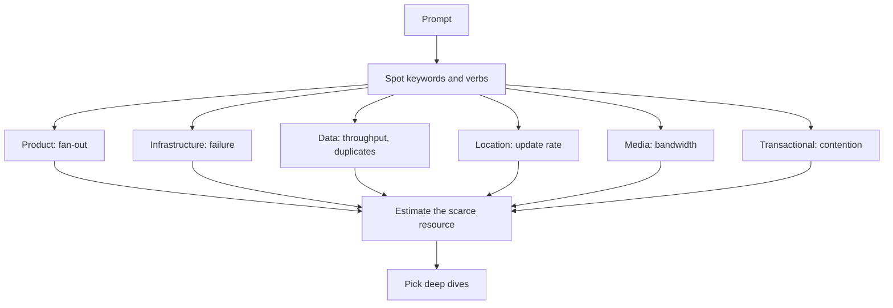

## In one minute
- Hundreds of prompts collapse into about six families: user-facing products, infrastructure building blocks, data and analytics pipelines, location and real-time systems, media and large files, and transactional systems with contention.
- Each family has one dominant constraint that decides most of the design: fan-out for products, correctness under failure for infrastructure, throughput with duplicates for data, update rate for location, bandwidth for media, and no double spend for transactions.
- Recognising the family in the first minute tells you where to spend your deep-dive time and which numbers to estimate. A candidate who spends 15 minutes on the feed schema of a payment system has misread the question.
- Many prompts are hybrids (food delivery is location plus transactions plus notifications). Name the dominant constraint aloud and confirm it with the interviewer.
- This chapter maps each family to its deeper lessons in this course, so you can practise by family rather than by memorising designs.

## How it works

### Product systems
"Design Twitter", "design Instagram", "design Slack", "design a news aggregator". These are the classic prompts. Traffic is read-heavy, often 100 reads per write or more, and the hard problem is getting the right data to many readers cheaply: fan-out on write versus on read, the celebrity problem, ranking, and keeping a timeline cache warm. Scoping matters most here because the feature list is endless. Go deeper with [Design FB News Feed](design-news-feed.md), [Design Slack](design-slack.md), [Fanout](fanout.md), and [High Read Traffic](high-read-traffic.md).

### Infrastructure building blocks
"Design a rate limiter", "design a distributed cache", "design a key-value store", "design a job scheduler", "design an API gateway". There is no product to scope; the interviewer wants internals. The dominant constraint is correctness under partial failure: what happens when a node dies mid-write, when the network partitions, when two nodes think they are the leader. Expect replication, consistent hashing, quorums, leases and clock skew; the Dynamo paper is the usual reference point for most of these ideas in one system ([Dynamo](https://www.allthingsdistributed.com/2007/10/amazons_dynamo.html)). See [Design Rate Limiter](design-rate-limiter.md), [Design Key-Value Store](design-key-value-store.md), [Design Distributed Cache](design-key-value-store.md) and [Design Job Scheduler](design-job-scheduler.md).

### Data and analytics pipelines
"Design an ad click aggregator", "design top-k trending", "design a metrics system", "design a web crawler". Writes dominate, often by orders of magnitude, and nobody reads individual events. The constraint is sustained throughput while handling late, duplicated and out-of-order events. Deep dives cover partitioned logs, windowed aggregation, exactly-once versus at-least-once with idempotent sinks, and approximate structures such as Count-Min Sketch. See [Design Ad Click Aggregator](design-ad-click-aggregator.md), [Design Top K](design-top-k.md), [Design Web Crawler](design-web-crawler.md) and [Distributed Counting](distributed-counting.md).

### Location and real-time systems
"Design Uber", "design a food delivery service", "find nearby friends". The constraint is a high rate of small position updates combined with spatial queries: a million drivers sending a location every 4 seconds is 250,000 writes per second, none of which needs to be durable for long. Deep dives cover geohash or S2 cells (S2 numbers 31 levels of cells along a Hilbert curve with 64-bit IDs, so nearby cells get nearby IDs ([S2 docs](http://s2geometry.io/devguide/s2cell_hierarchy))), in-memory spatial indexes, and pushing updates over WebSockets. See [Design Uber](design-uber.md), [Design Food Delivery Service](design-food-delivery-service.md), [Handling Location Data](handling-location-data.md) and [Realtime Updates](realtime-updates.md).

### Media and large files
"Design YouTube", "design TikTok", "design Dropbox". The constraint is bytes: upload bandwidth, transcoding compute, storage cost, and CDN egress. The metadata service is easy; the interesting parts are resumable chunked uploads, a transcoding pipeline, adaptive bitrate streaming (HLS or DASH, where the player picks a rendition per segment from a playlist ([RFC 8216](https://www.rfc-editor.org/rfc/rfc8216))), and cache hit ratio at the edge. See [Design YouTube](design-youtube.md), [Design TikTok](design-instagram.md), [Handling Large Files](handling-large-files.md) and [Media Streaming](media-streaming.md).

### Transactional systems with contention
"Design a payment system", "design Ticketmaster", "design a flash sale", "design an auction", "design Airbnb booking". Volume is often modest, but correctness is non-negotiable: never charge twice, never sell the same seat twice. Deep dives cover idempotency keys (Stripe, for example, stores the first response per key, rejects a reuse with different parameters, and may prune keys after 24 hours ([Stripe docs](https://docs.stripe.com/api/idempotent_requests))), row locks versus optimistic concurrency, reservations with expiry, ledgers, and what happens when the payment provider times out. See [Design Payment System](design-payment-system.md), [Design Flash Sale](design-flash-sale.md), [Design Movie Booking System](design-movie-booking-system.md), [Design Online Auction System](design-online-auction-system.md) and [Preventing Double Booking](preventing-double-booking.md).

### Hybrids and twists
Real prompts mix families. Food delivery is location plus a transaction plus notifications; Google Docs is a product whose hard part is real-time collaborative editing ([Design Google Docs](design-google-docs.md)). Interviewers also twist a familiar prompt into another family: "design a URL shortener" is a product question until they add "and show click counts per hour per country", which turns it into a data pipeline. When you hear a twist, say which constraint just changed.

### Formats that are not this round
Some prompts look like system design but belong to a different interview. Low-level or object-oriented design asks for classes and interfaces, not services; ML system design asks about modelling and features; and frontend design is its own track ([Hello Interview](https://www.hellointerview.com/learn/system-design/in-a-hurry/introduction)). Companies also split the system design round by role. Meta's Product Architecture round, for product engineers, uses user-facing prompts such as a news feed or Ticketmaster rather than a load balancer, and expects the whole system to be built from cloud-style managed components ([Hello Interview](https://www.hellointerview.com/blog/how-to-prepare-meta-pa)). Ask the recruiter which variant you will get, because it decides which of the families below to practise most.

## Down the stack

### Layer 1: The contract
What the interviewer scores is the same rubric for every type, but the weight shifts. For product questions most evidence comes from scoping and data modelling, because that is where candidates differ. For infrastructure questions it comes from depth and failure reasoning; a vague answer on replication is fatal. For data pipelines it is delivery semantics and throughput arithmetic. For transactional systems it is correctness: an interviewer who hears "we'll retry the charge" with no idempotency key will usually stop there. Misreading the type means spending your 45 minutes collecting evidence on the dimension that carries the least weight.

### Layer 2: The mechanism
Each family has a characteristic mechanism that the deep dive usually reaches. Product: a precomputed per-user timeline in a cache, with a hybrid of push for normal users and pull for accounts with millions of followers. Infrastructure: a consistent-hash ring with virtual nodes, replication factor 3, and quorum reads and writes (R + W > N), which Cassandra exposes as per-request consistency levels such as `QUORUM` and `LOCAL_QUORUM` ([Cassandra docs](https://cassandra.apache.org/doc/latest/cassandra/architecture/dynamo.html)). Data: a partitioned log such as Kafka feeding a stream processor that keeps windowed state, checkpoints it, and writes to a sink with idempotent upserts keyed by (window, key). Location: a grid index (geohash prefix or S2 cell ID) held in memory and sharded by region, queried by scanning the cell and its neighbours. Media: chunked uploads to object storage, a DAG of transcoding jobs, and HLS or DASH manifests that let the player switch bitrate per segment. Transactional: a state machine per order or seat, guarded by a conditional write (`UPDATE seats SET held_by = ? WHERE id = ? AND held_by IS NULL`) and an idempotency table.

### Layer 3: The machine
The dominant constraint of each family maps to a physical limit. Products hit memory: 500 million users times 800 timeline entries of 8 bytes is about 3.2 TB of cache, so you need dozens of large cache nodes. Infrastructure hits the latency of durability: an `fsync` on a good NVMe drive costs tens of microseconds to a millisecond (a 2026 cloud measurement put an 8 KiB write plus `fsync` at about 300 us ([Napkin Math](https://github.com/sirupsen/napkin-math))), and a quorum write adds a network round trip of about 0.5 ms within a data centre. Data pipelines hit sequential throughput: a single Kafka partition typically takes tens of MB per second of produce traffic, depending on batching, compression, acks and replication ([Confluent](https://www.confluent.io/blog/how-choose-number-topics-partitions-kafka-cluster/)), so 1 GB per second of clicks needs dozens of partitions. Location hits write rate into memory: 250,000 updates per second is easy for a sharded in-memory index but brutal for a B-tree on disk. Media hits the network: a 4 Mbit/s stream to one million concurrent viewers is 4 Tbit/s, which only a CDN can serve. Transactions hit lock contention: a single hot row can commit only a few hundred to a few thousand updates per second, however large the machine.

### Why it's built this way
Interviewers have one hour, so they choose prompts that concentrate one hard problem, and each hard problem comes from one scarce resource. So the family tells you which resource is scarce, the scarce resource tells you which numbers to estimate, and the numbers tell you which mechanism to deep dive.

## Diagram


## Worked example
Prompt: "Design a system that sells 10,000 concert tickets that go on sale at 10:00, with 2 million fans waiting."

Classify. The keywords are "sells", "tickets" and "go on sale": transactional with contention, plus a traffic spike. The dominant constraint is never selling a seat twice while the front door survives a surge.

Estimate the scarce resource. Two million fans refreshing every 2 seconds is 1 million requests per second at the edge, but only 10,000 successful purchases. If all of them tried to lock seat rows at once, a hot section of 500 seats would see thousands of conflicting writes per second on a handful of rows.

Choose deep dives that match. First, a virtual waiting room that admits, say, 2,000 users per minute, which converts the spike into a steady flow. Second, seat holds: a conditional update sets `held_by` and `hold_expires_at` for 10 minutes, and expired holds are released by a sweeper. Third, payment: an idempotency key per hold so a retried checkout cannot charge twice.

What to skip: profiles, recommendations and the artist page get one sentence each. For "design Instagram" those same minutes would go to fan-out, and "idempotency" might never come up.

## In the wild
- **Ticketmaster, 2022: the Eras Tour presale.** Over 3.5 million fans pre-registered and about 1.5 million received codes, but bots and fans without codes drove 3.5 billion system requests, four times the previous peak. Ticketmaster slowed and postponed sales to keep the queues stable, estimated that about 15% of interactions hit errors (including passcode failures that dropped carted tickets), and still sold over 2 million tickets that day. It is the transactional family with a surge on top, exactly the shape of this chapter's worked example ([Ticketmaster, archived](https://web.archive.org/web/20230101022610/https://business.ticketmaster.com/business-solutions/taylor-swift-the-eras-tour-onsale-explained/)).
- **Segment, 2017: duplicates are the data family's normal state.** About 0.6% of events ingested over four weeks were duplicates, mostly from clients on flaky networks retrying. Segment partitioned Kafka by message ID and gave each worker a RocksDB store of IDs seen in a four-week window, reaching about 60 billion keys and 1.5 TB after three months ([Twilio Segment](https://www.twilio.com/en-us/blog/insights/exactly-once-delivery)).
- **Tinder, 2019: location load is uneven.** One five-shard index became costly, so Tinder scored load per S2 cell, packed cells into 40 to 100 geoshards in Hilbert order, and handled 20 times the computation. Different language libraries produced different 64-bit IDs for the same cell, so they stored string tokens instead ([Tinder Engineering](https://medium.com/tinder/geosharded-recommendations-part-1-sharding-approach-d5d54e0ec77a)).

## Trade-offs
| Family | Dominant constraint | Typical deep dives | Common trap |
|---|---|---|---|
| Product | Read fan-out and data model | Timeline cache, celebrity problem, ranking | Scoping too many features |
| Infrastructure | Correctness under partial failure | Replication, consistent hashing, leases | Hand-waving failure cases |
| Data pipeline | Throughput with late and duplicate events | Partitioned log, windows, idempotent sinks | Designing a read API nobody needs |
| Location | Update rate plus spatial query | Geohash or S2 index, sharding by region | Persisting every ping durably |
| Media | Bandwidth and storage cost | Chunked upload, transcoding, CDN | Over-designing metadata |
| Transactional | No double spend under contention | Conditional writes, holds, idempotency | Retries without idempotency keys |

## Pitfalls in production
These misclassifications happen in real projects too, not only in interviews:

- **Treating a pipeline as a product.** Teams build a request/response API over raw events and fall over at the first marketing campaign. Fix: identify write-dominant workloads early and put a log in front.
- **Treating a transaction as a feed.** Eventual consistency on inventory leads to oversold stock. Fix: find the invariant ("seats sold is at most capacity") and protect it with a conditional write.
- **Ignoring the hybrid.** A delivery app designed only as a location system lacks a durable order state machine, so orders are lost when a dispatcher restarts. Fix: list every family the system touches and give each its own store.
- **Over-durable location data.** Writing every GPS ping to a replicated database is costly and useless. Fix: keep the live position in memory and sample to durable storage for history.

## Leadership lens
- In a design review, ask the author to name the family and the one invariant or scarce resource first; disagreements about the design are often disagreements about this.
- Staff the team to match the family: transactional systems need engineers comfortable with concurrency and auditing, media systems need people who understand CDNs and cost.
- When building an interview loop, rotate prompts across families so you are not only hiring people good at feeds.

## Check yourself
1. Why is a URL shortener with per-hour click analytics harder than one without?
   **Answer:** The analytics turn it into a write-heavy data pipeline: every redirect becomes an event that must be aggregated with late and duplicate handling, which needs a log and a stream aggregator rather than a simple counter.
2. What single question tells you whether a prompt is transactional?
   **Answer:** Is there an invariant that must never be violated even briefly, such as "never sell more than capacity" or "never charge twice"? If so, correctness under contention dominates.
3. Why do location systems usually keep live positions in memory?
   **Answer:** Updates arrive at hundreds of thousands per second and are only valid for seconds, so durable replicated writes cost far more than the data is worth; history can be sampled separately.
4. An interviewer gives you "design Dropbox". Where should most of your estimates go?
   **Answer:** Into bytes: upload and download bandwidth, storage growth, and deduplication savings, since metadata volume is small compared with file content.

## Practice
**Task:** Build a prompt classifier that maps a question to its family and dominant constraint. Lowercase the prompt and split it into tokens on any character that is not a letter or digit. A token matches a keyword if it equals the keyword, the keyword plus `s`, or the keyword plus `es`. Each family's score is the number of matching tokens (repeats count). `classify(prompt)` returns the highest-scoring family, its constraint, and the sorted unique list of keywords that matched for it; ties go to the family listed first, and a prompt with no matches returns `("unknown", "ask clarifying questions", [])`. Families, in priority order, with constraints and keywords: `transactional` ("no double spend under contention": payment, wallet, auction, ticket, booking, reservation, inventory, checkout, ledger), `infrastructure` ("correctness under partial failure": cache, limiter, queue, scheduler, gateway, store, lock), `data` ("throughput with late and duplicate events": analytics, aggregator, metric, click, log, pipeline, crawler, trending), `location` ("spatial index under high update rate": location, nearby, ride, map, courier, delivery, tracking, proximity), `media` ("bandwidth and storage cost": video, photo, upload, streaming, image, file, music), and `product` ("read fan-out and data model": feed, timeline, chat, messaging, social, comment, notification, news, post, follower).

```python starter
FAMILIES = []  # TODO: (name, constraint, keywords) in priority order

def classify(prompt):
    # TODO: return (family, constraint, sorted matched keywords)
    raise NotImplementedError
```

```python tests
def test_product_feed():
    assert classify("Design Instagram's news feed") == ("product", "read fan-out and data model", ["feed", "news"])

def test_infrastructure():
    assert classify("Design a distributed rate limiter")[0] == "infrastructure"

def test_data_pipeline():
    assert classify("Design an ad click aggregator") == (
        "data", "throughput with late and duplicate events", ["aggregator", "click"])

def test_media_counts_all_hits():
    assert classify("Design YouTube video upload and streaming")[2] == ["streaming", "upload", "video"]

def test_plural_and_case():
    assert classify("Find NEARBY drivers and their Locations")[0:3:2] == ("location", ["location", "nearby"])

def test_tie_goes_to_priority_order():
    assert classify("food delivery with payments")[0] == "transactional"

def test_repeats_count():
    assert classify("chat chat chat with a cache")[0] == "product"

def test_unknown():
    assert classify("Design a toaster") == ("unknown", "ask clarifying questions", [])
```

```python solution
FAMILIES = [
    ("transactional", "no double spend under contention",
     ["payment", "wallet", "auction", "ticket", "booking", "reservation", "inventory", "checkout", "ledger"]),
    ("infrastructure", "correctness under partial failure",
     ["cache", "limiter", "queue", "scheduler", "gateway", "store", "lock"]),
    ("data", "throughput with late and duplicate events",
     ["analytics", "aggregator", "metric", "click", "log", "pipeline", "crawler", "trending"]),
    ("location", "spatial index under high update rate",
     ["location", "nearby", "ride", "map", "courier", "delivery", "tracking", "proximity"]),
    ("media", "bandwidth and storage cost",
     ["video", "photo", "upload", "streaming", "image", "file", "music"]),
    ("product", "read fan-out and data model",
     ["feed", "timeline", "chat", "messaging", "social", "comment", "notification", "news", "post", "follower"]),
]

def _tokens(prompt):
    out, cur = [], []
    for ch in prompt.lower():
        if ch.isalnum():
            cur.append(ch)
        elif cur:
            out.append("".join(cur))
            cur = []
    if cur:
        out.append("".join(cur))
    return out

def _match(token, keywords):
    for kw in keywords:
        if token == kw or token == kw + "s" or token == kw + "es":
            return kw
    return None

def classify(prompt):
    toks = _tokens(prompt)
    best = None
    for name, constraint, keywords in FAMILIES:
        hits = [_match(t, keywords) for t in toks]
        hits = [h for h in hits if h is not None]
        if hits and (best is None or len(hits) > best[0]):
            best = (len(hits), name, constraint, sorted(set(hits)))
    if best is None:
        return ("unknown", "ask clarifying questions", [])
    return (best[1], best[2], best[3])
```

```typescript starter
export interface Result {
  family: string;
  constraint: string;
  matched: string[];
}

export function classify(prompt: string): Result {
  throw new Error("TODO");
}
```

```typescript tests
test("product feed", () => {
  assertEqual(classify("Design Instagram's news feed"), { family: "product", constraint: "read fan-out and data model", matched: ["feed", "news"] });
});
test("infrastructure", () => {
  assertEqual(classify("Design a distributed rate limiter").family, "infrastructure");
});
test("data pipeline", () => {
  assertEqual(classify("Design an ad click aggregator"), { family: "data", constraint: "throughput with late and duplicate events", matched: ["aggregator", "click"] });
});
test("media counts all hits", () => {
  assertEqual(classify("Design YouTube video upload and streaming").matched, ["streaming", "upload", "video"]);
});
test("plural and case", () => {
  const r = classify("Find NEARBY drivers and their Locations");
  assertEqual([r.family, r.matched], ["location", ["location", "nearby"]]);
});
test("tie goes to priority order", () => {
  assertEqual(classify("food delivery with payments").family, "transactional");
});
test("repeats count", () => {
  assertEqual(classify("chat chat chat with a cache").family, "product");
});
test("unknown", () => {
  assertEqual(classify("Design a toaster"), { family: "unknown", constraint: "ask clarifying questions", matched: [] });
});
```

```typescript solution
export interface Result {
  family: string;
  constraint: string;
  matched: string[];
}

const FAMILIES: [string, string, string[]][] = [
  ["transactional", "no double spend under contention",
    ["payment", "wallet", "auction", "ticket", "booking", "reservation", "inventory", "checkout", "ledger"]],
  ["infrastructure", "correctness under partial failure",
    ["cache", "limiter", "queue", "scheduler", "gateway", "store", "lock"]],
  ["data", "throughput with late and duplicate events",
    ["analytics", "aggregator", "metric", "click", "log", "pipeline", "crawler", "trending"]],
  ["location", "spatial index under high update rate",
    ["location", "nearby", "ride", "map", "courier", "delivery", "tracking", "proximity"]],
  ["media", "bandwidth and storage cost",
    ["video", "photo", "upload", "streaming", "image", "file", "music"]],
  ["product", "read fan-out and data model",
    ["feed", "timeline", "chat", "messaging", "social", "comment", "notification", "news", "post", "follower"]],
];

function matchKeyword(token: string, keywords: string[]): string | null {
  for (const kw of keywords) {
    if (token === kw || token === kw + "s" || token === kw + "es") return kw;
  }
  return null;
}

export function classify(prompt: string): Result {
  const toks = prompt.toLowerCase().split(/[^a-z0-9]+/).filter((t) => t.length > 0);
  let best: { n: number; r: Result } | null = null;
  for (const [family, constraint, keywords] of FAMILIES) {
    const hits: string[] = [];
    for (const t of toks) {
      const kw = matchKeyword(t, keywords);
      if (kw !== null) hits.push(kw);
    }
    if (hits.length > 0 && (best === null || hits.length > best.n)) {
      const matched = Array.from(new Set(hits)).sort();
      best = { n: hits.length, r: { family, constraint, matched } };
    }
  }
  return best === null ? { family: "unknown", constraint: "ask clarifying questions", matched: [] } : best.r;
}
```

```go starter
package practice

// Result is the family, its dominant constraint and the matched keywords.
type Result struct {
	Family     string
	Constraint string
	Matched    []string
}

func Classify(prompt string) Result { panic("TODO") }
```

```go tests
package practice

import (
	"reflect"
	"testing"
)

func TestProductFeed(t *testing.T) {
	got := Classify("Design Instagram's news feed")
	want := Result{"product", "read fan-out and data model", []string{"feed", "news"}}
	if !reflect.DeepEqual(got, want) {
		t.Fatalf("got %+v", got)
	}
}

func TestInfrastructureAndData(t *testing.T) {
	if f := Classify("Design a distributed rate limiter").Family; f != "infrastructure" {
		t.Fatalf("got %s", f)
	}
	got := Classify("Design an ad click aggregator")
	if got.Family != "data" || !reflect.DeepEqual(got.Matched, []string{"aggregator", "click"}) {
		t.Fatalf("got %+v", got)
	}
}

func TestMediaCountsAllHits(t *testing.T) {
	got := Classify("Design YouTube video upload and streaming").Matched
	if !reflect.DeepEqual(got, []string{"streaming", "upload", "video"}) {
		t.Fatalf("got %v", got)
	}
}

func TestPluralAndCase(t *testing.T) {
	got := Classify("Find NEARBY drivers and their Locations")
	if got.Family != "location" || !reflect.DeepEqual(got.Matched, []string{"location", "nearby"}) {
		t.Fatalf("got %+v", got)
	}
}

func TestTieAndRepeats(t *testing.T) {
	if f := Classify("food delivery with payments").Family; f != "transactional" {
		t.Fatalf("tie got %s", f)
	}
	if f := Classify("chat chat chat with a cache").Family; f != "product" {
		t.Fatalf("repeats got %s", f)
	}
}

func TestUnknown(t *testing.T) {
	got := Classify("Design a toaster")
	if got.Family != "unknown" || got.Constraint != "ask clarifying questions" || len(got.Matched) != 0 {
		t.Fatalf("got %+v", got)
	}
}
```

```go solution
package practice

import (
	"sort"
	"strings"
	"unicode"
)

// Result is the family, its dominant constraint and the matched keywords.
type Result struct {
	Family     string
	Constraint string
	Matched    []string
}

type family struct {
	name, constraint string
	keywords         []string
}

var families = []family{
	{"transactional", "no double spend under contention",
		[]string{"payment", "wallet", "auction", "ticket", "booking", "reservation", "inventory", "checkout", "ledger"}},
	{"infrastructure", "correctness under partial failure",
		[]string{"cache", "limiter", "queue", "scheduler", "gateway", "store", "lock"}},
	{"data", "throughput with late and duplicate events",
		[]string{"analytics", "aggregator", "metric", "click", "log", "pipeline", "crawler", "trending"}},
	{"location", "spatial index under high update rate",
		[]string{"location", "nearby", "ride", "map", "courier", "delivery", "tracking", "proximity"}},
	{"media", "bandwidth and storage cost",
		[]string{"video", "photo", "upload", "streaming", "image", "file", "music"}},
	{"product", "read fan-out and data model",
		[]string{"feed", "timeline", "chat", "messaging", "social", "comment", "notification", "news", "post", "follower"}},
}

func matchKeyword(token string, keywords []string) string {
	for _, kw := range keywords {
		if token == kw || token == kw+"s" || token == kw+"es" {
			return kw
		}
	}
	return ""
}

func Classify(prompt string) Result {
	toks := strings.FieldsFunc(strings.ToLower(prompt), func(r rune) bool {
		return !(unicode.IsLetter(r) || unicode.IsDigit(r))
	})
	best, bestN := Result{"unknown", "ask clarifying questions", []string{}}, 0
	for _, f := range families {
		seen := map[string]bool{}
		n := 0
		for _, t := range toks {
			if kw := matchKeyword(t, f.keywords); kw != "" {
				n++
				seen[kw] = true
			}
		}
		if n > bestN {
			matched := make([]string, 0, len(seen))
			for kw := range seen {
				matched = append(matched, kw)
			}
			sort.Strings(matched)
			best, bestN = Result{f.name, f.constraint, matched}, n
		}
	}
	return best
}
```

## Mock interview
**Prompt:** Design a platform where restaurants post surplus food at a discount at the end of the day, nearby users reserve a bag and pay in the app, and pick it up within a two-hour window. Expect 5 million users and 50,000 restaurants, with most reservations in a 30-minute burst around 6 pm.

- Follow-up: Which family does this belong to, and which constraint dominates? Defend the choice.
- Follow-up: Two users tap "reserve" on the last bag within the same 10 ms. Walk me through exactly what happens.
- Follow-up: Would you push new listings to nearby users or let them poll? What does each cost at 6 pm?

**A strong answer covers:**
- Naming it as a hybrid: location for discovery, transactional for the reservation, with the transactional invariant (never more bags reserved than posted) as the dominant constraint.
- A conditional decrement or per-bag hold row guarded by a conditional write, with a hold expiry tied to payment.
- An idempotency key on the payment and a clear state machine: available, held, paid, picked up, expired.
- Burst handling at 6 pm with estimates, for example 5 million users times 20% active times 1 request every 5 seconds is 200,000 reads per second, served from cache.

## Sources and further study
**Primary**
- [RFC 8216: HTTP Live Streaming](https://www.rfc-editor.org/rfc/rfc8216): the playlist and segment model behind adaptive bitrate in media prompts.
- [S2 cell hierarchy (S2 Geometry)](http://s2geometry.io/devguide/s2cell_hierarchy): how spherical cells and Hilbert-curve IDs make spatial lookups into range scans.

**Systems docs**
- [Cassandra: Dynamo architecture](https://cassandra.apache.org/doc/latest/cassandra/architecture/dynamo.html): consistency levels, W + R > RF and last-write-wins, the core of infrastructure prompts.
- [Stripe: Idempotent requests](https://docs.stripe.com/api/idempotent_requests): a real idempotency-key contract for the transactional family.
- [Confluent: choosing the number of partitions](https://www.confluent.io/blog/how-choose-number-topics-partitions-kafka-cluster/): per-partition throughput for sizing data pipelines.

**Books**
- *System Design Interview – An Insider's Guide, Volume 1*, Alex Xu, chapters 4 to 15: rate limiter, key-value store, web crawler, news feed, chat, YouTube and Google Drive, spanning most families here.
- *System Design Interview – An Insider's Guide, Volume 2*, Alex Xu and Sahn Lam, chapters 1 to 13: proximity and maps (location), ad click aggregation (data), hotel reservation, payments and digital wallet (transactional).
- *Designing Data-Intensive Applications* (1st edition), Martin Kleppmann, chapter 1 "Reliable, Scalable, and Maintainable Applications": describing load and performance, the step before naming the scarce resource.

**Other curricula**
- [System Design in a Hurry: Introduction (Hello Interview)](https://www.hellointerview.com/learn/system-design/in-a-hurry/introduction): splits interviews into product design and infrastructure design, and separates out low-level and ML design.

## Watch
- [System Design Interview: Design Ticketmaster w/ a Ex-Meta Staff Engineer (Hello Interview)](https://www.youtube.com/watch?v=fhdPyoO6aXI): a transactional, contention-dominated prompt worked end to end.
- [Design an Ad Click Aggregator w/ a Ex-Meta Staff Engineer (Hello Interview)](https://www.youtube.com/watch?v=Zcv_899yqhI): a data-pipeline prompt, useful to contrast with the transactional one.
- [Design a Distributed Rate Limiter (Hello Interview)](https://www.youtube.com/watch?v=MIJFyUPG4Z4): an infrastructure building block where internals and failure handling carry the interview.

## Free resources
- [The System Design Primer](https://github.com/donnemartin/system-design-primer): sample designs from several families with worked solutions.
- [System Design in a Hurry: Core Concepts (Hello Interview)](https://www.hellointerview.com/learn/system-design/in-a-hurry/core-concepts): the recurring building blocks that the families draw on.
- [Amazon's Dynamo (All Things Distributed)](https://www.allthingsdistributed.com/2007/10/amazons_dynamo.html): the canonical reading for infrastructure-type prompts.
- [The Amazon Builders' Library](https://aws.amazon.com/builders-library/): production write-ups on timeouts, retries, idempotency and load shedding that cover the transactional and infrastructure families.
- [Napkin Math](https://github.com/sirupsen/napkin-math): reference numbers for the scarce resource in each family.
