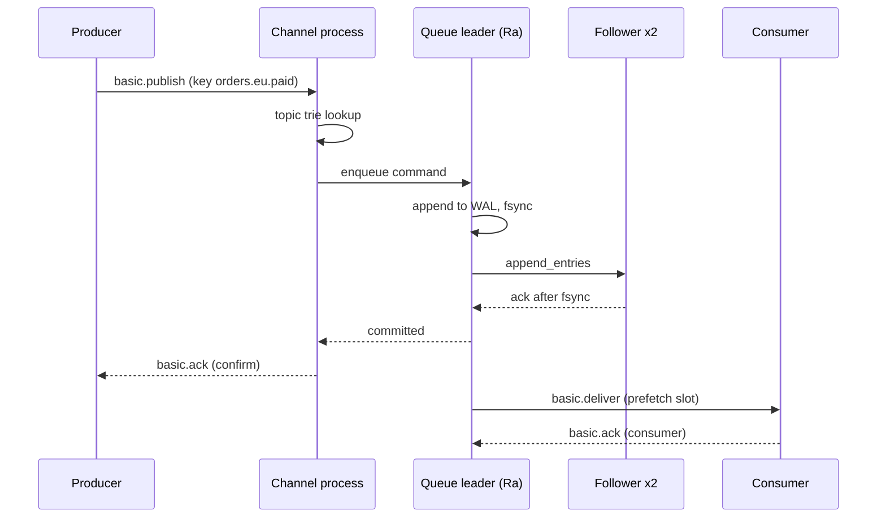

## In one minute
- RabbitMQ is a message broker: producers publish to an **exchange**, which copies each message into zero or more **queues** according to **bindings**; consumers take messages and acknowledge them.
- Routing is its distinguishing feature: direct, fanout, topic and headers exchanges express "who gets this" in broker configuration instead of application code.
- A queue is a single Erlang process. That gives simple per-queue FIFO semantics and caps one queue at roughly tens of thousands of messages per second.
- For durability, use **quorum queues** (Raft, `fsync` before confirm) with **publisher confirms** and **manual acks**. Delivery is at-least-once, so consumers must be idempotent.
- Choose it for task queues and rich routing at moderate scale. Prefer Kafka or a stream for replay, very high fan-in, or multi-day retention.

## How it works

### Exchanges, bindings and queues
A producer never writes to a queue directly. It sends `basic.publish` with an exchange name and a routing key. A **direct** exchange matches the key exactly. A **fanout** exchange copies to every bound queue. A **topic** exchange treats the key as dot-separated words and lets binding patterns use `*` (exactly one word) and `#` (zero or more words). A **headers** exchange matches on header values. The nameless default exchange routes by queue name, which is why "publish to a queue" appears to work. If nothing matches, the message is dropped unless the producer set `mandatory` (the broker sends `basic.return`) or the exchange has an alternate exchange ([AMQP 0-9-1 model](https://www.rabbitmq.com/tutorials/amqp-concepts)).

### Consumers, prefetch and acks
The broker pushes messages as `basic.deliver` frames, each with a per-channel delivery tag. With manual acks a message stays unacknowledged until `basic.ack`; `basic.nack` with `requeue=true` puts it back, and if the channel dies every unacked message is requeued with `redelivered` set. `basic.qos` sets the **prefetch** count, the maximum unacked messages per consumer. Too low and consumers idle on round trips; too high and one slow consumer hoards work. A delivery must also be acked within `consumer_timeout`, 30 minutes by default, or the broker closes the channel with `PRECONDITION_FAILED` and requeues everything it held; since 4.3 that timeout is enforced only for quorum queues ([consumer docs](https://www.rabbitmq.com/docs/consumers)).

### Queue types and clustering
**Classic queues** live on one node and are not replicated: classic queue mirroring was removed in 4.0 ([quorum queue docs](https://www.rabbitmq.com/docs/quorum-queues)). **Quorum queues** replicate through Raft, usually to three nodes. **Streams** are a replicated append-only log read by offset, giving replay inside RabbitMQ. Exchanges, bindings, users and policies are metadata replicated to every node, stored since 4.2 in Khepri, a Raft-based store that is the default for new clusters, while upgraded clusters stay on Mnesia until they opt in ([metadata store docs](https://www.rabbitmq.com/docs/metadata-store)); but queue contents live only on that queue's replicas, so a consumer connected to the wrong node has its traffic proxied across the cluster link.

## Down the stack

### Layer 1: The contract
With a quorum queue, publisher confirms and manual acks, RabbitMQ promises: a confirmed message is persisted on a majority of replicas and survives losing a minority, because confirms are issued only after quorum replication ([quorum queue docs](https://www.rabbitmq.com/docs/quorum-queues)); it will be delivered at least once until acked; and messages from one channel to one queue keep publish order, though redeliveries can arrive after later messages. It does not promise exactly-once delivery, ordering across queues, or ordering among competing consumers. Without confirms a publish is a TCP write the broker may drop.

### Layer 2: The mechanism
**Wire protocol.** AMQP 0-9-1 multiplexes channels over one TCP connection. Every frame is a 7-byte header (1-byte type, 2-byte channel, 4-byte size), the payload, and an end byte `0xCE`. A publish is a `basic.publish` method frame, a content header frame (body size, `delivery_mode=2` for persistent, `message_id`, headers) and body frames capped by `frame_max` (128 KiB default). The whole message is capped by `max_message_size`, 16 MiB by default ([limits](https://www.rabbitmq.com/docs/limits)). After `confirm.select`, the broker replies with `basic.ack` carrying a delivery tag and a `multiple` bit, so one ack can confirm a range.

**Routing and processes.** Topic bindings live in a trie keyed by words with `*` and `#` edges, so routing cost grows with key depth, not binding count. Each connection has a reader and a writer process and one process per channel; the channel routes, then sends the message to each target queue's process. A classic queue is one process; a quorum queue is one Raft member process per replica.

**Quorum queues.** They use Ra, a Raft library. The leader appends the enqueue command and replicates `append_entries` to followers. Each node keeps one write-ahead log shared by all its Ra members, batching many queues into one `fsync`, then flushes entries into per-queue segment files. Once a majority is durable the command commits and the channel sends the confirm ([Ra](https://github.com/rabbitmq/ra)). Consumer acks are also log entries, and snapshots let the log be truncated.

**Classic queues and streams.** Classic queues (v2 storage) keep a per-queue index that embeds small messages, with larger ones in a node-wide shared message store. Streams write segment files with an offset and timestamp index and replicate leader to follower (Osiris).

**Flow control.** Queues grant channels credit; when it runs out the channel stops, and the reader stops reading the socket. A **memory alarm** above `vm_memory_high_watermark` (0.6 of detected RAM by default) ([memory docs](https://www.rabbitmq.com/docs/memory)) or a **disk alarm** below `disk_free_limit` (only 50 MB by default, far too low for production) blocks all publishers cluster-wide ([configuration](https://www.rabbitmq.com/docs/configure)).

### Layer 3: The machine
The Erlang VM runs one scheduler thread per core and preempts processes every few thousand reductions, so one busy queue cannot stall others but can never use more than one core. Sockets are polled with `epoll`. At 20,000 messages per second with confirms there are tens of thousands of tiny TCP segments each way, so `multiple` acks matter.

An `fsync` costs about 50 to 200 microseconds on NVMe and 1 to 5 ms on network block storage; the shared WAL lets 500 quorum queues pay for one `fsync` per batch. Raft adds a cross-zone round trip, typically 0.5 to 2 ms.

Memory is the main hazard. Each in-memory message costs its body plus a few hundred bytes of metadata, and each Erlang process garbage-collects its own heap. Rough single-queue ceilings (hedge: they vary widely with message size and hardware) are 30,000 to 50,000 messages per second for a classic queue and 10,000 to 30,000 for a quorum queue; streams can reach hundreds of thousands per second because consumers read files without per-message state.

### Why it's built this way
1. Routing belongs in one shared place, so the broker owns exchanges and bindings rather than producers knowing consumers.
2. Erlang processes make per-queue state consistent without locks, so a queue is one process, bounded by one core; you scale by adding queues.
3. A push broker must not overwhelm consumers, so prefetch and acks give per-consumer flow control and credit flow does the same internally.
4. Classic mirroring lost data under partitions ([Jepsen showed it](https://aphyr.com/posts/315-call-me-maybe-rabbitmq)), so durable replication moved to Raft queues that confirm after a majority `fsync`, and 4.0 removed mirroring.
5. `fsync` and cross-zone round trips cost milliseconds, so the WAL is shared and confirms are batched.

## Diagram


## Worked example
An e-commerce platform emits order events: 10,000 per second at peak, about 2 KB each. Billing wants every paid order, shipping-eu wants EU paid orders, and analytics wants everything.

One topic exchange `orders` receives keys like `orders.<region>.<status>`. Billing binds `orders.*.paid`, shipping-eu binds `orders.eu.paid`, analytics binds `orders.#`. At peak that is 10,000 publishes but up to 30,000 queue writes, because one message can land in three queues.

Analytics at 10,000 per second would sit near one quorum queue's ceiling, so it is split into 4 queues behind a consistent-hash exchange keyed on order ID, about 2,500 per second each. Billing runs 20 consumers with prefetch 50; at 20 ms per message each consumer handles 50 per second, so 1,000 per second in total, above billing's share. Producers keep 500 unconfirmed messages in flight; at 5 ms confirm latency one channel could sustain 100,000 per second, so the queues, not confirms, are the limit. Billing deduplicates on `message_id` because redelivery after a consumer crash will eventually happen.

## In the wild
- **Jepsen, 2014: mirrored queues lose acknowledged messages.** On a five-node cluster with durable mirrored queues, publisher confirms and `pause_minority`, random partitions lost 1,312 of 3,747 attempted enqueues, about 35% of acknowledged writes, plus 24 duplicate deliveries. A node rejoining after a partition threw away its own queue contents and adopted the current primary's. This is the failure that quorum queues and the 4.0 removal of mirroring answer ([Jepsen](https://aphyr.com/posts/315-call-me-maybe-rabbitmq)).
- **Slack, about 2016: a full broker cannot even drain.** Not RabbitMQ, but the same shape as a memory alarm. Database contention slowed Slack's job workers until the Redis job queue hit its memory cap; enqueues failed, and dequeues failed too because moving a job to an in-flight list needed spare memory, so the queue stayed stuck after the database recovered. Slack put a Kafka buffer in front of Redis, with a relay that feeds jobs in at a rate limit, for about 1.4 billion jobs a day ([Slack Engineering](https://slack.engineering/scaling-slacks-job-queue/)).

## Trade-offs
| Option | Strengths | Weaknesses | Choose when |
|---|---|---|---|
| RabbitMQ quorum queues | Rich routing, per-message acks, DLX, durable via Raft | One core per queue, messages deleted on ack, ms latency | Work queues and routed events at up to tens of thousands per second per queue |
| RabbitMQ streams | Replay, high throughput, offset consumers | Fewer routing features, newer operational model | You want RabbitMQ plus replay or large fan-out |
| Kafka | Partitioned log, millions per second, long retention | No per-message ack or routing, ordering only per partition | Event streaming, CDC, analytics pipelines |
| Amazon SQS | No servers, near-unlimited standard throughput | No routing, polling, 12-hour visibility max | AWS-native task queues with no ops team |
| Redis lists or streams | Very low latency, simple | Weaker durability, memory-bound | Lightweight jobs where loss is tolerable |

## Pitfalls in production
- **Unbounded queues trigger the memory alarm.** A stalled consumer lets a queue grow until every publisher blocks. Set `x-max-length` or a TTL with `reject-publish` overflow and alert on depth.
- **Prefetch left unlimited.** Without `basic.qos` the first consumer receives the whole backlog. Set prefetch to a small multiple of consumer concurrency, often 10 to 300.
- **Poison messages loop forever.** Quorum queues cap redeliveries with `delivery-limit`, 20 by default since 4.0 (unlimited in 3.x), then drop or dead-letter the message, so configure a dead-letter exchange or lose it silently ([limits](https://www.rabbitmq.com/docs/limits)).
- **Fire-and-forget publishing.** Without confirms, messages vanish during alarms and failovers. Treat an unconfirmed message as unsent.
- **Connection churn.** A connection per request costs TCP and AMQP handshakes. Keep long-lived connections with a few channels, one per thread.
- **One giant queue.** It pins one core. Shard with a consistent-hash exchange or use a super stream.

## Leadership lens
- Check that confirms, quorum queues, manual acks and idempotent handlers are all present; missing any one weakens the whole chain.
- Treat queue depth as a primary SLO. A broker is healthy only while queues stay near empty.
- Decide early whether anyone will need replay; if so, a stream or Kafka avoids a later migration.
- Self-hosting means owning Erlang upgrades, partitions and disk alarms; Amazon MQ or CloudAMQP shifts that toil but not capacity planning.

## Check yourself
1. Why can adding more consumers fail to raise the throughput of a single quorum queue past a certain point?
   **Answer:** The queue is one Raft leader process on one core doing enqueue, delivery and ack bookkeeping, so the queue itself becomes the bottleneck; you need more queues, not more consumers.
2. A producer publishes without confirms during a memory alarm. What happens to its messages?
   **Answer:** The broker blocks the connection and stops reading the socket, so messages sit in TCP buffers; if the producer times out or the connection drops they are lost without the producer knowing.
3. Does the binding `orders.#.paid` match the key `orders.paid`?
   **Answer:** Yes, because `#` matches zero or more words, so the pattern reduces to `orders.paid`.
4. Why does RabbitMQ share one write-ahead log across all quorum queues on a node?
   **Answer:** `fsync` is expensive, so batching appends from many queues into one log lets one `fsync` make many messages durable at once.

## Practice
**Task:** Implement AMQP-style exchange routing. A `Broker` supports `declare_exchange(name, kind)` for `direct`, `fanout` and `topic`, `bind(exchange, queue, binding_key)`, `publish(exchange, routing_key, body)`, which appends the body to each matching queue at most once and returns the sorted queue names (empty means dropped), and `messages(queue)` in arrival order. `topic_matches(pattern, key)` splits on `.`; `*` matches one word and `#` zero or more. An unknown kind or exchange is an error: Python raises `ValueError` or `KeyError`, TypeScript throws, Go returns an error.

```python starter
class Broker:
    def declare_exchange(self, name, kind):
        # TODO
        raise NotImplementedError

    def bind(self, exchange, queue, binding_key):
        # TODO
        raise NotImplementedError

    def publish(self, exchange, routing_key, body):
        # TODO
        raise NotImplementedError

    def messages(self, queue):
        # TODO
        raise NotImplementedError


def topic_matches(pattern, key):
    # TODO
    raise NotImplementedError
```

```python tests
def test_topic_single_word_wildcard():
    assert topic_matches("*.orange.*", "quick.orange.rabbit")
    assert not topic_matches("*.orange.*", "quick.orange.male.rabbit")
    assert not topic_matches("*.orange.*", "orange")

def test_topic_hash_wildcard():
    assert topic_matches("lazy.#", "lazy")
    assert topic_matches("lazy.#", "lazy.orange.male.rabbit")
    assert topic_matches("#", "a.b.c")
    assert topic_matches("#.error", "error")
    assert topic_matches("a.#.z", "a.z")
    assert topic_matches("a.#.z", "a.b.c.z")
    assert not topic_matches("a.#.z", "a.b")
    assert topic_matches("orders.#.paid", "orders.paid")

def test_topic_exchange_routes_once_per_queue():
    b = Broker()
    b.declare_exchange("orders", "topic")
    b.bind("orders", "billing", "orders.*.paid")
    b.bind("orders", "billing", "orders.#")
    b.bind("orders", "eu", "orders.eu.*")
    assert b.publish("orders", "orders.eu.paid", "m1") == ["billing", "eu"]
    assert b.publish("orders", "orders.us.new", "m2") == ["billing"]
    assert b.messages("billing") == ["m1", "m2"]
    assert b.messages("eu") == ["m1"]

def test_direct_exchange_exact_match():
    b = Broker()
    b.declare_exchange("logs", "direct")
    b.bind("logs", "errors", "error")
    b.bind("logs", "all", "error")
    b.bind("logs", "all", "info")
    assert b.publish("logs", "error", "e1") == ["all", "errors"]
    assert b.publish("logs", "info", "i1") == ["all"]
    assert b.publish("logs", "error.db", "x") == []

def test_fanout_ignores_key():
    b = Broker()
    b.declare_exchange("bcast", "fanout")
    b.bind("bcast", "q2", "ignored")
    b.bind("bcast", "q1", "")
    assert b.publish("bcast", "anything", "hello") == ["q1", "q2"]

def test_unroutable_is_dropped():
    b = Broker()
    b.declare_exchange("t", "topic")
    b.bind("t", "q", "a.*")
    assert b.publish("t", "b.c", "lost") == []
    assert b.messages("q") == []
    assert b.messages("never-bound") == []

def test_errors():
    b = Broker()
    try:
        b.publish("missing", "k", "x")
        assert False, "publish to unknown exchange must fail"
    except KeyError:
        pass
    try:
        b.declare_exchange("h", "carrier-pigeon")
        assert False, "unknown kind must fail"
    except ValueError:
        pass
    try:
        b.bind("missing", "q", "k")
        assert False, "bind to unknown exchange must fail"
    except KeyError:
        pass
```

```python solution
def topic_matches(pattern, key):
    p = pattern.split(".")
    k = key.split(".")
    # ok[i][j] is True when p[i:] matches k[j:]
    ok = [[False] * (len(k) + 1) for _ in range(len(p) + 1)]
    ok[len(p)][len(k)] = True
    for i in range(len(p) - 1, -1, -1):
        for j in range(len(k), -1, -1):
            if p[i] == "#":
                ok[i][j] = ok[i + 1][j] or (j < len(k) and ok[i][j + 1])
            elif j < len(k) and (p[i] == "*" or p[i] == k[j]):
                ok[i][j] = ok[i + 1][j + 1]
    return ok[0][0]


class Broker:
    KINDS = ("direct", "fanout", "topic")

    def __init__(self):
        self.exchanges = {}
        self.queues = {}

    def declare_exchange(self, name, kind):
        if kind not in self.KINDS:
            raise ValueError("unknown exchange kind: " + kind)
        if name not in self.exchanges:
            self.exchanges[name] = {"kind": kind, "bindings": []}

    def bind(self, exchange, queue, binding_key):
        if exchange not in self.exchanges:
            raise KeyError(exchange)
        self.exchanges[exchange]["bindings"].append((queue, binding_key))
        self.queues.setdefault(queue, [])

    def publish(self, exchange, routing_key, body):
        if exchange not in self.exchanges:
            raise KeyError(exchange)
        ex = self.exchanges[exchange]
        targets = set()
        for queue, bkey in ex["bindings"]:
            kind = ex["kind"]
            if kind == "fanout":
                targets.add(queue)
            elif kind == "direct" and bkey == routing_key:
                targets.add(queue)
            elif kind == "topic" and topic_matches(bkey, routing_key):
                targets.add(queue)
        routed = sorted(targets)
        for q in routed:
            self.queues[q].append(body)
        return routed

    def messages(self, queue):
        return list(self.queues.get(queue, []))
```

```typescript starter
export function topicMatches(pattern: string, key: string): boolean {
  // TODO
  throw new Error("TODO");
}

export class Broker {
  declareExchange(name: string, kind: string): void {
    // TODO
    throw new Error("TODO");
  }
  bind(exchange: string, queue: string, bindingKey: string): void {
    // TODO
    throw new Error("TODO");
  }
  publish(exchange: string, routingKey: string, body: string): string[] {
    // TODO
    throw new Error("TODO");
  }
  messages(queue: string): string[] {
    // TODO
    throw new Error("TODO");
  }
}
```

```typescript tests
function throws(fn: () => void): boolean {
  try { fn(); return false; } catch (e) { return true; }
}

test("topic single word wildcard", () => {
  assert(topicMatches("*.orange.*", "quick.orange.rabbit"), "three words");
  assert(!topicMatches("*.orange.*", "quick.orange.male.rabbit"), "four words");
  assert(!topicMatches("*.orange.*", "orange"), "one word");
});

test("topic hash wildcard", () => {
  assert(topicMatches("lazy.#", "lazy"), "zero words");
  assert(topicMatches("lazy.#", "lazy.orange.male.rabbit"), "many words");
  assert(topicMatches("#", "a.b.c"), "hash alone");
  assert(topicMatches("#.error", "error"), "leading hash");
  assert(topicMatches("a.#.z", "a.z"), "middle hash zero");
  assert(topicMatches("a.#.z", "a.b.c.z"), "middle hash many");
  assert(!topicMatches("a.#.z", "a.b"), "missing tail");
  assert(topicMatches("orders.#.paid", "orders.paid"), "orders");
});

test("topic exchange routes once per queue", () => {
  const b = new Broker();
  b.declareExchange("orders", "topic");
  b.bind("orders", "billing", "orders.*.paid");
  b.bind("orders", "billing", "orders.#");
  b.bind("orders", "eu", "orders.eu.*");
  assertEqual(b.publish("orders", "orders.eu.paid", "m1"), ["billing", "eu"]);
  assertEqual(b.publish("orders", "orders.us.new", "m2"), ["billing"]);
  assertEqual(b.messages("billing"), ["m1", "m2"]);
  assertEqual(b.messages("eu"), ["m1"]);
});

test("direct exchange exact match", () => {
  const b = new Broker();
  b.declareExchange("logs", "direct");
  b.bind("logs", "errors", "error");
  b.bind("logs", "all", "error");
  b.bind("logs", "all", "info");
  assertEqual(b.publish("logs", "error", "e1"), ["all", "errors"]);
  assertEqual(b.publish("logs", "info", "i1"), ["all"]);
  assertEqual(b.publish("logs", "error.db", "x"), []);
});

test("fanout ignores key", () => {
  const b = new Broker();
  b.declareExchange("bcast", "fanout");
  b.bind("bcast", "q2", "ignored");
  b.bind("bcast", "q1", "");
  assertEqual(b.publish("bcast", "anything", "hello"), ["q1", "q2"]);
});

test("unroutable is dropped", () => {
  const b = new Broker();
  b.declareExchange("t", "topic");
  b.bind("t", "q", "a.*");
  assertEqual(b.publish("t", "b.c", "lost"), []);
  assertEqual(b.messages("q"), []);
  assertEqual(b.messages("never-bound"), []);
});

test("errors", () => {
  const b = new Broker();
  assert(throws(() => b.publish("missing", "k", "x")), "unknown exchange publish");
  assert(throws(() => b.declareExchange("h", "carrier-pigeon")), "unknown kind");
  assert(throws(() => b.bind("missing", "q", "k")), "unknown exchange bind");
});
```

```typescript solution
export function topicMatches(pattern: string, key: string): boolean {
  const p = pattern.split(".");
  const k = key.split(".");
  const ok: boolean[][] = [];
  for (let i = 0; i <= p.length; i++) ok.push(new Array(k.length + 1).fill(false));
  ok[p.length][k.length] = true;
  for (let i = p.length - 1; i >= 0; i--) {
    for (let j = k.length; j >= 0; j--) {
      if (p[i] === "#") {
        ok[i][j] = ok[i + 1][j] || (j < k.length && ok[i][j + 1]);
      } else if (j < k.length && (p[i] === "*" || p[i] === k[j])) {
        ok[i][j] = ok[i + 1][j + 1];
      }
    }
  }
  return ok[0][0];
}

interface Exchange {
  kind: string;
  bindings: [string, string][];
}

export class Broker {
  private exchanges = new Map<string, Exchange>();
  private queues = new Map<string, string[]>();

  declareExchange(name: string, kind: string): void {
    if (kind !== "direct" && kind !== "fanout" && kind !== "topic") {
      throw new Error("unknown exchange kind: " + kind);
    }
    if (!this.exchanges.has(name)) this.exchanges.set(name, { kind, bindings: [] });
  }

  bind(exchange: string, queue: string, bindingKey: string): void {
    const ex = this.exchanges.get(exchange);
    if (!ex) throw new Error("no exchange " + exchange);
    ex.bindings.push([queue, bindingKey]);
    if (!this.queues.has(queue)) this.queues.set(queue, []);
  }

  publish(exchange: string, routingKey: string, body: string): string[] {
    const ex = this.exchanges.get(exchange);
    if (!ex) throw new Error("no exchange " + exchange);
    const targets = new Set<string>();
    for (const [queue, bkey] of ex.bindings) {
      if (ex.kind === "fanout") targets.add(queue);
      else if (ex.kind === "direct" && bkey === routingKey) targets.add(queue);
      else if (ex.kind === "topic" && topicMatches(bkey, routingKey)) targets.add(queue);
    }
    const routed = Array.from(targets).sort();
    for (const q of routed) this.queues.get(q)!.push(body);
    return routed;
  }

  messages(queue: string): string[] {
    return (this.queues.get(queue) || []).slice();
  }
}
```

```go starter
package practice

func TopicMatches(pattern, key string) bool {
	// TODO
	panic("TODO")
}

type Broker struct{}

func NewBroker() *Broker {
	return &Broker{}
}

func (b *Broker) DeclareExchange(name, kind string) error {
	// TODO
	panic("TODO")
}

func (b *Broker) Bind(exchange, queue, bindingKey string) error {
	// TODO
	panic("TODO")
}

func (b *Broker) Publish(exchange, routingKey, body string) ([]string, error) {
	// TODO
	panic("TODO")
}

func (b *Broker) Messages(queue string) []string {
	// TODO
	panic("TODO")
}
```

```go tests
package practice

import (
	"reflect"
	"testing"
)

func mustPublish(t *testing.T, b *Broker, ex, key, body string) []string {
	t.Helper()
	got, err := b.Publish(ex, key, body)
	if err != nil {
		t.Fatalf("publish: %v", err)
	}
	if got == nil {
		got = []string{}
	}
	return got
}

func eq(t *testing.T, got, want []string) {
	t.Helper()
	if got == nil {
		got = []string{}
	}
	if !reflect.DeepEqual(got, want) {
		t.Fatalf("got %v want %v", got, want)
	}
}

func TestTopicSingleWordWildcard(t *testing.T) {
	if !TopicMatches("*.orange.*", "quick.orange.rabbit") {
		t.Fatal("three words")
	}
	if TopicMatches("*.orange.*", "quick.orange.male.rabbit") {
		t.Fatal("four words")
	}
	if TopicMatches("*.orange.*", "orange") {
		t.Fatal("one word")
	}
}

func TestTopicHashWildcard(t *testing.T) {
	yes := [][2]string{{"lazy.#", "lazy"}, {"lazy.#", "lazy.orange.male.rabbit"}, {"#", "a.b.c"},
		{"#.error", "error"}, {"a.#.z", "a.z"}, {"a.#.z", "a.b.c.z"}, {"orders.#.paid", "orders.paid"}}
	for _, c := range yes {
		if !TopicMatches(c[0], c[1]) {
			t.Fatalf("%q should match %q", c[0], c[1])
		}
	}
	if TopicMatches("a.#.z", "a.b") {
		t.Fatal("missing tail")
	}
}

func TestTopicExchangeRoutesOncePerQueue(t *testing.T) {
	b := NewBroker()
	b.DeclareExchange("orders", "topic")
	b.Bind("orders", "billing", "orders.*.paid")
	b.Bind("orders", "billing", "orders.#")
	b.Bind("orders", "eu", "orders.eu.*")
	eq(t, mustPublish(t, b, "orders", "orders.eu.paid", "m1"), []string{"billing", "eu"})
	eq(t, mustPublish(t, b, "orders", "orders.us.new", "m2"), []string{"billing"})
	eq(t, b.Messages("billing"), []string{"m1", "m2"})
	eq(t, b.Messages("eu"), []string{"m1"})
}

func TestDirectExchangeExactMatch(t *testing.T) {
	b := NewBroker()
	b.DeclareExchange("logs", "direct")
	b.Bind("logs", "errors", "error")
	b.Bind("logs", "all", "error")
	b.Bind("logs", "all", "info")
	eq(t, mustPublish(t, b, "logs", "error", "e1"), []string{"all", "errors"})
	eq(t, mustPublish(t, b, "logs", "info", "i1"), []string{"all"})
	eq(t, mustPublish(t, b, "logs", "error.db", "x"), []string{})
}

func TestFanoutIgnoresKey(t *testing.T) {
	b := NewBroker()
	b.DeclareExchange("bcast", "fanout")
	b.Bind("bcast", "q2", "ignored")
	b.Bind("bcast", "q1", "")
	eq(t, mustPublish(t, b, "bcast", "anything", "hello"), []string{"q1", "q2"})
}

func TestUnroutableIsDropped(t *testing.T) {
	b := NewBroker()
	b.DeclareExchange("t", "topic")
	b.Bind("t", "q", "a.*")
	eq(t, mustPublish(t, b, "t", "b.c", "lost"), []string{})
	eq(t, b.Messages("q"), []string{})
	eq(t, b.Messages("never-bound"), []string{})
}

func TestErrors(t *testing.T) {
	b := NewBroker()
	if _, err := b.Publish("missing", "k", "x"); err == nil {
		t.Fatal("publish to unknown exchange must fail")
	}
	if err := b.DeclareExchange("h", "carrier-pigeon"); err == nil {
		t.Fatal("unknown kind must fail")
	}
	if err := b.Bind("missing", "q", "k"); err == nil {
		t.Fatal("bind to unknown exchange must fail")
	}
}
```

```go solution
package practice

import (
	"fmt"
	"sort"
	"strings"
)

func TopicMatches(pattern, key string) bool {
	p := strings.Split(pattern, ".")
	k := strings.Split(key, ".")
	ok := make([][]bool, len(p)+1)
	for i := range ok {
		ok[i] = make([]bool, len(k)+1)
	}
	ok[len(p)][len(k)] = true
	for i := len(p) - 1; i >= 0; i-- {
		for j := len(k); j >= 0; j-- {
			if p[i] == "#" {
				ok[i][j] = ok[i+1][j] || (j < len(k) && ok[i][j+1])
			} else if j < len(k) && (p[i] == "*" || p[i] == k[j]) {
				ok[i][j] = ok[i+1][j+1]
			}
		}
	}
	return ok[0][0]
}

type binding struct{ queue, key string }

type exchange struct {
	kind     string
	bindings []binding
}

type Broker struct {
	exchanges map[string]*exchange
	queues    map[string][]string
}

func NewBroker() *Broker {
	return &Broker{exchanges: map[string]*exchange{}, queues: map[string][]string{}}
}

func (b *Broker) DeclareExchange(name, kind string) error {
	if kind != "direct" && kind != "fanout" && kind != "topic" {
		return fmt.Errorf("unknown exchange kind %q", kind)
	}
	if _, ok := b.exchanges[name]; !ok {
		b.exchanges[name] = &exchange{kind: kind}
	}
	return nil
}

func (b *Broker) Bind(ex, queue, bindingKey string) error {
	e, ok := b.exchanges[ex]
	if !ok {
		return fmt.Errorf("no exchange %q", ex)
	}
	e.bindings = append(e.bindings, binding{queue, bindingKey})
	if _, ok := b.queues[queue]; !ok {
		b.queues[queue] = []string{}
	}
	return nil
}

func (b *Broker) Publish(ex, routingKey, body string) ([]string, error) {
	e, ok := b.exchanges[ex]
	if !ok {
		return nil, fmt.Errorf("no exchange %q", ex)
	}
	targets := map[string]bool{}
	for _, bd := range e.bindings {
		switch {
		case e.kind == "fanout":
			targets[bd.queue] = true
		case e.kind == "direct" && bd.key == routingKey:
			targets[bd.queue] = true
		case e.kind == "topic" && TopicMatches(bd.key, routingKey):
			targets[bd.queue] = true
		}
	}
	routed := []string{}
	for q := range targets {
		routed = append(routed, q)
	}
	sort.Strings(routed)
	for _, q := range routed {
		b.queues[q] = append(b.queues[q], body)
	}
	return routed, nil
}

func (b *Broker) Messages(queue string) []string {
	return append([]string{}, b.queues[queue]...)
}
```

## Mock interview
**Prompt:** A notification platform receives 15,000 events per second at peak from 40 services, and 12 downstream services (email, push, SMS, audit, analytics) each want different subsets. Design the RabbitMQ topology and delivery guarantees.

- Follow-up: the push service is down for 30 minutes. What happens to its queue, the broker and other services?
- Follow-up: how do you make sure a user never gets the same SMS twice?
- Follow-up: analytics wants to reprocess the last 7 days. What changes?

**A strong answer covers:**
- A topic exchange with a deliberate key scheme, one quorum queue per consuming service, and sharding of hot consumers.
- Capacity arithmetic: publishes times fan-out, checked against per-queue ceilings.
- Backlog safety: length limits or TTL with dead-lettering, disk sized for the outage, and depth alerts before alarms block publishers.
- Confirms, manual acks, delivery limits, and an idempotency key checked before sending SMS.
- Replay needs a stream or Kafka, because acked messages are gone.

## Sources and further study
**Primary**
- [AMQP 0-9-1 specification (PDF)](https://www.rabbitmq.com/resources/specs/amqp0-9-1.pdf): the frame format, method classes and exchange semantics RabbitMQ implements.
- [In Search of an Understandable Consensus Algorithm (Raft)](https://raft.github.io/raft.pdf): the consensus protocol under quorum queues and the Khepri metadata store.

**Systems docs**
- [Ra: RabbitMQ's Raft library](https://github.com/rabbitmq/ra): the shared WAL, segment files and snapshots behind quorum queues.
- [Metadata store (Khepri)](https://www.rabbitmq.com/docs/metadata-store): what moved off Mnesia and how upgraded clusters migrate.
- [Configurable limits and timeouts](https://www.rabbitmq.com/docs/limits): current defaults for frame size, message size, consumer timeout and delivery limit.

**Books**
- *Understanding Distributed Systems*, 2nd ed., Vitillo, Ch 23 "Messaging" (channels, acknowledgements, duplicates, poison messages).
- *Designing Distributed Systems*, 2nd ed., Burns, Ch 11 "Work Queue Systems" and Ch 12 "Event-Driven Batch Processing" (Resiliency and Performance in Work Queues).
- *Designing Data-Intensive Applications*, 2nd ed., Kleppmann and Riccomini, Ch 12 "Stream Processing" (message brokers compared with log-based brokers).

**Other curricula**
- [system-design-primer](https://github.com/donnemartin/system-design-primer): lists RabbitMQ among message queues, with back pressure as the companion idea.
- [Azure Architecture Center: Competing Consumers pattern](https://learn.microsoft.com/en-us/azure/architecture/patterns/competing-consumers): frames a work queue as scaling consumers, with idempotency, poison messages and ordering as the costs.

## Watch
- [RabbitMQ in 100 Seconds (Fireship)](https://www.youtube.com/watch?v=NQ3fZtyXji0): a fast orientation on exchanges, queues and bindings.
- [RabbitMQ Crash Course (Hussein Nasser)](https://www.youtube.com/watch?v=Cie5v59mrTg): AMQP connections, channels and the publish and consume flow, with code.
- [What is RabbitMQ? (IBM Technology)](https://www.youtube.com/watch?v=7rkeORD4jSw): where a broker fits compared with point-to-point calls.

## Free resources
- [AMQP 0-9-1 model explained](https://www.rabbitmq.com/tutorials/amqp-concepts): official guide to exchanges, bindings, routing keys and acknowledgements.
- [Quorum queues](https://www.rabbitmq.com/docs/quorum-queues): Raft replication, delivery limits, and when not to use them.
- [Consumer acknowledgements and publisher confirms](https://www.rabbitmq.com/docs/confirms): the exact delivery guarantees and how to get them.
- [Flow control](https://www.rabbitmq.com/docs/flow-control): credit flow and the memory and disk alarms that block publishers.
- [Streams](https://www.rabbitmq.com/docs/streams): the append-only log type for replay and large fan-out.
- [Jepsen: RabbitMQ](https://aphyr.com/posts/315-jepsen-rabbitmq): why the old mirrored queues lost data under partitions.
