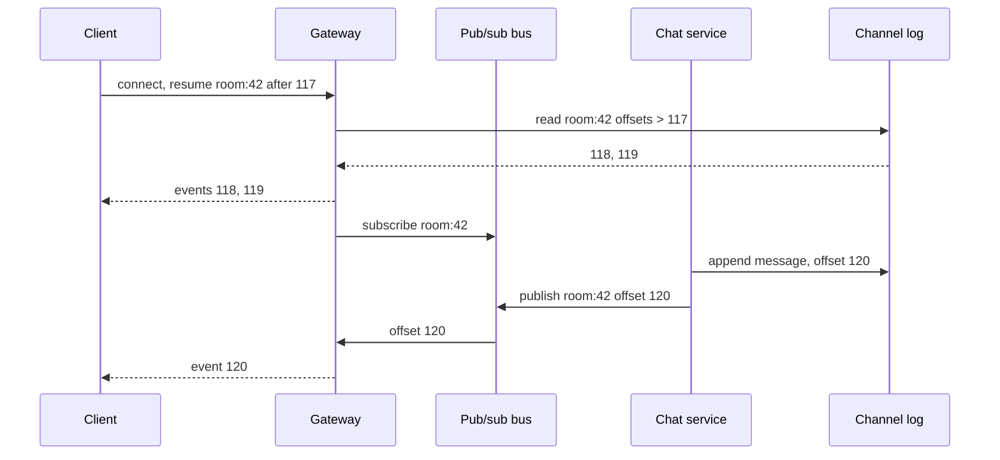

## In one minute
- HTTP is request and response, so the server cannot speak first. Real-time features need the server to push, over one of four transports: **short polling**, **long polling**, **Server-Sent Events (SSE)** or **WebSockets**.
- The transport is the easy part. The hard part is behind it: **connection gateways** holding millions of sockets, **routing** each event only to gateways with interested clients, and **presence**.
- Mobile connections drop constantly, so the real contract is **resume**: events carry offsets, the client reports the last one it saw, and the server replays the gap or says resync.
- Gateways hold sockets and subscriptions only; durable state lives in a log behind them.

## How it works

### The four transports
**Short polling**: the client asks "anything new?" every N seconds. Trivial, but latency averages N/2, and 1 million clients polling every 5 seconds make 200,000 mostly empty requests per second.

**Long polling**: the server holds each request open until there is data or a timeout of perhaps 30 seconds, and the client immediately asks again. Latency drops to one round trip and it works through any HTTP proxy, but each delivery costs a full request, and messages arriving between requests must be buffered. The IETF wrote these costs down in 2011, including proxies that buffer or time out held responses ([RFC 6202](https://www.rfc-editor.org/rfc/rfc6202)).

**Server-Sent Events**: one long-lived HTTP response with `Content-Type: text/event-stream`, onto which the server writes `data:` lines. It is one-way and text-only, and the browser's `EventSource` reconnects automatically, sending `Last-Event-ID` so the server can resume; a `204 No Content` reply tells it to stop retrying ([WHATWG HTML](https://html.spec.whatwg.org/multipage/server-sent-events.html)). Over HTTP/1.1 a browser allows only six such connections per domain across all tabs, so a seventh tab hangs; over HTTP/2 they are streams on one connection, and the stream limit is negotiated, typically 100 ([MDN](https://developer.mozilla.org/en-US/docs/Web/API/EventSource)).

**WebSockets**: an HTTP/1.1 request with `Upgrade: websocket` switches the connection to a framed, bidirectional protocol, suited to chat, games and collaborative editing. That upgrade is not the only way in any more: since 2018 a WebSocket can also run as one stream of an HTTP/2 connection using an extended `CONNECT` with `:protocol: websocket` ([RFC 8441](https://www.rfc-editor.org/rfc/rfc8441)), and the same trick was defined for HTTP/3 ([RFC 9220](https://www.rfc-editor.org/rfc/rfc9220)), so check what your proxies actually speak. It has no built-in resume or reconnect, so you build acknowledgements, backoff and offset tracking yourself.

A fifth option is arriving: **WebTransport** runs over HTTP/3 and QUIC, offers several streams plus unreliable datagrams, survives a switch from Wi-Fi to cellular, and became Baseline across major browsers in March 2026 ([MDN](https://developer.mozilla.org/en-US/docs/Web/API/WebTransport_API)). It suits games and live media more than chat, and many corporate networks still block UDP, so keep a WebSocket fallback.

A sensible default: SSE for server-to-client feeds, WebSockets when the client sends often, long polling as a fallback, plain polling when 30 seconds of delay is fine. Backgrounded mobile apps keep none of these alive, so use APNs or FCM as a wake-up signal.

### Connection gateways
A dedicated gateway tier terminates sockets. Each gateway holds hundreds of thousands of idle connections, authenticates once, and maps user or channel to connections. It does little else, so it can be deployed and drained independently of the services producing events. Slack is a public example: gateway servers hold WebSocket subscriptions and are the only tier spread across regions, while channel servers, placed by consistent hashing, own each channel's recent history and push to every subscribed gateway, for global delivery in about 500 ms ([Slack Engineering](https://slack.engineering/real-time-messaging/)).

### Routing events to the right gateway
Bob's socket lives on one of perhaps 200 gateways. How does a message reach it?

- **Broadcast**: every gateway gets every event and drops what it does not need. Fine small, wasteful large.
- **Registry lookup**: on connect, the gateway writes `user -> gateway_id` to a session registry (Redis with a TTL); producers look it up and publish to that gateway's topic. Precise, but a lookup per recipient.
- **Per-channel pub/sub**: each gateway subscribes to the channels its clients watch (`room:42`, `order:9001`) on Redis Pub/Sub or NATS, and unsubscribes when the last client leaves. Producers publish once per channel. This is the usual answer; the fanout lesson covers very large channels.

### Presence
Gateways heartbeat connected users into a presence store holding `user -> last_seen` with an expiry of, say, 60 seconds; online means a recent heartbeat. Presence changes are events fanned out only to contacts or room members, and throttled so a user flapping on a train does not broadcast 40 transitions a minute. Slack narrows it further: a client only receives presence for users currently visible on its screen ([Slack Engineering](https://slack.engineering/real-time-messaging/)).

### Reconnect and resume
Every event gets a monotonically increasing offset per channel. The client stores the highest offset it processed and sends it on reconnect; the server replays newer events from a bounded buffer (Redis Streams, Kafka or an in-memory ring). If the offset is older than the buffer, the server says "resync": the client refetches current state through a normal API call and continues from the latest offset. Reconnects use exponential backoff with jitter to avoid stampedes.

### How it shows up in interviews
Triggers: WhatsApp, Slack, live comments, driver tracking, Google Docs, auctions, notifications. A strong answer justifies the transport, separates gateways from business services, routes events to the right gateway, sizes connections, and resumes with offsets. Probes: a gateway dies, a user on three devices, deploying gateways, guaranteeing nothing is missed.

## Down the stack

### Layer 1: The contract
The socket promises nothing durable: a push is at most once, and a TCP write that succeeded locally may never reach a phone in a tunnel. The real contract comes from the log: every event is stored with an offset, delivered at least once to connected subscribers in offset order per channel, and recoverable after a disconnect if the gap fits the replay window. Clients de-duplicate by offset. Latency targets are typically a few hundred milliseconds.

### Layer 2: The mechanism
The WebSocket handshake ([RFC 6455](https://www.rfc-editor.org/rfc/rfc6455)) sends `Sec-WebSocket-Key`; the server answers `101 Switching Protocols` with `Sec-WebSocket-Accept`, the base64 SHA-1 of the key plus a fixed GUID. Frames carry a FIN bit, an opcode (text, binary, close, ping, pong), a mask bit and a 7, 16 or 64-bit length; client frames are XOR-masked with a 4-byte key to protect intermediaries from cache poisoning. SSE is simpler: `id:`, `event:`, `data:` and `retry:` lines, a blank line ending each event, with `id:` becoming the next `Last-Event-ID`. A gateway typically runs an event loop per core and keeps `channel -> set(connection)` with a reference count per channel to drive subscribe and unsubscribe.

### Layer 3: The machine
Each connection is a file descriptor and a kernel socket with buffers autotuned from `tcp_rmem` and `tcp_wmem`; idle sockets hold a few kilobytes, so 500,000 connections cost a few GB of kernel and application memory. `epoll_wait` returns only ready descriptors, at cost proportional to ready sockets rather than total, which is why one process can hold so many. Limits bite elsewhere: `ulimit -n`, and load balancers or NAT gateways capping flows or source ports. Proxy idle timeouts silently kill quiet connections: an AWS Application Load Balancer defaults to 60 seconds, and HTTP/2 PING frames do not reset it ([AWS](https://docs.aws.amazon.com/elasticloadbalancing/latest/application/edit-load-balancer-attributes.html)), so heartbeat with real data every 20 to 30 seconds. The SSE spec suggests a comment line about every 15 seconds for the same reason. Managed gateways add hard caps: an API Gateway WebSocket closes after 10 idle minutes and after 2 hours no matter what, with 32 KB frames ([AWS](https://docs.aws.amazon.com/apigateway/latest/developerguide/apigateway-execution-service-websocket-limits-table.html)), so resume is a routine path, not an edge case. Heartbeats drain mobile batteries, another reason background delivery uses APNs or FCM. A mass reconnect is a TLS handshake storm costing real CPU.

### Why it's built this way
HTTP cannot initiate from the server, so clients hold a connection open. Open connections are cheap in memory but tied to one machine, so a routing layer must find that machine. Machines and networks fail, so the socket cannot be the source of truth, and a durable log with offsets is. Logs cannot be kept forever, so the replay window is bounded, and clients outside it resync from current state. Reconnects arrive in bursts, so clients add jitter and servers drain gradually.

## Diagram


## Worked example
A food delivery app shows live courier location and order status. At dinner peak 2 million customers have the tracking screen open. Couriers send location every 4 seconds; 150,000 couriers are active.

Transport: customers only receive, so SSE over HTTP/2. Couriers send frequently, so their app uses a WebSocket.

Gateways: at a conservative 100,000 connections each, 2 million customers need 20 gateways, plus 30% spare: 26. At roughly 20 KB per connection including TLS state, that is about 2 GB per gateway.

Routing: each screen subscribes to `order:{id}`. Couriers send 37,500 updates per second, each published to one or two active orders, so about 50,000 publishes per second on a sharded NATS or Redis bus, usually reaching one gateway each.

Resume: each order channel keeps its last 50 events in a Redis Stream. A phone that switched networks resumes from offset 312 and gets 313 to 318; a customer back after an hour gets "resync" and reloads the order page.

Deploys: draining one gateway sends 100,000 clients to reconnect. With reconnect delay randomised between 0 and 10 seconds, the other gateways see about 10,000 new TLS handshakes per second in total, which they can absorb.

## In the wild
- **Discord, 2026: a scale-down starts a reconnect storm.** A config change that made session pods larger halved their number in one zone, and pods were killed before handing off, so 17% of sessions ended ungracefully. The reconnects hit an untuned rate limit and ran gateways out of memory, and voice and video were mostly down for about 3 hours 17 minutes. Discord added an admission webhook that blocks scale-down until pods drain, and retuned its rate limits ([Discord](https://discord.com/blog/behind-the-scenes-of-the-3-25-26-voice-outage)).
- **Shopify, 2022: from WebSocket plus polling to SSE.** The 2021 Black Friday live map pushed data over a WebSocket into a store that browsers polled every 10 seconds or more, and trending products could lag by minutes. The 2022 rebuild streamed from Kafka through a Go SSE server, reaching clients within milliseconds of the data being ready and within 21 seconds end to end ([Shopify Engineering](https://shopify.engineering/server-sent-events-data-streaming)).
- **Discord, 2017: fan-out to 30,000 sessions.** Each guild process sent every event to every connected session; at 30 to 70 microseconds per send, one publish to a 30,000-user guild took 0.9 to 2.1 seconds. Their Manifold library batches sends by destination node, where local workers deliver in order ([Discord](https://discord.com/blog/how-discord-scaled-elixir-to-5-000-000-concurrent-users)).

## Trade-offs
| Option | Strengths | Weaknesses | Choose when |
|---|---|---|---|
| Short polling | Simplest, cacheable, stateless | Latency of N/2, wasted requests | Updates every minute or so |
| Long polling | Works everywhere HTTP works | Request per message, buffering | Fallback, restrictive networks |
| SSE | Built-in reconnect and `Last-Event-ID`, plain HTTP | Server to client only, text | Feeds, notifications, dashboards |
| WebSockets | Bidirectional, low overhead per message | Custom resume, harder load balancing | Chat, games, collaboration |
| Mobile push (APNs, FCM) | Works when app is closed | Best effort, rate limited, payload limits | Background alerts and wake-ups |

## Pitfalls in production
- **Treating the socket as durable.** Messages pushed during a 3-second disconnect vanish. Persist first with an offset, then push, and replay on reconnect.
- **Reconnect storms.** A gateway crash makes every client reconnect at once. Add jittered backoff and drain gradually.
- **Silent idle timeouts.** A proxy drops idle connections after about a minute and neither side notices until the next send fails. Heartbeat below the shortest idle timeout on the path.
- **Leaking subscriptions.** Gateways that never unsubscribe receive traffic nobody watches. Reference-count subscriptions per channel.
- **Slow consumers.** One client on a bad network fills its send buffer, and the gateway buffers without bound. Cap per-connection queues and disconnect or drop to "resync" when exceeded.
- **Uneven gateways.** Connections pin to one gateway, so use least-connections balancing; a new gateway stays empty until clients reconnect.

## Leadership lens
- Ask "what does a client see after a 30-second disconnect, and after a 3-hour one?" The answers expose whether resume was designed or assumed.
- Gateways are shared infrastructure with a very large blast radius. Give them a single owning team, a slow and staged deploy process, and connection-count SLOs.
- Default to SSE or polling unless the product needs client-to-server streaming; WebSockets add operational cost that many features never use.
- Budget for connection count, not request rate: cost scales with concurrent users, and dinner peaks or live events set the bill.

## Check yourself
1. Why does a real-time system need offsets if TCP already guarantees ordered delivery?
   **Answer:** TCP only orders bytes within one connection. When the connection drops and a new one opens, possibly to another gateway, offsets tell the server exactly what the client missed.
2. When is SSE a better choice than WebSockets?
   **Answer:** When data flows mainly server to client: it is plain HTTP, works with existing proxies and HTTP/2 multiplexing, and has reconnect with `Last-Event-ID` built in.
3. Why do gateways subscribe per channel instead of receiving every event?
   **Answer:** Broadcasting every event to every gateway multiplies bus traffic by the gateway count; per-channel subscription delivers each event only where someone is listening.
4. What should the server do when a reconnecting client's offset is older than the replay buffer?
   **Answer:** Tell the client to resync: fetch current state through a normal read, then continue streaming from the latest offset.

## Practice
**Task:** Implement a per-channel replay buffer for resume. `ReplayLog(capacity)` keeps the most recent `capacity` events of each channel. `publish(channel, payload)` assigns the next offset for that channel (starting at 1), stores the event, evicts the oldest event if the channel holds more than `capacity`, and returns the offset. `resume(channel, last_seen)` returns all stored events with offset greater than `last_seen`, in order, as `(offset, payload)` pairs; it returns none (Python `None`, TypeScript `null`, Go `ok == false`) when the client must resync, which happens if events after `last_seen` were evicted or if `last_seen` is greater than the latest offset. Resuming an unknown channel from 0 returns an empty list.

```python starter
class ReplayLog:
    def __init__(self, capacity):
        # TODO
        raise NotImplementedError

    def publish(self, channel, payload):
        raise NotImplementedError

    def resume(self, channel, last_seen):
        raise NotImplementedError
```

```python tests
def test_offsets_per_channel():
    r = ReplayLog(10)
    assert r.publish("a", "x") == 1
    assert r.publish("a", "y") == 2
    assert r.publish("b", "z") == 1

def test_resume_returns_gap():
    r = ReplayLog(10)
    for p in ["m1", "m2", "m3"]:
        r.publish("room", p)
    assert r.resume("room", 1) == [(2, "m2"), (3, "m3")]

def test_resume_up_to_date_is_empty():
    r = ReplayLog(10)
    r.publish("room", "m1")
    assert r.resume("room", 1) == []

def test_gap_too_old_requires_resync():
    r = ReplayLog(2)
    for p in ["m1", "m2", "m3", "m4"]:
        r.publish("room", p)
    assert r.resume("room", 1) is None, "offset 2 was evicted"
    assert r.resume("room", 2) == [(3, "m3"), (4, "m4")]

def test_offset_from_future_requires_resync():
    r = ReplayLog(5)
    r.publish("room", "m1")
    assert r.resume("room", 7) is None

def test_unknown_channel():
    r = ReplayLog(3)
    assert r.resume("nope", 0) == []

def test_from_zero_after_eviction_requires_resync():
    r = ReplayLog(1)
    r.publish("c", "a"); r.publish("c", "b")
    assert r.resume("c", 0) is None
```

```python solution
from collections import deque

class ReplayLog:
    def __init__(self, capacity):
        self.capacity = capacity
        self.events = {}
        self.latest = {}

    def publish(self, channel, payload):
        off = self.latest.get(channel, 0) + 1
        self.latest[channel] = off
        q = self.events.setdefault(channel, deque())
        q.append((off, payload))
        while len(q) > self.capacity:
            q.popleft()
        return off

    def resume(self, channel, last_seen):
        latest = self.latest.get(channel, 0)
        if last_seen > latest:
            return None
        q = self.events.get(channel, deque())
        if q and q[0][0] > last_seen + 1:
            return None
        return [e for e in q if e[0] > last_seen]
```

```typescript starter
export class ReplayLog {
  constructor(capacity: number) {}
  publish(channel: string, payload: string): number {
    throw new Error("TODO");
  }
  resume(channel: string, lastSeen: number): [number, string][] | null {
    throw new Error("TODO");
  }
}
```

```typescript tests
test("offsets per channel", () => {
  const r = new ReplayLog(10);
  assertEqual(r.publish("a", "x"), 1);
  assertEqual(r.publish("a", "y"), 2);
  assertEqual(r.publish("b", "z"), 1);
});
test("resume returns gap", () => {
  const r = new ReplayLog(10);
  for (const p of ["m1", "m2", "m3"]) r.publish("room", p);
  assertEqual(r.resume("room", 1), [[2, "m2"], [3, "m3"]]);
});
test("resume up to date is empty", () => {
  const r = new ReplayLog(10);
  r.publish("room", "m1");
  assertEqual(r.resume("room", 1), []);
});
test("gap too old requires resync", () => {
  const r = new ReplayLog(2);
  for (const p of ["m1", "m2", "m3", "m4"]) r.publish("room", p);
  assert(r.resume("room", 1) === null, "offset 2 was evicted");
  assertEqual(r.resume("room", 2), [[3, "m3"], [4, "m4"]]);
});
test("offset from future requires resync", () => {
  const r = new ReplayLog(5);
  r.publish("room", "m1");
  assert(r.resume("room", 7) === null, "future offset");
});
test("unknown channel", () => {
  const r = new ReplayLog(3);
  assertEqual(r.resume("nope", 0), []);
});
test("from zero after eviction requires resync", () => {
  const r = new ReplayLog(1);
  r.publish("c", "a"); r.publish("c", "b");
  assert(r.resume("c", 0) === null, "offset 1 evicted");
});
```

```typescript solution
export class ReplayLog {
  private events = new Map<string, [number, string][]>();
  private latest = new Map<string, number>();
  constructor(private capacity: number) {}
  publish(channel: string, payload: string): number {
    const off = (this.latest.get(channel) ?? 0) + 1;
    this.latest.set(channel, off);
    let q = this.events.get(channel);
    if (!q) { q = []; this.events.set(channel, q); }
    q.push([off, payload]);
    while (q.length > this.capacity) q.shift();
    return off;
  }
  resume(channel: string, lastSeen: number): [number, string][] | null {
    const latest = this.latest.get(channel) ?? 0;
    if (lastSeen > latest) return null;
    const q = this.events.get(channel) ?? [];
    if (q.length > 0 && q[0][0] > lastSeen + 1) return null;
    return q.filter((e) => e[0] > lastSeen);
  }
}
```

```go starter
package practice

import "sync"

// Event is one stored message with its channel offset.
type Event struct {
	Offset  int
	Payload string
}

// ReplayLog keeps a bounded per-channel history for resume. Safe for concurrent use.
type ReplayLog struct {
	mu sync.Mutex
}

func NewReplayLog(capacity int) *ReplayLog { return &ReplayLog{} }

func (r *ReplayLog) Publish(channel, payload string) int { panic("TODO") }

// Resume returns events after lastSeen; ok is false when the client must resync.
func (r *ReplayLog) Resume(channel string, lastSeen int) ([]Event, bool) { panic("TODO") }
```

```go tests
package practice

import (
	"reflect"
	"testing"
)

func TestOffsetsPerChannel(t *testing.T) {
	r := NewReplayLog(10)
	if r.Publish("a", "x") != 1 || r.Publish("a", "y") != 2 || r.Publish("b", "z") != 1 {
		t.Fatal("offsets must start at 1 per channel")
	}
}

func TestResumeGap(t *testing.T) {
	r := NewReplayLog(10)
	for _, p := range []string{"m1", "m2", "m3"} {
		r.Publish("room", p)
	}
	got, ok := r.Resume("room", 1)
	if !ok || !reflect.DeepEqual(got, []Event{{2, "m2"}, {3, "m3"}}) {
		t.Fatalf("got %v %v", got, ok)
	}
}

func TestUpToDate(t *testing.T) {
	r := NewReplayLog(10)
	r.Publish("room", "m1")
	got, ok := r.Resume("room", 1)
	if !ok || len(got) != 0 {
		t.Fatalf("got %v %v", got, ok)
	}
}

func TestTooOld(t *testing.T) {
	r := NewReplayLog(2)
	for _, p := range []string{"m1", "m2", "m3", "m4"} {
		r.Publish("room", p)
	}
	if _, ok := r.Resume("room", 1); ok {
		t.Fatal("offset 2 was evicted, expected resync")
	}
	got, ok := r.Resume("room", 2)
	if !ok || !reflect.DeepEqual(got, []Event{{3, "m3"}, {4, "m4"}}) {
		t.Fatalf("got %v %v", got, ok)
	}
}

func TestFutureOffset(t *testing.T) {
	r := NewReplayLog(5)
	r.Publish("room", "m1")
	if _, ok := r.Resume("room", 7); ok {
		t.Fatal("future offset must resync")
	}
}

func TestUnknownChannel(t *testing.T) {
	r := NewReplayLog(3)
	got, ok := r.Resume("nope", 0)
	if !ok || len(got) != 0 {
		t.Fatalf("got %v %v", got, ok)
	}
}

func TestZeroAfterEviction(t *testing.T) {
	r := NewReplayLog(1)
	r.Publish("c", "a")
	r.Publish("c", "b")
	if _, ok := r.Resume("c", 0); ok {
		t.Fatal("offset 1 evicted, expected resync")
	}
}
```

```go solution
package practice

import "sync"

// Event is one stored message with its channel offset.
type Event struct {
	Offset  int
	Payload string
}

// ReplayLog keeps a bounded per-channel history for resume. Safe for concurrent use.
type ReplayLog struct {
	mu       sync.Mutex
	capacity int
	events   map[string][]Event
	latest   map[string]int
}

func NewReplayLog(capacity int) *ReplayLog {
	return &ReplayLog{capacity: capacity, events: map[string][]Event{}, latest: map[string]int{}}
}

func (r *ReplayLog) Publish(channel, payload string) int {
	r.mu.Lock()
	defer r.mu.Unlock()
	off := r.latest[channel] + 1
	r.latest[channel] = off
	q := append(r.events[channel], Event{off, payload})
	if len(q) > r.capacity {
		q = append([]Event{}, q[len(q)-r.capacity:]...)
	}
	r.events[channel] = q
	return off
}

// Resume returns events after lastSeen; ok is false when the client must resync.
func (r *ReplayLog) Resume(channel string, lastSeen int) ([]Event, bool) {
	r.mu.Lock()
	defer r.mu.Unlock()
	if lastSeen > r.latest[channel] {
		return nil, false
	}
	q := r.events[channel]
	if len(q) > 0 && q[0].Offset > lastSeen+1 {
		return nil, false
	}
	out := []Event{}
	for _, e := range q {
		if e.Offset > lastSeen {
			out = append(out, e)
		}
	}
	return out, true
}
```

## Mock interview
**Prompt:** Design the real-time layer for a team chat product with 20 million daily users, 8 million connected at peak, channels from 2 to 50,000 members, and messages delivered to online members within 500 ms.

- Follow-up: A gateway holding 300,000 connections crashes. Walk through what each affected client experiences and what load the rest of the system sees.
- Follow-up: A user has the desktop app, a browser tab and a phone open. How does each device get each message exactly once from the user's point of view?
- Follow-up: Would you use WebSockets or SSE plus HTTP POST for sending, and why?

**A strong answer covers:**
- Connection sizing: 8 million connections over gateways of roughly 100,000 to 300,000 each, with spare capacity for failover and deploys.
- Persist first with a per-channel offset, then publish to a pub/sub bus where gateways subscribe per channel, with reference-counted subscriptions.
- Resume by last offset with a bounded replay window and a resync path; client de-duplication by offset across devices.
- Jittered reconnect, gradual gateway draining, heartbeats under proxy idle timeouts, and bounded per-connection send queues.
- Presence via heartbeats with expiry, throttled presence fan-out, and mobile push for offline devices.

## Sources and further study
**Primary**
- [RFC 8441: Bootstrapping WebSockets with HTTP/2](https://www.rfc-editor.org/rfc/rfc8441): extended `CONNECT` and the `SETTINGS_ENABLE_CONNECT_PROTOCOL` setting.
- [RFC 9220: Bootstrapping WebSockets with HTTP/3](https://www.rfc-editor.org/rfc/rfc9220): the same mechanism carried over QUIC streams.

**Systems docs**
- [Amazon API Gateway: WebSocket quotas](https://docs.aws.amazon.com/apigateway/latest/developerguide/apigateway-execution-service-websocket-limits-table.html): idle timeout, two-hour cap, frame size and new-connection rate.
- [AWS: Application Load Balancer attributes](https://docs.aws.amazon.com/elasticloadbalancing/latest/application/edit-load-balancer-attributes.html): idle timeout and client keepalive settings that end long-lived connections.
- [MDN: WebTransport API](https://developer.mozilla.org/en-US/docs/Web/API/WebTransport_API): streams and datagrams over HTTP/3, and browser support.

**Books**
- *High Performance Browser Networking*, Ilya Grigorik, chapters 16 "Server-Sent Events" and 17 "WebSocket" ([free online](https://hpbn.co/websocket/)): the protocols and their performance costs.
- *System Design Interview Vol. 1*, Alex Xu, chapter 12 "Design A Chat System": WebSocket servers, service discovery and online presence.

**Other curricula**
- [donnemartin/system-design-primer](https://github.com/donnemartin/system-design-primer): covers TCP, UDP, RPC and REST under communication, but not push transports; useful only as background.
- [Azure Architecture Center: Publisher-Subscriber pattern](https://learn.microsoft.com/en-us/azure/architecture/patterns/publisher-subscriber): frames the routing layer as asynchronous pub/sub with topic-based filtering, independent of transport.

## Watch
- [WebSockets Crash Course - Handshake, Use-cases, Pros & Cons and more (Hussein Nasser)](https://www.youtube.com/watch?v=2Nt-ZrNP22A): the upgrade handshake, a working server and when not to use WebSockets.
- [Server-Sent Events Crash Course (Hussein Nasser)](https://www.youtube.com/watch?v=4HlNv1qpZFY): builds an SSE server and client and compares it with polling and WebSockets.
- [Load balancing WebSockets Streams efficiently (Hussein Nasser)](https://www.youtube.com/watch?v=ugAZsDdmwJQ): what long-lived connections do to load balancers and how to cope.

## Free resources
- [RFC 6455: The WebSocket Protocol (IETF)](https://www.rfc-editor.org/rfc/rfc6455): the handshake, framing, masking and close semantics.
- [Server-sent events (WHATWG HTML Standard)](https://html.spec.whatwg.org/multipage/server-sent-events.html): the event stream format, `Last-Event-ID` and reconnection rules.
- [RFC 6202: Known Issues and Best Practices for Long Polling and Streaming (IETF)](https://www.rfc-editor.org/rfc/rfc6202): the trade-offs of HTTP-based push before WebSockets.
- [Real-time messaging at Slack (Slack Engineering)](https://slack.engineering/real-time-messaging/): gateway servers, channel servers and fan-out in a production chat system.
- [How Discord scaled Elixir to 5,000,000 concurrent users (Discord)](https://discord.com/blog/how-discord-scaled-elixir-to-5-000-000-concurrent-users): fan-out of guild events to many sessions and the bottlenecks they hit.
