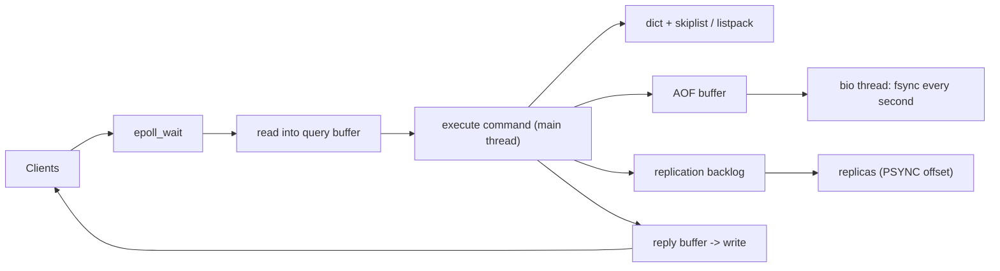

## In one minute
- Redis is an in-memory data structure server: strings, hashes, lists, sets, sorted sets and streams, each with atomic server-side operations answered in well under a millisecond.
- Commands execute on one main thread. Every command is atomic without locks, and one slow command (`KEYS *`, a huge `ZRANGE`) stalls every client.
- Durability is a dial: RDB snapshots via `fork()`, an append-only file fsynced every write or every second, or nothing. Replication is asynchronous, so failover can lose acknowledged writes.
- Choose it for caches, rate limiters, leaderboards, sessions and counters. Do not make it the only copy of data you cannot lose.

## How it works

### Data structures as the API
Redis stores a data structure under each key and offers operations on it: `INCR`, `HINCRBY`, `LPUSH`/`BRPOP`, `SINTER`, `ZADD`/`ZRANGE`, `XADD`/`XREADGROUP`. Because the server owns the structure, a leaderboard update is one atomic round trip rather than read, sort and write. Redis 8 (May 2025) folded the old Redis Stack modules into the core server, so JSON, time series, probabilistic structures, the query engine and the new vector sets ship with it.

### One thread runs the commands
The server is an event loop: wait for ready sockets, read bytes, parse complete commands, execute each to completion, queue replies. Nothing interleaves, so `MULTI`/`EXEC` blocks and Lua scripts are atomic. Throughput per instance is bounded by one core, and everyone's latency by the slowest queued command.

### Expiry, eviction, persistence, sharding
Keys with a TTL are deleted lazily on access and by a sampling background cycle. At `maxmemory`, `maxmemory-policy` either refuses writes (`noeviction`, the default per [redis.conf](https://github.com/redis/redis/blob/unstable/redis.conf)) or evicts by approximate LRU, LFU, random, nearest TTL or, since 8.6, least recently modified. "Approximate" means Redis samples a handful of keys (`maxmemory-samples`, default 5) and evicts the best candidate from a small pool, rather than keeping a true LRU list ([Redis docs](https://redis.io/docs/latest/develop/reference/eviction/)). RDB writes point-in-time snapshots; AOF logs every write for replay. Replicas stream writes from a primary, and Sentinel or Cluster promotes one on failure. Redis Cluster maps each key to one of 16,384 slots with `CRC16(key) mod 16384` ([cluster spec](https://redis.io/docs/latest/operate/oss_and_stack/reference/cluster-spec/)); hash tags (`{user42}`) pin related keys to one slot so multi-key commands work.

## Down the stack

### Layer 1: The contract
A command is atomic and linearizable on its primary. Across failover that weakens: a write acknowledged by the primary may not have reached any replica. `WAIT numreplicas timeout` blocks until N replicas acknowledge the replication offset, shrinking the loss window, but the docs are explicit that it does not make Redis a CP system and acknowledged writes can still be lost in a failover ([Redis docs](https://redis.io/docs/latest/operate/oss_and_stack/management/replication/)). `WAITAOF numlocal numreplicas timeout` (7.2+) goes one step further and waits until the write is fsynced to the AOF locally and on N replicas, with the same caveat ([Redis docs](https://redis.io/docs/latest/commands/waitaof/)). Single-node durability follows `appendfsync`: `always` loses nothing acknowledged at a heavy throughput cost, `everysec` (the default) can lose about a second of writes, `no` leaves it to kernel writeback, normally every 30 seconds on Linux ([Redis docs](https://redis.io/docs/latest/operate/oss_and_stack/management/persistence/)). If the disk stalls, Redis delays the next `write` up to two seconds before writing anyway, so a slow disk turns into latency as well as risk ([Redis latency guide](https://redis.io/docs/latest/operate/oss_and_stack/management/optimization/latency/)). Server time for simple commands is tens of microseconds; clients see RTT plus queueing, typically 0.2 to 1 ms within one zone.

### Layer 2: The mechanism
**Encodings.** Small values use compact encodings. A sorted set with at most `zset-max-listpack-entries` (128) members of at most `zset-max-listpack-value` (64) bytes is a listpack: one contiguous byte array of member, score pairs, scanned linearly. Larger sets convert to a hash table plus a skip list. The dict gives O(1) `ZSCORE`; the skip list orders by (score, member). Each forward pointer stores a `span`, the number of elements it skips, so summing spans along the search path yields rank, which keeps `ZRANK` and `ZRANGE` logarithmic. Node levels grow with probability 0.25, capped at 32.

**Keyspace.** Each database is a `dict` with incremental rehashing: on growth, a few buckets move per operation and per cron tick, so no command pays for a full rehash.

**RDB and AOF.** `BGSAVE` forks; the child serialises every key (type byte, length-prefixed key, encoded value, expiry) while the parent serves traffic under copy-on-write. AOF appends each write in RESP form to a buffer flushed before the loop sleeps and fsynced by a background (`bio`) thread. Since 7.0 the AOF is multi-part (base file, incremental files, manifest), so a rewrite no longer splices in writes buffered during it.

**Replication.** A primary has a replication ID, a byte offset, and a circular backlog (`repl-backlog-size`, default 1 MB, allocated only once a replica connects). A reconnecting replica sends `PSYNC <replid> <offset>`. If the offset is still in the backlog, the primary replies `+CONTINUE` and streams the gap; otherwise `+FULLRESYNC`, a forked RDB transfer, then buffered commands. Replicas report offsets each second with `REPLCONF ACK`.

**Cluster.** Nodes gossip `PING`/`PONG` on a bus port (client port + 10,000 unless `cluster-port` overrides it) carrying slot ownership and failure flags. When a majority of primaries mark one as failed, its replicas hold an election and the winner claims the slots under a higher config epoch. During resharding, `MIGRATE` moves keys and clients get `ASK` redirects.

### Layer 3: The machine
The loop blocks in `epoll_wait`, then `read`s ready sockets into query buffers. With pipelining one `read` carries hundreds of commands, and throughput climbs almost linearly with pipeline depth to about 10 times the unpipelined rate, because syscalls and context switches dominate, not the hash lookup ([Redis docs](https://redis.io/docs/latest/develop/using-commands/pipelining/)). `io-threads` (6.0+, off by default) moves socket reads, writes and parsing to helper threads while execution stays single-threaded. Valkey 8 reworked this so I/O threads also take over `epoll_wait`; on a c7g.16xlarge with 8 I/O threads and 650 clients, unpipelined `SET` throughput rose from 360,000 to 1.19 million per second ([Valkey](https://valkey.io/blog/unlock-one-million-rps/)).

`fork()` copies page tables, not data. A 24 GB heap with 4 KB pages needs about 48 MB of page table, and copying it blocks the main thread. Redis's own measurements put this at roughly 9 to 13 ms per GB on physical hosts and VMware, but 239 ms per GB on old Xen-based EC2 instances ([Redis latency guide](https://redis.io/docs/latest/operate/oss_and_stack/management/optimization/latency/)), so a 25 GB node can stall for a quarter of a second or for several seconds depending on where it runs. With transparent huge pages, each post-fork write copies 2 MB instead of 4 KB, so disable THP. Write-heavy load during `BGSAVE` can nearly double resident memory. Memory comes from jemalloc; `activedefrag` fights fragmentation, and `UNLINK` or `lazyfree-lazy-eviction yes` frees large values on a background thread instead of blocking for hundreds of milliseconds.

### Why it's built this way
1. RAM access is about 100 ns and a network round trip about 100 us, so the network, not the CPU, bounds a memory store; one thread can saturate it for small commands.
2. One thread means no locks, so structures stay simple and cache-friendly and every command is atomic for free.
3. Memory is expensive per byte, so small values use listpacks, trading O(n) scans over tiny n for fewer pointers.
4. An `fsync` costs 0.1 to 10 ms, hundreds of times the command itself, so durability is opt-in.
5. Scaling past one core means many single-threaded shards, so the cluster uses static slots and client-side routing instead of a coordinator hop.

## Diagram


## Worked example
A game needs a global leaderboard for 20 million players with 50,000 score updates and 30,000 "my rank and 10 neighbours" reads per second.

One sorted set holds every player. At roughly 80 to 100 bytes per member with a 16-byte ID (hedge: measure with `MEMORY USAGE`), that is about 2 GB. `ZADD` and `ZREVRANK` each walk about 25 skip-list levels, a few microseconds. A read pipelines `ZREVRANK` then `ZREVRANGE rank-5 rank+5 WITHSCORES` in one round trip.

That is 110,000 commands per second on one key, so one core of one shard: feasible with pipelining and `io-threads`, but with little headroom. Reads go to a replica (milliseconds stale is fine), and authoritative scores live in a durable database so the set can be rebuilt in minutes. At 10x, split into score bands with a count per band; global rank is the sum of higher bands' counts plus rank within the band.

## In the wild
- **Twilio, 2013: a read-only Redis master double-charges customers.** On 18 July a network blip made the billing replicas resync at once. A misdiagnosed restart of the master loaded a bad config, tried to recover from an AOF that did not exist, and left the master read-only with balances at zero. Auto-recharge then charged cards but could not record the new balance, so it charged again; 1.4% of customers were hit. Twilio stopped in-place master restarts and made billing refuse to charge when a balance is missing or unwritable ([Twilio](https://www.twilio.com/en-us/blog/company/communications/billing-incident-post-mortem-breakdown-analysis-and-root-cause-html)).
- **Slack, about 2016: a Redis job queue fills up and cannot drain.** Database contention slowed job workers until the Redis queue hit its memory limit. New jobs were refused, and dequeuing also needed spare memory to move a job onto an in-flight list, so the queue stayed stuck after the database recovered. At 1.4 billion jobs a day (33,000 per second at peak), Slack put Kafka in front of Redis as a durable buffer ([Slack](https://slack.engineering/scaling-slacks-job-queue/)).
- **Salesforce, 2026: hot keys pin single shards during a Memcached-to-Redis move.** Migrating about 1.5 million cache events per second to Redis Cluster exposed keys hot enough to saturate one shard's command thread. Read replicas were a stopgap; the fix was a local in-process cache in front of Redis for those keys, plus planned count-min-sketch detection ([Salesforce](https://engineering.salesforce.com/migration-at-scale-moving-marketing-cloud-caching-from-memcached-to-redis-at-1-5m-rps-without-downtime/)).

## Trade-offs
| Option | Strengths | Weaknesses | Choose when |
|---|---|---|---|
| Redis, no persistence | Fastest, simplest, cheap ops | Data gone on restart | Pure cache that can be refilled |
| Redis with AOF everysec + replica | Sub-ms, rich structures, survives restarts | Can lose about a second, or more on failover | Sessions, rate limits, leaderboards |
| Memcached | Multithreaded, simple, predictable memory | Only strings, no persistence or replication | Large flat cache on big multi-core boxes |
| DynamoDB or Cassandra | Durable, horizontally scalable writes | Single-digit ms latency, fewer server-side structures | Data that must not be lost |
| Postgres | Transactions, durability, SQL | 10x higher latency for hot counters, harder to scale writes | System of record |

## Pitfalls in production
- **Slow commands stall everyone.** `KEYS *`, `SMEMBERS` on huge sets, `DEL` of a giant hash. Use `SCAN`, `UNLINK`, and watch `SLOWLOG`.
- **Fork at peak.** `BGSAVE` or AOF rewrite on a large write-heavy node spikes latency and memory. Disable THP, keep headroom, snapshot on a replica.
- **Hot keys.** One key pins one shard's core. Split it under several names or add a client-side cache.
- **Loss on failover.** Use `min-replicas-to-write` and `WAIT` for important writes; keep money elsewhere.
- **`noeviction` on a cache.** Writes fail with OOM when full. Use `allkeys-lru` or `allkeys-lfu` and alert on `evicted_keys`.
- **Mass expiry in one second.** The active expire cycle repeats while more than 25 percent of sampled keys are expired, so millions of keys set with the same `EXPIREAT` can block the server. Add jitter to TTLs ([Redis latency guide](https://redis.io/docs/latest/operate/oss_and_stack/management/optimization/latency/)).

## Leadership lens
- Ask "what happens if this Redis is empty?" If the answer is data loss, the design treats a cache as a database.
- Decide durability per use case (`appendfsync`, replicas, `WAIT`) and write it down.
- Managed offerings remove failover toil; MemoryDB adds a durable multi-AZ log if Redis must be primary storage.
- Redis moved to RSALv2/SSPLv1 in March 2024, cloud providers backed the BSD-licensed Valkey fork, and Redis 8 added AGPLv3 as a third option in May 2025 ([Redis](https://redis.io/blog/agplv3/)). Check which one your platform team and cloud provider actually run.
- Budget 1.5 to 2 times dataset size for copy-on-write, fragmentation and replication buffers.

## Check yourself
1. Why can a single-threaded Redis serve more than 100,000 operations per second?
   **Answer:** Each command costs microseconds in memory; the real cost is syscalls and network, which pipelining and I/O threads amortise, and there is no lock contention.
2. A `SET` returned `OK`, the primary crashed, and after failover the value is gone. Why, and how do you reduce the risk?
   **Answer:** Replication is asynchronous, so the promoted replica never received it. `WAIT` and `min-replicas-to-write` shrink the window but cannot close it.
3. Why does a large sorted set keep both a skip list and a hash table?
   **Answer:** The hash table answers member-to-score in O(1); the skip list with spans keeps order for O(log n) rank and range queries.
4. Why should transparent huge pages be off on a Redis host?
   **Answer:** After `fork()`, each write copies a whole page; 2 MB pages multiply copy-on-write memory and latency compared with 4 KB pages.

## Practice
**Task:** Implement Redis sorted-set semantics. `zadd(member, score)` returns 1 if new, 0 if it only updated the score. Order is by score, ties by member string. `zrank(member)` returns the 0-based rank or `None`/`null`/`-1` (Go) when absent. `zrange(start, stop)` returns `(member, score)` pairs for ranks `start..stop` inclusive, where negative indices count from the end (-1 is the last), out-of-range indices are clamped, and an empty range returns an empty list, exactly like `ZRANGE`. Also implement `zrem`, `zscore`, `zcard` and `zrangebyscore(min, max)` (inclusive, returns members). A skip list is what Redis uses; a sorted array with binary search is acceptable here.

```python starter
class SortedSet:
    def __init__(self):
        # TODO
        pass

    def zadd(self, member, score):
        raise NotImplementedError

    def zrem(self, member):
        raise NotImplementedError

    def zscore(self, member):
        raise NotImplementedError

    def zcard(self):
        raise NotImplementedError

    def zrank(self, member):
        raise NotImplementedError

    def zrange(self, start, stop):
        raise NotImplementedError

    def zrangebyscore(self, lo, hi):
        raise NotImplementedError
```

```python tests
def test_add_new_and_update():
    z = SortedSet()
    assert z.zadd("alice", 10) == 1
    assert z.zadd("alice", 20) == 0
    assert z.zscore("alice") == 20 and z.zcard() == 1

def test_order_with_ties_by_member():
    z = SortedSet()
    for m, s in [("carol", 5), ("bob", 5), ("dave", 1), ("alice", 9)]:
        z.zadd(m, s)
    assert [m for m, _ in z.zrange(0, -1)] == ["dave", "bob", "carol", "alice"]
    assert z.zrank("carol") == 2 and z.zrank("nobody") is None

def test_negative_and_clamped_indices():
    z = SortedSet()
    for i, m in enumerate("abcde"):
        z.zadd(m, i)
    assert z.zrange(-2, -1) == [("d", 3), ("e", 4)]
    assert z.zrange(3, 100) == [("d", 3), ("e", 4)]
    assert z.zrange(-100, 0) == [("a", 0)]
    assert z.zrange(4, 2) == []
    assert z.zrange(10, 20) == []

def test_update_moves_member():
    z = SortedSet()
    z.zadd("a", 1); z.zadd("b", 2); z.zadd("c", 3)
    z.zadd("a", 10)
    assert z.zrank("a") == 2 and z.zrank("b") == 0

def test_zrem():
    z = SortedSet()
    z.zadd("a", 1); z.zadd("b", 2)
    assert z.zrem("a") == 1 and z.zrem("a") == 0
    assert z.zrange(0, -1) == [("b", 2)] and z.zscore("a") is None

def test_rangebyscore_inclusive():
    z = SortedSet()
    for m, s in [("a", 1), ("b", 2), ("c", 2), ("d", 3), ("e", 4)]:
        z.zadd(m, s)
    assert z.zrangebyscore(2, 3) == ["b", "c", "d"]
    assert z.zrangebyscore(5, 9) == []

def test_empty_set():
    z = SortedSet()
    assert z.zrange(0, -1) == [] and z.zcard() == 0
```

```python solution
import bisect

class SortedSet:
    def __init__(self):
        self.scores = {}
        self.order = []  # sorted list of (score, member)

    def zadd(self, member, score):
        old = self.scores.get(member)
        if old is not None:
            self.order.pop(bisect.bisect_left(self.order, (old, member)))
        bisect.insort(self.order, (score, member))
        self.scores[member] = score
        return 0 if old is not None else 1

    def zrem(self, member):
        if member not in self.scores:
            return 0
        score = self.scores.pop(member)
        self.order.pop(bisect.bisect_left(self.order, (score, member)))
        return 1

    def zscore(self, member):
        return self.scores.get(member)

    def zcard(self):
        return len(self.order)

    def zrank(self, member):
        if member not in self.scores:
            return None
        return bisect.bisect_left(self.order, (self.scores[member], member))

    def zrange(self, start, stop):
        n = len(self.order)
        if start < 0:
            start = max(n + start, 0)
        if stop < 0:
            stop = n + stop
        stop = min(stop, n - 1)
        if start > stop or start >= n:
            return []
        return [(m, s) for s, m in self.order[start:stop + 1]]

    def zrangebyscore(self, lo, hi):
        out = []
        i = bisect.bisect_left(self.order, (lo, ""))
        while i < len(self.order) and self.order[i][0] <= hi:
            out.append(self.order[i][1])
            i += 1
        return out
```

```typescript starter
export class SortedSet {
  zadd(member: string, score: number): number {
    throw new Error("TODO");
  }
  zrem(member: string): number {
    throw new Error("TODO");
  }
  zscore(member: string): number | null {
    throw new Error("TODO");
  }
  zcard(): number {
    throw new Error("TODO");
  }
  zrank(member: string): number | null {
    throw new Error("TODO");
  }
  zrange(start: number, stop: number): [string, number][] {
    throw new Error("TODO");
  }
  zrangebyscore(lo: number, hi: number): string[] {
    throw new Error("TODO");
  }
}
```

```typescript tests
test("add new and update", () => {
  const z = new SortedSet();
  assertEqual(z.zadd("alice", 10), 1);
  assertEqual(z.zadd("alice", 20), 0);
  assertEqual([z.zscore("alice"), z.zcard()], [20, 1]);
});
test("order with ties by member", () => {
  const z = new SortedSet();
  z.zadd("carol", 5); z.zadd("bob", 5); z.zadd("dave", 1); z.zadd("alice", 9);
  assertEqual(z.zrange(0, -1).map((p) => p[0]), ["dave", "bob", "carol", "alice"]);
  assertEqual(z.zrank("carol"), 2);
  assertEqual(z.zrank("nobody"), null);
});
test("negative and clamped indices", () => {
  const z = new SortedSet();
  ["a", "b", "c", "d", "e"].forEach((m, i) => z.zadd(m, i));
  assertEqual(z.zrange(-2, -1), [["d", 3], ["e", 4]]);
  assertEqual(z.zrange(3, 100), [["d", 3], ["e", 4]]);
  assertEqual(z.zrange(-100, 0), [["a", 0]]);
  assertEqual(z.zrange(4, 2), []);
  assertEqual(z.zrange(10, 20), []);
});
test("update moves member", () => {
  const z = new SortedSet();
  z.zadd("a", 1); z.zadd("b", 2); z.zadd("c", 3);
  z.zadd("a", 10);
  assertEqual([z.zrank("a"), z.zrank("b")], [2, 0]);
});
test("zrem", () => {
  const z = new SortedSet();
  z.zadd("a", 1); z.zadd("b", 2);
  assertEqual([z.zrem("a"), z.zrem("a")], [1, 0]);
  assertEqual(z.zrange(0, -1), [["b", 2]]);
  assertEqual(z.zscore("a"), null);
});
test("rangebyscore inclusive", () => {
  const z = new SortedSet();
  z.zadd("a", 1); z.zadd("b", 2); z.zadd("c", 2); z.zadd("d", 3); z.zadd("e", 4);
  assertEqual(z.zrangebyscore(2, 3), ["b", "c", "d"]);
  assertEqual(z.zrangebyscore(5, 9), []);
});
test("empty set", () => {
  const z = new SortedSet();
  assertEqual(z.zrange(0, -1), []);
  assertEqual(z.zcard(), 0);
});
```

```typescript solution
export class SortedSet {
  private scores = new Map<string, number>();
  private order: [number, string][] = [];

  private less(a: [number, string], b: [number, string]): boolean {
    return a[0] < b[0] || (a[0] === b[0] && a[1] < b[1]);
  }
  private lowerBound(key: [number, string]): number {
    let lo = 0, hi = this.order.length;
    while (lo < hi) {
      const mid = (lo + hi) >> 1;
      if (this.less(this.order[mid], key)) lo = mid + 1; else hi = mid;
    }
    return lo;
  }
  zadd(member: string, score: number): number {
    const old = this.scores.get(member);
    if (old !== undefined) this.order.splice(this.lowerBound([old, member]), 1);
    this.order.splice(this.lowerBound([score, member]), 0, [score, member]);
    this.scores.set(member, score);
    return old === undefined ? 1 : 0;
  }
  zrem(member: string): number {
    const s = this.scores.get(member);
    if (s === undefined) return 0;
    this.scores.delete(member);
    this.order.splice(this.lowerBound([s, member]), 1);
    return 1;
  }
  zscore(member: string): number | null {
    const s = this.scores.get(member);
    return s === undefined ? null : s;
  }
  zcard(): number {
    return this.order.length;
  }
  zrank(member: string): number | null {
    const s = this.scores.get(member);
    return s === undefined ? null : this.lowerBound([s, member]);
  }
  zrange(start: number, stop: number): [string, number][] {
    const n = this.order.length;
    if (start < 0) start = Math.max(n + start, 0);
    if (stop < 0) stop = n + stop;
    stop = Math.min(stop, n - 1);
    if (start > stop || start >= n) return [];
    return this.order.slice(start, stop + 1).map(([s, m]) => [m, s] as [string, number]);
  }
  zrangebyscore(lo: number, hi: number): string[] {
    const out: string[] = [];
    for (let i = this.lowerBound([lo, ""]); i < this.order.length && this.order[i][0] <= hi; i++) {
      out.push(this.order[i][1]);
    }
    return out;
  }
}
```

```go starter
package practice

// Pair is one (member, score) entry returned by ZRange.
type Pair struct {
	Member string
	Score  float64
}

type SortedSet struct{}

func NewSortedSet() *SortedSet { return &SortedSet{} }

func (z *SortedSet) ZAdd(member string, score float64) int { panic("TODO") }

func (z *SortedSet) ZRem(member string) int { panic("TODO") }

// ZScore returns the score and whether the member exists.
func (z *SortedSet) ZScore(member string) (float64, bool) { panic("TODO") }

func (z *SortedSet) ZCard() int { panic("TODO") }

// ZRank returns the 0-based rank, or -1 if absent.
func (z *SortedSet) ZRank(member string) int { panic("TODO") }

func (z *SortedSet) ZRange(start, stop int) []Pair { panic("TODO") }

func (z *SortedSet) ZRangeByScore(lo, hi float64) []string { panic("TODO") }
```

```go tests
package practice

import (
	"reflect"
	"testing"
)

func TestAddNewAndUpdate(t *testing.T) {
	z := NewSortedSet()
	if z.ZAdd("alice", 10) != 1 || z.ZAdd("alice", 20) != 0 {
		t.Fatal("wrong add results")
	}
	if s, ok := z.ZScore("alice"); !ok || s != 20 || z.ZCard() != 1 {
		t.Fatal("wrong score or card")
	}
}

func TestOrderWithTies(t *testing.T) {
	z := NewSortedSet()
	z.ZAdd("carol", 5)
	z.ZAdd("bob", 5)
	z.ZAdd("dave", 1)
	z.ZAdd("alice", 9)
	var got []string
	for _, p := range z.ZRange(0, -1) {
		got = append(got, p.Member)
	}
	if !reflect.DeepEqual(got, []string{"dave", "bob", "carol", "alice"}) {
		t.Fatalf("got %v", got)
	}
	if z.ZRank("carol") != 2 || z.ZRank("nobody") != -1 {
		t.Fatal("wrong rank")
	}
}

func TestNegativeAndClamped(t *testing.T) {
	z := NewSortedSet()
	for i, m := range []string{"a", "b", "c", "d", "e"} {
		z.ZAdd(m, float64(i))
	}
	de := []Pair{{"d", 3}, {"e", 4}}
	if !reflect.DeepEqual(z.ZRange(-2, -1), de) || !reflect.DeepEqual(z.ZRange(3, 100), de) {
		t.Fatal("wrong tail range")
	}
	if !reflect.DeepEqual(z.ZRange(-100, 0), []Pair{{"a", 0}}) {
		t.Fatal("wrong clamped head")
	}
	if len(z.ZRange(4, 2)) != 0 || len(z.ZRange(10, 20)) != 0 {
		t.Fatal("expected empty")
	}
}

func TestUpdateMoves(t *testing.T) {
	z := NewSortedSet()
	z.ZAdd("a", 1)
	z.ZAdd("b", 2)
	z.ZAdd("c", 3)
	z.ZAdd("a", 10)
	if z.ZRank("a") != 2 || z.ZRank("b") != 0 {
		t.Fatal("update did not reorder")
	}
}

func TestZRem(t *testing.T) {
	z := NewSortedSet()
	z.ZAdd("a", 1)
	z.ZAdd("b", 2)
	if z.ZRem("a") != 1 || z.ZRem("a") != 0 {
		t.Fatal("wrong zrem")
	}
	if !reflect.DeepEqual(z.ZRange(0, -1), []Pair{{"b", 2}}) {
		t.Fatal("wrong remaining")
	}
	if _, ok := z.ZScore("a"); ok {
		t.Fatal("removed member has score")
	}
}

func TestRangeByScore(t *testing.T) {
	z := NewSortedSet()
	z.ZAdd("a", 1)
	z.ZAdd("b", 2)
	z.ZAdd("c", 2)
	z.ZAdd("d", 3)
	z.ZAdd("e", 4)
	if !reflect.DeepEqual(z.ZRangeByScore(2, 3), []string{"b", "c", "d"}) {
		t.Fatal("wrong score range")
	}
	if len(z.ZRangeByScore(5, 9)) != 0 {
		t.Fatal("expected empty")
	}
}
```

```go solution
package practice

import "sort"

// Pair is one (member, score) entry returned by ZRange.
type Pair struct {
	Member string
	Score  float64
}

type SortedSet struct {
	scores map[string]float64
	order  []Pair
}

func NewSortedSet() *SortedSet { return &SortedSet{scores: map[string]float64{}} }

func less(a Pair, score float64, member string) bool {
	return a.Score < score || (a.Score == score && a.Member < member)
}

func (z *SortedSet) lowerBound(score float64, member string) int {
	return sort.Search(len(z.order), func(i int) bool { return !less(z.order[i], score, member) })
}

func (z *SortedSet) remove(score float64, member string) {
	i := z.lowerBound(score, member)
	z.order = append(z.order[:i], z.order[i+1:]...)
}

func (z *SortedSet) ZAdd(member string, score float64) int {
	old, exists := z.scores[member]
	if exists {
		z.remove(old, member)
	}
	i := z.lowerBound(score, member)
	z.order = append(z.order, Pair{})
	copy(z.order[i+1:], z.order[i:])
	z.order[i] = Pair{member, score}
	z.scores[member] = score
	if exists {
		return 0
	}
	return 1
}

func (z *SortedSet) ZRem(member string) int {
	s, ok := z.scores[member]
	if !ok {
		return 0
	}
	delete(z.scores, member)
	z.remove(s, member)
	return 1
}

// ZScore returns the score and whether the member exists.
func (z *SortedSet) ZScore(member string) (float64, bool) {
	s, ok := z.scores[member]
	return s, ok
}

func (z *SortedSet) ZCard() int { return len(z.order) }

// ZRank returns the 0-based rank, or -1 if absent.
func (z *SortedSet) ZRank(member string) int {
	s, ok := z.scores[member]
	if !ok {
		return -1
	}
	return z.lowerBound(s, member)
}

func (z *SortedSet) ZRange(start, stop int) []Pair {
	n := len(z.order)
	if start < 0 {
		start += n
		if start < 0 {
			start = 0
		}
	}
	if stop < 0 {
		stop += n
	}
	if stop > n-1 {
		stop = n - 1
	}
	if start > stop || start >= n {
		return []Pair{}
	}
	out := make([]Pair, stop-start+1)
	copy(out, z.order[start:stop+1])
	return out
}

func (z *SortedSet) ZRangeByScore(lo, hi float64) []string {
	out := []string{}
	for i := z.lowerBound(lo, ""); i < len(z.order) && z.order[i].Score <= hi; i++ {
		out = append(out, z.order[i].Member)
	}
	return out
}
```

## Mock interview
**Prompt:** Design the rate limiter and session store for an API serving 200,000 requests per second from 40 app servers, using a 3-shard Redis Cluster. Walk through key design, commands, and what happens when a primary fails.

- Follow-up: how do you make a sliding-window check atomic, and what does it cost in Redis CPU?
- Follow-up: a primary fails and its replica is 300 ms behind. What do users see?
- Follow-up: why not keep counters in each app server's memory?

**A strong answer covers:**
- Hash-tagged keys (`rl:{user123}:...`) and a Lua script so check-and-increment is one atomic step.
- About 67,000 requests per second per shard, comfortable for one thread with pipelining.
- Failover can reset a few hundred ms of counts and let a burst through; acceptable for limits, stated explicitly.
- Sessions with `everysec` AOF and replicas, falling back to re-login if lost.
- TTLs on every key, an eviction policy, and alerts on memory and evictions.
- Local counters with periodic sync as a cheaper but approximate alternative.

## Sources and further study
**Primary**
- [Kingsbury, Call me maybe: Redis (2013)](https://aphyr.com/posts/283-call-me-maybe-redis): Jepsen partition test of Sentinel failover that lost 56% of acknowledged writes.
- [Redis source: server.h](https://github.com/redis/redis/blob/unstable/src/server.h): the skip-list constants and core structs referenced above.
- [Valkey: Unlock one million RPS](https://valkey.io/blog/unlock-one-million-rps/): how the fork moved I/O and `epoll_wait` off the main thread while keeping single-threaded execution.

**Systems docs**
- [Redis: Diagnosing latency issues](https://redis.io/docs/latest/operate/oss_and_stack/management/optimization/latency/): fork cost per GB, transparent huge pages, AOF fsync stalls and expire storms.
- [Redis: WAITAOF](https://redis.io/docs/latest/commands/waitaof/): waiting for local and replica AOF fsync, and why it still is not strong consistency.
- [Redis: Pipelining](https://redis.io/docs/latest/develop/using-commands/pipelining/): why syscalls, not data structures, bound unpipelined throughput.

**Books**
- *Designing Data-Intensive Applications* (1st ed.), Martin Kleppmann, Ch 5 "Replication": asynchronous leader-follower replication and the writes it loses on failover.
- *System Design Interview, Volume 2*, Alex Xu and Sahn Lam, Ch 10 "Real-time Gaming Leaderboard": a sorted-set leaderboard sized and sharded end to end.

**Other curricula**
- [donnemartin/system-design-primer](https://github.com/donnemartin/system-design-primer#cache): treats Redis and Memcached together as in-memory caches and lists Redis's extra features (persistence, sorted sets) without going into replication or durability.
- [AWS Builders' Library: Caching challenges and strategies](https://builder.aws.com/content/3K9TeXp6strMiJ4vhakpRD7BQWO/caching-challenges-and-strategies): frames an external cache as a dependency that can fail, and covers cold starts, request coalescing and serving stale data.

## Watch
- [System Design: Why is single-threaded Redis so fast? (ByteByteGo)](https://www.youtube.com/watch?v=5TRFpFBccQM): the event loop, in-memory structures and I/O multiplexing in a few minutes.

## Free resources
- [Redis persistence](https://redis.io/docs/latest/operate/oss_and_stack/management/persistence/): official explanation of RDB, AOF, fsync policies and the fork trade-offs.
- [Redis replication](https://redis.io/docs/latest/operate/oss_and_stack/management/replication/): replication IDs, offsets, the backlog and partial resync.
- [Redis Cluster specification](https://redis.io/docs/latest/operate/oss_and_stack/reference/cluster-spec/): hash slots, gossip, redirects and the failover election in detail.
- [Key eviction](https://redis.io/docs/latest/develop/reference/eviction/): each `maxmemory-policy` and how approximated LRU and LFU work.
- [Sorted sets](https://redis.io/docs/latest/develop/data-types/sorted-sets/): commands and complexity for the structure behind leaderboards.
