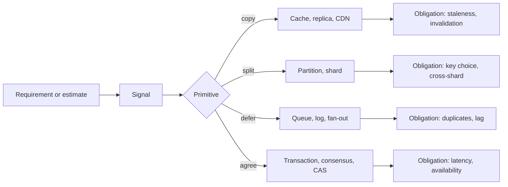

## In one minute
- In an interview, a concept is the answer to a requirement you heard or a number you computed. Every box should trace to a sentence like "reads outnumber writes 50 to 1 and may be 5 seconds stale, so I cache".
- A handful of signals triggers almost every concept: read-heavy with tolerable staleness, more writes or data than one node holds, slow work, one event reaching many users, a skewed key, a "never twice" rule, and more than one region.
- Underneath, most concepts are four primitives: copy, split, defer and agree. Copies go stale, splits break cross-partition operations, deferred work arrives late or twice, and agreement costs round trips.
- You have time for two or three proper deep dives. Rank the triggered concepts, go deep on the top ones, and name the rest in one sentence each.
- Every concept creates an obligation (a cache obliges invalidation, a queue obliges idempotent consumers). Budget for it or leave the concept out.

## How it works

### From signal to concept
Interviewers rarely say "use sharding". They say "200 million users, each posts a few times a day", and wait to see whether you notice the arithmetic has outgrown one machine. This table maps those signals to concepts and to the lessons that cover each in depth.

| Signal you hear or compute | Concept it triggers | Go deeper |
|---|---|---|
| Reads at least 10x writes, staleness of seconds is fine | Caching, read replicas, CDN | Caching, Scaling Read Traffic |
| Peak writes beyond about 10k per second, or data beyond a few TB | Partitioning and sharding, LSM storage | Scaling Write Traffic, Database Design |
| One key gets a large share of traffic | Hot-key splitting, request coalescing | Handling Hot Keys |
| Traffic jumps 10x in seconds (sales, launches) | Queues as buffers, admission control | Absorbing Traffic Spikes |
| Work takes longer than a request should wait | Queue plus workers, job state | Handling Long-Running Tasks, Scheduling Delayed and Recurring Jobs |
| One write must reach many readers | Fan-out on write or read | Fanning Out Updates |
| Others' changes visible within a second | Push (WebSocket, SSE) | Pushing Real-time Updates, Networking |
| "Never charge or sell twice" | Idempotency, conditional writes | Preventing Duplicate Processing, Preventing Double Booking |
| One action spans several services or stores | Sagas, outbox, change data capture | Coordinating Transactions Across Services, Keeping Data in Sync |
| Must survive losing a region | Multi-region replication and routing | Running Across Multiple Regions, Surviving Component Failures |
| Large blobs | Object storage, presigned URLs | Uploading and Serving Large Files, Streaming Video and Audio |
| Find by text, prefix or location | Inverted, trie or geo index | Search and Typeahead, Finding and Tracking Locations |
| Count, rank or ID huge streams | Sharded counters, sketches, ID schemes | Counting at Scale, Data Structures, Generating Unique IDs |

The five Concept Deep Dives sit underneath: **Networking** (what each arrow costs), **Caching** (the first tool for read load), **API Design** (requirements into an interface and access patterns), **Database Design** (access patterns into keys and partitions) and **Distributed Systems** (what happens when pieces disagree or fail). 30 Must-Know Concepts organises the same ideas by family; this chapter organises them by the signal that calls for them.

### Rank before you explain
A 45-minute interview leaves about 10 to 20 minutes after the high-level design; one widely used framework budgets about 10 minutes for deep dives after roughly 20 to 30 minutes of requirements, API and high-level design ([Hello Interview](https://www.hellointerview.com/learn/system-design/in-a-hurry/delivery)). A concept explained well, with mechanism, one number and failure mode, takes 4 to 7 minutes: two or three deep dives, not seven. Candidates who fail on depth rarely lack knowledge; they spend it on the wrong concept.

Rank the triggered concepts with three questions:

1. **What breaks the product if this is wrong?** Double charges and lost messages outrank a slow profile page.
2. **What did the numbers force?** At 40k writes per second, partitioning must appear and be justified.
3. **What is unusual about this problem?** Caching shows up everywhere. The celebrity fan-out in a feed, the seat hold in ticketing or the merge in a collaborative editor is what the interviewer most wants to see.

Everything below the cut gets one sentence: "Static assets go through a CDN; happy to go deeper."


### Concepts come with obligations
Each concept creates a question a strong interviewer will ask. A cache obliges invalidation and stampede handling, because cache-aside by itself guarantees no consistency with the database ([Azure Architecture Center](https://learn.microsoft.com/en-us/azure/architecture/patterns/cache-aside)). Sharding obliges a key and a plan for cross-shard queries. A queue obliges duplicate handling, ordering and a dead-letter path; even a managed queue such as SQS standard only promises at-least-once delivery and tells you to make consumers idempotent ([AWS docs](https://docs.aws.amazon.com/AWSSimpleQueueService/latest/SQSDeveloperGuide/standard-queues-at-least-once-delivery.html)). Replication obliges a statement of what a reader sees right after a write. Multi-region obliges conflict resolution. Budget the minute each obligation takes, or leave the box out.

### Common mistakes
- Adding concepts that no requirement asked for, such as Kafka in a design with 50 writes per second.
- Explaining the textbook version of a concept instead of the version this problem needs ("caching is storing data in memory" rather than "cache-aside on the product page, 60-second TTL, delete on price change").
- Forgetting the obligation, so the interviewer has to ask "what if the consumer crashes after charging?"

## Down the stack

### Layer 1: The contract
Each concept is a promise you can state as a testable sentence; that is what makes it an answer rather than a buzzword. Caching: "a read may be up to 30 seconds old; a write deletes the key". Sharding: "queries with the user ID touch one shard; others scatter to all 64". Queueing: "every accepted job runs at least once, usually within 10 seconds, possibly twice". Idempotency: "a repeat with the same key within 24 hours returns the first result and does nothing else". The window is a design choice you must state: Stripe may prune keys once they are [24 hours old](https://docs.stripe.com/api/idempotent_requests), while a DynamoDB transaction's client token is honoured for only [10 minutes](https://docs.aws.amazon.com/amazondynamodb/latest/developerguide/transaction-apis.html). Replication: "a committed write survives losing any one node; followers lag by up to a second". If you cannot finish the sentence, do not propose the concept.

### Layer 2: The mechanism
Almost every concept is built from four primitives. **Copy**: replicas, caches, CDNs, materialised views and search indexes store one fact in several places. **Split**: partitioning, sharding and consistent hashing divide data or work across machines. **Defer**: queues, logs, batching and change data capture move work out of the request path. **Agree**: transactions, consensus (Raft in etcd, ZAB in ZooKeeper), leases and compare-and-set make several actors accept one outcome. An etcd cluster needs a majority to accept any update, so three members survive one failure and five survive two ([etcd FAQ](https://etcd.io/docs/v3.5/faq/)).

The primitive predicts the obligation. Copies go stale: you need invalidation or a staleness budget. Facebook's memcache fleet, one of the largest copies ever run, still needed leases to stop stale sets and herds ([NSDI 2013](https://www.usenix.org/system/files/conference/nsdi13/nsdi13-final170_update.pdf)). Splits break cross-partition operations: you need a key that matches the dominant query. Deferred work arrives late or twice: you need idempotent consumers and lag monitoring. Agreement costs round trips and needs a majority: keep the agreed state small. Consensus keeps working while [any majority](https://raft.github.io/) is up and stops, without losing correctness, when it is not. An unfamiliar concept such as a CRDT becomes easy to place: it is copy without agree, hence its merge rules.

### Layer 3: The machine
The thresholds come from hardware. A DRAM lookup costs about 100 ns and a round trip inside one datacenter about 0.5 ms ([latency table](https://gist.github.com/jboner/2841832)), so a database query over the network costs 0.5 to a few ms, so a cache hit is worth one to two orders of magnitude. A relational primary with its WAL on NVMe sustains thousands to low tens of thousands of small transactional writes per second, bounded by `fsync` latency, lock contention and replication: hence the 10k trigger. A server holds tens of TB of SSD, but backups, index rebuilds and failover of a multi-TB database get painful long before the disk fills. A 10 Gbit NIC carries about 1.25 GB/s, so a hot key returning 10 KB values saturates one cache node at around 100k reads per second, before its CPU runs out. A cross-region round trip of 60 to 150 ms (California to the Netherlands and back is about 150 ms in the same table) is why synchronous agreement across regions is reserved for small, critical writes.

### Why it's built this way
One machine has finite memory, disk, network and failure tolerance, so at some scale you copy or split. The pieces then sit on a network that is slow and sometimes broken, so keeping them in step costs time. Most user-facing work tolerates a little delay or staleness, so deferring and copying buy capacity cheaply. A few operations (money, inventory, identity) cannot, so agreement is spent only there. That uneven need for exactness is why designs mix concepts per operation, and why ranking them matters.

## Diagram


## Worked example
The prompt: ticket sales for a concert platform. You learn there are 20 million DAU browsing about 50 pages each per day, and big on-sales put 2 million people on one event page in the same minute for 50,000 seats. No seat may be sold twice and no payment taken twice.

1. Reads: 20M × 50 / 86,400 is about 11,600 per second, read-heavy, with 10 seconds of staleness acceptable. That triggers **caching** and a **CDN**.
2. On-sale: 2 million users refreshing one event every few seconds is hundreds of thousands of reads per second on one key. That triggers **hot-key handling** and **spike absorption**, typically a waiting room that admits users at a fixed rate.
3. Seats: contention on 50,000 scarce items triggers **double-booking prevention** with a conditional write or an expiring hold.
4. Payments: mobile retries trigger **idempotency** keys.
5. At most 50,000 purchases per sale is a small write load, so **sharding is not triggered**. Say so; noticing what you do not need is a signal too.

With 18 minutes: the seat hold (correctness, unique, 7 minutes), the waiting room (forced by the numbers, 6 minutes), payment idempotency (4 minutes). Caching and the CDN get a sentence each. Each deep dive discharges its obligation: a hold expiring mid-payment, a refreshing user keeping their place, how long idempotency keys live.

## In the wild
- **Figma, 2024: splitting only when the numbers forced it.** Figma's database stack grew almost 100x from 2020. The team first split groups of tables into their own databases, the cheap lever. Only when single tables reached terabytes and billions of rows, with vacuum trouble and writes nearing the RDS IOPS ceiling, did they shard horizontally. "Colos" of tables share one shard key so joins and transactions within a key still work, and a Go proxy routes queries. The first sharded table took about 9 months and went live in September 2023 ([Figma](https://www.figma.com/blog/how-figmas-databases-team-lived-to-tell-the-scale/)).
- **Slack, 2022: a copy and a split with different keys.** Group DM membership was cached by channel ID, but the database was sharded by user. When a Consul rollout emptied part of the memcached fleet, every miss became a query across all shards, the database could not refill the cache, and many users could not start Slack. Each concept was fine alone; the obligation that failed was making the copy's key match the split's key ([Slack Engineering](https://slack.engineering/slacks-incident-on-2-22-22/)).
- **Twilio, 2013: deferred work without an idempotency guard.** A Redis billing master came back read-only with balances at zero. Usage then triggered automatic card recharges that could not record the new balance, so recharges were attempted again and again; 1.4% of customers were affected. Billing was shut off, charges were refunded, and Twilio added fail-safes that block charges when a balance cannot be read or written ([Twilio](https://www.twilio.com/en-us/blog/company/communications/billing-incident-post-mortem-breakdown-analysis-and-root-cause-html)).

## Trade-offs
| Strategy | Strengths | Weaknesses | Choose when |
|---|---|---|---|
| Deep on two or three concepts, one line on the rest | Shows real depth, fits the clock | Risk of picking the wrong two | Default; rank by damage, numbers and uniqueness |
| Broad tour of many concepts | Shows vocabulary | Shallow, invites "how exactly?" probes you have no time for | Rarely; only for a quick early sketch |
| Start from the simplest design and add concepts only when a number forces them | Every concept is justified | Can look slow if you over-explain the simple version | When you are unsure which concepts matter |

## Pitfalls in production
- **Résumé-driven architecture.** Event sourcing or a service mesh gets adopted because it is interesting. Require a written trigger (a number or a rule) for each new primitive in design review.
- **Copies with no staleness owner.** A cache or search index ships with no agreed staleness, so "old data" tickets have no correct answer. Put the budget in the service contract.
- **Splitting on the wrong key.** A shard key chosen for writes makes the main read scatter to every shard. Choose it from the dominant query and test it against the second.
- **Deferral without duplicate handling.** Consumers retry and side effects happen twice. Make consumers idempotent before enabling retries.
- **Agreement creeping into the hot path.** A lock added for one rare case ends up on every request. Scope agreement to the operations that need it.

## Leadership lens
- In design review, ask of each box: which requirement put it here, which primitive is it, and what obligation did it create?
- Prefer concepts the team can operate. A queue the team understands beats a stream processor that needs a specialist on call.
- Put the thresholds on dashboards ("we shard at 10k writes per second", alert at 60 percent) so the next concept arrives on a schedule, not in an incident.
- Teach new engineers the signals and the four primitives first. Technologies change; the signals do not.

## Check yourself
1. Your estimate shows 300 writes per second and 2 TB of data after five years. Does that trigger sharding?
   **Answer:** Not by itself. Both numbers fit one well-provisioned primary with replicas; say so, and name the threshold at which you would partition and the key you would use.
2. Why does adding a cache oblige you to discuss consistency?
   **Answer:** A cache is a copy, and copies go stale. You must state how long a stale read may last and how writes invalidate or update the cached value.
3. Your deep-dive budget allows three topics, and the problem triggers six concepts. How do you pick?
   **Answer:** Rank by the damage of getting it wrong, then by what the numbers forced, then by what is unique to this problem. Go deep on the top three and name the rest in a sentence each.

## Practice
**Task:** Build a concept planner in two parts. `required_concepts(req)` takes `dau`, `reads_per_user` and `writes_per_user` (per day), `peak_factor`, `bytes_per_write`, `retention_days`, `staleness_ok_s`, `fan_out`, `hot_key_share` (0 to 1), `no_duplicates`, `task_seconds` and `regions`. With peak write QPS = `dau × writes_per_user × peak_factor / 86400`, peak read QPS likewise, and stored bytes = `dau × writes_per_user × bytes_per_write × retention_days`, return the sorted list of: `"caching"` if `reads_per_user >= 10 × writes_per_user` and `staleness_ok_s > 0`; `"sharding"` if peak writes exceed 10,000 or stored bytes exceed 2×10^12; `"async-queue"` if `task_seconds > 1`; `"fan-out"` if `fan_out >= 100`; `"hot-key"` if `hot_key_share × peak reads > 20000`; `"idempotency"` if `no_duplicates`; `"multi-region"` if `regions > 1`. Reject negative numbers, `peak_factor < 1`, `hot_key_share > 1` or `regions < 1`. `plan_deep_dives(needed, catalog, budget)` takes concept names (duplicates count once), a catalog mapping each name to `(minutes, weight)` and a minute budget; pick the subset that fits the budget with the highest total weight, breaking ties by fewer total minutes, then by the lexicographically smaller sorted name list. Return `{"deep": [...], "mention": [...]}`, both sorted. Reject a negative budget or a concept missing from the catalog.

```python starter
def required_concepts(req):
    # TODO: return a sorted list of concept names
    raise NotImplementedError

def plan_deep_dives(needed, catalog, budget):
    # TODO: return {"deep": [...], "mention": [...]}
    raise NotImplementedError
```

```python tests
def base(**kw):
    req = {"dau": 1000, "reads_per_user": 1, "writes_per_user": 1, "peak_factor": 1,
           "bytes_per_write": 100, "retention_days": 1, "staleness_ok_s": 0, "fan_out": 1,
           "hot_key_share": 0.0, "no_duplicates": False, "task_seconds": 0, "regions": 1}
    req.update(kw)
    return req

def test_feed_needs_cache_fanout_and_sharding():
    req = base(dau=10_000_000, reads_per_user=100, writes_per_user=2, peak_factor=3,
               bytes_per_write=1000, retention_days=365, staleness_ok_s=5, fan_out=200)
    assert required_concepts(req) == ["caching", "fan-out", "sharding"]

def test_payments_need_correctness_concepts():
    req = base(dau=1_000_000, reads_per_user=5, writes_per_user=1, peak_factor=5,
               bytes_per_write=2000, retention_days=30, no_duplicates=True, task_seconds=3, regions=2)
    assert required_concepts(req) == ["async-queue", "idempotency", "multi-region"]

def test_hot_key_and_write_qps_sharding():
    hot = base(dau=50_000_000, reads_per_user=40, writes_per_user=1, peak_factor=2,
               staleness_ok_s=1, hot_key_share=0.5)
    assert required_concepts(hot) == ["caching", "hot-key"]
    writes = base(dau=100_000_000, reads_per_user=0, writes_per_user=10, peak_factor=2, bytes_per_write=10)
    assert required_concepts(writes) == ["sharding"]

def test_rejects_invalid_requirements():
    for bad in (base(dau=-1), base(peak_factor=0.5), base(hot_key_share=1.5), base(regions=0)):
        try:
            required_concepts(bad)
            assert False, "expected ValueError"
        except ValueError:
            pass

def test_plan_prefers_weight_within_budget():
    catalog = {"caching": (5, 3), "sharding": (8, 5), "fan-out": (7, 4), "idempotency": (4, 5)}
    plan = plan_deep_dives(["caching", "fan-out", "sharding", "fan-out"], catalog, 15)
    assert plan == {"deep": ["fan-out", "sharding"], "mention": ["caching"]}

def test_plan_tie_breaks():
    assert plan_deep_dives(["a", "b"], {"a": (5, 3), "b": (3, 3)}, 6) == {"deep": ["b"], "mention": ["a"]}
    assert plan_deep_dives(["y", "x"], {"x": (4, 2), "y": (4, 2)}, 4) == {"deep": ["x"], "mention": ["y"]}

def test_plan_zero_budget_and_errors():
    assert plan_deep_dives(["a"], {"a": (1, 1)}, 0) == {"deep": [], "mention": ["a"]}
    for args in ((["a"], {"a": (1, 1)}, -1), (["zzz"], {"a": (1, 1)}, 5)):
        try:
            plan_deep_dives(*args)
            assert False, "expected ValueError"
        except ValueError:
            pass
```

```python solution
NUMERIC = ("dau", "reads_per_user", "writes_per_user", "peak_factor", "bytes_per_write",
           "retention_days", "staleness_ok_s", "fan_out", "hot_key_share", "task_seconds", "regions")

def required_concepts(req):
    for k in NUMERIC:
        if req[k] < 0:
            raise ValueError("negative " + k)
    if req["peak_factor"] < 1 or req["hot_key_share"] > 1 or req["regions"] < 1:
        raise ValueError("invalid requirement")
    write_peak = req["dau"] * req["writes_per_user"] * req["peak_factor"] / 86400
    read_peak = req["dau"] * req["reads_per_user"] * req["peak_factor"] / 86400
    stored = req["dau"] * req["writes_per_user"] * req["bytes_per_write"] * req["retention_days"]
    out = []
    if req["reads_per_user"] >= 10 * req["writes_per_user"] and req["staleness_ok_s"] > 0:
        out.append("caching")
    if write_peak > 10000 or stored > 2e12:
        out.append("sharding")
    if req["task_seconds"] > 1:
        out.append("async-queue")
    if req["fan_out"] >= 100:
        out.append("fan-out")
    if req["hot_key_share"] * read_peak > 20000:
        out.append("hot-key")
    if req["no_duplicates"]:
        out.append("idempotency")
    if req["regions"] > 1:
        out.append("multi-region")
    return sorted(out)

def plan_deep_dives(needed, catalog, budget):
    if budget < 0:
        raise ValueError("negative budget")
    names = sorted(set(needed))
    for n in names:
        if n not in catalog:
            raise ValueError("unknown concept " + n)
    best = None
    for mask in range(1 << len(names)):
        pick = [names[i] for i in range(len(names)) if mask >> i & 1]
        minutes = sum(catalog[n][0] for n in pick)
        if minutes > budget:
            continue
        weight = sum(catalog[n][1] for n in pick)
        key = (-weight, minutes, pick)
        if best is None or key < best:
            best = key
    deep = best[2]
    return {"deep": deep, "mention": [n for n in names if n not in deep]}
```

```typescript starter
export interface Req {
  dau: number; readsPerUser: number; writesPerUser: number; peakFactor: number;
  bytesPerWrite: number; retentionDays: number; stalenessOkS: number; fanOut: number;
  hotKeyShare: number; noDuplicates: boolean; taskSeconds: number; regions: number;
}

export interface Plan { deep: string[]; mention: string[]; }

export function requiredConcepts(req: Req): string[] {
  throw new Error("TODO");
}

export function planDeepDives(needed: string[], catalog: Record<string, [number, number]>, budget: number): Plan {
  throw new Error("TODO");
}
```

```typescript tests
function mkReq(over: Partial<Req>): Req {
  const r: Req = { dau: 1000, readsPerUser: 1, writesPerUser: 1, peakFactor: 1, bytesPerWrite: 100,
    retentionDays: 1, stalenessOkS: 0, fanOut: 1, hotKeyShare: 0, noDuplicates: false, taskSeconds: 0, regions: 1 };
  return Object.assign(r, over);
}
function throws(fn: () => void): boolean {
  try { fn(); return false; } catch (e) { return true; }
}

test("feed needs cache, fan-out and sharding", () => {
  const r = mkReq({ dau: 10_000_000, readsPerUser: 100, writesPerUser: 2, peakFactor: 3,
    bytesPerWrite: 1000, retentionDays: 365, stalenessOkS: 5, fanOut: 200 });
  assertEqual(requiredConcepts(r), ["caching", "fan-out", "sharding"]);
});
test("payments need correctness concepts", () => {
  const r = mkReq({ dau: 1_000_000, readsPerUser: 5, writesPerUser: 1, peakFactor: 5,
    bytesPerWrite: 2000, retentionDays: 30, noDuplicates: true, taskSeconds: 3, regions: 2 });
  assertEqual(requiredConcepts(r), ["async-queue", "idempotency", "multi-region"]);
});
test("hot key and write qps sharding", () => {
  assertEqual(requiredConcepts(mkReq({ dau: 50_000_000, readsPerUser: 40, writesPerUser: 1, peakFactor: 2,
    stalenessOkS: 1, hotKeyShare: 0.5 })), ["caching", "hot-key"]);
  assertEqual(requiredConcepts(mkReq({ dau: 100_000_000, readsPerUser: 0, writesPerUser: 10, peakFactor: 2,
    bytesPerWrite: 10 })), ["sharding"]);
});
test("rejects invalid requirements", () => {
  for (const bad of [mkReq({ dau: -1 }), mkReq({ peakFactor: 0.5 }), mkReq({ hotKeyShare: 1.5 }), mkReq({ regions: 0 })]) {
    assert(throws(() => requiredConcepts(bad)), "expected error");
  }
});
test("plan prefers weight within budget", () => {
  const catalog: Record<string, [number, number]> = { caching: [5, 3], sharding: [8, 5], "fan-out": [7, 4], idempotency: [4, 5] };
  assertEqual(planDeepDives(["caching", "fan-out", "sharding", "fan-out"], catalog, 15),
    { deep: ["fan-out", "sharding"], mention: ["caching"] });
});
test("plan tie breaks", () => {
  assertEqual(planDeepDives(["a", "b"], { a: [5, 3], b: [3, 3] }, 6), { deep: ["b"], mention: ["a"] });
  assertEqual(planDeepDives(["y", "x"], { x: [4, 2], y: [4, 2] }, 4), { deep: ["x"], mention: ["y"] });
});
test("plan zero budget and errors", () => {
  assertEqual(planDeepDives(["a"], { a: [1, 1] }, 0), { deep: [], mention: ["a"] });
  assert(throws(() => planDeepDives(["a"], { a: [1, 1] }, -1)), "negative budget");
  assert(throws(() => planDeepDives(["zzz"], { a: [1, 1] }, 5)), "unknown concept");
});
```

```typescript solution
export interface Req {
  dau: number; readsPerUser: number; writesPerUser: number; peakFactor: number;
  bytesPerWrite: number; retentionDays: number; stalenessOkS: number; fanOut: number;
  hotKeyShare: number; noDuplicates: boolean; taskSeconds: number; regions: number;
}

export interface Plan { deep: string[]; mention: string[]; }

export function requiredConcepts(req: Req): string[] {
  const nums = [req.dau, req.readsPerUser, req.writesPerUser, req.peakFactor, req.bytesPerWrite,
    req.retentionDays, req.stalenessOkS, req.fanOut, req.hotKeyShare, req.taskSeconds, req.regions];
  if (nums.some((n) => n < 0)) throw new Error("negative input");
  if (req.peakFactor < 1 || req.hotKeyShare > 1 || req.regions < 1) throw new Error("invalid requirement");
  const writePeak = (req.dau * req.writesPerUser * req.peakFactor) / 86400;
  const readPeak = (req.dau * req.readsPerUser * req.peakFactor) / 86400;
  const stored = req.dau * req.writesPerUser * req.bytesPerWrite * req.retentionDays;
  const out: string[] = [];
  if (req.readsPerUser >= 10 * req.writesPerUser && req.stalenessOkS > 0) out.push("caching");
  if (writePeak > 10000 || stored > 2e12) out.push("sharding");
  if (req.taskSeconds > 1) out.push("async-queue");
  if (req.fanOut >= 100) out.push("fan-out");
  if (req.hotKeyShare * readPeak > 20000) out.push("hot-key");
  if (req.noDuplicates) out.push("idempotency");
  if (req.regions > 1) out.push("multi-region");
  return out.sort();
}

function lexLess(a: string[], b: string[]): boolean {
  for (let i = 0; i < Math.min(a.length, b.length); i++) {
    if (a[i] !== b[i]) return a[i] < b[i];
  }
  return a.length < b.length;
}

export function planDeepDives(needed: string[], catalog: Record<string, [number, number]>, budget: number): Plan {
  if (budget < 0) throw new Error("negative budget");
  const names = Array.from(new Set(needed)).sort();
  for (const n of names) {
    if (!Object.prototype.hasOwnProperty.call(catalog, n)) throw new Error("unknown concept " + n);
  }
  let best: { w: number; m: number; pick: string[] } | null = null;
  for (let mask = 0; mask < 1 << names.length; mask++) {
    const pick = names.filter((_, i) => ((mask >> i) & 1) === 1);
    let m = 0;
    let w = 0;
    for (const n of pick) { m += catalog[n][0]; w += catalog[n][1]; }
    if (m > budget) continue;
    if (best === null || w > best.w || (w === best.w && (m < best.m || (m === best.m && lexLess(pick, best.pick))))) {
      best = { w, m, pick };
    }
  }
  const deep = best === null ? [] : best.pick;
  return { deep, mention: names.filter((n) => deep.indexOf(n) < 0) };
}
```

```go starter
package practice

// Req describes the requirements and estimates gathered in an interview.
type Req struct {
	DAU, ReadsPerUser, WritesPerUser, PeakFactor, BytesPerWrite, RetentionDays float64
	StalenessOkS, FanOut, HotKeyShare, TaskSeconds                         float64
	NoDuplicates                                                           bool
	Regions                                                                int
}

// Cost is how long a concept takes to explain and how much it matters.
type Cost struct{ Minutes, Weight int }

// Plan splits concepts into deep dives and one-line mentions.
type Plan struct{ Deep, Mention []string }

func RequiredConcepts(req Req) ([]string, error) { panic("TODO") }

func PlanDeepDives(needed []string, catalog map[string]Cost, budget int) (Plan, error) {
	panic("TODO")
}
```

```go tests
package practice

import (
	"reflect"
	"testing"
)

func mkReq() Req {
	return Req{DAU: 1000, ReadsPerUser: 1, WritesPerUser: 1, PeakFactor: 1, BytesPerWrite: 100,
		RetentionDays: 1, FanOut: 1, Regions: 1}
}

func expectConcepts(t *testing.T, r Req, want []string) {
	t.Helper()
	got, err := RequiredConcepts(r)
	if err != nil || !reflect.DeepEqual(got, want) {
		t.Fatalf("got %v %v, want %v", got, err, want)
	}
}

func TestFeed(t *testing.T) {
	r := mkReq()
	r.DAU, r.ReadsPerUser, r.WritesPerUser, r.PeakFactor = 10_000_000, 100, 2, 3
	r.BytesPerWrite, r.RetentionDays, r.StalenessOkS, r.FanOut = 1000, 365, 5, 200
	expectConcepts(t, r, []string{"caching", "fan-out", "sharding"})
}

func TestPayments(t *testing.T) {
	r := mkReq()
	r.DAU, r.ReadsPerUser, r.PeakFactor, r.BytesPerWrite, r.RetentionDays = 1_000_000, 5, 5, 2000, 30
	r.NoDuplicates, r.TaskSeconds, r.Regions = true, 3, 2
	expectConcepts(t, r, []string{"async-queue", "idempotency", "multi-region"})
}

func TestHotKeyAndWriteSharding(t *testing.T) {
	h := mkReq()
	h.DAU, h.ReadsPerUser, h.PeakFactor, h.StalenessOkS, h.HotKeyShare = 50_000_000, 40, 2, 1, 0.5
	expectConcepts(t, h, []string{"caching", "hot-key"})
	w := mkReq()
	w.DAU, w.ReadsPerUser, w.WritesPerUser, w.PeakFactor, w.BytesPerWrite = 100_000_000, 0, 10, 2, 10
	expectConcepts(t, w, []string{"sharding"})
}

func TestRejectsInvalid(t *testing.T) {
	bad := []Req{mkReq(), mkReq(), mkReq(), mkReq()}
	bad[0].DAU = -1
	bad[1].PeakFactor = 0.5
	bad[2].HotKeyShare = 1.5
	bad[3].Regions = 0
	for i, r := range bad {
		if _, err := RequiredConcepts(r); err == nil {
			t.Fatalf("case %d: expected error", i)
		}
	}
}

func TestPlanWeight(t *testing.T) {
	cat := map[string]Cost{"caching": {5, 3}, "sharding": {8, 5}, "fan-out": {7, 4}, "idempotency": {4, 5}}
	p, err := PlanDeepDives([]string{"caching", "fan-out", "sharding", "fan-out"}, cat, 15)
	if err != nil || !reflect.DeepEqual(p, Plan{[]string{"fan-out", "sharding"}, []string{"caching"}}) {
		t.Fatalf("got %+v %v", p, err)
	}
}

func TestPlanTieBreaks(t *testing.T) {
	p, _ := PlanDeepDives([]string{"a", "b"}, map[string]Cost{"a": {5, 3}, "b": {3, 3}}, 6)
	if !reflect.DeepEqual(p, Plan{[]string{"b"}, []string{"a"}}) {
		t.Fatalf("got %+v", p)
	}
	p, _ = PlanDeepDives([]string{"y", "x"}, map[string]Cost{"x": {4, 2}, "y": {4, 2}}, 4)
	if !reflect.DeepEqual(p, Plan{[]string{"x"}, []string{"y"}}) {
		t.Fatalf("got %+v", p)
	}
}

func TestPlanZeroBudgetAndErrors(t *testing.T) {
	p, err := PlanDeepDives([]string{"a"}, map[string]Cost{"a": {1, 1}}, 0)
	if err != nil || len(p.Deep) != 0 || !reflect.DeepEqual(p.Mention, []string{"a"}) {
		t.Fatalf("got %+v %v", p, err)
	}
	if _, err := PlanDeepDives([]string{"a"}, map[string]Cost{"a": {1, 1}}, -1); err == nil {
		t.Fatal("expected error for negative budget")
	}
	if _, err := PlanDeepDives([]string{"zzz"}, map[string]Cost{"a": {1, 1}}, 5); err == nil {
		t.Fatal("expected error for unknown concept")
	}
}
```

```go solution
package practice

import (
	"errors"
	"sort"
)

// Req describes the requirements and estimates gathered in an interview.
type Req struct {
	DAU, ReadsPerUser, WritesPerUser, PeakFactor, BytesPerWrite, RetentionDays float64
	StalenessOkS, FanOut, HotKeyShare, TaskSeconds                         float64
	NoDuplicates                                                           bool
	Regions                                                                int
}

// Cost is how long a concept takes to explain and how much it matters.
type Cost struct{ Minutes, Weight int }

// Plan splits concepts into deep dives and one-line mentions.
type Plan struct{ Deep, Mention []string }

func RequiredConcepts(req Req) ([]string, error) {
	for _, n := range []float64{req.DAU, req.ReadsPerUser, req.WritesPerUser, req.PeakFactor, req.BytesPerWrite,
		req.RetentionDays, req.StalenessOkS, req.FanOut, req.HotKeyShare, req.TaskSeconds} {
		if n < 0 {
			return nil, errors.New("negative input")
		}
	}
	if req.PeakFactor < 1 || req.HotKeyShare > 1 || req.Regions < 1 {
		return nil, errors.New("invalid requirement")
	}
	writePeak := req.DAU * req.WritesPerUser * req.PeakFactor / 86400
	readPeak := req.DAU * req.ReadsPerUser * req.PeakFactor / 86400
	stored := req.DAU * req.WritesPerUser * req.BytesPerWrite * req.RetentionDays
	out := []string{}
	if req.ReadsPerUser >= 10*req.WritesPerUser && req.StalenessOkS > 0 {
		out = append(out, "caching")
	}
	if writePeak > 10000 || stored > 2e12 {
		out = append(out, "sharding")
	}
	if req.TaskSeconds > 1 {
		out = append(out, "async-queue")
	}
	if req.FanOut >= 100 {
		out = append(out, "fan-out")
	}
	if req.HotKeyShare*readPeak > 20000 {
		out = append(out, "hot-key")
	}
	if req.NoDuplicates {
		out = append(out, "idempotency")
	}
	if req.Regions > 1 {
		out = append(out, "multi-region")
	}
	sort.Strings(out)
	return out, nil
}

func lexLess(a, b []string) bool {
	for i := 0; i < len(a) && i < len(b); i++ {
		if a[i] != b[i] {
			return a[i] < b[i]
		}
	}
	return len(a) < len(b)
}

func PlanDeepDives(needed []string, catalog map[string]Cost, budget int) (Plan, error) {
	if budget < 0 {
		return Plan{}, errors.New("negative budget")
	}
	seen := map[string]bool{}
	names := []string{}
	for _, n := range needed {
		if _, ok := catalog[n]; !ok {
			return Plan{}, errors.New("unknown concept " + n)
		}
		if !seen[n] {
			seen[n] = true
			names = append(names, n)
		}
	}
	sort.Strings(names)
	bestW, bestM, found := 0, 0, false
	bestPick := []string{}
	for mask := 0; mask < 1<<len(names); mask++ {
		pick := []string{}
		m, w := 0, 0
		for i, n := range names {
			if mask>>i&1 == 1 {
				pick = append(pick, n)
				m += catalog[n].Minutes
				w += catalog[n].Weight
			}
		}
		if m > budget {
			continue
		}
		if !found || w > bestW || (w == bestW && (m < bestM || (m == bestM && lexLess(pick, bestPick)))) {
			bestW, bestM, bestPick, found = w, m, pick, true
		}
	}
	inDeep := map[string]bool{}
	for _, n := range bestPick {
		inDeep[n] = true
	}
	mention := []string{}
	for _, n := range names {
		if !inDeep[n] {
			mention = append(mention, n)
		}
	}
	return Plan{Deep: bestPick, Mention: mention}, nil
}
```

## Mock interview
**Prompt:** Design photo sharing for 100 million daily users who each view about 80 photos and upload about 0.2 per day. Before drawing, tell me which concepts this needs and which you would spend the most time on.

- Follow-up: Your estimate says uploads are only about 230 per second on average. Why might you still partition the metadata?
- Follow-up: You put a cache in front of photo metadata. A user deletes a photo and it still appears for others for a minute. Is that a bug?
- Follow-up: You have time for one more deep dive. Do you spend it on the feed fan-out or on multi-region replication? Defend the choice.

**A strong answer covers:**
- Arithmetic first: about 93k views per second on average against about 230 uploads per second, so the system is read-heavy and bytes dominate, putting object storage and a CDN in front.
- Storage: 20 million photos a day at about 2 MB is roughly 40 TB a day, so blobs go to object storage and only metadata, small enough for one primary with replicas at first, stays in a database.
- Feed fan-out named as the concept unique to this problem, with celebrities handled by fanning out on read.
- A staleness budget for metadata, and a delete path that invalidates cache and CDN, treating privacy-sensitive deletes differently from ordinary updates.
- An explicit ranking of deep dives with reasons, and one-line mentions for the rest.

## Sources and further study
**Primary**
- [Raft consensus algorithm](https://raft.github.io/): the paper, visualisation and the majority rule behind the "agree" primitive.
- [Elhemali et al., Amazon DynamoDB (USENIX ATC 2022)](https://www.usenix.org/conference/atc22/presentation/elhemali): copy and split at scale, with predictable latency as the contract.

**Systems docs**
- [Stripe: Idempotent requests](https://docs.stripe.com/api/idempotent_requests): a production idempotency contract, including how long keys live.
- [Amazon SQS: At-least-once delivery](https://docs.aws.amazon.com/AWSSimpleQueueService/latest/SQSDeveloperGuide/standard-queues-at-least-once-delivery.html): the duplicate obligation that comes with deferring work.
- [etcd FAQ](https://etcd.io/docs/v3.5/faq/): quorum sizes and why clusters stay small and odd.

**Books**
- *Designing Data-Intensive Applications* (1st ed.), Martin Kleppmann, chapters 5 "Replication", 6 "Partitioning", 7 "Transactions" and 11 "Stream Processing": copy, split, agree and defer in depth.
- *System Design Interview, Volume 1*, Alex Xu, chapter 3 "A Framework For System Design Interviews": where concept selection sits in the hour.

**Other curricula**
- [Hello Interview: Delivery framework](https://www.hellointerview.com/learn/system-design/in-a-hurry/delivery): budgets each interview phase, leaving about 10 minutes for deep dives.
- [roadmap.sh: System design](https://roadmap.sh/system-design): lists the same building blocks (caches, databases, queues, load balancers) as a map to study, without tying them to signals.

## Watch
- [System Design Interview: A Step-By-Step Guide (ByteByteGo)](https://www.youtube.com/watch?v=i7twT3x5yv8): where concept selection fits inside the interview.
- [Scaling Instagram Infrastructure (InfoQ)](https://www.youtube.com/watch?v=hnpzNAPiC0E): real signals (read load, fan-out, multi-region) and the concepts Instagram applied to each.
- [CS75 Lecture 9: Scalability (Harvard, David Malan)](https://www.youtube.com/watch?v=-W9F__D3oY4): copy, split and cache from first principles, step by step.

## Free resources
- [Hello Interview: Core Concepts](https://www.hellointerview.com/learn/system-design/in-a-hurry/core-concepts): a concise interview-oriented tour of the same concepts.
- [The System Design Primer](https://github.com/donnemartin/system-design-primer): broad reference with links to deeper material for each concept.
- [Designs, Lessons and Advice from Building Large Distributed Systems (Jeff Dean)](https://www.cs.cornell.edu/projects/ladis2009/talks/dean-keynote-ladis2009.pdf): the latency numbers and design patterns behind the thresholds in this chapter.
- [On Designing and Deploying Internet-Scale Services (James Hamilton)](https://www.usenix.org/legacy/event/lisa07/tech/full_papers/hamilton/hamilton.pdf): the operational obligations each concept creates, from someone who ran them.
