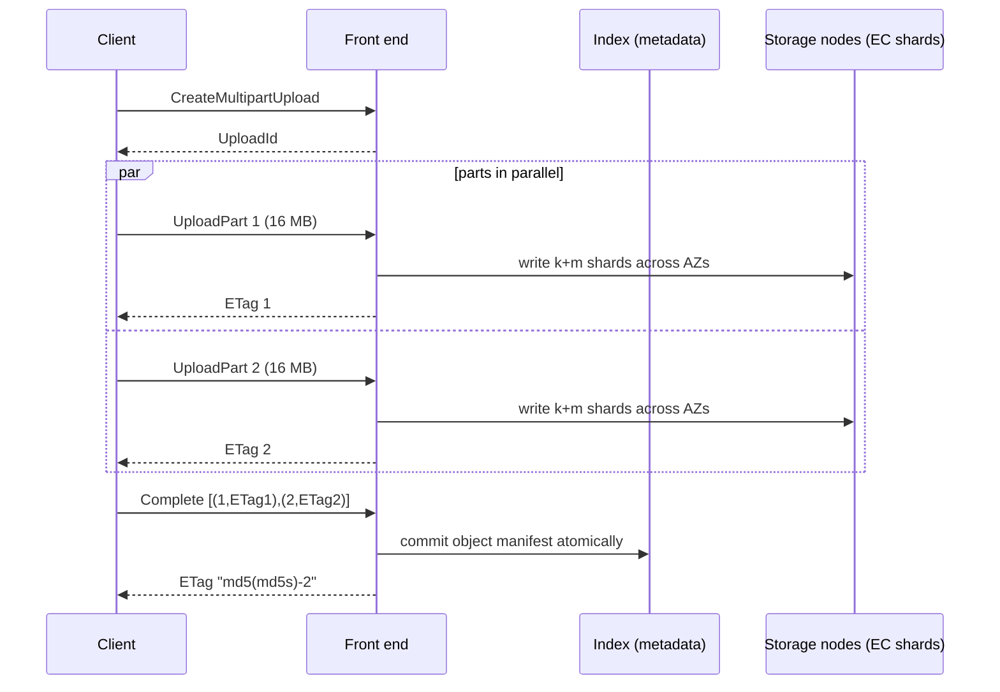

## In one minute
- Amazon S3 is an object store: you `PUT` and `GET` whole objects by bucket and key over HTTPS. There are no in-place edits or real directories.
- It is designed for eleven nines of durability by storing data redundantly across at least three availability zones, and since December 2020 reads, writes and lists are **strongly consistent** ([AWS](https://aws.amazon.com/about-aws/whats-new/2020/12/amazon-s3-now-delivers-strong-read-after-write-consistency-automatically-for-all-applications/)).
- Throughput comes from parallelism: each prefix supports at least 3,500 writes and 5,500 reads per second and splits under load; large objects move as parallel parts and ranged GETs.
- First-byte latency is tens to low hundreds of milliseconds, so S3 stores and streams data; it is not a low-latency database.
- In interviews, S3 is the default for media, backups, logs and data lakes. Keep metadata in a database and the bytes in S3.

## How it works

### Buckets, keys and objects
A bucket is a namespace in one region. A key is any UTF-8 string up to 1,024 bytes; `photos/2026/a.jpg` is one flat key, and "folders" are a listing convenience using a delimiter. An object is immutable once written: a `PUT` to an existing key replaces it atomically, and with versioning enabled the old version is kept. Objects can be up to 50 TB (raised from 5 TB in December 2025; [AWS](https://aws.amazon.com/about-aws/whats-new/2025/12/amazon-s3-maximum-object-size-50-tb/)), but a single `PUT` is limited to 5 GB.

### Multipart upload
Large objects are uploaded in parts. `CreateMultipartUpload` returns an `UploadId`. The client uploads parts numbered 1 to 10,000, each 5 MiB to 5 GiB except the last, in any order and in parallel, and each `UploadPart` returns that part's ETag ([AWS limits](https://docs.aws.amazon.com/AmazonS3/latest/userguide/qfacts.html)). Because the part count is capped, part size caps object size: 16 MiB parts top out near 156 GiB, and only parts close to 5 GiB reach the 48.8 TiB maximum, so pick the part size from the largest file you expect. `CompleteMultipartUpload` sends the list of part numbers and ETags in ascending order, and S3 stitches them into one object atomically. Until completion or `AbortMultipartUpload`, the parts are stored and billed but invisible, which is why every bucket should have a lifecycle rule that aborts incomplete uploads.

### Reading, listing and conditional writes
`GET` accepts a `Range` header, so clients download large objects as parallel byte ranges. `ListObjectsV2` returns up to 1,000 keys per page in lexicographic order. Conditional writes (`If-None-Match: *` to create only if absent, `If-Match: <etag>` to replace only an expected version) let S3 act as a simple coordination point, for example for table-format commit files. When several conditional writers race, the first to finish wins and the rest get `412 Precondition Failed`; a concurrent delete can produce `409 Conflict`, and for multipart uploads that means starting the upload again ([AWS docs](https://docs.aws.amazon.com/AmazonS3/latest/userguide/conditional-writes.html)).

### Storage classes and lifecycle
The same API fronts cost tiers from Standard through Infrequent Access to Glacier archive classes. Lifecycle rules move or expire objects by age or prefix; colder tiers trade cheaper storage for retrieval fees and, for archives, hours of restore time.

## Down the stack

### Layer 1: The contract
After a successful `PUT` or `CompleteMultipartUpload` returns, any subsequent `GET`, `HEAD` or `LIST` in any client sees the new object; overwrites and deletes are likewise immediately visible. Concurrent writers to one key get last-writer-wins unless they use conditional writes, and there is no multi-object transaction. Durability is designed for 99.999999999 percent per object per year, and Standard is designed for 99.99 percent availability ([AWS docs](https://docs.aws.amazon.com/AmazonS3/latest/userguide/DataDurability.html)), while the SLA only pays service credits below 99.9 percent ([AWS SLA](https://aws.amazon.com/s3/sla/)). An acknowledged write is already stored redundantly across zones. Typical first-byte latency is tens of milliseconds for small objects, and AWS's own performance guide tells latency-sensitive applications to expect roughly 100 to 200 ms ([AWS docs](https://docs.aws.amazon.com/AmazonS3/latest/userguide/optimizing-performance.html)). A single connection sustains on the order of 50 to 100 MB/s (hedge: varies with object size and client), so aggregate throughput comes from many connections.

### Layer 2: The mechanism
AWS has described S3 as hundreds of microservices; the public picture has three main layers.

**Front end.** DNS spreads clients over many front-end hosts, which terminate TLS, verify SigV4 signatures, evaluate IAM and bucket policies, and call the index and storage layers.

**Index (metadata).** A replicated key-value system maps bucket and key to size, ETag, checksum, version, storage class and shard locations. It is partitioned by key range, hence the per-prefix rates of at least 3,500 writes and 5,500 reads per second and automatic, gradual splitting of hot ranges, with `503 Slow Down` errors meanwhile. Strong consistency was added while keeping the metadata cache: new replication logic orders operations per object, and a "witness" component notified on every object change lets a read check whether its cached entry is stale and, if so, go to the persistence tier ([Werner Vogels](https://www.allthingsdistributed.com/2021/04/s3-strong-consistency.html)). The internals beyond that are not public.

**Storage.** Object bytes are split into chunks and **erasure coded** with Reed-Solomon codes: a chunk becomes k data shards plus m parity shards placed on different drives, hosts and availability zones, and any k of them reconstruct the data ([Warfield](https://www.allthingsdistributed.com/2023/07/building-and-operating-a-pretty-big-storage-system.html)). A scheme in the spirit of 5 data plus 4 parity (hedge: the actual parameters are not published and vary) survives losing a whole zone plus more drives, at under 2x storage overhead instead of 3x for replication. Storage hosts run ShardStore, a Rust key-value store AWS checked with lightweight formal methods, which caught 16 issues before they reached production ([SOSP 2021](https://www.amazon.science/publications/using-lightweight-formal-methods-to-validate-a-key-value-storage-node-in-amazon-s3)), and auditors continuously verify checksums and rebuild bad shards from parity.

**Integrity.** Each part's ETag is typically the MD5 of its bytes for unencrypted or SSE-S3 objects. A multipart object's ETag is the MD5 of the concatenated binary part MD5s, followed by `-` and the part count, so it is not the MD5 of the whole object. For end-to-end integrity, all AWS-owned clients (SDKs and CLI) now compute a checksum on every upload, `CRC64NVME` unless you pick another (CRC32, CRC32C, SHA-1, SHA-256 and newer XXHash and SHA-512 options), and S3 recomputes it and rejects a mismatch before storing ([AWS docs](https://docs.aws.amazon.com/AmazonS3/latest/userguide/checking-object-integrity.html)). SDKs do not compute MD5 automatically.

### Layer 3: The machine
Most S3 bytes sit on hard drives. A modern HDD holds 20 TB or more but still delivers only about 120 random IOPS, a figure that has barely moved since 2006, and roughly 200 to 250 MB/s sequential, so IOPS per TB keeps falling as drives grow. S3's answer is to spread every customer's data thinly across a huge fleet, so a workload's hot spots land on thousands of drives that also hold colder data, and aggregate demand smooths out statistically. Erasure coding helps reads too: a GET can start from whichever k shards respond fastest, hiding a slow drive.

Each request is an HTTPS exchange, so connection reuse matters; the AWS CRT-based clients issue 8 to 16 MB ranged GETs or parts over many connections to saturate 10 to 100 Gbit/s NICs. Per-request cost is fixed (roughly $0.005 per 1,000 PUTs and $0.0004 per 1,000 GETs for Standard in us-east-1; hedge: check current pricing), so millions of tiny objects cost more in requests than in storage, which runs about $0.023 per GB-month.

### Why it's built this way
1. Exabytes cheaply means hard drives, which are slow at random I/O, so data is spread over huge numbers of drives and throughput comes from parallelism.
2. Triple replication across zones would triple cost, so S3 erasure codes, paying CPU and network on repair for under 2x overhead.
3. A range-partitioned flat key space scales indefinitely, but each range has finite capacity, hence per-prefix limits and splitting.
4. Immutable objects keep replication, caching and erasure coding simple, so there are no in-place writes and large uploads commit parts atomically.
5. Customers assumed read-after-write, so S3 made the metadata layer strongly consistent instead of leaving clients to work around stale reads.

## Diagram


## Worked example
A video service ingests 50,000 uploads a day, averaging 1.2 GB, and serves 30 million plays a day of transcoded renditions through a CDN.

Ingest is 60 TB a day. Clients upload directly to S3 with presigned multipart URLs, so bytes never touch application servers. With 16 MB parts a 1.2 GB file is 75 parts; the upload bandwidth is the same, but a dropped part is retried alone instead of restarting the file. A lifecycle rule aborts incomplete uploads after 3 days.

Keys are `raw/<upload_id>/source.mp4` and `renditions/<video_id>/<height>/<segment>.ts`; random IDs spread writes across the key space. With 2-second segments, a 10-minute video in 5 renditions is 1,500 objects, so 75 million PUTs a day, about $375 a day in requests alone. Packing segments into one fMP4 file per rendition with byte-range reads cuts PUTs 300-fold.

After a year storage is about 22 PB of originals plus renditions. Originals move to Glacier Flexible Retrieval after 30 days, cutting their cost by roughly 80 percent. The CDN absorbs most reads, so S3 sees only a few thousand GETs per second of cache misses.

## In the wild
- **AWS, 2017: one mistyped command takes S3 down in us-east-1.** While debugging billing, an engineer meant to remove a few servers, but a mistyped argument removed many more, including capacity behind the index (metadata) and placement subsystems. Both needed a full restart that had not been done in years at that scale, and S3 in the region was unavailable for about four hours, taking EC2 launches, EBS restores, Lambda and AWS's own status page with it. The tool now removes capacity slowly and refuses to go below minimums, and work on smaller cells was accelerated ([AWS](https://aws.amazon.com/message/41926/)).
- **Amazon S3, 2008: one flipped bit in gossip.** On 20 July a few internal server-state messages carried a single corrupted bit that still parsed. S3 checksummed customer objects but not this gossip traffic, so the bad state spread until servers spent nearly all their time gossiping. Errors began at 8:40am PDT; AWS stopped server-to-server communication, cleared state and recovered by 4:58pm, then added checksums to the gossip messages ([AWS, archived](https://web.archive.org/web/2008/http://status.aws.amazon.com/s3-20080720.html)).
- **GitLab, 2021: abandoned multipart uploads keep billing.** A self-managed customer counted more than 67,276 incomplete multipart uploads created in three days. GitLab had cleaned up its temporary files but never completed or aborted the uploads, so their parts kept accruing storage charges; the advised fix was an `AbortIncompleteMultipartUpload` lifecycle rule ([GitLab](https://gitlab.com/gitlab-org/gitlab/-/issues/342136)).

## Trade-offs
| Option | Strengths | Weaknesses | Choose when |
|---|---|---|---|
| S3 Standard | Durable, unlimited, cheap per GB, strong consistency | 10 to 100 ms latency, per-request costs | Blobs, data lakes, backups, static assets |
| S3 Express One Zone | Single-digit ms, very high request rates | One zone, higher price per GB | Hot intermediate data for analytics or ML |
| EBS or local NVMe | Sub-ms block I/O, in-place writes | One instance, you manage durability | Databases and file systems |
| EFS or FSx | POSIX files shared across hosts | Higher cost, throughput tied to config | Legacy apps needing a file system |
| DynamoDB | Single-digit ms key-value with conditions | 400 KB item limit, costly for bulk bytes | Metadata about objects |

## Pitfalls in production
- **Incomplete multipart uploads.** Abandoned parts are billed but invisible. Add an `AbortIncompleteMultipartUpload` lifecycle rule everywhere.
- **Millions of tiny objects.** Request overhead dominates cost. Batch small records into larger files.
- **Listing as a query engine.** Scanning 1 billion keys is a million `LIST` calls. Keep an index in a database or use S3 Inventory.
- **Sudden traffic to one prefix.** Expect `503 SlowDown` until S3 repartitions. Spread keys and retry with backoff.
- **Public buckets and leaked presigned URLs.** Since April 2023 new buckets start with Block Public Access on and ACLs disabled ([AWS](https://aws.amazon.com/about-aws/whats-new/2023/04/amazon-s3-two-security-best-practices-buckets-default/)), and since January 2023 every new object is encrypted with SSE-S3 ([AWS docs](https://docs.aws.amazon.com/AmazonS3/latest/userguide/default-encryption-faq.html)), but older buckets keep whatever they had. Audit them, use short presigned expiries, and serve public content via a CDN.

## Leadership lens
- Decide early what lives in S3 (bytes) versus a database (metadata, permissions), and keep `LIST` off user-facing paths.
- Request counts, lifecycle tiers and cross-region or internet egress usually dominate the bill more than raw storage; model all four.
- Use versioning plus Object Lock or replication for anything that would be a disaster to delete, and test restores.
- Presigned direct uploads keep large bytes off application servers; make them the default pattern.

## Check yourself
1. Why is the ETag of a multipart object not the MD5 of the whole file?
   **Answer:** S3 computes it from the parts as the MD5 of the concatenated part digests plus a part count, so it never has to rehash the assembled object.
2. A team writes all objects under `logs/2026-10-15/` and sees `503 SlowDown` at 6,000 writes per second. What is happening?
   **Answer:** All writes hit one key range above its per-prefix rate; S3 will split the range over time, but spreading keys (such as hashed prefixes) avoids the hot spot.
3. Why does erasure coding allow both lower cost and higher durability than three replicas?
   **Answer:** k data plus m parity shards survive any m losses at (k+m)/k overhead, 1.8x for 5+4, versus 3x for replicas that survive two.
4. Can two clients safely use S3 to elect a leader?
   **Answer:** Yes: each `PUT`s the same key with `If-None-Match: *` and only one succeeds, though lease expiry still needs care.

## Practice
**Task:** Implement multipart upload assembly with an injected hash function. `create(key)` returns `u1`, `u2`, and so on. `upload_part(id, n, data)` stores or replaces part `n` (1 to 10,000, else `InvalidArgument`) and returns `hash(data)`. `complete(id, parts)` takes `(n, etag)` pairs and checks, in order: non-empty (`MalformedXML`), strictly ascending (`InvalidPartOrder`), each ETag matching an uploaded part (`InvalidPart`), and all but the last part at least `min_part_size` long (`EntityTooSmall`). It stores the listed parts' concatenation, drops the upload and returns `hash(etag1 + etag2 + ...) + "-" + count`. Unknown uploads give `NoSuchUpload`; the error message is the code. `abort` returns whether the upload existed; `get` returns the object or null.

```python starter
class MultipartStore:
    def __init__(self, hash_fn, min_part_size):
        self.hash_fn = hash_fn

    def create(self, key):
        # TODO
        raise NotImplementedError

    def upload_part(self, upload_id, part_number, data):
        # TODO
        raise NotImplementedError

    def complete(self, upload_id, parts):
        # TODO
        raise NotImplementedError

    def abort(self, upload_id):
        # TODO
        raise NotImplementedError

    def get(self, key):
        # TODO
        raise NotImplementedError
```

```python tests
def fnv(s):
    h = 0x811C9DC5
    for b in s.encode():
        h ^= b
        h = (h * 0x01000193) & 0xFFFFFFFF
    return "%08x" % h


def code_of(fn):
    try:
        fn()
    except ValueError as e:
        return str(e)
    return None


def test_happy_path_and_composite_etag():
    s = MultipartStore(fnv, 5)
    u = s.create("video.mp4")
    assert u == "u1"
    e1 = s.upload_part(u, 1, "hello")
    e2 = s.upload_part(u, 2, "!")
    assert e1 == fnv("hello")
    assert s.complete(u, [(1, e1), (2, e2)]) == fnv(e1 + e2) + "-2"
    assert s.get("video.mp4") == "hello!"
    assert s.get("missing") is None

def test_out_of_order_list_rejected():
    s = MultipartStore(fnv, 1)
    u = s.create("k")
    e1 = s.upload_part(u, 1, "a")
    e2 = s.upload_part(u, 2, "b")
    assert code_of(lambda: s.complete(u, [(2, e2), (1, e1)])) == "InvalidPartOrder"
    assert code_of(lambda: s.complete(u, [(1, e1), (1, e1)])) == "InvalidPartOrder"

def test_wrong_or_missing_etag():
    s = MultipartStore(fnv, 1)
    u = s.create("k")
    e1 = s.upload_part(u, 1, "a")
    assert code_of(lambda: s.complete(u, [(1, "deadbeef")])) == "InvalidPart"
    assert code_of(lambda: s.complete(u, [(1, e1), (2, e1)])) == "InvalidPart"
    assert code_of(lambda: s.complete(u, [])) == "MalformedXML"

def test_small_parts_only_allowed_last():
    s = MultipartStore(fnv, 5)
    u = s.create("k")
    e1 = s.upload_part(u, 1, "abc")
    e2 = s.upload_part(u, 2, "defgh")
    assert code_of(lambda: s.complete(u, [(1, e1), (2, e2)])) == "EntityTooSmall"
    assert s.complete(u, [(1, e1)]) == fnv(e1) + "-1"
    assert s.get("k") == "abc"

def test_replace_part_and_skip_unlisted():
    s = MultipartStore(fnv, 1)
    u = s.create("k")
    s.upload_part(u, 3, "zzz")
    s.upload_part(u, 1, "old")
    e1 = s.upload_part(u, 1, "new")
    e5 = s.upload_part(u, 5, "end")
    assert s.complete(u, [(1, e1), (5, e5)]) == fnv(e1 + e5) + "-2"
    assert s.get("k") == "newend"

def test_part_number_bounds():
    s = MultipartStore(fnv, 1)
    u = s.create("k")
    assert code_of(lambda: s.upload_part(u, 0, "x")) == "InvalidArgument"
    assert code_of(lambda: s.upload_part(u, 10001, "x")) == "InvalidArgument"
    assert s.upload_part(u, 10000, "x") == fnv("x")

def test_abort_and_complete_twice():
    s = MultipartStore(fnv, 1)
    u1 = s.create("a")
    u2 = s.create("b")
    assert u2 == "u2"
    assert s.abort(u1) is True
    assert s.abort(u1) is False
    assert code_of(lambda: s.upload_part(u1, 1, "x")) == "NoSuchUpload"
    e = s.upload_part(u2, 1, "x")
    s.complete(u2, [(1, e)])
    assert code_of(lambda: s.complete(u2, [(1, e)])) == "NoSuchUpload"
```

```python solution
class MultipartStore:
    def __init__(self, hash_fn, min_part_size):
        self.hash_fn = hash_fn
        self.min_part_size = min_part_size
        self.seq = 0
        self.uploads = {}  # upload_id -> (key, {part_number: (data, etag)})
        self.objects = {}

    def create(self, key):
        self.seq += 1
        uid = "u" + str(self.seq)
        self.uploads[uid] = (key, {})
        return uid

    def _upload(self, upload_id):
        if upload_id not in self.uploads:
            raise ValueError("NoSuchUpload")
        return self.uploads[upload_id]

    def upload_part(self, upload_id, part_number, data):
        _, parts = self._upload(upload_id)
        if part_number < 1 or part_number > 10000:
            raise ValueError("InvalidArgument")
        etag = self.hash_fn(data)
        parts[part_number] = (data, etag)
        return etag

    def complete(self, upload_id, parts):
        key, stored = self._upload(upload_id)
        if not parts:
            raise ValueError("MalformedXML")
        for i in range(1, len(parts)):
            if parts[i][0] <= parts[i - 1][0]:
                raise ValueError("InvalidPartOrder")
        for num, etag in parts:
            if num not in stored or stored[num][1] != etag:
                raise ValueError("InvalidPart")
        for num, _ in parts[:-1]:
            if len(stored[num][0]) < self.min_part_size:
                raise ValueError("EntityTooSmall")
        self.objects[key] = "".join(stored[num][0] for num, _ in parts)
        del self.uploads[upload_id]
        return self.hash_fn("".join(etag for _, etag in parts)) + "-" + str(len(parts))

    def abort(self, upload_id):
        return self.uploads.pop(upload_id, None) is not None

    def get(self, key):
        return self.objects.get(key)
```

```typescript starter
export class MultipartStore {
  constructor(private hashFn: (s: string) => string, minPartSize: number) {}
  create(key: string): string {
    throw new Error("TODO");
  }
  uploadPart(uploadId: string, partNumber: number, data: string): string {
    throw new Error("TODO");
  }
  complete(uploadId: string, parts: [number, string][]): string {
    throw new Error("TODO");
  }
  abort(uploadId: string): boolean {
    throw new Error("TODO");
  }
  get(key: string): string | null {
    throw new Error("TODO");
  }
}
```

```typescript tests
function fnv(s: string): string {
  let h = 0x811c9dc5;
  for (let i = 0; i < s.length; i++) {
    h ^= s.charCodeAt(i);
    h = Math.imul(h, 0x01000193) >>> 0;
  }
  return h.toString(16).padStart(8, "0");
}

function codeOf(fn: () => unknown): string | null {
  try { fn(); } catch (e) { return (e as Error).message; }
  return null;
}

test("happy path and composite etag", () => {
  const s = new MultipartStore(fnv, 5);
  const u = s.create("video.mp4");
  assertEqual(u, "u1");
  const e1 = s.uploadPart(u, 1, "hello");
  const e2 = s.uploadPart(u, 2, "!");
  assertEqual(e1, fnv("hello"));
  assertEqual(s.complete(u, [[1, e1], [2, e2]]), fnv(e1 + e2) + "-2");
  assertEqual(s.get("video.mp4"), "hello!");
  assertEqual(s.get("missing"), null);
});

test("out of order list rejected", () => {
  const s = new MultipartStore(fnv, 1);
  const u = s.create("k");
  const e1 = s.uploadPart(u, 1, "a");
  const e2 = s.uploadPart(u, 2, "b");
  assertEqual(codeOf(() => s.complete(u, [[2, e2], [1, e1]])), "InvalidPartOrder");
  assertEqual(codeOf(() => s.complete(u, [[1, e1], [1, e1]])), "InvalidPartOrder");
});

test("wrong or missing etag", () => {
  const s = new MultipartStore(fnv, 1);
  const u = s.create("k");
  const e1 = s.uploadPart(u, 1, "a");
  assertEqual(codeOf(() => s.complete(u, [[1, "deadbeef"]])), "InvalidPart");
  assertEqual(codeOf(() => s.complete(u, [[1, e1], [2, e1]])), "InvalidPart");
  assertEqual(codeOf(() => s.complete(u, [])), "MalformedXML");
});

test("small parts only allowed last", () => {
  const s = new MultipartStore(fnv, 5);
  const u = s.create("k");
  const e1 = s.uploadPart(u, 1, "abc");
  const e2 = s.uploadPart(u, 2, "defgh");
  assertEqual(codeOf(() => s.complete(u, [[1, e1], [2, e2]])), "EntityTooSmall");
  assertEqual(s.complete(u, [[1, e1]]), fnv(e1) + "-1");
  assertEqual(s.get("k"), "abc");
});

test("replace part and skip unlisted", () => {
  const s = new MultipartStore(fnv, 1);
  const u = s.create("k");
  s.uploadPart(u, 3, "zzz");
  s.uploadPart(u, 1, "old");
  const e1 = s.uploadPart(u, 1, "new");
  const e5 = s.uploadPart(u, 5, "end");
  assertEqual(s.complete(u, [[1, e1], [5, e5]]), fnv(e1 + e5) + "-2");
  assertEqual(s.get("k"), "newend");
});

test("part number bounds", () => {
  const s = new MultipartStore(fnv, 1);
  const u = s.create("k");
  assertEqual(codeOf(() => s.uploadPart(u, 0, "x")), "InvalidArgument");
  assertEqual(codeOf(() => s.uploadPart(u, 10001, "x")), "InvalidArgument");
  assertEqual(s.uploadPart(u, 10000, "x"), fnv("x"));
});

test("abort and complete twice", () => {
  const s = new MultipartStore(fnv, 1);
  const u1 = s.create("a");
  const u2 = s.create("b");
  assertEqual(u2, "u2");
  assertEqual(s.abort(u1), true);
  assertEqual(s.abort(u1), false);
  assertEqual(codeOf(() => s.uploadPart(u1, 1, "x")), "NoSuchUpload");
  const e = s.uploadPart(u2, 1, "x");
  s.complete(u2, [[1, e]]);
  assertEqual(codeOf(() => s.complete(u2, [[1, e]])), "NoSuchUpload");
});
```

```typescript solution
interface Upload {
  key: string;
  parts: Map<number, { data: string; etag: string }>;
}

export class MultipartStore {
  private seq = 0;
  private uploads = new Map<string, Upload>();
  private objects = new Map<string, string>();

  constructor(private hashFn: (s: string) => string, private minPartSize: number) {}

  create(key: string): string {
    this.seq++;
    const id = "u" + this.seq;
    this.uploads.set(id, { key, parts: new Map() });
    return id;
  }

  private upload(id: string): Upload {
    const u = this.uploads.get(id);
    if (!u) throw new Error("NoSuchUpload");
    return u;
  }

  uploadPart(uploadId: string, partNumber: number, data: string): string {
    const u = this.upload(uploadId);
    if (partNumber < 1 || partNumber > 10000) throw new Error("InvalidArgument");
    const etag = this.hashFn(data);
    u.parts.set(partNumber, { data, etag });
    return etag;
  }

  complete(uploadId: string, parts: [number, string][]): string {
    const u = this.upload(uploadId);
    if (parts.length === 0) throw new Error("MalformedXML");
    for (let i = 1; i < parts.length; i++) {
      if (parts[i][0] <= parts[i - 1][0]) throw new Error("InvalidPartOrder");
    }
    for (const [n, etag] of parts) {
      const p = u.parts.get(n);
      if (!p || p.etag !== etag) throw new Error("InvalidPart");
    }
    for (let i = 0; i < parts.length - 1; i++) {
      if (u.parts.get(parts[i][0])!.data.length < this.minPartSize) throw new Error("EntityTooSmall");
    }
    this.objects.set(u.key, parts.map(([n]) => u.parts.get(n)!.data).join(""));
    this.uploads.delete(uploadId);
    return this.hashFn(parts.map(([, e]) => e).join("")) + "-" + parts.length;
  }

  abort(uploadId: string): boolean {
    return this.uploads.delete(uploadId);
  }

  get(key: string): string | null {
    const v = this.objects.get(key);
    return v === undefined ? null : v;
  }
}
```

```go starter
package practice

type PartRef struct {
	Number int
	ETag   string
}

type MultipartStore struct{}

func NewMultipartStore(hash func(string) string, minPartSize int) *MultipartStore {
	return &MultipartStore{}
}

func (s *MultipartStore) Create(key string) string { panic("TODO") }

func (s *MultipartStore) UploadPart(uploadID string, partNumber int, data string) (string, error) {
	panic("TODO")
}

func (s *MultipartStore) Complete(uploadID string, parts []PartRef) (string, error) { panic("TODO") }

func (s *MultipartStore) Abort(uploadID string) bool { panic("TODO") }

func (s *MultipartStore) Get(key string) (string, bool) { panic("TODO") }
```

```go tests
package practice

import (
	"fmt"
	"testing"
)

func fnv(s string) string {
	h := uint32(0x811c9dc5)
	for i := 0; i < len(s); i++ {
		h ^= uint32(s[i])
		h *= 0x01000193
	}
	return fmt.Sprintf("%08x", h)
}

func codeOf(err error) string {
	if err == nil {
		return ""
	}
	return err.Error()
}

func must(v string, err error) string {
	if err != nil {
		panic(err)
	}
	return v
}

func TestHappyPathAndCompositeETag(t *testing.T) {
	s := NewMultipartStore(fnv, 5)
	u := s.Create("video.mp4")
	if u != "u1" {
		t.Fatalf("id %s", u)
	}
	e1 := must(s.UploadPart(u, 1, "hello"))
	e2 := must(s.UploadPart(u, 2, "!"))
	if e1 != fnv("hello") {
		t.Fatal("part etag")
	}
	if got := must(s.Complete(u, []PartRef{{1, e1}, {2, e2}})); got != fnv(e1+e2)+"-2" {
		t.Fatalf("etag %s", got)
	}
	if v, ok := s.Get("video.mp4"); !ok || v != "hello!" {
		t.Fatalf("got %q", v)
	}
	if _, ok := s.Get("missing"); ok {
		t.Fatal("missing key found")
	}
}

func TestOutOfOrderListRejected(t *testing.T) {
	s := NewMultipartStore(fnv, 1)
	u := s.Create("k")
	e1 := must(s.UploadPart(u, 1, "a"))
	e2 := must(s.UploadPart(u, 2, "b"))
	if _, err := s.Complete(u, []PartRef{{2, e2}, {1, e1}}); codeOf(err) != "InvalidPartOrder" {
		t.Fatalf("got %v", err)
	}
	if _, err := s.Complete(u, []PartRef{{1, e1}, {1, e1}}); codeOf(err) != "InvalidPartOrder" {
		t.Fatalf("got %v", err)
	}
}

func TestWrongOrMissingETag(t *testing.T) {
	s := NewMultipartStore(fnv, 1)
	u := s.Create("k")
	e1 := must(s.UploadPart(u, 1, "a"))
	if _, err := s.Complete(u, []PartRef{{1, "deadbeef"}}); codeOf(err) != "InvalidPart" {
		t.Fatalf("got %v", err)
	}
	if _, err := s.Complete(u, []PartRef{{1, e1}, {2, e1}}); codeOf(err) != "InvalidPart" {
		t.Fatalf("got %v", err)
	}
	if _, err := s.Complete(u, nil); codeOf(err) != "MalformedXML" {
		t.Fatalf("got %v", err)
	}
}

func TestSmallPartsOnlyAllowedLast(t *testing.T) {
	s := NewMultipartStore(fnv, 5)
	u := s.Create("k")
	e1 := must(s.UploadPart(u, 1, "abc"))
	e2 := must(s.UploadPart(u, 2, "defgh"))
	if _, err := s.Complete(u, []PartRef{{1, e1}, {2, e2}}); codeOf(err) != "EntityTooSmall" {
		t.Fatalf("got %v", err)
	}
	if got := must(s.Complete(u, []PartRef{{1, e1}})); got != fnv(e1)+"-1" {
		t.Fatalf("etag %s", got)
	}
	if v, _ := s.Get("k"); v != "abc" {
		t.Fatalf("got %q", v)
	}
}

func TestReplacePartAndSkipUnlisted(t *testing.T) {
	s := NewMultipartStore(fnv, 1)
	u := s.Create("k")
	s.UploadPart(u, 3, "zzz")
	s.UploadPart(u, 1, "old")
	e1 := must(s.UploadPart(u, 1, "new"))
	e5 := must(s.UploadPart(u, 5, "end"))
	if got := must(s.Complete(u, []PartRef{{1, e1}, {5, e5}})); got != fnv(e1+e5)+"-2" {
		t.Fatalf("etag %s", got)
	}
	if v, _ := s.Get("k"); v != "newend" {
		t.Fatalf("got %q", v)
	}
}

func TestPartNumberBounds(t *testing.T) {
	s := NewMultipartStore(fnv, 1)
	u := s.Create("k")
	if _, err := s.UploadPart(u, 0, "x"); codeOf(err) != "InvalidArgument" {
		t.Fatalf("got %v", err)
	}
	if _, err := s.UploadPart(u, 10001, "x"); codeOf(err) != "InvalidArgument" {
		t.Fatalf("got %v", err)
	}
	if e := must(s.UploadPart(u, 10000, "x")); e != fnv("x") {
		t.Fatal("max part number should work")
	}
}

func TestAbortAndCompleteTwice(t *testing.T) {
	s := NewMultipartStore(fnv, 1)
	u1 := s.Create("a")
	u2 := s.Create("b")
	if u2 != "u2" {
		t.Fatalf("id %s", u2)
	}
	if !s.Abort(u1) || s.Abort(u1) {
		t.Fatal("abort should succeed once")
	}
	if _, err := s.UploadPart(u1, 1, "x"); codeOf(err) != "NoSuchUpload" {
		t.Fatalf("got %v", err)
	}
	e := must(s.UploadPart(u2, 1, "x"))
	must(s.Complete(u2, []PartRef{{1, e}}))
	if _, err := s.Complete(u2, []PartRef{{1, e}}); codeOf(err) != "NoSuchUpload" {
		t.Fatalf("got %v", err)
	}
}
```

```go solution
package practice

import (
	"errors"
	"strconv"
	"strings"
)

type PartRef struct {
	Number int
	ETag   string
}

type part struct{ data, etag string }

type upload struct {
	key   string
	parts map[int]part
}

type MultipartStore struct {
	hash        func(string) string
	minPartSize int
	seq         int
	uploads     map[string]*upload
	objects     map[string]string
}

func NewMultipartStore(hash func(string) string, minPartSize int) *MultipartStore {
	return &MultipartStore{hash: hash, minPartSize: minPartSize,
		uploads: map[string]*upload{}, objects: map[string]string{}}
}

func (s *MultipartStore) Create(key string) string {
	s.seq++
	id := "u" + strconv.Itoa(s.seq)
	s.uploads[id] = &upload{key: key, parts: map[int]part{}}
	return id
}

func (s *MultipartStore) UploadPart(uploadID string, partNumber int, data string) (string, error) {
	u, ok := s.uploads[uploadID]
	if !ok {
		return "", errors.New("NoSuchUpload")
	}
	if partNumber < 1 || partNumber > 10000 {
		return "", errors.New("InvalidArgument")
	}
	etag := s.hash(data)
	u.parts[partNumber] = part{data, etag}
	return etag, nil
}

func (s *MultipartStore) Complete(uploadID string, parts []PartRef) (string, error) {
	u, ok := s.uploads[uploadID]
	if !ok {
		return "", errors.New("NoSuchUpload")
	}
	if len(parts) == 0 {
		return "", errors.New("MalformedXML")
	}
	for i := 1; i < len(parts); i++ {
		if parts[i].Number <= parts[i-1].Number {
			return "", errors.New("InvalidPartOrder")
		}
	}
	for _, p := range parts {
		got, ok := u.parts[p.Number]
		if !ok || got.etag != p.ETag {
			return "", errors.New("InvalidPart")
		}
	}
	for _, p := range parts[:len(parts)-1] {
		if len(u.parts[p.Number].data) < s.minPartSize {
			return "", errors.New("EntityTooSmall")
		}
	}
	var body, etags strings.Builder
	for _, p := range parts {
		body.WriteString(u.parts[p.Number].data)
		etags.WriteString(p.ETag)
	}
	s.objects[u.key] = body.String()
	delete(s.uploads, uploadID)
	return s.hash(etags.String()) + "-" + strconv.Itoa(len(parts)), nil
}

func (s *MultipartStore) Abort(uploadID string) bool {
	_, ok := s.uploads[uploadID]
	delete(s.uploads, uploadID)
	return ok
}

func (s *MultipartStore) Get(key string) (string, bool) {
	v, ok := s.objects[key]
	return v, ok
}
```

## Mock interview
**Prompt:** Design the storage layer for a photo-sharing app with 50 million daily users who upload 20 million photos a day (average 3 MB) and view 2 billion photos a day in several sizes. Uploads must survive flaky mobile networks.

- Follow-up: how do clients upload without sending bytes through your API servers, and how do you stop abuse?
- Follow-up: a celebrity's photo gets 5 million views in 10 minutes. What does S3 see?
- Follow-up: a user deletes their account. How are the photos really gone?

**A strong answer covers:**
- Presigned, resumable multipart uploads with size and content-type limits, and metadata written to a database on completion.
- Capacity: 60 TB a day of originals, about 22 PB a year, with lifecycle tiering for cold originals.
- A CDN with immutable, content-addressed keys, so S3 sees only misses.
- Random key prefixes, and a database (not `LIST`) as the index of a user's photos.
- Deletion as a tracked job covering noncurrent versions, replicas and backups within a stated window.

## Sources and further study
**Primary**
- [Vogels, Diving deep on S3 consistency (2021)](https://www.allthingsdistributed.com/2021/04/s3-strong-consistency.html): how the witness and cache-coherency protocol made S3 strongly consistent without losing its cache.
- [AWS: Summary of the Amazon S3 service disruption in us-east-1 (2017)](https://aws.amazon.com/message/41926/): the clearest public description of S3's index and placement subsystems.

**Systems docs**
- [Amazon S3 multipart upload limits](https://docs.aws.amazon.com/AmazonS3/latest/userguide/qfacts.html): part counts, part sizes and the maximum object size.
- [Amazon S3 conditional writes](https://docs.aws.amazon.com/AmazonS3/latest/userguide/conditional-writes.html): `If-None-Match`, `If-Match`, and the 412 and 409 cases.
- [Data protection in Amazon S3](https://docs.aws.amazon.com/AmazonS3/latest/userguide/DataDurability.html): the durability and availability design targets per storage class.
- [Amazon S3 default encryption FAQ](https://docs.aws.amazon.com/AmazonS3/latest/userguide/default-encryption-faq.html): SSE-S3 on every new object since January 2023.

**Books**
- *System Design Interview, Volume 2*, Alex Xu and Sahn Lam, Ch 9 "S3-like Object Storage": metadata versus data stores, erasure coding, multipart upload and garbage collection in interview form.
- *Designing Data-Intensive Applications* (1st ed.), Martin Kleppmann, Ch 10 "Batch Processing": distributed filesystems and object stores as the shared-nothing storage under batch jobs.

**Other curricula**
- [Azure Architecture Center: Valet Key pattern](https://learn.microsoft.com/en-us/azure/architecture/patterns/valet-key): the general form of presigned URLs, with short scopes and expiries and the warning that a key usually cannot cap upload size.
- [donnemartin/system-design-primer](https://github.com/donnemartin/system-design-primer): has no object-storage chapter; its SQL tuning advice is to keep large blobs out of the database and store their location instead.

## Watch
- [FAST '23: Building and Operating a Pretty Big Storage System (USENIX)](https://www.youtube.com/watch?v=sc3J4McebHE): Andy Warfield on S3's drives, heat management, durability and ShardStore.
- [How AWS S3 is built (The Pragmatic Engineer)](https://www.youtube.com/watch?v=5vL6aCvgQXU): an interview on S3's architecture, consistency change and engineering culture.

## Free resources
- [Building and operating a pretty big storage system called S3](https://www.allthingsdistributed.com/2023/07/building-and-operating-a-pretty-big-storage-system.html): Andy Warfield's essay on drives, heat and durability at S3 scale.
- [Uploading and copying objects using multipart upload](https://docs.aws.amazon.com/AmazonS3/latest/userguide/mpuoverview.html): official limits, flow and part rules.
- [Best practices design patterns: optimizing Amazon S3 performance](https://docs.aws.amazon.com/AmazonS3/latest/userguide/optimizing-performance.html): per-prefix rates, parallelism and ranged GETs.
- [Amazon S3 strong consistency](https://aws.amazon.com/s3/consistency/): what the consistency model guarantees.
- [Checking object integrity](https://docs.aws.amazon.com/AmazonS3/latest/userguide/checking-object-integrity.html): checksums, ETags and multipart checksum calculation.
- [Using lightweight formal methods to validate a key-value storage node in Amazon S3](https://www.amazon.science/publications/using-lightweight-formal-methods-to-validate-a-key-value-storage-node-in-amazon-s3): the ShardStore paper.
