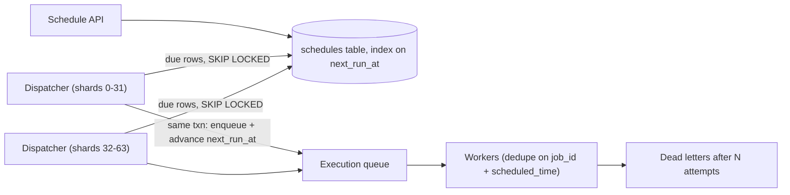

## In one minute
- "Do X at time T" and "do X every Monday at 9:00" are the same problem: durably store future work, find what is due cheaply, and hand it to workers once per occurrence.
- The durable store is indexed by next run time, so finding due work is a range scan, not a full scan. Delivery to workers reuses the job-queue pattern (leases, retries, dead letters).
- Recurring jobs store a rule (cron expression plus time zone) and compute the next occurrence after each firing; the next occurrence and the hand-off happen in one transaction.
- Execution is at least once, so every occurrence carries an idempotency key such as `(job_id, scheduled_time)`.
- The interview probes are scale (millions of timers), precision (seconds versus minutes), missed runs during an outage, time zones and DST, and the herd at the top of the hour.

## How it works

### When the pattern shows up in interviews
"Design a reminder service", "schedule posts for later", "send the abandoned-cart email 24 hours after the last activity", "renew subscriptions monthly", "retry the webhook in 5 minutes", "design a distributed cron", and calendar notifications. The tell is a time in the future attached to an action. Weak answers say "use cron" or "sleep in a thread"; strong answers separate storage of schedules, detection of due work, and execution.

### Store schedules durably
In-process timers vanish on restart, and a reminder for next month must survive many deploys. Keep a `schedules` table: job ID, payload or reference, `next_run_at` (UTC instant), the rule for recurring jobs (cron expression and IANA time zone, or a fixed interval), status, and a version. An index on `next_run_at` (often partial, on active rows only) makes "what is due?" cheap.

### Find due work
A dispatcher loop runs every second or so: select rows with `next_run_at <= now()` in time order, using `FOR UPDATE SKIP LOCKED` so several dispatchers can run without stepping on each other. For each row, in one transaction, enqueue an execution message (or insert it into an outbox) and advance `next_run_at` to the next occurrence, or mark a one-shot job done. Because the hand-off and the advance commit together, a dispatcher crash either does both or neither.

Other stores give the same shape. A Redis sorted set with the due timestamp as score is a natural priority queue: `ZRANGEBYSCORE` finds due members, and a Lua script claims them atomically. Wide-column stores such as Cassandra or DynamoDB often use time buckets as partition keys (`bucket = 2026-10-15T09:01`, sharded into N sub-partitions to spread load), and dispatchers read the current bucket.

### Short delays: timing wheels and queue delays
For millions of short timers (request timeouts, retry delays, "cancel the hold in 10 minutes"), keep them in memory in a **timing wheel**: a circular array of slots, each covering one tick. Inserting a timer drops it into slot `(now + delay) / tick mod N` in constant time, and each tick fires one slot's list. **Hierarchical** wheels (seconds, minutes, hours) cover long ranges with few slots by cascading timers down a level as their time nears ([Varghese and Lauck](https://www.cs.columbia.edu/~nahum/w6998/papers/sosp87-timing-wheels.pdf)). Kafka, Netty and the Linux kernel all use variants; Kafka moved to one because its old priority-queue timer cost O(log n) per insert and could not delete completed requests cheaply ([Confluent](https://www.confluent.io/blog/apache-kafka-purgatory-hierarchical-timing-wheels/)). Managed queues often offer native delays (SQS supports up to 15 minutes, [SQS docs](https://docs.aws.amazon.com/AWSSimpleQueueService/latest/SQSDeveloperGuide/sqs-delay-queues.html)), which is fine for retry backoff but not for next month. For long horizons there are managed schedulers: Amazon EventBridge Scheduler holds one-time, rate and cron schedules with a time zone, defaults to 10 million schedules per Region, delivers at least once, and offers flexible time windows to spread load ([AWS docs](https://docs.aws.amazon.com/scheduler/latest/UserGuide/what-is-scheduler.html), [quotas](https://docs.aws.amazon.com/scheduler/latest/UserGuide/scheduler-quotas.html)).

### Recurring rules, time zones and missed runs
Store "every weekday at 09:00 Europe/London", not a fixed UTC time, then compute each next instant with a time-zone database. DST creates nonexistent times (spring forward) and repeated times (fall back); pick a documented policy. EventBridge Scheduler's is a reasonable default to copy: an occurrence that falls in the skipped hour does not run, and one in the repeated hour runs once ([AWS docs](https://docs.aws.amazon.com/scheduler/latest/UserGuide/schedule-types.html)). When the scheduler is down past a run time, decide per job whether to run every missed occurrence, run once (coalesce), or skip. Kubernetes CronJob exposes exactly these choices through `startingDeadlineSeconds` and `concurrencyPolicy` (`Allow`, `Forbid`, `Replace`), and has a sharp edge: if the controller counts more than 100 missed schedules it starts nothing and logs an error. Its own docs say a Job is created only approximately once per scheduled time, sometimes twice or not at all, so jobs must be idempotent; since v1.32 each Job carries a `batch.kubernetes.io/cronjob-scheduled-timestamp` annotation you can use as the occurrence key ([Kubernetes docs](https://kubernetes.io/docs/concepts/workloads/controllers/cron-jobs/)).

### Scaling the dispatcher
One dispatcher is a bottleneck and a single point of failure. Shard schedules by hash of job ID into, say, 64 logical shards; each dispatcher instance leases a set of shards through a coordination service or a lease table, and failover reassigns the shard. Spread the herd: if a million users choose "9:00", either accept a burst into a queue that absorbs it, or add a small jitter where product allows. Google's cron let users write `?` in a crontab field to mean "any value", then hashed the job's configuration to pick one, spreading jobs over the range ([Google SRE book](https://sre.google/sre-book/distributed-periodic-scheduling/)). GitHub Actions warns that scheduled workflows can be delayed, or dropped under enough load, at the start of every hour, and advises picking another minute ([GitHub docs](https://docs.github.com/en/actions/reference/workflows-and-actions/events-that-trigger-workflows)).

## Down the stack

### Layer 1: The contract
An occurrence never fires before its scheduled instant, and fires within a stated lateness bound (for example p99 under 2 seconds) while the system is healthy. Each occurrence is delivered at least once; consumers deduplicate on `(job_id, scheduled_time)`. Cancelling or editing a schedule takes effect for occurrences not yet handed off; an occurrence already dispatched may still run, which the API must say. After an outage, missed occurrences follow the job's declared catch-up policy. When unsure whether a launch happened, Google's cron prefers to skip rather than risk a double launch, because a skipped run can be repaired and a double one often cannot ([Google SRE book](https://sre.google/sre-book/distributed-periodic-scheduling/)).

### Layer 2: The mechanism
The Postgres dispatcher's critical query is `SELECT id, next_run_at, rule FROM schedules WHERE status='active' AND next_run_at <= now() ORDER BY next_run_at LIMIT 500 FOR UPDATE SKIP LOCKED`. With a B-tree on `next_run_at`, this reads the left edge of the index and stops after 500 entries, so its cost depends on the due count, not the table size. A cron library parses the five fields into bitsets for minute, hour, day of month, month and weekday and walks forward to the next matching local time, then converts it to UTC. A hierarchical timing wheel, as described by Varghese and Lauck, keeps per-level arrays of linked lists; Kafka's implementation stores only non-empty buckets in a `DelayQueue` so its clock jumps straight to the next bucket instead of ticking through empty ones.

### Layer 3: The machine
Use a monotonic clock (`CLOCK_MONOTONIC`) for in-memory delays, because the wall clock (`CLOCK_REALTIME`) can step backward or forward when NTP corrects it, and a step can fire timers early or hold them for minutes. Go's `time.Now()` has carried a monotonic reading for duration math since Go 1.9 ([Go 1.9 release notes](https://go.dev/doc/go1.9)); before that, a wall-clock step produced negative durations, as the In the wild section shows. Use wall-clock UTC for persisted instants and keep servers synced; skew of tens of milliseconds between dispatchers is normal and is why "never early" is checked against the database's `now()` rather than each host's clock. A sleeping dispatcher wakes through `epoll_wait` or `timerfd` with millisecond granularity, which is fine for second-level precision. Memory sets the ceiling for in-memory timers: a timer object of roughly 100 bytes means 10 million pending timers need about 1 GB, which is why long horizons live on disk. On disk, a burst at 09:00 turns into a dense range of index pages that are already hot in the buffer cache, and the real limit becomes write throughput for advancing `next_run_at` and enqueueing executions.

### Why it's built this way
1. Processes restart and timers last for months, so schedules are persisted rather than held in memory.
2. Scanning every schedule each second is linear in total jobs, so the store is ordered by next run time and dispatch reads only the due edge.
3. Handing off and advancing must not diverge on a crash, so they commit together, and delivery downstream is at least once with an occurrence key.
4. Wall clocks jump and hosts disagree, so durations use monotonic clocks and "is it due?" uses one authoritative clock.
5. Human schedules cluster on round times, so the system is sized for bursts or smooths them with queues and jitter.

## Diagram


## Worked example
A reminders product holds 200 million active schedules, and about 30 million fire per day, an average of roughly 350 per second. Users love round times in their own zone, so each hour on the hour sees spikes; the team measures peaks around 20 times average, about 7,000 occurrences per second for the first minute.

Schedules are hashed into 64 shards over 8 Postgres partitions. Each dispatcher instance leases 8 shards and polls every 500 ms, claiming up to 1,000 rows per query. At peak each shard has about 110 due rows per second, well within one batch, and each dispatcher transaction inserts execution rows into an outbox and advances `next_run_at`, about 2 writes per occurrence, or 14,000 writes per second across the cluster at peak. Notification workers consume the queue and skip any `(reminder_id, scheduled_time)` already recorded as sent. Lateness is under 2 seconds at p99 except at the top of the hour, when the queue takes about 30 seconds to drain, which product accepted. After an outage, one-shot reminders fire late while recurring digests coalesce to one send.

## In the wild
- **Cloudflare, 2017: a leap second makes time run backwards.** At midnight UTC on 1 January 2017 the leap second stepped the wall clock back, and Cloudflare's DNS resolver, built on Go's then wall-clock-only `time.Now()`, computed negative round-trip times. A negative value reached `rand.Int63n()`, which panics, so some CNAME lookups failed: about 0.2% of DNS queries at peak for roughly six and three-quarter hours. The fix discarded negative intervals, and Go later added monotonic time ([Cloudflare](https://blog.cloudflare.com/how-and-why-the-leap-second-affected-cloudflare-dns/)).
- **Linux, 2012: timers fire early in a loop after a leap second.** After the 30 June 2012 leap second, the kernel inserted the extra second without calling `clock_was_set()`, so `CLOCK_REALTIME` high-resolution timers fired a second early and short timeouts fired immediately, again and again. MySQL and Java processes spun on futexes until operators reset the clock to itself; the patch called `clock_was_set()` on leap-second changes ([LKML](https://lkml.iu.edu/hypermail/linux/kernel/1207.0/02318.html)).
- **Dropbox, 2020: a delayed-task scheduler at 9,000 tasks per second.** Dropbox's Async Task Framework stores each task with a next-trigger timestamp in its metadata store, polls for due tasks every two seconds, and pushes them onto per-callback, per-priority SQS queues. It promises at-least-once execution, so callbacks must be idempotent, with 95% of tasks starting within five seconds of their scheduled time ([Dropbox Tech](https://dropbox.tech/infrastructure/asynchronous-task-scheduling-at-dropbox)).

## Trade-offs
| Option | Strengths | Weaknesses | Choose when |
|---|---|---|---|
| DB table + polling dispatcher | Durable, transactional, easy to query and edit | Poll interval sets precision, write load at peaks | Most product schedulers |
| Redis sorted set | Fast, simple priority queue | Durability depends on persistence settings, memory-bound | Short to medium horizons, high rates |
| Time-bucketed wide-column store | Scales horizontally to billions | Hot buckets, needs sharding within buckets | Very large schedule counts |
| In-memory timing wheel | O(1) insert, millions of timers | Lost on restart | Timeouts and short delays |
| Managed scheduler or queue delay | No servers to run | Limits on delay length or count | Simple needs, cloud-native stacks |

## Pitfalls in production
- **Storing local times as UTC once.** A 09:00 London job drifts by an hour at DST. Store the zone and compute each occurrence.
- **No catch-up policy.** After an outage, thousands of missed digests fire at once, or none fire. Declare per-job behaviour and test it.
- **Advancing and enqueueing in separate steps.** A crash between them loses or duplicates occurrences. Commit them together.
- **Comparing against each host's clock.** A host with a fast clock fires early. Use the database clock or a single time source and a monotonic clock for delays.
- **Top-of-hour herds.** Every tenant's `0 * * * *` job hits the same second. Size for it, queue it, or jitter it.

## Leadership lens
- Ask for the lateness SLO and the catch-up policy in writing; they drive the poll interval, sharding and cost.
- Decide whether editing or cancelling must affect occurrences already dispatched, and make workers check the latest schedule version if so.
- Watch dispatch lag (now minus `next_run_at` of the oldest due row) as the primary health metric.

## Check yourself
1. Why must advancing `next_run_at` and enqueueing the execution happen in one transaction?
   **Answer:** Otherwise a crash between them either loses the occurrence (advanced but not enqueued) or repeats it indefinitely (enqueued but not advanced).
2. What does a hierarchical timing wheel buy over a single wheel?
   **Answer:** It covers long delays with a small number of slots by keeping coarse wheels for far timers and cascading them to finer wheels as they approach.
3. Why use a monotonic clock for in-memory delays?
   **Answer:** The wall clock can jump when NTP steps it, which would fire timers early or late; the monotonic clock only moves forward at a steady rate.
4. A recurring job was due at 10:00, 10:10 and 10:20 while the scheduler was down until 10:25. Under a coalesce policy, what fires?
   **Answer:** One execution, typically for the most recent missed occurrence (10:20), and the next is scheduled for 10:30.

## Practice
**Task:** Implement an in-memory scheduler for one-shot and fixed-interval jobs. `add_once(job_id, run_at)` and `add_every(job_id, first_at, interval)` register a job, replacing any existing job with the same ID. `cancel(job_id)` returns true if an active job was removed. `due(now)` returns the occurrences that are due at or before `now`, as `(job_id, scheduled_time)` pairs sorted by time then job ID, and removes or reschedules them. A recurring job that missed several occurrences fires once, for the latest occurrence at or before `now`, and its next run is one interval after that. `next_run(job_id)` returns the next scheduled time, or nothing if the job is not active.

```python starter
class Scheduler:
    def __init__(self):
        # TODO
        pass

    def add_once(self, job_id, run_at):
        raise NotImplementedError

    def add_every(self, job_id, first_at, interval):
        raise NotImplementedError

    def cancel(self, job_id):
        raise NotImplementedError

    def due(self, now):
        raise NotImplementedError

    def next_run(self, job_id):
        raise NotImplementedError
```

```python tests
def test_once_fires_once_at_time():
    s = Scheduler()
    s.add_once("a", 5)
    assert s.due(4) == []
    assert s.due(5) == [("a", 5)]
    assert s.due(6) == []
    assert s.next_run("a") is None

def test_ordering_by_time_then_id():
    s = Scheduler()
    s.add_once("b", 5); s.add_once("a", 5); s.add_once("c", 3)
    assert s.due(10) == [("c", 3), ("a", 5), ("b", 5)]

def test_recurring_fires_each_interval():
    s = Scheduler()
    s.add_every("r", 0, 10)
    assert s.due(0) == [("r", 0)]
    assert s.due(10) == [("r", 10)]
    assert s.due(15) == []
    assert s.next_run("r") == 20

def test_missed_runs_coalesce_to_latest():
    s = Scheduler()
    s.add_every("r", 0, 10)
    assert s.due(35) == [("r", 30)]
    assert s.next_run("r") == 40

def test_cancel():
    s = Scheduler()
    s.add_once("a", 5)
    assert s.cancel("a")
    assert not s.cancel("a")
    assert not s.cancel("zzz")
    assert s.due(100) == []

def test_readd_replaces_schedule():
    s = Scheduler()
    s.add_once("a", 5)
    s.add_once("a", 50)
    assert s.due(10) == []
    assert s.due(50) == [("a", 50)]

def test_mixed_jobs_same_time():
    s = Scheduler()
    s.add_every("r", 0, 10)
    s.add_once("x", 10)
    assert s.due(10) == [("r", 10), ("x", 10)]
    assert s.next_run("r") == 20
```

```python solution
import heapq

class Scheduler:
    def __init__(self):
        self.heap = []  # (time, job_id, generation)
        self.jobs = {}  # job_id -> [generation, interval or None, next_time]
        self.gen = 0

    def _add(self, job_id, at, interval):
        self.gen += 1
        self.jobs[job_id] = [self.gen, interval, at]
        heapq.heappush(self.heap, (at, job_id, self.gen))

    def add_once(self, job_id, run_at):
        self._add(job_id, run_at, None)

    def add_every(self, job_id, first_at, interval):
        self._add(job_id, first_at, interval)

    def cancel(self, job_id):
        return self.jobs.pop(job_id, None) is not None

    def due(self, now):
        fired = []
        while self.heap and self.heap[0][0] <= now:
            at, job_id, gen = heapq.heappop(self.heap)
            job = self.jobs.get(job_id)
            if job is None or job[0] != gen:
                continue  # cancelled or replaced
            interval = job[1]
            if interval is None:
                del self.jobs[job_id]
                fired.append((job_id, at))
            else:
                latest = at + ((now - at) // interval) * interval
                fired.append((job_id, latest))
                job[2] = latest + interval
                heapq.heappush(self.heap, (job[2], job_id, gen))
        fired.sort(key=lambda f: (f[1], f[0]))
        return fired

    def next_run(self, job_id):
        job = self.jobs.get(job_id)
        return None if job is None else job[2]
```

```typescript starter
export class Scheduler {
  addOnce(jobId: string, runAt: number): void {
    throw new Error("TODO");
  }
  addEvery(jobId: string, firstAt: number, interval: number): void {
    throw new Error("TODO");
  }
  cancel(jobId: string): boolean {
    throw new Error("TODO");
  }
  due(now: number): Array<[string, number]> {
    throw new Error("TODO");
  }
  nextRun(jobId: string): number | null {
    throw new Error("TODO");
  }
}
```

```typescript tests
test("once fires once at time", () => {
  const s = new Scheduler();
  s.addOnce("a", 5);
  assertEqual(s.due(4), []);
  assertEqual(s.due(5), [["a", 5]]);
  assertEqual(s.due(6), []);
  assertEqual(s.nextRun("a"), null);
});

test("ordering by time then id", () => {
  const s = new Scheduler();
  s.addOnce("b", 5);
  s.addOnce("a", 5);
  s.addOnce("c", 3);
  assertEqual(s.due(10), [["c", 3], ["a", 5], ["b", 5]]);
});

test("recurring fires each interval", () => {
  const s = new Scheduler();
  s.addEvery("r", 0, 10);
  assertEqual(s.due(0), [["r", 0]]);
  assertEqual(s.due(10), [["r", 10]]);
  assertEqual(s.due(15), []);
  assertEqual(s.nextRun("r"), 20);
});

test("missed runs coalesce to latest", () => {
  const s = new Scheduler();
  s.addEvery("r", 0, 10);
  assertEqual(s.due(35), [["r", 30]]);
  assertEqual(s.nextRun("r"), 40);
});

test("cancel", () => {
  const s = new Scheduler();
  s.addOnce("a", 5);
  assert(s.cancel("a"), "cancel active");
  assert(!s.cancel("a"), "already cancelled");
  assert(!s.cancel("zzz"), "unknown");
  assertEqual(s.due(100), []);
});

test("re-add replaces schedule", () => {
  const s = new Scheduler();
  s.addOnce("a", 5);
  s.addOnce("a", 50);
  assertEqual(s.due(10), []);
  assertEqual(s.due(50), [["a", 50]]);
});

test("mixed jobs same time", () => {
  const s = new Scheduler();
  s.addEvery("r", 0, 10);
  s.addOnce("x", 10);
  assertEqual(s.due(10), [["r", 10], ["x", 10]]);
  assertEqual(s.nextRun("r"), 20);
});
```

```typescript solution
interface Entry {
  next: number;
  interval: number | null;
}

export class Scheduler {
  private jobs = new Map<string, Entry>();

  addOnce(jobId: string, runAt: number): void {
    this.jobs.set(jobId, { next: runAt, interval: null });
  }

  addEvery(jobId: string, firstAt: number, interval: number): void {
    this.jobs.set(jobId, { next: firstAt, interval });
  }

  cancel(jobId: string): boolean {
    return this.jobs.delete(jobId);
  }

  due(now: number): Array<[string, number]> {
    const fired: Array<[string, number]> = [];
    for (const [id, e] of Array.from(this.jobs.entries())) {
      if (e.next > now) continue;
      if (e.interval === null) {
        fired.push([id, e.next]);
        this.jobs.delete(id);
      } else {
        const latest = e.next + Math.floor((now - e.next) / e.interval) * e.interval;
        fired.push([id, latest]);
        e.next = latest + e.interval;
      }
    }
    fired.sort((a, b) => a[1] - b[1] || (a[0] < b[0] ? -1 : a[0] > b[0] ? 1 : 0));
    return fired;
  }

  nextRun(jobId: string): number | null {
    const e = this.jobs.get(jobId);
    return e ? e.next : null;
  }
}
```

```go starter
package practice

type Firing struct {
	JobID string
	At    int64
}

type Scheduler struct{}

func NewScheduler() *Scheduler {
	return &Scheduler{}
}

func (s *Scheduler) AddOnce(jobID string, runAt int64) {
	panic("TODO")
}

func (s *Scheduler) AddEvery(jobID string, firstAt, interval int64) {
	panic("TODO")
}

func (s *Scheduler) Cancel(jobID string) bool {
	panic("TODO")
}

func (s *Scheduler) Due(now int64) []Firing {
	panic("TODO")
}

// NextRun returns the next scheduled time and true, or 0 and false.
func (s *Scheduler) NextRun(jobID string) (int64, bool) {
	panic("TODO")
}
```

```go tests
package practice

import (
	"reflect"
	"testing"
)

func expectDue(t *testing.T, s *Scheduler, now int64, want []Firing) {
	t.Helper()
	got := s.Due(now)
	if len(got) == 0 && len(want) == 0 {
		return
	}
	if !reflect.DeepEqual(got, want) {
		t.Fatalf("Due(%d) = %v, want %v", now, got, want)
	}
}

func TestOnceFiresOnce(t *testing.T) {
	s := NewScheduler()
	s.AddOnce("a", 5)
	expectDue(t, s, 4, nil)
	expectDue(t, s, 5, []Firing{{"a", 5}})
	expectDue(t, s, 6, nil)
	if _, ok := s.NextRun("a"); ok {
		t.Fatal("one-shot should be gone")
	}
}

func TestOrdering(t *testing.T) {
	s := NewScheduler()
	s.AddOnce("b", 5)
	s.AddOnce("a", 5)
	s.AddOnce("c", 3)
	expectDue(t, s, 10, []Firing{{"c", 3}, {"a", 5}, {"b", 5}})
}

func TestRecurring(t *testing.T) {
	s := NewScheduler()
	s.AddEvery("r", 0, 10)
	expectDue(t, s, 0, []Firing{{"r", 0}})
	expectDue(t, s, 10, []Firing{{"r", 10}})
	expectDue(t, s, 15, nil)
	if n, ok := s.NextRun("r"); !ok || n != 20 {
		t.Fatalf("next = %d", n)
	}
}

func TestCoalesce(t *testing.T) {
	s := NewScheduler()
	s.AddEvery("r", 0, 10)
	expectDue(t, s, 35, []Firing{{"r", 30}})
	if n, _ := s.NextRun("r"); n != 40 {
		t.Fatalf("next = %d", n)
	}
}

func TestCancel(t *testing.T) {
	s := NewScheduler()
	s.AddOnce("a", 5)
	if !s.Cancel("a") || s.Cancel("a") || s.Cancel("zzz") {
		t.Fatal("cancel semantics")
	}
	expectDue(t, s, 100, nil)
}

func TestReaddReplaces(t *testing.T) {
	s := NewScheduler()
	s.AddOnce("a", 5)
	s.AddOnce("a", 50)
	expectDue(t, s, 10, nil)
	expectDue(t, s, 50, []Firing{{"a", 50}})
}

func TestMixedSameTime(t *testing.T) {
	s := NewScheduler()
	s.AddEvery("r", 0, 10)
	s.AddOnce("x", 10)
	expectDue(t, s, 10, []Firing{{"r", 10}, {"x", 10}})
}
```

```go solution
package practice

import "sort"

type Firing struct {
	JobID string
	At    int64
}

type entry struct {
	next     int64
	interval int64 // 0 means one-shot
}

type Scheduler struct {
	jobs map[string]*entry
}

func NewScheduler() *Scheduler {
	return &Scheduler{jobs: map[string]*entry{}}
}

func (s *Scheduler) AddOnce(jobID string, runAt int64) {
	s.jobs[jobID] = &entry{next: runAt}
}

func (s *Scheduler) AddEvery(jobID string, firstAt, interval int64) {
	s.jobs[jobID] = &entry{next: firstAt, interval: interval}
}

func (s *Scheduler) Cancel(jobID string) bool {
	if _, ok := s.jobs[jobID]; !ok {
		return false
	}
	delete(s.jobs, jobID)
	return true
}

func (s *Scheduler) Due(now int64) []Firing {
	var fired []Firing
	for id, e := range s.jobs {
		if e.next > now {
			continue
		}
		if e.interval == 0 {
			fired = append(fired, Firing{id, e.next})
			delete(s.jobs, id)
			continue
		}
		latest := e.next + ((now-e.next)/e.interval)*e.interval
		fired = append(fired, Firing{id, latest})
		e.next = latest + e.interval
	}
	sort.Slice(fired, func(i, j int) bool {
		if fired[i].At != fired[j].At {
			return fired[i].At < fired[j].At
		}
		return fired[i].JobID < fired[j].JobID
	})
	return fired
}

// NextRun returns the next scheduled time and true, or 0 and false.
func (s *Scheduler) NextRun(jobID string) (int64, bool) {
	e, ok := s.jobs[jobID]
	if !ok {
		return 0, false
	}
	return e.next, true
}
```

## Mock interview
**Prompt:** Design a reminder service for a productivity app with 50 million users. Users create one-off reminders ("tomorrow at 8") and recurring ones ("every weekday at 9 in my time zone"), and expect notifications within a few seconds of the chosen time. There are about 300 million active reminders.

- Follow-up: The scheduler cluster is down for 15 minutes. What happens to reminders due in that window, and to the daily ones?
- Follow-up: How do you prevent a user getting the same reminder twice when a dispatcher crashes mid-batch?
- Follow-up: A user in New York sets "every day at 2:30 am". What happens on the DST transition days?

**A strong answer covers:**
- Durable storage keyed or indexed by next run time, with dispatch as a range scan over due rows rather than a scan of all reminders.
- Atomic hand-off and advance, at-least-once execution, and dedupe on `(reminder_id, scheduled_time)`.
- Sharded dispatchers with leases and failover, and a plan for top-of-hour bursts.
- Recurrence stored as rule plus IANA time zone, with explicit DST and missed-run policies.
- Metrics: dispatch lag, queue age, and late-delivery percentage against the SLO.

## Sources and further study
**Primary**
- [Daylight saving time on EventBridge Scheduler (AWS docs)](https://docs.aws.amazon.com/scheduler/latest/UserGuide/schedule-types.html): a concrete published DST policy, plus how `rate(1 days)` drifts against wall time.
- [Go 1.9 release notes: transparent monotonic time (Go)](https://go.dev/doc/go1.9): why a language changed `time.Now()` so durations survive clock steps.

**Systems docs**
- [What is Amazon EventBridge Scheduler? (AWS docs)](https://docs.aws.amazon.com/scheduler/latest/UserGuide/what-is-scheduler.html): a managed scheduler with flexible time windows, retries and at-least-once delivery.
- [Events that trigger workflows: schedule (GitHub docs)](https://docs.github.com/en/actions/reference/workflows-and-actions/events-that-trigger-workflows): a real system documenting top-of-hour delays and dropped runs.
- [HashedWheelTimer (Netty API docs)](https://netty.io/4.1/api/io/netty/util/HashedWheelTimer.html): a production hashed timing wheel built for approximate I/O timeouts, with a 100 ms default tick.

**Books**
- *Site Reliability Engineering* (1st ed.), Beyer et al., Ch 24 "Distributed Periodic Scheduling with Cron": Paxos-backed cron, skip versus double launch, and precomputed job names.
- *Designing Data-Intensive Applications* (1st ed.), Martin Kleppmann, Ch 8 "The Trouble with Distributed Systems", section "Unreliable Clocks": time-of-day versus monotonic clocks and skew.

**Other curricula**
- [Scheduler Agent Supervisor pattern (Azure Architecture Center)](https://learn.microsoft.com/en-us/azure/architecture/patterns/scheduler-agent-supervisor): frames scheduling as recorded step state with a complete-by time, and a supervisor that retries or compensates steps that overrun.

## Watch
- [Implementations of Timing Wheels -- Julian Squires (Systems We Love)](https://www.youtube.com/watch?v=AftX7rqx-Uc): how timing wheels work and where they appear in real systems.
- [20: Distributed Job Scheduler (Jordan has no life)](https://www.youtube.com/watch?v=pzDwYHRzEnk): an interview-style walkthrough of a distributed scheduler.

## Free resources
- [Hashed and hierarchical timing wheels (Varghese and Lauck, SOSP 1987)](https://www.cs.columbia.edu/~nahum/w6998/papers/sosp87-timing-wheels.pdf): the original paper behind most efficient timer implementations.
- [Apache Kafka, purgatory, and hierarchical timing wheels (Confluent)](https://www.confluent.io/blog/apache-kafka-purgatory-hierarchical-timing-wheels/): a production timing wheel and why Kafka moved to it.
- [Distributed periodic scheduling with cron (Google SRE book)](https://sre.google/sre-book/distributed-periodic-scheduling/): how Google runs cron reliably, including skip-versus-double-run decisions.
- [Executing cron scripts reliably at scale (Slack Engineering)](https://slack.engineering/executing-cron-scripts-reliably-at-scale/): a real migration from host cron to a distributed scheduler.
- [CronJob (Kubernetes docs)](https://kubernetes.io/docs/concepts/workloads/controllers/cron-jobs/): concurrency policies, starting deadlines and time zone support.
