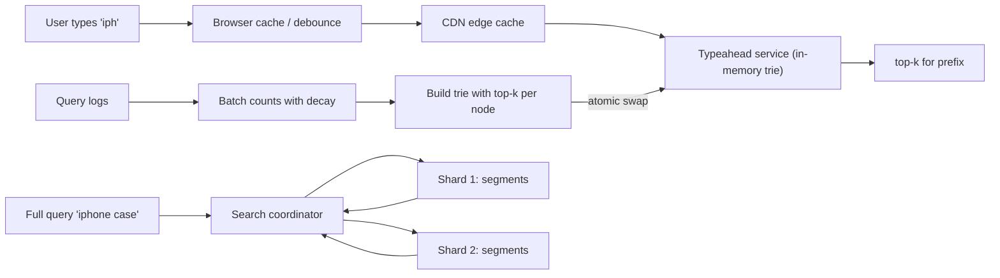

## In one minute
- Search splits into two problems with different budgets: **full-text search** (find and rank documents containing these words, a few hundred milliseconds) and **typeahead** (suggest completions for a prefix on every keystroke, tens of milliseconds).
- Full-text search runs on an **inverted index**: a map from each term to a sorted list of the documents containing it. Queries intersect or union those lists and rank the result, usually with BM25 plus business signals.
- Search engines like Lucene (inside Elasticsearch and OpenSearch) write immutable **segments** and merge them in the background, which is why new documents become searchable after a refresh rather than instantly.
- Typeahead precomputes answers: a trie or finite-state structure where each prefix already knows its top suggestions, built offline from query logs and served from memory and caches.
- In interviews, the database is the source of truth and the index is derived from it, so this pattern always comes with "keeping data in sync".

## How it works

### When the pattern shows up in interviews
"Search tweets by keyword", "search products with filters", "find users by name", "search Slack messages", "Google-style autocomplete", and "Design Yelp" (text plus location). The interviewer wants to hear why `LIKE '%term%'` on the primary database does not scale, what the index looks like, how it is sharded, how fresh it is, and for typeahead, how suggestions are ranked and served within a keystroke budget.

### The inverted index
At index time, an **analyzer** turns text into terms: tokenize, lowercase, remove or keep stop words, and optionally stem ("running" to "run") or add synonyms. For each term the index keeps a **postings list**: the sorted IDs of documents containing it, often with term frequency and positions for phrase queries. A query for `red shoes` looks up both postings lists, intersects them (for AND) by walking both in order, and scores each match. **BM25** scores a document higher when the query terms are frequent in it, rare across the corpus, and the document is not unusually long ([Manning, Raghavan and Schütze, 11.4.3](https://nlp.stanford.edu/IR-book/html/htmledition/okapi-bm25-a-non-binary-model-1.html)). Production ranking blends this text score with signals such as popularity, recency, personalisation or a learned model, often as a second-stage re-rank on the top few hundred hits.

### Segments, refresh and merges
Updating a compressed, sorted postings list in place for every new document would be ruinous, so Lucene buffers new documents in memory and periodically writes them out as a new, immutable **segment**: a self-contained mini-index. A search consults all segments and merges results. Deletes and updates mark the old document as deleted in a bitmap; the space is reclaimed when a background **merge** combines small segments into larger ones. Making buffered documents visible is a **refresh**, every second by default in Elasticsearch (five seconds on its Serverless offering), which is why it is called near-real-time. One catch: a shard that has seen no search for 30 seconds is "search idle" and skips background refreshes until the next search arrives, which then waits for one, unless you set the interval explicitly ([Elasticsearch docs](https://www.elastic.co/docs/reference/elasticsearch/index-settings/index-modules)).

### Sharding and scatter-gather
A large corpus is sharded by document (hash of ID, or by tenant). A query goes to every shard, each returns its local top k, and a coordinator merges them. Writes stay local, but every query touches every shard, so the slowest shard sets tail latency. Replicas add read capacity. Term-partitioned sharding is rare because multi-term queries must then join across machines. Waiting on the slowest of many machines is the general "tail at scale" problem: rare slow responses come to dominate as fan-out grows ([Dean and Barroso](https://research.google/pubs/the-tail-at-scale/)). Shard size has a hard ceiling too: a Lucene index tops out at about 2 billion documents, after which indexing simply fails, which is one reason Discord moved to many smaller indexes capped at 200 million messages ([Discord](https://discord.com/blog/how-discord-indexes-trillions-of-messages)).

### Typeahead
Typeahead suggests whole queries, not documents. Mine the query logs for completed searches, count them over a window (with decay so last week matters more than last year), filter out unsafe or low-quality phrases, and build a **trie** in which every node stores its precomputed top k completions. A lookup walks the prefix (a few characters) and returns the stored list: no traversal of the subtree at query time. Rebuild offline (hourly or daily) and swap atomically; layer a small real-time "trending" index on top if freshness matters. Storing top k in every node fixes k in advance and costs space that grows with k; compressed trie variants keep only scores and still return a completion in about a microsecond, at close to gzip size ([Hsu and Ottaviano, WWW 2013](https://archives.iw3c2.org/www2013/proceedings/p583.pdf)). Elasticsearch offers the same idea as the completion suggester, whose finite-state structure is entirely heap resident ([Elasticsearch docs](https://www.elastic.co/docs/reference/elasticsearch/rest-apis/search-suggesters)), or as edge n-gram fields that index every prefix of each word.

### Shaving the keystroke budget
Debounce on the client, cancel in-flight requests as the user keeps typing, and cache responses in the browser and at the CDN for short, popular prefixes. Merge personalisation (recent searches) on the client from a small per-user list.

## Down the stack

### Layer 1: The contract
Search returns the top k documents by a defined ranking for a query over the indexed snapshot, which lags the source of truth by the pipeline delay plus the refresh interval. Results are not strongly consistent: two shards may be at slightly different points, and replicas can differ until they refresh. Typeahead returns up to k suggestions for a prefix, ranked by a popularity score as of the last build, with a latency target small enough to keep up with typing, typically well under 100 ms end to end.

### Layer 2: The mechanism
A Lucene segment stores a **term dictionary** (terms sorted, with an FST-based terms index that maps prefixes to blocks on disk), **postings** (doc IDs delta-encoded and bit-packed in fixed-size blocks, with skip data so intersection can jump ahead), positions for phrases, **stored fields** (the original document, compressed), and **doc values** (column-oriented values used for sorting and aggregations). A `.liv` file holds the live-docs bitmap for deletions. Durability between Lucene commits comes from Elasticsearch's translog, which records each operation and by default is fsynced on the primary and every replica before the write is acknowledged; the `async` setting fsyncs every 5 seconds instead and can lose writes acknowledged in that window ([Elasticsearch docs](https://www.elastic.co/docs/reference/elasticsearch/index-settings/translog)). BM25's free parameters default to `k1 = 1.2` (term frequency saturation) and `b = 0.75` (length normalisation) ([Elasticsearch docs](https://www.elastic.co/docs/reference/elasticsearch/index-settings/similarity)). The tiered merge policy groups segments of similar size and merges them to keep the count per shard bounded. For typeahead, a trie node holds child pointers and a top-k array; inserting a term with new weight updates the top-k array of every node on its path, which is O(length times k).

### Layer 3: The machine
Lucene opens segment files with `mmap`, so postings and term blocks are read through the OS page cache; a hot index whose working set fits in RAM serves queries at memory speed, while cold reads cost an SSD random read of roughly 100 microseconds each. This is why Elastic tells you to give the JVM heap no more than half of a node's memory, and to stay under the compressed-pointer limit (about 26 GB is safe), leaving the rest to the page cache ([Elasticsearch docs](https://www.elastic.co/docs/reference/elasticsearch/jvm-settings)). Bit-packed postings let the CPU decode many document IDs per instruction with good cache-line locality. Merges are sequential I/O that compete with queries, so they are throttled. For typeahead, the whole trie lives in process memory, and the request cost is dominated by the network: a round trip from a phone over mobile networks can be 50 to 100 ms, so caching at the edge and in the browser often matters more than server time.

### Why it's built this way
1. Scanning all text per query is linear in the corpus, so invert it once at index time and look up terms.
2. Sorted, compressed postings are expensive to edit, so write immutable segments and merge later.
3. Writing a segment per document would create millions of tiny files, so buffer and refresh periodically, accepting a freshness lag.
4. One machine cannot hold or serve the whole index, so shard by document and scatter-gather, which makes tail latency the slowest shard's latency.
5. Keystrokes arrive faster than any search can rank, so typeahead precomputes per-prefix answers and pushes them close to the user.

## Diagram


## Worked example
An online store wants autocomplete for 40 million daily users. Each search averages about 6 keystrokes after debounce, and with roughly 1.5 searches per user per day that is around 360 million suggestion requests per day, about 4,000 per second on average and perhaps 15,000 at peak.

The query logs contain about 8 million distinct queries over 30 days. After dropping those seen fewer than 5 times and filtering unsafe terms, 2 million remain, averaging 18 characters. A trie of that size has on the order of tens of millions of nodes; storing a top-10 list of 4-byte phrase IDs per node plus child pointers lands in the low single-digit gigabytes, which fits comfortably in memory on one server. The team runs 12 replicas across regions for capacity and locality rather than for size.

The CDN caches prefixes of up to 3 characters for 5 minutes; there are only tens of thousands of them and they carry a large share of requests. Server lookup takes well under a millisecond; users see 30 to 80 ms, almost all network. The trie is rebuilt hourly from a streaming count with a 7-day half-life, so "black friday deals" climbs within an hour of the campaign starting.

## In the wild
- **Discord, 2025: re-architecting message search.** Messages reached Elasticsearch through a Redis queue that dropped messages at peak CPU. Because a 50-message bulk request could touch 50 nodes, one failed node in a 100-node cluster failed about 40% of bulk writes, and indexes hit Lucene's 2-billion-document limit. Many smaller clusters in cells, a router that groups each bulk by destination node, and indexes capped at 200 million messages doubled indexing throughput and cut median latency from 500 ms to under 100 ms ([Discord](https://discord.com/blog/how-discord-indexes-trillions-of-messages)).
- **Jepsen, 2015: the index is not the system of record.** Tests of Elasticsearch 1.5.0 lost acknowledged writes under partitions, pauses and crashes, almost a quarter in one primary-isolation run, partly because writes were acknowledged before the translog fsync. The advice that stuck: keep the truth in a safer database and continuously upsert into the index ([Jepsen](https://aphyr.com/posts/323-call-me-maybe-elasticsearch-1-5-0)).
- **Instacart, 2025: search back into Postgres.** Denormalized Elasticsearch documents meant billions of partial writes for price and stock updates. A normalized Postgres model cut write load 10 times and searches ran about twice as fast; moving semantic search from FAISS to pgvector in the same database cut zero-result searches by 6% ([Instacart](https://company.instacart.com/tech-innovation/how-instacart-built-a-modern-search-infrastructure-on-postgres)).

## Trade-offs
| Option | Strengths | Weaknesses | Choose when |
|---|---|---|---|
| `LIKE` / database full-text | No new system | Poor ranking, scans or limited index, loads primary | Small data, admin tools |
| Elasticsearch / OpenSearch | Rich queries, ranking, facets, mature | Cluster ops, eventual consistency, memory hungry | Product search, logs, most text search |
| Trie with precomputed top-k | Sub-millisecond lookups, simple to cache | Offline build, memory per node, stale between builds | Query autocomplete |
| Edge n-gram index | Uses existing search cluster, matches mid-phrase words | Index size grows a lot, slower than a trie | Moderate scale, word-prefix matching |

## Pitfalls in production
- **Searching the primary database with `LIKE '%x%'`.** It cannot use a B-tree index and degrades the transactional workload. Move search to a derived index.
- **Refreshing too often.** Very short refresh intervals create many tiny segments and merge pressure. Keep the default or longer for bulk loads.
- **Mapping changes need reindexing.** Changing an analyzer cannot be applied in place. Build a new index and switch an alias.
- **Offensive or manipulated suggestions.** Raw query logs contain abuse and spam. Filter with blocklists, minimum distinct-user counts and human review.
- **Deep pagination.** Fetching page 1,000 makes every shard return 10,000 hits to the coordinator. Elasticsearch refuses `from + size` beyond 10,000 by default, and now recommends `search_after` with a point in time rather than the older scroll API ([Elasticsearch docs](https://www.elastic.co/docs/reference/elasticsearch/rest-apis/paginate-search-results)).

## Leadership lens
- Make the freshness contract explicit (for example "searchable within 5 seconds") and design the sync pipeline and refresh interval to meet it.
- Treat relevance as a product with metrics: click-through, zero-result rate, and offline judgement sets, not just latency.
- Budget for reindexing; analyzers, synonyms and mappings will change.
- Keep typeahead separate from search so a slow search cluster does not break typing.

## Check yourself
1. Why are new documents in Elasticsearch not visible immediately after indexing?
   **Answer:** They sit in an in-memory buffer until a refresh writes a new segment and opens it for search, which happens on an interval rather than per document.
2. Why does each trie node store its own top-k list rather than computing it at query time?
   **Answer:** Computing it would traverse the whole subtree under a short prefix, which can hold millions of phrases; storing it makes lookup proportional to the prefix length.
3. What limits tail latency in a document-sharded search cluster?
   **Answer:** Each query waits for every shard, so the slowest shard (GC pause, merge, cold cache) sets the response time.
4. What does BM25's length normalisation protect against?
   **Answer:** Long documents matching terms simply because they contain many words; it discounts term frequency in documents longer than average.

## Practice
**Task:** Build a typeahead index with precomputed top-k per prefix. `Typeahead(k)` supports `record(term, count)` to add `count` (default 1) to a term's popularity, and `suggest(prefix)` to return up to `k` terms starting with the prefix, ordered by popularity descending and then alphabetically. Terms and prefixes are normalised by trimming spaces and lowercasing. An empty prefix returns an empty list. Counts only grow. Store a top-k list in each trie node and update the lists along the term's path on every `record`, so `suggest` does not traverse subtrees.

```python starter
class Typeahead:
    def __init__(self, k):
        # TODO
        pass

    def record(self, term, count=1):
        raise NotImplementedError

    def suggest(self, prefix):
        raise NotImplementedError
```

```python tests
def test_ranks_by_count():
    t = Typeahead(3)
    t.record("iphone", 50)
    t.record("ipad", 30)
    t.record("ipod", 10)
    t.record("imac", 40)
    assert t.suggest("ip") == ["iphone", "ipad", "ipod"]
    assert t.suggest("i") == ["iphone", "imac", "ipad"]

def test_ties_break_alphabetically():
    t = Typeahead(2)
    t.record("cat", 5)
    t.record("car", 5)
    t.record("cab", 5)
    assert t.suggest("ca") == ["cab", "car"]

def test_normalisation():
    t = Typeahead(5)
    t.record("  New York ", 3)
    assert t.suggest("NEW") == ["new york"]
    assert t.suggest("new y") == ["new york"]

def test_unknown_and_empty_prefix():
    t = Typeahead(5)
    t.record("hello")
    assert t.suggest("x") == []
    assert t.suggest("") == []
    assert t.suggest("hello world") == []

def test_increment_promotes_term():
    t = Typeahead(2)
    t.record("apple", 10)
    t.record("apricot", 8)
    t.record("avocado", 5)
    assert t.suggest("a") == ["apple", "apricot"]
    t.record("avocado", 6)
    assert t.suggest("a") == ["avocado", "apple"]
    assert t.suggest("av") == ["avocado"]

def test_term_is_its_own_prefix():
    t = Typeahead(3)
    t.record("go", 2)
    t.record("google", 5)
    assert t.suggest("go") == ["google", "go"]
    assert t.suggest("goo") == ["google"]
```

```python solution
class _Node:
    def __init__(self):
        self.children = {}
        self.top = []  # list of terms, best first

class Typeahead:
    def __init__(self, k):
        self.k = k
        self.root = _Node()
        self.counts = {}

    def record(self, term, count=1):
        term = term.strip().lower()
        if not term:
            return
        self.counts[term] = self.counts.get(term, 0) + count
        node = self.root
        for ch in term:
            node = node.children.setdefault(ch, _Node())
            if term not in node.top:
                node.top.append(term)
            node.top.sort(key=lambda s: (-self.counts[s], s))
            del node.top[self.k:]

    def suggest(self, prefix):
        prefix = prefix.strip().lower()
        if not prefix:
            return []
        node = self.root
        for ch in prefix:
            node = node.children.get(ch)
            if node is None:
                return []
        return list(node.top)
```

```typescript starter
export class Typeahead {
  constructor(k: number) {}
  record(term: string, count: number = 1): void {
    throw new Error("TODO");
  }
  suggest(prefix: string): string[] {
    throw new Error("TODO");
  }
}
```

```typescript tests
test("ranks by count", () => {
  const t = new Typeahead(3);
  t.record("iphone", 50);
  t.record("ipad", 30);
  t.record("ipod", 10);
  t.record("imac", 40);
  assertEqual(t.suggest("ip"), ["iphone", "ipad", "ipod"]);
  assertEqual(t.suggest("i"), ["iphone", "imac", "ipad"]);
});

test("ties break alphabetically", () => {
  const t = new Typeahead(2);
  t.record("cat", 5);
  t.record("car", 5);
  t.record("cab", 5);
  assertEqual(t.suggest("ca"), ["cab", "car"]);
});

test("normalisation", () => {
  const t = new Typeahead(5);
  t.record("  New York ", 3);
  assertEqual(t.suggest("NEW"), ["new york"]);
  assertEqual(t.suggest("new y"), ["new york"]);
});

test("unknown and empty prefix", () => {
  const t = new Typeahead(5);
  t.record("hello");
  assertEqual(t.suggest("x"), []);
  assertEqual(t.suggest(""), []);
  assertEqual(t.suggest("hello world"), []);
});

test("increment promotes term", () => {
  const t = new Typeahead(2);
  t.record("apple", 10);
  t.record("apricot", 8);
  t.record("avocado", 5);
  assertEqual(t.suggest("a"), ["apple", "apricot"]);
  t.record("avocado", 6);
  assertEqual(t.suggest("a"), ["avocado", "apple"]);
  assertEqual(t.suggest("av"), ["avocado"]);
});

test("term is its own prefix", () => {
  const t = new Typeahead(3);
  t.record("go", 2);
  t.record("google", 5);
  assertEqual(t.suggest("go"), ["google", "go"]);
  assertEqual(t.suggest("goo"), ["google"]);
});
```

```typescript solution
class TrieNode {
  children = new Map<string, TrieNode>();
  top: string[] = [];
}

export class Typeahead {
  private root = new TrieNode();
  private counts = new Map<string, number>();
  constructor(private k: number) {}

  record(term: string, count: number = 1): void {
    term = term.trim().toLowerCase();
    if (term === "") return;
    this.counts.set(term, (this.counts.get(term) ?? 0) + count);
    const score = (s: string) => this.counts.get(s) ?? 0;
    let node = this.root;
    for (const ch of term) {
      let next = node.children.get(ch);
      if (!next) {
        next = new TrieNode();
        node.children.set(ch, next);
      }
      node = next;
      if (!node.top.includes(term)) node.top.push(term);
      node.top.sort((a, b) => score(b) - score(a) || (a < b ? -1 : a > b ? 1 : 0));
      node.top.length = Math.min(node.top.length, this.k);
    }
  }

  suggest(prefix: string): string[] {
    prefix = prefix.trim().toLowerCase();
    if (prefix === "") return [];
    let node: TrieNode | undefined = this.root;
    for (const ch of prefix) {
      node = node.children.get(ch);
      if (!node) return [];
    }
    return [...node.top];
  }
}
```

```go starter
package practice

type Typeahead struct{}

func NewTypeahead(k int) *Typeahead {
	return &Typeahead{}
}

func (t *Typeahead) Record(term string, count int) {
	panic("TODO")
}

func (t *Typeahead) Suggest(prefix string) []string {
	panic("TODO")
}
```

```go tests
package practice

import (
	"reflect"
	"testing"
)

func expect(t *testing.T, got, want []string) {
	t.Helper()
	if len(got) == 0 && len(want) == 0 {
		return
	}
	if !reflect.DeepEqual(got, want) {
		t.Fatalf("got %v, want %v", got, want)
	}
}

func TestRanksByCount(t *testing.T) {
	ta := NewTypeahead(3)
	ta.Record("iphone", 50)
	ta.Record("ipad", 30)
	ta.Record("ipod", 10)
	ta.Record("imac", 40)
	expect(t, ta.Suggest("ip"), []string{"iphone", "ipad", "ipod"})
	expect(t, ta.Suggest("i"), []string{"iphone", "imac", "ipad"})
}

func TestTiesAlphabetical(t *testing.T) {
	ta := NewTypeahead(2)
	ta.Record("cat", 5)
	ta.Record("car", 5)
	ta.Record("cab", 5)
	expect(t, ta.Suggest("ca"), []string{"cab", "car"})
}

func TestNormalisation(t *testing.T) {
	ta := NewTypeahead(5)
	ta.Record("  New York ", 3)
	expect(t, ta.Suggest("NEW"), []string{"new york"})
	expect(t, ta.Suggest("new y"), []string{"new york"})
}

func TestUnknownAndEmpty(t *testing.T) {
	ta := NewTypeahead(5)
	ta.Record("hello", 1)
	expect(t, ta.Suggest("x"), nil)
	expect(t, ta.Suggest(""), nil)
	expect(t, ta.Suggest("hello world"), nil)
}

func TestIncrementPromotes(t *testing.T) {
	ta := NewTypeahead(2)
	ta.Record("apple", 10)
	ta.Record("apricot", 8)
	ta.Record("avocado", 5)
	expect(t, ta.Suggest("a"), []string{"apple", "apricot"})
	ta.Record("avocado", 6)
	expect(t, ta.Suggest("a"), []string{"avocado", "apple"})
	expect(t, ta.Suggest("av"), []string{"avocado"})
}

func TestTermIsOwnPrefix(t *testing.T) {
	ta := NewTypeahead(3)
	ta.Record("go", 2)
	ta.Record("google", 5)
	expect(t, ta.Suggest("go"), []string{"google", "go"})
	expect(t, ta.Suggest("goo"), []string{"google"})
}
```

```go solution
package practice

import (
	"sort"
	"strings"
)

type node struct {
	children map[rune]*node
	top      []string
}

type Typeahead struct {
	k      int
	root   *node
	counts map[string]int
}

func NewTypeahead(k int) *Typeahead {
	return &Typeahead{k: k, root: &node{children: map[rune]*node{}}, counts: map[string]int{}}
}

func (t *Typeahead) Record(term string, count int) {
	term = strings.ToLower(strings.TrimSpace(term))
	if term == "" {
		return
	}
	t.counts[term] += count
	n := t.root
	for _, ch := range term {
		next, ok := n.children[ch]
		if !ok {
			next = &node{children: map[rune]*node{}}
			n.children[ch] = next
		}
		n = next
		found := false
		for _, s := range n.top {
			if s == term {
				found = true
				break
			}
		}
		if !found {
			n.top = append(n.top, term)
		}
		sort.Slice(n.top, func(i, j int) bool {
			ci, cj := t.counts[n.top[i]], t.counts[n.top[j]]
			if ci != cj {
				return ci > cj
			}
			return n.top[i] < n.top[j]
		})
		if len(n.top) > t.k {
			n.top = n.top[:t.k]
		}
	}
}

func (t *Typeahead) Suggest(prefix string) []string {
	prefix = strings.ToLower(strings.TrimSpace(prefix))
	if prefix == "" {
		return nil
	}
	n := t.root
	for _, ch := range prefix {
		next, ok := n.children[ch]
		if !ok {
			return nil
		}
		n = next
	}
	return append([]string(nil), n.top...)
}
```

## Mock interview
**Prompt:** Design search-as-you-type for a large e-commerce site with 100 million products and about 50 million daily users. Suggestions must appear as the user types, and pressing enter runs a full product search with filters for brand, price and rating.

- Follow-up: How do new products and price changes get into the search index, and how fresh are they?
- Follow-up: A coordinated group starts typing an offensive phrase thousands of times. What stops it becoming a suggestion?
- Follow-up: Would you serve suggestions from Elasticsearch or a custom service? What changes at 10 times the traffic?

**A strong answer covers:**
- Separates typeahead (precomputed per-prefix top-k from query logs, in memory, heavily cached) from full search (inverted index, BM25 plus business ranking, filters via doc values).
- Explains the inverted index, segments, refresh and merges, and states a freshness target fed by CDC from the product database.
- Shards by document with replicas, scatter-gather top-k merge, and awareness of tail latency and deep pagination.
- Client-side debounce, request cancellation, browser and CDN caching for short prefixes.
- Abuse filtering on suggestions (minimum distinct users, blocklists, review) and metrics such as zero-result rate and click-through.

## Sources and further study
**Primary**
- [Hsu and Ottaviano, Space-Efficient Data Structures for Top-k Completion (WWW 2013)](https://archives.iw3c2.org/www2013/proceedings/p583.pdf): three compressed trie designs for autocomplete and their space and time trade-offs.
- [Dean and Barroso, The Tail at Scale (CACM 2013)](https://research.google/pubs/the-tail-at-scale/): why fan-out services are ruled by their slowest server, and techniques to tolerate it.

**Systems docs**
- [Elasticsearch: index module settings](https://www.elastic.co/docs/reference/elasticsearch/index-settings/index-modules): refresh interval, search-idle shards and `max_result_window`.
- [Elasticsearch: translog](https://www.elastic.co/docs/reference/elasticsearch/index-settings/translog): request versus async durability.
- [Elasticsearch: paginate search results](https://www.elastic.co/docs/reference/elasticsearch/rest-apis/paginate-search-results): `search_after`, point in time, and why scroll is no longer advised.

**Books**
- *Introduction to Information Retrieval*, Manning, Raghavan and Schütze, chapters 1 to 6 and section 11.4.3 ([free online](https://nlp.stanford.edu/IR-book/)): indexes, compression, scoring and BM25.
- *Designing Data-Intensive Applications* (2nd ed.), Kleppmann and Riccomini, chapter 4 "Storage and Retrieval": multidimensional and full-text indexes.
- *System Design Interview Vol. 1*, Alex Xu, chapter 13 "Design A Search Autocomplete System": trie with cached top k, data gathering and sharding.

**Other curricula**
- [donnemartin/system-design-primer: Twitter timeline and search](https://github.com/donnemartin/system-design-primer/blob/master/solutions/system_design/twitter/README.md): treats search as tokenize, scatter-gather over a Lucene cluster, then merge and rank; it does not cover typeahead.

## Watch
- [What is in a Lucene index? Adrien Grand (Lucene/Solr Revolution)](https://www.youtube.com/watch?v=T5RmMNDR5XI): a Lucene committer walks through the segment file formats.
- [Elasticsearch Deep Dive w/ a Ex-Meta Senior Manager for System Design Interviews (Hello Interview)](https://www.youtube.com/watch?v=PuZvF2EyfBM): how to use and explain Elasticsearch in an interview.
- [System design: Design Autocomplete or Typeahead Suggestions for Google search (Tushar Roy)](https://www.youtube.com/watch?v=us0qySiUsGU): the trie-with-top-k approach and how to build it offline.

## Free resources
- [A first take at building an inverted index (Introduction to Information Retrieval)](https://nlp.stanford.edu/IR-book/html/htmledition/a-first-take-at-building-an-inverted-index-1.html): the free Manning, Raghavan and Schütze textbook on the core data structure.
- [Elasticsearch from the bottom up (Elastic blog)](https://www.elastic.co/blog/found-elasticsearch-from-the-bottom-up): from inverted index to segments to shards and clusters.
- [Using finite state transducers in Lucene (Mike McCandless)](https://blog.mikemccandless.com/2010/12/using-finite-state-transducers-in.html): the compact structure behind Lucene's term index and suggesters.
- [Search-as-you-type field type (Elasticsearch docs)](https://www.elastic.co/docs/reference/elasticsearch/mapping-reference/search-as-you-type): the built-in edge n-gram approach to prefix matching.
- [Trie (Wikipedia)](https://en.wikipedia.org/wiki/Trie): background on tries and their compressed variants.
