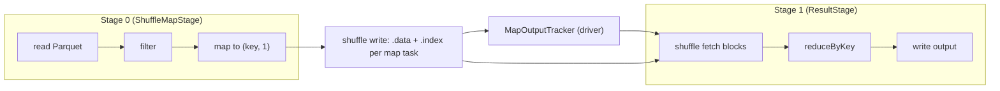

## In one minute
- Apache Spark is a distributed batch engine (with a micro-batch streaming mode) that runs a **driver** process planning work and many **executor** processes running it in parallel over partitions of data.
- Your code builds a lazy plan. An action triggers a **job**, which the scheduler splits into **stages** at every **shuffle** (a repartition by key), and each stage into one **task** per partition.
- The shuffle is the expensive part: map tasks write sorted, partitioned files to local disk and reduce tasks fetch them over the network. Most Spark tuning is about shuffling less or shuffling better.
- Fault tolerance comes from **lineage**: a lost partition is recomputed from its inputs rather than restored from a replica.
- Choose Spark for large ETL, joins and aggregations over terabytes in object storage, and batch ML. Avoid it for low-latency serving, data that fits on one machine, or tight-latency streaming (use Flink).

## How it works

### Driver, executors and the cluster manager
The driver runs your `main`, holds the `SparkSession`, and plans and schedules work. A cluster manager (YARN, Kubernetes or Spark standalone) launches executors, JVMs with a set number of cores and memory. Each core runs one task at a time, so 100 executors with 4 cores each run 400 tasks concurrently. With **Spark Connect** (since 3.4) the application is a thin client that sends unresolved logical plans to the driver over gRPC and gets Arrow batches back, so a misbehaving notebook no longer shares the driver's JVM; it gives up the RDD and `SparkContext` APIs ([Spark Connect overview](https://spark.apache.org/docs/latest/spark-connect-overview.html)).

### From DataFrame to physical plan
DataFrame and SQL code is parsed into a logical plan, which the **Catalyst** optimizer rewrites: predicate pushdown into Parquet scans, column pruning, constant folding, join reordering. The planner picks physical operators such as sort-merge join or broadcast hash join. **Whole-stage code generation** then fuses chains of operators into a single generated Java method per stage, avoiding virtual calls per row. **Adaptive Query Execution** (on by default since 3.2) re-plans at shuffle boundaries using the actual sizes of map outputs ([SQL performance tuning](https://spark.apache.org/docs/latest/sql-performance-tuning.html)). Since 4.0, Spark SQL also runs in ANSI mode by default (`spark.sql.ansi.enabled=true`): an overflow or invalid cast raises an error at runtime instead of quietly returning null ([Spark 4.0 release notes](https://spark.apache.org/releases/spark-release-4-0-0.html), [configuration](https://spark.apache.org/docs/latest/configuration.html)).

### Narrow and wide dependencies
A **narrow** dependency means each output partition depends on a bounded set of input partitions on the same task: `map`, `filter`, `union`, reading a file. These pipeline inside one task with no data movement. A **wide** (shuffle) dependency means an output partition needs data from many input partitions: `groupByKey`, `reduceByKey`, `join` on differently partitioned inputs, `repartition`, `distinct`. The **DAGScheduler** walks the lineage backwards from the action and starts a new stage at each shuffle dependency.

### Caching and storage
`cache()` or `persist()` keeps computed partitions in executor memory or on local disk via the **BlockManager**, so later jobs skip recomputing them. Output normally goes to object storage in columnar formats (Parquet, ORC) or table formats (Delta Lake, Iceberg, Hudi) that add transactions on top.

## Down the stack

### Layer 1: The contract
Spark promises that an action produces the same result as running the transformation sequentially, as long as your functions are deterministic, regardless of executor failures: lost tasks are retried (`spark.task.maxFailures`, default 4 consecutive failures of one task) ([configuration](https://spark.apache.org/docs/latest/configuration.html)) and lost shuffle output is recomputed by rerunning parent stages. It does not promise exactly-once side effects from inside tasks, because retried or speculative tasks run your code more than once; writes are made safe by output committers and table formats that commit atomically at the end. Latency is batch-shaped: a job with several shuffles over terabytes takes minutes. Structured Streaming micro-batches can get as low as about 100 ms end to end with exactly-once guarantees, and usually run at seconds ([Structured Streaming guide](https://spark.apache.org/docs/latest/streaming/index.html)). Spark 4.1 added a real-time mode for continuous, sub-second processing, initially for stateless Scala queries ([Spark 4.1 release notes](https://spark.apache.org/releases/spark-release-4.1.0.html)).

### Layer 2: The mechanism
**Stage construction.** For the job's final RDD the DAGScheduler creates a `ResultStage` and walks dependencies: narrow ones join the current stage, and each `ShuffleDependency` creates or reuses (by shuffle ID) a `ShuffleMapStage`. A stage is submitted once its parents finish, as a `TaskSet` with one task per partition. The `TaskScheduler` prefers executors holding the input (`PROCESS_LOCAL`, `NODE_LOCAL`, then `ANY`), waiting up to `spark.locality.wait` (3 seconds per locality level) for a better slot.

**Sort-based shuffle.** Each map task partitions records by the reducer's partitioner (hash of key modulo N), buffering in memory and spilling sorted runs to disk when full. It then merges spills into one data file plus an index of byte offsets per reduce partition: `shuffle_<shuffleId>_<mapId>_0.data` and `.index`. The driver's `MapOutputTracker` records each map output's location and block sizes. Reducers fetch blocks over Netty from remote BlockManagers or the external shuffle service, capped by `spark.reducer.maxSizeInFlight` (48 MiB). A failed fetch raises `FetchFailed`, and the parent map stage is resubmitted for the missing outputs. That partial rerun is only correct if the map stage reproduces the same output; Spark 4.1 added a checksum-based full retry of a shuffle stage to catch the cases where it does not ([Spark 4.1 release notes](https://spark.apache.org/releases/spark-release-4.1.0.html)).

**AQE.** After a map stage, AQE reads real partition sizes, coalesces small shuffle partitions (so the default `spark.sql.shuffle.partitions=200` matters less), splits skewed join partitions, and switches to a broadcast hash join when a side is under `spark.sql.autoBroadcastJoinThreshold` (10 MB) ([SQL performance tuning](https://spark.apache.org/docs/latest/sql-performance-tuning.html)).

**Memory.** `spark.memory.fraction` (0.6) of heap minus 300 MB is shared by execution and storage; execution can evict cached blocks down to `spark.memory.storageFraction` (0.5) ([Tuning Spark](https://spark.apache.org/docs/latest/tuning.html)). Tungsten keeps rows in compact binary form, on or off heap.

### Layer 3: The machine
A Parquet scan reads columns in large sequential ranges, decompresses (Snappy or Zstd) and decodes into vectorised batches; one core can scan several hundred MB/s of compressed data for simple filters (hedge: depends heavily on schema and codec). Object storage adds 20 to 100 ms of first-byte latency per request, which is why files under about 32 MB hurt and 128 MB to 1 GB files work well; `spark.sql.files.maxPartitionBytes` (128 MB) sets the split size.

With M map tasks and R reduce partitions a shuffle has M x R blocks: 2,000 x 2,000 is 4 million small random reads. On HDDs at 100 to 200 IOPS that is catastrophic; on NVMe it is tolerable. A 2 TB shuffle on 100 nodes with 25 Gbit/s NICs moves 20 GB per node in about 7 seconds of raw transfer, so serialisation, compression and spills usually dominate.

Very large heaps (over about 64 GB) risk multi-second GC pauses, so executors are commonly 4 to 5 cores and 16 to 40 GB with G1 GC.

### Why it's built this way
1. MapReduce wrote every intermediate step to replicated HDFS, which was slow for multi-step jobs, so Spark keeps intermediate data in memory and pipelines narrow transformations.
2. Keeping data only in memory means it can be lost, so Spark records lineage and recomputes lost partitions instead of paying for replication on every step ([RDD paper](https://www.usenix.org/system/files/conference/nsdi12/nsdi12-final138.pdf)).
3. Some operations need all values for a key in one place, which requires moving data across the network; shuffle boundaries are therefore natural checkpoints, and map outputs are written to local disk so a failed reducer does not rerun the whole job.
4. Static plans guess wrong about data sizes, so AQE re-plans at each shuffle boundary, where exact sizes are finally known.
5. JVM objects waste memory and stress the GC, so Tungsten stores binary rows and generates code that operates on them directly.

## Diagram


## Worked example
A nightly job joins 3 TB of clickstream events (Parquet, 30 days) with a 40 GB user table and a 200 MB country table, then aggregates sessions per user per day.

Scanning 3 TB at 128 MB per split is about 24,000 tasks; on 250 cores at about 10 seconds per task, that is 96 waves, roughly 16 minutes. Pushing the date filter into Parquet and reading 8 of 60 columns cuts bytes read to about a quarter.

The country table is broadcast (200 MB to 50 executors, 10 GB of network), so its join needs no shuffle. The user join is a sort-merge join with both sides shuffled by `user_id`; the events side shuffles about 600 GB. With the default 200 partitions that is 3 GB per reduce task, which spills heavily, so the job starts at 3,000 partitions (200 MB each) and lets AQE coalesce. A bot user with 2 percent of events creates a 12 GB partition; AQE skew handling splits it, or bots are filtered first. The final `groupBy(user_id, date)` reuses the `user_id` partitioning and does not shuffle again.

## In the wild
- **Apache Spark, 2018: a retry that changed the answer.** SPARK-23207, a blocker labelled "correctness": `repartition` uses round-robin partitioning, whose output depends on row order. When an executor died in a job with several shuffles, retried tasks could see rows in a different order and produce different data; the reporter's job returned 931,532 rows instead of 1,000,000. Fixed in 2.1.4, 2.2.3 and 2.3.0, it is the lineage contract failing on non-deterministic input, the same reason 4.1 added checksum-based stage retries ([Apache JIRA](https://issues.apache.org/jira/browse/SPARK-23207)).
- **Uber, 2018: rewriting 100 TB to add 100 GB.** Uber's Spark ingestion rebuilt whole tables from snapshots: one run took over 20 hours on more than 1,000 executors, rewrote a table of over 100 TB for about 100 GB of new daily data, and made data visible only every 24 hours. Moving to Hudi upserts and incremental pulls cut latency to under an hour. The cost of a batch job is the bytes it rewrites, not the bytes that changed ([Uber Engineering](https://www.uber.com/en-US/blog/uber-big-data-platform/)).

## Trade-offs
| Option | Strengths | Weaknesses | Choose when |
|---|---|---|---|
| Spark | Mature, SQL plus code, scales to petabytes, rich ecosystem | Shuffle and JVM tuning, seconds of overhead per job | Large batch ETL, joins, ML feature pipelines |
| Flink | True streaming, event time, large state | Smaller batch ecosystem | Low-latency stateful streaming |
| Warehouse SQL (BigQuery, Snowflake, Redshift) | No cluster tuning, fast interactive SQL | Cost at very large scale, less control over custom code | SQL analytics and BI |
| Trino or Presto | Fast interactive federated queries | Not built for long fault-tolerant ETL | Ad hoc queries over a lake |
| Single node (DuckDB, Polars) | No distribution overhead, very fast up to hundreds of GB | One machine's limits | Data fits on one large box |

## Pitfalls in production
- **Small files.** Thousands of tiny files mean tiny tasks and slow listing. Compact to 128 MB to 1 GB files.
- **Skewed keys.** One task runs for an hour while 999 finish in a minute. Enable AQE skew handling or salt hot keys.
- **`collect()` on big data.** The driver runs out of memory. Write results out instead.
- **Wrong shuffle partition count.** Too few spill, too many add scheduling overhead. Aim for 100 to 200 MB per partition.
- **Python UDFs.** Row-at-a-time UDFs serialise every row to Python. Prefer built-ins or Arrow-based pandas UDFs.
- **Non-deterministic tasks.** Random IDs or `now()` change on recomputation. Derive them deterministically.
- **Upgrading to 4.x without testing SQL.** ANSI mode turns silent nulls into job failures, and 4.0 requires Java 17 and Scala 2.13 ([Spark 4.0 release notes](https://spark.apache.org/releases/spark-release-4-0-0.html)). Run the old and new versions on the same input and diff the outputs before switching.

## Leadership lens
- In review, ask for the physical plan (`explain`) and the Spark UI stage view of a representative run; the number of shuffles and their sizes predict cost better than code reading.
- Decide on a table format (Delta, Iceberg) early; it determines how writes commit atomically, how small files get compacted and how schemas evolve.
- Cluster cost is mostly executor-hours, so right-sizing, spot instances for stateless executors and autoscaling matter more than micro-optimising code.
- Ask whether the data really needs a cluster; many "big data" jobs fit in memory on one large machine.

## Check yourself
1. Why does `reduceByKey` usually shuffle less data than `groupByKey` followed by a sum?
   **Answer:** `reduceByKey` combines values per key on the map side before the shuffle, so each map task sends one partial sum per key instead of every value.
2. A reduce task fails with `FetchFailed`. What does Spark do?
   **Answer:** It marks that location's map outputs lost, reruns the parent map stage for just those outputs, then retries the reduce stage.
3. Why do two joins on the same key not always need two shuffles?
   **Answer:** If both inputs of the second join are already hash-partitioned on that key with the same partition count, the dependency is narrow and Spark reuses the existing partitioning.
4. Why is a single giant executor with 64 cores and 512 GB heap usually worse than many smaller ones?
   **Answer:** Large heaps cause long GC pauses, and one failure loses much more work and cached data.

## Practice
**Task:** Implement the DAGScheduler's stage splitter. Inputs: `partitions` (node ID to partition count), `deps` as `(child, parent, kind)` with kind `narrow` or `shuffle`, and a `target`. A stage's root is the target or any node read through a shuffle. Its nodes are those reachable from the root via narrow dependencies (a node may sit in several stages), its parents are the roots of those nodes' shuffle dependencies, and its tasks equal the root's partitions. Return `(root, sorted nodes, sorted parents, tasks)` in topological order, smallest ready root first. Unknown kinds or targets are errors.

```python starter
def build_stages(partitions, deps, target):
    # TODO
    raise NotImplementedError
```

```python tests
def test_single_narrow_chain():
    parts = {1: 4, 2: 4, 3: 4}
    deps = [(2, 1, "narrow"), (3, 2, "narrow")]
    assert build_stages(parts, deps, 3) == [(3, [1, 2, 3], [], 4)]

def test_word_count_two_stages():
    parts = {1: 8, 2: 8, 3: 8, 4: 3, 5: 3}
    deps = [(2, 1, "narrow"), (3, 2, "narrow"), (4, 3, "shuffle"), (5, 4, "narrow")]
    assert build_stages(parts, deps, 5) == [(3, [1, 2, 3], [], 8), (5, [4, 5], [3], 3)]

def test_join_of_two_shuffled_inputs():
    parts = {1: 2, 2: 2, 3: 5, 4: 5, 5: 6, 6: 6}
    deps = [(2, 1, "narrow"), (4, 3, "narrow"), (5, 2, "shuffle"), (5, 4, "shuffle"), (6, 5, "narrow")]
    assert build_stages(parts, deps, 6) == [(2, [1, 2], [], 2), (4, [3, 4], [], 5), (6, [5, 6], [2, 4], 6)]

def test_shared_narrow_ancestor_in_two_stages():
    parts = {1: 4, 2: 4, 3: 4, 4: 2}
    deps = [(2, 1, "narrow"), (3, 1, "narrow"), (4, 2, "shuffle"), (4, 3, "shuffle")]
    assert build_stages(parts, deps, 4) == [(2, [1, 2], [], 4), (3, [1, 3], [], 4), (4, [4], [2, 3], 2)]

def test_shared_shuffle_parent_reused():
    parts = {1: 4, 2: 2, 3: 2, 4: 4}
    deps = [(2, 1, "shuffle"), (3, 1, "shuffle"), (4, 2, "narrow"), (4, 3, "narrow")]
    assert build_stages(parts, deps, 4) == [(1, [1], [], 4), (4, [2, 3, 4], [1], 4)]

def test_topological_before_id_order():
    parts = {1: 1, 9: 2, 4: 3}
    deps = [(1, 9, "shuffle"), (9, 4, "shuffle")]
    assert build_stages(parts, deps, 1) == [(4, [4], [], 3), (9, [9], [4], 2), (1, [1], [9], 1)]

def test_unreachable_nodes_ignored():
    parts = {1: 1, 2: 1, 7: 1}
    deps = [(2, 1, "narrow"), (7, 2, "shuffle")]
    assert build_stages(parts, deps, 2) == [(2, [1, 2], [], 1)]

def test_errors():
    for args in [({1: 1, 2: 1}, [(2, 1, "wide")], 2), ({1: 1}, [], 5)]:
        try:
            build_stages(*args)
            assert False, "expected ValueError"
        except ValueError:
            pass
```

```python solution
import heapq


def build_stages(partitions, deps, target):
    if target not in partitions:
        raise ValueError("unknown target")
    parents_of = {}
    for child, parent, kind in deps:
        if kind not in ("narrow", "shuffle"):
            raise ValueError("unknown dependency kind: " + kind)
        parents_of.setdefault(child, []).append((parent, kind))

    stages = {}

    def make(root):
        if root in stages:
            return
        nodes, shuffle_parents = set(), set()
        stack = [root]
        while stack:
            n = stack.pop()
            if n in nodes:
                continue
            nodes.add(n)
            for p, kind in parents_of.get(n, []):
                if kind == "narrow":
                    stack.append(p)
                else:
                    shuffle_parents.add(p)
        stages[root] = (sorted(nodes), sorted(shuffle_parents))
        for p in shuffle_parents:
            make(p)

    make(target)
    waiting = {r: len(stages[r][1]) for r in stages}
    children = {r: [] for r in stages}
    for r, (_, ps) in stages.items():
        for p in ps:
            children[p].append(r)
    ready = [r for r, n in waiting.items() if n == 0]
    heapq.heapify(ready)
    out = []
    while ready:
        r = heapq.heappop(ready)
        nodes, ps = stages[r]
        out.append((r, nodes, ps, partitions[r]))
        for c in children[r]:
            waiting[c] -= 1
            if waiting[c] == 0:
                heapq.heappush(ready, c)
    return out
```

```typescript starter
export interface Stage {
  root: number;
  nodes: number[];
  parents: number[];
  tasks: number;
}

export function buildStages(
  partitions: Record<number, number>,
  deps: [number, number, string][],
  target: number
): Stage[] {
  throw new Error("TODO");
}
```

```typescript tests
function st(root: number, nodes: number[], parents: number[], tasks: number): Stage {
  return { root, nodes, parents, tasks };
}

test("single narrow chain", () => {
  assertEqual(buildStages({ 1: 4, 2: 4, 3: 4 }, [[2, 1, "narrow"], [3, 2, "narrow"]], 3), [st(3, [1, 2, 3], [], 4)]);
});

test("word count two stages", () => {
  const deps: [number, number, string][] = [[2, 1, "narrow"], [3, 2, "narrow"], [4, 3, "shuffle"], [5, 4, "narrow"]];
  assertEqual(buildStages({ 1: 8, 2: 8, 3: 8, 4: 3, 5: 3 }, deps, 5), [st(3, [1, 2, 3], [], 8), st(5, [4, 5], [3], 3)]);
});

test("join of two shuffled inputs", () => {
  const deps: [number, number, string][] = [[2, 1, "narrow"], [4, 3, "narrow"], [5, 2, "shuffle"], [5, 4, "shuffle"], [6, 5, "narrow"]];
  assertEqual(buildStages({ 1: 2, 2: 2, 3: 5, 4: 5, 5: 6, 6: 6 }, deps, 6),
    [st(2, [1, 2], [], 2), st(4, [3, 4], [], 5), st(6, [5, 6], [2, 4], 6)]);
});

test("shared narrow ancestor in two stages", () => {
  const deps: [number, number, string][] = [[2, 1, "narrow"], [3, 1, "narrow"], [4, 2, "shuffle"], [4, 3, "shuffle"]];
  assertEqual(buildStages({ 1: 4, 2: 4, 3: 4, 4: 2 }, deps, 4),
    [st(2, [1, 2], [], 4), st(3, [1, 3], [], 4), st(4, [4], [2, 3], 2)]);
});

test("shared shuffle parent reused", () => {
  const deps: [number, number, string][] = [[2, 1, "shuffle"], [3, 1, "shuffle"], [4, 2, "narrow"], [4, 3, "narrow"]];
  assertEqual(buildStages({ 1: 4, 2: 2, 3: 2, 4: 4 }, deps, 4), [st(1, [1], [], 4), st(4, [2, 3, 4], [1], 4)]);
});

test("topological before id order", () => {
  const deps: [number, number, string][] = [[1, 9, "shuffle"], [9, 4, "shuffle"]];
  assertEqual(buildStages({ 1: 1, 9: 2, 4: 3 }, deps, 1), [st(4, [4], [], 3), st(9, [9], [4], 2), st(1, [1], [9], 1)]);
});

test("unreachable nodes ignored", () => {
  assertEqual(buildStages({ 1: 1, 2: 1, 7: 1 }, [[2, 1, "narrow"], [7, 2, "shuffle"]], 2), [st(2, [1, 2], [], 1)]);
});

test("errors", () => {
  let n = 0;
  try { buildStages({ 1: 1, 2: 1 }, [[2, 1, "wide"]], 2); } catch (e) { n++; }
  try { buildStages({ 1: 1 }, [], 5); } catch (e) { n++; }
  assertEqual(n, 2, "both calls must throw");
});
```

```typescript solution
export interface Stage {
  root: number;
  nodes: number[];
  parents: number[];
  tasks: number;
}

export function buildStages(
  partitions: Record<number, number>,
  deps: [number, number, string][],
  target: number
): Stage[] {
  if (!(target in partitions)) throw new Error("unknown target");
  const parentsOf = new Map<number, [number, string][]>();
  for (const [child, parent, kind] of deps) {
    if (kind !== "narrow" && kind !== "shuffle") throw new Error("unknown kind " + kind);
    if (!parentsOf.has(child)) parentsOf.set(child, []);
    parentsOf.get(child)!.push([parent, kind]);
  }
  const stages = new Map<number, { nodes: number[]; parents: number[] }>();
  const byNum = (a: number, b: number) => a - b;
  const make = (root: number): void => {
    if (stages.has(root)) return;
    const nodes = new Set<number>();
    const sp = new Set<number>();
    const stack = [root];
    while (stack.length) {
      const n = stack.pop()!;
      if (nodes.has(n)) continue;
      nodes.add(n);
      for (const [p, kind] of parentsOf.get(n) || []) {
        if (kind === "narrow") stack.push(p);
        else sp.add(p);
      }
    }
    stages.set(root, { nodes: Array.from(nodes).sort(byNum), parents: Array.from(sp).sort(byNum) });
    sp.forEach((p) => make(p));
  };
  make(target);
  const waiting = new Map<number, number>();
  const children = new Map<number, number[]>();
  stages.forEach((s, r) => { waiting.set(r, s.parents.length); children.set(r, []); });
  stages.forEach((s, r) => s.parents.forEach((p) => children.get(p)!.push(r)));
  let ready = Array.from(waiting.keys()).filter((r) => waiting.get(r) === 0);
  const out: Stage[] = [];
  while (ready.length) {
    ready.sort(byNum);
    const r = ready.shift()!;
    const s = stages.get(r)!;
    out.push({ root: r, nodes: s.nodes, parents: s.parents, tasks: partitions[r] });
    for (const c of children.get(r)!) {
      waiting.set(c, waiting.get(c)! - 1);
      if (waiting.get(c) === 0) ready.push(c);
    }
  }
  return out;
}
```

```go starter
package practice

type Dep struct {
	Child, Parent int
	Kind          string
}

type Stage struct {
	Root    int
	Nodes   []int
	Parents []int
	Tasks   int
}

func BuildStages(partitions map[int]int, deps []Dep, target int) ([]Stage, error) {
	// TODO
	panic("TODO")
}
```

```go tests
package practice

import (
	"reflect"
	"testing"
)

func run(t *testing.T, parts map[int]int, deps []Dep, target int, want []Stage) {
	t.Helper()
	got, err := BuildStages(parts, deps, target)
	if err != nil {
		t.Fatalf("unexpected error %v", err)
	}
	if !reflect.DeepEqual(got, want) {
		t.Fatalf("got %+v\nwant %+v", got, want)
	}
}

func TestSingleNarrowChain(t *testing.T) {
	run(t, map[int]int{1: 4, 2: 4, 3: 4}, []Dep{{2, 1, "narrow"}, {3, 2, "narrow"}}, 3,
		[]Stage{{3, []int{1, 2, 3}, []int{}, 4}})
}

func TestWordCountTwoStages(t *testing.T) {
	run(t, map[int]int{1: 8, 2: 8, 3: 8, 4: 3, 5: 3},
		[]Dep{{2, 1, "narrow"}, {3, 2, "narrow"}, {4, 3, "shuffle"}, {5, 4, "narrow"}}, 5,
		[]Stage{{3, []int{1, 2, 3}, []int{}, 8}, {5, []int{4, 5}, []int{3}, 3}})
}

func TestJoinOfTwoShuffledInputs(t *testing.T) {
	run(t, map[int]int{1: 2, 2: 2, 3: 5, 4: 5, 5: 6, 6: 6},
		[]Dep{{2, 1, "narrow"}, {4, 3, "narrow"}, {5, 2, "shuffle"}, {5, 4, "shuffle"}, {6, 5, "narrow"}}, 6,
		[]Stage{{2, []int{1, 2}, []int{}, 2}, {4, []int{3, 4}, []int{}, 5}, {6, []int{5, 6}, []int{2, 4}, 6}})
}

func TestSharedNarrowAncestorInTwoStages(t *testing.T) {
	run(t, map[int]int{1: 4, 2: 4, 3: 4, 4: 2},
		[]Dep{{2, 1, "narrow"}, {3, 1, "narrow"}, {4, 2, "shuffle"}, {4, 3, "shuffle"}}, 4,
		[]Stage{{2, []int{1, 2}, []int{}, 4}, {3, []int{1, 3}, []int{}, 4}, {4, []int{4}, []int{2, 3}, 2}})
}

func TestSharedShuffleParentReused(t *testing.T) {
	run(t, map[int]int{1: 4, 2: 2, 3: 2, 4: 4},
		[]Dep{{2, 1, "shuffle"}, {3, 1, "shuffle"}, {4, 2, "narrow"}, {4, 3, "narrow"}}, 4,
		[]Stage{{1, []int{1}, []int{}, 4}, {4, []int{2, 3, 4}, []int{1}, 4}})
}

func TestTopologicalBeforeIDOrder(t *testing.T) {
	run(t, map[int]int{1: 1, 9: 2, 4: 3}, []Dep{{1, 9, "shuffle"}, {9, 4, "shuffle"}}, 1,
		[]Stage{{4, []int{4}, []int{}, 3}, {9, []int{9}, []int{4}, 2}, {1, []int{1}, []int{9}, 1}})
}

func TestUnreachableNodesIgnored(t *testing.T) {
	run(t, map[int]int{1: 1, 2: 1, 7: 1}, []Dep{{2, 1, "narrow"}, {7, 2, "shuffle"}}, 2,
		[]Stage{{2, []int{1, 2}, []int{}, 1}})
}

func TestErrors(t *testing.T) {
	if _, err := BuildStages(map[int]int{1: 1, 2: 1}, []Dep{{2, 1, "wide"}}, 2); err == nil {
		t.Fatal("unknown kind must fail")
	}
	if _, err := BuildStages(map[int]int{1: 1}, nil, 5); err == nil {
		t.Fatal("unknown target must fail")
	}
}
```

```go solution
package practice

import (
	"fmt"
	"sort"
)

type Dep struct {
	Child, Parent int
	Kind          string
}

type Stage struct {
	Root    int
	Nodes   []int
	Parents []int
	Tasks   int
}

type edge struct {
	parent int
	kind   string
}

func sortedKeys(m map[int]bool) []int {
	out := []int{}
	for k := range m {
		out = append(out, k)
	}
	sort.Ints(out)
	return out
}

func BuildStages(partitions map[int]int, deps []Dep, target int) ([]Stage, error) {
	if _, ok := partitions[target]; !ok {
		return nil, fmt.Errorf("unknown target %d", target)
	}
	parentsOf := map[int][]edge{}
	for _, d := range deps {
		if d.Kind != "narrow" && d.Kind != "shuffle" {
			return nil, fmt.Errorf("unknown dependency kind %q", d.Kind)
		}
		parentsOf[d.Child] = append(parentsOf[d.Child], edge{d.Parent, d.Kind})
	}
	stages := map[int]Stage{}
	var make_ func(root int)
	make_ = func(root int) {
		if _, ok := stages[root]; ok {
			return
		}
		nodes, sp := map[int]bool{}, map[int]bool{}
		stack := []int{root}
		for len(stack) > 0 {
			n := stack[len(stack)-1]
			stack = stack[:len(stack)-1]
			if nodes[n] {
				continue
			}
			nodes[n] = true
			for _, e := range parentsOf[n] {
				if e.kind == "narrow" {
					stack = append(stack, e.parent)
				} else {
					sp[e.parent] = true
				}
			}
		}
		stages[root] = Stage{root, sortedKeys(nodes), sortedKeys(sp), partitions[root]}
		for p := range sp {
			make_(p)
		}
	}
	make_(target)

	waiting := map[int]int{}
	children := map[int][]int{}
	ready := []int{}
	for r, s := range stages {
		waiting[r] = len(s.Parents)
		for _, p := range s.Parents {
			children[p] = append(children[p], r)
		}
		if len(s.Parents) == 0 {
			ready = append(ready, r)
		}
	}
	out := []Stage{}
	for len(ready) > 0 {
		sort.Ints(ready)
		r := ready[0]
		ready = ready[1:]
		out = append(out, stages[r])
		for _, c := range children[r] {
			waiting[c]--
			if waiting[c] == 0 {
				ready = append(ready, c)
			}
		}
	}
	return out, nil
}
```

## Mock interview
**Prompt:** Your team runs a daily Spark job that builds a 2 TB user-feature table from 20 TB of raw events and three dimension tables. It used to take 40 minutes and now takes 5 hours, with a few tasks in the final stage running far longer than the rest. Diagnose and fix it.

- Follow-up: what in the Spark UI tells you it is skew rather than too little capacity?
- Follow-up: salting fixes the join but the aggregation afterwards is still slow. Why?
- Follow-up: the business now wants the features updated every 5 minutes. What changes?

**A strong answer covers:**
- Stage view: shuffle read size and task time with max far above median means skew; uniform slowness with spills means too few partitions.
- Fixes: AQE skew join, isolating hot keys, salting with two-phase aggregation, broadcasting small dimensions.
- Partitions of 100 to 200 MB, spill metrics, and reusing partitioning to avoid a second shuffle.
- Compacted output and an atomic table-format commit so reruns are idempotent.
- For 5-minute freshness, incremental Structured Streaming or Flink over a change feed, keeping batch for backfills.

## Sources and further study
**Primary**
- [MapReduce: Simplified Data Processing on Large Clusters (OSDI 2004)](https://static.googleusercontent.com/media/research.google.com/en//archive/mapreduce-osdi04.pdf): the map, shuffle, reduce model and re-execution on failure that Spark generalises.
- [Spark SQL: Relational Data Processing in Spark (SIGMOD 2015)](https://people.csail.mit.edu/matei/papers/2015/sigmod_spark_sql.pdf): the DataFrame API and the Catalyst optimizer.
- [Structured Streaming (SIGMOD 2018)](https://people.eecs.berkeley.edu/~matei/papers/2018/sigmod_structured_streaming.pdf): streaming as incremental execution of a batch query, and its micro-batch design.

**Systems docs**
- [Spark 4.0.0 release notes](https://spark.apache.org/releases/spark-release-4-0-0.html): ANSI mode by default, JDK 17 and Scala 2.13, Spark Connect changes.
- [Spark 4.1.0 release notes](https://spark.apache.org/releases/spark-release-4.1.0.html): real-time mode, declarative pipelines and checksum-based shuffle retries.
- [Spark configuration reference](https://spark.apache.org/docs/latest/configuration.html): current defaults for scheduling, shuffle, memory and SQL.

**Books**
- *Designing Data-Intensive Applications*, 2nd ed., Kleppmann and Riccomini, Ch 11 "Batch Processing" (Batch Processing in Distributed Systems; Batch Processing Models).
- *Designing Data-Intensive Applications*, 1st ed., Kleppmann, Ch 10 "Batch Processing" (Beyond MapReduce: dataflow engines, materialisation and fault tolerance).

**Other curricula**
- [Azure Architecture Center: choose a batch processing technology](https://learn.microsoft.com/en-us/azure/architecture/data-guide/technology-choices/batch-processing): frames Spark-based services by managed versus self-run, bursty workloads and auto-termination.
- [roadmap.sh: Software Architect](https://roadmap.sh/software-architect): lists Apache Spark under big data tools an architect should be able to place, next to Hadoop MapReduce.

## Watch
- [A Deeper Understanding of Spark Internals (Spark Summit)](https://www.youtube.com/watch?v=dmL0N3qfSc8): Aaron Davidson on the execution model, stages, the shuffle and common performance problems.

## Free resources
- [RDD programming guide](https://spark.apache.org/docs/latest/rdd-programming-guide.html): official explanation of transformations, actions, shuffles and persistence.
- [Performance tuning for Spark SQL](https://spark.apache.org/docs/latest/sql-performance-tuning.html): AQE, join strategies, skew handling and partition settings.
- [Tuning Spark](https://spark.apache.org/docs/latest/tuning.html): memory management, serialisation and GC guidance.
- [Job scheduling](https://spark.apache.org/docs/latest/job-scheduling.html): how applications and jobs share a cluster, including dynamic allocation.
- [Resilient Distributed Datasets (NSDI 2012)](https://www.usenix.org/system/files/conference/nsdi12/nsdi12-final138.pdf): the original paper on RDDs, lineage and narrow versus wide dependencies.
