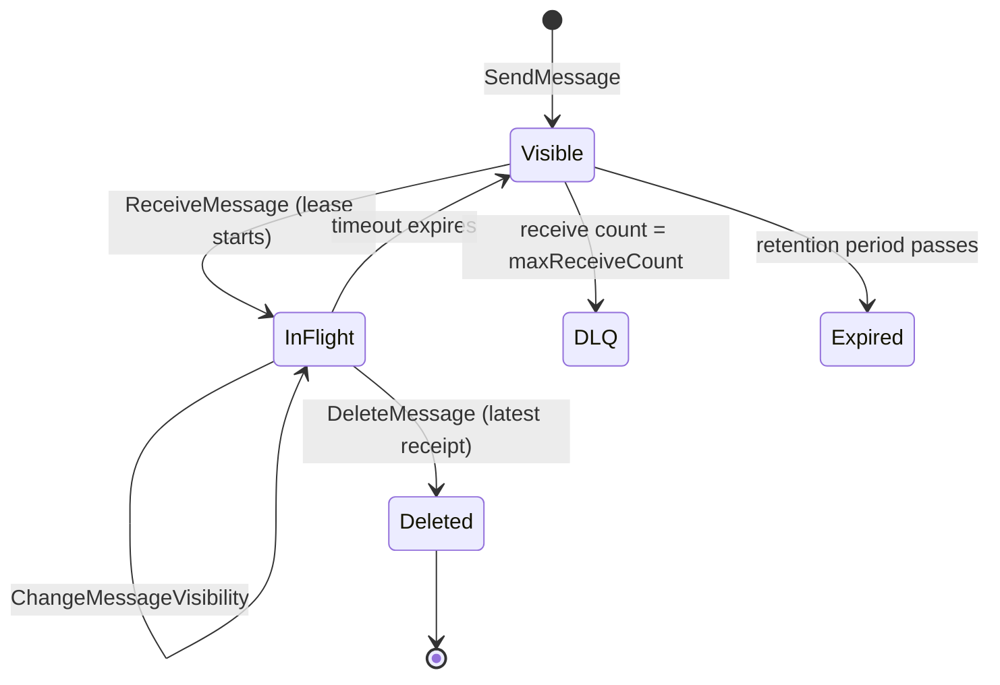

## In one minute
- Amazon SQS is a fully managed queue behind an HTTPS API. You `SendMessage`, consumers `ReceiveMessage`, and a message stays in the queue until someone calls `DeleteMessage` with the receipt handle from their receive.
- The **visibility timeout** is the whole delivery model: a received message is hidden, not removed, and reappears if it is not deleted in time. That gives at-least-once delivery with no consumer registration at all.
- **Standard** queues scale almost without limit but may deliver twice and out of order. **FIFO** queues give ordering per message group and deduplication, at lower throughput.
- There are no servers to size. You pay per request (a 64 KB chunk counts as one request), and the operational work moves to choosing timeouts, batching, dead-letter queues and idempotent consumers.
- Choose it for decoupling AWS services and smoothing load spikes. Avoid it when you need replay, fan-out to many consumers (pair it with SNS or EventBridge), or sub-10 ms latency.

## How it works

### The message lifecycle
A producer sends a message of up to 1 MiB, raised from 256 KiB on 4 August 2025 ([AWS announcement](https://aws.amazon.com/about-aws/whats-new/2025/08/amazon-sqs-max-payload-size-1mib/)). SQS stores it redundantly before returning a message ID. A consumer calls `ReceiveMessage` for up to 10 messages. Each returned message carries a **receipt handle**, which is tied to that particular receive. The message becomes invisible for the queue's visibility timeout (default 30 seconds, maximum 12 hours) ([SQS message quotas](https://docs.aws.amazon.com/AWSSimpleQueueService/latest/SQSDeveloperGuide/quotas-messages.html)). If the consumer finishes, it calls `DeleteMessage` with the receipt handle. About 120,000 messages can be in flight per queue; past that, short polls get `OverLimit` and long polls simply return nothing ([queue quotas](https://docs.aws.amazon.com/AWSSimpleQueueService/latest/SQSDeveloperGuide/quotas-queues.html)). If a consumer crashes or runs long, the timeout expires and the message becomes visible again for another consumer, with its `ApproximateReceiveCount` incremented. A consumer that needs more time calls `ChangeMessageVisibility` to extend the timer.

### Polling
Consumers pull. **Short polling** (`WaitTimeSeconds=0`) queries a subset of SQS's storage hosts and returns immediately, so it can return nothing even when messages exist. **Long polling** (up to 20 seconds) waits until a message arrives or the wait expires and queries all hosts, which cuts empty responses and cost ([polling docs](https://docs.aws.amazon.com/AWSSimpleQueueService/latest/SQSDeveloperGuide/sqs-short-and-long-polling.html)). Long polling should be the default.

### Failure handling
A **redrive policy** names a dead-letter queue and a `maxReceiveCount`. When a message has been received that many times without being deleted, SQS moves it to the DLQ rather than delivering it again, so one poison message cannot consume your fleet forever. Messages expire after the retention period (1 minute to 14 days, default 4 days). **Delay queues** and per-message timers hide new messages for up to 15 minutes. To recover, a redrive task (`StartMessageMoveTask`) moves DLQ messages back to the source or another queue of the same type, optionally capped at up to 500 messages per second; moved messages get new IDs and a fresh retention clock, and nothing can be filtered or edited on the way ([DLQ redrive](https://docs.aws.amazon.com/AWSSimpleQueueService/latest/SQSDeveloperGuide/sqs-configure-dead-letter-queue-redrive.html)).

### FIFO queues
A FIFO queue requires a `MessageGroupId`. Messages in the same group are delivered in order, and while any message of a group is in flight, no later message of that group is handed out, which is how ordering survives multiple consumers. A `MessageDeduplicationId` (or content-based hashing) suppresses duplicates sent within a 5-minute window. Different groups proceed in parallel, so the group ID is your unit of both ordering and parallelism.

### Fair queues
Since July 2025 a `MessageGroupId` also means something on a *standard* queue: it names a tenant, not an ordering group. SQS watches how in-flight messages split across tenants, and when one tenant holds a disproportionate share and builds a backlog, it serves quiet tenants' messages first. The noisy tenant is not rate-limited, consumers need no changes, and throughput stays standard-queue unlimited ([fair queues docs](https://docs.aws.amazon.com/AWSSimpleQueueService/latest/SQSDeveloperGuide/sqs-fair-queues.html), [AWS Compute blog](https://aws.amazon.com/blogs/compute/building-resilient-multi-tenant-systems-with-amazon-sqs-fair-queues/)). This is the noisy-neighbour shape, solved inside the queue instead of with one queue per tenant.

## Down the stack

### Layer 1: The contract
Standard queues guarantee at-least-once delivery and best-effort ordering: an acknowledged send is delivered one or more times until deleted or expired, possibly out of order and occasionally duplicated even when consumers behave perfectly, because a storage server holding one copy can be unreachable when you delete ([at-least-once delivery](https://docs.aws.amazon.com/AWSSimpleQueueService/latest/SQSDeveloperGuide/standard-queues-at-least-once-delivery.html)). FIFO queues drop sends that repeat a deduplication ID within 5 minutes and keep strict order within a message group, but a consumer that overruns its timeout still causes redelivery. The visibility timeout is a lease, not a lock. Standard throughput is nearly unlimited; FIFO allows 300 calls per second per action per partition (3,000 messages with batches of 10). High-throughput mode raises that to 70,000 calls per second per action in N. Virginia, Oregon and Ireland (700,000 messages batched), but only 2,400 in many smaller regions ([SQS message quotas](https://docs.aws.amazon.com/AWSSimpleQueueService/latest/SQSDeveloperGuide/quotas-messages.html)).

### Layer 2: The mechanism
AWS publishes little about SQS internals, so treat this as a model consistent with public material, not a spec. A front-end fleet terminates HTTPS, verifies the SigV4 signature, checks quotas and routes to back-end storage hosts that hold partitions of the queue. A message is written to several hosts across availability zones before the send returns. Standard queues spread messages over many partitions with no global order, which is why throughput scales and why a receive can see a later message first, or a delete racing a host failure can leave a copy behind.

Each message is visible, in flight with an `invisible_until` timestamp, or deleted. A receive picks visible messages, sets `invisible_until = now + timeout`, increments the receive count and mints a fresh receipt handle. `DeleteMessage` and `ChangeMessageVisibility` must present the latest handle; an older one names a superseded lease. The redrive check runs at receive time: if the count already equals `maxReceiveCount`, the message moves to the DLQ.

FIFO queues partition by a hash of the group ID. Only the head of each group is deliverable, and the group stays locked while it has a message in flight. High-throughput FIFO spreads groups over more partitions, so it only helps with many distinct group IDs.

Since November 2023 the SDKs can speak the AWS JSON protocol instead of query/XML, which AWS measured at up to 23% lower end-to-end latency for 5 KB messages ([AWS announcement](https://aws.amazon.com/about-aws/whats-new/2023/11/amazon-sqs-support-json-protocol/)). Responses carry `MD5OfMessageBody` for verification. Every 64 KB of payload is billed as one request, so a 1 MiB message costs 16 ([SQS pricing](https://aws.amazon.com/sqs/pricing/)).

### Layer 3: The machine
Every call is a TLS-protected HTTP request, so cost per message depends on batching and connection reuse; the SDK connection pool often caps throughput before SQS does. With 15 ms per receive and 10 messages per call, one polling thread moves about 650 messages per second, so 20,000 per second needs about 30 pollers plus batched deletes.

Long polling holds the connection for up to 20 seconds, so client read timeouts must exceed the wait or the client aborts healthy polls and retries. Bodies are text, so binary payloads are base64-encoded, inflating them by a third; payloads above the limit go to S3 with a pointer in the message. At roughly $0.40 per million requests (hedge: check current pricing), a tight short-polling loop on an empty queue can cost more than the real traffic.

### Why it's built this way
1. AWS wanted a queue that never needs capacity planning, so messages are spread across many partitions with no global coordination.
2. Without global coordination there is no cheap global order or exactly-once delivery, so standard queues offer best effort and push idempotency to consumers.
3. Consumers fail in unknown ways, so instead of tracking consumers SQS uses a lease (visibility timeout) that expires on its own; no heartbeats or sessions are required.
4. Some workloads need order, so FIFO restricts ordering to a group and locks the group during processing, trading throughput for a guarantee scoped small enough to partition.
5. HTTPS calls cost milliseconds and money, so the API batches 10 messages per call and long polling replaces busy loops.

## Diagram


## Worked example
A video platform enqueues a transcoding job for each upload: 2 million uploads per day, peaking at 120 per second. Each job takes 30 seconds to 8 minutes.

A 10-minute visibility timeout would cover the worst job, but a crashed worker's job would then wait 10 minutes for retry. Instead the timeout is 2 minutes and each worker extends it by 2 minutes every 60 seconds while working, so a crash delays retry by at most 2 minutes.

Workers long-poll with `MaxNumberOfMessages=1`, because receiving 10 long jobs would hide 9 behind one busy worker. At 3 minutes average and 120 jobs per second, peak needs about 120 x 180 = 21,600 concurrent workers, or a backlog that drains later; queue depth drives autoscaling. Each job costs about 6 requests (send, receive, three extensions, delete), so 12 million requests a day, around $5. `maxReceiveCount=3` sends corrupt uploads to a DLQ, and output keys derive from the upload ID, so a duplicate delivery overwrites the same file.

## In the wild
- **AWS, 2015: the queue survives, its metadata cache does not.** On 20 September a DynamoDB metadata overload in US-East disabled DynamoDB traffic at 5:45 a.m. PDT. SQS keeps queue metadata in an internal DynamoDB table; sends and receives did not read it directly, but they relied on frequently refreshed caches of it, so error rates rose sharply until DynamoDB returned at 7:10 a.m. No queued data was lost, and AWS said it would adjust SQS metadata caching so sends and receives keep working without the table ([AWS summary](https://aws.amazon.com/message/5467D2/)).
- **AWS, 2025: the pollers, not the queue, stall.** During the 19 to 20 October US-East outage, triggered by an empty DNS record for DynamoDB's regional endpoint, Lambda's internal subsystem that polls SQS queues failed and did not recover on its own. It was restored at 4:40 a.m. PDT and backlogs cleared by 6:00, then Lambda throttled event source mappings to protect synchronous calls and only drained everything by 2:15 p.m. Queue depth and oldest-message age were the signals that mattered ([AWS summary](https://aws.amazon.com/message/101925/)).
- **Dropbox, 2020: SQS as the buffer in a task framework.** Dropbox's Async Task Framework stores each task with its trigger time, polls for due tasks every two seconds, and pushes them onto one SQS queue per (callback, priority) pair. It served about 9,000 tasks per second for 28 teams with at-least-once execution, and 95% of tasks started within 5 seconds of schedule ([Dropbox Tech](https://dropbox.tech/infrastructure/asynchronous-task-scheduling-at-dropbox)).

## Trade-offs
| Option | Strengths | Weaknesses | Choose when |
|---|---|---|---|
| SQS standard | Effectively unlimited throughput, zero ops | Duplicates, no ordering, no replay | Background jobs and buffering on AWS |
| SQS FIFO | Ordered per group, dedup window | Lower throughput, group head-of-line blocking | Per-entity ordered commands |
| SNS + SQS | Fan-out to many queues | Two services to configure, still no replay | One event, many consumers |
| Kinesis or Kafka (MSK) | Replay, ordered shards, high throughput | Capacity planning, consumers manage offsets | Event streams, analytics |
| RabbitMQ (Amazon MQ) | Routing, push delivery, low latency | You size and operate brokers | Complex routing, protocol compatibility |

## Pitfalls in production
- **Timeout shorter than processing.** Jobs run twice and the queue never drains. Set it above p99 or extend with a heartbeat.
- **No DLQ.** A poison message retries until retention expires. Attach a redrive policy and alarm on DLQ depth.
- **Assuming FIFO means exactly-once side effects.** Deduplication only covers sends. Make handlers idempotent.
- **Hot message group.** One group ID serialises the whole FIFO queue. Use entity-level group IDs.
- **Lambda pollers flooding a database.** Cap maximum concurrency on the event source mapping.

## Leadership lens
- Ask "what if this message arrives twice, or an hour late?" for every queue; the answer defines idempotency and timeouts.
- Make DLQs and a redrive runbook, with an owner, part of the definition of done.
- Prefer standard queues plus idempotency unless ordering is a real requirement.
- Alarm on age of oldest message, which maps to user-visible delay, not just depth.

## Check yourself
1. Why can a standard queue deliver a message twice even when every consumer deletes within the timeout?
   **Answer:** Messages are stored on several hosts without global coordination, so a delete can miss a copy or a receive can race it during failures; at-least-once is the contract.
2. A consumer deletes using a receipt handle from its first receive, after the message has been received again elsewhere. What should you expect?
   **Answer:** The handle refers to a superseded lease, so the delete may not take effect and the second consumer will process the message too.
3. Why does a FIFO queue with one message group not benefit from more consumers?
   **Answer:** Only one message from a group can be in flight at a time, so the group is processed serially regardless of consumer count.
4. Why set `MaxNumberOfMessages=1` for long-running jobs?
   **Answer:** Receiving 10 hides all 10 behind one worker's lease while other workers sit idle, and their timeouts may expire before the worker reaches them.

## Practice
**Task:** Build an SQS-style queue with an injected clock (a function returning seconds). `send(body)` returns IDs `m1`, `m2`, and so on. `receive(max_n)` returns up to `max_n` visible messages (`now >= invisible_until`) in send order, setting `invisible_until = now + visibility_timeout`, incrementing the receive count and issuing receipt `"<id>#<count>"`; a visible message whose count already equals `max_receives` moves to the DLQ instead. `delete(receipt)` and `change_visibility(receipt, seconds)` return true only for the latest receipt of a message still present (and still in flight, for `change_visibility`). Add `dlq()` and `counts()` returning (visible, in flight).

```python starter
from dataclasses import dataclass


@dataclass
class Received:
    id: str
    body: str
    receipt: str
    receive_count: int


class VisibilityQueue:
    def __init__(self, clock, visibility_timeout, max_receives):
        self.clock = clock

    def send(self, body):
        # TODO
        raise NotImplementedError

    def receive(self, max_n):
        # TODO
        raise NotImplementedError

    def delete(self, receipt):
        # TODO
        raise NotImplementedError

    def change_visibility(self, receipt, seconds):
        # TODO
        raise NotImplementedError

    def dlq(self):
        # TODO
        raise NotImplementedError

    def counts(self):
        # TODO
        raise NotImplementedError
```

```python tests
class FakeClock:
    def __init__(self):
        self.t = 0

    def __call__(self):
        return self.t


def test_receive_hides_message():
    c = FakeClock()
    q = VisibilityQueue(c, 30, 5)
    assert q.send("a") == "m1"
    got = q.receive(10)
    assert [(r.id, r.body, r.receipt, r.receive_count) for r in got] == [("m1", "a", "m1#1", 1)]
    assert q.receive(10) == []
    assert q.counts() == (0, 1)

def test_redelivery_after_timeout():
    c = FakeClock()
    q = VisibilityQueue(c, 30, 5)
    q.send("a")
    q.receive(1)
    c.t = 29
    assert q.receive(1) == []
    c.t = 30
    got = q.receive(1)
    assert got[0].receipt == "m1#2" and got[0].receive_count == 2

def test_delete_needs_latest_receipt():
    c = FakeClock()
    q = VisibilityQueue(c, 10, 5)
    q.send("a")
    first = q.receive(1)[0].receipt
    c.t = 10
    second = q.receive(1)[0].receipt
    assert q.delete(first) is False
    assert q.delete(second) is True
    assert q.delete(second) is False
    c.t = 100
    assert q.receive(1) == []

def test_change_visibility():
    c = FakeClock()
    q = VisibilityQueue(c, 10, 5)
    q.send("a")
    r = q.receive(1)[0].receipt
    c.t = 8
    assert q.change_visibility(r, 20) is True
    c.t = 27
    assert q.receive(1) == []
    c.t = 28
    r2 = q.receive(1)[0].receipt
    assert q.change_visibility(r2, 0) is True
    assert q.receive(1)[0].receipt == "m1#3"
    c.t = 100
    assert q.change_visibility("m1#3", 5) is False, "lease already expired"

def test_dead_letter_after_max_receives():
    c = FakeClock()
    q = VisibilityQueue(c, 10, 2)
    q.send("poison")
    q.send("ok")
    q.receive(1)
    c.t = 10
    q.receive(1)
    c.t = 20
    got = q.receive(10)
    assert [r.body for r in got] == ["ok"]
    assert q.dlq() == ["poison"]
    assert q.counts() == (0, 1)

def test_order_and_batch_limit():
    c = FakeClock()
    q = VisibilityQueue(c, 30, 5)
    for b in ["a", "b", "c"]:
        q.send(b)
    assert [r.body for r in q.receive(2)] == ["a", "b"]
    assert [r.body for r in q.receive(2)] == ["c"]
    assert q.counts() == (0, 3)

def test_unknown_receipt():
    c = FakeClock()
    q = VisibilityQueue(c, 30, 5)
    assert q.delete("m9#1") is False
    assert q.change_visibility("garbage", 5) is False
```

```python solution
from dataclasses import dataclass


@dataclass
class Received:
    id: str
    body: str
    receipt: str
    receive_count: int


class VisibilityQueue:
    def __init__(self, clock, visibility_timeout, max_receives):
        self.clock = clock
        self.timeout = visibility_timeout
        self.max_receives = max_receives
        self.seq = 0
        self.msgs = {}  # id -> [body, invisible_until, receive_count, receipt]
        self.order = []
        self.dead = []

    def send(self, body):
        self.seq += 1
        mid = "m" + str(self.seq)
        self.msgs[mid] = [body, 0, 0, ""]
        self.order.append(mid)
        return mid

    def receive(self, max_n):
        now = self.clock()
        out = []
        for mid in list(self.order):
            if len(out) >= max_n:
                break
            m = self.msgs[mid]
            if now < m[1]:
                continue
            if m[2] >= self.max_receives:
                self.dead.append(m[0])
                self._remove(mid)
                continue
            m[1] = now + self.timeout
            m[2] += 1
            m[3] = mid + "#" + str(m[2])
            out.append(Received(mid, m[0], m[3], m[2]))
        return out

    def _remove(self, mid):
        del self.msgs[mid]
        self.order.remove(mid)

    def _lookup(self, receipt):
        mid = receipt.split("#")[0]
        m = self.msgs.get(mid)
        if m is None or m[3] != receipt:
            return None, None
        return mid, m

    def delete(self, receipt):
        mid, m = self._lookup(receipt)
        if m is None:
            return False
        self._remove(mid)
        return True

    def change_visibility(self, receipt, seconds):
        mid, m = self._lookup(receipt)
        now = self.clock()
        if m is None or now >= m[1]:
            return False
        m[1] = now + seconds
        return True

    def dlq(self):
        return list(self.dead)

    def counts(self):
        now = self.clock()
        in_flight = sum(1 for m in self.msgs.values() if now < m[1])
        return (len(self.msgs) - in_flight, in_flight)
```

```typescript starter
export interface Received {
  id: string;
  body: string;
  receipt: string;
  receiveCount: number;
}

export class VisibilityQueue {
  constructor(private clock: () => number, visibilityTimeout: number, maxReceives: number) {}
  send(body: string): string {
    throw new Error("TODO");
  }
  receive(maxN: number): Received[] {
    throw new Error("TODO");
  }
  delete(receipt: string): boolean {
    throw new Error("TODO");
  }
  changeVisibility(receipt: string, seconds: number): boolean {
    throw new Error("TODO");
  }
  dlq(): string[] {
    throw new Error("TODO");
  }
  counts(): [number, number] {
    throw new Error("TODO");
  }
}
```

```typescript tests
function mk(timeout: number, maxReceives: number): { q: VisibilityQueue; c: { t: number } } {
  const c = { t: 0 };
  return { q: new VisibilityQueue(() => c.t, timeout, maxReceives), c };
}

test("receive hides message", () => {
  const { q } = mk(30, 5);
  assertEqual(q.send("a"), "m1");
  assertEqual(q.receive(10), [{ id: "m1", body: "a", receipt: "m1#1", receiveCount: 1 }]);
  assertEqual(q.receive(10), []);
  assertEqual(q.counts(), [0, 1]);
});

test("redelivery after timeout", () => {
  const { q, c } = mk(30, 5);
  q.send("a");
  q.receive(1);
  c.t = 29;
  assertEqual(q.receive(1), []);
  c.t = 30;
  const got = q.receive(1);
  assertEqual([got[0].receipt, got[0].receiveCount], ["m1#2", 2]);
});

test("delete needs latest receipt", () => {
  const { q, c } = mk(10, 5);
  q.send("a");
  const first = q.receive(1)[0].receipt;
  c.t = 10;
  const second = q.receive(1)[0].receipt;
  assertEqual(q.delete(first), false);
  assertEqual(q.delete(second), true);
  assertEqual(q.delete(second), false);
  c.t = 100;
  assertEqual(q.receive(1), []);
});

test("change visibility", () => {
  const { q, c } = mk(10, 5);
  q.send("a");
  const r = q.receive(1)[0].receipt;
  c.t = 8;
  assertEqual(q.changeVisibility(r, 20), true);
  c.t = 27;
  assertEqual(q.receive(1), []);
  c.t = 28;
  const r2 = q.receive(1)[0].receipt;
  assertEqual(q.changeVisibility(r2, 0), true);
  assertEqual(q.receive(1)[0].receipt, "m1#3");
  c.t = 100;
  assertEqual(q.changeVisibility("m1#3", 5), false, "lease already expired");
});

test("dead letter after max receives", () => {
  const { q, c } = mk(10, 2);
  q.send("poison");
  q.send("ok");
  q.receive(1);
  c.t = 10;
  q.receive(1);
  c.t = 20;
  assertEqual(q.receive(10).map((r) => r.body), ["ok"]);
  assertEqual(q.dlq(), ["poison"]);
  assertEqual(q.counts(), [0, 1]);
});

test("order and batch limit", () => {
  const { q } = mk(30, 5);
  ["a", "b", "c"].forEach((b) => q.send(b));
  assertEqual(q.receive(2).map((r) => r.body), ["a", "b"]);
  assertEqual(q.receive(2).map((r) => r.body), ["c"]);
  assertEqual(q.counts(), [0, 3]);
});

test("unknown receipt", () => {
  const { q } = mk(30, 5);
  assertEqual(q.delete("m9#1"), false);
  assertEqual(q.changeVisibility("garbage", 5), false);
});
```

```typescript solution
export interface Received {
  id: string;
  body: string;
  receipt: string;
  receiveCount: number;
}

interface Msg {
  body: string;
  invisibleUntil: number;
  count: number;
  receipt: string;
}

export class VisibilityQueue {
  private seq = 0;
  private msgs = new Map<string, Msg>();
  private order: string[] = [];
  private dead: string[] = [];

  constructor(private clock: () => number, private timeout: number, private maxReceives: number) {}

  send(body: string): string {
    this.seq++;
    const id = "m" + this.seq;
    this.msgs.set(id, { body, invisibleUntil: 0, count: 0, receipt: "" });
    this.order.push(id);
    return id;
  }

  receive(maxN: number): Received[] {
    const now = this.clock();
    const out: Received[] = [];
    for (const id of this.order.slice()) {
      if (out.length >= maxN) break;
      const m = this.msgs.get(id)!;
      if (now < m.invisibleUntil) continue;
      if (m.count >= this.maxReceives) {
        this.dead.push(m.body);
        this.remove(id);
        continue;
      }
      m.invisibleUntil = now + this.timeout;
      m.count++;
      m.receipt = id + "#" + m.count;
      out.push({ id, body: m.body, receipt: m.receipt, receiveCount: m.count });
    }
    return out;
  }

  private remove(id: string): void {
    this.msgs.delete(id);
    this.order = this.order.filter((x) => x !== id);
  }

  private lookup(receipt: string): [string, Msg] | null {
    const id = receipt.split("#")[0];
    const m = this.msgs.get(id);
    if (!m || m.receipt !== receipt) return null;
    return [id, m];
  }

  delete(receipt: string): boolean {
    const hit = this.lookup(receipt);
    if (!hit) return false;
    this.remove(hit[0]);
    return true;
  }

  changeVisibility(receipt: string, seconds: number): boolean {
    const hit = this.lookup(receipt);
    const now = this.clock();
    if (!hit || now >= hit[1].invisibleUntil) return false;
    hit[1].invisibleUntil = now + seconds;
    return true;
  }

  dlq(): string[] {
    return this.dead.slice();
  }

  counts(): [number, number] {
    const now = this.clock();
    let inFlight = 0;
    this.msgs.forEach((m) => { if (now < m.invisibleUntil) inFlight++; });
    return [this.msgs.size - inFlight, inFlight];
  }
}
```

```go starter
package practice

type Received struct {
	ID           string
	Body         string
	Receipt      string
	ReceiveCount int
}

type VisibilityQueue struct{}

func NewVisibilityQueue(clock func() int64, visibilityTimeout int64, maxReceives int) *VisibilityQueue {
	return &VisibilityQueue{}
}

func (q *VisibilityQueue) Send(body string) string { panic("TODO") }

func (q *VisibilityQueue) Receive(maxN int) []Received { panic("TODO") }

func (q *VisibilityQueue) Delete(receipt string) bool { panic("TODO") }

func (q *VisibilityQueue) ChangeVisibility(receipt string, seconds int64) bool { panic("TODO") }

func (q *VisibilityQueue) DLQ() []string { panic("TODO") }

func (q *VisibilityQueue) Counts() (int, int) { panic("TODO") }
```

```go tests
package practice

import (
	"reflect"
	"testing"
)

func mk(timeout int64, maxReceives int) (*VisibilityQueue, *int64) {
	var t int64
	return NewVisibilityQueue(func() int64 { return t }, timeout, maxReceives), &t
}

func bodies(rs []Received) []string {
	out := []string{}
	for _, r := range rs {
		out = append(out, r.Body)
	}
	return out
}

func TestReceiveHidesMessage(t *testing.T) {
	q, _ := mk(30, 5)
	if id := q.Send("a"); id != "m1" {
		t.Fatalf("id %s", id)
	}
	got := q.Receive(10)
	want := []Received{{"m1", "a", "m1#1", 1}}
	if !reflect.DeepEqual(got, want) {
		t.Fatalf("got %v", got)
	}
	if len(q.Receive(10)) != 0 {
		t.Fatal("should be in flight")
	}
	if v, f := q.Counts(); v != 0 || f != 1 {
		t.Fatalf("counts %d %d", v, f)
	}
}

func TestRedeliveryAfterTimeout(t *testing.T) {
	q, now := mk(30, 5)
	q.Send("a")
	q.Receive(1)
	*now = 29
	if len(q.Receive(1)) != 0 {
		t.Fatal("still hidden at 29")
	}
	*now = 30
	got := q.Receive(1)
	if got[0].Receipt != "m1#2" || got[0].ReceiveCount != 2 {
		t.Fatalf("got %v", got)
	}
}

func TestDeleteNeedsLatestReceipt(t *testing.T) {
	q, now := mk(10, 5)
	q.Send("a")
	first := q.Receive(1)[0].Receipt
	*now = 10
	second := q.Receive(1)[0].Receipt
	if q.Delete(first) {
		t.Fatal("stale receipt deleted")
	}
	if !q.Delete(second) {
		t.Fatal("latest receipt failed")
	}
	if q.Delete(second) {
		t.Fatal("double delete")
	}
	*now = 100
	if len(q.Receive(1)) != 0 {
		t.Fatal("message should be gone")
	}
}

func TestChangeVisibility(t *testing.T) {
	q, now := mk(10, 5)
	q.Send("a")
	r := q.Receive(1)[0].Receipt
	*now = 8
	if !q.ChangeVisibility(r, 20) {
		t.Fatal("extend failed")
	}
	*now = 27
	if len(q.Receive(1)) != 0 {
		t.Fatal("hidden until 28")
	}
	*now = 28
	r2 := q.Receive(1)[0].Receipt
	if !q.ChangeVisibility(r2, 0) {
		t.Fatal("release failed")
	}
	if got := q.Receive(1)[0].Receipt; got != "m1#3" {
		t.Fatalf("got %s", got)
	}
	*now = 100
	if q.ChangeVisibility("m1#3", 5) {
		t.Fatal("lease already expired")
	}
}

func TestDeadLetterAfterMaxReceives(t *testing.T) {
	q, now := mk(10, 2)
	q.Send("poison")
	q.Send("ok")
	q.Receive(1)
	*now = 10
	q.Receive(1)
	*now = 20
	if got := bodies(q.Receive(10)); !reflect.DeepEqual(got, []string{"ok"}) {
		t.Fatalf("got %v", got)
	}
	if !reflect.DeepEqual(q.DLQ(), []string{"poison"}) {
		t.Fatalf("dlq %v", q.DLQ())
	}
	if v, f := q.Counts(); v != 0 || f != 1 {
		t.Fatalf("counts %d %d", v, f)
	}
}

func TestOrderAndBatchLimit(t *testing.T) {
	q, _ := mk(30, 5)
	for _, b := range []string{"a", "b", "c"} {
		q.Send(b)
	}
	if got := bodies(q.Receive(2)); !reflect.DeepEqual(got, []string{"a", "b"}) {
		t.Fatalf("got %v", got)
	}
	if got := bodies(q.Receive(2)); !reflect.DeepEqual(got, []string{"c"}) {
		t.Fatalf("got %v", got)
	}
	if v, f := q.Counts(); v != 0 || f != 3 {
		t.Fatalf("counts %d %d", v, f)
	}
}

func TestUnknownReceipt(t *testing.T) {
	q, _ := mk(30, 5)
	if q.Delete("m9#1") || q.ChangeVisibility("garbage", 5) {
		t.Fatal("unknown receipts must fail")
	}
}
```

```go solution
package practice

import (
	"strconv"
	"strings"
)

type Received struct {
	ID           string
	Body         string
	Receipt      string
	ReceiveCount int
}

type msg struct {
	body           string
	invisibleUntil int64
	count          int
	receipt        string
}

type VisibilityQueue struct {
	clock       func() int64
	timeout     int64
	maxReceives int
	seq         int
	msgs        map[string]*msg
	order       []string
	dead        []string
}

func NewVisibilityQueue(clock func() int64, visibilityTimeout int64, maxReceives int) *VisibilityQueue {
	return &VisibilityQueue{clock: clock, timeout: visibilityTimeout, maxReceives: maxReceives,
		msgs: map[string]*msg{}, dead: []string{}}
}

func (q *VisibilityQueue) Send(body string) string {
	q.seq++
	id := "m" + strconv.Itoa(q.seq)
	q.msgs[id] = &msg{body: body}
	q.order = append(q.order, id)
	return id
}

func (q *VisibilityQueue) remove(id string) {
	delete(q.msgs, id)
	for i, x := range q.order {
		if x == id {
			q.order = append(q.order[:i], q.order[i+1:]...)
			return
		}
	}
}

func (q *VisibilityQueue) Receive(maxN int) []Received {
	now := q.clock()
	out := []Received{}
	ids := append([]string{}, q.order...)
	for _, id := range ids {
		if len(out) >= maxN {
			break
		}
		m := q.msgs[id]
		if now < m.invisibleUntil {
			continue
		}
		if m.count >= q.maxReceives {
			q.dead = append(q.dead, m.body)
			q.remove(id)
			continue
		}
		m.invisibleUntil = now + q.timeout
		m.count++
		m.receipt = id + "#" + strconv.Itoa(m.count)
		out = append(out, Received{id, m.body, m.receipt, m.count})
	}
	return out
}

func (q *VisibilityQueue) lookup(receipt string) (string, *msg) {
	id := strings.SplitN(receipt, "#", 2)[0]
	m, ok := q.msgs[id]
	if !ok || m.receipt != receipt {
		return "", nil
	}
	return id, m
}

func (q *VisibilityQueue) Delete(receipt string) bool {
	id, m := q.lookup(receipt)
	if m == nil {
		return false
	}
	q.remove(id)
	return true
}

func (q *VisibilityQueue) ChangeVisibility(receipt string, seconds int64) bool {
	_, m := q.lookup(receipt)
	now := q.clock()
	if m == nil || now >= m.invisibleUntil {
		return false
	}
	m.invisibleUntil = now + seconds
	return true
}

func (q *VisibilityQueue) DLQ() []string { return append([]string{}, q.dead...) }

func (q *VisibilityQueue) Counts() (int, int) {
	now := q.clock()
	inFlight := 0
	for _, m := range q.msgs {
		if now < m.invisibleUntil {
			inFlight++
		}
	}
	return len(q.msgs) - inFlight, inFlight
}
```

## Mock interview
**Prompt:** Design the order-processing backbone for a retailer that takes 5,000 orders per second at a flash-sale peak. Each order triggers payment capture, inventory reservation and an email. The team wants to use SQS.

- Follow-up: the payment provider slows to 10 seconds per call for 15 minutes. What happens to your queues and workers?
- Follow-up: payment capture must never happen twice for the same order. How do you guarantee that on top of SQS?
- Follow-up: inventory updates for the same SKU must apply in order. Standard or FIFO, and what is the group ID?

**A strong answer covers:**
- SNS or EventBridge fan-out to one queue per downstream step, so each scales and fails independently.
- Timeouts sized from p99 with heartbeat extension, DLQs, and alarms on oldest-message age.
- Idempotency keyed on order ID via a conditional database write, plus the provider's idempotency key.
- FIFO for inventory with SKU as group ID, and a check that a hot SKU's serial throughput is enough.
- Backpressure: cap worker concurrency to protect the slow provider instead of autoscaling into it.

## Sources and further study
**Primary**
- [ReceiveMessage API reference](https://docs.aws.amazon.com/AWSSimpleQueueService/latest/APIReference/API_ReceiveMessage.html): the exact parameters (wait time, visibility, attempt IDs for FIFO) behind the lease model.
- [StartMessageMoveTask API reference](https://docs.aws.amazon.com/AWSSimpleQueueService/latest/APIReference/API_StartMessageMoveTask.html): the redrive call and its rate limit.

**Systems docs**
- [SQS fair queues](https://docs.aws.amazon.com/AWSSimpleQueueService/latest/SQSDeveloperGuide/sqs-fair-queues.html): noisy-neighbour detection on standard queues and its CloudWatch metrics.
- [SQS message quotas](https://docs.aws.amazon.com/AWSSimpleQueueService/latest/SQSDeveloperGuide/quotas-messages.html): current size, retention, timer and FIFO throughput limits by region.
- [Using Lambda with Amazon SQS](https://docs.aws.amazon.com/lambda/latest/dg/with-sqs.html): how the event source mapping polls, batches, scales and reports partial failures.

**Books**
- *Understanding Distributed Systems*, 2nd ed., Vitillo, Ch 23 "Messaging" (at-least-once delivery, idempotent consumers, dead-letter channels).
- *Designing Distributed Systems*, 2nd ed., Burns, Ch 11 "Work Queue Systems" (a generic work queue and dynamic scaling of workers).

**Other curricula**
- [Azure Architecture Center: Queue-Based Load Leveling](https://learn.microsoft.com/en-us/azure/architecture/patterns/queue-based-load-leveling): frames a queue as a buffer that lets producers and a slow service run at different rates.
- [AWS Builders' Library: Timeouts, retries and backoff with jitter](https://aws.amazon.com/builders-library/timeouts-retries-and-backoff-with-jitter/): why retries, including queue redeliveries, need idempotency and backoff.
- [system-design-primer](https://github.com/donnemartin/system-design-primer): places SQS-style queues under asynchronism, with back pressure as the safeguard.

## Watch
- [AWS re:Invent 2019: Scalable serverless event-driven applications using Amazon SQS & Lambda (AWS Events)](https://www.youtube.com/watch?v=2rikdPIFc_Q): visibility timeouts, batching, DLQs and how the Lambda poller scales against a queue.
- [AWS re:Invent 2021: Building modern cloud applications? Think integration (AWS Events)](https://www.youtube.com/watch?v=ttJAIQf7cTw): Gregor Hohpe on where queues fit among integration patterns.

## Free resources
- [Amazon SQS visibility timeout](https://docs.aws.amazon.com/AWSSimpleQueueService/latest/SQSDeveloperGuide/sqs-visibility-timeout.html): the lease model, in-flight limits and how to extend it.
- [Short and long polling](https://docs.aws.amazon.com/AWSSimpleQueueService/latest/SQSDeveloperGuide/sqs-short-and-long-polling.html): why short polls sample servers and when they return empty.
- [FIFO queues](https://docs.aws.amazon.com/AWSSimpleQueueService/latest/SQSDeveloperGuide/FIFO-queues.html): message groups, deduplication and ordering rules.
- [High throughput for FIFO queues](https://docs.aws.amazon.com/AWSSimpleQueueService/latest/SQSDeveloperGuide/high-throughput-fifo.html): how partitioning by group ID raises FIFO limits.
- [Dead-letter queues](https://docs.aws.amazon.com/AWSSimpleQueueService/latest/SQSDeveloperGuide/sqs-dead-letter-queues.html): redrive policy and redriving messages back.
- [Avoiding insurmountable queue backlogs (Amazon Builders' Library)](https://aws.amazon.com/builders-library/avoiding-insurmountable-queue-backlogs/): how AWS teams design queue-based systems that recover from backlogs.
