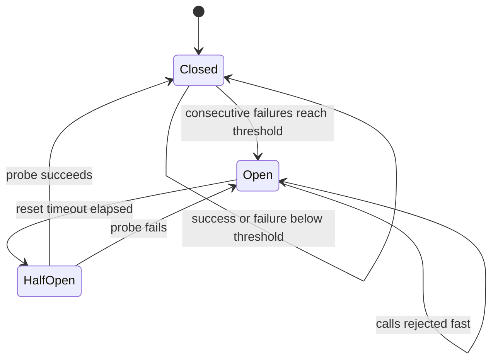

## In one minute
- In a large system something is always broken: a disk, a host, a zone, a dependency, a deploy. The design question is not "will it fail" but "what does the user see when it does".
- Survival rests on a few mechanisms used together: **redundancy** (more than one of everything, in independent failure domains), **detection** (health checks, timeouts), **isolation** (bulkheads, circuit breakers, cells) and **graceful degradation** (fallbacks and reduced functionality).
- Most outages are not the first failure but the reaction to it: retry storms, cascading timeouts, failovers that overload the survivors. Good designs bound the reaction.
- **Static stability** is the goal: when a component fails, the rest keeps working with what it already has, without needing to make new decisions or call a control plane.
- In interviews, the interviewer will pick a box in your diagram and say "this dies, now what?" You should have an answer for every box.

## How it works

### Redundancy in independent failure domains
Run at least N+1 (often N+2) instances of every stateless service across availability zones, sized so losing one zone leaves enough capacity. Stateful components need replication: a database primary with synchronous or semi-synchronous replicas in other zones, a consensus group of 3 or 5 nodes for coordination data, object storage with erasure coding across zones. Redundancy only helps if failures are independent, so watch for shared dependencies: one DNS provider, one config service, one certificate, one deploy pipeline. Pre-provisioning the spare capacity, rather than launching it after the failure, is what AWS calls static stability: the surviving zones need no control-plane call to cope ([AWS Builders' Library](https://aws.amazon.com/builders-library/static-stability-using-availability-zones/)).

### Detection
A failure you do not detect becomes a hang. Every network call needs a timeout set from the dependency's measured latency (for example p99.9 plus margin), not a library default. Load balancers run active health checks and also passive outlier detection, ejecting hosts that return consecutive errors. Health checks should test what matters (can this instance serve a request) without depending on shared dependencies, or a database blip will mark the whole fleet unhealthy at once. Kubernetes warns that a careless liveness probe can cause cascading restarts under load, and puts back-end dependency checks in the readiness probe, not the liveness one ([Kubernetes docs](https://kubernetes.io/docs/concepts/configuration/liveness-readiness-startup-probes/)).

### Isolation and containment
- **Circuit breakers** stop calling a dependency that is failing, fail fast, and periodically probe to see if it has recovered ([Fowler](https://martinfowler.com/bliki/CircuitBreaker.html)).
- **Bulkheads** give each dependency its own concurrency budget so one slow call cannot exhaust all threads.
- **Retry budgets** cap retries to a fraction of normal traffic, so retries cannot multiply load during an outage. Google's clients allow at most three attempts per request and retry only while retries stay under 10% of a client's requests ([Google SRE book](https://sre.google/sre-book/handling-overload/)).
- **Cells** split the fleet into independent copies serving subsets of customers, so a bad deploy or poison request hurts one cell.

### Degradation
Decide per dependency what happens without it. Recommendations fail: show popular items from a static list. Reviews fail: hide the reviews panel. Pricing fails: this is critical, so fail the request clearly. Precompute fallbacks so that the fallback path does not itself depend on something that might be down. Amazon goes further and avoids fallback logic where it can, because a rarely run path is the least tested code in the system; it prefers making the primary path more reliable or pushing data out ahead of time ([AWS Builders' Library](https://aws.amazon.com/builders-library/avoiding-fallback-in-distributed-systems/)).

### Failover for stateful parts
Leader-based stores elect a new leader when the old one stops renewing its lease. Failover must fence the old leader (with an epoch or fencing token) so a paused, not dead, primary cannot keep accepting writes. Asynchronous replication means failover can lose the last few seconds of writes; say so and decide whether that is acceptable.

### How it shows up in interviews
Every design question has a reliability phase, and some are explicitly about it: design a highly available payment service, a distributed job scheduler, a key-value store, a notification system with delivery guarantees. A strong answer lists failure domains, gives each component a redundancy and failover story, sets timeouts and retries with budgets, adds circuit breakers and fallbacks, and discusses detection time and data loss on failover. Interviewers probe: what if the database primary dies mid-write, what if a dependency is slow rather than down, what if a whole zone goes, and how do you know a node is dead rather than slow.

## Down the stack

### Layer 1: The contract
State availability and durability targets per component and per user journey: for example 99.95% success for checkout over 30 days, with recovery time under 60 seconds and zero acknowledged-write loss for orders. A circuit breaker promises that while open, calls fail within microseconds instead of waiting for a timeout, and that it will let a limited number of probe calls through after a cool-down. A health-checked load balancer promises to stop routing to a failed host within its detection window (for example 3 failed checks at 5-second intervals, so about 15 seconds). Synchronous replication promises an acknowledged write survives a single node loss; asynchronous replication does not.

### Layer 2: The mechanism
Envoy's outlier detection tracks per-host counters such as `consecutive_5xx` (5 by default) and ejects a host for `base_ejection_time` (30 seconds by default) multiplied by the number of prior ejections, capped by `max_ejection_percent`, 10% of the cluster by default, so it never ejects the whole cluster ([Envoy docs](https://www.envoyproxy.io/docs/envoy/latest/api-v3/config/cluster/v3/outlier_detection.proto)). Envoy also supports retry budgets (`retry_budget` with `budget_percent`, 20% of active requests by default, [Envoy docs](https://www.envoyproxy.io/docs/envoy/latest/api-v3/config/cluster/v3/circuit_breaker.proto)), and gRPC clients have a retry throttling policy: each failure subtracts 1 from a token count that starts at `maxTokens`, each success adds `tokenRatio`, and retries stop while the count is at or below half of `maxTokens` ([gRFC A6](https://github.com/grpc/proposal/blob/master/A6-client-retries.md)). A circuit breaker is a three-state machine: closed (count failures), open (reject until a timeout elapses), half-open (allow a probe; success closes, failure reopens). Leader election in etcd or ZooKeeper uses leases or ephemeral nodes; a client that loses its session must stop acting as leader, and the store hands the new leader a higher revision number usable as a fencing token. Kubernetes separates liveness probes (restart a wedged process) from readiness probes (stop sending traffic), which matters: failing liveness on a dependency outage restarts every pod at once.

### Layer 3: The machine
Without application timeouts, the kernel's defaults are slow. A connection attempt to a dead host retransmits SYNs with exponential backoff; with Linux's default `tcp_syn_retries` of 6, `connect` takes about 131 seconds to fail on current kernels. On an established connection, unacknowledged data is retransmitted up to `tcp_retries2` (15 by default), a timeout of at least 924.6 seconds, about 15 minutes, before the socket errors. TCP keepalive defaults to 2 hours of idleness before the first probe ([Linux kernel docs](https://www.kernel.org/doc/html/latest/networking/ip-sysctl.html)). A process paused by a long garbage collection, a VM live migration or a stalled disk can look dead for seconds and then resume, still believing it holds a lease, which is why fencing is needed. Disks fail in ways that are not crashes: an `fsync` that returns an error may have dropped dirty pages, and Postgres changed its behaviour to panic on fsync failure instead of retrying, after the 2018 "fsyncgate" discussion showed that a retry could falsely report success. The change shipped in February 2019 in 11.2 and the older supported branches, with `data_sync_retry` to restore the old behaviour ([Postgres 11.2 release notes](https://www.postgresql.org/docs/release/11.2/)).

### Why it's built this way
Hardware and networks fail independently and often at scale, so every component needs a peer in a separate failure domain. A slow component is indistinguishable from a dead one from the outside, so detection relies on timeouts tuned to real latency. Reactions to failure add load at the worst time, so retries and failovers are budgeted and damped. Paused processes can return, so leadership is enforced with fencing rather than assumed from silence.

## Diagram


## Worked example
A checkout service runs 30 instances across three zones and calls pricing, inventory, payments and a recommendations widget. Each instance handles 100 requests per second.

Zone loss: losing one zone removes 10 instances. The remaining 20 must carry 3,000 requests per second, 150 each. The team sizes instances to run at 50% CPU normally, so 150 per instance is about 75%, survivable. Without that headroom, the survivors overload, latency climbs, health checks fail and the outage spreads to all zones.

Slow dependency: recommendations latency jumps from 30 ms to 4 seconds. The checkout call to it has a 150 ms timeout and a bulkhead of 20 concurrent calls per instance. Within a second, the breaker sees 20 consecutive timeouts and opens; for the next 30 seconds calls fail in microseconds and the page renders with a static "popular items" list. Every 30 seconds one probe tests recovery.

Retries: payments has a retry budget of 10%. During a 2-minute payments brownout where 40% of calls fail, naive single retries would add 40% more load to a struggling service; the budget caps the extra at 10%, and further failures surface as "please try again" with idempotency keys so user retries cannot double-charge.

Database failover: the orders primary uses semi-synchronous replication to one replica in another zone. When the primary's host dies, the orchestrator promotes the replica in about 20 to 30 seconds and bumps the epoch. Writes during that window fail and are retried by clients with idempotency keys.

## In the wild
- **Google Cloud, 2025: no fail-open, no backoff.** On 12 June a policy record with blank fields replicated worldwide within seconds and hit new Service Control code with no error handling and no feature flag, so the quota-checking binary crash-looped in every region. The kill switch rolled out within 40 minutes, but in us-central1 restarting tasks overloaded their Spanner table because they lacked randomized exponential backoff, adding up to about 2 hours 40 minutes. Google committed to making Service Control fail open and to auditing backoff ([Google Cloud](https://status.cloud.google.com/incidents/ow5i3PPK96RduMcb1SsW)).
- **AWS, 2021: retries that would not back off.** In us-east-1 an automated scaling action set off a surge of connections from internal clients that overwhelmed the devices linking AWS's internal and main networks. A latent bug stopped clients from backing off, so retries sustained the congestion for about seven hours, and the monitoring that would have shown it ran on the same congested network. AWS fixed the back-off bug and rebuilt its health dashboard ([AWS](https://aws.amazon.com/message/12721/)).
- **HubSpot, 2024: readiness ejections cascade.** HubSpot's Envoy routing pods were packed unevenly onto Kubernetes nodes. At a morning traffic spike, several pods on an overloaded node failed readiness together and were pulled from service, pushing their load onto the rest until those failed too, two waves of errors, roughly 5:35 to 6:09 AM and 9:14 to 9:44 AM on 25 September. Fixes included even pod spread and load balancers that avoid removing too many pods at once under high load ([HubSpot](https://product.hubspot.com/blog/hubspot-incident-sept25)).

## Trade-offs
| Option | Strengths | Weaknesses | Choose when |
|---|---|---|---|
| Active-active replicas | No failover delay, uses all capacity | Needs headroom for loss, harder for stateful parts | Stateless services |
| Active-passive failover | Simple for stateful components | Detection plus promotion delay, idle standby | Single-writer databases |
| Synchronous replication | No acknowledged-write loss | Higher write latency, availability tied to replica | Money, orders |
| Asynchronous replication | Low latency | Loses recent writes on failover | Feeds, analytics, caches |
| Circuit breaker with fallback | Fast failure, protects dependency | Tuning, fallback may be stale | Optional or degradable features |

## Pitfalls in production
- **Default timeouts.** Library defaults of 30 seconds or none at all let a dead dependency hold every thread. Set explicit timeouts per call from measured latency.
- **Retry amplification.** Three attempts at each of four layers turn one failure into 81 calls at the bottom. Retry at one layer, with backoff, jitter and a budget.
- **Health checks that test dependencies.** A shared database blip fails every instance's check and the load balancer removes the whole fleet. Keep liveness local; use readiness carefully.
- **Failover without fencing.** A paused old primary wakes up and writes, causing split brain. Use epochs or fencing tokens checked by the storage layer.
- **Untested fallbacks.** The fallback path is rarely exercised and breaks when needed. Exercise it with fault injection and game days.
- **No capacity for loss.** Running at 80% across three zones means a zone loss overloads the rest. Plan N+1 at the zone level.

## Leadership lens
- For each box in the architecture, ask: what is its failure domain, how is failure detected, how long until recovery, and what is lost.
- Review timeouts, retries and breaker settings as configuration owned by the calling team, with dashboards.
- Run game days and fault injection regularly; untested failover is a hypothesis.
- Track the cost of headroom explicitly. Reliability is bought with idle capacity, and finance should see why.

## Check yourself
1. Why can retries make an outage worse?
   **Answer:** They add load to a dependency that is already failing, and retries stacked across layers multiply, which can keep it from recovering.
2. Why does a half-open state exist in a circuit breaker?
   **Answer:** It lets a small number of probe calls test whether the dependency has recovered without sending full traffic to it.
3. Why is a health check that queries the shared database risky?
   **Answer:** A brief database problem makes every instance fail its check simultaneously, so the load balancer removes the entire fleet.
4. What does a fencing token prevent?
   **Answer:** It stops a paused former leader from writing after a new leader has taken over, because storage rejects writes with an older token.

## Practice
**Task:** Implement a circuit breaker with an injected clock. `CircuitBreaker(failure_threshold, reset_timeout)` starts closed. In the closed state, `allow(now)` returns `True`; `record_failure(now)` counts consecutive failures and opens the breaker when the count reaches the threshold; `record_success(now)` resets the count. When open, `allow` returns `False` until `reset_timeout` has elapsed since opening; then the breaker becomes half-open and `allow` returns `True` for exactly one probe, and `False` for further calls until the probe reports. In half-open, a success closes the breaker (count reset) and a failure reopens it at `now`. `state(now)` returns `"closed"`, `"open"` or `"half_open"`, where an open breaker whose timeout has elapsed reports `"half_open"`.

```python starter
class CircuitBreaker:
    def __init__(self, failure_threshold, reset_timeout):
        # TODO
        raise NotImplementedError

    def allow(self, now):
        raise NotImplementedError

    def record_success(self, now):
        raise NotImplementedError

    def record_failure(self, now):
        raise NotImplementedError

    def state(self, now):
        raise NotImplementedError
```

```python tests
def test_opens_after_threshold():
    cb = CircuitBreaker(3, 10)
    for t in range(3):
        assert cb.allow(t)
        cb.record_failure(t)
    assert cb.state(3) == "open"
    assert cb.allow(3) is False

def test_success_resets_consecutive_count():
    cb = CircuitBreaker(2, 10)
    cb.record_failure(0); cb.record_success(1); cb.record_failure(2)
    assert cb.state(2) == "closed"

def test_half_open_allows_single_probe():
    cb = CircuitBreaker(1, 5)
    cb.record_failure(0)
    assert cb.allow(4) is False
    assert cb.state(5) == "half_open"
    assert cb.allow(5) is True
    assert cb.allow(5) is False, "only one probe in flight"

def test_probe_success_closes():
    cb = CircuitBreaker(1, 5)
    cb.record_failure(0)
    cb.allow(6)
    cb.record_success(6)
    assert cb.state(6) == "closed" and cb.allow(6) is True

def test_probe_failure_reopens_with_new_timer():
    cb = CircuitBreaker(1, 5)
    cb.record_failure(0)
    cb.allow(5)
    cb.record_failure(5)
    assert cb.state(9) == "open"
    assert cb.allow(9) is False
    assert cb.allow(10) is True

def test_reclosed_breaker_needs_full_threshold_again():
    cb = CircuitBreaker(2, 5)
    cb.record_failure(0); cb.record_failure(0)
    cb.allow(5); cb.record_success(5)
    cb.record_failure(6)
    assert cb.state(6) == "closed"
```

```python solution
class CircuitBreaker:
    def __init__(self, failure_threshold, reset_timeout):
        self.threshold = failure_threshold
        self.timeout = reset_timeout
        self.failures = 0
        self.mode = "closed"
        self.opened_at = 0
        self.probe_out = False

    def state(self, now):
        if self.mode == "open" and now - self.opened_at >= self.timeout:
            return "half_open"
        return self.mode

    def allow(self, now):
        s = self.state(now)
        if s == "closed":
            return True
        if s == "open":
            return False
        if self.mode == "open":
            self.mode = "half_open"
            self.probe_out = False
        if self.probe_out:
            return False
        self.probe_out = True
        return True

    def _open(self, now):
        self.mode = "open"
        self.opened_at = now
        self.probe_out = False

    def record_success(self, now):
        self.failures = 0
        if self.state(now) != "open":
            self.mode = "closed"
            self.probe_out = False

    def record_failure(self, now):
        if self.mode == "half_open":
            self._open(now)
            return
        if self.mode == "closed":
            self.failures += 1
            if self.failures >= self.threshold:
                self._open(now)
```

```typescript starter
export type BreakerState = "closed" | "open" | "half_open";

export class CircuitBreaker {
  constructor(failureThreshold: number, resetTimeout: number) {}
  allow(now: number): boolean {
    throw new Error("TODO");
  }
  recordSuccess(now: number): void {
    throw new Error("TODO");
  }
  recordFailure(now: number): void {
    throw new Error("TODO");
  }
  state(now: number): BreakerState {
    throw new Error("TODO");
  }
}
```

```typescript tests
test("opens after threshold", () => {
  const cb = new CircuitBreaker(3, 10);
  for (let t = 0; t < 3; t++) {
    assert(cb.allow(t), "closed allows");
    cb.recordFailure(t);
  }
  assertEqual(cb.state(3), "open");
  assertEqual(cb.allow(3), false);
});
test("success resets count", () => {
  const cb = new CircuitBreaker(2, 10);
  cb.recordFailure(0); cb.recordSuccess(1); cb.recordFailure(2);
  assertEqual(cb.state(2), "closed");
});
test("half open allows single probe", () => {
  const cb = new CircuitBreaker(1, 5);
  cb.recordFailure(0);
  assertEqual(cb.allow(4), false);
  assertEqual(cb.state(5), "half_open");
  assertEqual(cb.allow(5), true);
  assertEqual(cb.allow(5), false);
});
test("probe success closes", () => {
  const cb = new CircuitBreaker(1, 5);
  cb.recordFailure(0);
  cb.allow(6);
  cb.recordSuccess(6);
  assertEqual(cb.state(6), "closed");
  assertEqual(cb.allow(6), true);
});
test("probe failure reopens", () => {
  const cb = new CircuitBreaker(1, 5);
  cb.recordFailure(0);
  cb.allow(5);
  cb.recordFailure(5);
  assertEqual(cb.state(9), "open");
  assertEqual(cb.allow(9), false);
  assertEqual(cb.allow(10), true);
});
test("reclosed needs full threshold", () => {
  const cb = new CircuitBreaker(2, 5);
  cb.recordFailure(0); cb.recordFailure(0);
  cb.allow(5); cb.recordSuccess(5);
  cb.recordFailure(6);
  assertEqual(cb.state(6), "closed");
});
```

```typescript solution
export type BreakerState = "closed" | "open" | "half_open";

export class CircuitBreaker {
  private failures = 0;
  private mode: BreakerState = "closed";
  private openedAt = 0;
  private probeOut = false;
  constructor(private threshold: number, private timeout: number) {}
  state(now: number): BreakerState {
    if (this.mode === "open" && now - this.openedAt >= this.timeout) return "half_open";
    return this.mode;
  }
  allow(now: number): boolean {
    const s = this.state(now);
    if (s === "closed") return true;
    if (s === "open") return false;
    if (this.mode === "open") {
      this.mode = "half_open";
      this.probeOut = false;
    }
    if (this.probeOut) return false;
    this.probeOut = true;
    return true;
  }
  private open(now: number): void {
    this.mode = "open";
    this.openedAt = now;
    this.probeOut = false;
  }
  recordSuccess(now: number): void {
    this.failures = 0;
    if (this.state(now) !== "open") {
      this.mode = "closed";
      this.probeOut = false;
    }
  }
  recordFailure(now: number): void {
    if (this.mode === "half_open") {
      this.open(now);
      return;
    }
    if (this.mode === "closed") {
      this.failures++;
      if (this.failures >= this.threshold) this.open(now);
    }
  }
}
```

```go starter
package practice

import "sync"

// CircuitBreaker is a three-state breaker with an injected clock. Safe for concurrent use.
type CircuitBreaker struct {
	mu sync.Mutex
}

func NewCircuitBreaker(failureThreshold, resetTimeout int) *CircuitBreaker {
	return &CircuitBreaker{}
}

func (c *CircuitBreaker) Allow(now int) bool { panic("TODO") }

func (c *CircuitBreaker) RecordSuccess(now int) { panic("TODO") }

func (c *CircuitBreaker) RecordFailure(now int) { panic("TODO") }

// State returns "closed", "open" or "half_open".
func (c *CircuitBreaker) State(now int) string { panic("TODO") }
```

```go tests
package practice

import "testing"

func TestOpensAfterThreshold(t *testing.T) {
	cb := NewCircuitBreaker(3, 10)
	for i := 0; i < 3; i++ {
		if !cb.Allow(i) {
			t.Fatal("closed allows")
		}
		cb.RecordFailure(i)
	}
	if cb.State(3) != "open" || cb.Allow(3) {
		t.Fatal("expected open and rejecting")
	}
}

func TestSuccessResets(t *testing.T) {
	cb := NewCircuitBreaker(2, 10)
	cb.RecordFailure(0)
	cb.RecordSuccess(1)
	cb.RecordFailure(2)
	if cb.State(2) != "closed" {
		t.Fatal("expected closed")
	}
}

func TestSingleProbe(t *testing.T) {
	cb := NewCircuitBreaker(1, 5)
	cb.RecordFailure(0)
	if cb.Allow(4) {
		t.Fatal("still open at 4")
	}
	if cb.State(5) != "half_open" || !cb.Allow(5) || cb.Allow(5) {
		t.Fatal("exactly one probe in half-open")
	}
}

func TestProbeSuccessCloses(t *testing.T) {
	cb := NewCircuitBreaker(1, 5)
	cb.RecordFailure(0)
	cb.Allow(6)
	cb.RecordSuccess(6)
	if cb.State(6) != "closed" || !cb.Allow(6) {
		t.Fatal("expected closed")
	}
}

func TestProbeFailureReopens(t *testing.T) {
	cb := NewCircuitBreaker(1, 5)
	cb.RecordFailure(0)
	cb.Allow(5)
	cb.RecordFailure(5)
	if cb.State(9) != "open" || cb.Allow(9) || !cb.Allow(10) {
		t.Fatal("expected reopen with a fresh timer")
	}
}

func TestReclosedNeedsThreshold(t *testing.T) {
	cb := NewCircuitBreaker(2, 5)
	cb.RecordFailure(0)
	cb.RecordFailure(0)
	cb.Allow(5)
	cb.RecordSuccess(5)
	cb.RecordFailure(6)
	if cb.State(6) != "closed" {
		t.Fatal("one failure after reclose should not open")
	}
}
```

```go solution
package practice

import "sync"

// CircuitBreaker is a three-state breaker with an injected clock. Safe for concurrent use.
type CircuitBreaker struct {
	mu        sync.Mutex
	threshold int
	timeout   int
	failures  int
	mode      string
	openedAt  int
	probeOut  bool
}

func NewCircuitBreaker(failureThreshold, resetTimeout int) *CircuitBreaker {
	return &CircuitBreaker{threshold: failureThreshold, timeout: resetTimeout, mode: "closed"}
}

func (c *CircuitBreaker) stateLocked(now int) string {
	if c.mode == "open" && now-c.openedAt >= c.timeout {
		return "half_open"
	}
	return c.mode
}

func (c *CircuitBreaker) State(now int) string {
	c.mu.Lock()
	defer c.mu.Unlock()
	return c.stateLocked(now)
}

func (c *CircuitBreaker) Allow(now int) bool {
	c.mu.Lock()
	defer c.mu.Unlock()
	switch c.stateLocked(now) {
	case "closed":
		return true
	case "open":
		return false
	}
	if c.mode == "open" {
		c.mode = "half_open"
		c.probeOut = false
	}
	if c.probeOut {
		return false
	}
	c.probeOut = true
	return true
}

func (c *CircuitBreaker) open(now int) {
	c.mode = "open"
	c.openedAt = now
	c.probeOut = false
}

func (c *CircuitBreaker) RecordSuccess(now int) {
	c.mu.Lock()
	defer c.mu.Unlock()
	c.failures = 0
	if c.stateLocked(now) != "open" {
		c.mode = "closed"
		c.probeOut = false
	}
}

func (c *CircuitBreaker) RecordFailure(now int) {
	c.mu.Lock()
	defer c.mu.Unlock()
	if c.mode == "half_open" {
		c.open(now)
		return
	}
	if c.mode == "closed" {
		c.failures++
		if c.failures >= c.threshold {
			c.open(now)
		}
	}
}
```

## Mock interview
**Prompt:** You run an order-placement service handling 5,000 orders per second at peak across three availability zones. It depends on a Postgres cluster, an inventory service, a payment provider and a fraud-scoring service. Walk through how the system behaves when each of these fails, and when an entire zone is lost.

- Follow-up: The fraud service is not down but its p99 went from 80 ms to 3 seconds. What happens, step by step?
- Follow-up: The Postgres primary's host freezes for 40 seconds and then comes back. What prevents two primaries?
- Follow-up: How much spare capacity do you carry, and how do you justify it?

**A strong answer covers:**
- Failure domains and N+1 capacity per zone, with the arithmetic for losing one of three zones.
- Explicit timeouts, bulkheads and circuit breakers per dependency, and which ones have fallbacks (fraud could fail open below a limit, payment cannot).
- Retry policy at one layer with backoff, jitter, budgets and idempotency keys.
- Database failover with lease-based leader election, fencing via epochs, and the data-loss implications of the replication mode.
- Verification through fault injection and game days, and alerting on breaker state and ejections.

## Sources and further study
**Primary**
- [gRFC A6: gRPC retry design (gRPC proposals)](https://github.com/grpc/proposal/blob/master/A6-client-retries.md): retry policy, hedging and the token-based throttle that switches retries off.
- [IP sysctl reference (Linux kernel docs)](https://www.kernel.org/doc/html/latest/networking/ip-sysctl.html): the SYN, retransmission and keepalive defaults behind "the kernel will time out eventually".

**Systems docs**
- [Outlier detection (Envoy API docs)](https://www.envoyproxy.io/docs/envoy/latest/api-v3/config/cluster/v3/outlier_detection.proto): every ejection knob with its default.
- [Liveness, readiness and startup probes (Kubernetes docs)](https://kubernetes.io/docs/concepts/configuration/liveness-readiness-startup-probes/): what each probe does, and the warning that a careless liveness probe can cascade.
- [Fsync errors (PostgreSQL wiki)](https://wiki.postgresql.org/wiki/Fsync_Errors): the history of fsyncgate and how each OS reports lost writes.

**Books**
- *Release It!* (2nd ed.), Michael T. Nygard, Ch 4 "Stability Antipatterns" and Ch 5 "Stability Patterns": chain reactions, cascading failures, timeouts, circuit breakers and bulkheads.
- *Site Reliability Engineering* (1st ed.), Beyer et al., Ch 22 "Addressing Cascading Failures": overload, retries, slow startup and how to test for cascades.
- *Understanding Distributed Systems* (2nd ed.), Roberto Vitillo, chapters "Downstream resiliency" and "Upstream resiliency": timeouts, retries and breakers on the caller side, load shedding and bulkheads on the callee side.

**Other curricula**
- [Circuit Breaker pattern (Azure Architecture Center)](https://learn.microsoft.com/en-us/azure/architecture/patterns/circuit-breaker): frames the breaker alongside the Retry and Bulkhead patterns, with guidance on which exceptions should trip it.
- [System Design Primer: Availability patterns (donnemartin)](https://github.com/donnemartin/system-design-primer#availability-patterns): frames survival as fail-over (active-passive, active-active) and replication, with availability math for components in sequence and in parallel.

## Watch
- [Mastering Chaos: A Netflix Guide to Microservices (InfoQ)](https://www.youtube.com/watch?v=CZ3wIuvmHeM): fallbacks, breakers, cascading failures and regional evacuation in practice.
- [Close Loops and Opening Minds (AWS re:Invent 2018)](https://www.youtube.com/watch?v=O8xLxNje30M): designing control loops and systems that stay stable during failures.

## Free resources
- [Static stability using Availability Zones (AWS Builders' Library)](https://aws.amazon.com/builders-library/static-stability-using-availability-zones/): pre-provisioned capacity so zone loss needs no reaction.
- [Addressing cascading failures (Google SRE book)](https://sre.google/sre-book/addressing-cascading-failures/): how overload spreads and the mechanisms that stop it.
- [Timeouts, retries and backoff with jitter (AWS Builders' Library)](https://aws.amazon.com/builders-library/timeouts-retries-and-backoff-with-jitter/): setting timeouts and avoiding retry amplification.
- [Circuit Breaker (martinfowler.com)](https://martinfowler.com/bliki/CircuitBreaker.html): the canonical description of the pattern.
- [Avoiding fallback in distributed systems (AWS Builders' Library)](https://aws.amazon.com/builders-library/avoiding-fallback-in-distributed-systems/): why rarely used fallback paths can make things worse.
