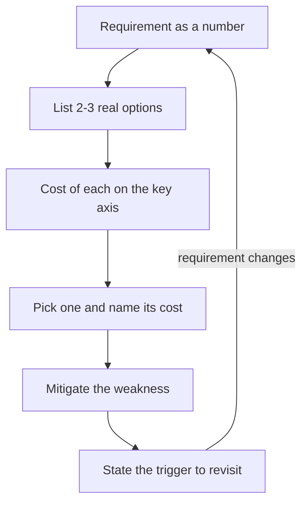

## In one minute
- A system design interview is graded mostly on how you choose, not what you choose. Every non-trivial decision buys one property by spending another: latency, consistency, availability, durability, cost, operability or team time.
- Senior candidates name the options; staff candidates name the options, the axis they trade along, the number that decides it, and the condition under which they would switch.
- Use a repeatable sentence: "I'll pick A over B because requirement X matters more than Y here; A costs us Z, which we mitigate with W; if X changes, I'd revisit."
- The most common tradeoffs reduce to a few physical facts: replicas are far apart, disks are slow to make durable, memory is expensive, and coordination costs round trips.
- Never present a choice as free. If you cannot name the cost, the interviewer will, and that is worse.

## How it works

### What interviewers are actually scoring
Rubrics at most large companies have a line called something like "tradeoff analysis" or "design judgement". Behind it sit three questions. Did the candidate see that there was a choice at all? Did they reason from the requirements they gathered, rather than from habit? Did they understand the second-order cost, such as operational burden or a failure mode that only appears at scale? "We'll use Cassandra" scores lower than "we need about 200k simple key writes per second and tolerate some staleness, so a leaderless wide-column store fits; we lose multi-row transactions, so the ledger stays in Postgres".

### The axes that come up again and again
Most interview tradeoffs are one of these, sometimes wearing a costume.

- **Consistency vs latency and availability.** Synchronous replication or quorum reads give fresher data at the price of extra round trips and lower availability during partitions. PACELC states it well: during a partition choose availability or consistency; else choose latency or consistency ([Abadi](https://www.cs.umd.edu/~abadi/papers/abadi-pacelc.pdf)).
- **Read cost vs write cost.** Denormalising, fan-out on write, secondary indexes and materialised views make reads cheap by doing more work on each write. Normalised schemas and fan-out on read do the reverse.
- **Freshness vs load.** Caches, CDNs, batching and precomputation reduce load by serving data that is a little old.
- **Durability vs latency.** Waiting for `fsync` or for a replica acknowledgement before replying adds milliseconds; replying first risks losing the last writes on a crash.
- **Simplicity vs scale.** A single Postgres primary is simpler than a sharded cluster and fine up to a surprisingly high load. Sharding early costs engineering time forever.
- **Build vs buy.** A managed queue costs money but saves an on-call rotation.
- **Availability vs cost.** Each extra nine is far more expensive than the last; Google's SRE book says one more increment of reliability may cost 100 times the previous one, so a target should match what users can notice ([Google SRE](https://sre.google/sre-book/embracing-risk/)).

### A repeatable approach
1. Before choosing, restate the requirement that decides it, ideally as a number: "feeds may lag by up to 5 seconds", "checkout must never double-charge", "p99 under 200 ms".
2. Name two or three real options, not a straw man.
3. Say what each option costs on the axis that matters, with a rough number.
4. Pick one and state the mitigation for its weakness. Say how hard the choice is to undo: Amazon's 2015 shareholder letter separates one-way-door decisions, which deserve slow deliberation, from reversible two-way doors that should be made quickly ([Amazon 2015 letter](https://www.sec.gov/Archives/edgar/data/1018724/000119312516530910/d168744dex991.htm)). A partition key is a one-way door; a cache TTL is a two-way door.
5. State the trigger to revisit: "if writes exceed what one primary handles, which I'd estimate around 10k to 30k per second for this row size, we shard by user ID".

That fifth step is what separates staff answers. It shows you see the design as a point in time, not a final state.

### Common mistakes
- Listing pros and cons of every technology without tying any of them to the requirements.
- Choosing the strongest option everywhere ("strongly consistent, globally replicated, five nines") without noticing the cost compounds.
- Treating CAP as a menu where you pick two. Partitions are not optional; the real choice is how each operation behaves when one happens, and many real systems are neither CAP-consistent nor CAP-available ([Kleppmann](https://martin.kleppmann.com/2015/05/11/please-stop-calling-databases-cp-or-ap.html)).
- Flip-flopping when the interviewer pushes. Pushback is often a probe; change your mind only if a requirement changes.

## Down the stack

### Layer 1: The contract
A tradeoff statement is a contract you can test. "Reads may be stale by up to 2 seconds" means a read issued 2 seconds after a successful write must observe it. "RPO zero" means no acknowledged write is lost if any single node dies. "Available during an AZ failure" means a client in a surviving AZ gets a successful response within the timeout. Written this way, conflicts show early: RPO zero across regions with a 50 ms p99 write is impossible if the regions are 70 ms apart.

### Layer 2: The mechanism
Many consistency tradeoffs are tuned with quorums. With `N` replicas, a write waits for `W` acknowledgements and a read queries `R` replicas. If `R + W > N`, every read quorum overlaps every write quorum, so a read sees the latest acknowledged write (assuming versioned values and correct conflict handling). If `2W > N`, two concurrent writes also overlap. Cassandra exposes this per request through consistency levels such as `ONE`, `QUORUM` and `LOCAL_QUORUM`, and resolves conflicting writes by last-write-wins timestamps, so it needs synchronised clocks ([Cassandra docs](https://cassandra.apache.org/doc/latest/cassandra/architecture/dynamo.html)). DynamoDB exposes it as eventually consistent versus strongly consistent reads, where eventually consistent reads cost half as much, and global secondary indexes support only eventual reads ([DynamoDB docs](https://docs.aws.amazon.com/amazondynamodb/latest/developerguide/HowItWorks.ReadConsistency.html)). Its global tables used to be eventually consistent across regions only; they now also offer multi-Region strong consistency, which replicates each write synchronously to another region before acknowledging it, putting a cross-region round trip on every write ([DynamoDB docs](https://docs.aws.amazon.com/amazondynamodb/latest/developerguide/HowItWorks.ReadConsistency.html)). Raft-based stores like etcd fix `W` at a majority and make reads linearizable by default, which sends them through Raft and adds latency; a client can ask for a `serializable` read instead, which is faster but may be stale ([etcd docs](https://etcd.io/docs/v3.6/learning/api_guarantees/)). Postgres exposes the durability axis through `synchronous_commit` (`off`, `local`, `remote_write`, `on` as the default, `remote_apply`) and `synchronous_standby_names`, letting you choose per transaction, with `SET LOCAL`, whether to wait for a standby ([Postgres docs](https://www.postgresql.org/docs/current/runtime-config-wal.html)).

### Layer 3: The machine
The costs behind these knobs are physical. A round trip inside one zone is about 0.1 ms on current cloud hardware and about 0.25 ms across a region ([Napkin Math](https://github.com/sirupsen/napkin-math)), with AWS keeping a region's zones within 100 km of each other ([AWS](https://aws.amazon.com/about-aws/global-infrastructure/regions_az/)); budget up to a millisecond or two under load. Across a continent it is 25 to 60 ms, and across an ocean 80 ms or more ([Napkin Math](https://github.com/sirupsen/napkin-math)), bounded below by light in fibre at roughly 200 km per ms. A durable write needs `fsync`, which on an NVMe SSD with power-loss protection can complete in tens of microseconds, but on consumer drives or network block storage often takes 0.5 to several ms; a 2026 cloud measurement put an 8 KiB write plus `fsync` at about 300 us against 2 us without it ([Napkin Math](https://github.com/sirupsen/napkin-math)). Memory costs on the order of tens of times more per GB than SSD, which is why caches are smaller than datasets. Each extra replica multiplies storage and write bandwidth. These numbers turn vague words like "slower" into the decisive comparison: a quorum write within a region adds a millisecond or two; a cross-region one adds a hundred.

### Why it's built this way
Data must live on several machines to survive failure, so copies exist. Copies are separated by distance and distance costs time, so keeping them identical costs latency. Networks can partition, so a system must decide what an operation does when it cannot reach a majority. Because different operations care differently, good systems make the choice tunable per request rather than global. And because engineers are the scarcest resource, the simpler option often wins even when it is not the fastest.

## Diagram


## Worked example
The interviewer asks you to design a shopping cart for a retailer doing 50 million daily users, with peaks of about 20,000 cart writes per second, in two regions.

Option A is a single-primary relational store in one region with a cross-region async replica. Writes from the far region pay about 80 ms extra, and a region failure can lose a few seconds of carts. Option B is a multi-region leaderless store with `LOCAL_QUORUM` writes (N=3 per region, W=2): writes cost a local round trip of about 2 ms, but concurrent edits from two regions can conflict.

You say: "Carts are user-scoped and rarely edited from two places at once, and losing an item or showing a stale cart briefly is annoying but not costly. Latency and availability matter more than global ordering here, so I'll take option B and merge conflicts by unioning item adds and applying removes with timestamps. Checkout is different: payment and inventory decrement go through a strongly consistent store, because a double charge costs real money. If product later wants shared carts edited by several people at once, I'd revisit the merge rules."

That answer splits the system by requirement, names the cost, the mitigation and the trigger, in about 40 seconds.

## In the wild
- **GitHub, 2018: choosing consistency cost 24 hours of degradation.** A 43-second network partition during optical maintenance let the failover tool promote MySQL primaries on the US West Coast before they had caught up, and writes then landed on both coasts. GitHub chose data integrity over availability: it restored from backups and re-replicated rather than discard writes, leaving the site degraded for 24 hours 11 minutes, with over 5 million webhook events queued and 954 writes on one cluster reconciled by hand. Afterwards it stopped cross-region primary promotion ([GitHub](https://github.blog/news-insights/company-news/oct21-post-incident-analysis/)).
- **Shopify, 2021: buying exactly the consistency it needed.** Reads spread across lagging MySQL replicas could see a row in one table but miss its related row in another. Shopify rejected waiting for every replica (too slow) and GTID-based causal consistency (too complex to run), and built monotonic-read routing instead: a `consistent_read_id` hashed to pin a series of reads to one replica ([Shopify Engineering](https://shopify.engineering/read-consistency-database-replicas)).

## Trade-offs
| Option | Strengths | Weaknesses | Choose when |
|---|---|---|---|
| Strong consistency (majority quorum or leader reads) | Simple reasoning, no stale reads | Extra round trips, unavailable without a majority | Money, inventory, uniqueness, locks |
| Eventual consistency (W=1 or async replicas) | Low latency, stays up during partitions | Stale reads, conflicts to resolve | Feeds, counters, carts, profiles |
| Fan-out on write | Cheap, fast reads | Write amplification, celebrity problem | Read-heavy timelines with bounded fan-out |
| Fan-out on read | Cheap writes | Expensive reads, tail latency | Users with huge follower counts |
| Single-node simplicity | Easy to run and reason about | Ceiling on scale and availability | Early stage, moderate load |
| Sharded or managed distributed store | Scales horizontally | Cross-shard queries, operational cost | Load clearly beyond one node |

## Pitfalls in production
- **Strong everywhere by default.** Teams make every read a quorum read "to be safe" and pay double read cost with no requirement behind it. Decide per operation and document it.
- **Unstated staleness.** Product never agreed to eventual consistency, so a support ticket about a missing post becomes an incident. Agree staleness budgets with product up front.
- **Retries that change the trade.** A latency-optimised async path plus client retries can double-apply writes. Pair retries with idempotency keys.
- **Fixed thresholds that age.** "We'll shard at 10k QPS" is forgotten. Put the trigger on a dashboard with an alert at 60 percent of it.

## Leadership lens
- In design review, ask for each component: which requirement made us pick this, what does it cost, and what would make us change it?
- Record decisions as short ADRs (context, decision, status, consequences, with negative consequences listed too ([Nygard](https://cognitect.com/blog/2011/11/15/documenting-architecture-decisions))) with the revisit trigger written down; that turns tradeoffs into scheduled work instead of surprises.
- Push consistency decisions to the operation level, not the system level, and make the weaker paths explicit in the API contract.

## Check yourself
1. With N=5 replicas, which settings of R and W guarantee a read sees the latest acknowledged write, and what does W=5 cost?
   **Answer:** Any R and W with R + W > 5, such as R=3, W=3 or R=1, W=5. W=5 makes every write fail if any single replica is down, so write availability collapses.
2. Why is "we chose CP" an incomplete answer?
   **Answer:** It only describes behaviour during a partition. Most of the time there is no partition, and the real everyday trade is latency against consistency, which needs its own answer.
3. An interviewer pushes back on your eventually consistent feed. What should you do?
   **Answer:** Restate the staleness budget and its user impact, acknowledge the cost they raised, and change the design only if they change a requirement, for example a read-your-writes need you can meet with session routing.
4. Why does a cross-region synchronous write rarely fit a 50 ms latency budget?
   **Answer:** Light in fibre needs roughly 1 ms per 100 km of round trip, so regions thousands of km apart add tens to over a hundred ms before any processing.

## Practice
**Task:** Write a quorum tradeoff calculator. `analyze(n, r, w)` validates that `1 <= r <= n` and `1 <= w <= n` (raise or return an error otherwise) and reports whether reads are strongly consistent (`r + w > n`), whether two writes always overlap (`2w > n`), and how many replica failures reads and writes each tolerate (`n - r`, `n - w`). `choose(n, need_strong, min_read_tol, min_write_tol)` returns the `(r, w)` pair satisfying all constraints with the smallest `r + w`, breaking ties by smaller `r`, or nothing if no pair works.

```python starter
def analyze(n, r, w):
    # TODO: return {"strong": ..., "writes_overlap": ..., "read_tolerance": ..., "write_tolerance": ...}
    raise NotImplementedError

def choose(n, need_strong, min_read_tol, min_write_tol):
    # TODO: return (r, w) or None
    raise NotImplementedError
```

```python tests
def test_analyze_majority():
    a = analyze(3, 2, 2)
    assert a == {"strong": True, "writes_overlap": True, "read_tolerance": 1, "write_tolerance": 1}

def test_analyze_weak():
    a = analyze(3, 1, 1)
    assert a["strong"] is False and a["writes_overlap"] is False
    assert a["read_tolerance"] == 2

def test_analyze_rejects_invalid():
    for args in ((3, 0, 2), (3, 4, 1), (3, 2, 0)):
        try:
            analyze(*args)
            assert False, "expected ValueError for %r" % (args,)
        except ValueError:
            pass

def test_choose_majority():
    assert choose(3, True, 1, 1) == (2, 2)
    assert choose(5, True, 2, 2) == (3, 3)

def test_choose_impossible():
    assert choose(3, True, 2, 2) is None

def test_choose_weak_is_cheapest():
    assert choose(3, False, 0, 0) == (1, 1)

def test_choose_tie_breaks_on_r():
    assert choose(5, True, 3, 0) == (1, 5)
    assert choose(5, True, 0, 4) == (5, 1)
```

```python solution
def analyze(n, r, w):
    if n < 1 or not (1 <= r <= n) or not (1 <= w <= n):
        raise ValueError("need 1 <= r, w <= n")
    return {
        "strong": r + w > n,
        "writes_overlap": 2 * w > n,
        "read_tolerance": n - r,
        "write_tolerance": n - w,
    }

def choose(n, need_strong, min_read_tol, min_write_tol):
    best = None
    for r in range(1, n + 1):
        for w in range(1, n + 1):
            if need_strong and r + w <= n:
                continue
            if n - r < min_read_tol or n - w < min_write_tol:
                continue
            if best is None or (r + w, r) < (best[0] + best[1], best[0]):
                best = (r, w)
    return best
```

```typescript starter
export interface Analysis {
  strong: boolean;
  writesOverlap: boolean;
  readTolerance: number;
  writeTolerance: number;
}

export function analyze(n: number, r: number, w: number): Analysis {
  throw new Error("TODO");
}

export function choose(n: number, needStrong: boolean, minReadTol: number, minWriteTol: number): [number, number] | null {
  throw new Error("TODO");
}
```

```typescript tests
test("analyze majority", () => {
  assertEqual(analyze(3, 2, 2), { strong: true, writesOverlap: true, readTolerance: 1, writeTolerance: 1 });
});
test("analyze weak", () => {
  const a = analyze(3, 1, 1);
  assert(!a.strong && !a.writesOverlap, "R=W=1 of 3 is weak");
  assertEqual(a.readTolerance, 2);
});
test("analyze rejects invalid", () => {
  for (const [n, r, w] of [[3, 0, 2], [3, 4, 1], [3, 2, 0]]) {
    let threw = false;
    try { analyze(n, r, w); } catch (e) { threw = true; }
    assert(threw, "expected error for " + [n, r, w].join(","));
  }
});
test("choose majority", () => {
  assertEqual(choose(3, true, 1, 1), [2, 2]);
  assertEqual(choose(5, true, 2, 2), [3, 3]);
});
test("choose impossible", () => {
  assertEqual(choose(3, true, 2, 2), null);
});
test("choose weak is cheapest", () => {
  assertEqual(choose(3, false, 0, 0), [1, 1]);
});
test("choose tie breaks on r", () => {
  assertEqual(choose(5, true, 3, 0), [1, 5]);
  assertEqual(choose(5, true, 0, 4), [5, 1]);
});
```

```typescript solution
export interface Analysis {
  strong: boolean;
  writesOverlap: boolean;
  readTolerance: number;
  writeTolerance: number;
}

export function analyze(n: number, r: number, w: number): Analysis {
  if (n < 1 || r < 1 || r > n || w < 1 || w > n) throw new Error("need 1 <= r, w <= n");
  return { strong: r + w > n, writesOverlap: 2 * w > n, readTolerance: n - r, writeTolerance: n - w };
}

export function choose(n: number, needStrong: boolean, minReadTol: number, minWriteTol: number): [number, number] | null {
  let best: [number, number] | null = null;
  for (let r = 1; r <= n; r++) {
    for (let w = 1; w <= n; w++) {
      if (needStrong && r + w <= n) continue;
      if (n - r < minReadTol || n - w < minWriteTol) continue;
      if (best === null || r + w < best[0] + best[1] || (r + w === best[0] + best[1] && r < best[0])) {
        best = [r, w];
      }
    }
  }
  return best;
}
```

```go starter
package practice

// Analysis describes the guarantees of an N/R/W quorum configuration.
type Analysis struct {
	Strong         bool
	WritesOverlap  bool
	ReadTolerance  int
	WriteTolerance int
}

func Analyze(n, r, w int) (Analysis, error) { panic("TODO") }

func Choose(n int, needStrong bool, minReadTol, minWriteTol int) (int, int, bool) { panic("TODO") }
```

```go tests
package practice

import "testing"

func TestAnalyzeMajority(t *testing.T) {
	a, err := Analyze(3, 2, 2)
	if err != nil || a != (Analysis{true, true, 1, 1}) {
		t.Fatalf("got %+v %v", a, err)
	}
}

func TestAnalyzeWeak(t *testing.T) {
	a, err := Analyze(3, 1, 1)
	if err != nil || a.Strong || a.WritesOverlap || a.ReadTolerance != 2 {
		t.Fatalf("got %+v %v", a, err)
	}
}

func TestAnalyzeRejectsInvalid(t *testing.T) {
	for _, c := range [][3]int{{3, 0, 2}, {3, 4, 1}, {3, 2, 0}} {
		if _, err := Analyze(c[0], c[1], c[2]); err == nil {
			t.Fatalf("expected error for %v", c)
		}
	}
}

func TestChooseMajority(t *testing.T) {
	if r, w, ok := Choose(3, true, 1, 1); !ok || r != 2 || w != 2 {
		t.Fatalf("got %d %d %v", r, w, ok)
	}
	if r, w, ok := Choose(5, true, 2, 2); !ok || r != 3 || w != 3 {
		t.Fatalf("got %d %d %v", r, w, ok)
	}
}

func TestChooseImpossible(t *testing.T) {
	if _, _, ok := Choose(3, true, 2, 2); ok {
		t.Fatal("expected no configuration")
	}
}

func TestChooseWeak(t *testing.T) {
	if r, w, ok := Choose(3, false, 0, 0); !ok || r != 1 || w != 1 {
		t.Fatalf("got %d %d %v", r, w, ok)
	}
}

func TestChooseTieBreak(t *testing.T) {
	if r, w, ok := Choose(5, true, 3, 0); !ok || r != 1 || w != 5 {
		t.Fatalf("got %d %d %v", r, w, ok)
	}
	if r, w, ok := Choose(5, true, 0, 4); !ok || r != 5 || w != 1 {
		t.Fatalf("got %d %d %v", r, w, ok)
	}
}
```

```go solution
package practice

import "errors"

// Analysis describes the guarantees of an N/R/W quorum configuration.
type Analysis struct {
	Strong         bool
	WritesOverlap  bool
	ReadTolerance  int
	WriteTolerance int
}

func Analyze(n, r, w int) (Analysis, error) {
	if n < 1 || r < 1 || r > n || w < 1 || w > n {
		return Analysis{}, errors.New("need 1 <= r, w <= n")
	}
	return Analysis{Strong: r+w > n, WritesOverlap: 2*w > n, ReadTolerance: n - r, WriteTolerance: n - w}, nil
}

func Choose(n int, needStrong bool, minReadTol, minWriteTol int) (int, int, bool) {
	bestR, bestW, found := 0, 0, false
	for r := 1; r <= n; r++ {
		for w := 1; w <= n; w++ {
			if needStrong && r+w <= n {
				continue
			}
			if n-r < minReadTol || n-w < minWriteTol {
				continue
			}
			if !found || r+w < bestR+bestW || (r+w == bestR+bestW && r < bestR) {
				bestR, bestW, found = r, w, true
			}
		}
	}
	return bestR, bestW, found
}
```

## Mock interview
**Prompt:** You are designing a global user-profile service for 500 million users across three regions. Profiles are read about 200,000 times per second and updated about 2,000 times per second. Walk me through the consistency and replication choices.

- Follow-up: A user updates their display name and immediately reloads from another device in another region. What do they see, and is that acceptable?
- Follow-up: One region is cut off from the other two for 20 minutes. What happens to reads and writes in each region?
- Follow-up: Legal now requires that a deleted account disappears everywhere within 1 second. What changes and what does it cost?

**A strong answer covers:**
- Stating the read-to-write ratio and the staleness budget before picking a replication model.
- Local reads from regional replicas with a single home region per user (or per-region quorums), with the cross-region latency numbers that justify it.
- Read-your-writes via session stickiness or version tokens rather than global strong consistency.
- Explicit partition behaviour per operation: reads stay available and may be stale; writes for users homed in the isolated region continue or are rejected, with the reason.
- Recognising that a 1-second global delete is a strong-consistency requirement for one operation, solvable with a synchronous tombstone or a read-time check against a strongly consistent deny list, and estimating its latency cost.

## Sources and further study
**Primary**
- [DeCandia et al., Dynamo (SOSP 2007)](https://www.allthingsdistributed.com/2007/10/amazons_dynamo.html): the paper that made tunable N, R and W quorums mainstream.
- [Amazon 2015 letter to shareholders](https://www.sec.gov/Archives/edgar/data/1018724/000119312516530910/d168744dex991.htm): Type 1 (one-way door) versus Type 2 (two-way door) decisions.
- [Nygard, Documenting Architecture Decisions (2011)](https://cognitect.com/blog/2011/11/15/documenting-architecture-decisions): the original ADR format for recording a trade-off and its consequences.

**Systems docs**
- [DynamoDB read consistency](https://docs.aws.amazon.com/amazondynamodb/latest/developerguide/HowItWorks.ReadConsistency.html): per-request strong reads at twice the cost, and MREC versus MRSC global tables.
- [etcd API guarantees](https://etcd.io/docs/v3.6/learning/api_guarantees/): linearizable reads by default, serializable reads as the faster, staler option.
- [PostgreSQL: synchronous_commit](https://www.postgresql.org/docs/current/runtime-config-wal.html): the durability-versus-latency knob, settable per transaction.

**Books**
- *Fundamentals of Software Architecture* (2nd edition), Mark Richards and Neal Ford, chapter 2 "Architectural Thinking" (section "Analyzing Trade-Offs") and chapter 27 "The Laws of Software Architecture, Revisited": everything is a trade-off, and why matters more than how.
- *Designing Data-Intensive Applications* (1st edition), Martin Kleppmann, chapter 5 "Replication" and chapter 9 "Consistency and Consensus": replication lag, quorums, linearizability and its cost.

**Other curricula**
- [System Design Primer: performance vs scalability, latency vs throughput, availability vs consistency](https://github.com/donnemartin/system-design-primer#performance-vs-scalability): frames the topic as three high-level trade-offs and the rule that everything is a trade-off.
- [Azure Well-Architected Framework: Reliability trade-offs](https://learn.microsoft.com/en-us/azure/well-architected/reliability/tradeoffs): each pillar has a trade-offs page listing what reliability costs in security, cost, operations and performance.

## Watch
- [Mastering Chaos - A Netflix Guide to Microservices (InfoQ)](https://www.youtube.com/watch?v=CZ3wIuvmHeM): real availability-versus-consistency and complexity tradeoffs at Netflix scale.
- [System Design Interview: A Step-By-Step Guide (ByteByteGo)](https://www.youtube.com/watch?v=i7twT3x5yv8): where tradeoff discussion fits in the interview timeline.
- [Distributed Systems 1.1: Introduction (Martin Kleppmann)](https://www.youtube.com/watch?v=UEAMfLPZZhE): why distribution forces these choices in the first place.

## Free resources
- [Please stop calling databases CP or AP (Martin Kleppmann)](https://martin.kleppmann.com/2015/05/11/please-stop-calling-databases-cp-or-ap.html): why CAP labels mislead and what to say instead.
- [Consistency Tradeoffs in Modern Distributed Database System Design (Daniel Abadi)](https://www.cs.umd.edu/~abadi/papers/abadi-pacelc.pdf): the PACELC paper, the latency-consistency trade during normal operation.
- [Eventually Consistent (Werner Vogels)](https://www.allthingsdistributed.com/2008/12/eventually_consistent.html): client-side consistency models such as read-your-writes and monotonic reads.
- [Microservice Trade-Offs (Martin Fowler)](https://martinfowler.com/articles/microservice-trade-offs.html): organisational and operational costs that interviews often forget.
- [Embracing Risk (Google SRE book)](https://sre.google/sre-book/embracing-risk/): availability targets as an explicit cost decision.
