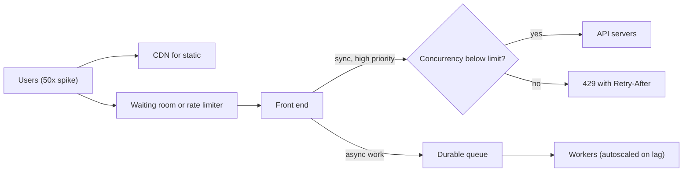

## In one minute
- A spike is load that arrives faster than capacity can grow. Autoscaling reacts in minutes; a flash sale, a push notification or a viral link arrives in seconds. The gap must be absorbed by something other than new servers.
- The toolkit has four parts: **buffer** (queue the work and drain it at a sustainable rate), **shed** (reject the least valuable work early and cheaply), **shape** (rate-limit, add waiting rooms, spread the arrival with jitter) and **pre-provision** (scale up before known events).
- Queues only help when the work can be asynchronous and the spike is finite. A queue in front of a synchronous request just turns overload into latency, then into timeouts.
- The goal under overload is to keep goodput flat: serve as many useful requests as the system can, fast, and refuse the rest, rather than serving everyone slowly and failing all of them.

## How it works

### Where spikes come from
Spikes are rarely random. Marketing pushes to 20 million phones, which then open the app within a minute. A ticket on-sale starts at exactly 10:00. Cron jobs across thousands of clients fire at the top of the hour. A dependency recovers and every client retries at once. Knowing the cause tells you whether the spike is predictable (pre-scale), self-inflicted (add jitter), or truly unknown (buffer and shed).

### Buffering with a queue
For work that does not need an immediate answer (sending emails, processing uploads, recording orders after a fast acknowledgement), put a durable queue between the front end and the workers. The front end only has to enqueue, which is cheap. Workers drain at their own rate. If the spike is 10x for 2 minutes and workers run at 2x normal, the backlog grows by 8 normal-minutes of work each minute, peaks at 16, and drains at the 1x of spare capacity in about 16 more minutes. This is queue-based load levelling ([Azure Architecture Center](https://learn.microsoft.com/en-us/azure/architecture/patterns/queue-based-load-leveling)). It works when the user accepts "we got it, processing" and when the total work in the spike fits within your patience window.

### Shedding load
For synchronous requests, the server must decide quickly whether it can serve each one. Load shedding rejects work at the edge with a cheap error (HTTP 503 or 429 with `Retry-After`) when a signal crosses a threshold: concurrency in flight, queue wait time, CPU. Rejecting costs microseconds; serving a request that will time out anyway costs the full work and helps nobody. AWS calls the useful part of throughput goodput: requests answered without error and fast enough for the client to use, which collapses once latency passes the client timeout ([AWS Builders' Library](https://aws.amazon.com/builders-library/using-load-shedding-to-avoid-overload/)). Good shedding is prioritised: checkout beats browse, interactive beats batch, a user's first attempt beats their fifth retry.

### Shaping the arrival
- **Rate limits** per client or per tenant (token bucket) cap how much any one source can add ([Azure Throttling pattern](https://learn.microsoft.com/en-us/azure/architecture/patterns/throttling)).
- **Virtual waiting rooms** for known surges admit users at a controlled rate and give others a place in line with a position, so the backend sees a steady flow.
- **Jitter** on client schedules and retries turns a synchronized stampede into a smear. A push notification sent to 20 million devices can include a randomized delay before the app fetches content.
- **Static content to the CDN** removes the bulk of a spike from origins.

### Pre-provisioning
For predictable events, scale before they start, warm caches, and pre-split database partitions. Google's SRE book warns that a service whose capacity depends on a cache cannot carry its normal load while that cache is empty, so new capacity should take a small share of traffic first ([Google SRE book](https://sre.google/sre-book/addressing-cascading-failures/)). Autoscaling still matters for the long tail of growth, but treat it as a slow loop, not an emergency brake.

### How it shows up in interviews
Triggers: design Ticketmaster, a flash-sale system, a voting system for a live TV show, a notification service, a URL shortener that might go viral, or any prompt that says "traffic is 50x at peak." A strong answer quantifies the peak, separates synchronous from asynchronous work, places a queue where async is acceptable, sheds and prioritises where it is not, and mentions client-side jitter and pre-scaling. Interviewers probe: what happens to the queue if the spike never ends, how do you choose what to drop, how does the user experience a rejection, and how do retries make it worse.

## Down the stack

### Layer 1: The contract
A buffered path promises durability on acknowledgement and eventual processing, with a latency envelope that grows with backlog: if 600,000 messages are queued and workers drain 2,000 per second, the newest one waits about 5 minutes. A shedding front end promises that accepted requests meet their latency objective and rejected ones fail fast, ideally in under a millisecond, with a retry hint. A waiting room promises ordering and a bounded admission rate, not admission. Make the contract explicit, because "the queue will absorb it" hides an unbounded wait.

### Layer 2: The mechanism
A token bucket stores `tokens` and `last_refill`; each request refills `rate * (now - last_refill)` up to `capacity`, then spends one token or is rejected. Envoy's local rate limit filter implements exactly this and answers 429 by default ([Envoy docs](https://www.envoyproxy.io/docs/envoy/latest/configuration/http/http_filters/local_rate_limit_filter)), as do many API gateways. For queue management, Facebook adapted CoDel to server queues: if a queue has not been empty at any point in the last N milliseconds, newly queued requests get a short timeout of M milliseconds instead of the normal one, and the server switches to adaptive LIFO so the freshest requests, whose users are still waiting, are served first ([summary of Maurer, "Fail at Scale"](https://blog.acolyer.org/2015/11/19/fail-at-scale-controlling-queue-delay/)). Classic network CoDel uses a 5 ms target and a 100 ms interval ([RFC 8289](https://www.rfc-editor.org/rfc/rfc8289)). Concurrency limiters such as Netflix's `concurrency-limits` library start from Little's law (limit equals request rate times latency) and adjust the limit with TCP-like algorithms such as Vegas or Gradient2, shrinking it when latency rises ([Netflix](https://github.com/Netflix/concurrency-limits)). Kafka or SQS provide the durable buffer; consumer lag (`records-lag-max` in Kafka) is the backlog signal you scale workers on.

### Layer 3: The machine
Even without application queues, the kernel has its own. A listening socket has an accept queue sized by the `listen()` backlog, capped by `net.core.somaxconn` (4096 by default since Linux 5.4, 128 before). When it fills, the kernel drops incoming handshake packets unless `tcp_abort_on_overflow` is set, and the client retransmits its SYN. Older kernels back off exponentially (about 1, 3 and 7 seconds after the first try); kernels since 2023 retry the first four SYNs at one-second intervals (`tcp_syn_linear_timeouts`, default 4) before backing off ([Linux kernel docs](https://docs.kernel.org/networking/ip-sysctl.html)). Either way, a full accept queue turns into seconds of tail latency invisible to application metrics. Inside the process, each queued request holds memory: at 20 KB of buffers per request, 100,000 queued requests are 2 GB of heap, which in a garbage-collected runtime raises GC pause times exactly when you can least afford them. New instances take time: VM boot, container pull, JIT warm-up and cache warming can each take tens of seconds, so a fresh server can be slower than its neighbours for its first minute.

### Why it's built this way
Capacity costs money every hour, so systems are sized near typical peak, not worst case. Capacity cannot appear instantly because machines must boot and warm, so short spikes must be absorbed in time (queues) or refused (shedding). Queues hold memory and add delay, so they must be bounded. Users abandon slow responses, so under overload serving fresh requests first and refusing stale ones maximises useful work.

## Diagram


## Worked example
A ticketing site normally handles 2,000 requests per second. A major concert goes on sale at 10:00, and the team expects 1.5 million users in the first five minutes, each refreshing and searching, roughly 80,000 requests per second at the peak.

The backend (seat inventory database and payment) can safely complete about 1,500 checkouts per second. The team designs three layers. First, a waiting room in front of the sale page: users get a random queue position at 10:00 (not first-come, which rewards bots refreshing at 09:59:59). It admits about 600 users per second into the shopping flow, so the API sees a bounded population of tens of thousands of active shoppers instead of 1.5 million. Second, seat browsing is served from a cache refreshed every second; only "hold this seat" touches the database. Third, the hold endpoint has a concurrency limit of 400 in flight per instance and sheds the rest with a 429 and a retry-after of 2 seconds plus jitter.

Pre-scaling at 09:30 doubles the API fleet. Payment processing after a hold goes through a queue; users see "confirming your order" for a few seconds. Even if every admitted user checks out, 600 per second stays well under the 1,500-per-second checkout ceiling, and the 50,000 available tickets are gone within a few minutes. The waiting room then tells the remaining users that inventory is gone instead of letting them hammer the API.

## In the wild
- **Canva, 2024: a stalled asset turns into a synchronized stampede.** After a deploy, one JavaScript chunk stalled on a lossy CDN path, and request coalescing held about 270,000 clients on the same fetch. When it finally loaded, they all hit the API at once, about 1.5 million requests per second or 3x the usual peak; gateway tasks ran out of memory faster than autoscaling could replace them, and canva.com was down for about 52 minutes. Canva blocked traffic at the CDN, let regions back in under rate limits, and added load shedding and fetch timeouts ([Canva Engineering](https://www.canva.dev/blog/engineering/canva-incident-report-api-gateway-outage/)).
- **Slack, 2021: the first Monday back outgrows the network.** On the first workday of 2021, clients with cold caches drove a surge that AWS Transit Gateways could not scale for, causing packet loss. Autoscaling thrashed, and provisioning about 1,200 servers hit open-file limits and AWS quotas, while monitoring sat behind the same gateway; Slack was degraded or down for several hours, until AWS raised the gateway capacity at about 10:40am PST. Slack now asks for pre-warming before holidays ([Slack Engineering](https://slack.engineering/slacks-outage-on-january-4th-2021/)).
- **Discord, 2026: a scale-down sets off a reconnect storm.** A config change halved the number of session pods in one zone, and pods were terminated before they could hand off, ending 17% of sessions ungracefully. Reconnects hit an untuned rate limit and ran gateways out of memory, and voice and video were mostly down for about 3 hours 17 minutes. Discord now blocks scale-down until pods drain and retuned its limits ([Discord](https://discord.com/blog/behind-the-scenes-of-the-3-25-26-voice-outage)).

## Trade-offs
| Option | Strengths | Weaknesses | Choose when |
|---|---|---|---|
| Durable queue | Smooths bursts, decouples producers | Adds latency, backlog can grow without bound | Work is async and spikes are finite |
| Load shedding | Protects latency for accepted work | Some users get errors | Synchronous APIs under overload |
| Rate limiting per client | Fairness, stops one abuser | Does not cap total load from many clients | Multi-tenant APIs |
| Waiting room | Predictable admission, good UX | Extra component, users wait | Known surges like sales or launches |
| Pre-provisioning | No warm-up lag | Cost of idle capacity | Scheduled events |

## Pitfalls in production
- **Unbounded queues.** The queue accepts everything, latency climbs to minutes, and by the time a request is processed its client has gone. Bound every queue and drop or reject by age.
- **Retry storms.** Rejected clients retry immediately and multiply load. Use exponential backoff with jitter, honour `Retry-After`, and cap retries with a budget.
- **Shedding too late.** If the rejection happens after authentication, database lookups and deserialisation, it saves little. Shed as early and cheaply as possible.
- **Autoscaling on the wrong signal.** CPU lags behind queue growth for I/O-bound services. Scale on queue depth, consumer lag or concurrency.
- **Synchronized clients.** Mobile apps that refresh on the minute or SDKs that reconnect immediately after an outage create self-inflicted spikes. Add jitter in the client.
- **Cold caches after scaling out.** New instances miss in local caches and push a second wave onto the database. Warm caches before routing traffic.

## Leadership lens
- Ask what the system does at 10x expected peak. "It falls over" and "it gets slow" are both wrong answers; "it serves 1x well and refuses the rest" is the target.
- Agree with product which features are sheddable and in what order, before the incident.
- Load-test the overload behaviour, not only the happy path. Run at 3x capacity and confirm goodput stays flat.
- Coordinate with marketing and partners; many spikes are scheduled by someone in the same company.

## Check yourself
1. Why does a queue not help a synchronous API under sustained overload?
   **Answer:** Arrival rate exceeds service rate, so the queue grows without limit and every request waits longer until clients time out, wasting the work.
2. Why serve the newest requests first when overloaded?
   **Answer:** Old requests are likely abandoned by their clients, so serving them wastes capacity; fresh requests still have someone waiting.
3. A spike is 10x normal for 3 minutes and workers can run at 2x normal. How long does the backlog take to clear?
   **Answer:** The backlog builds at 8x normal for 3 minutes, so 24 minutes of normal-rate work; draining at 1x spare capacity takes about 24 more minutes.
4. Why randomize queue positions in a waiting room?
   **Answer:** First-come ordering rewards bots and refresh storms right before opening; random positions remove the incentive to hammer the site.

## Practice
**Task:** Implement a bounded priority load leveller. `LoadLeveler(capacity, drain_per_tick)` buffers items with integer priorities (higher is more important). `offer(item, priority)` returns `"accepted"` if there is room. When full, it evicts the lowest-priority buffered item (the most recently added one among ties) if the newcomer has strictly higher priority, and returns `"accepted"`; otherwise it returns `"shed"`. `tick()` removes and returns up to `drain_per_tick` items, highest priority first and first-in-first-out within a priority. `shed_count()` returns how many items were shed or evicted.

```python starter
class LoadLeveler:
    def __init__(self, capacity, drain_per_tick):
        # TODO
        raise NotImplementedError

    def offer(self, item, priority):
        raise NotImplementedError

    def tick(self):
        raise NotImplementedError

    def shed_count(self):
        raise NotImplementedError
```

```python tests
def test_accepts_until_full_then_sheds_equal_priority():
    q = LoadLeveler(2, 1)
    assert q.offer("a", 1) == "accepted"
    assert q.offer("b", 1) == "accepted"
    assert q.offer("c", 1) == "shed"
    assert q.shed_count() == 1

def test_higher_priority_evicts_lowest_newest():
    q = LoadLeveler(3, 3)
    q.offer("low1", 0); q.offer("low2", 0); q.offer("mid", 5)
    assert q.offer("vip", 9) == "accepted"
    assert q.tick() == ["vip", "mid", "low1"], "low2 was the newest lowest item"
    assert q.shed_count() == 1

def test_drain_order_priority_then_fifo():
    q = LoadLeveler(10, 10)
    for item, p in [("x", 1), ("y", 3), ("z", 1), ("w", 3)]:
        q.offer(item, p)
    assert q.tick() == ["y", "w", "x", "z"]

def test_tick_respects_drain_rate():
    q = LoadLeveler(10, 2)
    for i in range(5):
        q.offer(i, 0)
    assert q.tick() == [0, 1]
    assert q.tick() == [2, 3]
    assert q.tick() == [4]
    assert q.tick() == []

def test_room_frees_after_tick():
    q = LoadLeveler(1, 1)
    q.offer("a", 0)
    assert q.offer("b", 0) == "shed"
    q.tick()
    assert q.offer("b", 0) == "accepted"

def test_zero_capacity_sheds_everything():
    q = LoadLeveler(0, 1)
    assert q.offer("a", 100) == "shed"
    assert q.tick() == [] and q.shed_count() == 1
```

```python solution
class LoadLeveler:
    def __init__(self, capacity, drain_per_tick):
        self.capacity = capacity
        self.drain = drain_per_tick
        self.items = []  # (priority, seq, item)
        self.seq = 0
        self.shed = 0

    def offer(self, item, priority):
        if len(self.items) < self.capacity:
            self.items.append((priority, self.seq, item))
            self.seq += 1
            return "accepted"
        if not self.items:
            self.shed += 1
            return "shed"
        victim = min(self.items, key=lambda e: (e[0], -e[1]))
        if priority > victim[0]:
            self.items.remove(victim)
            self.shed += 1
            self.items.append((priority, self.seq, item))
            self.seq += 1
            return "accepted"
        self.shed += 1
        return "shed"

    def tick(self):
        self.items.sort(key=lambda e: (-e[0], e[1]))
        out = self.items[:self.drain]
        self.items = self.items[self.drain:]
        return [e[2] for e in out]

    def shed_count(self):
        return self.shed
```

```typescript starter
export class LoadLeveler {
  constructor(capacity: number, drainPerTick: number) {}
  offer(item: string, priority: number): "accepted" | "shed" {
    throw new Error("TODO");
  }
  tick(): string[] {
    throw new Error("TODO");
  }
  shedCount(): number {
    throw new Error("TODO");
  }
}
```

```typescript tests
test("accepts until full then sheds equal priority", () => {
  const q = new LoadLeveler(2, 1);
  assertEqual([q.offer("a", 1), q.offer("b", 1), q.offer("c", 1)], ["accepted", "accepted", "shed"]);
  assertEqual(q.shedCount(), 1);
});
test("higher priority evicts lowest newest", () => {
  const q = new LoadLeveler(3, 3);
  q.offer("low1", 0); q.offer("low2", 0); q.offer("mid", 5);
  assertEqual(q.offer("vip", 9), "accepted");
  assertEqual(q.tick(), ["vip", "mid", "low1"]);
  assertEqual(q.shedCount(), 1);
});
test("drain order priority then fifo", () => {
  const q = new LoadLeveler(10, 10);
  q.offer("x", 1); q.offer("y", 3); q.offer("z", 1); q.offer("w", 3);
  assertEqual(q.tick(), ["y", "w", "x", "z"]);
});
test("tick respects drain rate", () => {
  const q = new LoadLeveler(10, 2);
  for (const i of ["0", "1", "2", "3", "4"]) q.offer(i, 0);
  assertEqual(q.tick(), ["0", "1"]);
  assertEqual(q.tick(), ["2", "3"]);
  assertEqual(q.tick(), ["4"]);
  assertEqual(q.tick(), []);
});
test("room frees after tick", () => {
  const q = new LoadLeveler(1, 1);
  q.offer("a", 0);
  assertEqual(q.offer("b", 0), "shed");
  q.tick();
  assertEqual(q.offer("b", 0), "accepted");
});
test("zero capacity sheds everything", () => {
  const q = new LoadLeveler(0, 1);
  assertEqual(q.offer("a", 100), "shed");
  assertEqual(q.tick(), []);
  assertEqual(q.shedCount(), 1);
});
```

```typescript solution
type Entry = { p: number; seq: number; item: string };

export class LoadLeveler {
  private items: Entry[] = [];
  private seq = 0;
  private shed = 0;
  constructor(private capacity: number, private drainPerTick: number) {}
  offer(item: string, priority: number): "accepted" | "shed" {
    if (this.items.length < this.capacity) {
      this.items.push({ p: priority, seq: this.seq++, item });
      return "accepted";
    }
    if (this.items.length === 0) {
      this.shed++;
      return "shed";
    }
    let vi = 0;
    for (let i = 1; i < this.items.length; i++) {
      const a = this.items[i], v = this.items[vi];
      if (a.p < v.p || (a.p === v.p && a.seq > v.seq)) vi = i;
    }
    this.shed++;
    if (priority > this.items[vi].p) {
      this.items.splice(vi, 1);
      this.items.push({ p: priority, seq: this.seq++, item });
      return "accepted";
    }
    return "shed";
  }
  tick(): string[] {
    this.items.sort((a, b) => (b.p - a.p) || (a.seq - b.seq));
    const out = this.items.slice(0, this.drainPerTick);
    this.items = this.items.slice(this.drainPerTick);
    return out.map((e) => e.item);
  }
  shedCount(): number {
    return this.shed;
  }
}
```

```go starter
package practice

import "sync"

// LoadLeveler is a bounded priority buffer. Safe for concurrent use.
type LoadLeveler struct {
	mu sync.Mutex
}

func NewLoadLeveler(capacity, drainPerTick int) *LoadLeveler { return &LoadLeveler{} }

// Offer returns "accepted" or "shed".
func (q *LoadLeveler) Offer(item string, priority int) string { panic("TODO") }

func (q *LoadLeveler) Tick() []string { panic("TODO") }

func (q *LoadLeveler) ShedCount() int { panic("TODO") }
```

```go tests
package practice

import (
	"reflect"
	"testing"
)

func TestAcceptThenShed(t *testing.T) {
	q := NewLoadLeveler(2, 1)
	got := []string{q.Offer("a", 1), q.Offer("b", 1), q.Offer("c", 1)}
	if !reflect.DeepEqual(got, []string{"accepted", "accepted", "shed"}) || q.ShedCount() != 1 {
		t.Fatalf("got %v", got)
	}
}

func TestEvictLowestNewest(t *testing.T) {
	q := NewLoadLeveler(3, 3)
	q.Offer("low1", 0)
	q.Offer("low2", 0)
	q.Offer("mid", 5)
	if q.Offer("vip", 9) != "accepted" {
		t.Fatal("vip should be accepted")
	}
	if got := q.Tick(); !reflect.DeepEqual(got, []string{"vip", "mid", "low1"}) {
		t.Fatalf("got %v", got)
	}
}

func TestDrainOrder(t *testing.T) {
	q := NewLoadLeveler(10, 10)
	q.Offer("x", 1)
	q.Offer("y", 3)
	q.Offer("z", 1)
	q.Offer("w", 3)
	if got := q.Tick(); !reflect.DeepEqual(got, []string{"y", "w", "x", "z"}) {
		t.Fatalf("got %v", got)
	}
}

func TestDrainRate(t *testing.T) {
	q := NewLoadLeveler(10, 2)
	for _, s := range []string{"0", "1", "2", "3", "4"} {
		q.Offer(s, 0)
	}
	if got := q.Tick(); !reflect.DeepEqual(got, []string{"0", "1"}) {
		t.Fatalf("got %v", got)
	}
	q.Tick()
	if got := q.Tick(); !reflect.DeepEqual(got, []string{"4"}) {
		t.Fatalf("got %v", got)
	}
	if got := q.Tick(); len(got) != 0 {
		t.Fatalf("got %v", got)
	}
}

func TestRoomFrees(t *testing.T) {
	q := NewLoadLeveler(1, 1)
	q.Offer("a", 0)
	if q.Offer("b", 0) != "shed" {
		t.Fatal("expected shed")
	}
	q.Tick()
	if q.Offer("b", 0) != "accepted" {
		t.Fatal("expected accepted")
	}
}

func TestZeroCapacity(t *testing.T) {
	q := NewLoadLeveler(0, 1)
	if q.Offer("a", 100) != "shed" || len(q.Tick()) != 0 || q.ShedCount() != 1 {
		t.Fatal("zero capacity sheds everything")
	}
}
```

```go solution
package practice

import (
	"sort"
	"sync"
)

type entry struct {
	p, seq int
	item   string
}

// LoadLeveler is a bounded priority buffer. Safe for concurrent use.
type LoadLeveler struct {
	mu       sync.Mutex
	capacity int
	drain    int
	items    []entry
	seq      int
	shed     int
}

func NewLoadLeveler(capacity, drainPerTick int) *LoadLeveler {
	return &LoadLeveler{capacity: capacity, drain: drainPerTick}
}

// Offer returns "accepted" or "shed".
func (q *LoadLeveler) Offer(item string, priority int) string {
	q.mu.Lock()
	defer q.mu.Unlock()
	if len(q.items) < q.capacity {
		q.items = append(q.items, entry{priority, q.seq, item})
		q.seq++
		return "accepted"
	}
	q.shed++
	if len(q.items) == 0 {
		return "shed"
	}
	vi := 0
	for i, e := range q.items {
		v := q.items[vi]
		if e.p < v.p || (e.p == v.p && e.seq > v.seq) {
			vi = i
		}
	}
	if priority <= q.items[vi].p {
		return "shed"
	}
	q.items = append(q.items[:vi], q.items[vi+1:]...)
	q.items = append(q.items, entry{priority, q.seq, item})
	q.seq++
	return "accepted"
}

func (q *LoadLeveler) Tick() []string {
	q.mu.Lock()
	defer q.mu.Unlock()
	sort.Slice(q.items, func(i, j int) bool {
		if q.items[i].p != q.items[j].p {
			return q.items[i].p > q.items[j].p
		}
		return q.items[i].seq < q.items[j].seq
	})
	n := q.drain
	if n > len(q.items) {
		n = len(q.items)
	}
	out := []string{}
	for _, e := range q.items[:n] {
		out = append(out, e.item)
	}
	q.items = append([]entry{}, q.items[n:]...)
	return out
}

func (q *LoadLeveler) ShedCount() int {
	q.mu.Lock()
	defer q.mu.Unlock()
	return q.shed
}
```

## Mock interview
**Prompt:** Design the vote-ingestion backend for a live TV talent show. Voting opens for 5 minutes after each performance; you expect 30 million votes in that window, with most arriving in the first 60 seconds, against a normal load of near zero. Each phone number may vote up to 10 times per contestant.

- Follow-up: Where exactly do you acknowledge the vote, and what does the user see if the system is saturated?
- Follow-up: The queue consumers fall behind by 4 minutes. Is that a problem, and how do you show results on air?
- Follow-up: Would you pre-provision or autoscale, and what does each cost?

**A strong answer covers:**
- Peak arithmetic: roughly 30 million votes mostly within 60 seconds means a few hundred thousand writes per second at peak.
- A thin, stateless ingest tier that validates and appends to a partitioned durable log, acknowledging after the append.
- Per-phone limits enforced downstream or with a fast counter store, with the trade-off between strictness and ingest speed.
- Pre-provisioning for a scheduled event, with load tests at higher than expected peak.
- Shedding with clear client behaviour (retry with jitter) and a bounded backlog whose drain time fits the results deadline.

## Sources and further study
**Primary**
- [RFC 8289: Controlled Delay Active Queue Management](https://www.rfc-editor.org/rfc/rfc8289): the CoDel algorithm, its 5 ms target and 100 ms interval.
- [Linux kernel: IP sysctl reference](https://docs.kernel.org/networking/ip-sysctl.html): `somaxconn`, SYN retry timing and `tcp_abort_on_overflow`.

**Systems docs**
- [Netflix concurrency-limits](https://github.com/Netflix/concurrency-limits): adaptive concurrency limits derived from Little's law and measured latency.
- [Envoy local rate limit filter](https://www.envoyproxy.io/docs/envoy/latest/configuration/http/http_filters/local_rate_limit_filter): a per-instance token bucket at the proxy.

**Books**
- *Site Reliability Engineering*, Beyer et al. (Google), Ch 22 "Addressing Cascading Failures": queue sizing, LIFO, slow startup and cold caches, and retry amplification.
- *Release It!* (2nd ed.), Michael T. Nygard, Ch 15 "Case Study: Trampled by Your Own Customers" (a launch-day overload) and Ch 9 "Interconnect", whose demand control section covers shedding at each layer.

**Other curricula**
- [Azure Architecture Center: Throttling pattern](https://learn.microsoft.com/en-us/azure/architecture/patterns/throttling): frames throttling as an alternative to autoscaling that degrades lower-priority work while capacity catches up.
- [donnemartin/system-design-primer](https://github.com/donnemartin/system-design-primer): frames back pressure as a bounded queue that answers 503 when full, with clients retrying under exponential backoff.

## Watch
- [Stop Rate Limiting! Capacity Management Done Right (Strange Loop)](https://www.youtube.com/watch?v=m64SWl9bfvk): queueing theory and concurrency limits as an alternative to static rate limits.
- [Close Loops and Opening Minds (AWS re:Invent 2018)](https://www.youtube.com/watch?v=O8xLxNje30M): control-theory view of overload, backlogs and stability.

## Free resources
- [Using load shedding to avoid overload (AWS Builders' Library)](https://aws.amazon.com/builders-library/using-load-shedding-to-avoid-overload/): goodput, prioritised shedding and testing overload.
- [Avoiding insurmountable queue backlogs (AWS Builders' Library)](https://aws.amazon.com/builders-library/avoiding-insurmountable-queue-backlogs/): bounded queues, LIFO and backlog recovery.
- [Handling overload (Google SRE book)](https://sre.google/sre-book/handling-overload/): client-side throttling, criticality and per-customer limits.
- [Queue-based load levelling (Azure Architecture Center)](https://learn.microsoft.com/en-us/azure/architecture/patterns/queue-based-load-leveling): the buffering pattern and its constraints.
- [Timeouts, retries and backoff with jitter (AWS Builders' Library)](https://aws.amazon.com/builders-library/timeouts-retries-and-backoff-with-jitter/): stopping retry storms from amplifying spikes.
