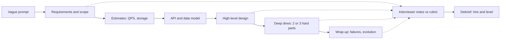

## In one minute
- A system design interview is a 45 to 60 minute conversation ([interviewing.io](https://interviewing.io/guides/system-design-interview)) in which you design a large system from a vague prompt ("design a URL shortener", "design a rate limiter") while the interviewer probes your reasoning. There is no single right answer; there are defensible and indefensible ones.
- The interviewer is not grading the final diagram. They are collecting evidence on a rubric: did you scope the problem, size it, choose components for stated reasons, find the hard parts, and reason about failure and trade-offs?
- Time is the scarcest resource. In a 45-minute slot you may get only about 35 minutes of actual design once introductions and questions are done ([Hello Interview](https://www.hellointerview.com/blog/how-to-prepare-meta-pa)). Most weak performances are not wrong designs but unfinished ones: 25 minutes on requirements, or a deep dive into a cache before the read path exists.
- The same session also decides your level. A mid-level answer that works and a staff-level answer that works differ in how much of the conversation the candidate drives and how far down the stack they can go when pushed.
- This chapter orients you. The rest of the course goes deep: [Types of System Design Questions](question-types.md), [Expectations by Level/YoE](expectations-by-level.md), the answering framework, [Estimation Cheatsheet](estimation-cheatsheet.md), [Diagramming Tips](diagramming-tips.md), [Tradeoffs](tradeoffs.md), and some 30 full "Design X" walkthroughs such as [Design Pastebin](design-url-shortener.md) and [Design Rate Limiter](design-rate-limiter.md).

## How it works

### Why companies run them
Coding interviews say little about whether you can decide what to build when requirements are fuzzy, load is unknown and every option has a cost. That judgement is most of the job above entry level, and a poor partition key or consistency model can cost a team a year. The system design interview is a cheap, imperfect simulation of a design review, compressed into one hour with one reviewer.

### The shape of a session
Almost every format follows the same arc, whatever the company calls it. The open curricula agree on the skeleton: the System Design Primer uses four steps (use cases and constraints, high-level design, core components, scaling) ([System Design Primer](https://github.com/donnemartin/system-design-primer#how-to-approach-a-system-design-interview-question)), and Hello Interview budgets about 5 minutes for requirements, 10 to 15 for the high-level design and about 10 for deep dives ([Hello Interview](https://www.hellointerview.com/learn/system-design/in-a-hurry/delivery)).

1. **Prompt.** One sentence, deliberately underspecified. The ambiguity is the test: a candidate who starts drawing immediately has skipped the part that matters.
2. **Requirements.** You agree the functional scope (three to five core features) and the non-functional targets (scale, latency, availability, consistency). You also say what is out of scope.
3. **Estimation.** Enough arithmetic to make decisions: requests per second, storage growth, bandwidth, and the read to write ratio. The [Estimation Cheatsheet](estimation-cheatsheet.md) covers the numbers.
4. **Interface.** The main API calls or events, which pin down what the system actually does.
5. **High-level design.** A diagram of clients, services, stores and queues, with one walk through the write path and one through the read path. [Diagramming Tips](diagramming-tips.md) covers how to draw it.
6. **Deep dives.** Two or three hard parts, chosen by you or by the interviewer: the hot key, the fan-out, the exactly-once payment, the region failover.
7. **Wrap-up.** Bottlenecks, failure modes, what you would build first, and what you would change at ten times the load.

### What the interviewer is doing
While you talk, the interviewer takes notes against a rubric of four to six dimensions such as scoping, high-level design, technical depth, trade-offs and communication. Hello Interview's version has four: problem navigation, solution design, technical excellence, and communication and collaboration, and notes that companies use different words for the same things ([Hello Interview](https://www.hellointerview.com/learn/system-design/in-a-hurry/introduction)). Some questions are hints in disguise: "how many writes per second is that?" usually means your design will not hold at that rate. Afterwards they write feedback with concrete quotes for a debrief or hiring committee. Their job is to produce evidence, so yours is to make your reasoning visible.

### Variations and what it is not
Prompts split into product designs ("design Instagram"), which reward scoping and data modelling, and infrastructure designs ("design a distributed cache"), which reward internals and failure handling; [Types of System Design Questions](question-types.md) classifies them. Most entry-level roles have no system design round at all ([Hello Interview](https://www.hellointerview.com/learn/system-design/in-a-hurry/introduction)). Mid-level loops are often interviewer-led; senior loops expect you to direct more of the session ([interviewing.io](https://interviewing.io/guides/system-design-interview)). Some companies also split the round by role: Meta's Product Architecture interview is the system design round for product engineers and asks for user-facing products rather than, say, a load balancer ([Hello Interview](https://www.hellointerview.com/blog/how-to-prepare-meta-pa)). It is not a trivia test: "use Kafka" earns nothing, while "an append-only partitioned log, so consumers can replay" earns a lot. Nor is it a test of memorised designs; interviewers twist familiar prompts ("now some links get 100,000 hits per second") to separate reasoning from recall.

## Down the stack

### Layer 1: The contract
The human process is a structured interview. Google's re:Work guide names its four parts: vetted role-relevant questions, recorded feedback, standardised rubrics, and interviewer training and calibration, and reports that structured interviews predicted job performance better than unstructured ones in Google's own data ([re:Work](https://rework.withgoogle.com/intl/en/guides/a-guide-to-structured-interviewing-for-better-hiring-practices)). The contract between candidate and company is that every candidate for a role gets a comparable prompt, is scored on the same named dimensions, and is judged on evidence written down during the session rather than on a gut feeling afterwards. Concretely, a hire signal on "technical depth" should be traceable to something you said, such as "they explained why a write-through cache doubles write latency and chose cache-aside instead". That is why silence hurts: an interviewer cannot record a thought you did not say aloud. It is also why a single strong deep dive can carry a session while a long, shallow tour of every component cannot.

### Layer 2: The mechanism
Underneath the rubric, the technical content follows a dependency chain, and each artefact unlocks the next. Requirements fix which operations exist. Estimates turn them into rates: 100 million daily users posting twice a day is about 2,300 writes per second on average. Rates plus the read to write ratio choose the shape: at 100 reads per write you design the read path first, with caching or precomputation. The API fixes the access patterns, which fix the data model and the partition key. Data model plus rates expose the hard parts: a post fanned out to 50 million followers, a counter hit 10,000 times a second, one inventory row everyone wants. Deep dives resolve those with named mechanisms such as consistent hashing, an idempotency key or a lease. Skip a link and the answer feels unanchored.

### Layer 3: The machine
A strong candidate can check a design against the hardware in their head. Memory access is about 100 ns and a random SSD read about 100 us ([Napkin Math](https://github.com/sirupsen/napkin-math)). The classic table puts a round trip inside a data centre at 0.5 ms, but those figures date from about 2012 ([latency numbers](https://gist.github.com/jboner/2841832)); a 2026 re-measurement on cloud VMs gives about 100 us within a zone and 250 us within a region, with region-to-region round trips of 25 to 180 ms ([Napkin Math](https://github.com/sirupsen/napkin-math)). Treat 0.1 to 0.5 ms as the in-region range. A day has 86,400 seconds, so one million events a day is roughly 12 per second. A single well-tuned Postgres primary handles thousands to low tens of thousands of simple writes per second; a single Redis instance, which executes commands on one thread, does on the order of 100,000 simple operations per second without pipelining and far more with it ([Redis docs](https://redis.io/docs/latest/operate/oss_and_stack/management/optimization/benchmarks/)). A 10 Gbit/s NIC moves about 1.25 GB per second. These numbers turn opinions into checks: "a 1 KB write at 50,000 per second is 50 MB/s, one disk can absorb that, but one Postgres primary probably cannot commit that many transactions, so we batch or shard." Most interviewers will not ask for the numbers directly. They notice whether your choices are consistent with them.

### Why it's built this way
Design ability cannot be observed by watching someone build a real system, because that takes months, so companies compress it into an hour. An hour is too short to finish a real design, so the interview grades the process, not the output. Process is invisible unless spoken, so the format rewards narrating your reasoning. Interviewers are human and inconsistent, so companies add rubrics, written evidence and committees to reduce variance. And because seniority shows up mainly in judgement under ambiguity, the same open-ended format is used to decide your level as well as your hire.

## Diagram


## Worked example
Here is a 45-minute plan for "design a URL shortener", with what the interviewer can write down at each stage.

Minutes 0 to 5, requirements. You settle on create, redirect and optional expiry, with click counts as a stretch goal and user accounts out of scope; redirects under 50 ms at p99. Evidence logged: "scoped before designing".

Minutes 5 to 8, estimates. 100 million new links a month is about 40 writes per second. At 100 reads per write, that is 4,000 redirects per second on average and perhaps 20,000 at peak. At 500 bytes a record that is 50 GB a month. Said aloud: "reads dominate and the hot set fits in memory, so the redirect path is a cache lookup." Evidence: "used numbers to drive a decision".

Minutes 8 to 12, API and data. `POST /links {url, ttl}` returns a code; `GET /{code}` returns a 301 or 302. The table is `code -> (url, expires_at, owner)`, partitioned by code.

Minutes 12 to 24, high-level design: load balancer, stateless link service, key-value store, Redis cache, and an ID allocator handing out ranges.

Minutes 24 to 41, deep dives: base62 counters versus hashing (7 characters give 3.5 trillion codes), an in-process cache for a link at 100,000 requests per second, and 301 versus 302 (browser caching versus click counts).

Minutes 41 to 45, wrap-up: what fails first at ten times the load (the cache tier's network), and the build order. A candidate who finishes this arc with three real deep dives is in hire territory at most levels; how deep each dive went decides which level.

## In the wild
- **Niantic and Google Cloud, 2016: Pokémon GO launches at 50 times its estimate.** Niantic planned for 1x traffic with 5x as the worst case; real traffic, measured on Cloud Datastore, reached 50x. Google engineers added tens of thousands of cores, and before the Japan launch the team upgraded GKE to allow over 1,000 more nodes and moved to the HTTP/S load balancer, after which Japan launched cleanly. It is the estimation phase of the interview at production scale: the number you plan for decides what breaks ([Google Cloud](https://cloud.google.com/blog/products/gcp/bringing-pokemon-go-to-life-on-google-cloud)).
- **Amazon Prime Video, 2023: the default architecture failed at 5% of expected load.** A stream-quality monitor built from Step Functions, Lambda and S3 hit account limits on state transitions at about 5% of its target, and passing frames through S3 was expensive. Rebuilding the same components as one process on ECS cut infrastructure cost by over 90%. Interviewers reward this kind of reasoning from the workload's numbers rather than from a fashionable default ([Prime Video Tech, archived](http://web.archive.org/web/20240805183535/https://www.primevideotech.com/video-streaming/scaling-up-the-prime-video-audio-video-monitoring-service-and-reducing-costs-by-90)).

## Trade-offs
| Approach in the room | Strengths | Weaknesses | Choose when |
|---|---|---|---|
| Breadth first, then depth | Never leaves a gap; shows structure | Risks shallow deep dives if slow | Default for every prompt |
| Depth early on the known hard part | Shows expertise fast | Unfinished design if it runs long | The prompt is obviously about one mechanism (rate limiter) |
| Interviewer-led, answer questions | Low risk of drifting | Weak signal on ownership and leadership | Junior loops, or when the interviewer clearly has a script |
| Candidate-led, check in often | Strong senior signal | Can miss what the interviewer wanted to see | Senior and staff loops |

## Pitfalls in production
The interview mirrors real design reviews, and the same failures show up in both:

- **Designing before scoping.** In interviews this wastes time; at work it ships the wrong system. Fix: write three to five requirements and the non-goals before any box.
- **Numbers that never get used.** Candidates compute 20,000 QPS and then draw a single database anyway. Fix: after every estimate, say the decision it forces.
- **No failure story.** Designs that only describe the happy path fail both interviews and on-call. Fix: for each stateful box, say how it replicates and what the user sees when it is down.
- **Running out of time.** The most common failure. Fix: budget the 45 minutes up front and check the clock at the end of each phase, which is exactly what this chapter's practice task builds.

## Leadership lens
- If you run interviews, write the rubric before the loop and calibrate interviewers on recorded or mock sessions; untrained interviewers grade confidence, not reasoning.
- Pick prompts that resemble your real system's hard problems, but not your actual architecture, or candidates who happen to know it get an unfair edge.
- Ask interviewers to log evidence as quotes, not adjectives. "Explained why fan-out on write fails for 50 million followers" is useful to a committee; "strong" is not.

## Check yourself
1. Why can a candidate with a correct final diagram still get a no-hire?
   **Answer:** The interviewer grades evidence of reasoning on a rubric. If the diagram was not justified by requirements and numbers, and no hard part was explored in depth, there is little evidence to record for scoping, depth or trade-offs.
2. Why do estimates come before the high-level design?
   **Answer:** Rates and sizes decide the shape of the design, such as whether reads need a cache, whether one database is enough, or whether you need sharding. Without them component choices are arbitrary.
3. An interviewer asks "what happens when this cache node dies?" during your high-level design. What is going on?
   **Answer:** Usually a hint that they want a deep dive on availability or that your design has a single point of failure; answer briefly with the failure behaviour and mitigation, then offer to go deeper.
4. Why is saying "use Kafka" without a reason weak?
   **Answer:** It names a product without the property you need, so it gives no evidence that you understand why a partitioned log fits; the interviewer cannot tell recall from reasoning.

## Practice
**Task:** Build the interview time planner. The phases, in order, are `requirements`, `estimation`, `api`, `high_level`, `deep_dive` and `wrap_up`. Base weights per question type sum to 45: `product` is 5, 3, 4, 12, 17, 4; `infrastructure` is 5, 3, 2, 10, 21, 4; `data` is 5, 6, 2, 11, 17, 4. `plan(total, qtype)` returns `(phase, minutes)` pairs in phase order that sum to `total`, using the largest-remainder method: each phase gets the floor of `total * weight / 45`, and the minutes left over go one each to the phases with the largest remainder, ties broken by phase order. Reject an unknown type or `total < 1`. `review(starts, plan, slack)` takes a map from phase to the minute you actually started it and returns, in phase order, `(phase, "missing")` for phases never started and `(phase, "late")` for phases started more than `slack` minutes after their planned start (the sum of planned minutes before them); reject an unknown phase name in `starts`.

```python starter
PHASES = ["requirements", "estimation", "api", "high_level", "deep_dive", "wrap_up"]

def plan(total, qtype):
    # TODO: largest-remainder allocation; raise ValueError on bad input
    raise NotImplementedError

def review(starts, plan_slots, slack):
    # TODO: return list of (phase, "missing" | "late") in phase order
    raise NotImplementedError
```

```python tests
def test_base_45_matches_weights():
    assert plan(45, "product") == [("requirements", 5), ("estimation", 3), ("api", 4),
                                   ("high_level", 12), ("deep_dive", 17), ("wrap_up", 4)]

def test_60_minutes_largest_remainder_ties_by_order():
    p = plan(60, "product")
    assert [m for _, m in p] == [7, 4, 5, 16, 23, 5]

def test_30_minutes_infrastructure():
    assert [m for _, m in plan(30, "infrastructure")] == [3, 2, 1, 7, 14, 3]

def test_sum_always_matches_total():
    for t in range(1, 91):
        for q in ("product", "infrastructure", "data"):
            assert sum(m for _, m in plan(t, q)) == t

def test_bad_input_rejected():
    for args in ((45, "trivia"), (0, "product")):
        try:
            plan(*args)
            assert False, "expected ValueError"
        except ValueError:
            pass

def test_review_flags_late_and_missing():
    p = plan(45, "product")
    starts = {"requirements": 0, "estimation": 4, "api": 9, "high_level": 20, "deep_dive": 33}
    assert review(starts, p, 3) == [("high_level", "late"), ("deep_dive", "late"), ("wrap_up", "missing")]

def test_review_on_time_is_clean():
    p = plan(45, "data")
    starts = {"requirements": 0, "estimation": 5, "api": 11, "high_level": 13, "deep_dive": 24, "wrap_up": 41}
    assert review(starts, p, 0) == []

def test_review_unknown_phase():
    try:
        review({"coffee": 3}, plan(45, "product"), 2)
        assert False, "expected ValueError"
    except ValueError:
        pass
```

```python solution
PHASES = ["requirements", "estimation", "api", "high_level", "deep_dive", "wrap_up"]
WEIGHTS = {
    "product": [5, 3, 4, 12, 17, 4],
    "infrastructure": [5, 3, 2, 10, 21, 4],
    "data": [5, 6, 2, 11, 17, 4],
}

def plan(total, qtype):
    if qtype not in WEIGHTS:
        raise ValueError("unknown question type: %s" % qtype)
    if total < 1:
        raise ValueError("total must be positive")
    w = WEIGHTS[qtype]
    mins = [total * x // 45 for x in w]
    rems = [total * x % 45 for x in w]
    left = total - sum(mins)
    order = sorted(range(len(w)), key=lambda i: (-rems[i], i))
    for i in order[:left]:
        mins[i] += 1
    return list(zip(PHASES, mins))

def review(starts, plan_slots, slack):
    for p in starts:
        if p not in PHASES:
            raise ValueError("unknown phase: %s" % p)
    out = []
    planned = 0
    for phase, minutes in plan_slots:
        if phase not in starts:
            out.append((phase, "missing"))
        elif starts[phase] > planned + slack:
            out.append((phase, "late"))
        planned += minutes
    return out
```

```typescript starter
export const PHASES = ["requirements", "estimation", "api", "high_level", "deep_dive", "wrap_up"];
export type Slot = [string, number];
export type Issue = [string, string];

export function plan(total: number, qtype: string): Slot[] {
  throw new Error("TODO");
}

export function review(starts: Record<string, number>, slots: Slot[], slack: number): Issue[] {
  throw new Error("TODO");
}
```

```typescript tests
test("base 45 matches weights", () => {
  assertEqual(plan(45, "product"), [["requirements", 5], ["estimation", 3], ["api", 4], ["high_level", 12], ["deep_dive", 17], ["wrap_up", 4]]);
});
test("60 minutes largest remainder ties by order", () => {
  assertEqual(plan(60, "product").map((s) => s[1]), [7, 4, 5, 16, 23, 5]);
});
test("30 minutes infrastructure", () => {
  assertEqual(plan(30, "infrastructure").map((s) => s[1]), [3, 2, 1, 7, 14, 3]);
});
test("sum always matches total", () => {
  for (let t = 1; t <= 90; t++) {
    for (const q of ["product", "infrastructure", "data"]) {
      assertEqual(plan(t, q).reduce((a, s) => a + s[1], 0), t, "total " + t + " " + q);
    }
  }
});
test("bad input rejected", () => {
  let a = false, b = false;
  try { plan(45, "trivia"); } catch (e) { a = true; }
  try { plan(0, "product"); } catch (e) { b = true; }
  assert(a && b, "expected errors");
});
test("review flags late and missing", () => {
  const starts = { requirements: 0, estimation: 4, api: 9, high_level: 20, deep_dive: 33 };
  assertEqual(review(starts, plan(45, "product"), 3), [["high_level", "late"], ["deep_dive", "late"], ["wrap_up", "missing"]]);
});
test("review on time is clean", () => {
  const starts = { requirements: 0, estimation: 5, api: 11, high_level: 13, deep_dive: 24, wrap_up: 41 };
  assertEqual(review(starts, plan(45, "data"), 0), []);
});
test("review unknown phase", () => {
  let threw = false;
  try { review({ coffee: 3 }, plan(45, "product"), 2); } catch (e) { threw = true; }
  assert(threw, "expected error");
});
```

```typescript solution
export const PHASES = ["requirements", "estimation", "api", "high_level", "deep_dive", "wrap_up"];
export type Slot = [string, number];
export type Issue = [string, string];

const WEIGHTS: Record<string, number[]> = {
  product: [5, 3, 4, 12, 17, 4],
  infrastructure: [5, 3, 2, 10, 21, 4],
  data: [5, 6, 2, 11, 17, 4],
};

export function plan(total: number, qtype: string): Slot[] {
  const w = WEIGHTS[qtype];
  if (!w) throw new Error("unknown question type: " + qtype);
  if (total < 1) throw new Error("total must be positive");
  const mins = w.map((x) => Math.floor((total * x) / 45));
  const rems = w.map((x) => (total * x) % 45);
  let left = total - mins.reduce((a, b) => a + b, 0);
  const order = w.map((_, i) => i).sort((i, j) => rems[j] - rems[i] || i - j);
  for (const i of order) {
    if (left === 0) break;
    mins[i] += 1;
    left -= 1;
  }
  return PHASES.map((p, i) => [p, mins[i]] as Slot);
}

export function review(starts: Record<string, number>, slots: Slot[], slack: number): Issue[] {
  for (const p of Object.keys(starts)) {
    if (PHASES.indexOf(p) < 0) throw new Error("unknown phase: " + p);
  }
  const out: Issue[] = [];
  let planned = 0;
  for (const [phase, minutes] of slots) {
    if (!(phase in starts)) out.push([phase, "missing"]);
    else if (starts[phase] > planned + slack) out.push([phase, "late"]);
    planned += minutes;
  }
  return out;
}
```

```go starter
package practice

// Phases in interview order.
var Phases = []string{"requirements", "estimation", "api", "high_level", "deep_dive", "wrap_up"}

// Slot is a planned phase and its minutes.
type Slot struct {
	Phase   string
	Minutes int
}

// Issue flags a phase as "missing" or "late".
type Issue struct {
	Phase  string
	Status string
}

func Plan(total int, qtype string) ([]Slot, error) { panic("TODO") }

func Review(starts map[string]int, slots []Slot, slack int) ([]Issue, error) { panic("TODO") }
```

```go tests
package practice

import (
	"reflect"
	"testing"
)

func minutes(s []Slot) []int {
	out := []int{}
	for _, x := range s {
		out = append(out, x.Minutes)
	}
	return out
}

func TestBase45(t *testing.T) {
	got, err := Plan(45, "product")
	want := []Slot{{"requirements", 5}, {"estimation", 3}, {"api", 4}, {"high_level", 12}, {"deep_dive", 17}, {"wrap_up", 4}}
	if err != nil || !reflect.DeepEqual(got, want) {
		t.Fatalf("got %v %v", got, err)
	}
}

func TestLargestRemainder(t *testing.T) {
	p, _ := Plan(60, "product")
	if !reflect.DeepEqual(minutes(p), []int{7, 4, 5, 16, 23, 5}) {
		t.Fatalf("got %v", minutes(p))
	}
	q, _ := Plan(30, "infrastructure")
	if !reflect.DeepEqual(minutes(q), []int{3, 2, 1, 7, 14, 3}) {
		t.Fatalf("got %v", minutes(q))
	}
}

func TestSumMatches(t *testing.T) {
	for total := 1; total <= 90; total++ {
		for _, q := range []string{"product", "infrastructure", "data"} {
			p, err := Plan(total, q)
			sum := 0
			for _, m := range minutes(p) {
				sum += m
			}
			if err != nil || sum != total {
				t.Fatalf("total %d %s got %d", total, q, sum)
			}
		}
	}
}

func TestBadInput(t *testing.T) {
	if _, err := Plan(45, "trivia"); err == nil {
		t.Fatal("expected error for type")
	}
	if _, err := Plan(0, "product"); err == nil {
		t.Fatal("expected error for total")
	}
}

func TestReviewLateMissing(t *testing.T) {
	p, _ := Plan(45, "product")
	starts := map[string]int{"requirements": 0, "estimation": 4, "api": 9, "high_level": 20, "deep_dive": 33}
	got, err := Review(starts, p, 3)
	want := []Issue{{"high_level", "late"}, {"deep_dive", "late"}, {"wrap_up", "missing"}}
	if err != nil || !reflect.DeepEqual(got, want) {
		t.Fatalf("got %v %v", got, err)
	}
}

func TestReviewClean(t *testing.T) {
	p, _ := Plan(45, "data")
	starts := map[string]int{"requirements": 0, "estimation": 5, "api": 11, "high_level": 13, "deep_dive": 24, "wrap_up": 41}
	got, err := Review(starts, p, 0)
	if err != nil || len(got) != 0 {
		t.Fatalf("got %v %v", got, err)
	}
}

func TestReviewUnknownPhase(t *testing.T) {
	p, _ := Plan(45, "product")
	if _, err := Review(map[string]int{"coffee": 3}, p, 2); err == nil {
		t.Fatal("expected error")
	}
}
```

```go solution
package practice

import (
	"fmt"
	"sort"
)

// Phases in interview order.
var Phases = []string{"requirements", "estimation", "api", "high_level", "deep_dive", "wrap_up"}

// Slot is a planned phase and its minutes.
type Slot struct {
	Phase   string
	Minutes int
}

// Issue flags a phase as "missing" or "late".
type Issue struct {
	Phase  string
	Status string
}

var weights = map[string][]int{
	"product":        {5, 3, 4, 12, 17, 4},
	"infrastructure": {5, 3, 2, 10, 21, 4},
	"data":           {5, 6, 2, 11, 17, 4},
}

func Plan(total int, qtype string) ([]Slot, error) {
	w, ok := weights[qtype]
	if !ok {
		return nil, fmt.Errorf("unknown question type: %s", qtype)
	}
	if total < 1 {
		return nil, fmt.Errorf("total must be positive")
	}
	mins := make([]int, len(w))
	rems := make([]int, len(w))
	left := total
	order := make([]int, len(w))
	for i, x := range w {
		mins[i] = total * x / 45
		rems[i] = total * x % 45
		left -= mins[i]
		order[i] = i
	}
	sort.SliceStable(order, func(a, b int) bool { return rems[order[a]] > rems[order[b]] })
	for _, i := range order[:left] {
		mins[i]++
	}
	out := make([]Slot, len(w))
	for i, p := range Phases {
		out[i] = Slot{p, mins[i]}
	}
	return out, nil
}

func Review(starts map[string]int, slots []Slot, slack int) ([]Issue, error) {
	known := map[string]bool{}
	for _, p := range Phases {
		known[p] = true
	}
	for p := range starts {
		if !known[p] {
			return nil, fmt.Errorf("unknown phase: %s", p)
		}
	}
	out := []Issue{}
	planned := 0
	for _, s := range slots {
		started, ok := starts[s.Phase]
		if !ok {
			out = append(out, Issue{s.Phase, "missing"})
		} else if started > planned+slack {
			out = append(out, Issue{s.Phase, "late"})
		}
		planned += s.Minutes
	}
	return out, nil
}
```

## Mock interview
**Prompt:** You have 45 minutes. Design a service that lets users schedule a message to be sent to themselves at a future time, for 20 million daily users who each schedule about three messages a day, with delivery within one minute of the requested time.

- Follow-up: You have spent 12 minutes on requirements. What do you cut, and what do you tell the interviewer?
- Follow-up: At 9:00 every morning a third of all messages are due at once. What breaks and how do you spread the load?
- Follow-up: Would you store pending messages in a relational database with an index on due time, or in a time-bucketed queue? Defend the choice with numbers.

**A strong answer covers:**
- Quick scoping with explicit non-goals (no recurring schedules, no rich media), then an estimate: 60 million messages a day is about 700 per second on average, with a sharp peak on round times.
- A clean split between the scheduling write path and the delivery path, with time-bucketed storage partitioned so workers can claim buckets without contention.
- Delivery semantics stated plainly: at-least-once delivery with idempotency keys on the send, because exactly-once delivery across a network is not available.
- A failure story for a dead worker (leases on buckets that expire and are reclaimed) and for the peak (pre-fetching due buckets a minute early).
- Time management visible to the interviewer: checking in at phase boundaries and proposing which deep dive to take.

## Sources and further study
**Primary**
- [A guide to structured interviewing (Google re:Work)](https://rework.withgoogle.com/intl/en/guides/a-guide-to-structured-interviewing-for-better-hiring-practices): the four parts of a structured interview and Google's evidence that it predicts performance better.
- [Napkin Math (Simon Eskildsen)](https://github.com/sirupsen/napkin-math): latency and throughput numbers re-measured on current cloud hardware, a useful update to the 2012 table.

**Systems docs**
- [Redis benchmark (Redis docs)](https://redis.io/docs/latest/operate/oss_and_stack/management/optimization/benchmarks/): what one Redis instance does with and without pipelining, and why it is mostly single-threaded.

**Books**
- *System Design Interview – An Insider's Guide, Volume 1*, Alex Xu, chapter 3 "A Framework For System Design Interviews": a four-step framework with a time budget for each step.
- *System Design Interview – An Insider's Guide, Volume 1*, Alex Xu, chapter 2 "Back-of-the-envelope Estimation": the arithmetic behind the estimation phase.
- *Seeking SRE*, ed. David Blank-Edelman, chapter 2 "Interviewing Site Reliability Engineers": how an interview loop is designed from the hiring side.

**Other curricula**
- [System Design Delivery Framework (Hello Interview)](https://www.hellointerview.com/learn/system-design/in-a-hurry/delivery): six steps with minute budgets, putting core entities before the API and leaving data flow optional.
- [How to prepare for Meta's Product Architecture interview (Hello Interview)](https://www.hellointerview.com/blog/how-to-prepare-meta-pa): frames the round as user-facing product design, with about 35 working minutes.
- [The System Design Interview: What is Expected at Each Level (Hello Interview)](https://www.hellointerview.com/blog/the-system-design-interview-what-is-expected-at-each-level): frames the same session along breadth, depth and proactiveness, with the weight shifting as the level rises.

## Watch
- [System Design Interview: A Step-By-Step Guide (ByteByteGo)](https://www.youtube.com/watch?v=i7twT3x5yv8): the phases of a session and what to produce in each.
- [Google Systems Design Interview With An Ex-Googler (Clément Mihailescu)](https://www.youtube.com/watch?v=q0KGYwNbf-0): a full mock session, useful for watching pacing and how the interviewer probes.

## Free resources
- [System Design in a Hurry: Introduction (Hello Interview)](https://www.hellointerview.com/learn/system-design/in-a-hurry/introduction): a concise overview of interview formats and what is assessed.
- [System Design Interview Guide for Senior Engineers (interviewing.io)](https://interviewing.io/guides/system-design-interview): long-form guide written from the interviewer's side of the table.
- [The System Design Primer](https://github.com/donnemartin/system-design-primer): a widely used open study guide with topic summaries and sample designs.
- [Use structured interviewing (Google re:Work)](https://rework.withgoogle.com/intl/en/guides/a-guide-to-structured-interviewing-for-better-hiring-practices): why companies use rubrics and consistent questions.
- [Latency numbers every programmer should know](https://gist.github.com/jboner/2841832): the classic table behind the Layer 3 checks.
