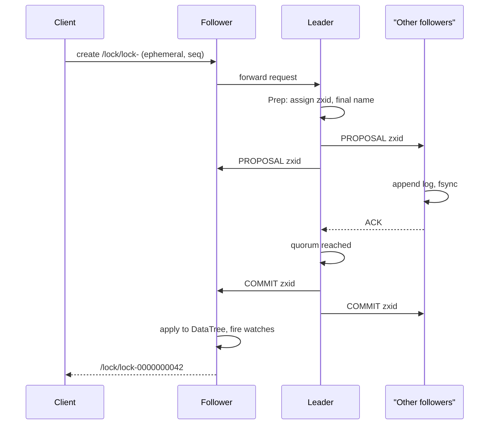

## In one minute
- ZooKeeper is a small, replicated, strongly ordered key-value tree for coordination: leader election, locks, group membership, configuration and fencing. It is not a database or a queue.
- Writes go through one leader and the ZAB atomic broadcast protocol, so every server applies the same writes in the same order. Reads are served locally by any server and can be slightly stale.
- Ephemeral znodes live only as long as the client's session, and sequential znodes get a monotonically increasing suffix. Together with watches, they build locks and elections without polling.
- A 3- or 5-server ensemble handles thousands to low tens of thousands of writes per second, bounded by `fsync` on the transaction log, and keeps the whole tree in memory.
- In interviews, name it for coordination metadata in the kilobytes to low gigabytes. For new systems, etcd is often the more common choice, and Kafka 4.0 dropped ZooKeeper entirely for KRaft. ZooKeeper itself is alive: 3.9 is the current line and 3.8 the stable one.

## How it works

### Znodes and the tree
Data lives in znodes addressed by slash-separated paths like `/services/payments/leader`. Each znode holds a small byte array (the default limit, `jute.maxbuffer`, is 1,048,575 bytes, just under 1 MiB, and must match on every server and client; real payloads should be far smaller) ([Administrator's Guide](https://zookeeper.apache.org/doc/current/zookeeperAdmin.html)) plus a `Stat`: creation and modification zxids, a data `version`, a child version `cversion`, `ephemeralOwner` (the session ID, or 0) and child count. Every write can be conditional on a version, which gives compare-and-set.

Node types: persistent, ephemeral (deleted when the creating session ends, and cannot have children), sequential (the server appends a 10-digit counter kept by the parent, such as `lock-0000000042`; it is a signed 32-bit int that wraps to a negative number after 2,147,483,647), container (deleted once its last child goes, since 3.5.3) and TTL, which is disabled by default and must be switched on with a system property ([Programmer's Guide](https://zookeeper.apache.org/doc/current/zookeeperProgrammers.html)).

### Sessions
A client gets a session with a timeout the server bounds by default to 2 to 20 times `tickTime`, so 4 to 40 s with the usual 2 s tick ([Administrator's Guide](https://zookeeper.apache.org/doc/current/zookeeperAdmin.html)). It pings when idle and can fail over to another server with the same session ID. If the leader hears nothing for the full timeout, it expires the session and deletes its ephemeral nodes. The client learns of expiry only when it reconnects, so "I hold the lock" is always a belief.

### Watches
A read can leave a one-shot watch: on change the server sends one notification, delivered before the client can see the new data, and the client must re-read and re-register. Since 3.6, persistent and recursive watches (`addWatch`) stay registered after firing and can cover a whole subtree ([Programmer's Guide](https://zookeeper.apache.org/doc/current/zookeeperProgrammers.html)).

### Recipes built on top
A lock: create `/lock/lock-` as ephemeral and sequential, list children, and if yours is lowest you hold it. Otherwise watch only the node just before yours. When it goes, re-check. Watching the predecessor instead of the parent means a release wakes one client, not all of them ([recipes](https://zookeeper.apache.org/doc/current/recipes.html)). Leader election is the same recipe with the lowest node as leader.

## Down the stack

### Layer 1: The contract
- **Linearizable writes.** All updates are totally ordered by zxid and applied in that order everywhere.
- **FIFO client order.** One client's requests take effect in the order it sent them, including asynchronous ones.
- **Reads are sequentially consistent, not linearizable.** A server answers from its own memory, which may trail the leader. Call `sync` before a read to make it reflect every write committed before the `sync` ([Programmer's Guide](https://zookeeper.apache.org/doc/current/zookeeperProgrammers.html)). Treat that as nearly, not strictly, linearizable: Jepsen later noted that sync plus read can still return stale data under some conditions ([Jepsen](https://aphyr.com/posts/291-call-me-maybe-zookeeper)).
- **Durability.** A write acknowledged to the client is on disk on a quorum (2 of 3, or 3 of 5).
- **Availability.** A majority must be up and connected to the leader. A 5-server ensemble survives 2 failures; a minority partition serves reads (with `readonlymode.enabled`) but no writes.

Write latency is a leader round trip plus a quorum `fsync`: a few ms on SSDs.

### Layer 2: The mechanism
**ZAB.** Each server is LOOKING, FOLLOWING, LEADING or OBSERVING. In `FastLeaderElection`, servers exchange votes of (epoch, last zxid, server ID) and converge on the server with the most recent history. The new leader then runs discovery (gathers followers' epochs and picks a higher one) and synchronisation: each follower is brought up to date with a `DIFF` (missing transactions), `TRUNC` (roll back uncommitted ones from a dead leader) or `SNAP` (full snapshot). Only then does broadcast begin ([Zab paper](https://marcoserafini.github.io/assets/pdf/zab.pdf)).

In broadcast, the leader gives each write a zxid: a 64-bit number with the epoch in the high 32 bits and a counter in the low 32. It sends `PROPOSAL` to followers, which append it to their log, `fsync`, and reply `ACK`. On a quorum of ACKs the leader sends `COMMIT`, and observers, which do not vote, receive `INFORM`. Proposals travel over one TCP connection per follower, so they arrive in order with no reordering logic.

**Request pipeline.** On the leader, `PrepRequestProcessor` validates a request and turns it into an idempotent transaction: a conditional `setData` becomes "set data to X with version 7", and a sequential create carries its final name. `SyncRequestProcessor` logs and batches `fsync`s, `CommitProcessor` waits for the quorum, and `FinalRequestProcessor` applies the change to the in-memory `DataTree` and fires watches.

**Transaction log and snapshots.** Transactions are appended to `log.<zxid>` files in `dataLogDir`, preallocated in 64 MB chunks (`preAllocSize`) so appends do not extend file metadata. After a random count between `snapCount`/2+1 and `snapCount` (100,000 by default) transactions, so servers do not snapshot together ([Administrator's Guide](https://zookeeper.apache.org/doc/current/zookeeperAdmin.html)), a background thread writes `snapshot.<zxid>`. The snapshot is fuzzy, taken while writes continue, which works because transactions are idempotent: on restart the server loads the snapshot and replays every log entry after its starting zxid. Old files are removed only if `autopurge.purgeInterval` is set: it defaults to 0, which means never, so an untouched install fills its disk.

**Sessions on the leader.** Expiry is tracked in buckets rounded to `tickTime`, so the leader checks one bucket per tick instead of every session. Expiry is itself a `closeSession` transaction through ZAB, so every server deletes the same ephemerals in the same order.

### Layer 3: The machine
The write path is bounded by `fsync` on the transaction log. Group commit amortises this, but a log on a disk shared with snapshots or application logs can see `fsync` stalls. Put `dataLogDir` on its own device and watch the `fsync` warning threshold (`fsync.warningthresholdms`, default 1,000 ms) ([Administrator's Guide](https://zookeeper.apache.org/doc/current/zookeeperAdmin.html)).

The whole tree lives in the JVM heap. A million small znodes with paths of about 50 bytes cost very roughly 0.5 to 1 GB of heap (hedge: depends on data and watches). Watches cost memory per watcher-path pair. A full GC pause longer than the session timeout makes clients look dead: sessions expire, ephemerals vanish, every waiter wakes and reconnects. Size heaps so that pauses stay well under `tickTime`, and use G1 or ZGC.

Reads scale with the number of servers; writes do not, because each goes to every voter. More voters make writes slower, which is why non-voting observers exist.

### Why it's built this way
1. Coordination needs one agreed order of events, and agreement over a network needs a quorum, so every write goes through a single leader and a majority.
2. Consensus is slow per operation, so the data model is tiny and in memory and reads skip consensus, trading freshness for throughput.
3. Majority writes must survive power loss, so each one is `fsync`ed to an append-only log, and logs grow, so fuzzy snapshots plus idempotent transactions bound recovery time.
4. Polling a coordination service from thousands of clients is expensive, so watches push changes and ephemerals turn liveness into data.
5. Watches that wake everyone cause herds, so recipes watch a single predecessor.

## Diagram


## Worked example
A batch platform runs 400 shards, each with 5 worker replicas competing to be shard leader, so 2,000 clients on a 5-server ensemble with a 10 s session timeout.

Steady state is about 650 pings per second across 5 servers and 2,000 znodes of under 100 bytes: trivial.

A naive recipe has every replica watch `/shards/17` itself. When the leader dies, 4 watchers fire and each re-lists children: fine for 5 replicas. Scale to 200 replicas competing for one global lock and every release triggers 200 notifications and 200 `getChildren` calls. Watching the predecessor makes each release cost one notification.

Failure: a 15 s GC pause on a leader replica exceeds its 10 s timeout. ZooKeeper expires the session, deletes the node, and the next replica takes over. The paused process wakes up still believing it is leader. The fix is a fencing token: the new leader's zxid or sequence number is passed to downstream storage, which rejects writes carrying a smaller token.

## In the wild
- **Jepsen, 2013: ZooKeeper passes, with footnotes.** Five nodes, five clients doing compare-and-set through Curator, and a partition that cut the leader and one follower off from the other three. Writes on the minority side blocked, a new leader was elected in about 15 seconds, and no acknowledged write was lost, a rare clean result. The same analysis warned that a linearizable coordinator does not make the system using it linearizable, and a 2019 update added that sync plus read can return stale data ([Jepsen](https://aphyr.com/posts/291-call-me-maybe-zookeeper)).
- **Apache Kafka, 2019 onward: why Kafka left ZooKeeper.** KIP-500 listed the costs of an external coordinator: the controller's in-memory state often disagreed with ZooKeeper, one-shot watches could miss changes and carry no state, a new controller had to reload everything from ZooKeeper before acting, and operators had to secure and tune a second system. The replacement keeps metadata in a Raft log inside Kafka, and 4.0 removed ZooKeeper mode ([KIP-500](https://cwiki.apache.org/confluence/display/KAFKA/KIP-500%3A+Replace+ZooKeeper+with+a+Self-Managed+Metadata+Quorum)).

## Trade-offs
| Option | Strengths | Weaknesses | Choose when |
|---|---|---|---|
| ZooKeeper | Mature, ephemeral and sequential nodes, watches, wide Hadoop ecosystem | JVM tuning, custom protocol, writes limited by one leader | Existing ZooKeeper-based stack (HBase, Solr, older Kafka) |
| etcd | Raft, gRPC API, leases, MVCC history with watch from revision | Default 2 GiB data limit (8 GiB suggested max), 1.5 MiB requests, same write ceiling | Kubernetes-adjacent or new Go services |
| Consul | Service discovery, health checks and KV in one | Weaker as a general lock service | Service discovery across datacenters |
| Built-in Raft (KRaft, Redpanda) | No extra cluster to run | Each system reimplements coordination | You own the storage system |
| Database row lock or lease | No new infrastructure | No push notifications, polling load | Low-scale leader election |

## Pitfalls in production
- **Treating it as storage.** Large znodes or millions of children slow snapshots, sync and restarts. Keep blobs elsewhere and store pointers.
- **No fencing.** A client whose session expired during a pause keeps acting as lock holder. Pass a monotonic token to the protected resource.
- **Herd effect.** Watching a parent with thousands of waiters creates notification storms. Watch the predecessor or use a mature library such as Apache Curator.
- **Slow disk for the log.** `fsync` stalls block every write and can cause followers to drop out. Use a dedicated SSD for `dataLogDir`.
- **Autopurge left off.** Snapshots and logs accumulate until the disk fills and the server stops. Set `autopurge.purgeInterval` and `autopurge.snapRetainCount`, and alert on disk use.
- **Even-sized ensembles.** Four servers tolerate one failure, the same as three, but need more votes per write. Use 3 or 5 voters and add observers for reads.
- **Ignoring connection loss.** A `ConnectionLoss` error on create does not mean the create failed. With sequential nodes, use the protected-create pattern (a GUID in the name) to find your node after reconnecting.

## Leadership lens
- Ask what the system needs: ordering, liveness detection, or just storage. Only the first two justify a coordination service.
- Count writes per second and data size in review; a design that needs more than about 10,000 coordination writes per second is using ZooKeeper as a database.
- Operating an ensemble means JVM tuning, disk alerts, rolling upgrades and quorum-aware maintenance. If Kubernetes already runs etcd, ask whether you need a second consensus system.
- Standardise on Curator rather than hand-written recipes; connection-loss edge cases are subtle.

## Check yourself
1. Why can a client read a value older than one it just wrote through a different server?
   **Answer:** Reads are served from the local server's memory without consensus, and that server may not have applied the commit yet. FIFO order holds only per session, so use `sync` first or keep the same server.
2. Why does the lock recipe watch the predecessor instead of the lock's parent?
   **Answer:** Watching the parent wakes every waiter on each release, a herd of notifications and reads. Watching the predecessor wakes exactly one waiter.
3. How can a ZooKeeper server take a snapshot while writes continue and still recover correctly?
   **Answer:** Transactions are idempotent, so replaying the log from the snapshot's starting zxid over a fuzzy snapshot produces the correct state even if some transactions are applied twice.
4. Why does a 4-server ensemble give no more fault tolerance than a 3-server one?
   **Answer:** A quorum of 4 is 3, so it still survives only one failure, while every write needs one more ACK.

## Practice
**Task:** Implement a ZooKeeper-style lock recipe over ephemeral sequential znodes under one parent. `request(session)` creates a child named `lock-` plus a 10-digit zero-padded counter from a per-parent counter that never repeats, and returns that name. The holder is the session owning the lowest-numbered child. Each non-lowest child watches only its immediate predecessor. `release(node)` deletes one node and `expire(session)` deletes every node that session owns; both return the sorted list of surviving nodes whose watched node was deleted (each then re-watches its new predecessor, or none if it is now lowest). `watched(node)` returns the predecessor a node is watching, or `None`/`null`/`""` in Go. `holder()` returns the holding session, or `None`/`null`/`""` when no nodes exist. Releasing an unknown node returns an empty list.

```python starter
class LockRecipe:
    def __init__(self):
        # TODO
        pass

    def request(self, session):
        raise NotImplementedError

    def holder(self):
        raise NotImplementedError

    def watched(self, node):
        raise NotImplementedError

    def release(self, node):
        raise NotImplementedError

    def expire(self, session):
        raise NotImplementedError
```

```python tests
def test_names_are_zero_padded_and_monotonic():
    z = LockRecipe()
    assert z.request("s1") == "lock-0000000000"
    assert z.request("s2") == "lock-0000000001"

def test_lowest_holds_and_others_watch_predecessor():
    z = LockRecipe()
    a, b, c = z.request("s1"), z.request("s2"), z.request("s3")
    assert z.holder() == "s1"
    assert z.watched(a) is None
    assert z.watched(b) == a and z.watched(c) == b

def test_release_wakes_only_successor():
    z = LockRecipe()
    a, b, c = z.request("s1"), z.request("s2"), z.request("s3")
    assert z.release(a) == [b], "no herd: only b is notified"
    assert z.holder() == "s2" and z.watched(b) is None and z.watched(c) == b

def test_middle_waiter_leaving_rewires_watch():
    z = LockRecipe()
    a, b, c = z.request("s1"), z.request("s2"), z.request("s3")
    assert z.expire("s2") == [c]
    assert z.holder() == "s1" and z.watched(c) == a

def test_holder_session_expiry_passes_lock():
    z = LockRecipe()
    z.request("s1")
    b = z.request("s2")
    z.expire("s1")
    assert z.holder() == "s2" and z.watched(b) is None

def test_counter_never_reuses_after_delete():
    z = LockRecipe()
    a = z.request("s1")
    z.release(a)
    assert z.holder() is None
    assert z.request("s1") == "lock-0000000001"

def test_expire_many_nodes_and_unknown_release():
    z = LockRecipe()
    a = z.request("s1")
    b = z.request("s2")
    c = z.request("s2")
    d = z.request("s3")
    assert z.expire("s2") == [d]
    assert z.watched(d) == a
    assert z.release("lock-0000000099") == []
```

```python solution
class LockRecipe:
    def __init__(self):
        self.counter = 0
        self.owner = {}      # node -> session
        self.watch = {}      # node -> watched node or None

    def _sorted(self):
        return sorted(self.owner)

    def _predecessor(self, node):
        nodes = self._sorted()
        i = nodes.index(node)
        return nodes[i - 1] if i > 0 else None

    def request(self, session):
        name = "lock-%010d" % self.counter
        self.counter += 1
        self.owner[name] = session
        self.watch[name] = self._predecessor(name)
        return name

    def holder(self):
        nodes = self._sorted()
        return self.owner[nodes[0]] if nodes else None

    def watched(self, node):
        return self.watch.get(node)

    def _delete(self, nodes):
        gone = set()
        for n in nodes:
            if n in self.owner:
                del self.owner[n]
                del self.watch[n]
                gone.add(n)
        notified = sorted(n for n, w in self.watch.items() if w in gone)
        for n in notified:
            self.watch[n] = self._predecessor(n)
        return notified

    def release(self, node):
        return self._delete([node])

    def expire(self, session):
        return self._delete([n for n, s in self.owner.items() if s == session])
```

```typescript starter
export class LockRecipe {
  request(session: string): string {
    throw new Error("TODO");
  }
  holder(): string | null {
    throw new Error("TODO");
  }
  watched(node: string): string | null {
    throw new Error("TODO");
  }
  release(node: string): string[] {
    throw new Error("TODO");
  }
  expire(session: string): string[] {
    throw new Error("TODO");
  }
}
```

```typescript tests
test("names are zero padded and monotonic", () => {
  const z = new LockRecipe();
  assertEqual(z.request("s1"), "lock-0000000000");
  assertEqual(z.request("s2"), "lock-0000000001");
});
test("lowest holds and others watch predecessor", () => {
  const z = new LockRecipe();
  const a = z.request("s1"), b = z.request("s2"), c = z.request("s3");
  assertEqual(z.holder(), "s1");
  assertEqual(z.watched(a), null);
  assertEqual([z.watched(b), z.watched(c)], [a, b]);
});
test("release wakes only successor", () => {
  const z = new LockRecipe();
  const a = z.request("s1"), b = z.request("s2"), c = z.request("s3");
  assertEqual(z.release(a), [b], "no herd: only b is notified");
  assertEqual([z.holder(), z.watched(b), z.watched(c)], ["s2", null, b]);
});
test("middle waiter leaving rewires watch", () => {
  const z = new LockRecipe();
  const a = z.request("s1"), b = z.request("s2"), c = z.request("s3");
  assertEqual(z.expire("s2"), [c]);
  assertEqual([z.holder(), z.watched(c)], ["s1", a]);
});
test("holder session expiry passes lock", () => {
  const z = new LockRecipe();
  z.request("s1");
  const b = z.request("s2");
  z.expire("s1");
  assertEqual([z.holder(), z.watched(b)], ["s2", null]);
});
test("counter never reuses after delete", () => {
  const z = new LockRecipe();
  const a = z.request("s1");
  z.release(a);
  assertEqual(z.holder(), null);
  assertEqual(z.request("s1"), "lock-0000000001");
});
test("expire many nodes and unknown release", () => {
  const z = new LockRecipe();
  const a = z.request("s1");
  z.request("s2");
  z.request("s2");
  const d = z.request("s3");
  assertEqual(z.expire("s2"), [d]);
  assertEqual(z.watched(d), a);
  assertEqual(z.release("lock-0000000099"), []);
});
```

```typescript solution
export class LockRecipe {
  private counter = 0;
  private owner = new Map<string, string>();
  private watch = new Map<string, string | null>();

  private sortedNodes(): string[] {
    return Array.from(this.owner.keys()).sort();
  }
  private predecessor(node: string): string | null {
    const nodes = this.sortedNodes();
    const i = nodes.indexOf(node);
    return i > 0 ? nodes[i - 1] : null;
  }
  request(session: string): string {
    const name = "lock-" + String(this.counter++).padStart(10, "0");
    this.owner.set(name, session);
    this.watch.set(name, this.predecessor(name));
    return name;
  }
  holder(): string | null {
    const nodes = this.sortedNodes();
    return nodes.length ? this.owner.get(nodes[0])! : null;
  }
  watched(node: string): string | null {
    const w = this.watch.get(node);
    return w === undefined ? null : w;
  }
  private remove(nodes: string[]): string[] {
    const gone = new Set<string>();
    for (const n of nodes) {
      if (this.owner.has(n)) {
        this.owner.delete(n);
        this.watch.delete(n);
        gone.add(n);
      }
    }
    const notified: string[] = [];
    this.watch.forEach((w, n) => {
      if (w !== null && gone.has(w)) notified.push(n);
    });
    notified.sort();
    for (const n of notified) this.watch.set(n, this.predecessor(n));
    return notified;
  }
  release(node: string): string[] {
    return this.remove([node]);
  }
  expire(session: string): string[] {
    const mine: string[] = [];
    this.owner.forEach((s, n) => {
      if (s === session) mine.push(n);
    });
    return this.remove(mine);
  }
}
```

```go starter
package practice

type LockRecipe struct{}

func NewLockRecipe() *LockRecipe { return &LockRecipe{} }

func (z *LockRecipe) Request(session string) string { panic("TODO") }

// Holder returns the holding session, or "" if no nodes exist.
func (z *LockRecipe) Holder() string { panic("TODO") }

// Watched returns the predecessor a node watches, or "".
func (z *LockRecipe) Watched(node string) string { panic("TODO") }

func (z *LockRecipe) Release(node string) []string { panic("TODO") }

func (z *LockRecipe) Expire(session string) []string { panic("TODO") }
```

```go tests
package practice

import (
	"reflect"
	"testing"
)

func TestNamesZeroPaddedMonotonic(t *testing.T) {
	z := NewLockRecipe()
	if got := z.Request("s1"); got != "lock-0000000000" {
		t.Fatalf("got %q", got)
	}
	if got := z.Request("s2"); got != "lock-0000000001" {
		t.Fatalf("got %q", got)
	}
}

func TestLowestHoldsOthersWatchPredecessor(t *testing.T) {
	z := NewLockRecipe()
	a, b, c := z.Request("s1"), z.Request("s2"), z.Request("s3")
	if z.Holder() != "s1" || z.Watched(a) != "" || z.Watched(b) != a || z.Watched(c) != b {
		t.Fatal("wrong holder or watches")
	}
}

func TestReleaseWakesOnlySuccessor(t *testing.T) {
	z := NewLockRecipe()
	a, b, c := z.Request("s1"), z.Request("s2"), z.Request("s3")
	if got := z.Release(a); !reflect.DeepEqual(got, []string{b}) {
		t.Fatalf("no herd: got %v", got)
	}
	if z.Holder() != "s2" || z.Watched(b) != "" || z.Watched(c) != b {
		t.Fatal("wrong state after release")
	}
}

func TestMiddleWaiterLeavingRewiresWatch(t *testing.T) {
	z := NewLockRecipe()
	a, _, c := z.Request("s1"), z.Request("s2"), z.Request("s3")
	if got := z.Expire("s2"); !reflect.DeepEqual(got, []string{c}) {
		t.Fatalf("got %v", got)
	}
	if z.Holder() != "s1" || z.Watched(c) != a {
		t.Fatal("c should now watch a")
	}
}

func TestHolderExpiryPassesLock(t *testing.T) {
	z := NewLockRecipe()
	z.Request("s1")
	b := z.Request("s2")
	z.Expire("s1")
	if z.Holder() != "s2" || z.Watched(b) != "" {
		t.Fatal("lock should pass to s2")
	}
}

func TestCounterNeverReuses(t *testing.T) {
	z := NewLockRecipe()
	a := z.Request("s1")
	z.Release(a)
	if z.Holder() != "" {
		t.Fatal("expected no holder")
	}
	if got := z.Request("s1"); got != "lock-0000000001" {
		t.Fatalf("got %q", got)
	}
}

func TestExpireManyAndUnknownRelease(t *testing.T) {
	z := NewLockRecipe()
	a := z.Request("s1")
	z.Request("s2")
	z.Request("s2")
	d := z.Request("s3")
	if got := z.Expire("s2"); !reflect.DeepEqual(got, []string{d}) {
		t.Fatalf("got %v", got)
	}
	if z.Watched(d) != a {
		t.Fatal("d should watch a")
	}
	if got := z.Release("lock-0000000099"); len(got) != 0 {
		t.Fatalf("got %v", got)
	}
}
```

```go solution
package practice

import (
	"fmt"
	"sort"
	"sync"
)

type LockRecipe struct {
	mu      sync.Mutex
	counter int
	owner   map[string]string // node -> session
	watch   map[string]string // node -> watched node ("" if none)
}

func NewLockRecipe() *LockRecipe {
	return &LockRecipe{owner: map[string]string{}, watch: map[string]string{}}
}

func (z *LockRecipe) sorted() []string {
	nodes := make([]string, 0, len(z.owner))
	for n := range z.owner {
		nodes = append(nodes, n)
	}
	sort.Strings(nodes)
	return nodes
}

func (z *LockRecipe) predecessor(node string) string {
	nodes := z.sorted()
	i := sort.SearchStrings(nodes, node)
	if i > 0 {
		return nodes[i-1]
	}
	return ""
}

func (z *LockRecipe) Request(session string) string {
	z.mu.Lock()
	defer z.mu.Unlock()
	name := fmt.Sprintf("lock-%010d", z.counter)
	z.counter++
	z.owner[name] = session
	z.watch[name] = z.predecessor(name)
	return name
}

// Holder returns the holding session, or "" if no nodes exist.
func (z *LockRecipe) Holder() string {
	z.mu.Lock()
	defer z.mu.Unlock()
	nodes := z.sorted()
	if len(nodes) == 0 {
		return ""
	}
	return z.owner[nodes[0]]
}

// Watched returns the predecessor a node watches, or "".
func (z *LockRecipe) Watched(node string) string {
	z.mu.Lock()
	defer z.mu.Unlock()
	return z.watch[node]
}

func (z *LockRecipe) remove(nodes []string) []string {
	gone := map[string]bool{}
	for _, n := range nodes {
		if _, ok := z.owner[n]; ok {
			delete(z.owner, n)
			delete(z.watch, n)
			gone[n] = true
		}
	}
	notified := []string{}
	for n, w := range z.watch {
		if w != "" && gone[w] {
			notified = append(notified, n)
		}
	}
	sort.Strings(notified)
	for _, n := range notified {
		z.watch[n] = z.predecessor(n)
	}
	return notified
}

func (z *LockRecipe) Release(node string) []string {
	z.mu.Lock()
	defer z.mu.Unlock()
	return z.remove([]string{node})
}

func (z *LockRecipe) Expire(session string) []string {
	z.mu.Lock()
	defer z.mu.Unlock()
	mine := []string{}
	for n, s := range z.owner {
		if s == session {
			mine = append(mine, n)
		}
	}
	return z.remove(mine)
}
```

## Mock interview
**Prompt:** Design leader election and a distributed lock for a job scheduler with 300 partitions, each owned by exactly one of 50 scheduler instances, using ZooKeeper. A partition must never run the same job twice concurrently, and failover should complete within 15 seconds.

- Follow-up: walk through what happens, message by message, when the leader of partition 17 is killed with `kill -9`.
- Follow-up: the old leader was in a 20 second GC pause, not dead. What stops it from running a job after it wakes?
- Follow-up: would you use etcd or a database lease instead? What changes?

**A strong answer covers:**
- Ephemeral sequential nodes per partition, watching the predecessor, and a session timeout around 6 to 10 s so detection plus election fits the 15 s budget.
- Session expiry as a ZAB `closeSession` transaction, then the next node's watch firing and its `getChildren` re-check.
- Fencing tokens (the znode's sequence number or czxid) checked by the job store, because ZooKeeper alone cannot stop a paused process.
- Handling `ConnectionLoss` versus `SessionExpired`: the first may recover, the second means stop work immediately.
- Load arithmetic: 300 elections and 50 sessions is tiny for a 3-server ensemble.
- etcd leases with revision-based fencing as an equivalent design, and a database lease as a simpler choice at this scale.

## Sources and further study
**Primary**
- [Zab: High-performance broadcast for primary-backup systems (DSN 2011)](https://marcoserafini.github.io/assets/pdf/zab.pdf): the atomic broadcast protocol, its phases and why it orders by primary epoch.
- [The Chubby lock service (OSDI 2006)](https://static.googleusercontent.com/media/research.google.com/en//archive/chubby-osdi06.pdf): Google's coarse-grained lock service, the design ZooKeeper reacted against, including sequencers for fencing.

**Systems docs**
- [Apache Curator recipes](https://curator.apache.org/docs/recipes): production implementations of locks, leader latches and elections that handle connection loss.
- [etcd system limits](https://etcd.io/docs/v3.6/dev-guide/limit/): the request and storage limits of the main alternative.
- [ZooKeeper releases](https://zookeeper.apache.org/releases.html): which lines are current, stable and end of life.

**Books**
- *Understanding Distributed Systems*, 2nd ed., Vitillo, Ch 9 "Leader election" (Raft-style election and leases).
- *Designing Distributed Systems*, 2nd ed., Burns, Ch 10 "Ownership Election" (whether you need election at all, and handling concurrent data manipulation).
- *Designing Data-Intensive Applications*, 2nd ed., Kleppmann and Riccomini, Ch 10 "Consistency and Consensus" (Linearizability; Consensus).

**Other curricula**
- [Azure Architecture Center: Leader Election pattern](https://learn.microsoft.com/en-us/azure/architecture/patterns/leader-election): frames election as a coordination pattern with leases, failure detection and split-brain risk.
- [MIT 6.5840 lecture notes: ZooKeeper](https://pdos.csail.mit.edu/6.824/notes/l-zookeeper.txt): reads ZooKeeper as a case study in relaxing read consistency to scale reads.
- [Martin Kleppmann: How to do distributed locking](https://martin.kleppmann.com/2016/02/08/how-to-do-distributed-locking.html): argues that locks need fencing tokens, citing ZooKeeper's zxid or znode version.

## Watch
- [Lecture 8: Zookeeper (MIT 6.824)](https://www.youtube.com/watch?v=pbmyrNjzdDk): Robert Morris on the ZooKeeper paper, its consistency guarantees and why reads skip consensus.
- [ZooKeeper: Because Distributed Computing is a Zoo (Benjamin Reed)](https://www.youtube.com/watch?v=rXI9xiesUV8): one of ZooKeeper's creators on the design and its recipes.

## Free resources
- [ZooKeeper: Wait-free coordination for Internet-scale systems](https://www.usenix.org/legacy/event/atc10/tech/full_papers/Hunt.pdf): the original USENIX ATC 2010 paper with the guarantees, recipes and benchmarks.
- [ZooKeeper Programmer's Guide](https://zookeeper.apache.org/doc/current/zookeeperProgrammers.html): znode types, `Stat` fields, sessions, watches and consistency guarantees.
- [ZooKeeper Recipes and Solutions](https://zookeeper.apache.org/doc/current/recipes.html): the official lock, barrier, queue and election recipes, including herd avoidance.
- [ZooKeeper Internals](https://zookeeper.apache.org/doc/current/zookeeperInternals.html): ZAB guarantees, zxids, leader activation and the quorum model.
- [ZooKeeper Administrator's Guide](https://zookeeper.apache.org/doc/current/zookeeperAdmin.html): `tickTime`, `snapCount`, `preAllocSize`, disk layout and the operational settings that matter.
